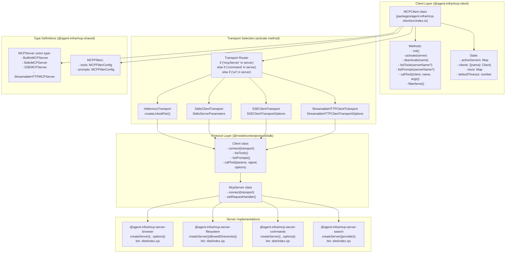
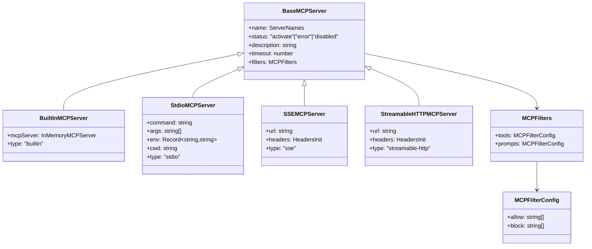
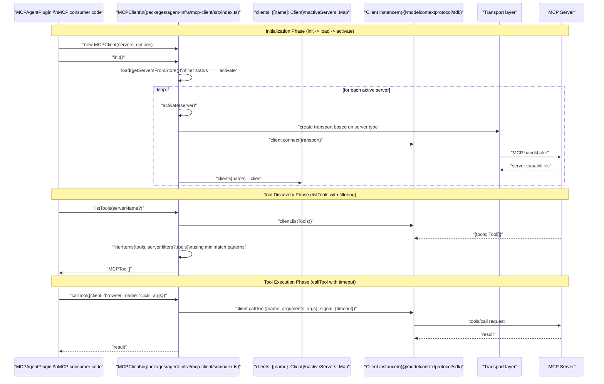

<!-- source: DeepWiki mcp.deepwiki.com · repo bytedance/UI-TARS-desktop · page 6.1 Model Context Protocol (MCP) System · fetched 2026-10-30 -->

# Model Context Protocol (MCP) System

Relevant source files

The following files were used as context for generating this wiki page:

- [packages/agent-infra/mcp-client/CHANGELOG.md](packages/agent-infra/mcp-client/CHANGELOG.md)
- [packages/agent-infra/mcp-client/README.md](packages/agent-infra/mcp-client/README.md)
- [packages/agent-infra/mcp-client/package.json](packages/agent-infra/mcp-client/package.json)
- [packages/agent-infra/mcp-client/src/index.ts](packages/agent-infra/mcp-client/src/index.ts)
- [packages/agent-infra/mcp-client/test/index.test.ts](packages/agent-infra/mcp-client/test/index.test.ts)
- [packages/agent-infra/mcp-servers/browser/CHANGELOG.md](packages/agent-infra/mcp-servers/browser/CHANGELOG.md)
- [packages/agent-infra/mcp-servers/browser/package.json](packages/agent-infra/mcp-servers/browser/package.json)
- [packages/agent-infra/mcp-servers/commands/CHANGELOG.md](packages/agent-infra/mcp-servers/commands/CHANGELOG.md)
- [packages/agent-infra/mcp-servers/commands/package.json](packages/agent-infra/mcp-servers/commands/package.json)
- [packages/agent-infra/mcp-servers/filesystem/CHANGELOG.md](packages/agent-infra/mcp-servers/filesystem/CHANGELOG.md)
- [packages/agent-infra/mcp-servers/filesystem/package.json](packages/agent-infra/mcp-servers/filesystem/package.json)
- [packages/agent-infra/mcp-servers/search/CHANGELOG.md](packages/agent-infra/mcp-servers/search/CHANGELOG.md)
- [packages/agent-infra/mcp-servers/search/package.json](packages/agent-infra/mcp-servers/search/package.json)
- [packages/agent-infra/mcp-shared/CHANGELOG.md](packages/agent-infra/mcp-shared/CHANGELOG.md)
- [packages/agent-infra/mcp-shared/package.json](packages/agent-infra/mcp-shared/package.json)
- [packages/agent-infra/mcp-shared/src/client/types.ts](packages/agent-infra/mcp-shared/src/client/types.ts)

## Purpose and Scope

This document provides an overview of the Model Context Protocol (MCP) infrastructure within UI-TARS/Agent TARS. MCP is a standardized protocol for exposing tools and capabilities to AI agents through a server-client architecture. This section covers the overall MCP ecosystem, its architecture, and how it integrates with the agent system.

For detailed information about specific components:
- [MCP Client Architecture](#6.1.1) — Document `MCPClient` class, server management, tool listing, tool invocation, and filtering system.
- [MCP Server Implementations](#6.1.2) — Detail built-in MCP servers: browser, filesystem, commands, search, and their capabilities.
- [MCP Transport Layer and Communication Protocol](#6.1.3) — Explain transport types (stdio, SSE, streamable HTTP, in-memory), connection management, and protocol flow.

For information about how agents consume MCP tools:
- [MCP Agent Integration](#3.5) — Explain how the MCP Agent integrates Model Context Protocol servers for external tool access.
- [Agent Mode Configuration and Tool Call Engines](#3.6) — Document agent modes and how they control `ToolCallEngineProvider` selection.

## Overview of MCP

The Model Context Protocol (MCP) is a standardized protocol that enables AI agents to discover and execute external tools in a consistent manner. Rather than hardcoding tool implementations directly into agent code, MCP servers expose capabilities (browser automation, file operations, shell commands, web search) through a common interface defined by `@modelcontextprotocol/sdk`.

This architecture provides several benefits:
- **Extensibility**: New tools can be added by implementing new MCP servers without modifying core agent code.
- **Standardization**: All tools follow the same discovery and invocation patterns.
- **Isolation**: Tool implementations run in separate processes/servers with defined boundaries.
- **Reusability**: MCP servers can be used by any MCP-compatible client.

Sources: [packages/agent-infra/mcp-servers/browser/package.json:4-6](), [packages/agent-infra/mcp-client/package.json:2-4]()

## MCP Architecture Components

**Figure 1: MCP System Architecture — Client, Servers, and Transport Layer**

The MCP system is organized into four layers:

1.  **Client Layer**: The `MCPClient` class manages server lifecycle, tool discovery, and execution via methods like `init()`, `activate()`, and `callTool()`.
2.  **Transport Selection**: The `activate()` method inspects server configuration to select the appropriate transport (`InMemoryTransport`, `StdioClientTransport`, `SSEClientTransport`, or `StreamableHTTPClientTransport`).
3.  **Protocol Layer**: The `@modelcontextprotocol/sdk` provides the `Client` and `McpServer` classes that implement the MCP protocol.
4.  **Server Implementations**: Four built-in MCP servers expose browser automation, filesystem operations, shell commands, and web search capabilities.

Sources: [packages/agent-infra/mcp-client/src/index.ts:48-78](), [packages/agent-infra/mcp-client/src/index.ts:212-313](), [packages/agent-infra/mcp-shared/src/client/types.ts:17-57](), [packages/agent-infra/mcp-servers/browser/package.json:1-56](), [packages/agent-infra/mcp-servers/filesystem/package.json:1-57]()

## Package Organization

| Package | Version | Description | Key Features |
| :--- | :--- | :--- | :--- |
| `@agent-infra/mcp-server-browser` | 1.2.29 | Browser automation via Puppeteer | Vision mode, screenshot capture, navigation, evaluate JS |
| `@agent-infra/mcp-server-filesystem` | 1.2.29 | File system operations | Read, write, list, delete, glob patterns, diff |
| `@agent-infra/mcp-server-commands` | 1.2.29 | Shell command execution | Execute arbitrary commands with cwd support |
| `@agent-infra/mcp-server-search` | 1.2.29 | Web search across providers | Bing, Tavily, DuckDuckGo, Browser, SearXNG |
| `@agent-infra/mcp-client` | 1.2.29 | MCP client implementation | Connection management, tool discovery, filtering |
| `@agent-infra/mcp-shared` | 1.2.29 | Shared utilities | Zod schemas, common types |
| `@modelcontextprotocol/sdk` | ~1.15.1 | Core MCP protocol | External dependency, protocol specification |
| `mcp-http-server` | workspace | HTTP/SSE transport | Express server, streaming support |

Each MCP server package defines an `mcpName` field in its `package.json` that serves as a unique identifier in the MCP registry (e.g., `io.github.bytedance/mcp-server-browser`).

Sources: [packages/agent-infra/mcp-servers/browser/package.json:2-4](), [packages/agent-infra/mcp-servers/filesystem/package.json:2-4](), [packages/agent-infra/mcp-servers/commands/package.json:2-4](), [packages/agent-infra/mcp-servers/search/package.json:2-4](), [packages/agent-infra/mcp-client/package.json:2-4](), [packages/agent-infra/mcp-shared/package.json:2-4]()

## MCPServer Type Hierarchy

The `MCPServer` union type in `@agent-infra/mcp-shared` defines the supported connection modes.

**Figure 2: `MCPServer` Type Hierarchy — `mcp-shared/src/client/types.ts`**

The `MCPClient` class inspects the server config at runtime to select the appropriate transport:
- `'mcpServer' in server` → `InMemoryTransport` (builtin, same-process)
- `'command' in server` → `StdioClientTransport` (subprocess via stdio)
- `'url' in server` with `type === 'sse'` → `SSEClientTransport`
- `'url' in server` with `type === 'streamable-http'` → `StreamableHTTPClientTransport`

Sources: [packages/agent-infra/mcp-shared/src/client/types.ts:1-57](), [packages/agent-infra/mcp-client/src/index.ts:212-313]()

## MCP Server Capabilities

Each MCP server exposes a set of tools that the `MCPClient` discovers dynamically.

| Server Package | Binary | Notable Tools |
| :--- | :--- | :--- |
| `@agent-infra/mcp-server-browser` | `mcp-server-browser` | `browser_navigate`, `browser_click`, `browser_screenshot`, `browser_vision_screen_capture`, `browser_get_markdown` |
| `@agent-infra/mcp-server-filesystem` | `mcp-server-filesystem` | `read_file`, `write_file`, `list_directory`, `search_files` |
| `@agent-infra/mcp-server-commands` | `mcp-server-commands` | Shell command execution with configurable `cwd` |
| `@agent-infra/mcp-server-search` | `mcp-server-search` | Web search via Bing, Tavily, DuckDuckGo, etc. |

Sources: [packages/agent-infra/mcp-servers/browser/package.json:15-17](), [packages/agent-infra/mcp-servers/filesystem/package.json:24-26](), [packages/agent-infra/mcp-servers/commands/package.json:16-18](), [packages/agent-infra/mcp-servers/search/package.json:16-18](), [packages/agent-infra/mcp-client/src/index.ts:499-568]()

## Protocol Communication Flow

**Figure 3: `MCPClient` Execution Flow — Initialization, Discovery, and Tool Calls**

The protocol communication flow consists of three distinct phases:

1.  **Initialization** ([packages/agent-infra/mcp-client/src/index.ts:115-140]()): The `init()` method calls `load()`, which iterates through servers with `status === 'activate'` and calls `activate()` for each.
2.  **Tool Discovery** ([packages/agent-infra/mcp-client/src/index.ts:499-568]()): The `listTools()` method retrieves tools, enriches them with unique IDs, and applies glob pattern matching via `minimatch` based on `server.filters?.tools`.
3.  **Tool Execution** ([packages/agent-infra/mcp-client/src/index.ts:640-675]()): The `callTool()` method retrieves the server-specific or default timeout and forwards the call to the SDK.

Sources: [packages/agent-infra/mcp-client/src/index.ts:115-140](), [packages/agent-infra/mcp-client/src/index.ts:212-313](), [packages/agent-infra/mcp-client/src/index.ts:499-568](), [packages/agent-infra/mcp-client/src/index.ts:640-675]()

## Transport Layer and Server Execution Modes

The `MCPClient.activate()` method ([packages/agent-infra/mcp-client/src/index.ts:212-313]()) selects the appropriate transport based on the server configuration.

### StdioClientTransport PATH Augmentation

When spawning stdio-based servers, the `activate()` method calls `getEnhancedPath()` ([packages/agent-infra/mcp-client/src/index.ts:151-210]()) to augment the child process `PATH`. This ensures that tools like `nvm`, `npm`, and `cargo` are available in the Electron environment.

### Platform-Specific Command Adjustments

On Windows, the `activate()` method applies platform-specific transformations such as `npx` → `npx.cmd` and `node` → `node.exe`.

Sources: [packages/agent-infra/mcp-client/src/index.ts:212-313](), [packages/agent-infra/mcp-client/src/index.ts:151-210](), [packages/agent-infra/mcp-shared/src/client/types.ts:17-57]()

## Configuration and Filtering System

### Filtering System with Glob Patterns

The `MCPFilters` interface supports filtering both tools and prompts. The `filterItems()` private method ([packages/agent-infra/mcp-client/src/index.ts:85-109]()) applies filtering using the `minimatch` library:

1.  **Allow-list phase**: Only items matching at least one `allow` pattern are retained.
2.  **Block-list phase**: Items matching any `block` pattern are removed.

Sources: [packages/agent-infra/mcp-client/src/index.ts:85-109](), [packages/agent-infra/mcp-shared/src/client/types.ts:7-25]()

## Build and Distribution

All MCP server packages are distributed as both CommonJS and ES modules. Build scripts use `@rslib/core` and ensure binaries are executable via `shx chmod +x`.

Sources: [packages/agent-infra/mcp-servers/browser/package.json:15-34](), [packages/agent-infra/mcp-servers/filesystem/package.json:24-35](), [packages/agent-infra/mcp-servers/commands/package.json:16-38](), [packages/agent-infra/mcp-servers/search/package.json:16-29]()

---

