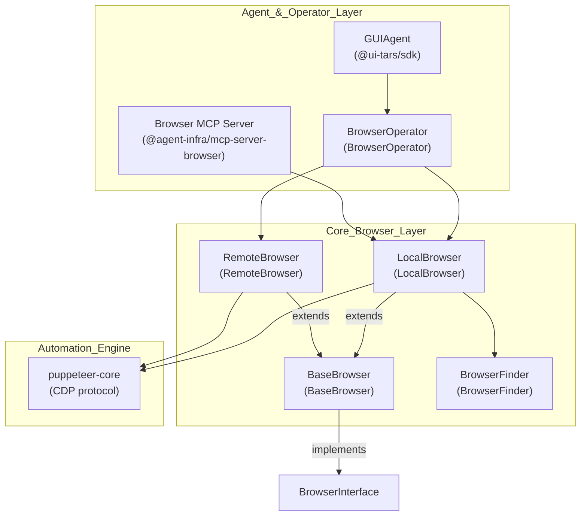
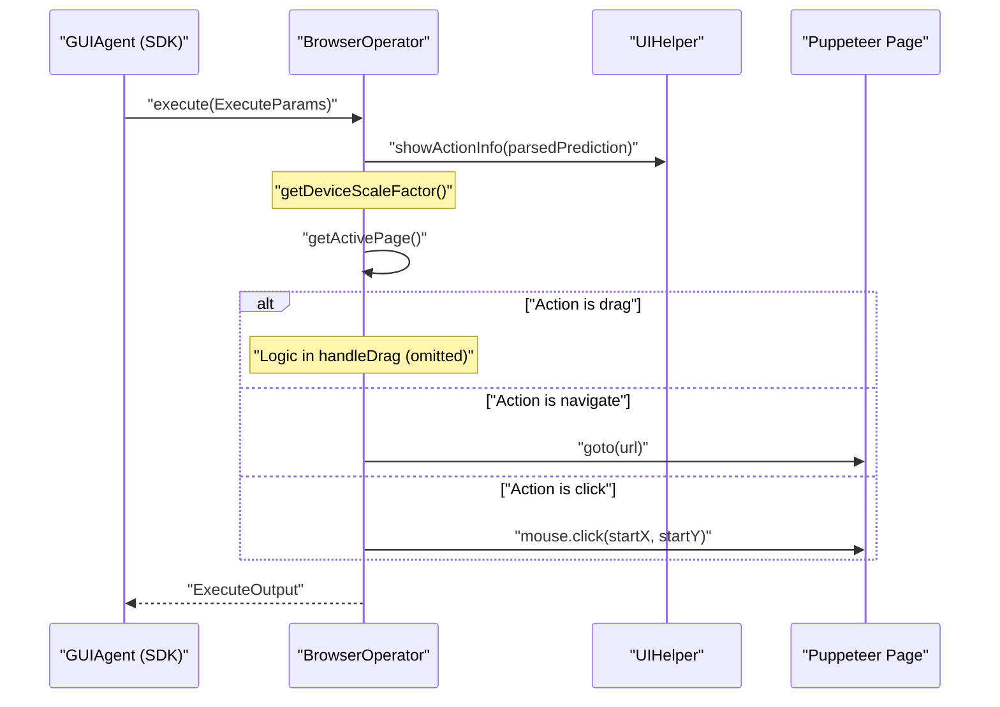

<!-- source: DeepWiki mcp.deepwiki.com · repo bytedance/UI-TARS-desktop · page 6.2 Browser Automation Infrastructure · fetched 2026-10-30 -->

# Browser Automation Infrastructure

Relevant source files

The following files were used as context for generating this wiki page:

- [.commitlintrc.cjs](.commitlintrc.cjs)
- [packages/agent-infra/browser-use/src/agent/actions/schemas.ts](packages/agent-infra/browser-use/src/agent/actions/schemas.ts)
- [packages/agent-infra/browser-use/src/agent/messages/service.ts](packages/agent-infra/browser-use/src/agent/messages/service.ts)
- [packages/agent-infra/browser-use/src/agent/prompts/navigator.ts](packages/agent-infra/browser-use/src/agent/prompts/navigator.ts)
- [packages/agent-infra/browser-use/src/browser/page.ts](packages/agent-infra/browser-use/src/browser/page.ts)
- [packages/agent-infra/browser-use/src/browser/types.ts](packages/agent-infra/browser-use/src/browser/types.ts)
- [packages/agent-infra/browser-use/src/browser/utils.ts](packages/agent-infra/browser-use/src/browser/utils.ts)
- [packages/agent-infra/browser-use/src/index.ts](packages/agent-infra/browser-use/src/index.ts)
- [packages/agent-infra/browser/package.json](packages/agent-infra/browser/package.json)
- [packages/agent-infra/browser/src/base-browser.ts](packages/agent-infra/browser/src/base-browser.ts)
- [packages/agent-infra/browser/src/browser-finder/chrome-paths.ts](packages/agent-infra/browser/src/browser-finder/chrome-paths.ts)
- [packages/agent-infra/browser/src/browser-finder/firefox-paths.ts](packages/agent-infra/browser/src/browser-finder/firefox-paths.ts)
- [packages/agent-infra/browser/src/browser-finder/index.test.ts](packages/agent-infra/browser/src/browser-finder/index.test.ts)
- [packages/agent-infra/browser/src/browser-finder/index.ts](packages/agent-infra/browser/src/browser-finder/index.ts)
- [packages/agent-infra/browser/src/local-browser.ts](packages/agent-infra/browser/src/local-browser.ts)
- [packages/agent-infra/browser/src/remote-browser.ts](packages/agent-infra/browser/src/remote-browser.ts)
- [packages/agent-infra/browser/src/types.ts](packages/agent-infra/browser/src/types.ts)
- [packages/agent-infra/mcp-servers/browser/README.md](packages/agent-infra/mcp-servers/browser/README.md)
- [packages/agent-infra/mcp-servers/filesystem/README.md](packages/agent-infra/mcp-servers/filesystem/README.md)
- [packages/ui-tars/operators/browser-operator/examples/default.ts](packages/ui-tars/operators/browser-operator/examples/default.ts)
- [packages/ui-tars/operators/browser-operator/src/browser-operator.ts](packages/ui-tars/operators/browser-operator/src/browser-operator.ts)
- [packages/ui-tars/operators/browser-operator/src/key-map.ts](packages/ui-tars/operators/browser-operator/src/key-map.ts)
- [packages/ui-tars/operators/browser-operator/src/shortcuts.ts](packages/ui-tars/operators/browser-operator/src/shortcuts.ts)
- [packages/ui-tars/operators/browser-operator/src/types.ts](packages/ui-tars/operators/browser-operator/src/types.ts)

## Purpose and Scope

This document describes the browser automation infrastructure layer in the UI-TARS Desktop repository. This infrastructure provides programmatic browser control capabilities used by GUI agents for web-based task automation. The system consists of core browser control (`@agent-infra/browser`), specialized operators for the UI-TARS SDK (`@ui-tars/operator-browser`), and a browser-use integration for AI-driven DOM interaction via the Model Context Protocol (MCP).

## Architecture Overview

The browser automation infrastructure is organized into distinct layers, ranging from low-level Puppeteer wrappers to high-level AI operators. It provides a unified interface for both local and remote browser instances.

### System Components to Code Entities

The following diagram maps high-level automation concepts to the specific classes and packages that implement them.

**Sources:**
- [packages/agent-infra/browser/src/base-browser.ts:30-35]()
- [packages/agent-infra/browser/src/local-browser.ts:16-16]()
- [packages/ui-tars/operators/browser-operator/src/browser-operator.ts:32-33]()
- [packages/agent-infra/browser/src/types.ts:148-185]()
- [packages/ui-tars/operators/browser-operator/examples/default.ts:7-36]()

## Core Browser Package (`@agent-infra/browser`)

The `@agent-infra/browser` package provides a unified `BrowserInterface` [packages/agent-infra/browser/src/types.ts:148-185]() for controlling browser instances. It abstracts the complexities of launching different browser types and managing page lifecycles.

### Browser Discovery and Launching

The `LocalBrowser` class handles the lifecycle of locally installed browsers. It utilizes `BrowserFinder` to automatically locate Chrome, Edge, or Firefox executables if no `executablePath` is provided [packages/agent-infra/browser/src/local-browser.ts:117-121](). The discovery logic for Chrome is implemented in `chrome-paths.ts`, which avoids time-consuming operations like `lsregister` on macOS by checking common installation paths [packages/agent-infra/browser/src/browser-finder/chrome-paths.ts:13-16]().

**Key Launch Configurations:**
- **Viewport:** Defaults to 1280x800 [packages/agent-infra/browser/src/local-browser.ts:28-29]().
- **Stealth:** Disables `AutomationControlled` features and infobars to reduce bot detection [packages/agent-infra/browser/src/local-browser.ts:50-51]().
- **Security:** Optionally disables web security (CORS) and site isolation (`--disable-features=IsolateOrigins,site-per-process`) for easier automation [packages/agent-infra/browser/src/local-browser.ts:59-61]().
- **Device Scale Factor:** Set to 0 by default in Puppeteer options to resolve screenshot blinking issues when combined with `captureBeyondViewport: false` [packages/agent-infra/browser/src/local-browser.ts:41-42]().

### Browser Implementation Hierarchy

| Class | Responsibility | Key Methods |
|-------|----------------|-------------|
| `BaseBrowser` | Abstract base providing page event listeners and evaluation logic [packages/agent-infra/browser/src/base-browser.ts:30-56]() | `evaluateOnNewPage`, `setupPageListener`, `getActivePage` |
| `LocalBrowser` | Launches local processes using `puppeteer.launch` [packages/agent-infra/browser/src/local-browser.ts:16-104]() | `launch`, `getBrowserInfo` |
| `RemoteBrowser` | Connects to existing instances via CDP WebSocket endpoints [packages/agent-infra/browser/src/remote-browser.ts:39-83]() | `launch` (connects via `wsEndpoint` or `cdpEndpoint`) |

**Sources:**
- [packages/agent-infra/browser/src/base-browser.ts:30-151]()
- [packages/agent-infra/browser/src/local-browser.ts:24-104]()
- [packages/agent-infra/browser/src/remote-browser.ts:55-83]()
- [packages/agent-infra/browser/src/browser-finder/index.ts:13-61]()
- [packages/agent-infra/browser/src/browser-finder/chrome-paths.ts:109-177]()

## Browser Operator Layer

The `BrowserOperator` extends the base `Operator` class from the UI-TARS SDK to bridge the gap between VLM-predicted actions and browser execution.

### Action Execution Flow

When the agent predicts an action (e.g., `drag`, `navigate`, `click`), the `BrowserOperator.execute` method translates these into Puppeteer commands.

**Sources:**
- [packages/ui-tars/operators/browser-operator/src/browser-operator.ts:189-214]()
- [packages/ui-tars/operators/browser-operator/src/browser-operator.ts:82-91]()
- [packages/ui-tars/operators/browser-operator/examples/default.ts:30-55]()

### Visual Feedback and Highlighting

The `UIHelper` class provides visual cues within the browser to assist the VLM and the user:
- **Clickable Highlighting:** If `highlightClickableElements` is enabled, the operator triggers `uiHelper.highlightClickableElements()` before taking a screenshot [packages/ui-tars/operators/browser-operator/src/browser-operator.ts:128-130]().
- **Water Flow Effect:** A visual animation overlay that indicates the agent is currently capturing or processing, triggered via `uiHelper.showWaterFlow()` [packages/ui-tars/operators/browser-operator/src/browser-operator.ts:116-118]().
- **Action Info:** Displays a temporary overlay showing the predicted action being performed [packages/ui-tars/operators/browser-operator/src/browser-operator.ts:195-197]().

**Sources:**
- [packages/ui-tars/operators/browser-operator/src/browser-operator.ts:39-45]()
- [packages/ui-tars/operators/browser-operator/src/browser-operator.ts:113-134]()

## Browser MCP Server Integration

The infrastructure includes a dedicated Model Context Protocol (MCP) server (`@agent-infra/mcp-server-browser`) that empowers LLMs with browser automation capabilities.

### Key Features
- **Structured Data Focus:** Utilizes Puppeteer's label index and accessibility DOM tree rather than purely pixel-based input, reducing token usage [packages/agent-infra/mcp-servers/browser/README.md:14-16]().
- **Vision Mode Support:** Optional visual understanding for complex layouts when structured data is insufficient [packages/agent-infra/mcp-servers/browser/README.md:15-15]().
- **Flexible Runtime Configuration:** Viewport size, User-Agent, and coordinate system factors can be customized via HTTP headers or arguments [packages/agent-infra/mcp-servers/browser/README.md:17-17]().

### Remote and In-Memory Execution
The Browser MCP server supports multiple transport modes:
- **Stdio:** For local CLI usage [packages/agent-infra/mcp-servers/browser/README.md:29-44]().
- **SSE / Streamable HTTP:** For remote browser control over the network using the `--port` argument [packages/agent-infra/mcp-servers/browser/README.md:115-155]().
- **In-Memory:** Direct programmatic usage within TypeScript applications via `createServer()` to avoid CLI dependencies [packages/agent-infra/mcp-servers/browser/README.md:157-200]().

**Sources:**
- [packages/agent-infra/mcp-servers/browser/README.md:8-18]()
- [packages/agent-infra/mcp-servers/browser/README.md:115-200]()

## Implementation Details: Coordinate Mapping

Browser automation requires precise coordinate mapping between the VLM's normalized coordinate space (usually 0-1000) and the physical browser pixels.

| Variable | Definition | Source |
|----------|------------|--------|
| `deviceScaleFactor` | The ratio of physical pixels to CSS pixels (e.g., 2.0 for Retina) | [packages/ui-tars/operators/browser-operator/src/browser-operator.ts:205]() |
| `screenWidth/Height` | The dimensions of the screen as seen by the VLM | [packages/ui-tars/operators/browser-operator/src/browser-operator.ts:192]() |
| `startX/Y` | The calculated position adjusted for scale factor for Puppeteer consumption | [packages/ui-tars/operators/browser-operator/src/browser-operator.ts:211-212]() |

The `parseBoxToScreenCoords` utility [packages/ui-tars/operators/browser-operator/src/browser-operator.ts:8]() is used to convert the VLM's `start_box` string into actionable coordinates, which are then divided by the `deviceScaleFactor` to target the correct CSS pixel location in Puppeteer [packages/ui-tars/operators/browser-operator/src/browser-operator.ts:206-212]().

**Sources:**
- [packages/ui-tars/operators/browser-operator/src/browser-operator.ts:205-212]()
- [packages/ui-tars/operators/browser-operator/src/browser-operator.ts:124-125]()

---

