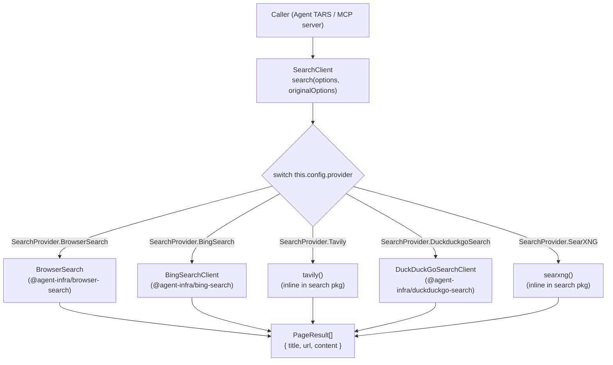
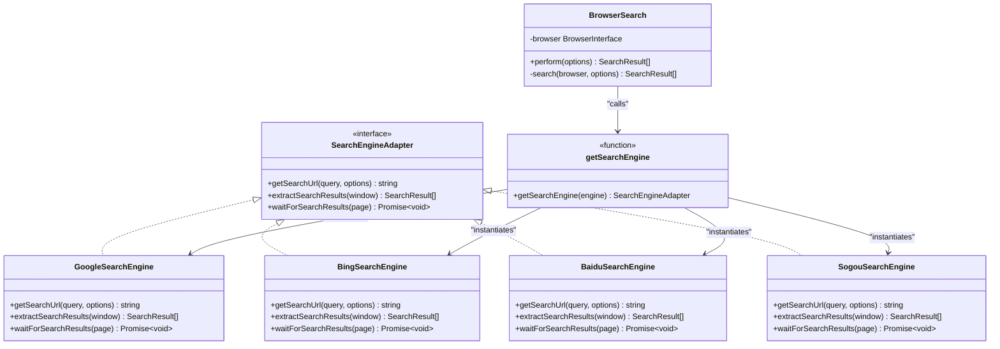
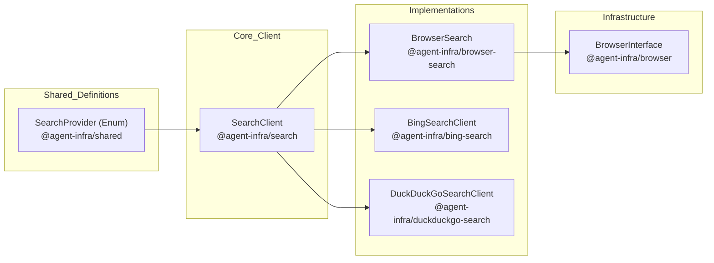

<!-- source: DeepWiki mcp.deepwiki.com · repo bytedance/UI-TARS-desktop · page 6.3 Search System Architecture · fetched 2026-10-30 -->

# Search System Architecture

<details>
<summary>Relevant source files</summary>

The following files were used as context for generating this wiki page:

- [packages/agent-infra/search/browser-search/examples/bing-search.ts](packages/agent-infra/search/browser-search/examples/bing-search.ts)
- [packages/agent-infra/search/browser-search/examples/google-search.ts](packages/agent-infra/search/browser-search/examples/google-search.ts)
- [packages/agent-infra/search/browser-search/package.json](packages/agent-infra/search/browser-search/package.json)
- [packages/agent-infra/search/browser-search/src/browser-search.ts](packages/agent-infra/search/browser-search/src/browser-search.ts)
- [packages/agent-infra/search/browser-search/src/engines/baidu-engine.ts](packages/agent-infra/search/browser-search/src/engines/baidu-engine.ts)
- [packages/agent-infra/search/browser-search/src/engines/bing-engine.ts](packages/agent-infra/search/browser-search/src/engines/bing-engine.ts)
- [packages/agent-infra/search/browser-search/src/engines/get-search-engine.ts](packages/agent-infra/search/browser-search/src/engines/get-search-engine.ts)
- [packages/agent-infra/search/browser-search/src/engines/google-engine.ts](packages/agent-infra/search/browser-search/src/engines/google-engine.ts)
- [packages/agent-infra/search/browser-search/src/engines/index.ts](packages/agent-infra/search/browser-search/src/engines/index.ts)
- [packages/agent-infra/search/browser-search/src/engines/sogou-engine.ts](packages/agent-infra/search/browser-search/src/engines/sogou-engine.ts)
- [packages/agent-infra/search/browser-search/src/types.ts](packages/agent-infra/search/browser-search/src/types.ts)
- [packages/agent-infra/search/browser-search/src/utils/misc.ts](packages/agent-infra/search/browser-search/src/utils/misc.ts)
- [packages/agent-infra/search/duckduckgo-search/README.md](packages/agent-infra/search/duckduckgo-search/README.md)
- [packages/agent-infra/search/duckduckgo-search/examples/default.ts](packages/agent-infra/search/duckduckgo-search/examples/default.ts)
- [packages/agent-infra/search/duckduckgo-search/package.json](packages/agent-infra/search/duckduckgo-search/package.json)
- [packages/agent-infra/search/duckduckgo-search/rslib.config.ts](packages/agent-infra/search/duckduckgo-search/rslib.config.ts)
- [packages/agent-infra/search/duckduckgo-search/src/api-client.ts](packages/agent-infra/search/duckduckgo-search/src/api-client.ts)
- [packages/agent-infra/search/duckduckgo-search/src/index.ts](packages/agent-infra/search/duckduckgo-search/src/index.ts)
- [packages/agent-infra/search/duckduckgo-search/tsconfig.json](packages/agent-infra/search/duckduckgo-search/tsconfig.json)
- [packages/agent-infra/search/search/package.json](packages/agent-infra/search/search/package.json)
- [packages/agent-infra/search/search/src/index.ts](packages/agent-infra/search/search/src/index.ts)
- [packages/agent-infra/shared/src/agent-tars-types/search.ts](packages/agent-infra/shared/src/agent-tars-types/search.ts)

</details>


This page documents the search infrastructure packages in the `packages/agent-infra/search/` directory, covering the unified `SearchClient` interface, the `SearchProvider` enum, each supported provider backend, the `BrowserSearch` engine adapter system, and the `SearchSettings` configuration type.

---

## Package Layout

The search system is split across several focused packages under `packages/agent-infra/`:

| Package path | npm name | Role |
|---|---|---|
| `packages/agent-infra/shared` | `@agent-infra/shared` | `SearchProvider` enum, `SearchSettings` type [packages/agent-infra/shared/src/agent-tars-types/search.ts:4-55]() |
| `packages/agent-infra/search/search` | `@agent-infra/search` | `SearchClient` unified facade [packages/agent-infra/search/search/src/index.ts:115-115]() |
| `packages/agent-infra/search/browser-search` | `@agent-infra/browser-search` | `BrowserSearch`, engine adapters [packages/agent-infra/search/browser-search/src/browser-search.ts:30-30]() |
| `packages/agent-infra/search/bing-search` | `@agent-infra/bing-search` | `BingSearchClient` (REST API) [packages/agent-infra/search/search/src/index.ts:159-162]() |
| `packages/agent-infra/search/duckduckgo-search` | `@agent-infra/duckduckgo-search` | `DuckDuckGoSearchClient` (scrape) [packages/agent-infra/search/duckduckgo-search/src/index.ts]() |

Tavily and SearXNG are implemented via factory functions in the unified `search` package at [packages/agent-infra/search/search/src/index.ts:23-24]().

Sources: [packages/agent-infra/search/search/package.json:29-36](), [packages/agent-infra/search/browser-search/package.json:28-32]()

---

## SearchProvider Enum

Defined in [packages/agent-infra/shared/src/agent-tars-types/search.ts:4-25]().

```typescript
export enum SearchProvider {
  BrowserSearch = 'browser_search',
  BingSearch = 'bing_search',
  Tavily = 'tavily',
  DuckduckgoSearch = 'duckduckgo_search',
  SearXNG = 'searxng',
}
```

The same file also exports `LocalBrowserSearchEngine` — a string union `'google' | 'bing' | 'baidu' | 'sogou'` — which selects the underlying engine used by the `BrowserSearch` provider [packages/agent-infra/shared/src/agent-tars-types/search.ts:27-27]().

The `SearchSettings` interface ([packages/agent-infra/shared/src/agent-tars-types/search.ts:32-55]()) is a configuration shape that includes the provider, engine, and API key.

---

## Unified SearchClient

**Package entry point:** [packages/agent-infra/search/search/src/index.ts]()

`SearchClient<T extends SearchProvider>` is the single entry point for all search operations. Callers configure it with a `provider` and `providerConfig`, then call `search()` with `CommonSearchOptions`. Internally, `search()` contains a switch statement that dispatches to the appropriate underlying client [packages/agent-infra/search/search/src/index.ts:136-244]().

### Key types

| Type | Description |
|---|---|
| `SearchConfig<T>` | Constructor config: `provider`, `providerConfig`, optional `logger` [packages/agent-infra/search/search/src/index.ts:96-109]() |
| `CommonSearchOptions` | `query: string`, optional `count: number` [packages/agent-infra/search/search/src/index.ts:54-63]() |
| `SearchResult` | Unified output format containing `pages: PageResult[]` [packages/agent-infra/search/search/src/index.ts:86-91]() |
| `PageResult` | Standardized result: `{ title, url, content }` [packages/agent-infra/search/search/src/index.ts:68-81]() |
| `SearchProviderConfigMap` | Maps each `SearchProvider` to its specific config type [packages/agent-infra/search/search/src/index.ts:27-33]() |

**Diagram: SearchClient dispatch architecture**



Sources: [packages/agent-infra/search/search/src/index.ts:132-245]()

---

## BrowserSearch Provider

`BrowserSearch` (in `@agent-infra/browser-search`) performs searches by automating a real browser. It is the most capable provider, as it can follow links and extract full page content rather than relying on snippets.

### Configuration

`BrowserSearchConfig` ([packages/agent-infra/search/browser-search/src/types.ts:54-78]()):

| Field | Type | Description |
|---|---|---|
| `logger` | `Logger` | Optional logger instance |
| `cdpEndpoint` | `string` | Connect to a remote browser via CDP. Overrides `browser` and `browserOptions` [packages/agent-infra/search/browser-search/src/browser-search.ts:38-42](). |
| `browser` | `BrowserInterface` | Custom `LocalBrowser` or `RemoteBrowser` instance |
| `browserOptions` | `LaunchOptions` | Options passed to the browser launch method |
| `defaultEngine` | `LocalBrowserSearchEngine` | Default search engine; defaults to `'google'` [packages/agent-infra/search/browser-search/src/browser-search.ts:47-47](). |

### `perform()` execution flow

[packages/agent-infra/search/browser-search/src/browser-search.ts:53-104]()

1. **Launch**: Starts the browser via `this.browser.launch()` if not already open [packages/agent-infra/search/browser-search/src/browser-search.ts:69-69]().
2. **Queueing**: Uses a `PromiseQueue` to manage concurrency (default: 15) [packages/agent-infra/search/browser-search/src/browser-search.ts:75-75]().
3. **Scraping**: Calls the engine-specific `extractSearchResults` inside the browser page [packages/agent-infra/search/browser-search/src/browser-search.ts:143-143]().
4. **Deep Crawl**: If `needVisitedUrls` is `true`, it visits each result link and uses `extractPageInformation` with `READABILITY_SCRIPT` to get clean content [packages/agent-infra/search/browser-search/src/browser-search.ts:205-212]().
5. **Markdown Conversion**: Converts extracted HTML content to Markdown using `toMarkdown()` [packages/agent-infra/search/browser-search/src/browser-search.ts:215-215]().

Sources: [packages/agent-infra/search/browser-search/src/browser-search.ts:53-222]()

---

## Engine Adapter System

The system uses an adapter pattern to support multiple web search engines through the same interface.

**Diagram: BrowserSearch engine adapter relationships**



### Implementation Details

Each adapter provides logic for URL generation and DOM scraping:

- **`GoogleSearchEngine`**: Generates URLs with `udm=14` [packages/agent-infra/search/browser-search/src/engines/google-engine.ts:38-38](), uses `.tF2Cxc` selector for results [packages/agent-infra/search/browser-search/src/engines/google-engine.ts:117-117](), and waits for `#search` [packages/agent-infra/search/browser-search/src/engines/google-engine.ts:153-153]().
- **`BingSearchEngine`**: Uses `.b_algo` selector for results [packages/agent-infra/search/browser-search/src/engines/bing-engine.ts:115-115]() and waits for `#b_results` [packages/agent-infra/search/browser-search/src/engines/bing-engine.ts:151-151]().
- **`BaiduSearchEngine`**: Uses `.c-container` selector [packages/agent-infra/search/browser-search/src/engines/baidu-engine.ts:119-119]() and waits for `#content_left` [packages/agent-infra/search/browser-search/src/engines/baidu-engine.ts:154-154]().
- **`SogouSearchEngine`**: Implements the `SearchEngineAdapter` interface for Sogou [packages/agent-infra/search/browser-search/src/engines/sogou-engine.ts]().

Sources: [packages/agent-infra/search/browser-search/src/engines/get-search-engine.ts:13-28](), [packages/agent-infra/search/browser-search/src/types.ts:80-103]()

---

## API-Based Providers

### BingSearch
Uses `BingSearchClient` from `@agent-infra/bing-search`. It maps `CommonSearchOptions.query` to the `q` parameter and extracts results from `response.webPages.value` [packages/agent-infra/search/search/src/index.ts:158-177]().

### Tavily
Uses the `@tavily/core` SDK. It maps `count` to `maxResults` and returns standard `PageResult` objects [packages/agent-infra/search/search/src/index.ts:179-194]().

### DuckDuckGo
Uses `DuckDuckGoSearchClient` which performs scraping via `api-client.ts`. It includes a retry mechanism with randomization to bypass rate limits [packages/agent-infra/search/search/src/index.ts:216-240]().

### SearXNG
Uses the `searxng()` factory. It requires a `baseUrl` in the provider configuration and maps results from the self-hosted SearXNG instance [packages/agent-infra/search/search/src/index.ts:196-214]().

---

## Integration Points

**Diagram: Search System Code Entity Mapping**



- **MCP Search Server**: The `@agent-infra/mcp-server-search` package uses `SearchClient` to provide search tools to the agent via the Model Context Protocol.
- **Browser Automation**: `BrowserSearch` relies on the `@agent-infra/browser` package for `LocalBrowser` and `RemoteBrowser` implementations [packages/agent-infra/search/browser-search/src/browser-search.ts:6-9]().

Sources: [packages/agent-infra/search/search/src/index.ts:115-246](), [packages/agent-infra/search/browser-search/src/browser-search.ts:30-48](), [packages/agent-infra/shared/src/agent-tars-types/search.ts:4-25]()

---

