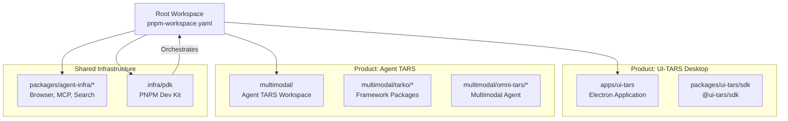
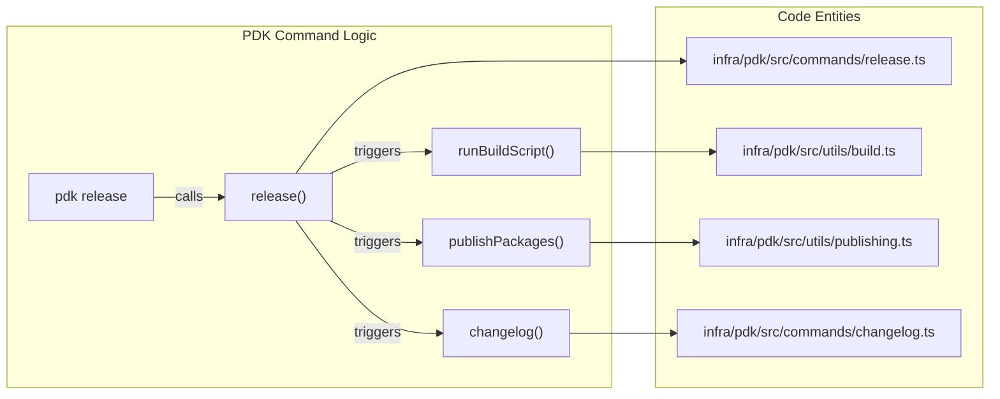

<!-- source: DeepWiki mcp.deepwiki.com · repo bytedance/UI-TARS-desktop · page 7 Development and Operations · fetched 2026-10-30 -->

# Development and Operations

Relevant source files

The following files were used as context for generating this wiki page:

- [.github/workflows/agent_tars_test.yml](.github/workflows/agent_tars_test.yml)
- [.github/workflows/benchmark.yml](.github/workflows/benchmark.yml)
- [.github/workflows/e2e-ui-tars.yml](.github/workflows/e2e-ui-tars.yml)
- [.github/workflows/release-ui-tars.yml](.github/workflows/release-ui-tars.yml)
- [.github/workflows/scorecard.yml](.github/workflows/scorecard.yml)
- [.github/workflows/secret-scan.yml](.github/workflows/secret-scan.yml)
- [.github/workflows/secretlint.yml](.github/workflows/secretlint.yml)
- [.github/workflows/test.yml](.github/workflows/test.yml)
- [infra/CHANGELOG.md](infra/CHANGELOG.md)
- [infra/pdk/rslib.config.ts](infra/pdk/rslib.config.ts)
- [infra/pdk/src/__tests__/tag-prefix.test.ts](infra/pdk/src/__tests__/tag-prefix.test.ts)
- [infra/pdk/src/cli.ts](infra/pdk/src/cli.ts)
- [infra/pdk/src/commands/changelog.ts](infra/pdk/src/commands/changelog.ts)
- [infra/pdk/src/commands/index.ts](infra/pdk/src/commands/index.ts)
- [infra/pdk/src/commands/next-version.ts](infra/pdk/src/commands/next-version.ts)
- [infra/pdk/src/commands/release.ts](infra/pdk/src/commands/release.ts)
- [infra/pdk/src/index.ts](infra/pdk/src/index.ts)
- [infra/pdk/src/types.ts](infra/pdk/src/types.ts)
- [infra/pdk/src/utils/ai-changelog.ts](infra/pdk/src/utils/ai-changelog.ts)
- [infra/pdk/src/utils/build.ts](infra/pdk/src/utils/build.ts)
- [infra/pdk/src/utils/commit.ts](infra/pdk/src/utils/commit.ts)
- [infra/pdk/src/utils/config.ts](infra/pdk/src/utils/config.ts)
- [infra/pdk/src/utils/github.ts](infra/pdk/src/utils/github.ts)
- [infra/pdk/src/utils/version.ts](infra/pdk/src/utils/version.ts)

This document provides an overview of the development workflow, build system, testing infrastructure, and release management for the UI-TARS Desktop repository. It covers the tooling and processes used to maintain code quality, manage the monorepo structure, and deliver releases.

For detailed information on specific topics:
- Build system and package management details, see [Build System and Package Management](#7.1)
- Release workflow and versioning strategy, see [Release Management and Versioning](#7.2)
- Testing infrastructure and quality tools, see [Testing and Quality Assurance](#7.3)

## Overview of Development Infrastructure

The UI-TARS Desktop repository is organized as a monorepo containing multiple applications and packages. The development infrastructure uses modern JavaScript tooling to support efficient development, testing, and deployment workflows.

### Monorepo Architecture

The repository is managed as a pnpm workspace with specialized products and infrastructure packages. A key component of the infrastructure is **PDK (PNPM Dev Kit)**, located in `infra/pdk`, which provides unified CLI commands for development, versioning, and releasing [infra/pdk/src/cli.ts:44-46]().

**Sources:** [.github/workflows/test.yml:6-12](), [infra/pdk/src/cli.ts:1-10]()

### Development Workflow and CI

The project employs a robust CI/CD pipeline using GitHub Actions to ensure code quality through automated type checking, testing, and security scanning. The system utilizes `turbo` for task caching and orchestration.

| Workflow | Trigger | Tasks |
|----------|---------|-------|
| CI Test, Typecheck | PR, Push to main | `turbo run typecheck`, `turbo run coverage` [.github/workflows/test.yml:57-59]() |
| Secretlint | PR, Push to main | `npx secretlint` on changed files [.github/workflows/secretlint.yml:34-36]() |
| Scorecard | Schedule, Push | Supply-chain security analysis [.github/workflows/scorecard.yml:39-43]() |
| Release UI-TARS | Manual | macOS (arm64/x64) builds and signing [.github/workflows/release-ui-tars.yml:68-143]() |

**Sources:** [.github/workflows/test.yml:19-67](), [.github/workflows/secretlint.yml:8-36](), [.github/workflows/scorecard.yml:5-64]()

## Build and Tooling Orchestration

The monorepo uses **Turbo** for build orchestration and **PDK** for high-level developer operations.

### PDK CLI Operations
The `pdk` CLI provides an isomorphic interface for both Node.js and CLI usage [infra/pdk/src/types.ts:9-13](). It wraps complex logic for:
- **Development**: Launching on-demand builds for specific packages via `pdk dev` [infra/pdk/src/cli.ts:52-77]().
- **Versioning**: Interactive selection of semantic versions and tags [infra/pdk/src/commands/release.ts:114-129]().
- **Changelogs**: Generating GitHub-style release notes, optionally using AI (LLM) providers like GPT-4o [infra/pdk/src/commands/changelog.ts:113-127]().

**Sources:** [infra/pdk/src/cli.ts:79-145](), [infra/pdk/src/commands/release.ts:47-224](), [infra/pdk/src/commands/changelog.ts:62-172]()

## Release Management Overview

The repository utilizes a specialized release workflow for the UI-TARS Desktop application, involving platform-specific builds and automated changelog generation.

### UI-TARS Release Pipeline
The release process for the desktop application involves:
1. **Environment Setup**: Provisioning Apple certificates and profiles in the GitHub Runner [.github/workflows/release-ui-tars.yml:37-65]().
2. **Platform Builds**: Parallel jobs for `publish:mac-arm64` and `publish:mac-x64` [.github/workflows/release-ui-tars.yml:77-143]().
3. **Artifact Merging**: Consolidating YAML configuration files from both architectures [.github/workflows/release-ui-tars.yml:151-169]().

### Monorepo Release (PDK)
For internal packages and general monorepo releases, `pdk release` manages the lifecycle:
- **Canary Mode**: Auto-generates canary versions without interactive prompts [infra/pdk/src/commands/release.ts:88-93]().
- **Dependency Management**: Updates versions across all workspace packages and ensures correct publishing order [infra/pdk/src/commands/release.ts:168-179]().
- **Git Operations**: Automatically handles tagging and pushing to remote repositories [infra/pdk/src/commands/release.ts:220-224]().

**Sources:** [.github/workflows/release-ui-tars.yml:19-176](), [infra/pdk/src/commands/release.ts:47-224]()

## Testing and Quality Assurance

### Testing Infrastructure
- **Unit/Integration**: Handled via `turbo run coverage`, producing LCOV reports for Codecov [.github/workflows/test.yml:59-65]().
- **Type Checking**: Verified across the monorepo using `turbo run typecheck` [.github/workflows/test.yml:56-57]().

### Security and Compliance
- **Secret Scanning**: Employs `secretlint` for commit-time checks on changed files [.github/workflows/secretlint.yml:34-36]().
- **Supply Chain**: OpenSSF Scorecard monitors for security best practices, including branch protection and maintenance checks [.github/workflows/scorecard.yml:5-15]().

**Sources:** [.github/workflows/test.yml:19-67](), [.github/workflows/secretlint.yml:1-36](), [.github/workflows/scorecard.yml:21-64]()

## Summary

The UI-TARS Desktop development ecosystem is built on:
- **pnpm workspaces** for monorepo management.
- **PDK (PNPM Dev Kit)** for unified release and development CLI operations [infra/pdk/src/index.ts:1-12]().
- **Turbo** for high-performance task orchestration and caching [.github/workflows/test.yml:36-43]().
- **GitHub Actions** for comprehensive CI/CD covering multi-platform Electron distribution and security scanning [.github/workflows/release-ui-tars.yml:1-169]().

For implementation details of each area, refer to the child pages for [Build System and Package Management](#7.1), [Release Management and Versioning](#7.2), and [Testing and Quality Assurance](#7.3).

---

