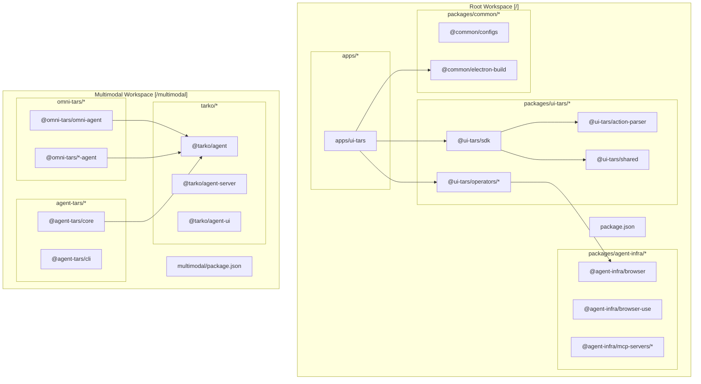
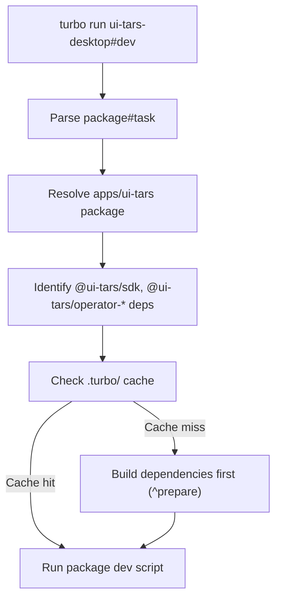
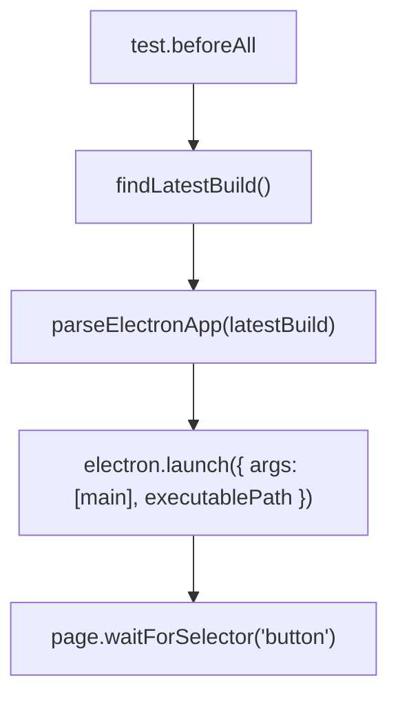

<!-- source: DeepWiki mcp.deepwiki.com · repo bytedance/UI-TARS-desktop · page 7.1 Build System and Package Management · fetched 2026-10-30 -->

# Build System and Package Management

Relevant source files

The following files were used as context for generating this wiki page:

- [.gitignore](.gitignore)
- [.lintstagedrc.mjs](.lintstagedrc.mjs)
- [.secretlintignore](.secretlintignore)
- [apps/ui-tars/e2e/app.test.ts](apps/ui-tars/e2e/app.test.ts)
- [multimodal/CHANGELOG.md](multimodal/CHANGELOG.md)
- [multimodal/benchmark/content-extraction/package.json](multimodal/benchmark/content-extraction/package.json)
- [multimodal/package.json](multimodal/package.json)
- [multimodal/websites/docs/package.json](multimodal/websites/docs/package.json)
- [multimodal/websites/main/package.json](multimodal/websites/main/package.json)
- [package.json](package.json)
- [packages/agent-infra/browser-use/src/dom/views.test.ts](packages/agent-infra/browser-use/src/dom/views.test.ts)
- [packages/agent-infra/browser-use/src/dom/views.ts](packages/agent-infra/browser-use/src/dom/views.ts)
- [packages/agent-infra/browser-use/vitest.config.ts](packages/agent-infra/browser-use/vitest.config.ts)
- [packages/agent-infra/mcp-servers/browser/tests/utils/utils.test.ts](packages/agent-infra/mcp-servers/browser/tests/utils/utils.test.ts)
- [packages/common/configs/package.json](packages/common/configs/package.json)
- [pnpm-lock.yaml](pnpm-lock.yaml)
- [turbo.json](turbo.json)

This document describes the build system and package management for the UI-TARS monorepo. The repository uses **pnpm workspaces** for dependency management, **Turbo** for task orchestration, and **Electron Forge** for desktop application packaging. The build system manages complex dependencies across a nested monorepo structure consisting of the root workspace (UI-TARS Desktop) and the `multimodal/` subdirectory (Agent TARS, OmniTARS, and Tarko framework).

## Monorepo Package Organization

The repository uses a **nested monorepo structure** with two primary workspaces. The root workspace handles the desktop application and shared infrastructure, while the `multimodal` workspace contains the agent framework and multimodal implementations.

| Workspace | Location | Package Manager | Purpose |
|-----------|----------|----------------|---------|
| Root | `/` | `pnpm@9.10.0` | UI-TARS Desktop app and shared infrastructure [package.json:5]() |
| Multimodal | `/multimodal` | `pnpm@9` | Agent TARS, OmniTARS, Tarko framework [multimodal/package.json:36]() |

**Package Categories and Code Entities**

**Sources:** [package.json:1-58](), [pnpm-lock.yaml:1-10](), [pnpm-lock.yaml:96-206](), [multimodal/package.json:1-5]()

## Package Manager Configuration (pnpm)

The monorepo uses **pnpm workspaces** with version `9.10.0` specified via the `packageManager` field [package.json:5]().

**Lockfile Configuration**
The `pnpm-lock.yaml` file configures workspace behavior to ensure strict dependency resolution:
- `autoInstallPeers: true`: Automatically installs peer dependencies [pnpm-lock.yaml:4]().
- `excludeLinksFromLockfile: false`: Ensures workspace symlinks are properly tracked [pnpm-lock.yaml:5]().

**Workspace Protocol**
Internal packages reference each other using the `workspace:` protocol. For example, `apps/ui-tars` links to several local packages in the `packages/ui-tars` directory [pnpm-lock.yaml:189-206]().

**Sources:** [pnpm-lock.yaml:1-10](), [pnpm-lock.yaml:189-206](), [package.json:5]()

## Build Orchestration with Turbo

The root workspace uses **Turbo** (v2.4.4) for parallel task execution and caching [package.json:27]().

**Turbo Task Pipeline**
The `turbo.json` file defines the execution graph for the monorepo [turbo.json:1-51]():

| Task | Depends On | Outputs |
|------|------------|---------|
| `//#bootstrap` | `^prepare` | `**/build/**`, `**/dist/**`, `**/out/**` [turbo.json:5-14]() |
| `ui-tars-desktop#build` | N/A | `apps/ui-tars-desktop/dist/**`, `apps/ui-tars-desktop/out/**` [turbo.json:15-20]() |
| `ui-tars-desktop#test:e2e` | `ui-tars-desktop#build:e2e` | N/A [turbo.json:27-31]() |

**Task Orchestration Logic**

**Sources:** [package.json:12](), [package.json:27](), [turbo.json:1-51]()

## Desktop Application Build (Electron Forge)

The **UI-TARS Desktop** application (`apps/ui-tars`) uses **Electron Forge** for its build pipeline [pnpm-lock.yaml:120-122]().

**Key Build Dependencies:**
- **Bundling**: `@electron-forge/plugin-vite` [pnpm-lock.yaml:144]().
- **Native Modules**: `@electron-forge/plugin-auto-unpack-natives` [pnpm-lock.yaml:135]().
- **Packaging**: Support for DMG, PKG, Squirrel (Windows), and ZIP [pnpm-lock.yaml:123-134]().
- **Publishing**: `@electron-forge/publisher-github` for automated release distribution [pnpm-lock.yaml:147]().

**Sources:** [pnpm-lock.yaml:120-152]()

## Multimodal Workspace Bootstrap Process

The `multimodal` workspace contains a specialized `bootstrap` script to handle the build order of the Tarko framework and its dependent agents [multimodal/package.json:7]().

**Sequential Build Pipeline:**
1. **Tarko Framework**: `pnpm --filter "./tarko/**" build` [multimodal/package.json:13]()
2. **GUI Agent**: `pnpm --filter "./gui-agent/**" build` [multimodal/package.json:17]()
3. **Agent TARS**: `pnpm --filter "./agent-tars/**" build` [multimodal/package.json:15]()
4. **OmniTARS**: `pnpm --filter "./omni-tars/**" build` [multimodal/package.json:16]()

This ensures that the base `Agent` classes and server infrastructure are compiled before the high-level agents that consume them.

**Sources:** [multimodal/package.json:7](), [multimodal/package.json:13-17]()

## Development Workflow and Quality Assurance

The repository enforces code quality through a combination of linting, type checking, and testing.

**Linting and Formatting Pipeline:**
- **Prettier**: Global formatting via `prettier --write .` [package.json:13]().
- **ESLint**: Standardized linting for TypeScript and React [package.json:14]().
- **Secretlint**: Scans for leaked credentials, integrated into `lint-staged` [.lintstagedrc.mjs:6]().
- **Husky**: Manages git hooks to trigger `lint-staged` before commits [package.json:20]().

**Testing Infrastructure:**
- **Unit/Integration**: Handled by **Vitest** [package.json:15]().
- **E2E Testing**: Uses **Playwright** to test the compiled Electron app [apps/ui-tars/e2e/app.test.ts:11]().
- **Coverage**: Generated via `@vitest/coverage-v8` or `coverage-istanbul` [package.json:38-39]().

**E2E Test Flow (Playwright)**
The `app.test.ts` file demonstrates the bridge between the build system (finding the executable) and the runtime validation using `findLatestBuild` and `parseElectronApp` [apps/ui-tars/e2e/app.test.ts:12-29]().

**Sources:** [package.json:13-20](), [package.json:38-39](), [.lintstagedrc.mjs:1-10](), [apps/ui-tars/e2e/app.test.ts:1-59]()

## Release Management

Release management is handled via **pnpm-dev-kit (pdk)** in the multimodal workspace [multimodal/package.json:39]().

**Release Commands [multimodal/package.json:22-32]():**
- `pdk release`: Standard release orchestration.
- `pdk release --canary`: Generates pre-release versions.
- `pdk release --use-ai`: Leverages AI for changelog generation and release notes.
- `pdk changelog`: Updates the `CHANGELOG.md` based on commit history.

The `CHANGELOG.md` tracks features across sub-packages like `agent-server`, `omni-agent`, and `tarko-agent` [multimodal/CHANGELOG.md:6-28]().

**Sources:** [multimodal/package.json:22-32](), [multimodal/package.json:39](), [multimodal/CHANGELOG.md:1-40]()

---

