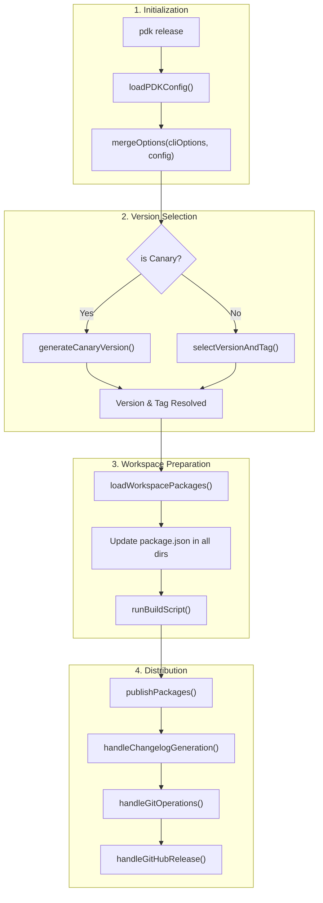
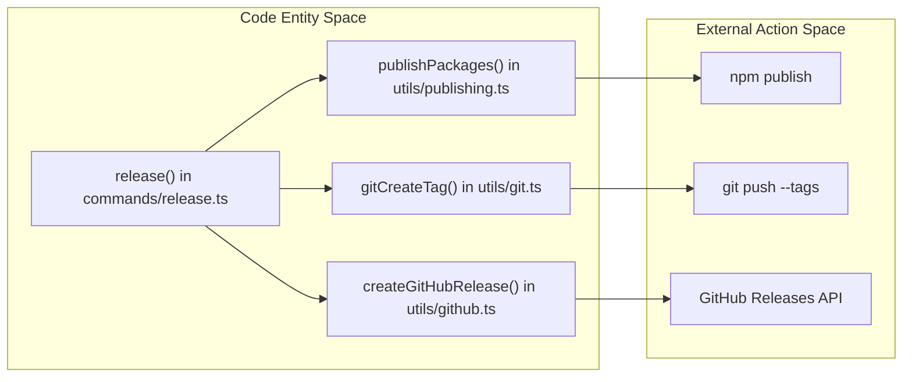

<!-- source: DeepWiki mcp.deepwiki.com · repo bytedance/UI-TARS-desktop · page 7.2 Release Management and Versioning · fetched 2026-10-30 -->

# Release Management and Versioning

Relevant source files

The following files were used as context for generating this wiki page:

- [.github/workflows/agent_tars_test.yml](.github/workflows/agent_tars_test.yml)
- [.github/workflows/benchmark.yml](.github/workflows/benchmark.yml)
- [.github/workflows/e2e-ui-tars.yml](.github/workflows/e2e-ui-tars.yml)
- [.github/workflows/release-ui-tars.yml](.github/workflows/release-ui-tars.yml)
- [.github/workflows/scorecard.yml](.github/workflows/scorecard.yml)
- [.github/workflows/secret-scan.yml](.github/workflows/secret-scan.yml)
- [.github/workflows/secretlint.yml](.github/workflows/secretlint.yml)
- [.github/workflows/test.yml](.github/workflows/test.yml)
- [infra/CHANGELOG.md](infra/CHANGELOG.md)
- [infra/package.json](infra/package.json)
- [infra/pdk/README.md](infra/pdk/README.md)
- [infra/pdk/bin/cli.js](infra/pdk/bin/cli.js)
- [infra/pdk/package.json](infra/pdk/package.json)
- [infra/pdk/rslib.config.ts](infra/pdk/rslib.config.ts)
- [infra/pdk/src/__tests__/tag-prefix.test.ts](infra/pdk/src/__tests__/tag-prefix.test.ts)
- [infra/pdk/src/cli.ts](infra/pdk/src/cli.ts)
- [infra/pdk/src/commands/changelog.ts](infra/pdk/src/commands/changelog.ts)
- [infra/pdk/src/commands/index.ts](infra/pdk/src/commands/index.ts)
- [infra/pdk/src/commands/next-version.ts](infra/pdk/src/commands/next-version.ts)
- [infra/pdk/src/commands/release.ts](infra/pdk/src/commands/release.ts)
- [infra/pdk/src/index.ts](infra/pdk/src/index.ts)
- [infra/pdk/src/types.ts](infra/pdk/src/types.ts)
- [infra/pdk/src/utils/ai-changelog.ts](infra/pdk/src/utils/ai-changelog.ts)
- [infra/pdk/src/utils/build.ts](infra/pdk/src/utils/build.ts)
- [infra/pdk/src/utils/commit.ts](infra/pdk/src/utils/commit.ts)
- [infra/pdk/src/utils/config.ts](infra/pdk/src/utils/config.ts)
- [infra/pdk/src/utils/github.ts](infra/pdk/src/utils/github.ts)
- [infra/pdk/src/utils/version.ts](infra/pdk/src/utils/version.ts)
- [infra/pdk/tsconfig.json](infra/pdk/tsconfig.json)
- [infra/pnpm-lock.yaml](infra/pnpm-lock.yaml)

This page documents the release workflow, versioning strategy, and automated tooling used in the UI-TARS-desktop repository. The system is centered around `pdk` (**pnpm-dev-kit**), a custom internal tool designed to manage semantic versioning, changelog generation, and multi-package publishing within the monorepo.

## Release Automation with PDK

The repository uses `pnpm-dev-kit` (PDK) as the primary orchestration engine for releases. PDK abstracts complex Git and npm operations into a unified CLI, supporting interactive version selection, automated canary builds, and AI-enhanced changelog generation.

### PDK Command Architecture

The PDK CLI is bootstrapped using the `cac` library [infra/pdk/src/cli.ts:45]() and provides several high-level commands for different stages of the release lifecycle. Commands are wrapped by `wrapCommand` [infra/pdk/src/cli.ts:18-39](), which handles configuration loading via `loadPDKConfig` [infra/pdk/src/utils/config.ts:27]().

| Command | Alias | Function | File Reference |
|:---|:---|:---|:---|
| `release` | `r` | Full release workflow: versioning, build, changelog, tag, and publish. | [infra/pdk/src/cli.ts:81-145]() |
| `patch` | `p` | Recovery command to retry or fix a failed release process. | [infra/pdk/src/cli.ts:148-167]() |
| `changelog` | - | Standalone generation of `CHANGELOG.md` using Git history. | [infra/pdk/src/cli.ts:170-213]() |
| `dev` | `d` | Launches on-demand development builds for specific packages. | [infra/pdk/src/cli.ts:52-77]() |
| `next-version` | - | Predicts the next version based on commit history. | [infra/pdk/src/cli.ts:10]() |

**Sources:** [infra/pdk/src/cli.ts:44-213](), [infra/pdk/src/index.ts:1-12](), [infra/pdk/src/utils/config.ts:9-32]()

### Release Data Flow and Logic

The `release` command follows a strict execution pipeline to ensure data integrity across the monorepo. It utilizes a `ReleaseBranchManager` [infra/pdk/src/commands/release.ts:40]() if the `autoCreateReleaseBranch` option is enabled [infra/pdk/src/commands/release.ts:71-73]().

Title: PDK Release Execution Pipeline

**Sources:** [infra/pdk/src/commands/release.ts:47-235](), [infra/pdk/src/cli.ts:26-32](), [infra/pdk/src/utils/version.ts:28-32]()

## Versioning Strategy

UI-TARS-desktop follows Semantic Versioning (SemVer). The `release` command implementation in `infra/pdk/src/commands/release.ts` manages different release tracks using the `ReleaseOptions` interface [infra/pdk/src/types.ts:202-239]().

### Release Types

1.  **Standard Release**: Interactive selection of Major, Minor, or Patch increments. Uses `selectVersionAndTag` to prompt the user [infra/pdk/src/commands/release.ts:115-118]().
2.  **Canary Release**: Automated non-interactive releases for CI/CD. Uses `generateCanaryVersion` to create a unique string (e.g., `0.0.5-canary-hash`) [infra/pdk/src/commands/release.ts:90-92]().
3.  **Direct Release**: Bypasses prompts if `releaseVersion` and `releaseTag` are provided via CLI [infra/pdk/src/commands/release.ts:94-104]().

### Version Propagation
When a version is selected, PDK performs a "Write-First" update:
- It iterates through all packages discovered by `loadWorkspacePackages` [infra/pdk/src/commands/release.ts:143]().
- It updates the `version` field in every `package.json` [infra/pdk/src/commands/release.ts:168-179]().
- It updates the root `package.json` to keep the monorepo synchronized [infra/pdk/src/commands/release.ts:182-193]().
- The environment variable `RELEASE_VERSION` is set for build scripts [infra/pdk/src/commands/release.ts:140]().

**Sources:** [infra/pdk/src/commands/release.ts:88-193](), [infra/pdk/src/utils/version.ts:28-32](), [infra/pdk/src/types.ts:202-239]()

## Changelog Generation

PDK generates changelogs by analyzing Git commit history between the current head and the `previousTag`.

### Unified Changelog Logic
The `changelog` function in `infra/pdk/src/commands/changelog.ts` performs the following:
1.  **Tag Resolution**: Identifies the current `tagName` and finds the `previousTag` using `getPreviousTag` [infra/pdk/src/commands/changelog.ts:87-105](). `getPreviousTag` filters out canary releases and applies `tagPrefix` [infra/pdk/src/utils/github.ts:54-101]().
2.  **Commit Extraction**: Fetches commits in the range `${previousTag}..${tagName}` using `git log` [infra/pdk/src/utils/github.ts:115-119]().
3.  **Grouping**: Categorizes commits into `feat`, `fix`, `docs`, `refactor`, etc., based on conventional commit prefixes [infra/pdk/src/utils/github.ts:134-163]().
4.  **Author Mapping**: Maps local Git names to GitHub usernames using `USERNAME_MAP` (e.g., mapping `chenhaoli` to `ulivz` and `小健` to `cjraft`) [infra/pdk/src/utils/github.ts:14-17]().

### AI-Assisted Changelog
If the `useAi` flag is active [infra/pdk/src/types.ts:152](), PDK instantiates `AIChangelogGenerator` [infra/pdk/src/commands/changelog.ts:114-121](). It sends the filtered commit list to an LLM (defaulting to `gpt-4o`) to produce a more readable summary [infra/pdk/src/commands/changelog.ts:122-126]().

**Sources:** [infra/pdk/src/commands/changelog.ts:62-149](), [infra/pdk/src/utils/github.ts:54-221](), [infra/pdk/src/types.ts:148-169]()

## Publishing and GitHub Integration

### Publishing Workflow
The `publishPackages` utility handles the actual upload to the npm registry.
- It filters out packages marked as `isPrivate: true` [infra/pdk/src/commands/release.ts:146]().
- It supports `runInBand` (sequential) or parallel publishing [infra/pdk/src/commands/release.ts:202-210]().
- It confirms packages to publish unless `skipConfirm` is enabled [infra/pdk/src/commands/release.ts:156-164]().

### GitHub Release Creation
After successful publishing and tagging, PDK can automatically create a GitHub Release:
- **Function**: `handleGitHubRelease` calls `createGitHubRelease` [infra/pdk/src/commands/release.ts:233-235]().
- **Content**: It uses the same generated release notes used for `CHANGELOG.md` [infra/pdk/src/utils/github.ts:106-112]().

Title: Release Code Entities to External Actions

**Sources:** [infra/pdk/src/commands/release.ts:202-235](), [infra/pdk/src/utils/github.ts:39-47](), [infra/package.json:15-22]()

## CI/CD and Desktop App Release

Beyond package publishing, the repository includes complex GitHub Action workflows for releasing the UI-TARS desktop application.

### Desktop App Release Workflow (`release-ui-tars.yml`)
The desktop app release is platform-specific and requires code signing:
1.  **Platform Builds**: Runs separate jobs for `publish_on_mac` (arm64) and `publish_on_mac_x64` [.github/workflows/release-ui-tars.yml:19-150]().
2.  **Code Signing**: Imports Apple certificates and provisioning profiles into a temporary keychain [.github/workflows/release-ui-tars.yml:43-65]().
3.  **Electron Builder**: Executes `pnpm run publish:mac-arm64` or `publish:mac-x64` within `apps/ui-tars` [.github/workflows/release-ui-tars.yml:77]().
4.  **Artifact Merging**: The `merge-latest-mac` job combines `.yml` update metadata from both architectures to support cross-platform auto-updates [.github/workflows/release-ui-tars.yml:151-177]().

### Supply Chain Security and Testing
- **Scorecard**: Monitors supply-chain security using the OpenSSF Scorecard action [.github/workflows/scorecard.yml:5-22]().
- **Secretlint**: Prevents credential leakage by scanning changed files during push or PR [.github/workflows/secretlint.yml:8-14]().
- **CI Test**: Runs typechecks and tests via `turbo run typecheck` and `turbo run coverage` on macOS environments [.github/workflows/test.yml:56-59]().

**Sources:** [.github/workflows/release-ui-tars.yml:1-177](), [.github/workflows/scorecard.yml:1-64](), [.github/workflows/secretlint.yml:1-36](), [.github/workflows/test.yml:1-67]()

## Infrastructure Package Scripts

The `infra/package.json` defines standard entry points for developers to trigger these workflows:

| Script | Command |
|:---|:---|
| `pnpm release` | `pdk release` |
| `pnpm release:canary` | `pdk release --canary` |
| `pnpm release:full` | `pdk release --create-github-release` |
| `pnpm changelog` | `pdk changelog` |
| `pnpm patch` | `pdk patch` |

**Sources:** [infra/package.json:15-22]()

---

