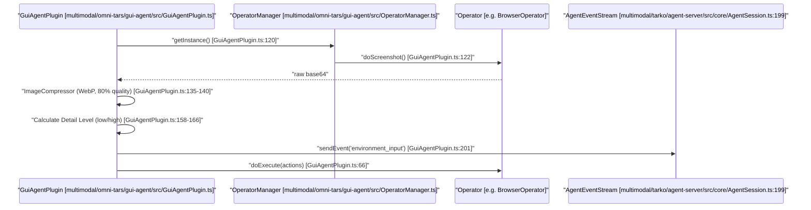

<!-- source: DeepWiki mcp.deepwiki.com · repo bytedance/UI-TARS-desktop · page 8 Glossary · fetched 2026-10-30 -->

# Glossary

<details>
<summary>Relevant source files</summary>

The following files were used as context for generating this wiki page:

- [README.md](README.md)
- [README.zh-CN.md](README.zh-CN.md)
- [apps/ui-tars/images/mac_app.png](apps/ui-tars/images/mac_app.png)
- [apps/ui-tars/images/quick_start/base_url.png](apps/ui-tars/images/quick_start/base_url.png)
- [apps/ui-tars/images/quick_start/start_button.png](apps/ui-tars/images/quick_start/start_button.png)
- [apps/ui-tars/src/main/remote/shared.ts](apps/ui-tars/src/main/remote/shared.ts)
- [apps/ui-tars/src/renderer/src/components/CountDown/index.tsx](apps/ui-tars/src/renderer/src/components/CountDown/index.tsx)
- [apps/ui-tars/src/renderer/src/const/index.ts](apps/ui-tars/src/renderer/src/const/index.ts)
- [apps/ui-tars/src/renderer/src/pages/home/index.tsx](apps/ui-tars/src/renderer/src/pages/home/index.tsx)
- [apps/ui-tars/src/renderer/src/pages/remote/cast/vnc.tsx](apps/ui-tars/src/renderer/src/pages/remote/cast/vnc.tsx)
- [apps/ui-tars/src/renderer/src/pages/remote/free.tsx](apps/ui-tars/src/renderer/src/pages/remote/free.tsx)
- [docs/quick-start.md](docs/quick-start.md)
- [multimodal/agent-tars/cli/src/index.ts](multimodal/agent-tars/cli/src/index.ts)
- [multimodal/agent-tars/interface/src/constants.ts](multimodal/agent-tars/interface/src/constants.ts)
- [multimodal/gui-agent/operator-aio/package.json](multimodal/gui-agent/operator-aio/package.json)
- [multimodal/gui-agent/operator-aio/src/AIOBrowser.ts](multimodal/gui-agent/operator-aio/src/AIOBrowser.ts)
- [multimodal/omni-tars/gui-agent/package.json](multimodal/omni-tars/gui-agent/package.json)
- [multimodal/omni-tars/gui-agent/src/GUIAgentT5Adapter.ts](multimodal/omni-tars/gui-agent/src/GUIAgentT5Adapter.ts)
- [multimodal/omni-tars/gui-agent/src/GuiAgentPlugin.ts](multimodal/omni-tars/gui-agent/src/GuiAgentPlugin.ts)
- [multimodal/omni-tars/omni-agent/src/index.ts](multimodal/omni-tars/omni-agent/src/index.ts)
- [multimodal/omni-tars/omni-agent/tarko.config.ts](multimodal/omni-tars/omni-agent/tarko.config.ts)
- [multimodal/pnpm-lock.yaml](multimodal/pnpm-lock.yaml)
- [multimodal/tarko/agent-server/src/api/controllers/oneshot.ts](multimodal/tarko/agent-server/src/api/controllers/oneshot.ts)
- [multimodal/tarko/agent-server/src/api/controllers/sessions.ts](multimodal/tarko/agent-server/src/api/controllers/sessions.ts)
- [multimodal/tarko/agent-server/src/api/controllers/system.ts](multimodal/tarko/agent-server/src/api/controllers/system.ts)
- [multimodal/tarko/agent-server/src/api/routes/system.ts](multimodal/tarko/agent-server/src/api/routes/system.ts)
- [multimodal/tarko/agent-server/src/core/AgentSession.ts](multimodal/tarko/agent-server/src/core/AgentSession.ts)
- [multimodal/tarko/agent-server/src/server.ts](multimodal/tarko/agent-server/src/server.ts)
- [multimodal/tarko/agent-server/src/storage/SQLiteStorageProvider.ts](multimodal/tarko/agent-server/src/storage/SQLiteStorageProvider.ts)
- [multimodal/tarko/agent-server/src/storage/compatibility.ts](multimodal/tarko/agent-server/src/storage/compatibility.ts)
- [multimodal/tarko/agent-server/src/storage/types.ts](multimodal/tarko/agent-server/src/storage/types.ts)
- [multimodal/tarko/agent-ui/src/common/services/apiService.ts](multimodal/tarko/agent-ui/src/common/services/apiService.ts)
- [multimodal/tarko/agent-ui/src/standalone/components/ThemeToggle.tsx](multimodal/tarko/agent-ui/src/standalone/components/ThemeToggle.tsx)
- [multimodal/tarko/agent-ui/src/standalone/components/index.ts](multimodal/tarko/agent-ui/src/standalone/components/index.ts)
- [multimodal/tarko/agent-ui/src/standalone/home/CreatingPage.tsx](multimodal/tarko/agent-ui/src/standalone/home/CreatingPage.tsx)
- [multimodal/tarko/agent-ui/src/standalone/home/WelcomeCards.tsx](multimodal/tarko/agent-ui/src/standalone/home/WelcomeCards.tsx)
- [multimodal/tarko/agent-ui/src/standalone/home/WelcomePage.tsx](multimodal/tarko/agent-ui/src/standalone/home/WelcomePage.tsx)
- [multimodal/tarko/interface/src/server.ts](multimodal/tarko/interface/src/server.ts)
- [multimodal/tarko/interface/src/web-ui-implementation.ts](multimodal/tarko/interface/src/web-ui-implementation.ts)
- [packages/agent-infra/mcp-client/CHANGELOG.md](packages/agent-infra/mcp-client/CHANGELOG.md)
- [packages/agent-infra/mcp-client/package.json](packages/agent-infra/mcp-client/package.json)
- [packages/agent-infra/mcp-servers/browser/CHANGELOG.md](packages/agent-infra/mcp-servers/browser/CHANGELOG.md)
- [packages/agent-infra/mcp-servers/browser/package.json](packages/agent-infra/mcp-servers/browser/package.json)
- [packages/agent-infra/mcp-servers/commands/CHANGELOG.md](packages/agent-infra/mcp-servers/commands/CHANGELOG.md)
- [packages/agent-infra/mcp-servers/commands/package.json](packages/agent-infra/mcp-servers/commands/package.json)
- [packages/agent-infra/mcp-servers/filesystem/CHANGELOG.md](packages/agent-infra/mcp-servers/filesystem/CHANGELOG.md)
- [packages/agent-infra/mcp-servers/filesystem/package.json](packages/agent-infra/mcp-servers/filesystem/package.json)
- [packages/agent-infra/mcp-servers/search/CHANGELOG.md](packages/agent-infra/mcp-servers/search/CHANGELOG.md)
- [packages/agent-infra/mcp-servers/search/package.json](packages/agent-infra/mcp-servers/search/package.json)
- [packages/agent-infra/mcp-shared/CHANGELOG.md](packages/agent-infra/mcp-shared/CHANGELOG.md)
- [packages/agent-infra/mcp-shared/package.json](packages/agent-infra/mcp-shared/package.json)
- [packages/ui-tars/sdk/README.md](packages/ui-tars/sdk/README.md)
- [packages/ui-tars/sdk/src/index.ts](packages/ui-tars/sdk/src/index.ts)

</details>


This page defines codebase-specific terms, jargon, and domain concepts used across the UI-TARS-desktop and Agent TARS projects. It serves as a technical reference for onboarding engineers to understand the implementation details and data flow of the multimodal agent system.

## Core Concepts

### Multimodal Agent Stack
The collective name for the system comprising **Agent TARS** (CLI/Web-based general agent) and **UI-TARS Desktop** (Electron-based GUI agent) [README.md:13-14](). It utilizes Vision-Language Models (VLMs) to perceive and interact with digital environments via computer use and tool integration.

### Tarko Framework
The underlying agent execution framework that provides the base `Agent` class, session management, and the reasoning loop. It is organized into several key packages:
*   `@tarko/agent`: The core execution logic.
*   `@tarko/agent-server`: The backend infrastructure for managing sessions [multimodal/tarko/agent-server/src/server.ts:1-10]().
*   `@tarko/interface`: Shared types and interfaces for the entire framework [multimodal/tarko/interface/src/web-ui-implementation.ts:7-13]().

### Agent Mode
A configuration setting that determines the behavior and toolset of the agent. Common modes defined in the runtime settings schema include:
*   **Omni**: General-purpose multimodal capabilities with seamless tool integration [multimodal/omni-tars/omni-agent/tarko.config.ts:57]().
*   **GUI**: Specialized for computer use and screen interaction [multimodal/omni-tars/omni-agent/tarko.config.ts:57]().
*   **Game**: Optimized for low-latency game environment interaction, often using a hybrid browser mode [multimodal/omni-tars/omni-agent/tarko.config.ts:57-67]().

**Sources:** [README.md:13-14](), [multimodal/omni-tars/omni-agent/tarko.config.ts:57-67](), [multimodal/tarko/agent-server/src/core/AgentSession.ts:1-16]()

---

## Technical Terminology

| Term | Definition | Code Pointer |
| :--- | :--- | :--- |
| **MCP** | Model Context Protocol. A standard for agents to access external tools, resources, and prompts. | [packages/agent-infra/mcp-client/package.json:2-4]() |
| **Operator** | An abstraction layer that executes physical actions (click, type, scroll) on a target system (Browser, Desktop, Mobile). | [multimodal/omni-tars/gui-agent/src/GuiAgentPlugin.ts:33]() |
| **AgentSession** | Represents a single agent execution context, managing the lifecycle of an `IAgent` instance. | [multimodal/tarko/agent-server/src/core/AgentSession.ts:65]() |
| **EventStreamBridge** | Connects internal agent events to external clients (e.g., via SSE). | [multimodal/tarko/agent-server/src/core/AgentSession.ts:68]() |
| **AGIO** | A monitoring and event collection system integrated into the agent session. | [multimodal/tarko/agent-server/src/core/AgentSession.ts:128-136]() |
| **AIO Sandbox** | An isolated All-In-One execution environment for running untrusted code or bash commands. | [README.md:74]() |
| **Runtime Settings** | Dynamic configuration (like agentMode or browserMode) that can be changed per session. | [multimodal/omni-tars/omni-agent/tarko.config.ts:50-85]() |

**Sources:** [multimodal/tarko/agent-server/src/core/AgentSession.ts:65-136](), [multimodal/omni-tars/omni-agent/tarko.config.ts:50-85](), [README.md:74](), [packages/agent-infra/mcp-client/package.json:2-4]()

---

## System Architecture Diagrams

### Session Lifecycle and Agent Creation
This diagram maps the conceptual "Session Initialization" to the specific code entities in the `AgentSession` class.

```mermaid
graph TD
    "Request"["POST /sessions [multimodal/tarko/agent-server/src/api/controllers/sessions.ts]"] --> "Session"["AgentSession.initialize() [multimodal/tarko/agent-server/src/core/AgentSession.ts:92]"]
    "Session" --> "Resolution"["getCurrentAgentResolution() [multimodal/tarko/agent-server/src/core/AgentSession.ts:154]"]
    "Resolution" --> "Storage"["storageProvider.getSessionEvents() [multimodal/tarko/agent-server/src/core/AgentSession.ts:160]"]
    "Storage" --> "Config"["resolveModelConfig() [multimodal/tarko/agent-server/src/core/AgentSession.ts:168]"]
    "Config" --> "Instantiation"["new agentConstructor(agentOptions) [multimodal/tarko/agent-server/src/core/AgentSession.ts:192]"]
    "Instantiation" --> "EventSetup"["Setup EventStreamBridge [multimodal/tarko/agent-server/src/core/AgentSession.ts:197]"]
```
**Sources:** [multimodal/tarko/agent-server/src/core/AgentSession.ts:92-202](), [multimodal/tarko/agent-server/src/api/controllers/sessions.ts]()

### GUI Agent Interaction Flow
How the `GuiAgentPlugin` perceives the screen and executes actions via the `OperatorManager`.


**Sources:** [multimodal/omni-tars/gui-agent/src/GuiAgentPlugin.ts:57-91](), [multimodal/omni-tars/gui-agent/src/GuiAgentPlugin.ts:119-202](), [multimodal/tarko/agent-server/src/core/AgentSession.ts:199]()

---

## Infrastructure Components

### MCP Ecosystem
The repository includes several built-in MCP servers located in `packages/agent-infra/mcp-servers/`:
*   **browser**: Automates browser sessions using Puppeteer [packages/agent-infra/mcp-servers/browser/package.json:5]().
*   **filesystem**: Provides secure access to the local file system [packages/agent-infra/mcp-servers/filesystem/package.json:5]().
*   **commands**: Allows execution of arbitrary shell commands [packages/agent-infra/mcp-servers/commands/package.json:5]().
*   **search**: Unified interface for various search providers [packages/agent-infra/mcp-servers/search/package.json:5]().

### Image Processing & VLM Perception
To optimize VLM performance, screenshots are processed before being sent to the model:
*   **Low Detail Threshold**: 1,048,576 pixels (1024x1024) [multimodal/omni-tars/gui-agent/src/GuiAgentPlugin.ts:23]().
*   **High Detail Threshold**: 4,014,080 pixels (2048x1960) [multimodal/omni-tars/gui-agent/src/GuiAgentPlugin.ts:24]().
*   **Format**: Images are compressed to `webp` at 80% quality to reduce payload size [multimodal/omni-tars/gui-agent/src/GuiAgentPlugin.ts:135-138]().

**Sources:** [multimodal/omni-tars/gui-agent/src/GuiAgentPlugin.ts:23-138](), [packages/agent-infra/mcp-servers/browser/package.json:5](), [packages/agent-infra/mcp-servers/filesystem/package.json:5](), [packages/agent-infra/mcp-servers/commands/package.json:5]()

---

## Abbreviations & Jargon

*   **VLM**: Vision-Language Model (e.g., UI-TARS-2, Seed-TARS) [multimodal/omni-tars/omni-agent/tarko.config.ts:15]().
*   **SSE**: Server-Sent Events, used for streaming agent messages and tool calls to the client.
*   **Jotai**: State management library used in the Web UI.
*   **Volcengine**: The cloud provider used for model hosting and API access [multimodal/omni-tars/omni-agent/tarko.config.ts:11]().
*   **SQLiteStorageProvider**: A persistence layer for storing session events locally [multimodal/tarko/agent-server/src/storage/SQLiteStorageProvider.ts:1-10]().
*   **Welcome Cards**: Pre-configured prompts and agent settings displayed on the home page [multimodal/omni-tars/omni-agent/tarko.config.ts:92-98]().
*   **Embed Frame**: A UI mode where external tools (like VNC or Code Server) are embedded within the Agent Web UI [multimodal/tarko/interface/src/web-ui-implementation.ts:29]().
*   **Auto-Activate**: A configuration for workspace navigation items to automatically open when a session starts [multimodal/tarko/interface/src/web-ui-implementation.ts:54-64]().

**Sources:** [README.md](), [multimodal/omni-tars/gui-agent/src/GuiAgentPlugin.ts](), [multimodal/tarko/agent-server/src/core/AgentSession.ts](), [multimodal/omni-tars/omni-agent/tarko.config.ts](), [multimodal/tarko/agent-server/src/storage/SQLiteStorageProvider.ts:1-10](), [multimodal/tarko/interface/src/web-ui-implementation.ts:29-64]()