# Page: Overview

# Overview

<details>
<summary>Relevant source files</summary>

The following files were used as context for generating this wiki page:

- [.gitignore](.gitignore)
- [.lintstagedrc.mjs](.lintstagedrc.mjs)
- [.secretlintignore](.secretlintignore)
- [README.md](README.md)
- [README.zh-CN.md](README.zh-CN.md)
- [apps/ui-tars/images/mac_app.png](apps/ui-tars/images/mac_app.png)
- [apps/ui-tars/images/quick_start/base_url.png](apps/ui-tars/images/quick_start/base_url.png)
- [apps/ui-tars/images/quick_start/start_button.png](apps/ui-tars/images/quick_start/start_button.png)
- [apps/ui-tars/src/main/remote/shared.ts](apps/ui-tars/src/main/remote/shared.ts)
- [apps/ui-tars/src/renderer/src/components/CountDown/index.tsx](apps/ui-tars/src/renderer/src/components/CountDown/index.tsx)
- [apps/ui-tars/src/renderer/src/const/index.ts](apps/ui-tars/src/renderer/src/const/index.ts)
- [apps/ui-tars/src/renderer/src/pages/home/index.tsx](apps/ui-tars/src/renderer/src/pages/home/index.tsx)
- [apps/ui-tars/src/renderer/src/pages/remote/cast/vnc.tsx](apps/ui-tars/src/renderer/src/pages/remote/cast/vnc.tsx)
- [apps/ui-tars/src/renderer/src/pages/remote/free.tsx](apps/ui-tars/src/renderer/src/pages/remote/free.tsx)
- [docs/quick-start.md](docs/quick-start.md)
- [multimodal/CHANGELOG.md](multimodal/CHANGELOG.md)
- [multimodal/benchmark/content-extraction/package.json](multimodal/benchmark/content-extraction/package.json)
- [multimodal/package.json](multimodal/package.json)
- [multimodal/websites/docs/package.json](multimodal/websites/docs/package.json)
- [multimodal/websites/main/package.json](multimodal/websites/main/package.json)
- [package.json](package.json)
- [packages/agent-infra/browser-use/src/dom/views.test.ts](packages/agent-infra/browser-use/src/dom/views.test.ts)
- [packages/agent-infra/browser-use/src/dom/views.ts](packages/agent-infra/browser-use/src/dom/views.ts)
- [packages/agent-infra/browser-use/vitest.config.ts](packages/agent-infra/browser-use/vitest.config.ts)
- [packages/agent-infra/mcp-servers/browser/tests/utils/utils.test.ts](packages/agent-infra/mcp-servers/browser/tests/utils/utils.test.ts)
- [packages/common/configs/package.json](packages/common/configs/package.json)
- [packages/ui-tars/sdk/README.md](packages/ui-tars/sdk/README.md)
- [packages/ui-tars/sdk/src/index.ts](packages/ui-tars/sdk/src/index.ts)
- [pnpm-lock.yaml](pnpm-lock.yaml)

</details>


## Purpose and Scope

The UI-TARS Desktop repository is a **monorepo** containing two primary products and shared infrastructure for building multimodal AI agents that can interact with graphical user interfaces. This documentation covers the architecture, components, and development practices for the entire repository.

This page provides a high-level introduction to the repository structure, main products, and core architectural concepts. For detailed information about specific subsystems, see:
- Repository organization and package management: [Repository Structure and Monorepo Organization]()
- Agent TARS multimodal agent system: [Multimodal Agent Stack (Agent TARS / OmniTARS)]()
- Tarko framework for agent execution: [Tarko Framework]()
- Desktop application specifics: [UI-TARS Desktop Application]()
- Infrastructure components: [Agent Infrastructure Layer]()

**Sources:** [README.md:1-299](), [multimodal/package.json:1-49](), [package.json:1-58]()

## Repository Products

The repository ships two distinct but related products:

### Agent TARS

**Agent TARS** is a general-purpose multimodal AI agent stack that brings GUI Agent and Vision capabilities to terminals, browsers, and web applications. It provides:

- **CLI Interface**: Command-line tool (`@agent-tars/cli`) for running agents in terminal environments [README.md:33-36]().
- **Web UI**: React-based web interface for interactive agent sessions [README.md:36-37]().
- **Server**: Backend managing agent sessions and API endpoints [multimodal/CHANGELOG.md:7-7]().
- **MCP Integration**: Built on Model Context Protocol for extensible tool access [README.md:37-38]().
- **Sandbox Execution**: Support for [AIO agent Sandbox](https://github.com/agent-infra/sandbox) as an isolated environment for tool execution [README.md:74-74](), [multimodal/CHANGELOG.md:10-10]().

**Sources:** [README.md:83-163](), [multimodal/CHANGELOG.md:1-40](), [packages/ui-tars/sdk/README.md:55-57]()

### UI-TARS Desktop

**UI-TARS Desktop** is an Electron-based native application for local and remote computer/browser automation [README.md:39-46](). Key features:

- **Local Operator Mode**: Direct control of the local computer using `NutJSOperator` for native desktop actions [docs/quick-start.md:63-65]().
- **Remote Operator Mode**: Control of remote sandbox environments via VNC/browser connections [apps/ui-tars/src/renderer/src/pages/remote/free.tsx:51-80]().
- **VLM Provider Configuration**: Supports multiple Vision-Language Model providers like Hugging Face (UI-TARS-1.5) and Volcano Engine (Doubao-1.5-UI-TARS) [docs/quick-start.md:65-133]().
- **Cross-Platform**: Runs on Windows and macOS [docs/quick-start.md:28-49]().

The desktop application uses the `@ui-tars/sdk` for core GUI automation logic [README.md:78-78]().

**Sources:** [README.md:237-278](), [docs/quick-start.md:1-161](), [packages/ui-tars/sdk/README.md:1-416](), [apps/ui-tars/src/renderer/src/pages/remote/free.tsx:76-80]()

### Shared Infrastructure

Both products share common infrastructure packages located in the monorepo:

| Package Category | Key Packages | Purpose |
|-----------------|--------------|---------|
| Agent Infrastructure | `@agent-infra/browser`, `@agent-infra/shared` | Browser automation and shared utilities [multimodal/benchmark/content-extraction/package.json:12-13]() |
| Tarko Framework | `@tarko/ui`, `@tarko/agent-ui` | Base agent execution, server infrastructure, web UI [multimodal/package.json:14-14]() |
| OmniTARS | `@omni-tars/agent`, `@omni-tars/gui-agent` | Composable multimodal agent system [multimodal/package.json:7-17]() |
| UI-TARS SDK | `@ui-tars/sdk`, `@ui-tars/operator-nut-js`, `@ui-tars/operator-browser` | GUI automation SDK and operators [pnpm-lock.yaml:195-203]() |

**Sources:** [README.md:1-50](), [multimodal/package.json:1-49](), [pnpm-lock.yaml:195-203]()

## High-Level Architecture

### System Architecture Diagram

The following diagram shows how the main products, frameworks, and infrastructure components relate:

```mermaid
graph TB
    subgraph "UI-TARS Desktop Monorepo"
        subgraph "Products"
            ["@agent-tars/cli"]
            ["@tarko/agent-ui"]
            ["apps/ui-tars (Electron)"]
        end
        
        subgraph "Frameworks"
            ["@tarko/agent"]
            ["@tarko/agent-server"]
            ["@omni-tars/agent"]
            ["@omni-tars/gui-agent"]
        end
        
        subgraph "Infrastructure Layer"
            ["@ui-tars/sdk"]
            ["@agent-infra/browser"]
            ["NutJSOperator"]
            ["BrowserOperator"]
        end
        
        subgraph "External"
            ["LLM APIs"]
            ["AIO Sandbox"]
        end
    end
    
    ["@agent-tars/cli"] --> ["@tarko/agent-server"]
    ["@tarko/agent-ui"] --> ["@tarko/agent-server"]
    ["apps/ui-tars (Electron)"] --> ["@ui-tars/sdk"]
    
    ["@tarko/agent-server"] --> ["@omni-tars/agent"]
    ["@omni-tars/agent"] --> ["@tarko/agent"]
    ["@omni-tars/agent"] --> ["@omni-tars/gui-agent"]
    
    ["@omni-tars/gui-agent"] --> ["@agent-infra/browser"]
    
    ["@ui-tars/sdk"] --> ["NutJSOperator"]
    ["@ui-tars/sdk"] --> ["BrowserOperator"]
    ["NutJSOperator"] --> ["@agent-infra/browser"]
    ["BrowserOperator"] --> ["@agent-infra/browser"]
    
    ["@tarko/agent"] --> ["LLM APIs"]
    ["@omni-tars/agent"] --> ["AIO Sandbox"]
```

**Sources:** [README.md:1-50](), [packages/ui-tars/sdk/README.md:11-51](), [multimodal/CHANGELOG.md:10-10]()

### GUI Agent SDK Flow

The `@ui-tars/sdk` provides a standard loop for GUI automation, bridging the model's visual reasoning with platform-specific execution.

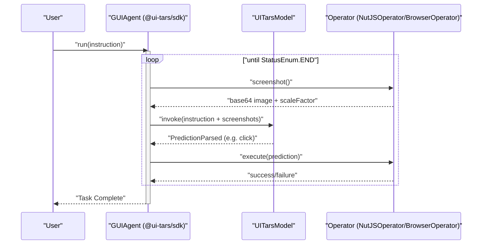

**Sources:** [packages/ui-tars/sdk/README.md:73-103](), [packages/ui-tars/sdk/README.md:11-51](), [apps/ui-tars/src/renderer/src/pages/remote/free.tsx:36-36]()

## Technology Stack

### Core Technologies

| Layer | Technologies |
|-------|-------------|
| **Runtime** | Node.js ≥22, TypeScript 5.8 [multimodal/package.json:35-44]() |
| **Package Management** | pnpm 9 (workspaces), turbo (task orchestration) [package.json:5-27]() |
| **Desktop Application** | Electron, Vite, Electron Forge [pnpm-lock.yaml:120-145]() |
| **Web Framework** | React 18, React Router [multimodal/websites/main/package.json:15-19]() |
| **UI Libraries** | NextUI, Tailwind CSS, Framer Motion [multimodal/websites/docs/package.json:13-21]() |
| **Build Tools** | Rsbuild, Rslib, Rspress [multimodal/websites/main/package.json:26-26](), [multimodal/websites/docs/package.json:6-6]() |

**Sources:** [multimodal/package.json:34-48](), [package.json:1-58](), [multimodal/websites/main/package.json:1-56]()

## Agent Execution Model

### Status Lifecycle

The system uses a state machine to track agent execution progress:

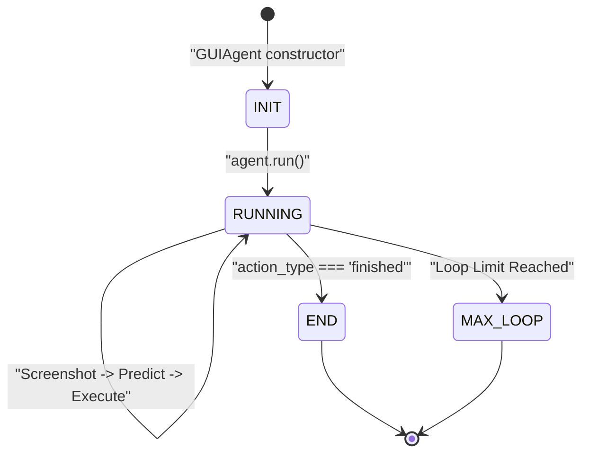

**Sources:** [packages/ui-tars/sdk/README.md:185-194](), [packages/ui-tars/sdk/README.md:181-181](), [apps/ui-tars/src/renderer/src/pages/remote/free.tsx:43-49]()

### Agent Modes

The OmniTARS agent supports specialized operational modes:

| Mode | Purpose |
|------|---------|
| **omni** | General multimodal tasks with full capabilities [multimodal/CHANGELOG.md:22-22](). |
| **gui** | Specialized for GUI automation and browser control [multimodal/CHANGELOG.md:16-16](). |
| **game** | Optimized for game interaction with enhanced error handling [multimodal/CHANGELOG.md:16-20](). |

**Sources:** [multimodal/CHANGELOG.md:16-24]()

## Development Workflow

### Monorepo Structure

The repository uses **pnpm workspaces** with packages organized into categories:

```
multimodal/
├── tarko/              # Framework (agent core, server, UI)
├── omni-tars/          # Composable agent implementation
├── gui-agent/          # GUI automation plugin
├── agent-tars/         # CLI and high-level product
└── websites/           # Documentation and main site
packages/ui-tars/       # SDK and platform operators
apps/ui-tars/           # Electron Desktop application
```

**Sources:** [multimodal/package.json:7-17](), [pnpm-lock.yaml:96-209](), [package.json:1-8]()

### Build and Release

#### Build Scripts

```bash
# Bootstrap: Build all multimodal packages in order
pnpm run bootstrap

# Build specific components
pnpm run build:tarko
pnpm run build:gui-agent
pnpm run build:agent-tars
```

#### Release Process

The repository uses **pnpm-dev-kit (pdk)** for automated releases and versioning in the `multimodal` workspace [multimodal/package.json:22-32](). The core monorepo uses `changesets` for package management [package.json:28-28]().

**Sources:** [multimodal/package.json:7-32](), [package.json:1-21]()

## Key Architectural Patterns

### Operator Abstraction

Both UI-TARS SDK and GUI Agent Plugin use the **Operator pattern** to abstract platform differences:

```typescript
// Core interface defined in @ui-tars/sdk
interface Operator {
  screenshot(): Promise<ScreenshotOutput>
  execute(params: ExecuteParams): Promise<ExecuteOutput>
}
```

**Implementations:**
- `NutJSOperator`: Local desktop control via `@computer-use/nut-js` [pnpm-lock.yaml:117-119]().
- `BrowserOperator`: Web automation via Puppeteer/Playwright [pnpm-lock.yaml:195-197]().
- `RemoteOperator`: Cloud computer/browser control via VNC [apps/ui-tars/src/renderer/src/pages/remote/free.tsx:51-80]().

**Sources:** [packages/ui-tars/sdk/README.md:198-256](), [pnpm-lock.yaml:117-200]()

### Remote Resource Management

For remote operations, the system manages a lifecycle including resource allocation and time-balancing:

- `useRemoteResource`: Hook for managing cloud instances [apps/ui-tars/src/renderer/src/pages/remote/free.tsx:69-75]().
- `VNCPreview`: Component for viewing remote desktop streams [apps/ui-tars/src/renderer/src/pages/remote/free.tsx:40-40]().
- `getTimeBalance`: Checks remaining session time (e.g., 30-minute limits) [apps/ui-tars/src/renderer/src/pages/remote/free.tsx:87-113]().

**Sources:** [apps/ui-tars/src/renderer/src/pages/remote/free.tsx:1-241]()

---

# Page: Repository Structure and Monorepo Organization

# Repository Structure and Monorepo Organization

<details>
<summary>Relevant source files</summary>

The following files were used as context for generating this wiki page:

- [.gitignore](.gitignore)
- [.lintstagedrc.mjs](.lintstagedrc.mjs)
- [.secretlintignore](.secretlintignore)
- [apps/ui-tars/e2e/app.test.ts](apps/ui-tars/e2e/app.test.ts)
- [multimodal/CHANGELOG.md](multimodal/CHANGELOG.md)
- [multimodal/agent-tars/cli/package.json](multimodal/agent-tars/cli/package.json)
- [multimodal/agent-tars/interface/package.json](multimodal/agent-tars/interface/package.json)
- [multimodal/benchmark/content-extraction/package.json](multimodal/benchmark/content-extraction/package.json)
- [multimodal/gui-agent/action-parser/package.json](multimodal/gui-agent/action-parser/package.json)
- [multimodal/omni-tars/code-agent/package.json](multimodal/omni-tars/code-agent/package.json)
- [multimodal/omni-tars/core/package.json](multimodal/omni-tars/core/package.json)
- [multimodal/omni-tars/mcp-agent/package.json](multimodal/omni-tars/mcp-agent/package.json)
- [multimodal/omni-tars/omni-agent/package.json](multimodal/omni-tars/omni-agent/package.json)
- [multimodal/package.json](multimodal/package.json)
- [multimodal/tarko/agent-cli/package.json](multimodal/tarko/agent-cli/package.json)
- [multimodal/tarko/agent-server/package.json](multimodal/tarko/agent-server/package.json)
- [multimodal/tarko/context-engineer/package.json](multimodal/tarko/context-engineer/package.json)
- [multimodal/tarko/interface/package.json](multimodal/tarko/interface/package.json)
- [multimodal/websites/docs/package.json](multimodal/websites/docs/package.json)
- [multimodal/websites/main/package.json](multimodal/websites/main/package.json)
- [package.json](package.json)
- [packages/agent-infra/browser-use/src/dom/views.test.ts](packages/agent-infra/browser-use/src/dom/views.test.ts)
- [packages/agent-infra/browser-use/src/dom/views.ts](packages/agent-infra/browser-use/src/dom/views.ts)
- [packages/agent-infra/browser-use/vitest.config.ts](packages/agent-infra/browser-use/vitest.config.ts)
- [packages/agent-infra/mcp-servers/browser/tests/utils/utils.test.ts](packages/agent-infra/mcp-servers/browser/tests/utils/utils.test.ts)
- [packages/common/configs/package.json](packages/common/configs/package.json)
- [pnpm-lock.yaml](pnpm-lock.yaml)
- [turbo.json](turbo.json)

</details>


This page describes the physical layout of the `UI-TARS-desktop` repository, how its packages are grouped, and how the build tools tie them together. It covers the root-level workspace, the `apps/`, `packages/`, and `multimodal/` directories, and the pnpm + Turbo orchestration layer.

---

## Top-Level Layout

The repository is a **pnpm monorepo** with two distinct workspaces that coexist in the same git repository but operate independently:

1.  **Root workspace** — manages the UI-TARS Desktop Electron app and all shared infrastructure packages. [package.json:1-58]()
2.  **`multimodal/` sub-monorepo** — a self-contained nested monorepo for the Agent TARS / OmniTARS multimodal stack, with its own `package.json`, pnpm lockfile, and release tooling. [multimodal/package.json:1-49]()

The root `package.json` declares `"packageManager": "pnpm@9.10.0"` and uses `turbo` as the task runner. [package.json:5-27]() The `multimodal/` workspace uses `pnpm-dev-kit` (`pdk`) for development and release management. [multimodal/package.json:10-32]()

### Workspace Configuration

The root workspace is configured via `pnpm-workspace.yaml`. Each workspace in `multimodal/` is identified by directory patterns in its own lockfile: [multimodal/pnpm-lock.yaml:7-152]()

| Workspace Pattern | Contains |
| :--- | :--- |
| `agent-tars/*` | Agent TARS core and CLI |
| `gui-agent/*` | GUI agent operators and SDK |
| `omni-tars/*` | OmniTARS multimodal agent packages |
| `tarko/*` | Tarko framework packages (agent, server, UI, LLM) |
| `benchmark/*` | Performance benchmarking tools (crawl, content-extraction) |
| `websites/*` | Documentation (Rspress) and marketing websites |

**Sources:** [package.json:1-58](), [multimodal/package.json:1-49](), [multimodal/pnpm-lock.yaml:7-152]()

---

## Root Workspace

**Directory tree (root workspace):**

```
UI-TARS-desktop/
├── apps/
│   └── ui-tars/               # Electron desktop application
├── packages/
│   ├── ui-tars/               # UI-TARS specific packages
│   │   ├── action-parser/     # @ui-tars/action-parser
│   │   ├── electron-ipc/      # @ui-tars/electron-ipc
│   │   ├── sdk/               # @ui-tars/sdk
│   │   ├── shared/            # @ui-tars/shared
│   │   ├── utio/              # @ui-tars/utio
│   │   └── operators/
│   │       ├── browser-operator/  # @ui-tars/operator-browser
│   │       └── nut-js/            # @ui-tars/operator-nut-js
│   └── common/
│       ├── configs/           # @common/configs
│       └── electron-build/    # @common/electron-build
├── multimodal/                # Sub-monorepo (Agent TARS stack)
├── infra/                     # Infrastructure tooling (e.g. agent-infra)
└── turbo.json
```

**Sources:** [pnpm-lock.yaml:96-209](), [package.json:1-58]()

---

## Package Naming Conventions

| Scope | Location | Purpose | Key Exports |
| :--- | :--- | :--- | :--- |
| `@ui-tars/*` | `packages/ui-tars/` | UI-TARS model interaction, SDK, operators | `GUIAgent`, `Operator` |
| `@agent-infra/*` | `packages/agent-infra/` | Shared infrastructure: browser, search, MCP | `BrowserContext`, `MCPClient` |
| `@common/*` | `packages/common/` | Shared ESLint/TS configs, Electron build helpers | Shared configs |
| `apps/ui-tars` | `apps/ui-tars/` | The Electron application itself | Main and renderer processes |

**Sources:** [pnpm-lock.yaml:96-209](), [multimodal/pnpm-lock.yaml:79-108]()

---

## Root Workspace Dependency Graph

**Diagram: Root workspace internal dependencies**

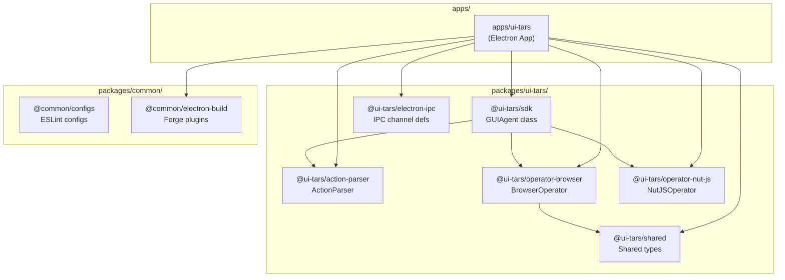

**Sources:** [pnpm-lock.yaml:96-209](), [package.json:1-58]()

---

## `multimodal/` Sub-Monorepo

The `multimodal/` directory is a **separate pnpm workspace** with its own `package.json` and lockfile. [multimodal/package.json:1-49]()

**Directory tree (`multimodal/`):**

```
multimodal/
├── tarko/                     # @tarko/* packages (base framework)
│   ├── agent/                 # @tarko/agent - Agent class, Runner
│   ├── agent-server/          # @tarko/agent-server - Express server
│   ├── agent-cli/             # @tarko/agent-cli - CLI entry point
│   ├── ui/                    # @tarko/ui - Shared UI primitives
│   ├── interface/             # @tarko/interface - High-level interfaces
│   ├── mcp-agent/             # @tarko/mcp-agent - MCP integration
│   ├── llm-client/            # @tarko/llm-client - Multi-provider SDK
│   └── shared-utils/          # @tarko/shared-utils - Utilities
├── gui-agent/                 # GUI agent packages
│   ├── action-parser/         # @gui-agent/action-parser
│   ├── agent-sdk/             # @gui-agent/agent-sdk
│   └── operator-browser/      # @gui-agent/operator-browser
├── agent-tars/                # @agent-tars/* packages
│   ├── core/                  # @agent-tars/core - AgentTARS class
│   ├── cli/                   # @agent-tars/cli - agent-tars CLI
│   └── interface/             # @agent-tars/interface - Types
├── omni-tars/                 # OmniTARS multimodal agent
│   ├── core/                  # @omni-tars/core - ComposableAgent
│   ├── code-agent/            # @omni-tars/code-agent - Sandbox execution
│   ├── gui-agent/             # @omni-tars/gui-agent - GUI control
│   ├── mcp-agent/             # @omni-tars/mcp-agent - MCP Plugin
│   └── omni-agent/            # @omni-tars/omni-agent - Configured agent
└── websites/
    ├── docs/                  # @agent-tars/docs (rspress documentation)
    └── main/                  # @agent-tars/website (rsbuild website)
```

**Sources:** [multimodal/package.json:1-49](), [multimodal/pnpm-lock.yaml:1-152](), [multimodal/websites/docs/package.json:1-30](), [multimodal/websites/main/package.json:1-56](), [multimodal/omni-tars/omni-agent/package.json:28-34](), [multimodal/omni-tars/code-agent/package.json:28-33]()

---

## `multimodal/` Build Order

The `bootstrap` script in `multimodal/package.json` reveals the build dependency order. It ensures that the base frameworks are built before the specialized agents that depend on them. [multimodal/package.json:7-17]()

```bash
pnpm --filter "./tarko/**" build && 
pnpm --filter "./gui-agent/**" build && 
pnpm --filter "./agent-tars/**" build && 
pnpm --filter "./omni-tars/**" build
```

**Sources:** [multimodal/package.json:7-17]()

---

## `multimodal/` Package Dependency Graph

**Diagram: multimodal sub-monorepo layers**

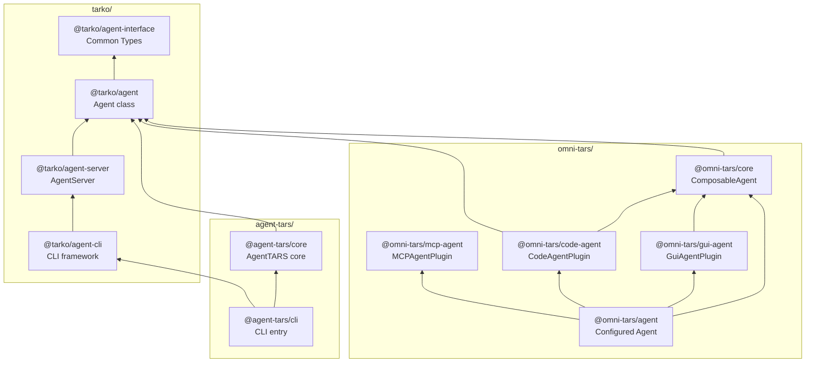

**Sources:** [multimodal/package.json:7-17](), [multimodal/omni-tars/omni-agent/package.json:28-34](), [multimodal/omni-tars/code-agent/package.json:28-33](), [multimodal/tarko/agent-server/package.json:21-26](), [multimodal/tarko/agent-cli/package.json:28-37]()

---

## Build Tooling

### Root Workspace: Turbo

The root workspace uses **Turbo** (`turbo ^2.4.4`) to orchestrate parallel builds across packages. [package.json:27-27]() The primary Turbo task is `dev:ui-tars`. [package.json:12-12]()

### Multimodal Workspace: PDK (pnpm-dev-kit)

The `multimodal/` sub-monorepo uses `pdk` (`pnpm-dev-kit`) for development and release orchestration: [multimodal/package.json:10-32]()

*   `pdk d`: Development mode. [multimodal/package.json:10-10]()
*   `pdk release`: Handles version bumping and publishing. [multimodal/package.json:22-22]()
*   `pdk changelog`: Generates changelogs from git history. [multimodal/package.json:31-31]()
*   `pdk patch`: Applies small version patches. [multimodal/package.json:32-32]()

### Package Build Tool: Rslib & Rsbuild

Many packages in the `multimodal/` workspace use **rslib** for libraries and **rsbuild** for applications. The websites use **rsbuild** or **rspress**. [multimodal/websites/main/package.json:26-26](), [multimodal/websites/docs/package.json:6-8](), [multimodal/omni-tars/code-agent/package.json:23-24](), [multimodal/tarko/agent-server/package.json:29-29]()

---

## Node.js Engine Requirements

| Workspace | Node.js Requirement | pnpm Version |
| :--- | :--- | :--- |
| Root workspace | `>=20.x` | `9.10.0` |
| `multimodal/` | `>=22` | `9` |

**Sources:** [package.json:5-56](), [multimodal/package.json:34-37]()

---

# Page: Multimodal Agent Stack (Agent TARS / OmniTARS)

# Multimodal Agent Stack (Agent TARS / OmniTARS)

<details>
<summary>Relevant source files</summary>

The following files were used as context for generating this wiki page:

- [multimodal/.gitignore](multimodal/.gitignore)
- [multimodal/agent-tars/cli/src/index.ts](multimodal/agent-tars/cli/src/index.ts)
- [multimodal/agent-tars/interface/src/constants.ts](multimodal/agent-tars/interface/src/constants.ts)
- [multimodal/omni-tars/code-agent/src/CodeAgentPlugin.ts](multimodal/omni-tars/code-agent/src/CodeAgentPlugin.ts)
- [multimodal/omni-tars/code-agent/src/index.ts](multimodal/omni-tars/code-agent/src/index.ts)
- [multimodal/omni-tars/code-agent/src/tools/ExcuteBash.ts](multimodal/omni-tars/code-agent/src/tools/ExcuteBash.ts)
- [multimodal/omni-tars/code-agent/src/tools/JupyterCI.ts](multimodal/omni-tars/code-agent/src/tools/JupyterCI.ts)
- [multimodal/omni-tars/code-agent/src/tools/StrReplaceEditor.ts](multimodal/omni-tars/code-agent/src/tools/StrReplaceEditor.ts)
- [multimodal/omni-tars/code-agent/tarko.config.ts](multimodal/omni-tars/code-agent/tarko.config.ts)
- [multimodal/omni-tars/core/src/AgentComposer.ts](multimodal/omni-tars/core/src/AgentComposer.ts)
- [multimodal/omni-tars/core/src/AgentPlugin.ts](multimodal/omni-tars/core/src/AgentPlugin.ts)
- [multimodal/omni-tars/core/src/ComposableAgent.ts](multimodal/omni-tars/core/src/ComposableAgent.ts)
- [multimodal/omni-tars/core/src/environments/code.ts](multimodal/omni-tars/core/src/environments/code.ts)
- [multimodal/omni-tars/core/src/utils/hepler.ts](multimodal/omni-tars/core/src/utils/hepler.ts)
- [multimodal/omni-tars/core/src/utils/parser.ts](multimodal/omni-tars/core/src/utils/parser.ts)
- [multimodal/omni-tars/gui-agent/tarko.config.ts](multimodal/omni-tars/gui-agent/tarko.config.ts)
- [multimodal/omni-tars/mcp-agent/src/McpAgentPlugin.ts](multimodal/omni-tars/mcp-agent/src/McpAgentPlugin.ts)
- [multimodal/omni-tars/mcp-agent/src/index.ts](multimodal/omni-tars/mcp-agent/src/index.ts)
- [multimodal/omni-tars/mcp-agent/src/tools/linkReader.ts](multimodal/omni-tars/mcp-agent/src/tools/linkReader.ts)
- [multimodal/omni-tars/mcp-agent/src/tools/mcp.ts](multimodal/omni-tars/mcp-agent/src/tools/mcp.ts)
- [multimodal/omni-tars/mcp-agent/tarko.config.ts](multimodal/omni-tars/mcp-agent/tarko.config.ts)
- [multimodal/omni-tars/omni-agent/.env.example](multimodal/omni-tars/omni-agent/.env.example)
- [multimodal/omni-tars/omni-agent/src/index.ts](multimodal/omni-tars/omni-agent/src/index.ts)
- [multimodal/tarko/agent-server-next/src/middlewares/access-log.ts](multimodal/tarko/agent-server-next/src/middlewares/access-log.ts)
- [multimodal/tarko/agent-server-next/src/middlewares/session-restore.ts](multimodal/tarko/agent-server-next/src/middlewares/session-restore.ts)
- [multimodal/tarko/agent-ui/src/standalone/components/ThemeToggle.tsx](multimodal/tarko/agent-ui/src/standalone/components/ThemeToggle.tsx)
- [multimodal/tarko/agent-ui/src/standalone/components/index.ts](multimodal/tarko/agent-ui/src/standalone/components/index.ts)
- [multimodal/tarko/agent-ui/src/standalone/home/CreatingPage.tsx](multimodal/tarko/agent-ui/src/standalone/home/CreatingPage.tsx)
- [multimodal/tarko/agent-ui/src/standalone/home/WelcomeCards.tsx](multimodal/tarko/agent-ui/src/standalone/home/WelcomeCards.tsx)
- [multimodal/tarko/agent-ui/src/standalone/home/WelcomePage.tsx](multimodal/tarko/agent-ui/src/standalone/home/WelcomePage.tsx)
- [multimodal/tarko/interface/src/web-ui-implementation.ts](multimodal/tarko/interface/src/web-ui-implementation.ts)

</details>


## Purpose and Scope

The multimodal agent stack lives entirely within the `multimodal/` sub-monorepo and contains two distinct but related agent systems:

- **Agent TARS** (`agent-tars/` packages) — A feature-rich agentic system with built-in browser management, search tools, planner, and environment abstraction for local vs. AIO sandbox execution. It is primarily executed via the `AgentTARSCLI` [multimodal/agent-tars/cli/src/index.ts:56-60]().
- **OmniTARS** (`omni-tars/` packages) — A composable plugin-based framework that orchestrates GUI, code, and MCP capabilities through the `ComposableAgent` + `AgentPlugin` architecture [multimodal/omni-tars/core/src/ComposableAgent.ts:24-47]().

Both systems are built on the Tarko framework (Section 4) and are served by the `@tarko/agent-cli` CLI. For specific plugin implementations, see child pages 3.1–3.5. For the UI-TARS Desktop application, see Section 5.

---

## Sub-monorepo Organization

The `multimodal/` directory is a self-contained pnpm workspace. Packages are organized to support the composition of specialized agents from shared infrastructure.

### Package Groups

| Group | npm scope | Contents |
|-------|-----------|----------|
| Tarko framework | `@tarko/` | `agent`, `agent-cli`, `agent-server`, `agent-ui`, `interface` |
| GUI agent | `@gui-agent/` | `action-parser`, `operator-browser`, `agent-sdk` |
| Agent TARS | `@agent-tars/` | `core`, `interface`, `cli` |
| OmniTARS | `@omni-tars/` | `core`, `gui-agent`, `code-agent`, `mcp-agent`, `omni-agent` |

**Diagram: Multimodal Sub-monorepo Package Groups**

```mermaid
graph TB
    subgraph "multimodal/"
        subgraph "tarko/"
            ["@tarko/agent"]
            ["@tarko/agent-cli"]
            ["@tarko/interface"]
            ["@tarko/agent-ui"]
        end
        subgraph "agent-tars/"
            ["@agent-tars/core"]
            ["@agent-tars/cli"]
        end
        subgraph "omni-tars/"
            ["@omni-tars/core"]
            ["@omni-tars/gui-agent"]
            ["@omni-tars/code-agent"]
            ["@omni-tars/mcp-agent"]
            ["@omni-tars/omni-agent"]
        end
    end

    ["@tarko/agent"] --> ["@agent-tars/core"]
    ["@tarko/agent"] --> ["@omni-tars/core"]
    ["@omni-tars/core"] --> ["@omni-tars/gui-agent"]
    ["@omni-tars/core"] --> ["@omni-tars/code-agent"]
    ["@omni-tars/core"] --> ["@omni-tars/mcp-agent"]
    ["@omni-tars/omni-agent"] --> ["@omni-tars/core"]
```

Sources: [multimodal/omni-tars/omni-agent/src/index.ts:6-8](), [multimodal/agent-tars/cli/src/index.ts:6-15](), [multimodal/omni-tars/core/src/ComposableAgent.ts:6-12]()

---

## Architecture Overview

**Diagram: High-Level Agent Stack — Both Systems**

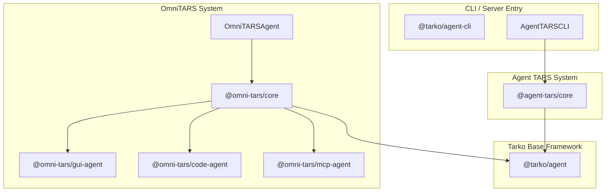

**Diagram: OmniTARS Composition Stack (Code-level Entities)**

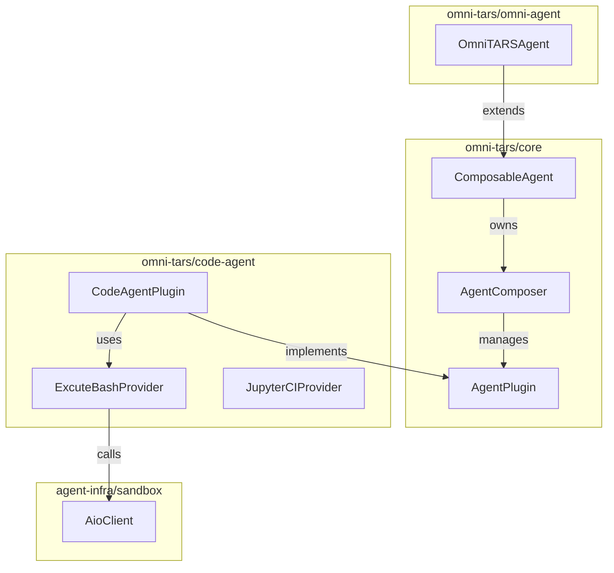

Sources: [multimodal/omni-tars/core/src/ComposableAgent.ts:24-96](), [multimodal/omni-tars/omni-agent/src/index.ts:11-12](), [multimodal/omni-tars/core/src/AgentComposer.ts:12-18](), [multimodal/omni-tars/code-agent/src/CodeAgentPlugin.ts:18-39](), [multimodal/omni-tars/code-agent/src/tools/ExcuteBash.ts:8-32]()

---

## OmniTARS Agent System

The OmniTARS system is built on a three-layer architecture within the `omni-tars/` workspace, utilizing a composable plugin system to extend the capabilities of the base LLM. For deep technical details on the architecture, see [OmniTARS Agent Architecture and Plugin System](#3.1).

### OmniTARSAgent Class

The `OmniTARSAgent` class serves as the entry point. It extends `ComposableAgent` and provides static configuration for the web UI [multimodal/omni-tars/omni-agent/src/index.ts:11-14]().

| Property | Type | Description |
|----------|------|-------------|
| `label` | `string` | Static label "Omni Agent" [multimodal/omni-tars/omni-agent/src/index.ts:12-12]() |
| `webuiConfig` | `AgentWebUIImplementation` | UI configuration including welcome cards and branding [multimodal/omni-tars/omni-agent/src/index.ts:14-20]() |

---

## ComposableAgent and Plugins

The `ComposableAgent` class provides the core plugin composition mechanism. It delegates lifecycle events (like `onLLMRequest`, `onEachAgentLoopStart`) to registered plugins through the `AgentComposer` [multimodal/omni-tars/core/src/ComposableAgent.ts:61-86]().

- **Plugin System:** Plugins like `CodeAgentPlugin` implement specific toolsets and handle environment-specific logic [multimodal/omni-tars/code-agent/src/CodeAgentPlugin.ts:18-42]().
- **Sandbox Execution:** The `CodeAgentPlugin` utilizes an `AioClient` to interact with a remote sandbox for bash execution and Jupyter notebook integration [multimodal/omni-tars/code-agent/src/CodeAgentPlugin.ts:28-39](). Details in [Code Agent and Sandbox Execution](#3.4).
- **MCP Integration:** External tools are integrated via the Model Context Protocol. See [MCP Agent Integration](#3.5).

---

## Agent Mode System

OmniTARS supports specialized operational modes (e.g., `omni`, `gui`, `game`) which are often triggered by user selection in the UI.

### Game Mode
Specialized for automated game playing, `game` mode is configured in `welcomeCards` with specific `agentOptions` and `browserMode: 'hybrid'` [multimodal/omni-tars/omni-agent/src/index.ts:27-33](). When a game card is clicked, the `WelcomeCards` component sets `runtimeSettings.agentMode = 'game'` [multimodal/tarko/agent-ui/src/standalone/home/WelcomeCards.tsx:51-53]().

### Prompt Engineering
The `AgentComposer` dynamically generates system prompts by combining `CODE_ENVIRONMENT`, `MCP_ENVIRONMENT`, and `COMPUTER_ENVIRONMENT` sections from all registered plugins [multimodal/omni-tars/core/src/AgentComposer.ts:44-64](). For details on the T5 prompt format, see [T5 Prompt Format and Streaming Parser](#3.7).

---

## Web UI Configuration

The `AgentWebUIImplementation` interface defines how the agent appears to the user, including welcome cards, navigation items, and layout settings [multimodal/tarko/interface/src/web-ui-implementation.ts:196-234]().

- **Welcome Cards:** Pre-configured tasks grouped by category (Game, Research, Code) with specific `agentOptions` [multimodal/omni-tars/omni-agent/src/index.ts:20-180](). The `WelcomeCards` component handles grouping and navigation to the `CreatingPage` [multimodal/tarko/agent-ui/src/standalone/home/WelcomeCards.tsx:24-69]().
- **CreatingPage:** Orchestrates session initialization by gathering `runtimeSettings` and `agentOptions` from the router state, global atoms, or URL parameters before calling `createSession` [multimodal/tarko/agent-ui/src/standalone/home/CreatingPage.tsx:39-92]().
- **Workspace Navigation:** Defines how tools like Code Server or VNC are embedded in the UI via `navItems` [multimodal/tarko/interface/src/web-ui-implementation.ts:34-65]().

For a full breakdown of UI settings, see [OmniTARS Web UI Configuration](#3.2).

---

## Child Pages

- [OmniTARS Agent Architecture and Plugin System](#3.1)
- [OmniTARS Web UI Configuration](#3.2)
- [GUI Agent Plugin and Screenshot Processing](#3.3)
- [Code Agent and Sandbox Execution](#3.4)
- [MCP Agent Integration](#3.5)
- [Agent Mode Configuration and Tool Call Engines](#3.6)
- [T5 Prompt Format and Streaming Parser](#3.7)

---

# Page: OmniTARS Agent Architecture and Plugin System

# OmniTARS Agent Architecture and Plugin System

<details>
<summary>Relevant source files</summary>

The following files were used as context for generating this wiki page:

- [multimodal/.gitignore](multimodal/.gitignore)
- [multimodal/omni-tars/code-agent/src/CodeAgentPlugin.ts](multimodal/omni-tars/code-agent/src/CodeAgentPlugin.ts)
- [multimodal/omni-tars/code-agent/src/index.ts](multimodal/omni-tars/code-agent/src/index.ts)
- [multimodal/omni-tars/code-agent/src/tools/ExcuteBash.ts](multimodal/omni-tars/code-agent/src/tools/ExcuteBash.ts)
- [multimodal/omni-tars/code-agent/src/tools/JupyterCI.ts](multimodal/omni-tars/code-agent/src/tools/JupyterCI.ts)
- [multimodal/omni-tars/code-agent/src/tools/StrReplaceEditor.ts](multimodal/omni-tars/code-agent/src/tools/StrReplaceEditor.ts)
- [multimodal/omni-tars/code-agent/tarko.config.ts](multimodal/omni-tars/code-agent/tarko.config.ts)
- [multimodal/omni-tars/core/src/AgentComposer.ts](multimodal/omni-tars/core/src/AgentComposer.ts)
- [multimodal/omni-tars/core/src/AgentPlugin.ts](multimodal/omni-tars/core/src/AgentPlugin.ts)
- [multimodal/omni-tars/core/src/ComposableAgent.ts](multimodal/omni-tars/core/src/ComposableAgent.ts)
- [multimodal/omni-tars/core/src/environments/code.ts](multimodal/omni-tars/core/src/environments/code.ts)
- [multimodal/omni-tars/core/src/utils/hepler.ts](multimodal/omni-tars/core/src/utils/hepler.ts)
- [multimodal/omni-tars/core/src/utils/parser.ts](multimodal/omni-tars/core/src/utils/parser.ts)
- [multimodal/omni-tars/gui-agent/tarko.config.ts](multimodal/omni-tars/gui-agent/tarko.config.ts)
- [multimodal/omni-tars/mcp-agent/src/McpAgentPlugin.ts](multimodal/omni-tars/mcp-agent/src/McpAgentPlugin.ts)
- [multimodal/omni-tars/mcp-agent/src/index.ts](multimodal/omni-tars/mcp-agent/src/index.ts)
- [multimodal/omni-tars/mcp-agent/src/tools/linkReader.ts](multimodal/omni-tars/mcp-agent/src/tools/linkReader.ts)
- [multimodal/omni-tars/mcp-agent/src/tools/mcp.ts](multimodal/omni-tars/mcp-agent/src/tools/mcp.ts)
- [multimodal/omni-tars/mcp-agent/tarko.config.ts](multimodal/omni-tars/mcp-agent/tarko.config.ts)
- [multimodal/omni-tars/omni-agent/.env.example](multimodal/omni-tars/omni-agent/.env.example)
- [multimodal/tarko/agent-server-next/src/middlewares/access-log.ts](multimodal/tarko/agent-server-next/src/middlewares/access-log.ts)
- [multimodal/tarko/agent-server-next/src/middlewares/session-restore.ts](multimodal/tarko/agent-server-next/src/middlewares/session-restore.ts)

</details>


This page documents the OmniTARS agent architecture built on the `ComposableAgent` base class, the `AgentPlugin` interface, and the `AgentComposer` orchestration system. This architecture lives in the `@omni-tars/core` package and enables composition of specialized agent capabilities (GUI automation, code execution, MCP integration) through a plugin-based design.

For documentation of the `Agent` base class that `ComposableAgent` extends, see [4.1](). For details on the specific plugin implementations — GUI, Code, and MCP — see [3.3](), [3.4](), and [3.5](). For agent mode configuration and tool call engine selection, see [3.6]().

---

## Overview

The OmniTARS agent system provides a composable architecture where specialized capabilities are added through **plugins**. Each plugin contributes:
- A set of `Tool` instances available to the LLM
- An `environmentSection` string that becomes part of the system prompt
- Lifecycle hooks executed at defined points during agent execution

The core abstractions are:

| Class | Package | File | Role |
|---|---|---|---|
| `AgentPlugin` | `@omni-tars/core` | [multimodal/omni-tars/core/src/AgentPlugin.ts:11-11]() | Base class for all plugins |
| `AgentComposer` | `@omni-tars/core` | [multimodal/omni-tars/core/src/AgentComposer.ts:12-12]() | Orchestrates a list of plugins |
| `ComposableAgent` | `@omni-tars/core` | [multimodal/omni-tars/core/src/ComposableAgent.ts:24-24]() | `Agent` subclass that delegates to `AgentComposer` |

**Package relationship diagram:**

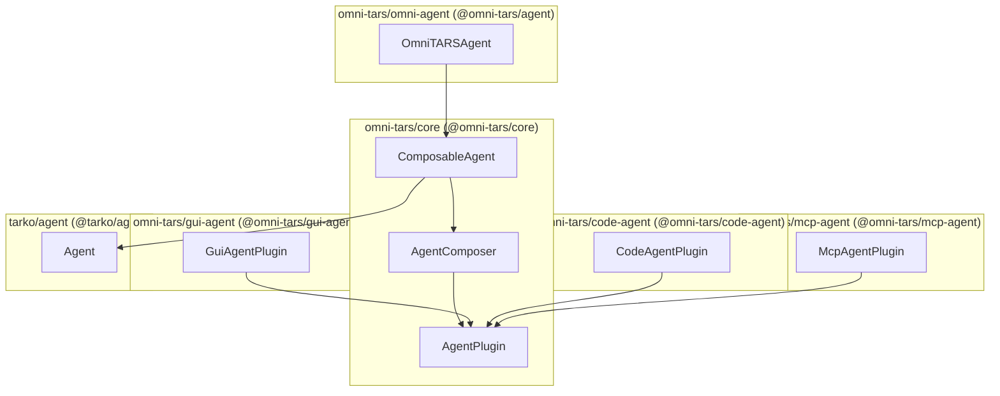

Sources: [multimodal/omni-tars/core/src/ComposableAgent.ts:24-25](), [multimodal/omni-tars/core/src/AgentComposer.ts:12-13](), [multimodal/omni-tars/core/src/AgentPlugin.ts:11-12]()

---

## `AgentPlugin` — Base Class

All plugins extend `AgentPlugin` from [multimodal/omni-tars/core/src/AgentPlugin.ts]().

### Properties

| Property | Type | Description |
|---|---|---|
| `name` | `string \| undefined` | Unique identifier for the plugin [multimodal/omni-tars/core/src/AgentPlugin.ts:13-13]() |
| `environmentSection` | `string \| undefined` | Text block injected into the system prompt [multimodal/omni-tars/core/src/AgentPlugin.ts:15-15]() |
| `tools` | `Tool[]` | Tools registered by this plugin [multimodal/omni-tars/core/src/AgentPlugin.ts:18-18]() |
| `_agent` | `Agent \| undefined` | Private reference to the parent agent, set by `AgentComposer` [multimodal/omni-tars/core/src/AgentPlugin.ts:17-17]() |

### Methods

| Method | Purpose |
|---|---|
| `setAgent(agent)` | Called by `AgentComposer` to inject the agent instance [multimodal/omni-tars/core/src/AgentPlugin.ts:27-29]() |
| `getTools()` | Returns the plugin's `tools` array [multimodal/omni-tars/core/src/AgentPlugin.ts:32-34]() |
| `initialize()` | Optional async setup, called once before agent starts [multimodal/omni-tars/core/src/AgentPlugin.ts:37-37]() |
| `onLLMRequest(id, payload)` | Hook fired before each LLM call [multimodal/omni-tars/core/src/AgentPlugin.ts:40-42]() |
| `onLLMResponse(id, payload)` | Hook fired after each LLM response [multimodal/omni-tars/core/src/AgentPlugin.ts:45-47]() |
| `onEachAgentLoopStart()` | Hook fired at start of reasoning iteration [multimodal/omni-tars/core/src/AgentPlugin.ts:50-52]() |
| `onEachAgentLoopEnd()` | Hook fired at end of reasoning iteration [multimodal/omni-tars/core/src/AgentPlugin.ts:55-57]() |
| `onAgentLoopEnd()` | Hook fired when the entire agent run finishes [multimodal/omni-tars/core/src/AgentPlugin.ts:60-62]() |
| `onAfterToolCall(...)` | Hook fired after a tool has returned a result [multimodal/omni-tars/core/src/AgentPlugin.ts:65-71]() |

Sources: [multimodal/omni-tars/core/src/AgentPlugin.ts:11-72]()

### Plugin Lifecycle

**Plugin initialization and hook execution flow:**

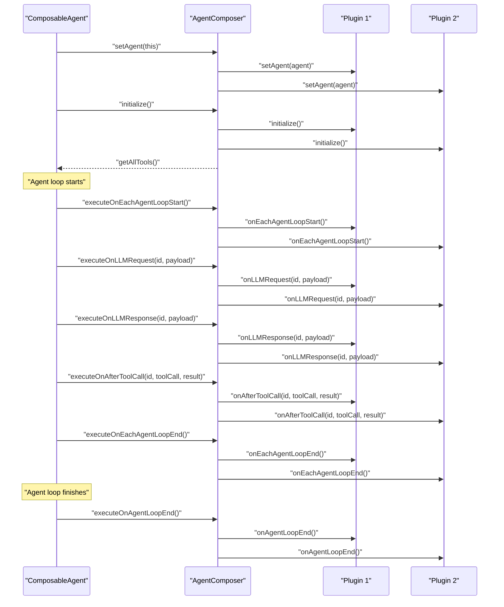

Sources: [multimodal/omni-tars/core/src/AgentPlugin.ts:11-72](), [multimodal/omni-tars/core/src/AgentComposer.ts:33-143](), [multimodal/omni-tars/core/src/ComposableAgent.ts:49-95]()

---

## `AgentComposer` — Plugin Orchestrator

`AgentComposer` in [multimodal/omni-tars/core/src/AgentComposer.ts]() holds a list of `AgentPlugin` instances and provides:

1. **Agent injection** — `setAgent(agent)` propagates the `Agent` reference [multimodal/omni-tars/core/src/AgentComposer.ts:24-28]()
2. **Sequential initialization** — `initialize()` calls each plugin's setup in order [multimodal/omni-tars/core/src/AgentComposer.ts:33-39]()
3. **Tool aggregation** — `getAllTools()` flat-maps all `plugin.getTools()` arrays [multimodal/omni-tars/core/src/AgentComposer.ts:69-71]()
4. **System prompt generation** — `generateSystemPrompt()` combines environment sections [multimodal/omni-tars/core/src/AgentComposer.ts:44-64]()
5. **Hook fan-out** — Each `execute*` method iterates all plugins and calls corresponding hooks [multimodal/omni-tars/core/src/AgentComposer.ts:76-143]()

### System Prompt Composition

`generateSystemPrompt()` builds the system prompt in three parts:

| Part | Source |
|---|---|
| Base preamble | Hard-coded instructions including `<think>` tag requirements [multimodal/omni-tars/core/src/AgentComposer.ts:49-52]() |
| Environment sections | Each plugin's `environmentSection` property joined with `\n\n` [multimodal/omni-tars/core/src/AgentComposer.ts:55-58]() |
| Usage instructions | `generateUsageInstructions()`, dynamically built from present plugins [multimodal/omni-tars/core/src/AgentComposer.ts:61-63]() |

The `generateUsageInstructions()` method uses `hasPlugin(type)` to check for 'code', 'mcp', or 'gui' plugins. The resulting `<IMPORTANT_NOTE>` block tells the LLM which environment XML tags (e.g., `<code_env>`, `<mcp_env>`, `<computer_env>`) to use [multimodal/omni-tars/core/src/AgentComposer.ts:182-214]().

---

## `ComposableAgent` — The Main Agent Class

`ComposableAgent` in [multimodal/omni-tars/core/src/ComposableAgent.ts]() extends `Agent` from `@tarko/agent` and wires the plugin layer into the execution lifecycle.

### Constructor

```typescript
export interface ComposableAgentOptions extends AgentOptions {
  plugins: AgentPlugin[];
}
```

The constructor strips `plugins` out of the options before passing them to `super()` to prevent circular reference errors [multimodal/omni-tars/core/src/ComposableAgent.ts:28-37](). It then constructs the `AgentComposer` and calls `composer.setAgent(this)` [multimodal/omni-tars/core/src/ComposableAgent.ts:30-40]().

### `initialize()`

[multimodal/omni-tars/core/src/ComposableAgent.ts:49-59]()

```typescript
async initialize(): Promise<void> {
  await this.composer.initialize();

  // Register all tools from all plugins
  const tools = this.composer.getAllTools();
  for (const tool of tools) {
    this.registerTool(tool);
  }

  await super.initialize();
}
```

This is the point where all plugin-contributed tools are registered with the underlying `Agent`.

---

## Specialized Plugin Implementations

### `CodeAgentPlugin` (`@omni-tars/code-agent`)

The `CodeAgentPlugin` handles the `CODE_ENVIRONMENT` for bash execution and file editing.

| Feature | Implementation |
|---|---|
| Environment Section | `CODE_ENVIRONMENT` defined in [multimodal/omni-tars/core/src/environments/code.ts:18-78]() |
| Sandbox Client | `AioClient` for remote execution with `sandboxUrl` [multimodal/omni-tars/code-agent/src/CodeAgentPlugin.ts:28-32]() |
| Provided Tools | `ExcuteBashProvider`, `JupyterCIProvider`, `StrReplaceEditorProvider` [multimodal/omni-tars/code-agent/src/CodeAgentPlugin.ts:35-39]() |

The `execute_bash` tool specifically uses `AioClient.shellExec` to run commands in the sandbox [multimodal/omni-tars/code-agent/src/tools/ExcuteBash.ts:22-30]().

### `McpAgentPlugin` (`@omni-tars/mcp-agent`)

The `McpAgentPlugin` integrates Model Context Protocol servers.

| Feature | Implementation |
|---|---|
| Manager | `McpManager` handles multiple server connections [multimodal/omni-tars/mcp-agent/src/McpAgentPlugin.ts:27-29]() |
| Built-in Servers | Tavily, Google Search, and LinkReader via `streamable-http` [multimodal/omni-tars/mcp-agent/src/index.ts:26-58]() |
| Tool Providers | `SearchToolProvider` and `LinkReaderToolProvider` [multimodal/omni-tars/mcp-agent/src/McpAgentPlugin.ts:38-39]() |

Sources: [multimodal/omni-tars/mcp-agent/src/McpAgentPlugin.ts:19-42](), [multimodal/omni-tars/mcp-agent/src/index.ts:24-60]()

---

## Data Flow: Tool Registration

**How plugins contribute tools to the agent:**

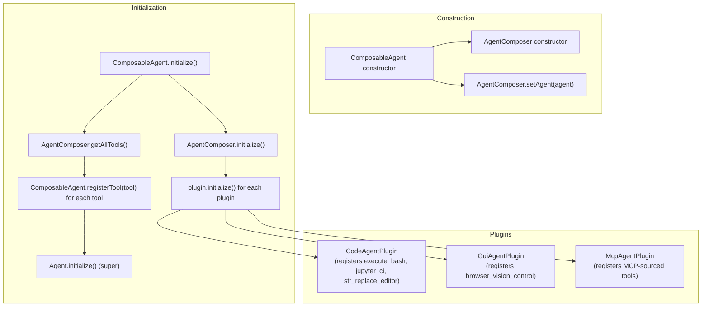

Sources: [multimodal/omni-tars/core/src/ComposableAgent.ts:27-59](), [multimodal/omni-tars/core/src/AgentComposer.ts:33-71](), [multimodal/omni-tars/code-agent/src/CodeAgentPlugin.ts:35-39]()

---

# Page: OmniTARS Web UI Configuration

# OmniTARS Web UI Configuration

<details>
<summary>Relevant source files</summary>

The following files were used as context for generating this wiki page:

- [multimodal/agent-tars/cli/src/index.ts](multimodal/agent-tars/cli/src/index.ts)
- [multimodal/agent-tars/core/src/webui-config.ts](multimodal/agent-tars/core/src/webui-config.ts)
- [multimodal/agent-tars/interface/src/constants.ts](multimodal/agent-tars/interface/src/constants.ts)
- [multimodal/omni-tars/omni-agent/src/index.ts](multimodal/omni-tars/omni-agent/src/index.ts)
- [multimodal/tarko/agent-ui/src/common/components/JsonRenderer.tsx](multimodal/tarko/agent-ui/src/common/components/JsonRenderer.tsx)
- [multimodal/tarko/agent-ui/src/common/state/actions/eventProcessors/EventHandlerRegistry.ts](multimodal/tarko/agent-ui/src/common/state/actions/eventProcessors/EventHandlerRegistry.ts)
- [multimodal/tarko/agent-ui/src/common/state/actions/eventProcessors/handlers/RawEventsHandler.ts](multimodal/tarko/agent-ui/src/common/state/actions/eventProcessors/handlers/RawEventsHandler.ts)
- [multimodal/tarko/agent-ui/src/common/state/actions/eventProcessors/index.ts](multimodal/tarko/agent-ui/src/common/state/actions/eventProcessors/index.ts)
- [multimodal/tarko/agent-ui/src/common/state/atoms/eventStreamModal.ts](multimodal/tarko/agent-ui/src/common/state/atoms/eventStreamModal.ts)
- [multimodal/tarko/agent-ui/src/standalone/app/Layout/index.tsx](multimodal/tarko/agent-ui/src/standalone/app/Layout/index.tsx)
- [multimodal/tarko/agent-ui/src/standalone/components/ThemeToggle.tsx](multimodal/tarko/agent-ui/src/standalone/components/ThemeToggle.tsx)
- [multimodal/tarko/agent-ui/src/standalone/components/index.ts](multimodal/tarko/agent-ui/src/standalone/components/index.ts)
- [multimodal/tarko/agent-ui/src/standalone/home/CreatingPage.tsx](multimodal/tarko/agent-ui/src/standalone/home/CreatingPage.tsx)
- [multimodal/tarko/agent-ui/src/standalone/home/WelcomeCards.tsx](multimodal/tarko/agent-ui/src/standalone/home/WelcomeCards.tsx)
- [multimodal/tarko/agent-ui/src/standalone/home/WelcomePage.tsx](multimodal/tarko/agent-ui/src/standalone/home/WelcomePage.tsx)
- [multimodal/tarko/agent-ui/src/standalone/modals/EventStreamModal.tsx](multimodal/tarko/agent-ui/src/standalone/modals/EventStreamModal.tsx)
- [multimodal/tarko/agent-ui/src/standalone/sidebar/ToolBar.tsx](multimodal/tarko/agent-ui/src/standalone/sidebar/ToolBar.tsx)
- [multimodal/tarko/interface/src/web-ui-implementation.ts](multimodal/tarko/interface/src/web-ui-implementation.ts)

</details>


## Overview

This document details the Web UI configuration system for OmniTARS agents, which allows agents to customize their web interface presentation, welcome experience, workspace navigation, and UI behavior. The configuration is defined through the `AgentWebUIImplementation` interface and implemented as a static property on agent classes.

For information about the broader OmniTARS agent architecture and plugin composition, see [OmniTARS Agent Architecture and Plugin System](3.1). For details on runtime settings and mode selection that affect agent behavior, see [Agent Mode Configuration and Tool Call Engines](3.6).

---

## AgentWebUIImplementation Interface Structure

### Type Definitions and Core Interfaces

The web UI configuration system is defined in the `@tarko/interface` package through a set of TypeScript interfaces that control all aspects of the UI presentation.

**Interface Hierarchy Diagram**

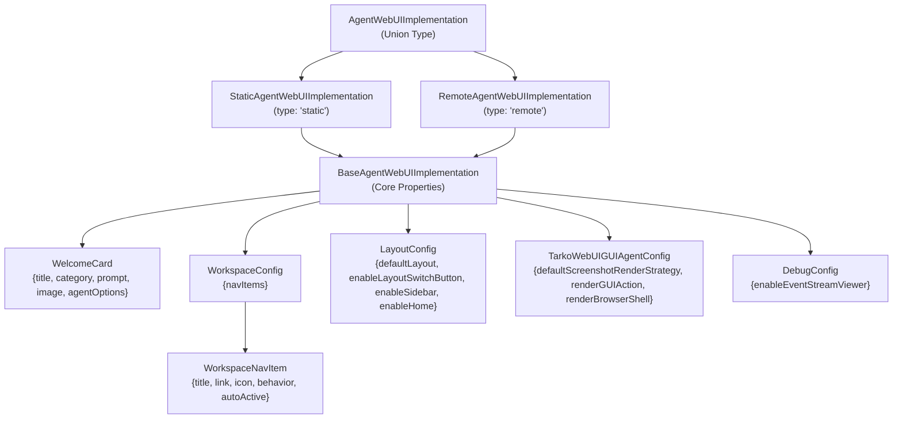

**Sources:** [multimodal/tarko/interface/src/web-ui-implementation.ts:7-314]()

### Base Configuration Properties

The `BaseAgentWebUIImplementation` interface defines the fundamental UI presentation properties:

| Property | Type | Default | Description |
|----------|------|---------|-------------|
| `type` | `'static' \| 'remote'` | `'static'` | Implementation type for UI serving |
| `logo` | `string` | Tarko logo URL | Logo image URL displayed in navbar |
| `title` | `string` | Agent name | Site title shown in navbar and meta tags |
| `subtitle` | `string` | Agent subtitle | Subtitle for home page and SEO |
| `welcomTitle` | `string` | Same as `title` | Hero title on welcome page |
| `welcomePrompts` | `string[]` | `[]` | Quick prompt suggestions on home page |
| `welcomeCards` | `WelcomeCard[]` | `[]` | Interactive cards for common tasks |
| `enableContextualSelector` | `boolean` | `false` | Enable @ syntax for file selection |

**Sources:** [multimodal/tarko/interface/src/web-ui-implementation.ts:196-268]()

### Welcome Card Configuration

Welcome cards provide pre-configured tasks that users can launch with a single click. Each card can specify custom agent options and runtime settings.

**WelcomeCard Interface**

```typescript
export interface WelcomeCard {
  title: string;              // Card display title
  category: string;           // Category for grouping cards
  prompt?: string;            // Initial query to send when clicked
  image?: string;             // Background image URL
  agentOptions?: Record<string, any>;  // One-time configuration for session
}
```

**Welcome Card Flow Diagram**

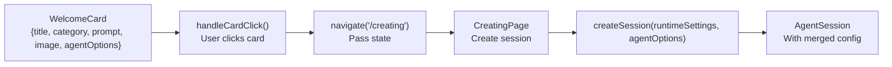

**Sources:** [multimodal/tarko/interface/src/web-ui-implementation.ts:156-178](), [multimodal/tarko/agent-ui/src/standalone/home/WelcomeCards.tsx:41-69]()

### Workspace Navigation Configuration

Workspace navigation items provide access to integrated tools like VNC, Code Server, and other workspace services. Items can open in new tabs or embed within the UI.

**WorkspaceNavItem Interface**

```typescript
export interface WorkspaceNavItem {
  title: string;                              // Button label
  link: string;                               // Target URL
  icon?: WorkspaceNavItemIcon;                // Icon type
  behavior?: 'new-page' | 'embed-frame';      // Click behavior
  autoActive?: boolean | string;              // Auto-activation config
}

export type WorkspaceNavItemIcon = 
  | 'code' 
  | 'monitor' 
  | 'terminal' 
  | 'browser' 
  | 'desktop' 
  | 'default';
```

**Auto-Activation Logic**

The `autoActive` property supports two formats:
- **Boolean**: Static true/false value. [multimodal/tarko/interface/src/web-ui-implementation.ts:60-60]()
- **String Expression**: JavaScript expression evaluated at runtime using `runtimeSettings` properties. [multimodal/tarko/interface/src/web-ui-implementation.ts:61-64]()

**Sources:** [multimodal/tarko/interface/src/web-ui-implementation.ts:16-65]()

### Layout Configuration

The `LayoutConfig` interface controls UI structure and page routing:

```typescript
export interface LayoutConfig {
  defaultLayout?: 'default' | 'narrow-chat';  // Initial layout mode
  enableLayoutSwitchButton?: boolean;         // Show layout toggle
  enableSidebar?: boolean;                    // Show session sidebar
  enableHome?: boolean;                       // Register home route
}
```

**Layout Implementation**

The `Layout` component in `agent-ui` uses `layoutModeAtom` to toggle between `default` (split screen) and `narrow-chat` (expanded workspace) modes. [multimodal/tarko/agent-ui/src/standalone/app/Layout/index.tsx:50-75]()

**Sources:** [multimodal/tarko/interface/src/web-ui-implementation.ts:69-96](), [multimodal/tarko/agent-ui/src/standalone/app/Layout/index.tsx:1-100]()

### GUI Agent Configuration

The `TarkoWebUIGUIAgentConfig` interface controls how GUI agent screenshots and actions are displayed:

```typescript
export interface TarkoWebUIGUIAgentConfig {
  defaultScreenshotRenderStrategy?: 'both' | 'beforeAction' | 'afterAction';
  enableScreenshotRenderStrategySwitch?: boolean;
  renderGUIAction?: boolean;
  renderBrowserShell?: boolean;
}
```

**Screenshot Rendering Strategy**

| Strategy | Use Case | Description |
|----------|----------|-------------|
| `both` | Action comparison | Display before and after screenshots side-by-side |
| `beforeAction` | Agent-TARS style | Show screenshot taken at loop start, with mouse cursor overlay |
| `afterAction` | Omni-TARS style | Show screenshot taken after action execution |

**Sources:** [multimodal/tarko/interface/src/web-ui-implementation.ts:108-152]()

### Debug Configuration

The `DebugConfig` interface enables development features, specifically the **Event Stream Viewer**. When `enableEventStreamViewer` is true, the UI registers a `RawEventsHandler` in the `EventHandlerRegistry` to capture and display real-time events in a modal accessible from the `ToolBar`.

**Sources:** [multimodal/tarko/interface/src/web-ui-implementation.ts:183-191](), [multimodal/tarko/agent-ui/src/common/state/actions/eventProcessors/EventHandlerRegistry.ts:57-60](), [multimodal/tarko/agent-ui/src/standalone/sidebar/ToolBar.tsx:128-145]()

---

## Agent Implementation Pattern

### Static webuiConfig Property

Agents implement web UI configuration by defining a static `webuiConfig` property on their class. This property is accessed by the system to customize the React frontend.

**Implementation Pattern**

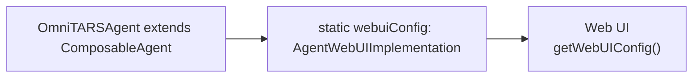

**Sources:** [multimodal/omni-tars/omni-agent/src/index.ts:11-14](), [multimodal/tarko/agent-ui/src/config/web-ui-config.ts:6-6]()

### OmniTARSAgent Configuration Example

The `OmniTARSAgent` class demonstrates a comprehensive web UI configuration:

**Configuration Structure**

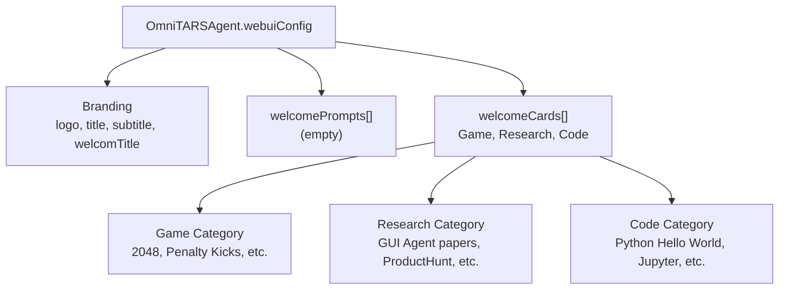

**Game Cards with Agent Options**

Game category cards specify `agentOptions` to force a specific `agentMode` when clicked:

```typescript
{
  title: '2048',
  category: 'Game',
  image: '...',
  agentOptions: {
    agentMode: {
      id: 'game',
      link: 'https://poki.com/zh/g/2048',
      browserMode: 'hybrid',
    },
  },
}
```

**Sources:** [multimodal/omni-tars/omni-agent/src/index.ts:14-178]()

---

## Configuration Consumption in Web UI

### Configuration Loading System

The web UI uses a centralized configuration loading system that provides utility functions for accessing configuration properties defined by the agent.

**Configuration Access Flow**

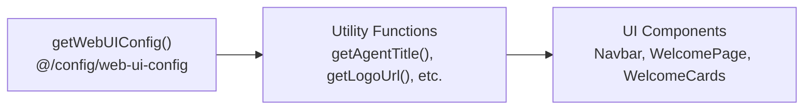

**Sources:** [multimodal/tarko/agent-ui/src/config/web-ui-config.ts:6-6](), [multimodal/tarko/agent-ui/src/standalone/home/WelcomePage.tsx:24-30]()

### Welcome Page Integration

The `WelcomePage` component consumes the configuration to render the hero section, search input, and interactive cards.

**Welcome Page Configuration Usage**

| UI Element | Source Property | Behavior |
|------------|-----------------|----------|
| Logo | `logo` | Fetched via `getLogoUrl()` |
| Hero Title | `welcomTitle` | Defaults to `title` if missing |
| Subtitle | `subtitle` | Displayed below the hero title |
| Quick Prompts | `welcomePrompts` | Shuffled and displayed as clickable suggestions |
| Task Grid | `welcomeCards` | Grouped by category in `WelcomeCards` component |

**Sources:** [multimodal/tarko/agent-ui/src/standalone/home/WelcomePage.tsx:24-64](), [multimodal/tarko/agent-ui/src/standalone/home/WelcomeCards.tsx:24-36]()

---

## Session Creation Flow

### CreatingPage Orchestration

The `CreatingPage` handles session creation by merging parameters from three sources in priority order:
1. **Router state**: Passed during internal navigation (e.g., from `WelcomeCards` click). [multimodal/tarko/agent-ui/src/standalone/home/CreatingPage.tsx:52-56]()
2. **Global runtime settings**: Selected by the user on the home page using `globalRuntimeSettingsAtom`. [multimodal/tarko/agent-ui/src/standalone/home/CreatingPage.tsx:58-61]()
3. **URL search params**: Used for deep-linking (parameters: `q`, `runtimeSettings`, `agentOptions`). [multimodal/tarko/agent-ui/src/standalone/home/CreatingPage.tsx:63-84]()

**Session Creation Logic**

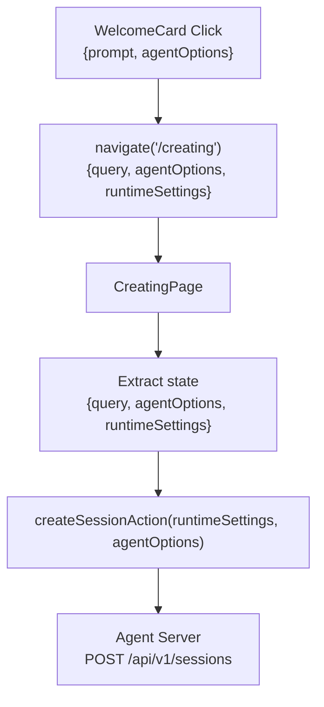

**Sources:** [multimodal/tarko/agent-ui/src/standalone/home/CreatingPage.tsx:39-113](), [multimodal/tarko/agent-ui/src/standalone/home/WelcomeCards.tsx:41-69]()

---

# Page: GUI Agent Plugin and Screenshot Processing

# GUI Agent Plugin and Screenshot Processing

<details>
<summary>Relevant source files</summary>

The following files were used as context for generating this wiki page:

- [multimodal/gui-agent/operator-aio/package.json](multimodal/gui-agent/operator-aio/package.json)
- [multimodal/gui-agent/operator-aio/src/AIOBrowser.ts](multimodal/gui-agent/operator-aio/src/AIOBrowser.ts)
- [multimodal/gui-agent/operator-aio/src/AIOComputer.ts](multimodal/gui-agent/operator-aio/src/AIOComputer.ts)
- [multimodal/gui-agent/operator-aio/src/AIOGameOperator.ts](multimodal/gui-agent/operator-aio/src/AIOGameOperator.ts)
- [multimodal/gui-agent/operator-aio/src/AIOHybridOperator.ts](multimodal/gui-agent/operator-aio/src/AIOHybridOperator.ts)
- [multimodal/gui-agent/operator-aio/src/index.ts](multimodal/gui-agent/operator-aio/src/index.ts)
- [multimodal/gui-agent/operator-aio/src/types.ts](multimodal/gui-agent/operator-aio/src/types.ts)
- [multimodal/gui-agent/operator-aio/test/aioComputer.test.ts](multimodal/gui-agent/operator-aio/test/aioComputer.test.ts)
- [multimodal/gui-agent/operator-nutjs/src/NutJSOperator.ts](multimodal/gui-agent/operator-nutjs/src/NutJSOperator.ts)
- [multimodal/omni-tars/gui-agent/package.json](multimodal/omni-tars/gui-agent/package.json)
- [multimodal/omni-tars/gui-agent/src/GUIAgentT5Adapter.ts](multimodal/omni-tars/gui-agent/src/GUIAgentT5Adapter.ts)
- [multimodal/omni-tars/gui-agent/src/GuiAgentPlugin.ts](multimodal/omni-tars/gui-agent/src/GuiAgentPlugin.ts)
- [multimodal/omni-tars/gui-agent/src/OperatorManager.ts](multimodal/omni-tars/gui-agent/src/OperatorManager.ts)
- [multimodal/omni-tars/gui-agent/src/index.ts](multimodal/omni-tars/gui-agent/src/index.ts)
- [multimodal/omni-tars/gui-agent/src/shared.ts](multimodal/omni-tars/gui-agent/src/shared.ts)
- [multimodal/omni-tars/omni-agent/tarko.config.ts](multimodal/omni-tars/omni-agent/tarko.config.ts)
- [multimodal/pnpm-lock.yaml](multimodal/pnpm-lock.yaml)

</details>


## Purpose and Scope

This page documents the `GuiAgentPlugin` implementation and its screenshot processing pipeline. The plugin provides visual GUI interaction capabilities by capturing, compressing, and streaming screenshots to the language model, enabling vision-based GUI automation.

This page covers:
- The `GuiAgentPlugin` class architecture and lifecycle hooks.
- `OperatorManager` for coordinating operator implementations (Browser, AIO, NutJS).
- Screenshot capture, WebP compression, and base64 encoding.
- Image detail level calculation for OpenAI API optimization.
- `browser_vision_control` tool registration and execution.
- Event stream integration for environment input.

## GuiAgentPlugin Architecture

The `GuiAgentPlugin` class extends `AgentPlugin` to provide GUI automation capabilities through visual grounding and action execution. It handles the `COMPUTER_USE_ENVIRONMENT` section of the agent's capabilities [multimodal/omni-tars/gui-agent/src/GuiAgentPlugin.ts:27-31]().

### Core Responsibilities

| Responsibility | Implementation Details |
|----------------|------------------------|
| **Screenshot Capture** | Captures screen state via `OperatorManager`, compresses to WebP format, emits `environment_input` events [multimodal/omni-tars/gui-agent/src/GuiAgentPlugin.ts:119-202](). |
| **Action Execution** | Routes GUI actions (click, type, scroll) through operator implementations [multimodal/omni-tars/gui-agent/src/GuiAgentPlugin.ts:62-90](). |
| **Tool Registration** | Registers `browser_vision_control` tool during initialization [multimodal/omni-tars/gui-agent/src/GuiAgentPlugin.ts:57-61](). |
| **Lifecycle Management** | Implements `initialize()` and `onAfterToolCall()` hooks [multimodal/omni-tars/gui-agent/src/GuiAgentPlugin.ts:45-117](). |
| **Image Optimization** | Compresses screenshots using 80% quality WebP with automatic detail level selection [multimodal/omni-tars/gui-agent/src/GuiAgentPlugin.ts:135-166](). |
| **Context Enrichment** | Adds current URL and visual context to conversation history [multimodal/omni-tars/gui-agent/src/GuiAgentPlugin.ts:182-187](). |

Sources: [multimodal/omni-tars/gui-agent/src/GuiAgentPlugin.ts:29-202]()

### Class Hierarchy

```mermaid
classDiagram
    class "AgentPlugin" {
        <<abstract>>
        +name string
        +environmentSection string
        +agent Agent
        +initialize() Promise~void~
        +onAfterToolCall() Promise~void~
        +getTools() Tool[]
    }
    
    class "GuiAgentPlugin" {
        +name "gui-agent"
        +environmentSection "COMPUTER_USE_ENVIRONMENT"
        -operatorManager "OperatorManager"
        -agentMode "AgentMode"
        -initializedWithMode boolean
        +initialize() Promise~void~
        +onAfterToolCall() Promise~void~
        -emitScreenshotEvent() Promise~void~
        -emitPresetUserQuey() Promise~void~
        -emitPresetAssistantNavMsg() Promise~void~
    }
    
    class "OperatorManager" {
        -operator "Operator"
        +getInstance() Promise~Operator~
        +static create(agentMode, sandboxUrl) "OperatorManager"
    }
    
    class "ImageCompressor" {
        -quality number
        -format string
        +compressToBuffer() Promise~Buffer~
    }
    
    class "Tool" {
        +id string
        +description string
        +function Function
    }
    
    "AgentPlugin" <|-- "GuiAgentPlugin"
    "GuiAgentPlugin" --> "OperatorManager"
    "GuiAgentPlugin" --> "ImageCompressor"
    "GuiAgentPlugin" ..> "Tool" : "registers"
```

**Diagram: GuiAgentPlugin Class Structure**

Sources: [multimodal/omni-tars/gui-agent/src/GuiAgentPlugin.ts:29-43](), [multimodal/omni-tars/gui-agent/src/GuiAgentPlugin.ts:135-138](), [multimodal/omni-tars/gui-agent/src/OperatorManager.ts:9-120]()

## OperatorManager and Operator Implementations

The `OperatorManager` provides a unified interface for managing different operator implementations. It selects between `AIOHybridOperator` (standard GUI) and `AIOGameOperator` (game-specific GUI) based on the `AgentMode` [multimodal/omni-tars/gui-agent/src/OperatorManager.ts:23-39]().

### Operator Abstraction Layer

```mermaid
graph TB
    "OperatorManager"["OperatorManager<br/>getInstance()"]
    
    subgraph "OperatorImpls" ["Operator Implementations"]
        "AIOHybridOperator"["AIOHybridOperator<br/>@gui-agent/operator-aio"]
        "AIOGameOperator"["AIOGameOperator<br/>@gui-agent/operator-aio"]
        "BrowserOperator"["BrowserOperator<br/>@gui-agent/operator-browser"]
    end
    
    subgraph "Infrastructure" ["Infrastructure Components"]
        "AIOBrowser"["AIOBrowser<br/>Remote Puppeteer Wrapper"]
        "AIOComputer"["AIOComputer<br/>Remote OS Action Wrapper"]
        "AioClient"["AioClient<br/>@agent-infra/sandbox"]
    end
    
    "OperatorManager" --> "AIOHybridOperator"
    "OperatorManager" --> "AIOGameOperator"
    
    "AIOHybridOperator" --> "AIOBrowser"
    "AIOHybridOperator" --> "AIOComputer"
    "AIOGameOperator" --> "AIOComputer"
    
    "AIOBrowser" --> "AioClient"
    "AIOComputer" --> "AioClient"
```

**Diagram: Operator Manager Architecture**

Sources: [multimodal/omni-tars/gui-agent/src/OperatorManager.ts:23-39](), [multimodal/gui-agent/operator-aio/src/AIOHybridOperator.ts:23-38](), [multimodal/gui-agent/operator-aio/src/AIOBrowser.ts:31-57]()

### Operator Interface and Execution

The `AIOHybridOperator` handles complex GUI actions by delegating to `AIOBrowser` for web-specific navigation and `AIOComputer` for operating system level mouse/keyboard inputs [multimodal/gui-agent/operator-aio/src/AIOHybridOperator.ts:142-216]().

| Method | Parameters | Return Type | Purpose |
|--------|-----------|-------------|---------|
| `screenshot()` | none | `Promise<ScreenshotOutput>` | Captures current screen state via `AIOComputer.screenshot()` [multimodal/gui-agent/operator-aio/src/AIOHybridOperator.ts:83-114](). |
| `execute(params)` | `{actions}` | `Promise<ExecuteOutput>` | Iterates through `BaseAction` array and calls `singleActionExecutor` [multimodal/gui-agent/operator-aio/src/AIOHybridOperator.ts:116-125](). |
| `singleActionExecutor` | `action` | `Promise<ExecuteOutput>` | Switches on `actionType` (click, type, navigate, etc.) [multimodal/gui-agent/operator-aio/src/AIOHybridOperator.ts:127-140](). |

Sources: [multimodal/gui-agent/operator-aio/src/AIOHybridOperator.ts:83-216]()

## Tool Registration and Execution Flow

### browser_vision_control Tool

The plugin registers a tool named `browser_vision_control` that serves as the entry point for all GUI operations within the `ComposableAgent` loop [multimodal/omni-tars/gui-agent/src/GuiAgentPlugin.ts:59-62]().

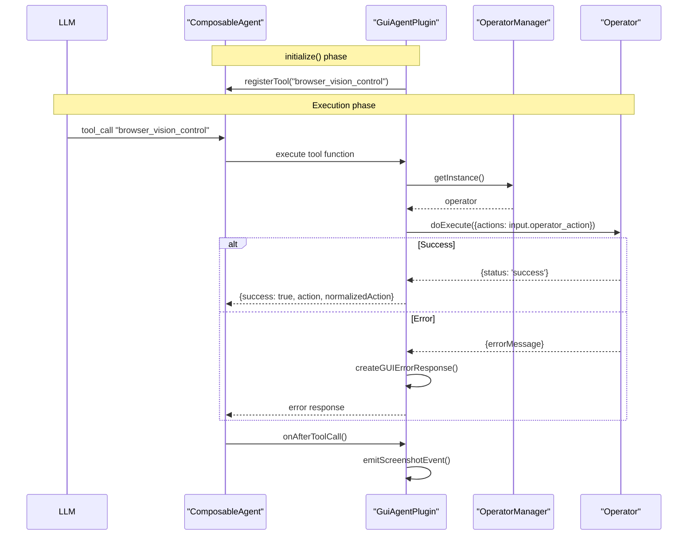

**Diagram: Tool Registration and Execution Sequence**

Sources: [multimodal/omni-tars/gui-agent/src/GuiAgentPlugin.ts:57-91](), [multimodal/omni-tars/gui-agent/src/GuiAgentPlugin.ts:104-117](), [multimodal/gui-agent/operator-aio/src/AIOHybridOperator.ts:116-125]()

## Screenshot Processing Pipeline

### Capture and Compression Workflow

The plugin performs optimization on screenshots before sending them to the VLM to manage token usage and latency [multimodal/omni-tars/gui-agent/src/GuiAgentPlugin.ts:135-155]().

```mermaid
flowchart TD
    "Start"["onAfterToolCall triggered"]
    "CheckTool"{"tool.name ==<br/>'browser_vision_control'?"}
    "Capture"["operator.doScreenshot()"]
    
    subgraph "Compression" ["Optimization Pipeline"]
        "Parse"["Base64ImageParser<br/>Get Dimensions"]
        "Sharp"["ImageCompressor<br/>WebP @ 80% Quality"]
        "CalcPixels"["Calculate Pixel Count<br/>(W * H)"]
    end
    
    "DetermineDetail"{"Pixel Count?"}
    "SetLow"["detail: 'low'<br/>≤ 1,048,576px"]
    "SetHigh"["detail: 'high'<br/>> 1,048,576px"]
    
    "BuildContent"["Build ChatCompletionContentPart[]"]
    "CreateEvent"["createEvent('environment_input')"]
    "SendEvent"["eventStream.sendEvent()"]
    
    "Start" --> "CheckTool"
    "CheckTool" -->|Yes| "Capture"
    "Capture" --> "Parse"
    "Parse" --> "Sharp"
    "Sharp" --> "CalcPixels"
    "CalcPixels" --> "DetermineDetail"
    "DetermineDetail" -->|Small| "SetLow"
    "DetermineDetail" -->|Large| "SetHigh"
    "SetLow" --> "BuildContent"
    "SetHigh" --> "BuildContent"
    "BuildContent" --> "CreateEvent"
    "CreateEvent" --> "SendEvent"
```

**Diagram: Screenshot Capture and Compression Pipeline**

Sources: [multimodal/omni-tars/gui-agent/src/GuiAgentPlugin.ts:119-202]()

### Image Compression Configuration

The plugin uses the `ImageCompressor` utility (built on `sharp`) to optimize payloads [multimodal/omni-tars/gui-agent/src/GuiAgentPlugin.ts:135-138]().

| Parameter | Value | Rationale |
|-----------|-------|-----------|
| **Format** | `webp` | Superior compression for screenshots [multimodal/omni-tars/gui-agent/src/GuiAgentPlugin.ts:137](). |
| **Quality** | `80` | High fidelity with reduced size [multimodal/omni-tars/gui-agent/src/GuiAgentPlugin.ts:136](). |
| **Low Detail Threshold** | 1,048,576 px | Maps to 1024x1024 (OpenAI "low" limit) [multimodal/omni-tars/gui-agent/src/GuiAgentPlugin.ts:23](). |
| **High Detail Threshold** | 4,014,080 px | Maps to 2048x1960 [multimodal/omni-tars/gui-agent/src/GuiAgentPlugin.ts:24](). |

Sources: [multimodal/omni-tars/gui-agent/src/GuiAgentPlugin.ts:23-24](), [multimodal/omni-tars/gui-agent/src/GuiAgentPlugin.ts:135-140]()

### Detail Level Selection Implementation

The detail parameter for the VLM is determined by comparing the compressed image's pixel count against defined thresholds [multimodal/omni-tars/gui-agent/src/GuiAgentPlugin.ts:157-166]().

```typescript
// From GuiAgentPlugin.ts:157-166
const pixelCount = compressedWidth * compressedHeight;
let detailLevel: 'low' | 'high';
if (pixelCount <= LOW_DETAIL_THRESHOLD) {
  detailLevel = 'low';
} else if (pixelCount <= HIGH_DETAIL_THRESHOLD) {
  detailLevel = 'high';
} else {
  // For images larger than high detail threshold, use high detail
  detailLevel = 'high';
}
```

Sources: [multimodal/omni-tars/gui-agent/src/GuiAgentPlugin.ts:157-166]()

## Browser Control via AIO Sandbox

The system uses `AIOBrowser` to interface with remote browser instances via the Chrome DevTools Protocol (CDP) [multimodal/gui-agent/operator-aio/src/AIOBrowser.ts:52-57]().

### AIOBrowser Core Functions

| Function | Implementation |
|----------|----------------|
| **Navigation** | `handleNavigate(inputs)` uses `page.goto(url)` [multimodal/gui-agent/operator-aio/src/AIOBrowser.ts:107-124](). |
| **History** | `handleNavigateBack()` uses `page.goBack()` [multimodal/gui-agent/operator-aio/src/AIOBrowser.ts:126-131](). |
| **Active Page Detection** | `getActivePage()` finds the tab where `document.visibilityState === 'visible'` [multimodal/gui-agent/operator-aio/src/AIOBrowser.ts:155-202](). |
| **Launch** | `launch(options)` connects the underlying `RemoteBrowser` [multimodal/gui-agent/operator-aio/src/AIOBrowser.ts:64-74](). |

Sources: [multimodal/gui-agent/operator-aio/src/AIOBrowser.ts:64-202]()

### Remote OS Interaction (AIOComputer)

`AIOComputer` provides an abstraction for operating system actions executed within the sandbox [multimodal/gui-agent/operator-aio/src/AIOComputer.ts:48-81]().

```typescript
// From AIOComputer.ts:139-146
async moveTo(x: number, y: number): Promise<ActionResponse> {
  const action: MoveToAction = {
    action_type: 'MOVE_TO',
    x,
    y,
  };
  return this.request(action);
}
```

Sources: [multimodal/gui-agent/operator-aio/src/AIOComputer.ts:139-146](), [multimodal/gui-agent/operator-aio/src/AIOComputer.ts:48-81]()

## Plugin Lifecycle and Mode Support

### Game Mode Specialization

When initialized in `game` mode, the plugin triggers a specialized bootstrap sequence to orient the agent [multimodal/omni-tars/gui-agent/src/GuiAgentPlugin.ts:46-55]().

1.  **Emit Preset User Query**: Sends the target URL as a navigation request.
2.  **Screenshot Event**: Captures the initial visual state after a 4000ms delay.
3.  **Emit Preset Assistant Message**: Provides context that navigation is underway or waiting.

Sources: [multimodal/omni-tars/gui-agent/src/GuiAgentPlugin.ts:46-55](), [multimodal/omni-tars/gui-agent/src/GuiAgentPlugin.ts:204-241]()

### Event Stream Integration

The plugin communicates with the `AgentEventStream` to push visual updates into the conversation flow. These events are categorized as `environment_input` [multimodal/omni-tars/gui-agent/src/GuiAgentPlugin.ts:193-201]().

```typescript
// From GuiAgentPlugin.ts:193-201
const event = eventStream.createEvent('environment_input', {
  description: 'Browser Screenshot',
  content,
  metadata: {
    type: 'screenshot',
    url: output?.url,
  },
});
eventStream.sendEvent(event);
```

Sources: [multimodal/omni-tars/gui-agent/src/GuiAgentPlugin.ts:193-201]()

---

# Page: Code Agent and Sandbox Execution

# Code Agent and Sandbox Execution

<details>
<summary>Relevant source files</summary>

The following files were used as context for generating this wiki page:

- [multimodal/omni-tars/code-agent/src/CodeAgentPlugin.ts](multimodal/omni-tars/code-agent/src/CodeAgentPlugin.ts)
- [multimodal/omni-tars/code-agent/src/tools/ExcuteBash.ts](multimodal/omni-tars/code-agent/src/tools/ExcuteBash.ts)
- [multimodal/omni-tars/code-agent/src/tools/JupyterCI.ts](multimodal/omni-tars/code-agent/src/tools/JupyterCI.ts)
- [multimodal/omni-tars/code-agent/src/tools/StrReplaceEditor.ts](multimodal/omni-tars/code-agent/src/tools/StrReplaceEditor.ts)
- [multimodal/omni-tars/core/src/AgentComposer.ts](multimodal/omni-tars/core/src/AgentComposer.ts)
- [multimodal/omni-tars/core/src/AgentPlugin.ts](multimodal/omni-tars/core/src/AgentPlugin.ts)
- [multimodal/omni-tars/core/src/ComposableAgent.ts](multimodal/omni-tars/core/src/ComposableAgent.ts)
- [multimodal/omni-tars/core/src/utils/parser.ts](multimodal/omni-tars/core/src/utils/parser.ts)
- [multimodal/omni-tars/mcp-agent/src/McpAgentPlugin.ts](multimodal/omni-tars/mcp-agent/src/McpAgentPlugin.ts)
- [multimodal/omni-tars/mcp-agent/src/tools/mcp.ts](multimodal/omni-tars/mcp-agent/src/tools/mcp.ts)
- [multimodal/tarko/agent-server-next/src/middlewares/access-log.ts](multimodal/tarko/agent-server-next/src/middlewares/access-log.ts)
- [multimodal/tarko/agent-server-next/src/middlewares/session-restore.ts](multimodal/tarko/agent-server-next/src/middlewares/session-restore.ts)

</details>


The Code Agent provides code execution capabilities within the OmniTARS multimodal agent system. It enables agents to execute bash commands, perform file operations, and run code in isolated sandbox environments. This document covers the implementation of the `CodeAgentPlugin`, its integration with remote sandbox services via `AioClient`, and the parsing logic for T5-formatted code instructions.

## Architecture Overview

The Code Agent is implemented as a plugin in the OmniTARS composable agent system [multimodal/omni-tars/code-agent/src/CodeAgentPlugin.ts:18-19](). It operates within the `CODE_ENVIRONMENT` section [multimodal/omni-tars/code-agent/src/CodeAgentPlugin.ts:20]() and provides tools for executing code and manipulating files in remote sandbox environments.

### System Context Diagram
This diagram bridges the Natural Language intent (Code Execution) to the specific Code Entities used in the implementation.

```mermaid
graph TB
    subgraph "Natural Language Space"
        NL_INTENT["'Run this python script'<br/>'Edit the config file'<br/>'List files in /home'"]
    end

    subgraph "Code Entity Space"
        COMPOSABLE["ComposableAgent<br/>(multimodal/omni-tars/core/src/ComposableAgent.ts)"]
        PLUGIN["CodeAgentPlugin<br/>(multimodal/omni-tars/code-agent/src/CodeAgentPlugin.ts)"]
        PARSER["parseCodeContent<br/>(multimodal/omni-tars/core/src/utils/parser.ts)"]
        CLIENT["AioClient<br/>(@agent-infra/sandbox)"]
        
        subgraph "Tools (multimodal/omni-tars/code-agent/src/tools/)"
            BASH["ExcuteBashProvider<br/>(execute_bash)"]
            JUPYTER["JupyterCIProvider<br/>(JupyterCI)"]
            EDITOR["StrReplaceEditorProvider<br/>(str_replace_editor)"]
        end
    end

    NL_INTENT --> COMPOSABLE
    COMPOSABLE --> PARSER
    COMPOSABLE --> PLUGIN
    PLUGIN --> BASH
    PLUGIN --> JUPYTER
    PLUGIN --> EDITOR
    
    BASH --> CLIENT
    JUPYTER --> CLIENT
    EDITOR --> CLIENT
```
**Sources:** [multimodal/omni-tars/code-agent/src/CodeAgentPlugin.ts:18-39](), [multimodal/omni-tars/core/src/ComposableAgent.ts:24-47](), [multimodal/omni-tars/core/src/utils/parser.ts:80]()

## Plugin Implementation

The `CodeAgentPlugin` class extends the base `AgentPlugin` [multimodal/omni-tars/code-agent/src/CodeAgentPlugin.ts:18](). It initializes a connection to an external sandbox service using `AioClient` [multimodal/omni-tars/code-agent/src/CodeAgentPlugin.ts:28-32]().

### Key Components
- **Environment Section**: Defined by `CODE_ENVIRONMENT` [multimodal/omni-tars/code-agent/src/CodeAgentPlugin.ts:20](), which is injected into the system prompt by the `AgentComposer` [multimodal/omni-tars/core/src/AgentComposer.ts:55-58]().
- **Sandbox Client**: Uses `AioClient` with a `baseUrl` provided via `CodeAgentExtraOption` [multimodal/omni-tars/code-agent/src/CodeAgentPlugin.ts:28-32]().
- **Health Check**: Performs a `client.healthCheck()` during initialization unless `ignoreSandboxCheck` is set [multimodal/omni-tars/code-agent/src/CodeAgentPlugin.ts:44-50]().

### System Prompt Composition
The `AgentComposer` generates a unified system prompt that includes the `CODE_ENVIRONMENT` description and usage instructions [multimodal/omni-tars/core/src/AgentComposer.ts:44-64](). If the code plugin is present, the composer adds `<code_env>` to the available environments list [multimodal/omni-tars/core/src/AgentComposer.ts:172-174]().

**Sources:** [multimodal/omni-tars/code-agent/src/CodeAgentPlugin.ts:18-42](), [multimodal/omni-tars/core/src/AgentComposer.ts:44-64](), [multimodal/omni-tars/core/src/AgentComposer.ts:172-174]()

## Tool Implementations

The Code Agent registers three primary tools for code execution and file manipulation [multimodal/omni-tars/code-agent/src/CodeAgentPlugin.ts:35-39]().

### 1. execute_bash
Enables execution of shell commands. It wraps the `client.shellExec` method with a 120-second timeout [multimodal/omni-tars/code-agent/src/tools/ExcuteBash.ts:24-29]().

| Parameter | Type | Description |
|-----------|------|-------------|
| `command` | string | The bash command to execute in the terminal [multimodal/omni-tars/code-agent/src/tools/ExcuteBash.ts:20](). |

### 2. JupyterCI
A stateful code sandbox tool for running Python code. It uses the `AioClient` to execute code within a persistent environment and maintains a `sessionId` across calls [multimodal/omni-tars/code-agent/src/tools/JupyterCI.ts:8-35](). If a `session_id` is returned that differs from the current one, the provider updates its internal state [multimodal/omni-tars/code-agent/src/tools/JupyterCI.ts:33-35]().

### 3. str_replace_editor
A tool for file system operations including viewing, creating, and editing files. It supports various commands such as `view`, `create`, `str_replace`, and `insert` [multimodal/omni-tars/code-agent/src/tools/StrReplaceEditor.ts:20-45](). It performs a `JSON.parse` on `view_range` if it is passed as a string [multimodal/omni-tars/code-agent/src/tools/StrReplaceEditor.ts:47-53]().

**Sources:** [multimodal/omni-tars/code-agent/src/tools/ExcuteBash.ts:15-33](), [multimodal/omni-tars/code-agent/src/tools/JupyterCI.ts:8-41](), [multimodal/omni-tars/code-agent/src/tools/StrReplaceEditor.ts:15-58]()

## Content Parsing and Tool Extraction

The system uses a specialized parser to extract reasoning, answers, and tool calls from the LLM's XML-like output format.

### parseCodeContent
The `parseCodeContent` function processes strings wrapped in `<code_env>` tags [multimodal/omni-tars/core/src/utils/parser.ts:80-89]().
1. **Reasoning**: Extracts content between `<code_env><function=execute_bash>...
    Agent->>Parser: parseCodeContent(content)
    Parser-->>Agent: { think, tools: [{ name: 'execute_bash', ... }] }
    Agent->>Tool: Invoke function({ command })
    Tool->>Aio: shellExec({ command })
    Aio->>Sandbox: POST /shell/exec
    Sandbox-->>Aio: { data: { stdout, exitCode } }
    Aio-->>Tool: Return data
    Tool-->>Agent: Tool Result
    Agent->>Agent: onAfterToolCall() hooks
    Agent-->>LLM: Next Loop: Tool "execute_bash" result: ...
```
**Sources:** [multimodal/omni-tars/core/src/ComposableAgent.ts:88-95](), [multimodal/omni-tars/core/src/utils/parser.ts:80-124](), [multimodal/omni-tars/code-agent/src/tools/ExcuteBash.ts:22-31]()

## Sandbox Client Integration

The `AioClient` serves as the bridge to the isolated execution environment. It is initialized with a `baseUrl` and optional logging levels [multimodal/omni-tars/code-agent/src/CodeAgentPlugin.ts:28-32]().

| Method | Purpose | Code Reference |
|--------|---------|----------------|
| `shellExec` | Executes arbitrary bash commands | [multimodal/omni-tars/code-agent/src/tools/ExcuteBash.ts:24]() |
| `jupyterExecute` | Runs Python code in a Jupyter kernel | [multimodal/omni-tars/code-agent/src/tools/JupyterCI.ts:25]() |
| `fileEditor` | Performs file system modifications | [multimodal/omni-tars/code-agent/src/tools/StrReplaceEditor.ts:55]() |
| `healthCheck` | Validates sandbox availability | [multimodal/omni-tars/code-agent/src/CodeAgentPlugin.ts:49]() |

**Sources:** [multimodal/omni-tars/code-agent/src/CodeAgentPlugin.ts:28-50](), [multimodal/omni-tars/code-agent/src/tools/ExcuteBash.ts:24-30](), [multimodal/omni-tars/code-agent/src/tools/JupyterCI.ts:25-30](), [multimodal/omni-tars/code-agent/src/tools/StrReplaceEditor.ts:55]()

---

# Page: MCP Agent Integration

# MCP Agent Integration

<details>
<summary>Relevant source files</summary>

The following files were used as context for generating this wiki page:

- [multimodal/.gitignore](multimodal/.gitignore)
- [multimodal/omni-tars/code-agent/src/index.ts](multimodal/omni-tars/code-agent/src/index.ts)
- [multimodal/omni-tars/code-agent/tarko.config.ts](multimodal/omni-tars/code-agent/tarko.config.ts)
- [multimodal/omni-tars/core/src/environments/code.ts](multimodal/omni-tars/core/src/environments/code.ts)
- [multimodal/omni-tars/core/src/utils/hepler.ts](multimodal/omni-tars/core/src/utils/hepler.ts)
- [multimodal/omni-tars/gui-agent/tarko.config.ts](multimodal/omni-tars/gui-agent/tarko.config.ts)
- [multimodal/omni-tars/mcp-agent/src/index.ts](multimodal/omni-tars/mcp-agent/src/index.ts)
- [multimodal/omni-tars/mcp-agent/src/tools/linkReader.ts](multimodal/omni-tars/mcp-agent/src/tools/linkReader.ts)
- [multimodal/omni-tars/mcp-agent/tarko.config.ts](multimodal/omni-tars/mcp-agent/tarko.config.ts)
- [multimodal/omni-tars/omni-agent/.env.example](multimodal/omni-tars/omni-agent/.env.example)
- [multimodal/tarko/mcp-agent-interface/src/index.ts](multimodal/tarko/mcp-agent-interface/src/index.ts)
- [multimodal/tarko/mcp-agent/README.md](multimodal/tarko/mcp-agent/README.md)
- [multimodal/tarko/mcp-agent/examples/mcp-agent.ts](multimodal/tarko/mcp-agent/examples/mcp-agent.ts)
- [multimodal/tarko/mcp-agent/src/index.ts](multimodal/tarko/mcp-agent/src/index.ts)
- [multimodal/tarko/mcp-agent/src/mcp-agent.ts](multimodal/tarko/mcp-agent/src/mcp-agent.ts)
- [multimodal/tarko/mcp-agent/src/mcp-client-v2.ts](multimodal/tarko/mcp-agent/src/mcp-client-v2.ts)
- [multimodal/tarko/mcp-agent/src/mcp-types.ts](multimodal/tarko/mcp-agent/src/mcp-types.ts)
- [multimodal/websites/docs/docs/en/sdk/mcp-agent/core.md](multimodal/websites/docs/docs/en/sdk/mcp-agent/core.md)
- [multimodal/websites/docs/docs/zh/sdk/mcp-agent/core.md](multimodal/websites/docs/docs/zh/sdk/mcp-agent/core.md)

</details>


## Purpose and Scope

This document describes how the MCP (Model Context Protocol) Agent integrates external tools and services into the Omni-TARS multimodal agent system. The MCP Agent is a specialized component that extends agent capabilities by connecting to MCP servers, which provide standardized access to tools, prompts, and resources. This integration enables the agent to perform operations like web searching, file system access, shell commands, and browser automation through a unified protocol.

The system utilizes a dual-layer approach: a low-level `MCPAgent` class in the Tarko framework for protocol handling [multimodal/tarko/mcp-agent/src/mcp-agent.ts:11-11](), and a high-level `McpAgentPlugin` in the Omni-TARS stack for environment composition [multimodal/omni-tars/mcp-agent/src/index.ts:7-7]().

## Architecture and Data Flow

The MCP integration spans from the Tarko agent framework to the specialized Omni-TARS environment composition. The system maps natural language reasoning to executable code entities through a plugin-based architecture.

### System Entity Mapping
```mermaid
graph TB
    subgraph "Natural Language Space (LLM Reasoning)"
        CA["ComposableAgent<br/>@omni-tars/core"]
        MTCE["McpToolCallEngine<br/>@omni-tars/mcp-agent"]
    end
    
    subgraph "Code Entity Space (Execution)"
        MA["MCPAgent<br/>@tarko/mcp-agent"]
        MCV2["MCPClientV2<br/>@tarko/mcp-agent"]
        V2C["MCPClient<br/>@agent-infra/mcp-client"]
        MAP["McpAgentPlugin<br/>@omni-tars/mcp-agent"]
        MM["McpManager<br/>@omni-tars/mcp-agent"]
    end

    CA -- "initializes" --> MAP
    CA -- "uses" --> MTCE
    MAP -- "uses" --> MM
    MM -- "manages" --> V2C
    MA -- "manages" --> MCV2
    MCV2 -- "wraps" --> V2C
```
**Sources:** [multimodal/omni-tars/mcp-agent/src/index.ts:6-9](), [multimodal/omni-tars/mcp-agent/src/index.ts:62-72](), [multimodal/tarko/mcp-agent/src/mcp-agent.ts:11-13](), [multimodal/tarko/mcp-agent/src/mcp-client-v2.ts:14-15]()

## Tarko MCPAgent Implementation

The `MCPAgent` class in the Tarko framework implements the core logic for connecting to multiple MCP servers and registering their capabilities as native agent tools [multimodal/tarko/mcp-agent/src/mcp-agent.ts:11-11]().

### Server Initialization and Filtering
During the `initialize` phase, the agent performs the following steps:
1. **Filtering**: It filters the `MCPServerRegistry` based on the `mcpServer` options (include/exclude) using `filterItems` from shared utilities [multimodal/tarko/mcp-agent/src/mcp-agent.ts:49-54]().
2. **Client Creation**: For each server, it instantiates an `MCPClientV2` with a configurable connection timeout [multimodal/tarko/mcp-agent/src/mcp-agent.ts:63-63]().
3. **Tool Wrapping**: It retrieves tools from the MCP server and wraps them in the Tarko `Tool` class, mapping the MCP `inputSchema` to `JSONSchema7` [multimodal/tarko/mcp-agent/src/mcp-agent.ts:72-86]().

### Tool Registration Sequence
```mermaid
sequenceDiagram
    participant MA as MCPAgent
    participant CV2 as MCPClientV2
    participant V2 as @agent-infra/mcp-client
    participant S as MCP Server

    MA->>CV2: initialize()
    CV2->>V2: init()
    V2->>S: listTools
    S-->>V2: [ToolA, ToolB]
    V2-->>CV2: Tool list
    CV2-->>MA: Tool list
    
    loop For each Tool
        MA->>MA: new Tool({id, function: callTool})
        MA->>MA: registerTool(tool)
    end
```
**Sources:** [multimodal/tarko/mcp-agent/src/mcp-agent.ts:49-102](), [multimodal/tarko/mcp-agent/src/mcp-client-v2.ts:41-59]()

## Omni-TARS MCP Integration

In the Omni-TARS stack, MCP capabilities are exposed through the `McpAgentPlugin`. This plugin integrates with the `ComposableAgent` to provide tool access and environment descriptions [multimodal/omni-tars/mcp-agent/src/index.ts:7-7]().

### Plugin Construction
The `mcpPluginBuilder` utility configures a set of standard MCP servers for the agent, including search and page parsing capabilities [multimodal/omni-tars/mcp-agent/src/index.ts:24-60]().

| Tool Type | Provider | Configuration |
|-----------|----------|---------------|
| `Tavily` | `streamable-http` | `https://mcp.tavily.com/mcp/` [multimodal/omni-tars/mcp-agent/src/index.ts:29-31]() |
| `Google` | `streamable-http` | Custom `googleMcpUrl` with `x-serper-api-key` [multimodal/omni-tars/mcp-agent/src/index.ts:37-42]() |
| `LinkReader` | `streamable-http` | Custom `linkReaderMcpUrl` for web crawling [multimodal/omni-tars/mcp-agent/src/index.ts:47-51]() |

### Tool Implementation Example: LinkReader
The `LinkReaderToolProvider` demonstrates how specific MCP tools are encapsulated within the Tarko `Tool` interface. It calls the `text_browser_view` tool from the `LinkReader` MCP client [multimodal/omni-tars/mcp-agent/src/tools/linkReader.ts:15-53]().

**Sources:** [multimodal/omni-tars/mcp-agent/src/index.ts:24-60](), [multimodal/omni-tars/mcp-agent/src/tools/linkReader.ts:27-37]()

## Transport and Configuration

The `MCPServerConfig` interface defines the connection parameters for different transport protocols supported by the MCP specification [multimodal/tarko/mcp-agent-interface/src/index.ts:38-62]().

| Field | Transport Type | Description |
|-------|----------------|-------------|
| `command` | `stdio` | The executable to run (e.g., `npx`, `node`) [multimodal/tarko/mcp-agent-interface/src/index.ts:43-43]() |
| `args` | `stdio` | Command line arguments for the server process [multimodal/tarko/mcp-agent-interface/src/index.ts:44-44]() |
| `env` | `stdio` | Environment variables for the child process [multimodal/tarko/mcp-agent-interface/src/index.ts:45-45]() |
| `url` | `sse` / `streaming-http` | The endpoint for remote MCP servers [multimodal/tarko/mcp-agent-interface/src/index.ts:52-52]() |
| `headers` | `sse` / `streaming-http` | Custom HTTP headers (e.g., `x-serper-api-key`) [multimodal/tarko/mcp-agent-interface/src/index.ts:56-56]() |

**Sources:** [multimodal/tarko/mcp-agent-interface/src/index.ts:38-66](), [multimodal/omni-tars/mcp-agent/src/index.ts:24-60]()

## Key Classes and Methods

### MCPClientV2
Implementation of `IMCPClient` that wraps the `@agent-infra/mcp-client` library [multimodal/tarko/mcp-agent/src/mcp-client-v2.ts:14-14]().
- `initialize()`: Connects to the server via the configured transport and fetches the tool list [multimodal/tarko/mcp-agent/src/mcp-client-v2.ts:41-59]().
- `callTool(toolName, args)`: Invokes a tool on the remote server and extracts the content from the response [multimodal/tarko/mcp-agent/src/mcp-client-v2.ts:61-80]().
- `close()`: Cleans up the connection and resets the client state [multimodal/tarko/mcp-agent/src/mcp-client-v2.ts:82-90]().

### McpAgent (Omni-TARS)
A `ComposableAgent` subclass that automatically integrates the `McpAgentPlugin` and `McpToolCallEngine` [multimodal/omni-tars/mcp-agent/src/index.ts:62-72]().
- `constructor(options)`: Extracts MCP-specific API keys and URLs to build the plugin stack [multimodal/omni-tars/mcp-agent/src/index.ts:64-72]().

**Sources:** [multimodal/tarko/mcp-agent/src/mcp-client-v2.ts:14-95](), [multimodal/omni-tars/mcp-agent/src/index.ts:62-73]()

---

# Page: Agent Mode Configuration and Tool Call Engines

# Agent Mode Configuration and Tool Call Engines

<details>
<summary>Relevant source files</summary>

The following files were used as context for generating this wiki page:

- [multimodal/omni-tars/code-agent/src/CodeToolCallEngine.ts](multimodal/omni-tars/code-agent/src/CodeToolCallEngine.ts)
- [multimodal/omni-tars/core/src/environments/prompt_t5.ts](multimodal/omni-tars/core/src/environments/prompt_t5.ts)
- [multimodal/omni-tars/core/src/index.ts](multimodal/omni-tars/core/src/index.ts)
- [multimodal/omni-tars/core/src/types.ts](multimodal/omni-tars/core/src/types.ts)
- [multimodal/omni-tars/core/src/utils/streamingParserT5/index.ts](multimodal/omni-tars/core/src/utils/streamingParserT5/index.ts)
- [multimodal/omni-tars/gui-agent/src/GUIAgentToolCallEngine.ts](multimodal/omni-tars/gui-agent/src/GUIAgentToolCallEngine.ts)
- [multimodal/omni-tars/gui-agent/src/GuiToolCallEngineProvider.ts](multimodal/omni-tars/gui-agent/src/GuiToolCallEngineProvider.ts)
- [multimodal/omni-tars/mcp-agent/src/McpToolCallEngine.ts](multimodal/omni-tars/mcp-agent/src/McpToolCallEngine.ts)
- [multimodal/omni-tars/omni-agent/src/options.ts](multimodal/omni-tars/omni-agent/src/options.ts)
- [multimodal/tarko/agent/src/tool-call-engine/NativeToolCallEngine.ts](multimodal/tarko/agent/src/tool-call-engine/NativeToolCallEngine.ts)
- [multimodal/tarko/agent/src/tool-call-engine/PromptEngineeringToolCallEngine.ts](multimodal/tarko/agent/src/tool-call-engine/PromptEngineeringToolCallEngine.ts)

</details>


This document describes the agent mode configuration system and the composable tool call engine architecture. Agent modes (`omni`, `gui`, `game`) determine which capabilities are active and which tool call engines process LLM responses. The runtime settings system allows dynamic reconfiguration of agent behavior without restarting the server.

For information about the base agent execution framework and tool call processing pipeline, see [Core Agent Execution Framework](). For details on the T5 prompt format and streaming parsing, see [T5 Prompt Format and Streaming Parser](). For the composable agent architecture, see [OmniTARS Agent Architecture and Plugin System]().

## Agent Mode Overview

The system supports three distinct agent modes, each optimizing for different use cases:

| Mode | ID | Description | Engines Active | Available Functions |
|------|-----|-------------|----------------|---------------------|
| **Omni** | `omni` | Full-featured multimodal agent with all capabilities | GUI, Code, MCP | All functions (GUI actions, code execution, web search, link reading) |
| **GUI** | `gui` | GUI automation and browser control only | GUI only | GUI actions (click, type, scroll, navigate, etc.) |
| **Game** | `game` | Game automation with preset navigation | GUI only (restricted) | GUI actions (excluding navigate/navigate_back) |

**Sources:** [multimodal/omni-tars/core/src/types.ts:65-69](), [multimodal/omni-tars/omni-agent/src/options.ts:54-82]()

### AgentMode Type Definition

The `AgentMode` type defines the structure for mode configuration, including specific browser control strategies.

```typescript
export type AgentMode = {
  id: 'omni' | 'gui' | 'game';
  link?: string;           // For game mode: preset navigation URL
  browserMode?: 'dom' | 'visual-grounding' | 'hybrid';
};
```

**Sources:** [multimodal/omni-tars/core/src/types.ts:65-69]()

## Runtime Settings System

The runtime settings system provides a declarative schema-based configuration mechanism that allows users to select agent modes and other settings through the UI.

### Runtime Settings Schema and Transformation

The following diagram illustrates how natural language configuration requirements are transformed into code entities within the `AgentOptions`.

**Natural Language to Code Entity Mapping: Runtime Settings**

```mermaid
graph TB
    subgraph "NaturalLanguageSpace(UserIntent)"
        UI_MODE["'I want to use GUI mode'"]
        UI_BROWSER["'Use Hybrid browser control'"]
    end

    subgraph "CodeEntitySpace(options.ts)"
        CONFIG["OmniTarsOption"]
        
        subgraph "SchemaDefinitions"
            AGENT_MODE_DEF["agentMode: AgentMode"]
            BROWSER_MODE_DEF["browserMode: 'dom' | 'visual-grounding' | 'hybrid'"]
        end
    end

    subgraph "RuntimeExecutionSpace"
        RUNTIME_VALS["runtimeSettingsObject"]
        FINAL_OPTS["ComposableAgentOptions"]
        GET_COMP["getComposableOption"]
    end

    UI_MODE -.-> AGENT_MODE_DEF
    UI_BROWSER -.-> BROWSER_MODE_DEF
    
    CONFIG --> AGENT_MODE_DEF
    CONFIG --> BROWSER_MODE_DEF
    
    AGENT_MODE_DEF --> RUNTIME_VALS
    BROWSER_MODE_DEF --> RUNTIME_VALS
    
    RUNTIME_VALS --> GET_COMP
    GET_COMP --> FINAL_OPTS
```

**Sources:** [multimodal/omni-tars/omni-agent/src/options.ts:24-28](), [multimodal/omni-tars/omni-agent/src/options.ts:30-41]()

## Tool Call Engine Provider System

The tool call engine provider system uses the Strategy pattern with priority-based selection to determine which engine handles tool call parsing and execution.

### ToolCallEngineProvider Hierarchy

```mermaid
classDiagram
    class ToolCallEngineProvider {
        <<abstract>>
        +name: string
        +priority: number
        +description: string
        -engineInstance: T
        +getEngine() T
        #createEngine()* T
        +canHandle(context)* boolean
    }
    
    class GuiToolCallEngineProvider {
        +name: "gui-tool-call-engine"
        +priority: 90
        -agentMode: AgentMode
        +canHandle(context) boolean
        #createEngine() GUIAgentToolCallEngine
    }
    
    class CodeToolCallEngineProvider {
        +name: "code-tool-call-engine"
        +priority: 80
        +canHandle(context) boolean
        #createEngine() CodeToolCallEngine
    }
    
    class McpToolCallEngineProvider {
        +name: "mcp-tool-call-engine"
        +priority: 70
        +canHandle(context) boolean
        #createEngine() McpToolCallEngine
    }
    
    ToolCallEngineProvider <|-- GuiToolCallEngineProvider
    ToolCallEngineProvider <|-- CodeToolCallEngineProvider
    ToolCallEngineProvider <|-- McpToolCallEngineProvider
```

**Sources:** [multimodal/omni-tars/core/src/types.ts:11-37](), [multimodal/omni-tars/gui-agent/src/GuiToolCallEngineProvider.ts:9-19](), [multimodal/omni-tars/code-agent/src/CodeToolCallEngine.ts:30-30](), [multimodal/omni-tars/mcp-agent/src/McpToolCallEngine.ts:25-25]()

### Priority-Based Engine Selection

Engine providers are sorted by priority (highest first) and the first provider whose `canHandle()` method returns `true` is selected.

| Provider | Priority | Criteria |
|----------|----------|----------|
| `GuiToolCallEngineProvider` | 90 | Tool names include GUI actions (click, type, scroll, etc.) or `<computer_env>` tags in LLM output. |
| `CodeToolCallEngineProvider` | 80 | Logic typically based on code-related tools. |
| `McpToolCallEngineProvider` | 70 | Logic typically based on MCP-related tools. |

**Sources:** [multimodal/omni-tars/gui-agent/src/GuiToolCallEngineProvider.ts:11-69]()

## Mode-to-Engine Mapping

Agent modes determine which tool call engine providers are instantiated and which system prompts are used.

**Natural Language to Code Entity Mapping: Agent Modes**

```mermaid
graph LR
    subgraph "NaturalLanguage(ModeIntent)"
        M_OMNI["'Act as a general assistant'"]
        M_GUI["'Automate my browser'"]
        M_GAME["'Play this web game'"]
    end

    subgraph "CodeEntitySpace(options.ts)"
        GET_OPTS["getComposableOption"]
        
        subgraph "ModeFactories"
            OMNI_FACTORY["createComposableToolCallEngineFactory:[Gui,Mcp,Code]"]
            GUI_FACTORY["createComposableToolCallEngineFactory:[Gui]"]
        end
        
        subgraph "PromptSelection(prompt_t5.ts)"
            DESC_OMNI["task_description"]
            DESC_GUI["gui_task_description"]
            DESC_GAME["game_task_description"]
        end
    end

    M_OMNI --> OMNI_FACTORY
    M_GUI --> GUI_FACTORY
    M_GAME --> GUI_FACTORY
    
    OMNI_FACTORY --> DESC_OMNI
    GUI_FACTORY --> DESC_GUI
    M_GAME --> DESC_GAME
```

**Sources:** [multimodal/omni-tars/omni-agent/src/options.ts:54-82](), [multimodal/omni-tars/core/src/environments/prompt_t5.ts:18-34]()

### Implementation in getComposableOption

The `getComposableOption` function implements the mode-to-engine mapping by switching on `agentMode.id`.

```typescript
switch (agentMode.id) {
  case 'game':
  case 'gui':
    baseOptions.toolCallEngine = createComposableToolCallEngineFactory({
      engines: [new GuiToolCallEngineProvider(agentMode)],
    });
    baseOptions.plugins = [guiPlugin];
    break;
  case 'omni':
  default:
    baseOptions.toolCallEngine = createComposableToolCallEngineFactory({
      engines: [
        new GuiToolCallEngineProvider(agentMode),
        new McpToolCallEngineProvider(),
        new CodeToolCallEngineProvider(),
      ],
    });
    baseOptions.plugins = [
      mcpPluginBuilder({...}),
      codePluginBuilder({...}),
      guiPlugin,
    ];
    break;
}
```

**Sources:** [multimodal/omni-tars/omni-agent/src/options.ts:54-82]()

## Tool Call Engine Implementations

### GUIAgentToolCallEngine

The `GUIAgentToolCallEngine` is a specialized engine for visual and GUI tasks. It integrates the T5 prompt format and a specific adapter for browser vision control.

**Key Responsibilities:**
- **Prompt Preparation**: Uses `createSystemPromptGroup(this.agentMode)` to generate mode-specific instructions [multimodal/omni-tars/gui-agent/src/GUIAgentToolCallEngine.ts:48-50]().
- **Streaming Processing**: Uses `omniProcessStreamingChunk` to handle real-time LLM output [multimodal/omni-tars/gui-agent/src/GUIAgentToolCallEngine.ts:79-84]().
- **Tool Call Finalization**: Uses `GUIAgentT5Adapter` to convert raw T5 tool calls into browser control calls while preserving reasoning content [multimodal/omni-tars/gui-agent/src/GUIAgentToolCallEngine.ts:89-108]().

**Sources:** [multimodal/omni-tars/gui-agent/src/GUIAgentToolCallEngine.ts:34-108]()

### McpToolCallEngine

The `McpToolCallEngine` handles Model Context Protocol tool calls using the T5 format.

**Key Responsibilities:**
- **Content Parsing**: Specifically looks for `mcp_env` tags and parses the inner JSON array of tool calls [multimodal/omni-tars/mcp-agent/src/McpToolCallEngine.ts:62-68]().
- **Format Support**: Supports multiple LLM output formats including `<|FunctionCallBegin|>` and `<|FunctionCallEnd|>` markers [multimodal/omni-tars/mcp-agent/src/McpToolCallEngine.ts:118-188]().

**Sources:** [multimodal/omni-tars/mcp-agent/src/McpToolCallEngine.ts:25-77](), [multimodal/omni-tars/mcp-agent/src/McpToolCallEngine.ts:90-188]()

### Prompt and Environment Configuration

The T5 environment defines the prompt strings and function schemas injected into the LLM context.

| Variable | Description | Source |
|----------|-------------|--------|
| `task_description` | Base professional assistant prompt | [multimodal/omni-tars/core/src/environments/prompt_t5.ts:18-20]() |
| `gui_task_description` | GUI-specific agent prompt | [multimodal/omni-tars/core/src/environments/prompt_t5.ts:21-23]() |
| `game_task_description` | Game-specific prompt with thinking modes | [multimodal/omni-tars/core/src/environments/prompt_t5.ts:24-34]() |
| `mcp_functions` | Definitions for `LinkReader` and `Search` | [multimodal/omni-tars/core/src/environments/prompt_t5.ts:44-47]() |
| `code_functions` | Definitions for `execute_bash` | [multimodal/omni-tars/core/src/environments/prompt_t5.ts:48-50]() |

**Sources:** [multimodal/omni-tars/core/src/environments/prompt_t5.ts:18-50]()

---

# Page: T5 Prompt Format and Streaming Parser

# T5 Prompt Format and Streaming Parser

<details>
<summary>Relevant source files</summary>

The following files were used as context for generating this wiki page:

- [multimodal/omni-tars/core/src/environments/prompt_t5.ts](multimodal/omni-tars/core/src/environments/prompt_t5.ts)
- [multimodal/omni-tars/core/src/index.ts](multimodal/omni-tars/core/src/index.ts)
- [multimodal/omni-tars/core/src/types.ts](multimodal/omni-tars/core/src/types.ts)
- [multimodal/omni-tars/core/src/utils/streamingParserT5/index.ts](multimodal/omni-tars/core/src/utils/streamingParserT5/index.ts)
- [multimodal/omni-tars/gui-agent/src/GUIAgentToolCallEngine.ts](multimodal/omni-tars/gui-agent/src/GUIAgentToolCallEngine.ts)
- [multimodal/omni-tars/gui-agent/src/GuiToolCallEngineProvider.ts](multimodal/omni-tars/gui-agent/src/GuiToolCallEngineProvider.ts)
- [multimodal/omni-tars/omni-agent/src/options.ts](multimodal/omni-tars/omni-agent/src/options.ts)

</details>


This document describes the T5 prompt engineering format and its associated streaming parser used in the Omni-TARS agent system. The T5 format uses XML-like tags to structure LLM output into distinct sections for reasoning, tool calls, and chat content. This enables real-time parsing of streaming responses and clear separation of agent thinking from actions.

For information about how tool call engines implement this format, see [3.6 Agent Mode Configuration and Tool Call Engines](). For details on how different agent plugins use these tools, see [3.3 GUI Agent Plugin and Screenshot Processing]().

## T5 Prompt Format Overview

The T5 format is a prompt engineering approach that instructs LLMs to output structured text using specific XML-like tags. This format enables:

- **Reasoning separation**: Think tokens wrap internal reasoning.
- **Tool call structuring**: Nested XML tags define function calls and parameters.
- **Content streaming**: Incremental parsing during LLM response streaming.
- **Multi-function calls**: Multiple tool invocations in a single response.

The format is defined in `multimodal/omni-tars/core/src/environments/prompt_t5.ts` and used across different agent modes (omni, gui, game) with mode-specific variations.

**Sources**: [multimodal/omni-tars/core/src/environments/prompt_t5.ts:1-161]()

## Prompt Structure Components

### Think Token Configuration

The T5 format uses configurable think tokens to wrap reasoning content. These are controlled via environment variables:

| Configuration | Environment Variable | Default Value | Description |
|--------------|---------------------|---------------|-------------|
| `think_token` | `THINK_TOKEN` | `"thinkt"` | Tag name for reasoning sections [multimodal/omni-tars/core/src/environments/prompt_t5.ts:11]() |
| `use_native_thinking` | `NATIVE_THINKING=true` | `false` | Use native model thinking if supported [multimodal/omni-tars/core/src/environments/prompt_t5.ts:12]() |
| `bypass_native_thinking` | `NATIVE_THINKING=bypass` | `false` | Skip thinking prompt instructions [multimodal/omni-tars/core/src/environments/prompt_t5.ts:13]() |

The think token is used in prompt templates like:
`<thinkt> reasoning process here </thinkt> answer here.` [multimodal/omni-tars/core/src/environments/prompt_t5.ts:25]()

### Task Descriptions by Agent Mode

The system provides different task descriptions based on the `AgentMode` [multimodal/omni-tars/core/src/types.ts:65-69]:

```mermaid
graph TB
    subgraph "Agent Mode Selection"
        MODE["AgentMode (types.ts)"]
        OMNI["id: 'omni'"]
        GUI["id: 'gui'"]
        GAME["id: 'game'"]
    end
    
    subgraph "Task Descriptions (prompt_t5.ts)"
        OMNI_DESC["task_description (Line 18)<br/>Professional assistant<br/>Multimodal capabilities"]
        GUI_DESC["gui_task_description (Line 21)<br/>GUI agent<br/>Action history focus"]
        GAME_DESC["game_task_description (Line 24)<br/>Unrestricted thinking<br/>Game automation"]
    end
    
    subgraph "Additional Notes"
        OMNI_NOTES["omni_additional_notes (Line 37)<br/>HOME_INSTRUCTION<br/>PROXY_INSTRUCTION"]
        GUI_NOTES["gui_additional_notes (Line 42)<br/>Multiple actions<br/>per tool call"]
    end
    
    MODE --> OMNI
    MODE --> GUI
    MODE --> GAME
    
    OMNI --> OMNI_DESC
    GUI --> GUI_DESC
    GAME --> GAME_DESC
    
    OMNI_DESC --> OMNI_NOTES
    GUI_DESC --> GUI_NOTES
    GAME_DESC --> GUI_NOTES
```

**Omni Mode Task Description**: Defines the agent as a "professional personal assistant (Doubao)" with access to various tools for solving user problems. [multimodal/omni-tars/core/src/environments/prompt_t5.ts:18-19]()

**GUI Mode Task Description**: Focuses on GUI automation with task completion using screenshots and action history. [multimodal/omni-tars/core/src/environments/prompt_t5.ts:21-22]()

**Game Mode Task Description**: Includes detailed thinking mode instructions (unrestricted, efficient, no-think, budgeted) and emphasizes trying alternative actions if repeated actions produce no changes. [multimodal/omni-tars/core/src/environments/prompt_t5.ts:24-34]()

**Sources**: [multimodal/omni-tars/core/src/environments/prompt_t5.ts:18-42](), [multimodal/omni-tars/core/src/types.ts:65-69]()

### Function Definitions

The T5 prompt embeds function definitions as JSON strings that describe available tools. These are organized by category:

| Function Category | Variable | Description |
|------------------|----------|-------------|
| MCP Functions | `mcp_functions` | `LinkReader`, `Search` for web access [multimodal/omni-tars/core/src/environments/prompt_t5.ts:44-47]() |
| Code Functions | `code_functions` | `execute_bash`, `str_replace_editor` [multimodal/omni-tars/core/src/environments/prompt_t5.ts:48-52]() |
| GUI Functions | `gui_functions` | Mouse/keyboard actions, navigation [multimodal/omni-tars/core/src/environments/prompt_t5.ts:53-69]() |
| Game Functions | `game_functions` | GUI actions without navigation [multimodal/omni-tars/core/src/environments/prompt_t5.ts:71-85]() |

**Sources**: [multimodal/omni-tars/core/src/environments/prompt_t5.ts:44-85]()

### System Prompt Assembly

The `createSystemPromptGroup` function selects the appropriate prompt components based on agent mode. [multimodal/omni-tars/core/src/environments/prompt_t5.ts:140-161]()

```mermaid
graph LR
    subgraph "Prompt Components"
        PROMPT1["PROMPT1<br/>Think instruction"]
        PROMPT2["createPROMPT2(description)<br/>Role and task"]
        PROMPT3["createPROMPT3(functions, notes)<br/>Function definitions"]
    end
    
    subgraph "Mode-Specific Assembly"
        OMNI_GROUP["SYSTEM_PROMPT_GROUP<br/>[PROMPT1, PROMPT2(task_description),<br/>PROMPT3(all_functions, omni_notes)]"]
        GUI_GROUP["GUI Mode Group<br/>[PROMPT1, PROMPT2(gui_task_description),<br/>PROMPT3(gui_functions, gui_notes)]"]
        GAME_GROUP["Game Mode Group<br/>[PROMPT1, PROMPT2(game_task_description),<br/>PROMPT3(game_functions, gui_notes)]"]
    end
    
    subgraph "Function: createSystemPromptGroup"
        INPUT["agentMode: AgentMode"]
        SWITCH["switch(agentMode.id)"]
        OUTPUT["string[] system prompts"]
    end
    
    PROMPT1 --> OMNI_GROUP
    PROMPT1 --> GUI_GROUP
    PROMPT1 --> GAME_GROUP
    
    PROMPT2 --> OMNI_GROUP
    PROMPT2 --> GUI_GROUP
    PROMPT2 --> GAME_GROUP
    
    PROMPT3 --> OMNI_GROUP
    PROMPT3 --> GUI_GROUP
    PROMPT3 --> GAME_GROUP
    
    INPUT --> SWITCH
    SWITCH --> OUTPUT
    
    SWITCH -.omni.-> OMNI_GROUP
    SWITCH -.gui.-> GUI_GROUP
    SWITCH -.game.-> GAME_GROUP
```

**Sources**: [multimodal/omni-tars/core/src/environments/prompt_t5.ts:87-161]()

## Tool Call Syntax

The T5 format uses nested XML-like tags for tool calls. A single `<seed:tool_call>` block can contain multiple `<function>` elements. [multimodal/omni-tars/core/src/environments/prompt_t5.ts:42]()

### GUI Tool Call Examples

```xml
<seed:tool_call>
<function=click>
<parameter=point><point>450 320</point></parameter>
</function>

<function=type>
<parameter=content>Hello world\n</parameter>
</function>
</seed:tool_call>
```

**Sources**: [multimodal/omni-tars/core/src/environments/prompt_t5.ts:42](), [multimodal/omni-tars/core/src/environments/prompt_t5.ts:53-69]()

## Streaming Parser Architecture

The T5 streaming parser processes LLM response chunks incrementally, extracting reasoning, tool calls, and chat content in real-time.

### T5StreamProcessingState Interface

The parser maintains state across streaming chunks using the `T5StreamProcessingState` interface:

| State Field | Type | Purpose |
|------------|------|---------|
| `currentTag` | `'think' \| 'chat_content' \| 'tool_call' \| null` | Current parsing context [multimodal/omni-tars/core/src/utils/streamingParserT5/index.ts:17]() |
| `insideThink` | `boolean` | Inside think tag [multimodal/omni-tars/core/src/utils/streamingParserT5/index.ts:18]() |
| `thinkBuffer` | `string` | Accumulated reasoning content [multimodal/omni-tars/core/src/utils/streamingParserT5/index.ts:20]() |
| `insideToolCall` | `boolean` | Inside tool call block [multimodal/omni-tars/core/src/utils/streamingParserT5/index.ts:27]() |
| `toolCallBuffer` | `string` | Raw tool call text [multimodal/omni-tars/core/src/utils/streamingParserT5/index.ts:28]() |
| `insideFunction` | `boolean` | Inside function tag [multimodal/omni-tars/core/src/utils/streamingParserT5/index.ts:34]() |
| `currentToolName` | `string` | Current function name [multimodal/omni-tars/core/src/utils/streamingParserT5/index.ts:29]() |
| `insideParameter` | `boolean` | Inside parameter tag [multimodal/omni-tars/core/src/utils/streamingParserT5/index.ts:33]() |
| `currentParameters` | `Record<string, string>` | Accumulated parameters [multimodal/omni-tars/core/src/utils/streamingParserT5/index.ts:30]() |
| `functionCount` | `number` | Count of functions in current tool call [multimodal/omni-tars/core/src/utils/streamingParserT5/index.ts:37]() |

**Sources**: [multimodal/omni-tars/core/src/utils/streamingParserT5/index.ts:15-38]()

### Chunk Processing Flow

The `processT5StreamingChunk` function orchestrates parsing [multimodal/omni-tars/core/src/utils/streamingParserT5/index.ts:88-153]():

1. Extracts `delta.content` from chunk.
2. Appends to `contentBuffer` for full text tracking.
3. Calls extraction functions in sequence:
   - `extractThinkT5`: Returns incremental reasoning content [multimodal/omni-tars/core/src/utils/streamingParserT5/index.ts:114]().
   - `extractToolCallT5`: Returns tool call updates [multimodal/omni-tars/core/src/utils/streamingParserT5/index.ts:117]().
   - `extractChatContentT5`: Returns incremental chat content [multimodal/omni-tars/core/src/utils/streamingParserT5/index.ts:123]().
4. Returns `StreamChunkResult` with all extracted information.

**Sources**: [multimodal/omni-tars/core/src/utils/streamingParserT5/index.ts:88-153]()

## Integration with Tool Call Engines

### Engine Implementations

Multiple specialized engines utilize the T5 parsing logic:

- **GUIAgentToolCallEngine**: Orchestrates GUI-specific T5 parsing. It uses `omniProcessStreamingChunk` [multimodal/omni-tars/gui-agent/src/GUIAgentToolCallEngine.ts:79-84]() and a `GUIAgentT5Adapter` [multimodal/omni-tars/gui-agent/src/GUIAgentToolCallEngine.ts:36]() to convert tool calls into standardized browser/vision control calls [multimodal/omni-tars/gui-agent/src/GUIAgentToolCallEngine.ts:96-108]().
- **CodeToolCallEngine**: Specialized for sandbox code execution. It uses the base T5 prompt logic to handle tool interactions within the code sandbox environment [multimodal/omni-tars/omni-agent/src/options.ts:68]().
- **McpToolCallEngine**: Handles MCP-based tool calls using similar prompt engineering strategies [multimodal/omni-tars/omni-agent/src/options.ts:67]().

### Tool Call Engine Provider Selection

The `GuiToolCallEngineProvider` determines if it can handle a request by checking for GUI-related tool names (e.g., `click`, `drag`, `scroll`, `type`) or specific tags like `<computer_env>` in the model output. [multimodal/omni-tars/gui-agent/src/GuiToolCallEngineProvider.ts:25-69]()

```mermaid
graph TD
    subgraph "Code Entity Space"
        ENGINE["GUIAgentToolCallEngine"]
        PROVIDER["GuiToolCallEngineProvider"]
        ADAPTER["GUIAgentT5Adapter"]
        PARSER["processT5StreamingChunk"]
    end

    subgraph "Data Flow"
        CHUNK["ChatCompletionChunk"]
        STATE["T5StreamProcessingState"]
        RESULT["ParsedModelResponse"]
    end

    CHUNK --> ENGINE
    ENGINE -- "calls" --> PARSER
    PARSER -- "updates" --> STATE
    ENGINE -- "finalizes with" --> ADAPTER
    ADAPTER --> RESULT
```

**Sources**: [multimodal/omni-tars/omni-agent/src/options.ts:30-86](), [multimodal/omni-tars/gui-agent/src/GuiToolCallEngineProvider.ts:25-69](), [multimodal/omni-tars/gui-agent/src/GUIAgentToolCallEngine.ts:34-108]()

## T5 Format Export

The T5 format components are exported from `@omni-tars/core` for system-wide use:

```typescript
export { 
  SYSTEM_PROMPT_GROUP, 
  createSystemPromptGroup, 
  think_token 
} from './environments/prompt_t5';

export * from './utils/streamingParserT5';
```

**Sources**: [multimodal/omni-tars/core/src/index.ts:19-21]()

---

# Page: Tarko Framework

# Tarko Framework

<details>
<summary>Relevant source files</summary>

The following files were used as context for generating this wiki page:

- [multimodal/tarko/agent-interface/src/agent-event-stream.ts](multimodal/tarko/agent-interface/src/agent-event-stream.ts)
- [multimodal/tarko/agent-interface/src/agent-options.ts](multimodal/tarko/agent-interface/src/agent-options.ts)
- [multimodal/tarko/agent-server/src/api/controllers/oneshot.ts](multimodal/tarko/agent-server/src/api/controllers/oneshot.ts)
- [multimodal/tarko/agent-server/src/api/controllers/sessions.ts](multimodal/tarko/agent-server/src/api/controllers/sessions.ts)
- [multimodal/tarko/agent-server/src/api/controllers/system.ts](multimodal/tarko/agent-server/src/api/controllers/system.ts)
- [multimodal/tarko/agent-server/src/api/routes/system.ts](multimodal/tarko/agent-server/src/api/routes/system.ts)
- [multimodal/tarko/agent-server/src/core/AgentSession.ts](multimodal/tarko/agent-server/src/core/AgentSession.ts)
- [multimodal/tarko/agent-server/src/server.ts](multimodal/tarko/agent-server/src/server.ts)
- [multimodal/tarko/agent-server/src/storage/SQLiteStorageProvider.ts](multimodal/tarko/agent-server/src/storage/SQLiteStorageProvider.ts)
- [multimodal/tarko/agent-server/src/storage/compatibility.ts](multimodal/tarko/agent-server/src/storage/compatibility.ts)
- [multimodal/tarko/agent-server/src/storage/types.ts](multimodal/tarko/agent-server/src/storage/types.ts)
- [multimodal/tarko/agent-snapshot/src/utils/snapshot-normalizer.ts](multimodal/tarko/agent-snapshot/src/utils/snapshot-normalizer.ts)
- [multimodal/tarko/agent-ui/rsbuild.config.ts](multimodal/tarko/agent-ui/rsbuild.config.ts)
- [multimodal/tarko/agent-ui/src/common/constants/index.ts](multimodal/tarko/agent-ui/src/common/constants/index.ts)
- [multimodal/tarko/agent-ui/src/common/services/apiService.ts](multimodal/tarko/agent-ui/src/common/services/apiService.ts)
- [multimodal/tarko/agent-ui/src/common/state/actions/connectionActions.ts](multimodal/tarko/agent-ui/src/common/state/actions/connectionActions.ts)
- [multimodal/tarko/agent-ui/src/common/types/env.d.ts](multimodal/tarko/agent-ui/src/common/types/env.d.ts)
- [multimodal/tarko/agent-ui/src/config/config-loader.ts](multimodal/tarko/agent-ui/src/config/config-loader.ts)
- [multimodal/tarko/agent-ui/src/config/web-ui-config.ts](multimodal/tarko/agent-ui/src/config/web-ui-config.ts)
- [multimodal/tarko/agent-ui/src/config/webui-config-provider.tsx](multimodal/tarko/agent-ui/src/config/webui-config-provider.tsx)
- [multimodal/tarko/agent-ui/src/entry.tsx](multimodal/tarko/agent-ui/src/entry.tsx)
- [multimodal/tarko/agent-ui/src/standalone/app/App.tsx](multimodal/tarko/agent-ui/src/standalone/app/App.tsx)
- [multimodal/tarko/agent-ui/src/standalone/app/index.tsx](multimodal/tarko/agent-ui/src/standalone/app/index.tsx)
- [multimodal/tarko/agent-ui/src/standalone/share/shareService.ts](multimodal/tarko/agent-ui/src/standalone/share/shareService.ts)
- [multimodal/tarko/agent/snapshot/__snapshots__/index.test.ts.snap](multimodal/tarko/agent/snapshot/__snapshots__/index.test.ts.snap)
- [multimodal/tarko/agent/src/agent/agent-runner.ts](multimodal/tarko/agent/src/agent/agent-runner.ts)
- [multimodal/tarko/agent/src/agent/agent.ts](multimodal/tarko/agent/src/agent/agent.ts)
- [multimodal/tarko/agent/src/agent/runner/llm-processor.ts](multimodal/tarko/agent/src/agent/runner/llm-processor.ts)
- [multimodal/tarko/agent/src/utils/tool-filter.ts](multimodal/tarko/agent/src/utils/tool-filter.ts)
- [multimodal/tarko/agent/tests/agent/llm-processor-usage-streaming.test.ts](multimodal/tarko/agent/tests/agent/llm-processor-usage-streaming.test.ts)
- [multimodal/tarko/interface/src/server.ts](multimodal/tarko/interface/src/server.ts)
- [multimodal/tarko/shared-utils/src/index.ts](multimodal/tarko/shared-utils/src/index.ts)

</details>


The Tarko Framework is a modular, event-driven agent framework that provides the foundational infrastructure for building and deploying multimodal LLM agents. It consists of three primary layers: a core agent execution engine (`@tarko/agent`), a server framework for session management and API endpoints (`@tarko/agent-server`), and a React-based web UI (`@tarko/agent-ui`).

This page provides an architectural overview of Tarko's design and component structure. For detailed implementation of specific subsystems, see [Core Agent Execution Framework](#4.1), [Tarko Agent Server Framework](#4.2), [Tarko Agent Web UI](#4.3), and [Agent TARS CLI](#4.4). For information about higher-level agent implementations that extend Tarko, see [Multimodal Agent Stack (Agent TARS / OmniTARS)](#3).

---

## Architecture Overview

Tarko follows a three-tier architecture separating execution logic, session management, and user interface concerns:

### System Architecture Diagram

```mermaid
graph TB
    subgraph "Client Tier"
        WebUI["@tarko/agent-ui<br/>React SPA"]
        CLI["@tarko/agent-cli<br/>Command Line"]
    end
    
    subgraph "Server Tier"
        AgentServer["AgentServer<br/>Express HTTP Server"]
        SessionPool["sessions: Record&lt;string, AgentSession&gt;"]
        StorageProvider["StorageProvider<br/>SQLite/File/MongoDB"]
        API["REST API<br/>/api/v1/*"]
        EventBridge["EventStreamBridge<br/>SSE Gateway"]
    end
    
    subgraph "Execution Tier"
        AgentSession["AgentSession<br/>Lifecycle Manager"]
        Agent["Agent&lt;AgentOptions&gt;<br/>Core Execution Loop"]
        AgentRunner["AgentRunner<br/>Orchestrator"]
        EventStream["AgentEventStreamProcessor<br/>Event Bus"]
        LLMProcessor["LLMProcessor<br/>LLM Communication"]
        ToolManager["ToolManager<br/>Tool Registry"]
    end
    
    subgraph "External Services"
        LLM["LLM Providers<br/>OpenAI, Anthropic, etc."]
        Storage["Persistent Storage<br/>Sessions, Events"]
    end
    
    WebUI --> API
    CLI --> API
    
    API --> SessionPool
    SessionPool --> AgentSession
    AgentServer --> StorageProvider
    
    AgentSession --> Agent
    AgentSession --> EventBridge
    
    Agent --> AgentRunner
    Agent --> EventStream
    AgentRunner --> LLMProcessor
    AgentRunner --> ToolManager
    
    EventStream --> EventBridge
    EventBridge -.SSE.-> WebUI
    
    LLMProcessor --> LLM
    StorageProvider --> Storage
```
**Sources:** [multimodal/tarko/agent-server/src/core/AgentSession.ts:65-90](), [multimodal/tarko/agent/src/agent/agent.ts:55-172](), [multimodal/tarko/agent-server/src/server.ts:37-103]()

---

## Core Components

### Agent Execution Layer

The execution layer is implemented in `@tarko/agent` and centered around the `Agent` class, which provides the main entry point for reasoning loops.

| Component | Class/File | Responsibility |
|-----------|------------|----------------|
| **Core Agent** | `Agent<T extends AgentOptions>` | Main entry point for agent execution, manages lifecycle and configuration [multimodal/tarko/agent/src/agent/agent.ts:55-58]() |
| **Runner** | `AgentRunner` | Orchestrates the reasoning loop, coordinates LLM and tool execution [multimodal/tarko/agent/src/agent/agent.ts:154-168]() |
| **Event Stream** | `AgentEventStreamProcessor` | Manages event creation, subscription, and distribution [multimodal/tarko/agent/src/agent/agent.ts:105-108]() |
| **Tool Manager** | `ToolManager` | Maintains tool registry and execution context [multimodal/tarko/agent/src/agent/agent.ts:111-111]() |

**Agent Construction Pattern:**
The `Agent` is initialized with `AgentOptions`, including instructions, tools, and model configuration [multimodal/tarko/agent/src/agent/agent.ts:86-172](). It uses an internal `AgentRunner` to manage the multi-turn reasoning process. For details, see [Core Agent Execution Framework](#4.1).

**Sources:** [multimodal/tarko/agent/src/agent/agent.ts:55-172](), [multimodal/tarko/agent/src/agent/runner/llm-processor.ts:37-63]()

---

### Server Framework Layer

The server layer is implemented in `@tarko/agent-server` and provides HTTP API, session management, and persistence.

### Server Session and Storage Logic

```mermaid
graph TB
    subgraph "AgentServer_Initialization"
        Constructor["AgentServer.constructor(options)"]
        AppConfig["AgentAppConfig"]
        ResolveAgent["resolveAgentImplementation()"]
    end
    
    subgraph "Session_Management"
        CreateSession["createSession() controller"]
        AgentSession_Init["AgentSession.initialize()"]
        CreateAgent["AgentSession.createAndInitializeAgent()"]
        SessionPool["server.sessions: Record&lt;string, AgentSession&gt;"]
    end
    
    subgraph "Persistence_Flow"
        SaveEvent["SQLiteStorageProvider.saveEvent()"]
        GetEvents["SQLiteStorageProvider.getSessionEvents()"]
        StoreCheck["shouldStoreEvent()"]
    end
    
    Constructor --> AppConfig
    CreateSession --> AgentSession_Init
    AgentSession_Init --> CreateAgent
    CreateAgent --> SessionPool
    
    SessionPool --> StoreCheck
    StoreCheck --> SaveEvent
    GetEvents --> CreateAgent
```
**Sources:** [multimodal/tarko/agent-server/src/api/controllers/sessions.ts:45-142](), [multimodal/tarko/agent-server/src/core/AgentSession.ts:152-220](), [multimodal/tarko/agent-server/src/server.ts:37-103](), [multimodal/tarko/agent-server/src/storage/SQLiteStorageProvider.ts:53-120]()

**Session Lifecycle:**
1. **Creation:** The `createSession` controller generates a `nanoid` ID and initializes `SessionInfo` metadata [multimodal/tarko/agent-server/src/api/controllers/sessions.ts:52-95]().
2. **Initialization:** `AgentSession.initialize()` creates the underlying `IAgent` instance, applying runtime settings transforms [multimodal/tarko/agent-server/src/core/AgentSession.ts:92-107]().
3. **Execution:** Queries are handled via `AgentSession`, which connects the agent's `AgentEventStream` to an `EventStreamBridge` for client delivery [multimodal/tarko/agent-server/src/core/AgentSession.ts:65-90]().

For details, see [Tarko Agent Server Framework](#4.2).

**Sources:** [multimodal/tarko/agent-server/src/api/controllers/sessions.ts:45-142](), [multimodal/tarko/agent-server/src/core/AgentSession.ts:65-220]()

---

### Web UI Layer

The web UI is a React application that communicates with the `AgentServer` via a dedicated `ApiService`.

| Component | Location | Purpose |
|-----------|----------|---------|
| **API Service** | `src/common/services/apiService.ts` | HTTP client for session and query management [multimodal/tarko/agent-ui/src/common/services/apiService.ts:34-115]() |
| **Application Router** | `src/standalone/app/App.tsx` | Manages routing between Home, Creating, and Session pages [multimodal/tarko/agent-ui/src/standalone/app/App.tsx:58-103]() |
| **Config Provider** | `src/config/web-ui-config.ts` | Utilities for loading layout and feature flags [multimodal/tarko/agent-ui/src/config/web-ui-config.ts:113-152]() |

**API Communication:**
The `ApiService` handles CSRF token management and provides methods for creating sessions, fetching event history, and monitoring server health [multimodal/tarko/agent-ui/src/common/services/apiService.ts:42-134](). For details, see [Tarko Agent Web UI](#4.3).

**Sources:** [multimodal/tarko/agent-ui/src/common/services/apiService.ts:1-240](), [multimodal/tarko/agent-ui/src/standalone/app/App.tsx:13-105]()

---

### CLI Infrastructure

The `AgentCLI` provides the command-line entry point for launching the framework in various modes.

- **Serve Mode:** Launches a headless `AgentServer` using the provided configuration.
- **Run Mode:** Executes an agent in either an interactive UI or headless mode.
- **Config Builder:** Merges CLI arguments, environment variables, and workspace configuration files into a unified configuration object.

For details, see [Agent TARS CLI](#4.4).

---

## Configuration and Runtime Settings

Tarko uses a schema-driven configuration system that allows agents to expose adjustable parameters to the UI.

### Configuration Flow

```mermaid
graph LR
    subgraph "Schema_Definition"
        ARS["AgentRuntimeSettings"]
        Schema["AgentRuntimeSettingsSchema"]
        Transform["transform() function"]
    end
    
    subgraph "UI_Space"
        Selector["AgentOptionsSelector"]
        Controls["Dropdowns/Toggles"]
    end
    
    subgraph "Agent_Space"
        BaseOptions["BaseAgentOptions"]
        FinalOptions["Merged AgentOptions"]
    end
    
    ARS --> Schema
    Schema --> Selector
    Selector --> Controls
    Controls --> Transform
    Transform --> FinalOptions
    BaseOptions --> FinalOptions
```
**Sources:** [multimodal/tarko/agent-server/src/core/AgentSession.ts:172-189](), [multimodal/tarko/interface/src/server.ts:4-64]()

**Key Configuration Concepts:**
- **Runtime Settings Schema:** A JSON-schema based definition of properties (boolean, string, number) with UI extensions like `enumLabels` and `icon` [multimodal/tarko/interface/src/server.ts:26-64]().
- **Transformation:** The `transform` function converts UI-friendly settings into the specific options required by the agent's constructor [multimodal/tarko/agent-server/src/core/AgentSession.ts:172-182]().
- **Persistence:** Settings are stored in the session metadata and applied during agent recreation [multimodal/tarko/agent-server/src/api/controllers/sessions.ts:83-86]().

**Sources:** [multimodal/tarko/agent-server/src/api/controllers/sessions.ts:69-95](), [multimodal/tarko/agent-server/src/core/AgentSession.ts:172-189](), [multimodal/tarko/interface/src/server.ts:1-64]()

---

## Event Stream Architecture

Tarko uses a standardized event stream for all agent-client communication.

- **Event Types:** Includes `user_message`, `assistant_message`, `tool_call`, and `assistant_thinking_message` [multimodal/tarko/agent-interface/src/agent-event-stream.ts:37-77]().
- **Streaming:** Real-time updates are delivered via `assistant_streaming_message` and `assistant_streaming_tool_call` to provide immediate feedback [multimodal/tarko/agent-interface/src/agent-event-stream.ts:169-212]().
- **Storage Filtering:** The server filters out high-frequency streaming events (e.g., `assistant_streaming_message`) before persisting to the database to optimize performance [multimodal/tarko/agent-server/src/core/AgentSession.ts:30-40]().

**Sources:** [multimodal/tarko/agent-interface/src/agent-event-stream.ts:29-212](), [multimodal/tarko/agent-server/src/core/AgentSession.ts:30-40]()

---

# Page: Core Agent Execution Framework

# Core Agent Execution Framework

<details>
<summary>Relevant source files</summary>

The following files were used as context for generating this wiki page:

- [multimodal/agent-tars/core/src/environments/local/browser/browser-manager.ts](multimodal/agent-tars/core/src/environments/local/browser/browser-manager.ts)
- [multimodal/tarko/agent-interface/src/agent-event-stream.ts](multimodal/tarko/agent-interface/src/agent-event-stream.ts)
- [multimodal/tarko/agent-interface/src/agent-options.ts](multimodal/tarko/agent-interface/src/agent-options.ts)
- [multimodal/tarko/agent-interface/src/agent.ts](multimodal/tarko/agent-interface/src/agent.ts)
- [multimodal/tarko/agent-interface/src/tool-call-engine.ts](multimodal/tarko/agent-interface/src/tool-call-engine.ts)
- [multimodal/tarko/agent-snapshot/src/utils/snapshot-normalizer.ts](multimodal/tarko/agent-snapshot/src/utils/snapshot-normalizer.ts)
- [multimodal/tarko/agent/snapshot/__snapshots__/index.test.ts.snap](multimodal/tarko/agent/snapshot/__snapshots__/index.test.ts.snap)
- [multimodal/tarko/agent/src/agent/agent-runner.ts](multimodal/tarko/agent/src/agent/agent-runner.ts)
- [multimodal/tarko/agent/src/agent/agent.ts](multimodal/tarko/agent/src/agent/agent.ts)
- [multimodal/tarko/agent/src/agent/runner/llm-processor.ts](multimodal/tarko/agent/src/agent/runner/llm-processor.ts)
- [multimodal/tarko/agent/src/utils/tool-filter.ts](multimodal/tarko/agent/src/utils/tool-filter.ts)
- [multimodal/tarko/agent/tests/agent/llm-processor-usage-streaming.test.ts](multimodal/tarko/agent/tests/agent/llm-processor-usage-streaming.test.ts)
- [multimodal/tarko/llm-client/README.md](multimodal/tarko/llm-client/README.md)
- [multimodal/tarko/llm-client/src/handlers/openai-compatible.ts](multimodal/tarko/llm-client/src/handlers/openai-compatible.ts)
- [multimodal/tarko/llm/README.md](multimodal/tarko/llm/README.md)

</details>


## Purpose and Scope

The Core Agent Execution Framework provides the foundational infrastructure for building and running autonomous AI agents in the Tarko framework. This page documents the base agent execution architecture including the `Agent` class, runner orchestration, and core processing logic.

This framework handles:
- Agent lifecycle management and initialization.
- LLM request/response processing and streaming.
- Tool registration, filtering, and execution.
- Multi-turn reasoning loops with iteration control.
- Event-driven communication via `AgentEventStream`.
- Execution control with abort capabilities.

For detailed information on specific components, see:
- Agent class implementation and configuration: [Agent Class and Configuration Options](#4.1.1)
- Runner orchestration and loop execution: [Agent Runner and Loop Executor](#4.1.2)
- LLM integration and streaming: [LLM Processing and Streaming Pipeline](#4.1.3)
- Tool call strategies: [Tool Call Engine Interface and Strategies](#4.1.4)
- Agent event architecture: [Agent Event Stream Architecture](#4.1.5)

For server-side session management built on top of this framework, see [Tarko Agent Server Framework](#4.2).

**Sources:** [multimodal/tarko/agent/src/agent/agent.ts:1-172](), [multimodal/tarko/agent-interface/src/agent.ts:34-138]()

## Architecture Overview

The Core Agent Execution Framework follows a modular architecture where the `Agent` class serves as the main entry point, delegating specialized tasks to dedicated components. The framework supports both streaming and non-streaming execution modes, with comprehensive event tracking throughout the execution lifecycle.

### Component Architecture Diagram

```mermaid
graph TB
    subgraph "Agent Class"
        Agent["Agent<br/>(agent.ts)"]
        AgentOptions["AgentOptions<br/>Configuration"]
        ExecutionController["AgentExecutionController<br/>(execution-controller.ts)"]
    end
    
    subgraph "AgentRunner Orchestration"
        AgentRunner["AgentRunner<br/>(agent-runner.ts)"]
        LoopExecutor["LoopExecutor<br/>(loop-executor.ts)"]
    end
    
    subgraph "Processing Components"
        LLMProcessor["LLMProcessor<br/>(llm-processor.ts)"]
        ToolProcessor["ToolProcessor<br/>(tool-processor.ts)"]
        MessageHistory["MessageHistory<br/>(message-history.ts)"]
    end
    
    subgraph "Tool Call System"
        ToolCallEngine["ToolCallEngine<br/>Interface"]
        NativeEngine["NativeToolCallEngine"]
        PromptEngine["PromptEngineeringToolCallEngine"]
        StructuredEngine["StructuredOutputsToolCallEngine"]
    end
    
    subgraph "Tool Management"
        ToolManager["ToolManager<br/>(tool-manager.ts)"]
        ToolFilter["filterTools()<br/>(tool-filter.ts)"]
        Tools["Tool[]<br/>Definitions"]
    end
    
    subgraph "Event System"
        EventStream["AgentEventStreamProcessor<br/>(event-stream.ts)"]
        EventTypes["AgentEventStream.Event<br/>Type Definitions"]
    end
    
    subgraph "LLM Integration"
        LLMClient["OpenAI Client<br/>(getLLMClient)"]
        ModelResolver["resolveModel()<br/>AgentModel"]
    end
    
    Agent --> AgentRunner
    Agent --> ExecutionController
    Agent --> EventStream
    Agent --> ToolManager
    
    AgentOptions --> Agent
    
    AgentRunner --> LLMProcessor
    AgentRunner --> ToolProcessor
    
    LLMProcessor --> MessageHistory
    LLMProcessor --> LLMClient
    LLMProcessor --> ToolCallEngine
    
    ToolCallEngine --> NativeEngine
    ToolCallEngine --> PromptEngine
    ToolCallEngine --> StructuredEngine
    
    ToolProcessor --> ToolManager
    ToolManager --> Tools
    Tools --> ToolFilter
    
    EventStream --> EventTypes
    
    LLMClient --> ModelResolver
    
    LoopExecutor --> LLMProcessor
    LoopExecutor --> ToolProcessor
```

**Sources:** [multimodal/tarko/agent/src/agent/agent.ts:55-172](), [multimodal/tarko/agent/src/agent/runner/llm-processor.ts:37-63](), [multimodal/tarko/agent-interface/src/tool-call-engine.ts:188-235]()

## Key Components and Their Roles

### Agent Class

The `Agent` class ([multimodal/tarko/agent/src/agent/agent.ts:55-172]()) is the primary interface for creating and running agents. It extends `BaseAgent` and implements the `IAgent` interface, providing:

- **Configuration Management**: Accepts `AgentOptions` covering instructions, tools, model settings, loop control, memory, and metrics ([multimodal/tarko/agent-interface/src/agent-options.ts:1-237]()).
- **Tool Registration**: Via `registerTool()` ([multimodal/tarko/agent/src/agent/agent.ts:203-205]()) and `getTools()` ([multimodal/tarko/agent-interface/src/agent.ts:109-113]()).
- **Execution Entry Points**: Overloaded `run()` methods supporting string input, streaming, and non-streaming modes ([multimodal/tarko/agent-interface/src/agent.ts:51-69]()).
- **Lifecycle Hooks**: Methods like `onLLMRequest`, `onLLMResponse`, and `onEachAgentLoopStart` allow subclasses to intercept and customize behavior ([multimodal/tarko/agent-interface/src/agent.ts:140-216]()).
- **Abort Control**: Via `AgentExecutionController` ([multimodal/tarko/agent/src/agent/agent.ts:171]()).
- **LLM Access**: `setCustomLLMClient()` for testing and custom implementations ([multimodal/tarko/agent/src/agent/agent.ts:181-185]()).

**Sources:** [multimodal/tarko/agent/src/agent/agent.ts:55-217](), [multimodal/tarko/agent-interface/src/agent-options.ts:1-260](), [multimodal/tarko/agent-interface/src/agent.ts:38-137]()

### AgentRunner and LLMProcessor

The `AgentRunner` coordinates execution ([multimodal/tarko/agent/src/agent/agent-runner.ts:55-117]()), while the `LLMProcessor` class ([multimodal/tarko/agent/src/agent/runner/llm-processor.ts:37-63]()) manages all LLM interactions:

- **Request Preparation**: Builds message history and integrates tool definitions via `onPrepareRequest` ([multimodal/tarko/agent/src/agent/runner/llm-processor.ts:160-189]()).
- **Streaming Processing**: Handles chunk-by-chunk processing with state accumulation via `processStreamingChunk` ([multimodal/tarko/agent-interface/src/tool-call-engine.ts:225]()).
- **Event Emission**: Creates streaming message, thinking, and tool call events.
- **Metrics Tracking**: Calculates TTFT (Time to First Token) and TTLT (Time to Last Token) when enabled ([multimodal/tarko/agent/src/agent/runner/llm-processor.ts:55-62]()).
- **Hook Integration**: Intercepts requests to allow the agent to modify them via `onLLMRequest` ([multimodal/tarko/agent/src/agent/runner/llm-processor.ts:127-134]()).

**Sources:** [multimodal/tarko/agent/src/agent/runner/llm-processor.ts:1-202](), [multimodal/tarko/agent-interface/src/tool-call-engine.ts:225-235](), [multimodal/tarko/agent/src/agent/agent-runner.ts:55-117]()

### ToolManager and Tool Filtering

The `ToolManager` handles tool registration and retrieval ([multimodal/tarko/agent/src/agent/agent.ts:111]()), while the `filterTools()` utility ([multimodal/tarko/agent/src/utils/tool-filter.ts:16-18]()) applies include/exclude patterns defined in `AgentToolFilterOptions` ([multimodal/tarko/agent-interface/src/agent-options.ts:107]()).

Tool filtering supports:
- `include`: Array of strings to match tool names (applied first).
- `exclude`: Array of strings to exclude tool names (applied after include).

**Sources:** [multimodal/tarko/agent/src/utils/tool-filter.ts:1-18](), [multimodal/tarko/agent-interface/src/agent-options.ts:107-147]()

### Event Stream System

The `AgentEventStream` namespace ([multimodal/tarko/agent-interface/src/agent-event-stream.ts:29-77]()) defines a comprehensive event type system for tracking agent execution:

**Event Categories:**
- **Conversation**: `user_message`, `assistant_message`, `assistant_thinking_message` ([multimodal/tarko/agent-interface/src/agent-event-stream.ts:41-43]()).
- **Streaming**: `assistant_streaming_message`, `assistant_streaming_thinking_message`, `assistant_streaming_tool_call` ([multimodal/tarko/agent-interface/src/agent-event-stream.ts:48-50]()).
- **Tools**: `tool_call`, `tool_result` ([multimodal/tarko/agent-interface/src/agent-event-stream.ts:55-56]()).
- **Lifecycle**: `agent_run_start`, `agent_run_end` ([multimodal/tarko/agent-interface/src/agent-event-stream.ts:62-63]()).
- **Environment**: `environment_input`, `plan_start`, `plan_update`, `plan_finish` ([multimodal/tarko/agent-interface/src/agent-event-stream.ts:68-71]()).
- **Final Output**: `final_answer`, `final_answer_streaming` ([multimodal/tarko/agent-interface/src/agent-event-stream.ts:76-77]()).

The `AgentEventStreamProcessor` implements the event management logic, handling initial events and real-time emission ([multimodal/tarko/agent/src/agent/agent.ts:105-108]()).

**Sources:** [multimodal/tarko/agent-interface/src/agent-event-stream.ts:1-208](), [multimodal/tarko/agent/src/agent/agent.ts:105-108]()

## Code Entity Mapping

### Agent Configuration to Code Entities

The following diagram maps configuration options from `AgentOptions` to their corresponding code entities and processing locations:

```mermaid
graph LR
    subgraph "AgentOptions Interface"
        BaseOpts["AgentBaseOptions<br/>id, name, instructions"]
        ModelOpts["AgentModelOptions<br/>model, maxTokens, temperature, thinking"]
        ToolOpts["AgentToolOptions<br/>tools, tool filters, toolCallEngine"]
        LoopOpts["AgentLoopOptions<br/>maxIterations"]
        MemoryOpts["AgentMemoryOptions<br/>context, eventStreamOptions, initialEvents"]
        MetricOpts["AgentMetricOptions<br/>enable"]
    end
    
    subgraph "Agent Class Fields"
        AgentInstructions["instructions: string<br/>(line 60)"]
        AgentMaxIter["maxIterations: number<br/>(line 61)"]
        AgentModel["currentModel: AgentModel<br/>(line 77)"]
        AgentEventStream["eventStream: AgentEventStreamProcessor<br/>(line 65)"]
        AgentToolMgr["toolManager: ToolManager<br/>(line 66)"]
        AgentRunner["runner: AgentRunner<br/>(line 71)"]
    end
    
    subgraph "AgentRunner Fields"
        RunnerTemp["temperature: number"]
        RunnerReasoning["reasoningOptions: LLMReasoningOptions"]
        RunnerLLMProc["llmProcessor: LLMProcessor"]
        RunnerToolProc["toolProcessor: ToolProcessor"]
    end
    
    subgraph "Processing in LLMProcessor"
        CreateClient["getLLMClient()<br/>(llm-processor.ts:122)"]
    end
    
    BaseOpts --> AgentInstructions
    LoopOpts --> AgentMaxIter
    ModelOpts --> AgentModel
    MemoryOpts --> AgentEventStream
    ToolOpts --> AgentToolMgr
    
    AgentInstructions --> AgentRunner
    AgentMaxIter --> AgentRunner
    AgentModel --> AgentRunner
    AgentEventStream --> AgentRunner
    AgentToolMgr --> AgentRunner
    
    AgentRunner --> RunnerLLMProc
    AgentRunner --> RunnerToolProc
    ModelOpts --> RunnerTemp
    ModelOpts --> RunnerReasoning
    
    ModelOpts --> CreateClient
```

**Sources:** [multimodal/tarko/agent/src/agent/agent.ts:86-172](), [multimodal/tarko/agent-interface/src/agent-options.ts:35-226](), [multimodal/tarko/agent/src/agent/runner/llm-processor.ts:121-136]()

### Event Types to Event Stream Definitions

This diagram maps the event type strings defined in `AgentEventStream` to the actual event interfaces:

```mermaid
graph TB
    subgraph "CoreEventType String Literals"
        UserMsg["'user_message'"]
        AssistMsg["'assistant_message'"]
        ThinkMsg["'assistant_thinking_message'"]
        StreamMsg["'assistant_streaming_message'"]
        StreamThink["'assistant_streaming_thinking_message'"]
        StreamTool["'assistant_streaming_tool_call'"]
        ToolCall["'tool_call'"]
        ToolResult["'tool_result'"]
        RunStart["'agent_run_start'"]
        RunEnd["'agent_run_end'"]
    end
    
    subgraph "Event Interface Definitions"
        UserEvent["UserMessageEvent<br/>(line 96)"]
        AssistEvent["AssistantMessageEvent<br/>(line 106)"]
        ThinkEvent["AssistantThinkingMessageEvent<br/>(line 149)"]
        StreamEvent["AssistantStreamingMessageEvent<br/>(line 171)"]
        StreamThinkEvent["AssistantStreamingThinkingMessageEvent<br/>(line 190)"]
    end
    
    UserMsg --> UserEvent
    AssistMsg --> AssistEvent
    ThinkMsg --> ThinkEvent
    StreamMsg --> StreamEvent
    StreamThink --> StreamThinkEvent
```

**Sources:** [multimodal/tarko/agent-interface/src/agent-event-stream.ts:37-78](), [multimodal/tarko/agent-interface/src/agent-event-stream.ts:96-204]()

## Tool Call Engine Strategy Pattern

The framework uses a strategy pattern for tool calling, supporting three built-in implementations:

| Engine Type | Class Name | Use Case |
|-------------|-----------|----------|
| `'native'` | `NativeToolCallEngine` | OpenAI-compatible native function calling |
| `'prompt_engineering'` | `PromptEngineeringToolCallEngine` | Prompt-based tool calling for non-compatible models |
| `'structured_outputs'` | `StructuredOutputsToolCallEngine` | JSON schema-based structured outputs |

Custom engines can be provided by passing a constructor function to `toolCallEngine` in `AgentOptions` ([multimodal/tarko/agent-interface/src/agent-options.ts:126-146]()). The engine is responsible for preparing prompts, requests, and processing streaming chunks ([multimodal/tarko/agent-interface/src/tool-call-engine.ts:188-235]()).

**Sources:** [multimodal/tarko/agent-interface/src/tool-call-engine.ts:188-235](), [multimodal/tarko/agent-interface/src/agent-options.ts:126-146]()

## Metrics and Performance Tracking

When `metric.enable` is set to `true` in `AgentOptions` ([multimodal/tarko/agent-interface/src/agent-options.ts:201-209]()), the framework tracks:

- **TTFT (Time to First Token)**: Measured from request start to first content chunk ([multimodal/tarko/agent-interface/src/agent-event-stream.ts:128]()).
- **TTLT (Time to Last Token)**: Measured from request start to response completion ([multimodal/tarko/agent-interface/src/agent-event-stream.ts:137]()).
- **Thinking Duration**: Time spent generating reasoning content ([multimodal/tarko/agent-interface/src/agent-event-stream.ts:159]()).

These metrics are extracted from LLM responses and chunks, then included in the corresponding event objects ([multimodal/tarko/agent/tests/agent/llm-processor-usage-streaming.test.ts:15-100]()).

**Sources:** [multimodal/tarko/agent/src/agent/runner/llm-processor.ts:55-62](), [multimodal/tarko/agent-interface/src/agent-event-stream.ts:128-159](), [multimodal/tarko/agent/tests/agent/llm-processor-usage-streaming.test.ts:15-100]()

## Streaming Tool Call Events

By default, the framework does not emit `assistant_streaming_tool_call` events. This can be enabled by setting `enableStreamingToolCallEvents: true` in `AgentOptions` ([multimodal/tarko/agent-interface/src/agent-options.ts:180-186]()).

When enabled, the system emits incremental updates via `assistant_streaming_tool_call` events. The `argumentsDelta` field contains only the incremental part to optimize performance ([multimodal/tarko/agent-interface/src/tool-call-engine.ts:133]()).

**Note:** `StructuredOutputsToolCallEngine` does not support streaming tool call events ([multimodal/tarko/agent/src/agent/runner/llm-processor.ts:110-118]()).

**Sources:** [multimodal/tarko/agent/src/agent/runner/llm-processor.ts:110-118](), [multimodal/tarko/agent-interface/src/tool-call-engine.ts:125-137](), [multimodal/tarko/agent-interface/src/agent-options.ts:180-186]()

---

# Page: Agent Class and Configuration Options

# Agent Class and Configuration Options

<details>
<summary>Relevant source files</summary>

The following files were used as context for generating this wiki page:

- [multimodal/agent-tars/core/src/environments/local/browser/browser-manager.ts](multimodal/agent-tars/core/src/environments/local/browser/browser-manager.ts)
- [multimodal/tarko/agent-interface/src/agent-event-stream.ts](multimodal/tarko/agent-interface/src/agent-event-stream.ts)
- [multimodal/tarko/agent-interface/src/agent-options.ts](multimodal/tarko/agent-interface/src/agent-options.ts)
- [multimodal/tarko/agent-interface/src/agent.ts](multimodal/tarko/agent-interface/src/agent.ts)
- [multimodal/tarko/agent-interface/src/tool-call-engine.ts](multimodal/tarko/agent-interface/src/tool-call-engine.ts)
- [multimodal/tarko/agent-snapshot/src/utils/snapshot-normalizer.ts](multimodal/tarko/agent-snapshot/src/utils/snapshot-normalizer.ts)
- [multimodal/tarko/agent/snapshot/__snapshots__/index.test.ts.snap](multimodal/tarko/agent/snapshot/__snapshots__/index.test.ts.snap)
- [multimodal/tarko/agent/src/agent/agent-runner.ts](multimodal/tarko/agent/src/agent/agent-runner.ts)
- [multimodal/tarko/agent/src/agent/agent.ts](multimodal/tarko/agent/src/agent/agent.ts)
- [multimodal/tarko/agent/src/agent/runner/llm-processor.ts](multimodal/tarko/agent/src/agent/runner/llm-processor.ts)
- [multimodal/tarko/agent/src/utils/tool-filter.ts](multimodal/tarko/agent/src/utils/tool-filter.ts)
- [multimodal/tarko/agent/tests/agent/llm-processor-usage-streaming.test.ts](multimodal/tarko/agent/tests/agent/llm-processor-usage-streaming.test.ts)
- [multimodal/tarko/llm-client/README.md](multimodal/tarko/llm-client/README.md)
- [multimodal/tarko/llm-client/src/handlers/openai-compatible.ts](multimodal/tarko/llm-client/src/handlers/openai-compatible.ts)
- [multimodal/tarko/llm/README.md](multimodal/tarko/llm/README.md)

</details>


## Purpose and Scope

This document details the `Agent` class constructor, the `AgentOptions` interface, and the configuration system that controls agent behavior in the Tarko framework. It covers the structure of configuration options, their default values, and how they are processed during agent initialization.

For information about the agent execution loop and runtime behavior, see page 4.1.2. For LLM processing details, see page 4.1.3. For tool execution, see page 4.1.4.

---

## Agent Class Structure

The `Agent` class is defined in [multimodal/tarko/agent/src/agent/agent.ts:55-720]() and serves as the main entry point for creating agent instances. It extends `BaseAgent` [multimodal/tarko/agent/src/agent/agent.ts:56-56]() and implements the `IAgent` interface [multimodal/tarko/agent/src/agent/agent.ts:57-57](). `BaseAgent` provides the lifecycle hook structure, while `Agent` adds execution logic (`run`, `abort`, `callLLM`) and configuration management.

### Agent Constructor Flow

The constructor initializes the agent's internal state and orchestrates the creation of specialized sub-components like the `AgentRunner` and `ToolManager`.

**Diagram: Agent Constructor Logic to Code Entities**

```mermaid
graph TB
    subgraph "Agent_Class_Constructor_Flow"
        AgentConstructor["Agent.constructor(options: AgentOptions)<br/>agent.ts:86"]
        
        AgentConstructor --> InitFields["this.instructions = options.instructions ?? getDefaultPrompt()<br/>this.maxIterations = options.maxIterations ?? 1000<br/>this.name = options.name ?? 'Anonymous'<br/>this.id = options.id ?? '@tarko/agent'<br/>Lines 89-93"]
        AgentConstructor --> ResolveModel["this.currentModel = resolveModel(options.model)<br/>Line 94"]
        AgentConstructor --> SetLogLevel["rootLogger.setLevel(options.logLevel)<br/>Lines 99-102"]
        AgentConstructor --> CreateEventStream["this.eventStream = new AgentEventStreamProcessor({<br/>  ...options.eventStreamOptions,<br/>  initialEvents: options.initialEvents<br/>})<br/>Lines 105-108"]
        AgentConstructor --> CreateToolManager["this.toolManager = new ToolManager()<br/>Line 111"]
        AgentConstructor --> RegisterTools["options.tools.forEach(tool => <br/>  this.registerTool(tool))<br/>Lines 122-126"]
        AgentConstructor --> CreateRunner["this.runner = new AgentRunner({...})<br/>Lines 154-168"]
        AgentConstructor --> CreateController["this.executionController = <br/>  new AgentExecutionController()<br/>Line 171"]
    end
    
    subgraph "Agent_Entity_Space"
        Fields1["Private Fields:<br/>instructions: string<br/>maxIterations: number<br/>maxTokens: number | undefined<br/>temperature: number<br/>top_p?: number<br/>reasoningOptions: LLMReasoningOptions<br/>customLLMClient?: OpenAI<br/>currentModel: AgentModel"]
        
        Fields2["Protected Fields:<br/>name: string<br/>id: string<br/>eventStream: AgentEventStreamProcessor<br/>executionController: AgentExecutionController"]
        
        Fields3["Public Fields:<br/>runner: AgentRunner<br/>logger: Logger<br/>initialized: boolean<br/>isReplaySnapshot: boolean"]
    end
    
    AgentConstructor --> Fields1
    AgentConstructor --> Fields2
    AgentConstructor --> Fields3
```

**Key Constructor Operations:**

1.  **Field Initialization** [multimodal/tarko/agent/src/agent/agent.ts:89-102](): Sets `this.instructions`, `this.maxIterations`, `this.maxTokens`, `this.name`, `this.id`, and `this.temperature`/`this.top_p` parameters with defaults.
2.  **Model Resolution** [multimodal/tarko/agent/src/agent/agent.ts:94](): Calls `resolveModel(options.model)` from `@tarko/model-provider` to convert model options to `AgentModel`, stores in `this.currentModel`.
3.  **Log Level Configuration** [multimodal/tarko/agent/src/agent/agent.ts:99-102](): Sets global `rootLogger.setLevel(options.logLevel)` if provided.
4.  **Event Stream Creation** [multimodal/tarko/agent/src/agent/agent.ts:105-108](): Instantiates `this.eventStream = new AgentEventStreamProcessor()` with event stream options and initial events.
5.  **Tool Manager Creation** [multimodal/tarko/agent/src/agent/agent.ts:111](): Creates `this.toolManager = new ToolManager()` for tool registration and retrieval.
6.  **Tool Registration** [multimodal/tarko/agent/src/agent/agent.ts:122-126](): Registers each tool from `options.tools` array via `this.registerTool(tool)`.
7.  **Runner Creation** [multimodal/tarko/agent/src/agent/agent.ts:154-168](): Creates `this.runner = new AgentRunner()` with all configuration and dependencies.
8.  **Execution Controller** [multimodal/tarko/agent/src/agent/agent.ts:171](): Initializes `this.executionController = new AgentExecutionController()` for execution state management.

**Sources:**
*   [multimodal/tarko/agent/src/agent/agent.ts:55-172]()
*   [multimodal/tarko/agent-interface/src/agent-options.ts:251-259]()

---

## AgentOptions Interface Hierarchy

The `AgentOptions` interface is defined in [multimodal/tarko/agent-interface/src/agent-options.ts:251-259]() and composes multiple specialized option interfaces.

```mermaid
graph TB
    AgentOptions["AgentOptions (Interface)<br/>agent-options.ts:251"]
    
    AgentOptions --> BaseOpts["AgentBaseOptions<br/>id?, name?, instructions?"]
    AgentOptions --> ModelOpts["AgentModelOptions<br/>model?, maxTokens?,<br/>temperature?, top_p?, thinking?"]
    AgentOptions --> ToolOpts["AgentToolOptions<br/>tools?, tool?, toolCallEngine?"]
    AgentOptions --> LoopOpts["AgentLoopOptions<br/>maxIterations?"]
    AgentOptions --> MemoryOpts["AgentMemoryOptions<br/>context?, eventStreamOptions?,<br/>enableStreamingToolCallEvents?,<br/>initialEvents?"]
    AgentOptions --> MiscOpts["AgentMiscOptions<br/>logLevel?, metric?"]
    AgentOptions --> WorkspaceOpts["AgentWorkspaceOptions<br/>workspace?"]
    AgentOptions --> SandboxOpts["AgentSandboxOptions<br/>sandboxUrl?"]
    
    ToolOpts --> ToolFilter["AgentToolFilterOptions (CommonFilterOptions)"]
    MemoryOpts --> ContextOpts["AgentContextAwarenessOptions"]
    MiscOpts --> MetricOpts["AgentMetricOptions"]
```

**Sources:**
*   [multimodal/tarko/agent-interface/src/agent-options.ts:1-275]()

---

## Configuration Categories

### 1. Base Configuration
The `AgentBaseOptions` [multimodal/tarko/agent-interface/src/agent-options.ts:35-58]() defines identity.

| Option | Type | Default | Description |
| :--- | :--- | :--- | :--- |
| `id` | `string?` | `"@tarko/agent"` | Unique identifier for the agent instance. |
| `name` | `string?` | `"Anonymous"` | Agent's display name for tracing. |
| `instructions` | `string?` | `undefined` | System prompt defining agent behavior. |

**Sources:**
*   [multimodal/tarko/agent-interface/src/agent-options.ts:35-58]()
*   [multimodal/tarko/agent/src/agent/agent.ts:89-93]()

### 2. Model Configuration
The `AgentModelOptions` [multimodal/tarko/agent-interface/src/agent-options.ts:63-102]() controls LLM interaction.

| Option | Type | Default | Description |
| :--- | :--- | :--- | :--- |
| `model` | `AgentModel?` | `undefined` | Model settings (provider and model ID). |
| `maxTokens` | `number?` | `1000` | Maximum tokens allowed in the context window. |
| `temperature` | `number?` | `0.7` | LLM sampling temperature. |
| `top_p` | `number?` | `undefined` | Nucleus sampling parameter. |
| `thinking` | `LLMReasoningOptions?` | `{ type: 'disabled' }` | Reasoning content control configuration. |

**Sources:**
*   [multimodal/tarko/agent-interface/src/agent-options.ts:63-102]()
*   [multimodal/tarko/agent/src/agent/agent.ts:139-151]()

### 3. Model Resolution Logic
Model configuration is processed via the `resolveModel` function in `@tarko/model-provider`.

**Diagram: Model Configuration Flow**

```mermaid
graph LR
    subgraph "Natural_Language_Space"
        UserIntent["User wants to use 'Claude 3.5 Sonnet' via 'Anthropic'"]
    end

    subgraph "Code_Entity_Space"
        ResolveFn["resolveModel(options.model)<br/>agent.ts:94"]
        AgentModel["AgentModel Interface<br/>@tarko/model-provider"]
        DefaultConfig["getDefaultConfig(provider)"]
        
        UserIntent --> ResolveFn
        ResolveFn --> DefaultConfig
        DefaultConfig --> AgentModel
    end
```

**Key Resolution Steps:**
1.  **Defaults**: If no model configuration is provided, `resolveModel` handles defaults (typically `gpt-4o` on `openai` provider) [multimodal/tarko/agent/src/agent/agent.ts:94]().
2.  **Provider Mapping**: The system maps human-readable provider names to their internal API configurations, including `baseURL` and `apiKey` lookups.
3.  **On-Demand Resolution**: Model resolution is performed on-demand within the constructor [multimodal/tarko/agent/src/agent/agent.ts:94]().

**Sources:**
*   [multimodal/tarko/agent/src/agent/agent.ts:94-94]()
*   [multimodal/tarko/agent-interface/src/agent-options.ts:63-70]()

### 4. Memory and Context Configuration
The `AgentMemoryOptions` [multimodal/tarko/agent-interface/src/agent-options.ts:166-196]() manages history and event streaming.

| Option | Type | Default | Description |
| :--- | :--- | :--- | :--- |
| `context` | `AgentContextAwarenessOptions?` | `{ maxImagesCount: 5 }` | Controls message history management. |
| `eventStreamOptions` | `ProcessorOptions?` | `undefined` | Configuration for the `AgentEventStreamProcessor`. |
| `enableStreamingToolCallEvents` | `boolean?` | `false` | Emits `assistant_streaming_tool_call` events during construction. |
| `initialEvents` | `Event[]?` | `undefined` | Events to restore to the stream during initialization. |

**Sources:**
*   [multimodal/tarko/agent-interface/src/agent-options.ts:166-196]()
*   [multimodal/tarko/agent/src/agent/agent.ts:114-117]()

---

## Key Public Methods

The `Agent` class provides several methods for interacting with the reasoning loop and configuration.

| Method | Signature | Description |
| :--- | :--- | :--- |
| `run` | `run(input: string \| AgentRunObjectOptions)` | Starts the agent reasoning loop [multimodal/tarko/agent/src/agent/agent.ts:251](). |
| `abort` | `abort(): boolean` | Aborts the current execution via `executionController` [multimodal/tarko/agent/src/agent/agent.ts:401](). |
| `registerTool` | `registerTool(tool: Tool)` | Registers a new tool with the `ToolManager` [multimodal/tarko/agent/src/agent/agent.ts:203](). |
| `getTools` | `getTools(): Tool[]` | Returns filtered tools using `filterTools` utility [multimodal/tarko/agent/src/agent/agent.ts:212](). |
| `setCustomLLMClient` | `setCustomLLMClient(client: OpenAI)` | Overrides the default LLM client and updates the runner's processor [multimodal/tarko/agent/src/agent/agent.ts:181-185](). |
| `getCurrentLoopIteration` | `getCurrentLoopIteration(): number` | Returns the current 1-based iteration of the runner [multimodal/tarko/agent/src/agent/agent.ts:193-195](). |

**Sources:**
*   [multimodal/tarko/agent/src/agent/agent.ts:181-401]()

---

## Initialization Flow Summary

The agent follows a pattern where the constructor sets up sub-components and prepares the state for execution.

1.  **Construction**: Validates `thinking` options [multimodal/tarko/agent/src/agent/agent.ts:142-148](), resolves the model [multimodal/tarko/agent/src/agent/agent.ts:94](), and instantiates the `AgentRunner` [multimodal/tarko/agent/src/agent/agent.ts:154-168]().
2.  **Component Linkage**: The `AgentRunner` receives the `Agent` instance, `ToolManager`, and `EventStreamProcessor` to coordinate the `LoopExecutor` and `LLMProcessor` [multimodal/tarko/agent/src/agent/agent-runner.ts:91-117]().
3.  **Tool Setup**: Tools provided in options are registered immediately into the `ToolManager` [multimodal/tarko/agent/src/agent/agent.ts:122-126]().

**Sources:**
*   [multimodal/tarko/agent/src/agent/agent.ts:86-172]()
*   [multimodal/tarko/agent/src/agent/runner/llm-processor.ts:37-63]()
*   [multimodal/tarko/agent/src/agent/agent-runner.ts:77-117]()

---

# Page: Agent Runner and Loop Executor

# Agent Runner and Loop Executor

<details>
<summary>Relevant source files</summary>

The following files were used as context for generating this wiki page:

- [multimodal/tarko/agent-interface/src/agent-event-stream.ts](multimodal/tarko/agent-interface/src/agent-event-stream.ts)
- [multimodal/tarko/agent-interface/src/agent-instance.ts](multimodal/tarko/agent-interface/src/agent-instance.ts)
- [multimodal/tarko/agent-interface/src/agent-options.ts](multimodal/tarko/agent-interface/src/agent-options.ts)
- [multimodal/tarko/agent-snapshot/src/utils/snapshot-normalizer.ts](multimodal/tarko/agent-snapshot/src/utils/snapshot-normalizer.ts)
- [multimodal/tarko/agent/snapshot/__snapshots__/index.test.ts.snap](multimodal/tarko/agent/snapshot/__snapshots__/index.test.ts.snap)
- [multimodal/tarko/agent/src/agent/agent-runner.ts](multimodal/tarko/agent/src/agent/agent-runner.ts)
- [multimodal/tarko/agent/src/agent/agent.ts](multimodal/tarko/agent/src/agent/agent.ts)
- [multimodal/tarko/agent/src/agent/base-agent.ts](multimodal/tarko/agent/src/agent/base-agent.ts)
- [multimodal/tarko/agent/src/agent/runner/llm-processor.ts](multimodal/tarko/agent/src/agent/runner/llm-processor.ts)
- [multimodal/tarko/agent/src/agent/runner/loop-executor.ts](multimodal/tarko/agent/src/agent/runner/loop-executor.ts)
- [multimodal/tarko/agent/src/utils/tool-filter.ts](multimodal/tarko/agent/src/utils/tool-filter.ts)
- [multimodal/tarko/agent/tests/agent/llm-processor-usage-streaming.test.ts](multimodal/tarko/agent/tests/agent/llm-processor-usage-streaming.test.ts)
- [multimodal/websites/tarko/docs/en/guide/advanced/agent-hooks.mdx](multimodal/websites/tarko/docs/en/guide/advanced/agent-hooks.mdx)
- [multimodal/websites/tarko/docs/zh/guide/advanced/agent-hooks.mdx](multimodal/websites/tarko/docs/zh/guide/advanced/agent-hooks.mdx)

</details>


This page documents the `AgentRunner` and `LoopExecutor` internal components within the `@tarko/agent` package, covering how they coordinate the multi-turn reasoning loop, manage iteration state, and handle both streaming and non-streaming execution modes.

---

## Component Overview

The `Agent` class delegates all loop execution to an `AgentRunner` instance created during construction. `AgentRunner` itself is a coordinator that owns specialized sub-components, each handling a distinct concern in the reasoning lifecycle.

**Component Ownership Diagram**

```mermaid
classDiagram
    class Agent["Agent"] {
        +runner: AgentRunner
        +run(options): Promise
        +getCurrentLoopIteration(): number
        +abort(): boolean
    }
    class AgentRunner["AgentRunner"] {
        +toolProcessor: ToolProcessor
        +llmProcessor: LLMProcessor
        +loopExecutor: LoopExecutor
        +streamAdapter: StreamAdapter
        +execute(options, model, sessionId): Promise
        +executeStreaming(options, model, sessionId): AsyncIterable
        +getCurrentIteration(): number
    }
    class LoopExecutor["LoopExecutor"] {
        -currentIteration: number
        -maxIterations: number
        +executeLoop(model, sessionId, engine, streamingMode, abortSignal): Promise
        +getCurrentIteration(): number
    }
    class LLMProcessor["LLMProcessor"] {
        +processRequest(model, prompt, engine, sessionId, streamingMode, iteration, abortSignal): Promise
    }
    class ToolProcessor["ToolProcessor"] {
        +processToolCalls(toolCalls, sessionId, abortSignal): Promise
    }
    class StreamAdapter["StreamAdapter"] {
        +createStream(runFn): AsyncIterable
    }

    Agent --> AgentRunner
    AgentRunner --> LoopExecutor
    AgentRunner --> LLMProcessor
    AgentRunner --> ToolProcessor
    AgentRunner --> StreamAdapter
    LoopExecutor --> LLMProcessor
    LoopExecutor --> ToolProcessor
```

Sources: [multimodal/tarko/agent/src/agent/agent.ts:71-73](), [multimodal/tarko/agent/src/agent/agent.ts:154-168](), [multimodal/tarko/agent/src/agent/agent-runner.ts:55-80](), [multimodal/tarko/agent/src/agent/runner/loop-executor.ts:19-30]()

---

## AgentRunner

`AgentRunner` is defined in [multimodal/tarko/agent/src/agent/agent-runner.ts](). It is constructed by `Agent` during initialization and is stored as the public field `runner`.

### Construction

`Agent` passes all relevant configuration into `AgentRunner` via `AgentRunnerOptions`:

| Option | Source | Description |
|--------|--------|-------------|
| `instructions` | `AgentOptions.instructions` | System prompt string [multimodal/tarko/agent/src/agent/agent.ts:89-89]() |
| `maxIterations` | `AgentOptions.maxIterations` | Hard loop limit (default 1000) [multimodal/tarko/agent/src/agent/agent.ts:90-90]() |
| `maxTokens` | `AgentOptions.maxTokens` | Per-request token cap [multimodal/tarko/agent/src/agent/agent.ts:91-91]() |
| `temperature` | `AgentOptions.temperature` | LLM sampling temperature [multimodal/tarko/agent/src/agent/agent.ts:139-139]() |
| `top_p` | `AgentOptions.top_p` | Nucleus sampling parameter [multimodal/tarko/agent/src/agent/agent.ts:140-140]() |
| `reasoningOptions` | `AgentOptions.thinking` | Reasoning/thinking control [multimodal/tarko/agent/src/agent/agent.ts:142-151]() |
| `toolCallEngine` | `AgentOptions.toolCallEngine` | Engine type or constructor [multimodal/tarko/agent-interface/src/agent-options.ts:146-146]() |
| `eventStream` | Built by `Agent` | `AgentEventStreamProcessor` instance [multimodal/tarko/agent/src/agent/agent.ts:105-108]() |
| `toolManager` | Built by `Agent` | `ToolManager` instance [multimodal/tarko/agent/src/agent/agent.ts:111-111]() |
| `agent` | `this` | Back-reference to the `Agent` for hooks [multimodal/tarko/agent/src/agent/agent.ts:164-164]() |
| `contextAwarenessOptions` | `AgentOptions.context` | Max image count, etc. [multimodal/tarko/agent/src/agent/agent.ts:114-117]() |
| `enableStreamingToolCallEvents` | `AgentOptions.enableStreamingToolCallEvents` | Delta tool call events [multimodal/tarko/agent/src/agent/agent.ts:166-166]() |
| `enableMetrics` | `AgentOptions.metric.enable` | TTFT/TTLT tracking [multimodal/tarko/agent/src/agent/agent.ts:167-167]() |

Sources: [multimodal/tarko/agent/src/agent/agent.ts:154-168](), [multimodal/tarko/agent/src/agent/agent-runner.ts:77-117]()

### Tool Call Engine Initialization

`AgentRunner` initializes the `ToolCallEngine` on demand. It maps the configured `ToolCallEngineType` string to a concrete implementation:

| `toolCallEngine` value | Concrete class |
|------------------------|----------------|
| `'native'` (default) | `NativeToolCallEngine` |
| `'prompt_engineering'` | `PromptEngineeringToolCallEngine` |
| `'structured_outputs'` | `StructuredOutputsToolCallEngine` |
| Custom constructor | Instantiated directly |

Sources: [multimodal/tarko/agent-interface/src/agent-options.ts:126-147](), [multimodal/tarko/agent/src/agent/agent-runner.ts:124-159]()

---

## LoopExecutor

`LoopExecutor` is defined in [multimodal/tarko/agent/src/agent/runner/loop-executor.ts](). It manages the counter `currentIteration` and drives the logic for the multi-turn reasoning cycle.

### executeLoop()

The `executeLoop` method resets the iteration counter and enters a `for` loop that continues until a termination condition is met or `maxIterations` is reached.

**Loop Execution Flow Diagram**

```mermaid
flowchart TD
    A["executeLoop() start"] --> B["Reset currentIteration = 1"]
    B --> C["for iteration = 1 to maxIterations"]
    C --> D{"abortSignal.aborted?"}
    D -->|"yes"| ERR["Create assistant_message with finishReason: 'abort'"]
    D -->|"no"| E["llmProcessor.processRequest()"]
    E --> F["Get latest assistant_message from eventStream"]
    F --> G{"Has toolCalls?"}
    G -->|"yes"| H["Continue loop to process tool results"]
    H --> I["agent.onEachAgentLoopEnd()"]
    I --> J{"agent.isLoopTerminationRequested()?"}
    J -->|"yes"| K["break"]
    J -->|"no"| C
    G -->|"no (stop)"| L["agent.onBeforeLoopTermination()"]
    L --> M{"result.finished?"}
    M -->|"true"| N["agent.onEachAgentLoopEnd()"]
    N --> O["break - final answer reached"]
    M -->|"false"| P["Inject system event for continuation"]
    P --> I
    C -->|"maxIterations exceeded"| Q["loop ends naturally"]
    O --> R["agent.onAgentLoopEnd(sessionId)"]
    K --> R
    Q --> R
    R --> S["return finalEvent"]
```

Sources: [multimodal/tarko/agent/src/agent/runner/loop-executor.ts:50-160]()

### Iteration Counter

`LoopExecutor` tracks the current iteration (1-based). `Agent.getCurrentLoopIteration()` provides external visibility into this state by delegating through the runner to the executor.

Sources: [multimodal/tarko/agent/src/agent/runner/loop-executor.ts:36-38](), [multimodal/tarko/agent/src/agent/agent.ts:193-195]()

---

## Iteration Control Mechanism

The loop can terminate via several mechanisms before reaching the hard `maxIterations` limit.

| Mechanism | Trigger | Where Checked |
|-----------|---------|---------------|
| `maxIterations` | Loop counter reaches limit | `for` loop condition in `LoopExecutor` [multimodal/tarko/agent/src/agent/runner/loop-executor.ts:63]() |
| `onBeforeLoopTermination()` | LLM returns `stop` reason | End of each iteration in `LoopExecutor` [multimodal/tarko/agent/src/agent/runner/loop-executor.ts:107-136]() |
| `requestLoopTermination()` | Programmatic call (e.g., from a hook) | `isLoopTerminationRequested()` check in `LoopExecutor` [multimodal/tarko/agent/src/agent/runner/loop-executor.ts:81-102]() |
| `AbortSignal` | `agent.abort()` | Top of each iteration in `LoopExecutor` [multimodal/tarko/agent/src/agent/runner/loop-executor.ts:65-78]() and inside `LLMProcessor` [multimodal/tarko/agent/src/agent/runner/llm-processor.ts:104-107]() |

**`onBeforeLoopTermination` behavior:**
When the LLM returns a `stop` reason without tool calls, the agent calls `onBeforeLoopTermination`. If the hook returns `{finished: false}`, the loop injects a system event and continues. This allows the agent to verify if specific criteria (like calling mandatory tools) have been met before finishing.

Sources: [multimodal/tarko/agent/src/agent/runner/loop-executor.ts:107-136](), [multimodal/tarko/agent/src/agent/base-agent.ts:269-311](), [multimodal/websites/tarko/docs/en/guide/advanced/agent-hooks.mdx:198-254]()

---

## Relationship to LLMProcessor and ToolProcessor

Within each iteration, `LoopExecutor` triggers `LLMProcessor.processRequest()`. The data flow follows a specific sequence where the LLM request leads to response processing, which may trigger tool execution.

**Data flow within a single iteration:**

```mermaid
sequenceDiagram
    participant LE as "LoopExecutor"
    participant LP as "LLMProcessor"
    participant ES as "AgentEventStreamProcessor"
    participant TP as "ToolProcessor"
    participant AGENT as "Agent (hooks)"

    LE->>AGENT: "onEachAgentLoopStart(sessionId)"
    LE->>LP: "processRequest(model, prompt, engine, sessionId, streamingMode, iteration)"
    LP->>AGENT: "onPrepareRequest(context)"
    LP->>LP: "Build messages using messageHistory"
    LP->>LP: "Send request to LLM (sendRequest)"
    LP->>ES: "emit assistant_streaming_message events"
    LP->>ES: "emit assistant_message event"
    LP->>TP: "processToolCalls(toolCalls, sessionId)"
    TP->>ES: "emit tool_call / tool_result events"
    LP-->>LE: "return (void)"
    LE->>ES: "get latest assistant_message"
    LE->>AGENT: "onBeforeLoopTermination() or continue"
    LE->>AGENT: "onEachAgentLoopEnd(context)"
```

Sources: [multimodal/tarko/agent/src/agent/runner/llm-processor.ts:94-226](), [multimodal/tarko/agent/src/agent/runner/loop-executor.ts:50-160](), [multimodal/tarko/agent/src/agent/base-agent.ts:118-207]()

---

## Hook Execution Order

The following hooks on `BaseAgent` (inherited by `Agent`) are invoked during each loop iteration:

1.  **`onEachAgentLoopStart(sessionId)`**: Called at the very beginning of the iteration [multimodal/tarko/agent/src/agent/base-agent.ts:145-155]().
2.  **`onPrepareRequest(context)`**: Called inside `LLMProcessor` to allow dynamic modification of tools or system prompts [multimodal/tarko/agent/src/agent/runner/llm-processor.ts:160-189]().
3.  **`onLLMRequest(sessionId, payload)`**: Intercepts the outgoing LLM request [multimodal/tarko/agent/src/agent/base-agent.ts:118-120]().
4.  **`onLLMResponse(sessionId, payload)`**: Intercepts the final LLM response [multimodal/tarko/agent/src/agent/base-agent.ts:129-131]().
5.  **`onProcessToolCalls(sessionId, toolCalls)`**: (If tool calls exist) High-level hook to override tool processing [multimodal/tarko/agent/src/agent/base-agent.ts:207-210]().
6.  **`onBeforeToolCall()` / `onAfterToolCall()`**: (If tool calls exist) Lifecycle hooks for individual tool execution [multimodal/tarko/agent/src/agent/base-agent.ts:180-205]().
7.  **`onBeforeLoopTermination(sessionId, finalEvent)`**: Called if the LLM finishes without tool calls [multimodal/tarko/agent/src/agent/runner/loop-executor.ts:107-136]().
8.  **`onEachAgentLoopEnd(context)`**: Final hook for the iteration [multimodal/tarko/agent/src/agent/runner/loop-executor.ts:174-182]().

Sources: [multimodal/tarko/agent/src/agent/base-agent.ts:118-281](), [multimodal/websites/tarko/docs/en/guide/advanced/agent-hooks.mdx:22-192]()

---

# Page: LLM Processing and Streaming Pipeline

# LLM Processing and Streaming Pipeline

<details>
<summary>Relevant source files</summary>

The following files were used as context for generating this wiki page:

- [.secretlintrc.json](.secretlintrc.json)
- [multimodal/tarko/agent-interface/src/agent-event-stream.ts](multimodal/tarko/agent-interface/src/agent-event-stream.ts)
- [multimodal/tarko/agent-interface/src/agent-options.ts](multimodal/tarko/agent-interface/src/agent-options.ts)
- [multimodal/tarko/agent-snapshot/src/utils/snapshot-normalizer.ts](multimodal/tarko/agent-snapshot/src/utils/snapshot-normalizer.ts)
- [multimodal/tarko/agent/snapshot/__snapshots__/index.test.ts.snap](multimodal/tarko/agent/snapshot/__snapshots__/index.test.ts.snap)
- [multimodal/tarko/agent/src/agent/agent-runner.ts](multimodal/tarko/agent/src/agent/agent-runner.ts)
- [multimodal/tarko/agent/src/agent/agent.ts](multimodal/tarko/agent/src/agent/agent.ts)
- [multimodal/tarko/agent/src/agent/runner/llm-processor.ts](multimodal/tarko/agent/src/agent/runner/llm-processor.ts)
- [multimodal/tarko/agent/src/utils/llm-requester.ts](multimodal/tarko/agent/src/utils/llm-requester.ts)
- [multimodal/tarko/agent/src/utils/tool-filter.ts](multimodal/tarko/agent/src/utils/tool-filter.ts)
- [multimodal/tarko/agent/tests/agent/kernel/agent.test.ts](multimodal/tarko/agent/tests/agent/kernel/agent.test.ts)
- [multimodal/tarko/agent/tests/agent/llm-processor-usage-streaming.test.ts](multimodal/tarko/agent/tests/agent/llm-processor-usage-streaming.test.ts)
- [multimodal/tarko/model-provider/README.md](multimodal/tarko/model-provider/README.md)
- [multimodal/tarko/model-provider/src/constants.ts](multimodal/tarko/model-provider/src/constants.ts)
- [multimodal/tarko/model-provider/src/index.ts](multimodal/tarko/model-provider/src/index.ts)
- [multimodal/tarko/model-provider/src/llm-client.ts](multimodal/tarko/model-provider/src/llm-client.ts)
- [multimodal/tarko/model-provider/src/model-resolver.ts](multimodal/tarko/model-provider/src/model-resolver.ts)
- [multimodal/tarko/model-provider/src/third-party.ts](multimodal/tarko/model-provider/src/third-party.ts)
- [multimodal/tarko/model-provider/src/types.ts](multimodal/tarko/model-provider/src/types.ts)
- [multimodal/tarko/model-provider/tests/integration.test.ts](multimodal/tarko/model-provider/tests/integration.test.ts)
- [multimodal/tarko/model-provider/tests/llm-client.test.ts](multimodal/tarko/model-provider/tests/llm-client.test.ts)
- [multimodal/tarko/model-provider/tests/model-resolver.test.ts](multimodal/tarko/model-provider/tests/model-resolver.test.ts)

</details>


This document details the LLM processing and streaming pipeline within the Tarko agent framework, specifically focusing on how the `LLMProcessor` class handles communication with language models, processes streaming responses, and emits events for real-time updates.

The `LLMProcessor` is responsible for all LLM interaction within an agent execution loop. It prepares requests using message history and tool definitions, sends requests to LLM providers, processes streaming chunks in real-time, and emits appropriate events for both streaming and non-streaming modes.

---

## LLMProcessor Class Architecture

The `LLMProcessor` class serves as the central coordinator for all LLM communication within an agent's reasoning loop. It orchestrates multiple components to prepare requests, process responses, and emit events.

### LLMProcessor Component Relationships
Title: LLMProcessor Component Relationships
```mermaid
graph TB
    subgraph "Natural Language Space (LLMProcessor)"
        LLMProc["LLMProcessor"]
        MsgHistory["MessageHistory"]
        LLMClient["OpenAI Client (via getLLMClient)"]
    end
    
    subgraph "Code Entity Space (Tarko Framework)"
        Agent["Agent Class"]
        EventStream["AgentEventStream.Processor"]
        ToolProc["ToolProcessor"]
        TCE["ToolCallEngine (Strategy)"]
    end
    
    subgraph "Configuration (AgentOptions)"
        ReasoningOpts["LLMReasoningOptions"]
        ContextOpts["AgentContextAwarenessOptions"]
        Metrics["AgentMetricOptions"]
        StreamToolCall["enableStreamingToolCallEvents"]
    end
    
    Agent["multimodal/tarko/agent/src/agent/agent.ts"] --> LLMProc
    EventStream["multimodal/tarko/agent-interface/src/agent-event-stream.ts"] --> LLMProc
    ToolProc["multimodal/tarko/agent/src/agent/runner/tool-processor.ts"] --> LLMProc
    
    LLMProc["multimodal/tarko/agent/src/agent/runner/llm-processor.ts"] --> MsgHistory
    LLMProc --> LLMClient
    
    ReasoningOpts["multimodal/tarko/model-provider/src/types.ts"] --> LLMProc
    ContextOpts["multimodal/tarko/agent-interface/src/agent-options.ts"] --> MsgHistory
    Metrics["multimodal/tarko/agent-interface/src/agent-options.ts"] --> LLMProc
    StreamToolCall --> LLMProc
    
    MsgHistory["multimodal/tarko/agent/src/agent/message-history.ts"] --> EventStream
```
Sources: [multimodal/tarko/agent/src/agent/runner/llm-processor.ts:37-63](), [multimodal/tarko/agent/src/agent/agent.ts:154-168](), [multimodal/tarko/agent-interface/src/agent-options.ts:166-209]()

**Class Initialization**

The `LLMProcessor` is instantiated by the `AgentRunner` with the following key components:

- **MessageHistory**: Manages conversation context and builds message arrays for LLM requests, respecting `maxImagesCount` [multimodal/tarko/agent/src/agent/runner/llm-processor.ts:57-60]().
- **LLM Client**: OpenAI-compatible client for making API requests, created via `getLLMClient`. It can be overridden by a custom client for testing [multimodal/tarko/agent/src/agent/runner/llm-processor.ts:70-81](), [multimodal/tarko/agent/src/agent/runner/llm-processor.ts:122-136]().
- **Event Stream**: For emitting real-time streaming events and final messages [multimodal/tarko/agent/src/agent/runner/llm-processor.ts:47-47]().
- **Tool Processor**: For executing tool calls after they are parsed from LLM responses [multimodal/tarko/agent/src/agent/runner/llm-processor.ts:48-48]().

---

## Model Resolution and Client Creation

The framework uses a `resolveModel` utility to transform high-level provider names into concrete configurations.

Title: Model Resolution and Client Flow
```mermaid
graph LR
    subgraph "Natural Language Space"
        InputProvider["Provider Name (e.g. 'volcengine')"]
        InputModel["Model ID"]
    end

    subgraph "Code Entity Space"
        RM["resolveModel()"]
        CL["createLLMClient()"]
        TJS["TokenJS Instance"]
        HLC["HIGH_LEVEL_MODEL_PROVIDER_CONFIGS"]
    end

    InputProvider --> RM
    InputModel --> RM
    HLC --> RM
    RM -->|AgentModel| CL
    CL -->|OpenAI Interface| TJS
```
Sources: [multimodal/tarko/model-provider/src/model-resolver.ts:54-90](), [multimodal/tarko/model-provider/src/llm-client.ts:27-85]()

* **resolveModel**: Normalizes provider names (e.g., mapping 'ollama' or 'volcengine' to 'openai' base providers) and injects default base URLs and API keys from `HIGH_LEVEL_MODEL_PROVIDER_CONFIGS` [multimodal/tarko/model-provider/src/model-resolver.ts:54-90]().
* **createLLMClient**: Instantiates a `TokenJS` client, applying custom headers (like `anthropic-beta` for Claude models) and request interceptors [multimodal/tarko/model-provider/src/llm-client.ts:27-85]().

---

## Request Preparation Pipeline

Before sending a request to the LLM, the `LLMProcessor` executes a multi-stage preparation pipeline that builds the complete request context.

Title: Request Preparation Sequence
```mermaid
sequenceDiagram
    participant LoopExec as "LoopExecutor"
    participant LLMProc as "LLMProcessor"
    participant Agent as "Agent"
    participant MsgHist as "MessageHistory"
    participant TCE as "ToolCallEngine"
    
    LoopExec->>LLMProc: processRequest()
    
    Note over LLMProc: Create/reuse LLM client via getLLMClient()
    LLMProc->>Agent: onEachAgentLoopStart(sessionId)
    
    Note over LLMProc: Get available tools
    LLMProc->>Agent: getAvailableTools()
    Agent-->>LLMProc: Tool[]
    
    Note over LLMProc: Prepare request context
    LLMProc->>Agent: onPrepareRequest(PrepareRequestContext)
    Agent-->>LLMProc: { systemPrompt, tools }
    
    LLMProc->>ToolProc: setExecutionTools(finalTools)
    
    Note over LLMProc: Build message history
    LLMProc->>MsgHist: toMessageHistory(tce, prompt, tools)
    MsgHist-->>LLMProc: messages[]
    
    Note over LLMProc: Prepare LLM request
    LLMProc->>TCE: prepareRequest(ToolCallEnginePrepareRequestContext)
    TCE-->>LLMProc: requestOptions
    
    LLMProc->>LLMProc: sendRequest()
```
Sources: [multimodal/tarko/agent/src/agent/runner/llm-processor.ts:94-226](), [multimodal/tarko/agent/src/agent/agent.ts:140-190]()

**Preparation Steps**

1. **LLM Client Creation**: Creates an OpenAI-compatible client via `getLLMClient()` with an interceptor that calls `agent.onLLMRequest()` to allow session tracking [multimodal/tarko/agent/src/agent/runner/llm-processor.ts:122-135]().
2. **Pre-iteration Hook**: Calls `agent.onEachAgentLoopStart(sessionId)` to allow agent-specific setup before each reasoning loop [multimodal/tarko/agent/src/agent/runner/llm-processor.ts:140-140]().
3. **Dynamic Request Modification**: Calls `agent.onPrepareRequest(prepareRequestContext)` which allows runtime modification of the system prompt and tool list based on the current session state [multimodal/tarko/agent/src/agent/runner/llm-processor.ts:172-172]().
4. **Execution Tool Registration**: Sets the final tools in `ToolProcessor` via `setExecutionTools()` [multimodal/tarko/agent/src/agent/runner/llm-processor.ts:181-181]().
5. **Message History Construction**: Calls `messageHistory.toMessageHistory()` to build the message array including multimodal context and system instructions [multimodal/tarko/agent/src/agent/runner/llm-processor.ts:192-196]().

---

## Streaming Response Processing

All LLM requests are made in streaming mode internally (`stream: true`) for optimal performance. The streaming pipeline processes chunks in real-time and accumulates state via the `ToolCallEngine`.

### Streaming State Management

Title: Streaming Chunk Processing Flow
```mermaid
graph TB
    subgraph "Stream Processing (Code Entities)"
        InitState["toolCallEngine.initStreamProcessingState()"]
        ProcessChunk["toolCallEngine.processStreamingChunk()"]
        FinalizeState["toolCallEngine.finalizeStreamProcessing()"]
    end
    
    subgraph "Chunk Data Flow"
        Chunk["ChatCompletionChunk"]
        ChunkResult["ChunkResult"]
    end
    
    subgraph "Internal State (StreamProcessingState)"
        ContentBuf["contentBuffer"]
        ReasoningBuf["reasoningBuffer"]
        ToolCalls["toolCallsInProgress"]
        FinishReason["finishReason"]
    end
    
    subgraph "AgentEventStream Events"
        StreamMsg["assistant_streaming_message"]
        StreamThink["assistant_streaming_thinking_message"]
        StreamTool["assistant_streaming_tool_call"]
    end
    
    InitState --> ProcessChunk
    Chunk --> ProcessChunk
    ProcessChunk --> ChunkResult
    
    ChunkResult --> ContentBuf
    ChunkResult --> ReasoningBuf
    ChunkResult --> ToolCalls
    ChunkResult --> FinishReason
    
    ChunkResult --> StreamMsg
    ChunkResult --> StreamThink
    ChunkResult --> StreamTool
    
    ProcessChunk --> FinalizeState
```
Sources: [multimodal/tarko/agent/src/agent/runner/llm-processor.ts:280-495](), [multimodal/tarko/agent-interface/src/agent-event-stream.ts:48-51]()

### Chunk Processing Details

The `handleStreamingResponse` method processes each chunk and extracts different types of content based on the `ChunkResult` returned by the engine:

| Chunk Result Field | Description | Event Emitted (if streaming) |
|-------------------|-------------|------------------------------|
| `content` | Incremental response content | `assistant_streaming_message` |
| `reasoningContent` | Incremental thinking/reasoning | `assistant_streaming_thinking_message` |
| `streamingToolCallUpdates` | Tool call construction deltas | `assistant_streaming_tool_call` |
| `finishReason` | Completion reason when stream ends | N/A |

Sources: [multimodal/tarko/agent/src/agent/runner/llm-processor.ts:304-383](), [multimodal/tarko/agent-interface/src/agent-event-stream.ts:169-212]()

---

## Event Emission Strategy

The `LLMProcessor` implements a dual-mode event emission strategy to support both live UI updates and long-term conversation memory.

### Message ID Correlation
All streaming events for a single LLM response share the same `messageId` field [multimodal/tarko/agent/src/agent/runner/llm-processor.ts:296-297](). This allows clients to correlate incremental updates with the final message:
* `assistant_streaming_message` [multimodal/tarko/agent-interface/src/agent-event-stream.ts:171-185]()
* `assistant_streaming_thinking_message` [multimodal/tarko/agent-interface/src/agent-event-stream.ts:190-204]()
* `assistant_thinking_message` [multimodal/tarko/agent-interface/src/agent-event-stream.ts:149-166]()
* `assistant_message` [multimodal/tarko/agent-interface/src/agent-event-stream.ts:106-144]()

### Reasoning Completion
When reasoning completes (detected by the transition from reasoning content to response content), the processor immediately emits a final `assistant_thinking_message` event with the complete reasoning buffer and `thinkingDurationMs` [multimodal/tarko/agent/src/agent/runner/llm-processor.ts:336-381]().

---

## Metrics and Timing Tracking

When `enableMetrics` is set to `true` in `AgentOptions`, the `LLMProcessor` tracks performance metrics to benchmark model performance [multimodal/tarko/agent/src/agent/runner/llm-processor.ts:55-62]().

| Metric | Code Symbol | Description |
|--------|-------------|-------------|
| Time to First Token | `ttftMs` | Time from request start to first content chunk [multimodal/tarko/agent-interface/src/agent-event-stream.ts:122-128]() |
| Time to Last Token | `ttltMs` | Time from request start to response completion [multimodal/tarko/agent-interface/src/agent-event-stream.ts:131-137]() |
| Thinking Duration | `thinkingDurationMs` | Total time spent in the reasoning phase [multimodal/tarko/agent-interface/src/agent-event-stream.ts:159-159]() |

Timing metrics are included in the final `assistant_message` event for storage and analytics [multimodal/tarko/agent/src/agent/runner/llm-processor.ts:507-521]().

---

## Usage Extraction from Streaming Responses

LLM providers typically only include usage data in the final chunk of a streaming response. The `LLMProcessor` iterates through the stream and extracts the `usage` field from the final chunk to report token consumption [multimodal/tarko/agent/src/agent/runner/llm-processor.ts:448-474]().

```typescript
// Example of extraction logic in streaming mode
// The last chunk contains prompt_tokens, completion_tokens, and total_tokens
const lastChunk = allChunks[allChunks.length - 1];
const usage = lastChunk?.usage;
```
Sources: [multimodal/tarko/agent/src/agent/runner/llm-processor.ts:448-474](), [multimodal/tarko/agent/tests/agent/llm-processor-usage-streaming.test.ts:15-62]()

---

## Error Handling and Abort Signals

The `LLMProcessor` integrates with the `AgentExecutionController` via `AbortSignal` to ensure that long-running or runaway agent loops can be terminated cleanly.

1. **Pre-request check**: Aborts before sending the request to the LLM client [multimodal/tarko/agent/src/agent/runner/llm-processor.ts:104-107]().
2. **Streaming check**: Aborts the chunk processing loop if the signal is triggered during a response [multimodal/tarko/agent/src/agent/runner/llm-processor.ts:308-312]().
3. **Tool execution check**: Aborts before starting tool processing if the reasoning phase was canceled [multimodal/tarko/agent/src/agent/runner/llm-processor.ts:486-486]().

Sources: [multimodal/tarko/agent/src/agent/runner/llm-processor.ts:104-486](), [multimodal/tarko/agent/src/agent/agent.ts:171-171]()

---

# Page: Tool Call Engine Interface and Strategies

# Tool Call Engine Interface and Strategies

<details>
<summary>Relevant source files</summary>

The following files were used as context for generating this wiki page:

- [multimodal/agent-tars/core/src/environments/local/browser/browser-manager.ts](multimodal/agent-tars/core/src/environments/local/browser/browser-manager.ts)
- [multimodal/omni-tars/code-agent/src/CodeToolCallEngine.ts](multimodal/omni-tars/code-agent/src/CodeToolCallEngine.ts)
- [multimodal/omni-tars/mcp-agent/src/McpToolCallEngine.ts](multimodal/omni-tars/mcp-agent/src/McpToolCallEngine.ts)
- [multimodal/tarko/agent-interface/src/agent.ts](multimodal/tarko/agent-interface/src/agent.ts)
- [multimodal/tarko/agent-interface/src/tool-call-engine.ts](multimodal/tarko/agent-interface/src/tool-call-engine.ts)
- [multimodal/tarko/agent/src/tool-call-engine/NativeToolCallEngine.ts](multimodal/tarko/agent/src/tool-call-engine/NativeToolCallEngine.ts)
- [multimodal/tarko/agent/src/tool-call-engine/PromptEngineeringToolCallEngine.ts](multimodal/tarko/agent/src/tool-call-engine/PromptEngineeringToolCallEngine.ts)
- [multimodal/tarko/llm-client/README.md](multimodal/tarko/llm-client/README.md)
- [multimodal/tarko/llm-client/src/handlers/openai-compatible.ts](multimodal/tarko/llm-client/src/handlers/openai-compatible.ts)
- [multimodal/tarko/llm/README.md](multimodal/tarko/llm/README.md)

</details>


This document explains the `ToolCallEngine` interface and strategy pattern used in the Tarko agent framework for handling different approaches to LLM tool calling. The system provides a pluggable architecture for adapting to various LLM providers and tool invocation formats, from native function calling to prompt engineering and specialized T5-based multimodal formats.

---

## Overview and Design Goals

The `ToolCallEngine` abstraction decouples the agent's reasoning loop from the specific mechanism used to invoke tools. Different LLM providers and model families support different tool calling formats:

- **Native function calling** (OpenAI, compatible providers): Uses structured `tools` parameters in requests and `tool_calls` in responses [multimodal/tarko/agent-interface/src/tool-call-engine.ts:53-53]().
- **Prompt engineering** (custom formats like `<tool_call>`): Embeds tool definitions and calls in text using custom tags for models without native support [multimodal/tarko/agent/src/tool-call-engine/PromptEngineeringToolCallEngine.ts:68-68]().
- **Specialized T5/OmniTARS formats**: Uses structured XML-like tags (e.g., `<mcp_env>`, `<code_env>`) optimized for GUI, Code, and MCP agents [multimodal/omni-tars/code-agent/src/CodeToolCallEngine.ts:30-30]().

The `ToolCallEngine` interface provides a unified API for preparing prompts, formatting requests, parsing streaming chunks, and building conversation history [multimodal/tarko/agent-interface/src/tool-call-engine.ts:188-245]().

Sources: [multimodal/tarko/agent-interface/src/tool-call-engine.ts:18-58](), [multimodal/tarko/agent-interface/src/tool-call-engine.ts:188-245]().

---

## Tool Call Engine Interface

### Core Interface Definition

The `ToolCallEngine` abstract base class defines the contract that all tool calling strategies must implement.

**Tool Call Engine Class Hierarchy**
```mermaid
classDiagram
    class ToolCallEngine {
        <<abstract>>
        +preparePrompt(instructions, tools) string
        +prepareRequest(context) ChatCompletionCreateParams
        +initStreamProcessingState() T
        +processStreamingChunk(chunk, state) StreamChunkResult
        +finalizeStreamProcessing(state) ParsedModelResponse
    }
    
    class NativeToolCallEngine {
        +preparePrompt(instructions, tools)
        +prepareRequest(context)
        +processStreamingChunk(chunk, state)
        +finalizeStreamProcessing(state)
    }
    
    class PromptEngineeringToolCallEngine {
        +preparePrompt(instructions, tools)
        +prepareRequest(context)
        +processStreamingChunk(chunk, state)
        +finalizeStreamProcessing(state)
    }
    
    class CodeToolCallEngine {
        +preparePrompt(instructions, tools)
        +processStreamingChunk(chunk, state)
        +finalizeStreamProcessing(state)
        +buildHistoricalAssistantMessage(event)
    }
    
    class McpToolCallEngine {
        +preparePrompt(instructions, tools)
        +finalizeStreamProcessing(state)
        +parseContent(content)
    }
    
    ToolCallEngine <|-- NativeToolCallEngine
    ToolCallEngine <|-- PromptEngineeringToolCallEngine
    ToolCallEngine <|-- CodeToolCallEngine
    ToolCallEngine <|-- McpToolCallEngine
```

**Key Interface Methods:**

| Method | Purpose | Return Type |
|--------|---------|-------------|
| `preparePrompt()` | Generate system prompt segments with tool definitions [multimodal/tarko/agent/src/tool-call-engine/PromptEngineeringToolCallEngine.ts:71-126]() | `string` |
| `prepareRequest()` | Build LLM API request parameters (model, stop sequences, etc.) [multimodal/tarko/agent-interface/src/tool-call-engine.ts:206-206]() | `ChatCompletionCreateParams` |
| `initStreamProcessingState()` | Initialize state for streaming response parsing [multimodal/tarko/agent/src/tool-call-engine/PromptEngineeringToolCallEngine.ts:150-170]() | `T extends StreamProcessingState` |
| `processStreamingChunk()` | Parse incremental streaming chunks using a state machine [multimodal/tarko/agent/src/tool-call-engine/PromptEngineeringToolCallEngine.ts:175-214]() | `StreamChunkResult` |
| `finalizeStreamProcessing()` | Extract final tool calls and content from accumulated state [multimodal/omni-tars/mcp-agent/src/McpToolCallEngine.ts:56-77]() | `ParsedModelResponse` |

Sources: [multimodal/tarko/agent-interface/src/tool-call-engine.ts:188-245](), [multimodal/tarko/agent/src/tool-call-engine/PromptEngineeringToolCallEngine.ts:68-170]().

---

## Built-in Tool Call Strategies

### Native Tool Call Engine
The `NativeToolCallEngine` utilizes standard OpenAI-compatible function calling. It converts `Tool` objects into `ChatCompletionTool` definitions with JSON schemas using `zodToJsonSchema` [multimodal/tarko/agent/src/tool-call-engine/NativeToolCallEngine.ts:50-58](). It processes `delta.tool_calls` from streaming chunks and emits `StreamingToolCallUpdate` events [multimodal/tarko/agent/src/tool-call-engine/NativeToolCallEngine.ts:119-122]().

### Prompt Engineering Tool Call Engine
The `PromptEngineeringToolCallEngine` is designed for models that do not support native tool calling. It:
1. Injects a `<tool_instruction>` block into the system prompt with tool schemas [multimodal/tarko/agent/src/tool-call-engine/PromptEngineeringToolCallEngine.ts:98-125]().
2. Uses a complex state machine (`ParserState`) to parse `<tool_call>` tags character-by-character from the stream [multimodal/tarko/agent/src/tool-call-engine/PromptEngineeringToolCallEngine.ts:31-59]().
3. Sets `stop` sequences (e.g., `</tool_call>`) in the request to prevent the model from generating text after a tool call [multimodal/tarko/agent/src/tool-call-engine/PromptEngineeringToolCallEngine.ts:141-143]().

### Code and MCP Tool Call Engines
These engines are optimized for the OmniTARS ecosystem:
- **CodeToolCallEngine**: Uses `SYSTEM_PROMPT_GROUP` and the `omniProcessStreamingChunk` parser to handle code execution blocks [multimodal/omni-tars/code-agent/src/CodeToolCallEngine.ts:33-59]().
- **McpToolCallEngine**: Specialized in parsing Model Context Protocol (MCP) tool calls. It includes a robust `parseContent` method that handles multiple tag formats including `<|FunctionCallBegin|>`, `<think>`, and `<mcp_env>` [multimodal/omni-tars/mcp-agent/src/McpToolCallEngine.ts:90-188]().

Sources: [multimodal/omni-tars/code-agent/src/CodeToolCallEngine.ts:30-71](), [multimodal/omni-tars/mcp-agent/src/McpToolCallEngine.ts:25-77]().

---

## Streaming Data Flow

The following diagram bridges the **Natural Language Space** (LLM outputs) to the **Code Entity Space** (Internal State and Parsers).

**Streaming Tool Call Parsing Flow**
```mermaid
sequenceDiagram
    participant LLM as "LLM (Natural Language Space)"
    participant TCE as "PromptEngineeringToolCallEngine"
    participant State as "ExtendedStreamProcessingState"
    participant Parser as "processStreamingChunk()"

    LLM->>TCE: "Here is the result: <tool_call>..."
    TCE->>Parser: "process character by character"
    
    Note over Parser: "ParserState: 'normal' -> 'collecting_tool_call'"
    
    Parser->>State: "Update currentToolCallBuffer"
    Parser->>State: "Set hasActiveToolCall = true"
    
    LLM->>TCE: "...{\"name\": \"click\"}</tool_call>"
    TCE->>Parser: "process closing tag"
    
    Note over Parser: "ParserState: 'possible_tag_end' -> 'normal'"
    
    TCE->>TCE: "finalizeStreamProcessing()"
    TCE-->>TCE: "ParsedModelResponse (Code Entity Space)"
```

Sources: [multimodal/tarko/agent/src/tool-call-engine/PromptEngineeringToolCallEngine.ts:175-214](), [multimodal/tarko/agent/src/tool-call-engine/PromptEngineeringToolCallEngine.ts:31-59]().

---

## Historical Message Construction

Tool call engines are responsible for re-formatting conversation history so the LLM understands previous tool interactions.

| Engine | Assistant Message Format | Tool Result Format |
|--------|-------------------------|--------------------|
| **Native** | Standard `assistant` message | `role: 'tool'` with `tool_call_id` [multimodal/tarko/agent-interface/src/tool-call-engine.ts:142-149]() |
| **Code/MCP** | Uses `rawContent` (original tags) [multimodal/omni-tars/code-agent/src/CodeToolCallEngine.ts:78-79]() | `role: 'user'` with text "Tool [name] result: ..." [multimodal/omni-tars/code-agent/src/CodeToolCallEngine.ts:92-95]() |
| **Prompt** | Uses `rawContent` (if provided) | `role: 'user'` with text-based result [multimodal/tarko/agent/src/tool-call-engine/PromptEngineeringToolCallEngine.ts:26-26]() |

Sources: [multimodal/omni-tars/code-agent/src/CodeToolCallEngine.ts:73-97](), [multimodal/tarko/agent/src/tool-call-engine/NativeToolCallEngine.ts:205-208]().

---

## Strategy Logic: Parser State Machine

The `PromptEngineeringToolCallEngine` uses an `ExtendedStreamProcessingState` to track parsing across chunks. This ensures that even if a `<tool_call>` tag is split across two network packets, it is reconstructed correctly.

**Parser State Machine Transitions**
```mermaid
stateDiagram-v2
    [*] --> normal : "delta.content"
    normal --> possible_tag_start : "detect '<'"
    possible_tag_start --> collecting_tool_call : "detect 'tool_call>'"
    possible_tag_start --> normal : "mismatch"
    collecting_tool_call --> possible_tag_end : "detect '</'"
    possible_tag_end --> normal : "detect 'tool_call>'"
    
    state collecting_tool_call {
        [*] --> extract_name
        extract_name --> extract_params : "detect 'parameters'"
    }
```

**State Definitions:**
- `normal`: Collecting standard chat content into `normalContentBuffer` [multimodal/tarko/agent/src/tool-call-engine/PromptEngineeringToolCallEngine.ts:42-42]().
- `collecting_tool_call`: Buffering JSON content into `currentToolCallBuffer` [multimodal/tarko/agent/src/tool-call-engine/PromptEngineeringToolCallEngine.ts:38-38]().
- `parameterBracketDepth`: Tracks `{}` nesting to correctly identify the end of a JSON object [multimodal/tarko/agent/src/tool-call-engine/PromptEngineeringToolCallEngine.ts:55-56]().

Sources: [multimodal/tarko/agent/src/tool-call-engine/PromptEngineeringToolCallEngine.ts:31-59](), [multimodal/tarko/agent/src/tool-call-engine/PromptEngineeringToolCallEngine.ts:150-170]().

---

# Page: Agent Event Stream Architecture

# Agent Event Stream Architecture

<details>
<summary>Relevant source files</summary>

The following files were used as context for generating this wiki page:

- [multimodal/tarko/agent-interface/src/agent-event-stream.ts](multimodal/tarko/agent-interface/src/agent-event-stream.ts)
- [multimodal/tarko/agent-interface/src/agent-options.ts](multimodal/tarko/agent-interface/src/agent-options.ts)
- [multimodal/tarko/agent-snapshot/src/utils/snapshot-normalizer.ts](multimodal/tarko/agent-snapshot/src/utils/snapshot-normalizer.ts)
- [multimodal/tarko/agent/snapshot/__snapshots__/index.test.ts.snap](multimodal/tarko/agent/snapshot/__snapshots__/index.test.ts.snap)
- [multimodal/tarko/agent/src/agent/agent-runner.ts](multimodal/tarko/agent/src/agent/agent-runner.ts)
- [multimodal/tarko/agent/src/agent/agent.ts](multimodal/tarko/agent/src/agent/agent.ts)
- [multimodal/tarko/agent/src/agent/runner/llm-processor.ts](multimodal/tarko/agent/src/agent/runner/llm-processor.ts)
- [multimodal/tarko/agent/src/utils/tool-filter.ts](multimodal/tarko/agent/src/utils/tool-filter.ts)
- [multimodal/tarko/agent/tests/agent/llm-processor-usage-streaming.test.ts](multimodal/tarko/agent/tests/agent/llm-processor-usage-streaming.test.ts)

</details>


## Purpose and Scope

This document details the Agent Event Stream Architecture within the Tarko Framework, which provides a comprehensive event-driven communication system for tracking agent execution state, conversation flow, and tool interactions. The event stream serves as the central nervous system for agent operations, enabling real-time streaming to clients, persistent storage of conversation history, and monitoring/analytics integration.

This page covers the event type system, processor implementation, subscription model, and event-driven communication patterns.

## Event Stream Architecture Overview

The event stream architecture is built on three primary components: the **event type definitions** (namespace-based TypeScript interfaces), the **event processor** (manages creation, storage, and subscriptions), and the **event consumers** (subscribers that react to events in real-time).

### System Component Interaction

The following diagram bridges the high-level event concepts with the specific code entities that produce and consume them.

**Diagram: Event Stream System to Code Entity Mapping**
```mermaid
graph TB
    subgraph "Event Type System [agent-event-stream.ts]"
        NAMESPACE["AgentEventStream Namespace"]
        CORETYPES["CoreEventType"]
    end
    
    subgraph "Event Processor [event-stream.ts]"
        PROCESSOR["AgentEventStreamProcessor"]
        EVENTLIST["Internal Event List<br/>Array&lt;AgentEventStream.Event&gt;"]
        SUBSCRIBERS["Subscriber Registry<br/>Array&lt;callback&gt;"]
    end
    
    subgraph "Event Producers"
        AGENT["Agent Class<br/>agent.ts:105-108"]
        LLMPROC["LLMProcessor<br/>llm-processor.ts:37"]
        TOOLPROC["ToolProcessor<br/>runner/tool-processor.ts"]
        RUNNER["AgentRunner<br/>agent-runner.ts:55"]
    end
    
    subgraph "Event Consumers"
        SESSION["AgentSession<br/>Persistence & Routing"]
        BRIDGE["StreamAdapter<br/>runner/stream-adapter.ts"]
        HISTORY["MessageHistory<br/>runner/llm-processor.ts:57"]
    end
    
    NAMESPACE --> PROCESSOR
    CORETYPES --> NAMESPACE
    
    PROCESSOR --> EVENTLIST
    PROCESSOR --> SUBSCRIBERS
    
    AGENT --> PROCESSOR
    LLMPROC --> PROCESSOR
    TOOLPROC --> PROCESSOR
    RUNNER --> PROCESSOR
    
    PROCESSOR --> SESSION
    PROCESSOR --> BRIDGE
    PROCESSOR --> HISTORY
```

**Sources:** [multimodal/tarko/agent-interface/src/agent-event-stream.ts:29-77](), [multimodal/tarko/agent/src/agent/agent.ts:105-108](), [multimodal/tarko/agent/src/agent/runner/llm-processor.ts:57-63]()

## Event Type System

The event type system is defined in the `AgentEventStream` namespace. It provides granular visibility into the agent's reasoning and execution process [multimodal/tarko/agent-interface/src/agent-event-stream.ts:15-35]().

### Core Event Categories

Events are categorized into distinct functional groups within the `CoreEventType` definition [multimodal/tarko/agent-interface/src/agent-event-stream.ts:37-77]():

| Category | Event Types | Purpose |
|----------|-------------|---------|
| **Conversation Flow** | `user_message`, `assistant_message`, `assistant_thinking_message` | Track primary dialogue between user and assistant |
| **Real-time Streaming** | `assistant_streaming_message`, `assistant_streaming_thinking_message`, `assistant_streaming_tool_call` | Provide incremental updates during execution |
| **Tool Execution** | `tool_call`, `tool_result` | Track individual tool invocations and results |
| **Lifecycle** | `agent_run_start`, `agent_run_end` | Mark execution session boundaries |
| **System** | `system` | System logs, warnings, and errors |
| **Environment** | `environment_input` | External context injection (screenshots, etc.) |
| **Planning** | `plan_start`, `plan_update`, `plan_finish` | Multi-step planning workflows |
| **Final Output** | `final_answer`, `final_answer_streaming` | Structured final responses |

**Sources:** [multimodal/tarko/agent-interface/src/agent-event-stream.ts:37-77]()

### Event Structure and Base Properties

All events inherit from `BaseEvent` and include standardized metadata:

**Diagram: Event Interface Hierarchy**
```mermaid
graph LR
    BASE["BaseEvent Interface<br/>line 82-91"]
    PROPS["id: string<br/>type: string<br/>timestamp: number"]
    
    USER["UserMessageEvent<br/>line 96-101"]
    ASSISTANT["AssistantMessageEvent<br/>line 106-144"]
    TOOL["ToolCallEvent<br/>line 244-265"]
    STREAMING["StreamingMessageEvent<br/>line 171-185"]
    
    BASE --> PROPS
    BASE --> USER
    BASE --> ASSISTANT
    BASE --> TOOL
    BASE --> STREAMING
```

**Key Event Interfaces:**

- **`BaseEvent`** [multimodal/tarko/agent-interface/src/agent-event-stream.ts:82-91](): Contains `id` (unique identifier), `type` (event type string), and `timestamp` (creation time).
- **`UserMessageEvent`** [multimodal/tarko/agent-interface/src/agent-event-stream.ts:96-101](): Includes `content` field supporting both text and multimodal content (`ChatCompletionContentPart[]`).
- **`AssistantMessageEvent`** [multimodal/tarko/agent-interface/src/agent-event-stream.ts:106-144](): Includes `content`, `toolCalls`, `finishReason`, and performance metrics (`ttftMs`, `ttltMs`).
- **`AssistantStreamingMessageEvent`** [multimodal/tarko/agent-interface/src/agent-event-stream.ts:171-185](): Includes incremental `content` chunks, `isComplete` flag, and `messageId` for correlation.
- **`AssistantStreamingToolCallEvent`** [multimodal/tarko/agent-interface/src/agent-event-stream.ts:213-222](): Provides incremental updates for tool call construction, specifically optimized for large arguments.
- **`ToolResultEvent`** [multimodal/tarko/agent-interface/src/agent-event-stream.ts:270-293](): Contains `toolCallId`, tool `name`, execution `content`, and `elapsedMs`.

**Sources:** [multimodal/tarko/agent-interface/src/agent-event-stream.ts:82-293]()

## Event Stream Processor Implementation

The `AgentEventStreamProcessor` class (aliased as `AgentEventStream.Processor` in some contexts) is the concrete implementation that manages event lifecycle, storage, and subscriptions. It is instantiated within the `Agent` constructor [multimodal/tarko/agent/src/agent/agent.ts:105-108]().

### Processor Initialization and Configuration

The processor accepts `ProcessorOptions` during initialization [multimodal/tarko/agent-interface/src/agent-options.ts:177-177]():

- **`maxEvents`**: Maximum events to retain in memory.
- **`autoTrim`**: Whether to automatically remove old events when exceeding limits.
- **`initialEvents`**: Array of events to restore, useful for recreating agent instances with existing conversation context [multimodal/tarko/agent-interface/src/agent-options.ts:189-196]().

**Sources:** [multimodal/tarko/agent/src/agent/agent.ts:105-108](), [multimodal/tarko/agent-interface/src/agent-options.ts:172-196]()

### Event Creation and Emission

The processor provides the `createEvent` method to generate events with unique IDs and timestamps. Once created, events are broadcast via `sendEvent`.

**Diagram: Event Emission Flow**
```mermaid
graph LR
    EVENT["Event Created<br/>createEvent()"]
    SEND["sendEvent(event)"]
    
    STORE["Add to Internal List"]
    NOTIFY["Notify All Subscribers"]
    TRIM["Auto-Trim Check"]
    
    SUB1["Subscriber 1<br/>AgentSession"]
    SUB2["Subscriber 2<br/>StreamAdapter"]
    
    EVENT --> SEND
    SEND --> STORE
    SEND --> NOTIFY
    SEND --> TRIM
    NOTIFY --> SUB1
    NOTIFY --> SUB2
```

**Sources:** [multimodal/tarko/agent/src/agent/agent.ts:105-108](), [multimodal/tarko/agent/src/agent/agent-runner.ts:28-28]()

## Subscription Model

The event stream supports multiple subscription patterns to allow different components to react to specific types of data.

### Subscription Methods

The framework provides mechanisms to:
- Subscribe to all events for logging or persistence.
- Subscribe to specific event types (e.g., only `tool_result`).
- Subscribe specifically to incremental content updates for real-time UI rendering.

Components like `StreamAdapter` use these subscriptions to convert internal events into external stream formats [multimodal/tarko/agent/src/agent/agent-runner.ts:116-116]().

**Sources:** [multimodal/tarko/agent/src/agent/agent-runner.ts:27-28](), [multimodal/tarko/agent/src/agent/agent-runner.ts:116-117]()

## Event Flow During Agent Execution

The execution loop heavily relies on events to maintain state and provide feedback. The `AgentRunner` coordinates specialized components like `LLMProcessor` and `ToolProcessor` which emit events throughout the lifecycle [multimodal/tarko/agent/src/agent/agent-runner.ts:91-117]().

### Execution Event Sequence

1.  **Start**: `AgentRunner` emits `agent_run_start` [multimodal/tarko/agent/snapshot/__snapshots__/index.test.ts.snap:24-35]().
2.  **Reasoning**: `LLMProcessor` emits `assistant_streaming_message` for real-time output and `assistant_message` for the final turn response [multimodal/tarko/agent-interface/src/agent-event-stream.ts:171-185]().
3.  **Tooling**: If the model requests a tool, `ToolProcessor` emits `tool_call` followed by `tool_result` once execution finishes [multimodal/tarko/agent/snapshot/__snapshots__/index.test.ts.snap:73-123]().
4.  **Metrics**: If `enableMetrics` is true, events include `ttftMs` (Time to First Token) and `ttltMs` (Time to Last Token) [multimodal/tarko/agent/src/agent/runner/llm-processor.ts:42-42](), [multimodal/tarko/agent-interface/src/agent-event-stream.ts:122-138]().

**Sources:** [multimodal/tarko/agent/src/agent/agent-runner.ts:92-114](), [multimodal/tarko/agent/src/agent/runner/llm-processor.ts:94-202](), [multimodal/tarko/agent-interface/src/agent-event-stream.ts:122-185](), [multimodal/tarko/agent/snapshot/__snapshots__/index.test.ts.snap:24-123]()

## Snapshot and Normalization

For testing and debugging, the event stream can be captured in snapshots. The `AgentNormalizerConfig` provides patterns to replace volatile fields (like `id`, `timestamp`, `ttftMs`, `sessionId`) with fixed placeholders (e.g., `<<TIMESTAMP>>`, `<<ID>>`) to ensure stable test comparisons [multimodal/tarko/agent-snapshot/src/utils/snapshot-normalizer.ts:34-50]().

**Sources:** [multimodal/tarko/agent-snapshot/src/utils/snapshot-normalizer.ts:34-50](), [multimodal/tarko/agent/snapshot/__snapshots__/index.test.ts.snap:12-83]()

---

# Page: Tarko Agent Server Framework

# Tarko Agent Server Framework

<details>
<summary>Relevant source files</summary>

The following files were used as context for generating this wiki page:

- [multimodal/omni-tars/mcp-agent/examples/mcp.ts](multimodal/omni-tars/mcp-agent/examples/mcp.ts)
- [multimodal/tarko/agent-server-next/examples/bootstrap.ts](multimodal/tarko/agent-server-next/examples/bootstrap.ts)
- [multimodal/tarko/agent-server-next/package.json](multimodal/tarko/agent-server-next/package.json)
- [multimodal/tarko/agent-server-next/src/controllers/sessions.ts](multimodal/tarko/agent-server-next/src/controllers/sessions.ts)
- [multimodal/tarko/agent-server-next/src/controllers/system.ts](multimodal/tarko/agent-server-next/src/controllers/system.ts)
- [multimodal/tarko/agent-server-next/src/routes/sessions.ts](multimodal/tarko/agent-server-next/src/routes/sessions.ts)
- [multimodal/tarko/agent-server-next/src/routes/system.ts](multimodal/tarko/agent-server-next/src/routes/system.ts)
- [multimodal/tarko/agent-server-next/src/services/session/AgentSession.ts](multimodal/tarko/agent-server-next/src/services/session/AgentSession.ts)
- [multimodal/tarko/agent-server-next/src/services/session/AgentSessionFactory.ts](multimodal/tarko/agent-server-next/src/services/session/AgentSessionFactory.ts)
- [multimodal/tarko/agent-server-next/src/utils/logger.ts](multimodal/tarko/agent-server-next/src/utils/logger.ts)
- [multimodal/tarko/agent-server/src/api/controllers/oneshot.ts](multimodal/tarko/agent-server/src/api/controllers/oneshot.ts)
- [multimodal/tarko/agent-server/src/api/controllers/sessions.ts](multimodal/tarko/agent-server/src/api/controllers/sessions.ts)
- [multimodal/tarko/agent-server/src/api/controllers/system.ts](multimodal/tarko/agent-server/src/api/controllers/system.ts)
- [multimodal/tarko/agent-server/src/api/routes/system.ts](multimodal/tarko/agent-server/src/api/routes/system.ts)
- [multimodal/tarko/agent-server/src/core/AgentSession.ts](multimodal/tarko/agent-server/src/core/AgentSession.ts)
- [multimodal/tarko/agent-server/src/server.ts](multimodal/tarko/agent-server/src/server.ts)
- [multimodal/tarko/agent-server/src/storage/SQLiteStorageProvider.ts](multimodal/tarko/agent-server/src/storage/SQLiteStorageProvider.ts)
- [multimodal/tarko/agent-server/src/storage/compatibility.ts](multimodal/tarko/agent-server/src/storage/compatibility.ts)
- [multimodal/tarko/agent-server/src/storage/types.ts](multimodal/tarko/agent-server/src/storage/types.ts)
- [multimodal/tarko/agent-ui/src/common/services/apiService.ts](multimodal/tarko/agent-ui/src/common/services/apiService.ts)
- [multimodal/tarko/interface/src/server.ts](multimodal/tarko/interface/src/server.ts)

</details>


The Tarko Agent Server Framework (`@tarko/agent-server`) is the foundational server-side infrastructure for the TARS ecosystem. It provides the environment for managing multiple concurrent agent sessions, handling persistent storage of conversation history, and exposing REST/SSE APIs for client interaction.

This page provides a high-level overview of the server infrastructure. For deep technical details, refer to the child pages linked in each section.

---

## Server Architecture and Bootstrap

The server is built around the `AgentServer` class ([multimodal/tarko/agent-server/src/server.ts:37]()), which acts as an orchestration layer for the Express application, HTTP server, and storage backends. It utilizes a dependency injection pattern, accepting an agent constructor during initialization to support different agent implementations (e.g., OmniTARS, GUI Agent).

The bootstrap process involves resolving the agent implementation via `resolveAgentImplementation` ([multimodal/tarko/agent-server/src/server.ts:12]()), initializing the storage provider ([multimodal/tarko/agent-server/src/server.ts:90-92]()), and setting up API routes. The framework also supports a modernized implementation in `agent-server-next` ([multimodal/tarko/agent-server-next/examples/bootstrap.ts:19]()) which introduces a hook system for auth, CORS, and CSRF protection ([multimodal/tarko/agent-server-next/examples/bootstrap.ts:150-154]()).

### Code-to-Entity Mapping: Bootstrap

```mermaid
graph TD
    Bootstrap["bootstrap.ts"] -- "instantiates" --> Server["AgentServer"]
    Server -- "uses" --> Resolver["resolveAgentImplementation"]
    Server -- "configures" --> AppConfig["AgentAppConfig"]
    Server -- "registers" --> Hooks["Hooks (AuthHook, createCorsHook, createCsrfProtectionHook)"]
    
    subgraph "Code Entities"
        [multimodal/tarko/agent-server/src/server.ts:37]
        [multimodal/tarko/agent-server/src/utils/agent-resolver.ts:12]
        [multimodal/tarko/agent-server-next/examples/bootstrap.ts:150]
    end
```

**Sources:** [multimodal/tarko/agent-server/src/server.ts:37-103](), [multimodal/tarko/agent-server/src/server.ts:12-19](), [multimodal/tarko/agent-server-next/examples/bootstrap.ts:19-157](), [multimodal/tarko/agent-server-next/src/index.ts:7-9]()

For details on initialization, configuration loading, and the hook system, see **[Server Architecture and Bootstrap](#4.2.1)**.

---

## AgentSession Lifecycle and Management

An `AgentSession` ([multimodal/tarko/agent-server/src/core/AgentSession.ts:65]()) represents a single, isolated execution context for an agent. It is responsible for managing the underlying agent's lifecycle—from creation and initialization to cleanup. 

When a session is initialized, it creates the agent instance with merged configuration from global settings, runtime overrides, and stored historical events ([multimodal/tarko/agent-server/src/core/AgentSession.ts:152-193]()). In the `agent-server-next` implementation, an `AgentSessionFactory` ([multimodal/tarko/agent-server-next/src/services/session/AgentSessionFactory.ts:29]()) orchestrates session creation and integrates with a `SandboxScheduler` ([multimodal/tarko/agent-server-next/src/services/session/AgentSessionFactory.ts:31]()) to allocate isolated execution environments with dynamic JWT tokens ([multimodal/tarko/agent-server-next/examples/bootstrap.ts:116-128]()).

**Sources:** [multimodal/tarko/agent-server/src/core/AgentSession.ts:65-107](), [multimodal/tarko/agent-server/src/core/AgentSession.ts:152-193](), [multimodal/tarko/agent-server-next/src/services/session/AgentSessionFactory.ts:29-139](), [multimodal/tarko/agent-server-next/examples/bootstrap.ts:116-128]()

For details on the session lifecycle, agent creation flow, and sandbox integration, see **[AgentSession Lifecycle and Management](#4.2.2)**.

---

## Session API and REST Endpoints

The framework exposes a comprehensive REST API for managing sessions and interacting with agents. These endpoints are handled by controllers that interface with the active `AgentSession` registry and the `StorageProvider`.

### Primary API Endpoints

| Category | Endpoint | Controller Function |
| :--- | :--- | :--- |
| **Session Management** | `POST /api/v1/sessions/create` | `createSession` ([multimodal/tarko/agent-server/src/api/controllers/sessions.ts:45]()) |
| | `GET /api/v1/sessions` | `getAllSessions` ([multimodal/tarko/agent-server/src/api/controllers/sessions.ts:18]()) |
| | `GET /api/v1/sessions/details` | `getSessionDetails` ([multimodal/tarko/agent-server/src/api/controllers/sessions.ts:147]()) |
| **Agent Interaction** | `POST /api/v1/query/stream` | Executes `runQueryStreaming` via SSE |
| **Configuration** | `GET /api/v1/runtime-settings` | `getRuntimeSettings` ([multimodal/tarko/agent-server/src/api/controllers/system.ts:35]()) |
| | `POST /api/v1/runtime-settings` | `updateRuntimeSettings` ([multimodal/tarko/agent-server/src/api/controllers/system.ts:88]()) |

**Sources:** [multimodal/tarko/agent-server/src/api/controllers/sessions.ts:18-142](), [multimodal/tarko/agent-server/src/api/controllers/system.ts:35-148](), [multimodal/tarko/agent-server-next/src/routes/sessions.ts:14-38](), [multimodal/tarko/agent-ui/src/common/services/apiService.ts:139-242]()

For detailed documentation of all REST endpoints, request/response schemas, and the SSE streaming protocol, see **[Session API and REST Endpoints](#4.2.3)**.

---

## Event Flow and Persistence Architecture

The Tarko framework utilizes an event-driven architecture for both real-time communication and long-term persistence. The `AgentSession` connects the agent's internal `AgentEventStream` to an `EventStreamBridge` ([multimodal/tarko/agent-server/src/core/AgentSession.ts:84]()) for SSE streaming to the UI.

Simultaneously, events are routed to a `StorageProvider` (such as `SQLiteStorageProvider` ([multimodal/tarko/agent-server/src/storage/SQLiteStorageProvider.ts:53]())). To ensure performance and storage efficiency, the framework implements a filtering logic in `shouldStoreEvent` ([multimodal/tarko/agent-server/src/core/AgentSession.ts:30-40]()) that excludes high-frequency streaming chunks while persisting critical state events.

### Code-to-Entity Mapping: Event Flow

```mermaid
graph TD
    Agent["IAgent"] -- "emits" --> EvStream["AgentEventStream"]
    EvStream -- "consumed by" --> Bridge["EventStreamBridge"]
    EvStream -- "filtered by" --> Filter["shouldStoreEvent"]
    Filter -- "passed to" --> Storage["SQLiteStorageProvider / ISessionDAO"]
    
    subgraph "File Paths"
        [multimodal/tarko/agent-server/src/core/AgentSession.ts:30]
        [multimodal/tarko/agent-server/src/storage/SQLiteStorageProvider.ts:53]
        [multimodal/tarko/agent-server-next/src/services/session/AgentSession.ts:123]
    end
```

**Sources:** [multimodal/tarko/agent-server/src/core/AgentSession.ts:30-40](), [multimodal/tarko/agent-server/src/core/AgentSession.ts:112-137](), [multimodal/tarko/agent-server/src/storage/SQLiteStorageProvider.ts:53-114](), [multimodal/tarko/agent-server-next/src/services/session/AgentSession.ts:120-143]()

For details on multi-path event routing, storage filtering, and AGIO integration, see **[Event Flow and Persistence Architecture](#4.2.4)**.

---

## Runtime Settings and Dynamic Reconfiguration

The framework supports dynamic reconfiguration of agent parameters without requiring a server restart. `AgentRuntimeSettings` ([multimodal/tarko/interface/src/server.ts:4]()) allow for defining a JSON schema that the UI uses to render configuration controls, including visibility conditions ([multimodal/tarko/interface/src/server.ts:35-40]()) and placement ([multimodal/tarko/interface/src/server.ts:16-21]()).

When settings are updated via the `updateRuntimeSettings` controller ([multimodal/tarko/agent-server/src/api/controllers/system.ts:88]()), the server updates the persistent session metadata and triggers `activeSession.updateSessionConfig()`. This process disposes of the current agent and recreates a new instance using the transformed runtime settings ([multimodal/tarko/agent-server/src/core/AgentSession.ts:172-189]()).

**Sources:** [multimodal/tarko/interface/src/server.ts:4-64](), [multimodal/tarko/agent-server/src/api/controllers/system.ts:88-148](), [multimodal/tarko/agent-server/src/core/AgentSession.ts:172-189](), [multimodal/tarko/agent-server-next/examples/bootstrap.ts:44-79]()

For details on the runtime settings schema, transform functions, and the agent recreation mechanism, see **[Runtime Settings and Dynamic Reconfiguration](#4.2.5)**.

---

# Page: Server Architecture and Bootstrap

# Server Architecture and Bootstrap

<details>
<summary>Relevant source files</summary>

The following files were used as context for generating this wiki page:

- [multimodal/tarko/agent-server-next/src/hooks/builtInHooks.ts](multimodal/tarko/agent-server-next/src/hooks/builtInHooks.ts)
- [multimodal/tarko/agent-server-next/src/hooks/index.ts](multimodal/tarko/agent-server-next/src/hooks/index.ts)
- [multimodal/tarko/agent-server-next/src/routes/csrf.ts](multimodal/tarko/agent-server-next/src/routes/csrf.ts)
- [multimodal/tarko/agent-server-next/src/routes/index.ts](multimodal/tarko/agent-server-next/src/routes/index.ts)
- [multimodal/tarko/agent-server-next/src/server.ts](multimodal/tarko/agent-server-next/src/server.ts)
- [multimodal/tarko/agent-server/src/api/controllers/oneshot.ts](multimodal/tarko/agent-server/src/api/controllers/oneshot.ts)
- [multimodal/tarko/agent-server/src/api/controllers/sessions.ts](multimodal/tarko/agent-server/src/api/controllers/sessions.ts)
- [multimodal/tarko/agent-server/src/api/controllers/system.ts](multimodal/tarko/agent-server/src/api/controllers/system.ts)
- [multimodal/tarko/agent-server/src/api/index.ts](multimodal/tarko/agent-server/src/api/index.ts)
- [multimodal/tarko/agent-server/src/api/middleware/csrf-protection.ts](multimodal/tarko/agent-server/src/api/middleware/csrf-protection.ts)
- [multimodal/tarko/agent-server/src/api/middleware/index.ts](multimodal/tarko/agent-server/src/api/middleware/index.ts)
- [multimodal/tarko/agent-server/src/api/routes/csrf.ts](multimodal/tarko/agent-server/src/api/routes/csrf.ts)
- [multimodal/tarko/agent-server/src/api/routes/system.ts](multimodal/tarko/agent-server/src/api/routes/system.ts)
- [multimodal/tarko/agent-server/src/core/AgentSession.ts](multimodal/tarko/agent-server/src/core/AgentSession.ts)
- [multimodal/tarko/agent-server/src/server.ts](multimodal/tarko/agent-server/src/server.ts)
- [multimodal/tarko/agent-server/src/storage/SQLiteStorageProvider.ts](multimodal/tarko/agent-server/src/storage/SQLiteStorageProvider.ts)
- [multimodal/tarko/agent-server/src/storage/compatibility.ts](multimodal/tarko/agent-server/src/storage/compatibility.ts)
- [multimodal/tarko/agent-server/src/storage/types.ts](multimodal/tarko/agent-server/src/storage/types.ts)
- [multimodal/tarko/agent-ui/src/common/services/apiService.ts](multimodal/tarko/agent-ui/src/common/services/apiService.ts)
- [multimodal/tarko/interface/src/server.ts](multimodal/tarko/interface/src/server.ts)

</details>


This page documents the `AgentServer` class, its initialization sequence, agent resolver logic, hook system, and the bootstrap configuration pattern used by the Tarko agent server framework. The server layer sits between the agent execution framework and the HTTP-facing API that clients and the web UI consume.

The Tarko framework supports two server implementations: the original Express-based server (`@tarko/agent-server`) and the newer Hono-based server (`@tarko/agent-server-next`). This documentation focuses on the architecture of the primary `AgentServer` implementation while highlighting the hook and session management systems.

---

## Overview

The Tarko agent server coordinates the lifecycle of agent execution contexts and exposes them via a RESTful API. It manages:

- **Server Lifecycle**: Express/Hono application and HTTP server management.
- **Agent Resolution**: Dynamic loading of agent implementations via module paths or direct constructors.
- **Session Management**: Orchestrating `AgentSession` lifecycles, including persistence, sandbox allocation, and runtime configuration.
- **Hook System**: A prioritized middleware system for cross-cutting concerns (Auth, CORS, CSRF).
- **Storage & Persistence**: Provider-based storage for session metadata and event logs using SQLite, MongoDB, or File systems.

**Server Architecture and Code Entity Mapping**

```mermaid
graph TD
  Bootstrap["bootstrap.ts"] -->|"new AgentServer(config)"| Server["AgentServer&lt;T&gt;"]
  Server -->|"setupAPI()"| API["setupAPI (api/index.ts)"]
  Server -->|"createStorageProvider()"| Storage["StorageProvider (SQLite/File)"]
  Server -->|"resolveAgentImplementation()"| Resolver["agent-resolver.ts"]
  
  subgraph "Session Management"
    Server -- "sessions" --> SessionMap["Record&lt;string, AgentSession&gt;"]
    SessionMap --> Session["AgentSession"]
    Session -->|"new"| Agent["IAgent Implementation"]
    Server -->|"sessionPool"| Pool["AgentSessionPool"]
    Server -->|"sessionFactory"| Factory["AgentSessionFactory"]
  end

  subgraph "Routing Layer"
    API --> Routes["Routes (sessions, system, oneshot)"]
    Routes --> Controllers["Controllers (sessions.ts, system.ts)"]
  end
```
Sources: [multimodal/tarko/agent-server/src/server.ts:37-103](), [multimodal/tarko/agent-server/src/api/index.ts:1-20](), [multimodal/tarko/agent-server/src/core/AgentSession.ts:65-90](), [multimodal/tarko/agent-server-next/src/server.ts:51-116]()

---

## `AgentServer` Class

`AgentServer<T extends AgentAppConfig>` is the central orchestrator. It is generic over the application configuration type, allowing agent-specific extensions to `AgentAppConfig`.

### Initialization
The constructor performs synchronous setup of core infrastructure components:

1.  **Config Storage**: Stores `appConfig`, `versionInfo`, and directory defaults [multimodal/tarko/agent-server/src/server.ts:67-78]().
2.  **Storage Initialization**: Creates a `StorageProvider` (e.g., `SQLiteStorageProvider`) if `appConfig.server.storage` is defined [multimodal/tarko/agent-server/src/server.ts:90-92]().
3.  **API Setup**: Initializes Express routes and middleware via `setupAPI`, including static file serving for the agent workspace [multimodal/tarko/agent-server/src/server.ts:95-99]().
4.  **Context Injection**: Makes the server instance available to all request handlers via `app.locals.server` [multimodal/tarko/agent-server/src/server.ts:102]().

### Public API and State
| Member | Type | Purpose |
|--------|------|---------|
| `storageProvider` | `StorageProvider` | Interface for database operations (Sessions/Events) [multimodal/tarko/agent-server/src/server.ts:53]() |
| `sessions` | `Record<string, AgentSession>` | In-memory registry of active `AgentSession` instances [multimodal/tarko/agent-server/src/server.ts:46]() |
| `port` | `number` | The TCP port the server listens on (default 3000) [multimodal/tarko/agent-server/src/server.ts:81]() |
| `isExclusive` | `boolean` | If true, rejects new requests while an agent is running [multimodal/tarko/agent-server/src/server.ts:83]() |

Sources: [multimodal/tarko/agent-server/src/server.ts:46-56]()

---

## The Hook and Middleware System

The server utilizes a prioritized middleware system (managed via `HookManager` in the `next` implementation) to handle cross-cutting concerns.

### Hook Execution Flow
The `HookManager` ensures that middleware is applied to the application context in a strict priority order.

```mermaid
graph LR
    HM["HookManager.getHooks()"] -->|"Sort by Priority"| Hooks["Sorted Hooks List"]
    Hooks --> H1["RequestIdHook (900)"]
    H1 --> H2["ContextStorageHook (850)"]
    H2 --> H3["SecurityHeadersHook (810)"]
    H3 --> H4["CorsHook (800)"]
    H4 --> H5["CsrfProtectionHook (790)"]
    H5 --> H6["AuthHook (700)"]
    H6 --> App["Hono App"]
```
Sources: [multimodal/tarko/agent-server-next/src/server.ts:142-163](), [multimodal/tarko/agent-server-next/src/hooks/builtInHooks.ts:15-38]()

### Built-in Hooks and Priorities
| Hook Name | Priority / Order | File Reference |
|-----------|------------------|----------------|
| Request ID | `REQUEST_ID (900)` | [multimodal/tarko/agent-server-next/src/hooks/builtInHooks.ts:15-21]() |
| Error Handling | `ERROR_HANDLING (1000)` | [multimodal/tarko/agent-server-next/src/hooks/builtInHooks.ts:24-30]() |
| Context Storage | `CONTEXT_STORAGE (850)` | [multimodal/tarko/agent-server-next/src/hooks/builtInHooks.ts:33-38]() |
| Security Headers| `CORS + 10 (810)` | [multimodal/tarko/agent-server-next/src/hooks/builtInHooks.ts:218-228]() |
| CORS | `CORS (800)` | [multimodal/tarko/agent-server-next/src/hooks/builtInHooks.ts:79-104]() |
| CSRF Protection | `AUTH - 10 (690)` | [multimodal/tarko/agent-server-next/src/hooks/builtInHooks.ts:189-212]() |
| Authentication | `AUTH (700)` | [multimodal/tarko/agent-server-next/src/hooks/builtInHooks.ts:141-147]() |

### CSRF Management
The server implements a stateful CSRF protection mechanism. Tokens are generated with a 24-hour expiry and stored in an in-memory `csrfTokenStore` [multimodal/tarko/agent-server-next/src/hooks/builtInHooks.ts:151-171](). Mutation requests (POST/PUT/DELETE) must include a valid `X-CSRF-Token` header [multimodal/tarko/agent-server-next/src/hooks/builtInHooks.ts:189-212](). Clients typically fetch this token via a GET request to `/api/v1/csrf-token` before performing mutations [multimodal/tarko/agent-ui/src/common/services/apiService.ts:42-76]().

---

## Bootstrap and Startup Process

The `server.start()` method initiates the asynchronous bootstrap sequence, resolving the agent implementation before opening the network port.

**Bootstrap Sequence Diagram**

```mermaid
sequenceDiagram
  participant B as "Bootstrap Script"
  participant S as "AgentServer.start()"
  participant R as "resolveAgentImplementation()"
  participant ST as "StorageProvider.initialize()"
  participant H as "HTTP Server"

  B->>S: await start()
  S->>R: resolveAgentImplementation(appConfig.agent)
  R-->>S: AgentResolutionResult (Constructor + Config)
  S->>ST: storageProvider.initialize()
  ST-->>S: Database Tables Created/Migrated
  S->>H: listen(port)
  H-->>B: Server Ready
```
Sources: [multimodal/tarko/agent-server/src/server.ts:242-263](), [multimodal/tarko/agent-server/src/storage/SQLiteStorageProvider.ts:72-120]()

---

## Session Architecture and Initialization

When a client creates a session via `createSession` [multimodal/tarko/agent-server/src/api/controllers/sessions.ts:45](), the server orchestrates the creation of an `AgentSession`.

### Session Creation Workflow
1.  **ID Generation**: A unique `sessionId` is generated using `nanoid()` [multimodal/tarko/agent-server/src/api/controllers/sessions.ts:52]().
2.  **Persistence**: Initial `SessionInfo` (metadata, model config, workspace, runtime settings) is saved to the storage provider [multimodal/tarko/agent-server/src/api/controllers/sessions.ts:66-95]().
3.  **Agent Instantiation**: The `AgentSession` creates the `IAgent` instance. It merges base options with transformed `runtimeSettings` and any one-time `agentOptions` [multimodal/tarko/agent-server/src/core/AgentSession.ts:152-193]().
4.  **Event Hooking**: An event handler is attached to the agent's event stream *before* initialization to ensure all events (including startup logs) are captured and saved to storage [multimodal/tarko/agent-server/src/core/AgentSession.ts:112-137]().
5.  **Initialization**: The `initialize()` method is called on the session, which triggers the agent's internal setup [multimodal/tarko/agent-server/src/core/AgentSession.ts:92-107]().

### Runtime Reconfiguration
The server supports dynamic updates to `runtimeSettings` and `modelConfig`. When these settings are updated via the API [multimodal/tarko/agent-server/src/api/controllers/system.ts:88, 160](), the server triggers `activeSession.updateSessionConfig(updatedSessionInfo)`, which recreates the agent instance with the new configuration while maintaining the session context [multimodal/tarko/agent-server/src/api/controllers/system.ts:122-138]().

Sources: [multimodal/tarko/agent-server/src/core/AgentSession.ts:65-107](), [multimodal/tarko/agent-server/src/api/controllers/sessions.ts:98-113](), [multimodal/tarko/agent-server/src/api/controllers/system.ts:103-148]()

---

## Storage and Persistence

The server abstracts storage through the `StorageProvider` interface [multimodal/tarko/agent-server/src/storage/types.ts:14-75]().

### SQLite Implementation
The `SQLiteStorageProvider` uses the native Node.js `node:sqlite` module. It maintains two primary tables:
- `sessions`: Stores metadata, workspace paths, and a JSON `metadata` string for extensibility [multimodal/tarko/agent-server/src/storage/SQLiteStorageProvider.ts:85-93]().
- `events`: Stores the history of agent interactions linked via `sessionId` [multimodal/tarko/agent-server/src/storage/SQLiteStorageProvider.ts:97-104]().

The provider includes a `migrateIfNeeded` mechanism to handle schema evolution, specifically migrating legacy column-based designs to a flexible JSON metadata schema [multimodal/tarko/agent-server/src/storage/SQLiteStorageProvider.ts:125-161]().

### Event Filtering
To optimize storage and replay performance, the server filters out high-frequency streaming events (e.g., `assistant_streaming_message`, `final_answer_streaming`) from persistent storage, keeping only the final state and tool call events [multimodal/tarko/agent-server/src/core/AgentSession.ts:30-40]().

Sources: [multimodal/tarko/agent-server/src/storage/SQLiteStorageProvider.ts:53-70](), [multimodal/tarko/agent-server/src/core/AgentSession.ts:113-126](), [multimodal/tarko/agent-server/src/storage/SQLiteStorageProvider.ts:170-222]()

---

# Page: AgentSession Lifecycle and Management

# AgentSession Lifecycle and Management

<details>
<summary>Relevant source files</summary>

The following files were used as context for generating this wiki page:

- [multimodal/omni-tars/mcp-agent/examples/mcp.ts](multimodal/omni-tars/mcp-agent/examples/mcp.ts)
- [multimodal/tarko/agent-server-next/examples/bootstrap.ts](multimodal/tarko/agent-server-next/examples/bootstrap.ts)
- [multimodal/tarko/agent-server-next/package.json](multimodal/tarko/agent-server-next/package.json)
- [multimodal/tarko/agent-server-next/src/controllers/sessions.ts](multimodal/tarko/agent-server-next/src/controllers/sessions.ts)
- [multimodal/tarko/agent-server-next/src/controllers/system.ts](multimodal/tarko/agent-server-next/src/controllers/system.ts)
- [multimodal/tarko/agent-server-next/src/routes/sessions.ts](multimodal/tarko/agent-server-next/src/routes/sessions.ts)
- [multimodal/tarko/agent-server-next/src/routes/system.ts](multimodal/tarko/agent-server-next/src/routes/system.ts)
- [multimodal/tarko/agent-server-next/src/services/session/AgentSession.ts](multimodal/tarko/agent-server-next/src/services/session/AgentSession.ts)
- [multimodal/tarko/agent-server-next/src/services/session/AgentSessionFactory.ts](multimodal/tarko/agent-server-next/src/services/session/AgentSessionFactory.ts)
- [multimodal/tarko/agent-server-next/src/utils/logger.ts](multimodal/tarko/agent-server-next/src/utils/logger.ts)
- [multimodal/tarko/agent-server/src/api/controllers/oneshot.ts](multimodal/tarko/agent-server/src/api/controllers/oneshot.ts)
- [multimodal/tarko/agent-server/src/api/controllers/sessions.ts](multimodal/tarko/agent-server/src/api/controllers/sessions.ts)
- [multimodal/tarko/agent-server/src/api/controllers/system.ts](multimodal/tarko/agent-server/src/api/controllers/system.ts)
- [multimodal/tarko/agent-server/src/api/routes/system.ts](multimodal/tarko/agent-server/src/api/routes/system.ts)
- [multimodal/tarko/agent-server/src/core/AgentSession.ts](multimodal/tarko/agent-server/src/core/AgentSession.ts)
- [multimodal/tarko/agent-server/src/server.ts](multimodal/tarko/agent-server/src/server.ts)
- [multimodal/tarko/agent-server/src/storage/SQLiteStorageProvider.ts](multimodal/tarko/agent-server/src/storage/SQLiteStorageProvider.ts)
- [multimodal/tarko/agent-server/src/storage/compatibility.ts](multimodal/tarko/agent-server/src/storage/compatibility.ts)
- [multimodal/tarko/agent-server/src/storage/types.ts](multimodal/tarko/agent-server/src/storage/types.ts)
- [multimodal/tarko/agent-ui/src/common/services/apiService.ts](multimodal/tarko/agent-ui/src/common/services/apiService.ts)
- [multimodal/tarko/interface/src/server.ts](multimodal/tarko/interface/src/server.ts)

</details>


This document details the `AgentSession` class, which represents a single agent execution context in the Tarko server framework. It covers session creation, initialization, agent management, query execution, configuration updates, and cleanup procedures.

**Scope**: This page focuses on the internal lifecycle of `AgentSession` instances. For REST API endpoints that interact with sessions, see [multimodal/tarko/agent-server/src/api/controllers/sessions.ts](). For event flow architecture and persistence details, see [multimodal/tarko/agent-server/src/core/AgentSession.ts]().

## AgentSession Class Overview

The `AgentSession` class manages the complete lifecycle of a single agent instance, including event streaming, storage integration, and AGIO monitoring. Each session has a unique ID and maintains its own agent instance, event bridge, and configuration.

### System Mapping: Code Entity Space
The following diagram maps high-level session concepts to the specific code entities that implement them.

```mermaid
graph TB
    subgraph "AgentSession Implementation"
        SESSION["AgentSession Class"]
        FIELDS["<b>Key Fields:</b><br/>id: string<br/>agent: IAgent<br/>eventBridge: EventStreamBridge<br/>sessionInfo?: SessionInfo<br/>agentOptions?: Record&lt;any&gt;"]
        
        CONSTRUCTOR["<b>Constructor</b><br/>server: AgentServer<br/>sessionId: string<br/>agioProvider: AgioProviderConstructor<br/>sessionInfo: SessionInfo"]
        
        INIT["<b>initialize()</b><br/>Calls createAndInitializeAgent()<br/>Sets up EventStreamBridge<br/>Emits 'ready'"]
        
        QUERY["<b>Query Methods</b><br/>runQuery()<br/>runQueryStreaming()<br/>abortQuery()"]
        
        UPDATE["<b>Configuration</b><br/>updateSessionConfig()<br/>resolveModelConfig()"]
        
        CLEANUP["<b>cleanup()</b><br/>Disposes IAgent<br/>Clears exclusive session<br/>Emits 'closed'"]
    end
    
    SESSION --> FIELDS
    SESSION --> CONSTRUCTOR
    SESSION --> INIT
    SESSION --> QUERY
    SESSION --> UPDATE
    SESSION --> CLEANUP
```

**Sources**: [multimodal/tarko/agent-server/src/core/AgentSession.ts:65-90](), [multimodal/tarko/agent-server-next/src/services/session/AgentSession.ts:67-95]()

### Core Responsibilities

The `AgentSession` class has five primary responsibilities:

| Responsibility | Implementation |
|---------------|----------------|
| **Agent Instance Management** | Creates, wraps, initializes, and disposes `IAgent` instances |
| **Event Stream Bridging** | Connects agent events to clients via `EventStreamBridge` |
| **Query Processing** | Handles both streaming and non-streaming query execution |
| **Event Persistence** | Filters and saves events to storage via `StorageProvider` or `DAOFactory` |
| **AGIO Monitoring** | Processes agent events through `AgioProvider` if configured |

**Sources**: [multimodal/tarko/agent-server/src/core/AgentSession.ts:56-64](), [multimodal/tarko/agent-server-next/src/services/session/AgentSession.ts:58-66]()

## Session Creation and Initialization Flow

Session creation follows a multi-phase process that separates construction from initialization to enable proper event stream setup before the agent processes initial events.

### Phase 1: Constructor

The constructor performs minimal setup, deferring agent creation to the `initialize()` method:
- Stores `AgentServer` reference, session ID, and configuration parameters [multimodal/tarko/agent-server/src/core/AgentSession.ts:81-87]().
- Creates `EventStreamBridge` for client communication [multimodal/tarko/agent-server/src/core/AgentSession.ts:84]().
- Sets `agentOptions` for one-time initialization options passed from the API request [multimodal/tarko/agent-server/src/api/controllers/sessions.ts:103]().

**Sources**: [multimodal/tarko/agent-server/src/core/AgentSession.ts:76-90](), [multimodal/tarko/agent-server-next/src/services/session/AgentSession.ts:80-95](), [multimodal/tarko/agent-server/src/api/controllers/sessions.ts:98-104]()

### Phase 2: Initialize Method

The `initialize()` method orchestrates complete agent creation with proper event stream timing.

```mermaid
sequenceDiagram
    participant Controller as "sessions.ts (Controller)"
    participant Session as "AgentSession"
    participant Create as "createAndInitializeAgent"
    participant Agent as "IAgent"
    participant Storage as "StorageProvider/DAO"
    
    Controller->>Session: initialize()
    Session->>Create: createAndInitializeAgent(sessionInfo)
    
    Note over Create: Load History
    Create->>Storage: getSessionEvents(this.id)
    Storage-->>Create: storedEvents[]
    
    Note over Create: Build Options
    Create->>Create: Merge baseConfig + runtimeSettings + agentOptions
    Create->>Create: new agentConstructor(mergedOptions)
    
    Note over Create: Setup Event Pipeline
    Create->>Create: getEventStream()
    Create->>Create: createEventHandler() for Storage/AGIO
    
    Note over Create: Agent Boot
    Create->>Agent: initialize()
    Agent-->>Create: Initialized
    
    Create-->>Session: wrappedAgent
    Session->>Session: eventBridge.emit('ready')
    Session-->>Controller: { storageUnsubscribe }
```

**Critical Timing**: Event streams are connected via `createEventHandler` **before** calling `agent.initialize()` [multimodal/tarko/agent-server/src/core/AgentSession.ts:197-200](). This ensures that any events emitted during the agent's internal initialization (like tool discovery) are properly persisted to the database.

**Sources**: [multimodal/tarko/agent-server/src/core/AgentSession.ts:92-107](), [multimodal/tarko/agent-server/src/core/AgentSession.ts:152-242](), [multimodal/tarko/agent-server-next/src/services/session/AgentSession.ts:98-113]()

### Pending Event Saves

The session tracks pending event save operations to ensure all initialization events are persisted before returning to the controller:

```typescript
// From multimodal/tarko/agent-server/src/core/AgentSession.ts:112-137
private createEventHandler() {
  return async (event: AgentEventStream.Event) => {
    if (this.server.storageProvider && shouldStoreEvent(event)) {
      const savePromise = this.server.storageProvider.saveEvent(this.id, event)
        .finally(() => this.pendingEventSaves.delete(savePromise));
      this.pendingEventSaves.add(savePromise);
    }
  };
}
```

Controllers call `waitForEventSavesToComplete()` after initialization to ensure events are available before returning to the client [multimodal/tarko/agent-server/src/api/controllers/sessions.ts:118-121]().

**Sources**: [multimodal/tarko/agent-server/src/core/AgentSession.ts:143-147](), [multimodal/tarko/agent-server-next/src/services/session/AgentSession.ts:149-153]()

## Agent Configuration and Resolution

### Agent Creation with Options Merging

The `createAndInitializeAgent` method builds final agent options by merging multiple sources:

1.  **Base options**: Derived from `this.server.appConfig` [multimodal/tarko/agent-server/src/core/AgentSession.ts:165-170]().
2.  **Transformed runtime settings**: User-configured settings (e.g., `agentMode`) transformed via the `runtimeSettings.transform` function [multimodal/tarko/agent-server/src/core/AgentSession.ts:173-182]().
3.  **One-time agent options**: Options passed during the specific session creation call [multimodal/tarko/agent-server/src/core/AgentSession.ts:188]().
4.  **Initial events**: Stored events retrieved from the database to allow the agent to reconstruct state [multimodal/tarko/agent-server/src/core/AgentSession.ts:169]().

**Sources**: [multimodal/tarko/agent-server/src/core/AgentSession.ts:164-189](), [multimodal/tarko/agent-server-next/src/services/session/AgentSession.ts:171-197]()

### Model Configuration Resolution

Model resolution follows a fallback hierarchy:
1.  **Session-specific model**: From `sessionInfo.metadata.modelConfig` [multimodal/tarko/agent-server/src/core/AgentSession.ts:246-254]().
2.  **Default model**: Resolved via `getDefaultModel(this.server.appConfig)` [multimodal/tarko/agent-server/src/core/AgentSession.ts:267]().

**Sources**: [multimodal/tarko/agent-server/src/core/AgentSession.ts:244-268](), [multimodal/tarko/agent-server-next/src/services/session/AgentSession.ts:251-275]()

## Query Execution Lifecycle

### Query Processing Flow
The `runQuery` and `runQueryStreaming` methods manage the interaction between the HTTP request and the `IAgent` runner.

```mermaid
graph LR
    subgraph "Execution Pipeline"
        REQ["runQuery() Request"]
        EXCL["setRunningSession()"]
        RUN["IAgent.run()"]
        ERR["handleAgentError()"]
        CLEAR["clearRunningSession()"]
    end

    REQ --> EXCL
    EXCL --> RUN
    RUN -- "Success" --> CLEAR
    RUN -- "Failure" --> ERR
    ERR --> CLEAR
```

- **Exclusive Mode**: The `AgentServer` tracks the `runningSessionId` to prevent concurrent execution in exclusive mode [multimodal/tarko/agent-server/src/server.ts:157-164]().
- **Error Handling**: Errors are caught and processed by `handleAgentError`, which maps internal errors to `ErrorWithCode` for client responses [multimodal/tarko/agent-server/src/core/AgentSession.ts:358-373]().

**Sources**: [multimodal/tarko/agent-server/src/core/AgentSession.ts:311-446](), [multimodal/tarko/agent-server-next/src/services/session/AgentSession.ts:318-453]()

## Session Configuration Updates

### Dynamic Reconfiguration
The `updateSessionConfig` method allows the agent to be recreated with new configuration (e.g., switching models or runtime settings) while preserving the session ID:
1.  Disposes the current agent instance [multimodal/tarko/agent-server/src/core/AgentSession.ts:522]().
2.  Cleans up existing AGIO providers [multimodal/tarko/agent-server/src/core/AgentSession.ts:524]().
3.  Re-runs `createAndInitializeAgent` with the updated `SessionInfo` [multimodal/tarko/agent-server/src/core/AgentSession.ts:527]().

**Sources**: [multimodal/tarko/agent-server/src/core/AgentSession.ts:512-533](), [multimodal/tarko/agent-server-next/src/services/session/AgentSession.ts:519-540]()

## Cleanup and Resource Management

The `cleanup` method performs orderly shutdown:
1.  Clears the server's exclusive session lock via `clearRunningSession` [multimodal/tarko/agent-server/src/core/AgentSession.ts:546]().
2.  Unsubscribes from the agent's event stream [multimodal/tarko/agent-server/src/core/AgentSession.ts:549]().
3.  Calls `agent.dispose()` to release underlying resources [multimodal/tarko/agent-server/src/core/AgentSession.ts:553]().
4.  Emits a `closed` event via the event bridge [multimodal/tarko/agent-server/src/core/AgentSession.ts:566]().

**Sources**: [multimodal/tarko/agent-server/src/core/AgentSession.ts:545-567](), [multimodal/tarko/agent-server-next/src/services/session/AgentSession.ts:552-574]()

## Session Factory and Sandbox Integration (Next-Gen)

In the `agent-server-next` implementation, `AgentSessionFactory` manages the creation of sessions with integrated sandbox allocation.

- **Sandbox Allocation**: During `createSession`, the `SandboxScheduler` is called to provision an isolated environment [multimodal/tarko/agent-server-next/src/services/session/AgentSessionFactory.ts:66-75](). The resulting `sandboxUrl` is stored in the session metadata [multimodal/tarko/agent-server-next/src/services/session/AgentSessionFactory.ts:99]().
- **Restoration**: `restoreSession` checks if a sandbox instance still exists via `checkInstanceExist(old_sandboxUrl)` [multimodal/tarko/agent-server-next/src/services/session/AgentSessionFactory.ts:160](). If not, it reallocates one and updates the session metadata before re-initializing the agent [multimodal/tarko/agent-server-next/src/services/session/AgentSessionFactory.ts:168-174]().

**Sources**: [multimodal/tarko/agent-server-next/src/services/session/AgentSessionFactory.ts:29-205]()

## Event Filtering for Storage

The `shouldStoreEvent` function determines which events are persisted to storage. It filters out high-frequency streaming events to prevent performance degradation during replay and to save storage space.

| Filtered (Streaming) Events | Stored (Structural) Events |
|-----------------------------|---------------------------|
| `assistant_streaming_message` | `assistant_message` |
| `assistant_streaming_thinking_message` | `agent_status` |
| `assistant_streaming_tool_call` | `tool_call` |
| `final_answer_streaming` | `tool_result` |

**Sources**: [multimodal/tarko/agent-server/src/core/AgentSession.ts:30-40](), [multimodal/tarko/agent-server-next/src/services/session/AgentSession.ts:32-42]()

---

# Page: Session API and REST Endpoints

# Session API and REST Endpoints

<details>
<summary>Relevant source files</summary>

The following files were used as context for generating this wiki page:

- [multimodal/tarko/agent-interface/src/agent-run-options.ts](multimodal/tarko/agent-interface/src/agent-run-options.ts)
- [multimodal/tarko/agent-server/src/api/controllers/oneshot.ts](multimodal/tarko/agent-server/src/api/controllers/oneshot.ts)
- [multimodal/tarko/agent-server/src/api/controllers/queries.ts](multimodal/tarko/agent-server/src/api/controllers/queries.ts)
- [multimodal/tarko/agent-server/src/api/controllers/sessions.ts](multimodal/tarko/agent-server/src/api/controllers/sessions.ts)
- [multimodal/tarko/agent-server/src/api/controllers/system.ts](multimodal/tarko/agent-server/src/api/controllers/system.ts)
- [multimodal/tarko/agent-server/src/api/routes/system.ts](multimodal/tarko/agent-server/src/api/routes/system.ts)
- [multimodal/tarko/agent-server/src/core/AgentSession.ts](multimodal/tarko/agent-server/src/core/AgentSession.ts)
- [multimodal/tarko/agent-server/src/server.ts](multimodal/tarko/agent-server/src/server.ts)
- [multimodal/tarko/agent-server/src/storage/SQLiteStorageProvider.ts](multimodal/tarko/agent-server/src/storage/SQLiteStorageProvider.ts)
- [multimodal/tarko/agent-server/src/storage/compatibility.ts](multimodal/tarko/agent-server/src/storage/compatibility.ts)
- [multimodal/tarko/agent-server/src/storage/types.ts](multimodal/tarko/agent-server/src/storage/types.ts)
- [multimodal/tarko/agent-server/tests/api/contextual-references.test.ts](multimodal/tarko/agent-server/tests/api/contextual-references.test.ts)
- [multimodal/tarko/agent-server/tests/api/queries.test.ts](multimodal/tarko/agent-server/tests/api/queries.test.ts)
- [multimodal/tarko/agent-ui/src/common/services/apiService.ts](multimodal/tarko/agent-ui/src/common/services/apiService.ts)
- [multimodal/tarko/agent/tests/agent/agent-modes.test.ts](multimodal/tarko/agent/tests/agent/agent-modes.test.ts)
- [multimodal/tarko/agent/tests/agent/environment-input.test.ts](multimodal/tarko/agent/tests/agent/environment-input.test.ts)
- [multimodal/tarko/context-engineer/src/node/context-reference-processor.ts](multimodal/tarko/context-engineer/src/node/context-reference-processor.ts)
- [multimodal/tarko/context-engineer/tests/context-reference-processor.test.ts](multimodal/tarko/context-engineer/tests/context-reference-processor.test.ts)
- [multimodal/tarko/interface/src/server.ts](multimodal/tarko/interface/src/server.ts)

</details>


This document describes the REST API endpoints exposed by the Tarko Agent Server for managing agent sessions, executing queries, and configuring runtime settings. These endpoints form the primary interface between client applications (Web UI, CLI, Desktop) and the agent execution framework.

For information about the AgentSession lifecycle and internal management, see **4.2.2 AgentSession Lifecycle and Management**. For event streaming details, see **4.2.4 Event Flow and Persistence Architecture**.

## Overview

The Tarko Agent Server exposes a RESTful API at `/api/v1` that provides:

- **Session lifecycle management**: Create, retrieve, and delete agent sessions [multimodal/tarko/agent-server/src/api/controllers/sessions.ts:18-221]().
- **Query execution**: Execute queries in streaming and non-streaming modes, including one-shot sessions [multimodal/tarko/agent-server/src/api/controllers/queries.ts:38-176](), [multimodal/tarko/agent-server/src/api/controllers/oneshot.ts:36-200]().
- **Configuration management**: Update model and runtime settings for active sessions [multimodal/tarko/agent-server/src/api/routes/system.ts:24-29]().
- **System information**: Health checks, version info, and available models [multimodal/tarko/agent-server/src/api/controllers/system.ts:10-28]().

All endpoints are registered through route registration functions like `registerSystemRoutes` [multimodal/tarko/agent-server/src/api/routes/system.ts:13-13]().

## API Endpoint Groups

### REST API Architecture Diagram
```mermaid
graph TB
    subgraph "REST_API_Endpoints"
        API["/api/v1"]
        
        subgraph "Session_Endpoints"
            SESS_LIST["/sessions<br/>GET - getAllSessions"]
            SESS_CREATE["/sessions/create<br/>POST - createSession"]
            SESS_DETAILS["/sessions/details<br/>GET - getSessionDetails"]
            SESS_EVENTS["/sessions/events<br/>GET - getSessionEvents"]
            SESS_STATUS["/sessions/status<br/>GET - getSessionStatus"]
        end

        subgraph "Query_Endpoints"
            QUERY_EXEC["/sessions/query<br/>POST - executeQuery"]
            QUERY_STREAM["/sessions/query/stream<br/>POST - executeStreamingQuery"]
            QUERY_ABORT["/sessions/query/abort<br/>POST - abortQuery"]
            ONESHOT["/oneshot/query<br/>POST - createAndQuery"]
        end
        
        subgraph "Configuration_Endpoints"
            MODELS["/models<br/>GET - getAvailableModels"]
            MODEL_UPDATE["/sessions/model<br/>POST - updateSessionModel"]
            RUNTIME_GET["/runtime-settings<br/>GET - getRuntimeSettings"]
            RUNTIME_UPDATE["/runtime-settings<br/>POST - updateRuntimeSettings"]
        end
        
        subgraph "System_Endpoints"
            HEALTH["/health<br/>GET - healthCheck"]
            VERSION["/version<br/>GET - getVersion"]
            AGENT_OPTIONS["/agent/options<br/>GET - getAgentOptions"]
        end
    end
    
    API --> SESS_LIST
    API --> SESS_CREATE
    API --> QUERY_EXEC
    API --> MODELS
    API --> HEALTH
```
Sources: [multimodal/tarko/agent-server/src/api/routes/system.ts:15-29](), [multimodal/tarko/agent-server/src/api/controllers/queries.ts:38-191](), [multimodal/tarko/agent-server/src/api/controllers/sessions.ts:18-202]()

## Session and Query Management

### Core Session Operations

| Endpoint | Method | Description | Controller Function |
|----------|--------|-------------|---------------------|
| `/api/v1/sessions` | GET | List all sessions from storage | `getAllSessions` [multimodal/tarko/agent-server/src/api/controllers/sessions.ts:18-40]() |
| `/api/v1/sessions/create` | POST | Create new agent session | `createSession` [multimodal/tarko/agent-server/src/api/controllers/sessions.ts:45-142]() |
| `/api/v1/sessions/details` | GET | Get session metadata | `getSessionDetails` [multimodal/tarko/agent-server/src/api/controllers/sessions.ts:147-172]() |
| `/api/v1/sessions/events` | GET | Get session event history | `getSessionEvents` [multimodal/tarko/agent-server/src/api/controllers/sessions.ts:177-197]() |
| `/api/v1/sessions/status` | GET | Get current processing status | `getSessionStatus` [multimodal/tarko/agent-server/src/api/controllers/sessions.ts:202-221]() |
| `/api/v1/sessions/query` | POST | Execute non-streaming query | `executeQuery` [multimodal/tarko/agent-server/src/api/controllers/queries.ts:38-87]() |
| `/api/v1/sessions/query/stream` | POST | Execute streaming query (SSE) | `executeStreamingQuery` [multimodal/tarko/agent-server/src/api/controllers/queries.ts:92-176]() |

Sources: [multimodal/tarko/agent-server/src/api/controllers/sessions.ts:18-221](), [multimodal/tarko/agent-server/src/api/controllers/queries.ts:38-176]()

### Query Execution Flow
Queries are processed through a pipeline that includes contextual reference expansion and image compression before being passed to the agent [multimodal/tarko/agent-server/src/api/controllers/queries.ts:51-57]().

1.  **Context Expansion**: The `ContextReferenceProcessor` scans the query for `@file` or `@dir` tags and expands them into full text content [multimodal/tarko/agent-server/src/api/controllers/queries.ts:51-54]().
2.  **Image Processing**: The `ImageProcessor` compresses images to optimize token usage [multimodal/tarko/agent-server/src/api/controllers/queries.ts:57-57]().
3.  **Agent Execution**: The processed input is sent to `AgentSession.runQuery()` or `runQueryStreaming()` [multimodal/tarko/agent-server/src/api/controllers/queries.ts:74-74](), [multimodal/tarko/agent-server/src/api/controllers/queries.ts:133-133]().

Sources: [multimodal/tarko/agent-server/src/api/controllers/queries.ts:51-57](), [multimodal/tarko/agent-server/tests/api/queries.test.ts:59-86]()

### One-shot Queries
The server supports "one-shot" endpoints (`/api/v1/oneshot/query`) which combine session creation, initialization, and query execution into a single request [multimodal/tarko/agent-server/src/api/controllers/oneshot.ts:36-97](). These are ideal for CLI tools or simple automation scripts.
Sources: [multimodal/tarko/agent-server/src/api/controllers/oneshot.ts:36-97]()

## Configuration and Runtime Settings

### Runtime Settings Reconfiguration
Runtime settings allow dynamic adjustment of agent behavior without losing session context [multimodal/tarko/interface/src/server.ts:4-21]().

-   **Persistence**: Settings are stored in the session metadata within the `StorageProvider` (e.g., `SQLiteStorageProvider`) [multimodal/tarko/agent-server/src/api/controllers/system.ts:115-120]().
-   **Dynamic Update**: If a session is active, updating runtime settings via `POST /api/v1/runtime-settings` triggers `activeSession.updateSessionConfig()`, which recreates the internal agent with new options [multimodal/tarko/agent-server/src/api/controllers/system.ts:123-133]().

Sources: [multimodal/tarko/interface/src/server.ts:4-21](), [multimodal/tarko/agent-server/src/api/controllers/system.ts:115-133]()

### Model Selection
The `GET /api/v1/models` endpoint returns a list of models available on the server [multimodal/tarko/agent-server/src/api/controllers/system.ts:150-155](). Users can switch models for an existing session via `POST /api/v1/sessions/model`, which updates the `modelConfig` in session metadata and recreates the agent [multimodal/tarko/agent-server/src/api/controllers/system.ts:160-201]().
Sources: [multimodal/tarko/agent-server/src/api/controllers/system.ts:150-201]()

## Client-Side API Integration

### ApiService Class
The frontend interacts with these endpoints via the `ApiService` singleton [multimodal/tarko/agent-ui/src/common/services/apiService.ts:34-34]().

-   **CSRF Handling**: It fetches a token from `/api/v1/csrf-token` and automatically retries requests if the token expires (HTTP 403) [multimodal/tarko/agent-ui/src/common/services/apiService.ts:42-115]().
-   **Session Creation**: It handles the `POST` request to create a session, returning the `SessionInfo` and any initialization events [multimodal/tarko/agent-ui/src/common/services/apiService.ts:139-159]().

Sources: [multimodal/tarko/agent-ui/src/common/services/apiService.ts:34-159]()

### UI to Code Mapping Diagram
This diagram bridges the visual UI components to the underlying REST controllers and session logic.

```mermaid
sequenceDiagram
    participant UI as "ChatInput.tsx / AgentOptionsSelector.tsx"
    participant API_S as "apiService.ts"
    participant CTRL as "queries.ts / system.ts"
    participant SESS as "AgentSession.ts"
    participant AGENT as "Agent.ts (Tarko Core)"

    UI->>API_S: executeStreamingQuery(sessionId, query)
    API_S->>CTRL: POST /api/v1/sessions/query/stream
    CTRL->>SESS: runQueryStreaming(runOptions)
    SESS->>AGENT: runStreaming(options)
    AGENT-->>SESS: Event Stream
    SESS-->>CTRL: Event Stream
    CTRL-->>UI: SSE Data Packets
```
Sources: [multimodal/tarko/agent-ui/src/common/services/apiService.ts:139-159](), [multimodal/tarko/agent-server/src/api/controllers/queries.ts:133-156](), [multimodal/tarko/agent-server/src/core/AgentSession.ts:92-107]()

## Security and Middleware

### CSRF Protection
The server enforces CSRF protection for all mutation requests. The `ApiService` fetches tokens and manages headers automatically [multimodal/tarko/agent-ui/src/common/services/apiService.ts:81-92]().
Sources: [multimodal/tarko/agent-ui/src/common/services/apiService.ts:81-92]()

### Exclusive Mode
The `AgentServer` can be configured in "exclusive mode" [multimodal/tarko/agent-server/src/server.ts:83-83](). When enabled, the server tracks a `runningSessionId` and can reject new requests if a session is already active [multimodal/tarko/agent-server/src/server.ts:147-152]().
Sources: [multimodal/tarko/agent-server/src/server.ts:83-83](), [multimodal/tarko/agent-server/src/server.ts:147-152]()

### Session Persistence
The `SQLiteStorageProvider` manages the lifecycle of session data on disk [multimodal/tarko/agent-server/src/storage/SQLiteStorageProvider.ts:53-70](). It stores session metadata in a `sessions` table and event history in an `events` table [multimodal/tarko/agent-server/src/storage/SQLiteStorageProvider.ts:86-104]().
Sources: [multimodal/tarko/agent-server/src/server.ts:46-53](), [multimodal/tarko/agent-server/src/storage/SQLiteStorageProvider.ts:86-104]()

---

# Page: Event Flow and Persistence Architecture

# Event Flow and Persistence Architecture

<details>
<summary>Relevant source files</summary>

The following files were used as context for generating this wiki page:

- [multimodal/tarko/agent-cli/src/config/display.ts](multimodal/tarko/agent-cli/src/config/display.ts)
- [multimodal/tarko/agent-server/rslib.config.ts](multimodal/tarko/agent-server/rslib.config.ts)
- [multimodal/tarko/agent-server/src/api/controllers/oneshot.ts](multimodal/tarko/agent-server/src/api/controllers/oneshot.ts)
- [multimodal/tarko/agent-server/src/api/controllers/sessions.ts](multimodal/tarko/agent-server/src/api/controllers/sessions.ts)
- [multimodal/tarko/agent-server/src/api/controllers/system.ts](multimodal/tarko/agent-server/src/api/controllers/system.ts)
- [multimodal/tarko/agent-server/src/api/routes/system.ts](multimodal/tarko/agent-server/src/api/routes/system.ts)
- [multimodal/tarko/agent-server/src/core/AgentSession.ts](multimodal/tarko/agent-server/src/core/AgentSession.ts)
- [multimodal/tarko/agent-server/src/server.ts](multimodal/tarko/agent-server/src/server.ts)
- [multimodal/tarko/agent-server/src/storage/DatabaseStorageProvider.ts](multimodal/tarko/agent-server/src/storage/DatabaseStorageProvider.ts)
- [multimodal/tarko/agent-server/src/storage/FileStorageProvider.ts](multimodal/tarko/agent-server/src/storage/FileStorageProvider.ts)
- [multimodal/tarko/agent-server/src/storage/MongoDBStorageProvider/MongoDBSchemas.ts](multimodal/tarko/agent-server/src/storage/MongoDBStorageProvider/MongoDBSchemas.ts)
- [multimodal/tarko/agent-server/src/storage/MongoDBStorageProvider/index.ts](multimodal/tarko/agent-server/src/storage/MongoDBStorageProvider/index.ts)
- [multimodal/tarko/agent-server/src/storage/SQLiteStorageProvider.ts](multimodal/tarko/agent-server/src/storage/SQLiteStorageProvider.ts)
- [multimodal/tarko/agent-server/src/storage/compatibility.ts](multimodal/tarko/agent-server/src/storage/compatibility.ts)
- [multimodal/tarko/agent-server/src/storage/index.ts](multimodal/tarko/agent-server/src/storage/index.ts)
- [multimodal/tarko/agent-server/src/storage/types.ts](multimodal/tarko/agent-server/src/storage/types.ts)
- [multimodal/tarko/agent-server/src/utils/event-stream.ts](multimodal/tarko/agent-server/src/utils/event-stream.ts)
- [multimodal/tarko/agent-ui/src/common/services/apiService.ts](multimodal/tarko/agent-ui/src/common/services/apiService.ts)
- [multimodal/tarko/interface/src/constants.ts](multimodal/tarko/interface/src/constants.ts)
- [multimodal/tarko/interface/src/index.ts](multimodal/tarko/interface/src/index.ts)
- [multimodal/tarko/interface/src/server.ts](multimodal/tarko/interface/src/server.ts)
- [multimodal/tarko/interface/src/storage-implementation.ts](multimodal/tarko/interface/src/storage-implementation.ts)

</details>


This document describes the event flow and persistence architecture in the Tarko Agent Server, detailing how events generated during agent execution are routed to multiple destinations (storage, monitoring, and clients), filtered for persistence, and consumed by web clients in real-time.

For information about the overall session lifecycle and agent initialization, see **4.2.2 AgentSession Lifecycle and Management**. For details on the REST API endpoints that expose event data, see **4.2.3 Session API and REST Endpoints**.

## Event Flow Overview

The Tarko Agent Server implements a multi-path event routing architecture where events generated by agent execution flow through three parallel paths:

1.  **Storage Path**: Filtered events persisted to database for session replay and sharing.
2.  **AGIO Path**: All events sent to monitoring/analytics service.
3.  **SSE Bridge Path**: All events streamed to connected web clients in real-time via `EventStreamBridge`.

Title: "Multi-Path Event Routing Architecture"
```mermaid
graph TB
    subgraph "Agent_Execution_Space"
        [IAgent]
        [AgentEventStream]
    end
    
    subgraph "Event_Generation"
        [user_message]
        [assistant_message]
        [assistant_streaming_message]
        [tool_call]
        [run_end]
    end
    
    subgraph "AgentSession_Logic"
        [AgentSession.createEventHandler]
        [shouldStoreEvent]
    end
    
    subgraph "Routing_Entities"
        [StorageProvider.saveEvent]
        [AgioProvider.processAgentEvent]
        [EventStreamBridge]
    end
    
    subgraph "Persistence_Monitoring"
        [SQLiteStorageProvider]
        [AgioProvider]
        [WebUI_Clients]
    end
    
    [IAgent] --> [AgentEventStream]
    [AgentEventStream] --> [user_message]
    [AgentEventStream] --> [assistant_message]
    [AgentEventStream] --> [assistant_streaming_message]
    [AgentEventStream] --> [tool_call]
    [AgentEventStream] --> [run_end]
    
    [user_message] --> [AgentSession.createEventHandler]
    [assistant_message] --> [AgentSession.createEventHandler]
    [assistant_streaming_message] --> [AgentSession.createEventHandler]
    [tool_call] --> [AgentSession.createEventHandler]
    [run_end] --> [AgentSession.createEventHandler]
    
    [AgentSession.createEventHandler] --> [shouldStoreEvent]
    [shouldStoreEvent] -->|"filtered events"| [StorageProvider.saveEvent]
    [shouldStoreEvent] -->|"all events"| [AgioProvider.processAgentEvent]
    [shouldStoreEvent] -->|"all events"| [EventStreamBridge]
    
    [StorageProvider.saveEvent] --> [SQLiteStorageProvider]
    [AgioProvider.processAgentEvent] --> [AgioProvider]
    [EventStreamBridge] --> [WebUI_Clients]
```
**Sources:** [multimodal/tarko/agent-server/src/core/AgentSession.ts:65-90](), [multimodal/tarko/agent-server/src/core/AgentSession.ts:112-137](), [multimodal/tarko/agent-server/src/utils/event-stream.ts:18-18]()

## Event Types and Filtering

The system distinguishes between **persistent events** (stored for replay) and **streaming events** (only needed for real-time updates). The `shouldStoreEvent` function filters out high-frequency streaming events to prevent performance degradation during session replay and to keep the storage footprint manageable [multimodal/tarko/agent-server/src/core/AgentSession.ts:30-40]().

### Filtered Event Types

The following event types are **excluded** from storage via `shouldStoreEvent` [multimodal/tarko/agent-server/src/core/AgentSession.ts:32-37]():

| Event Type | Purpose | Why Filtered |
| :--- | :--- | :--- |
| `assistant_streaming_message` | Real-time message chunks | Duplicate of final `assistant_message` |
| `assistant_streaming_thinking_message` | Real-time thinking chunks | Duplicate of final thinking content |
| `assistant_streaming_tool_call` | Real-time tool call chunks | Duplicate of final `tool_call` |
| `final_answer_streaming` | Real-time final answer chunks | Duplicate of final content |

Title: "Event Storage Filtering Logic"
```mermaid
graph LR
    subgraph "Classification_shouldStoreEvent"
        [AgentEventStream.Event]
        [IsStreamingType]
        [PersistToStorage]
        [SkipStorage]
    end
    
    [AgentEventStream.Event] --> [IsStreamingType]
    [IsStreamingType] -->|"No"| [PersistToStorage]
    [IsStreamingType] -->|"Yes"| [SkipStorage]
    
    [PersistToStorage] -->|"Stored"| [user_message]
    [PersistToStorage] --> [assistant_message]
    [PersistToStorage] --> [tool_call]
    [PersistToStorage] --> [tool_result]
    
    [SkipStorage] -->|"Ephemeral"| [assistant_streaming_message]
    [SkipStorage] --> [assistant_streaming_thinking_message]
    [SkipStorage] --> [assistant_streaming_tool_call]
```
**Sources:** [multimodal/tarko/agent-server/src/core/AgentSession.ts:30-40]()

## Multi-Path Event Routing Implementation

### Event Handler Creation

The `AgentSession` class creates an asynchronous event handler that implements the multi-path routing logic. This handler is executed whenever an event is emitted from the agent [multimodal/tarko/agent-server/src/core/AgentSession.ts:112-113]().

Title: "AgentSession Event Handler Internals"
```mermaid
graph TB
    subgraph "AgentSession.createEventHandler"
        [HandlerFunction]
        
        subgraph "Storage_Logic"
            [StorageExists]
            [ShouldStore]
            [saveEvent]
            [pendingEventSaves.add]
        end
        
        subgraph "AGIO_Monitoring"
            [AgioProviderExists]
            [processAgentEvent]
        end
        
        [LogError]
    end
    
    [HandlerFunction] --> [StorageExists]
    [StorageExists] -->|"Yes"| [ShouldStore]
    [ShouldStore] -->|"Yes"| [saveEvent]
    [saveEvent] --> [pendingEventSaves.add]
    [ShouldStore] -->|"No"| [AgioProviderExists]
    [StorageExists] -->|"No"| [AgioProviderExists]
    
    [AgioProviderExists] -->|"Yes"| [processAgentEvent]
    [processAgentEvent] --> [LogError]
    [AgioProviderExists] -->|"No"| [LogError]
```
**Sources:** [multimodal/tarko/agent-server/src/core/AgentSession.ts:112-137]()

### Pending Event Saves Tracking

To ensure all events are persisted before querying storage (e.g., when returning the initial event list during session creation), the system tracks pending save operations in a `Set` of promises [multimodal/tarko/agent-server/src/core/AgentSession.ts:74](). The `waitForEventSavesToComplete` method is used to block until all asynchronous I/O operations are finished [multimodal/tarko/agent-server/src/core/AgentSession.ts:143-147](). This is explicitly called during session creation to ensure consistency [multimodal/tarko/agent-server/src/api/controllers/sessions.ts:118]().

**Sources:** [multimodal/tarko/agent-server/src/core/AgentSession.ts:115-126](), [multimodal/tarko/agent-server/src/api/controllers/sessions.ts:118-132]()

## Storage Provider Architecture

The `StorageProvider` interface [multimodal/tarko/agent-server/src/storage/types.ts:14-75]() defines the contract for persistence. The server supports multiple backends including Memory, File, MongoDB, and SQLite [multimodal/tarko/agent-server/src/storage/index.ts:19-42]().

### Core Storage Methods
| Method | Description | Source |
| :--- | :--- | :--- |
| `createSession` | Persists initial `SessionInfo` metadata. | [multimodal/tarko/agent-server/src/storage/types.ts:29]() |
| `saveEvent` | Appends a single `AgentEventStream.Event` to a session. | [multimodal/tarko/agent-server/src/storage/types.ts:63]() |
| `getSessionEvents` | Retrieves all persistent events for a specific ID. | [multimodal/tarko/agent-server/src/storage/types.ts:69]() |
| `updateSessionInfo` | Updates metadata like `runtimeSettings` or `modelConfig`. | [multimodal/tarko/agent-server/src/storage/types.ts:36-39]() |

### SQLite Implementation Details
The `SQLiteStorageProvider` manages two primary tables: `sessions` (for metadata) and `events` (for session history) [multimodal/tarko/agent-server/src/storage/SQLiteStorageProvider.ts:85-104](). It includes a robust migration system to transition legacy column-based schemas to a modern JSON metadata design [multimodal/tarko/agent-server/src/storage/SQLiteStorageProvider.ts:170-222]().

**Sources:** [multimodal/tarko/agent-server/src/storage/types.ts:14-75](), [multimodal/tarko/agent-server/src/storage/SQLiteStorageProvider.ts:53-120](), [multimodal/tarko/agent-server/src/api/controllers/sessions.ts:66-95]()

## AGIO Monitoring Integration

The AGIO (Agent I/O) system provides standardized monitoring. When an `agioProvider` is configured via `server.getCustomAgioProvider()`, the session initializes it [multimodal/tarko/agent-server/src/core/AgentSession.ts:70-71]().

Unlike the storage path, AGIO processing receives the raw event stream directly, including streaming events, to provide high-fidelity monitoring [multimodal/tarko/agent-server/src/core/AgentSession.ts:131]().

**Sources:** [multimodal/tarko/agent-server/src/core/AgentSession.ts:128-136](), [multimodal/tarko/agent-server/src/api/controllers/oneshot.ts:49]()

## SSE Streaming and Client-Side Consumption

The server streams events to the Web UI using Server-Sent Events (SSE). The `EventStreamBridge` facilitates this by connecting the `AgentEventStream` to SSE listeners [multimodal/tarko/agent-server/src/utils/event-stream.ts:18]().

### Client-Side API Service
The `ApiService` in the Web UI handles the consumption of these streams. It provides methods for creating sessions and retrieving session events [multimodal/tarko/agent-ui/src/common/services/apiService.ts:139-234](). For one-shot streaming, the controller sets headers for `text/event-stream` and writes chunks as they arrive [multimodal/tarko/agent-server/src/api/controllers/oneshot.ts:145-167]().

Title: "SSE Streaming and Parsing Flow"
```mermaid
sequenceDiagram
    participant UI as ChatInput Component
    participant API as ApiService.createSession
    participant SSE as AgentServer (SSE Endpoint)
    participant Session as AgentSession
    participant Bridge as EventStreamBridge
    
    UI->>API: query content
    API->>SSE: POST /api/v1/oneshot/streaming
    SSE->>Session: runQueryStreaming()
    
    loop Agent Execution
        Session->>Bridge: agentEventStream.emit(event)
        Bridge->>SSE: re-emit event
        SSE->>API: data: {"type": "...", ...}\n\n
        API->>UI: onEvent(parsedEvent)
    end
```
**Sources:** [multimodal/tarko/agent-ui/src/common/services/apiService.ts:139-234](), [multimodal/tarko/agent-server/src/api/controllers/oneshot.ts:145-176]()

## Persistence of Runtime Settings

Runtime settings are persisted within the `SessionInfo` metadata [multimodal/tarko/agent-server/src/api/controllers/sessions.ts:84-86](). When a user changes a setting in the UI, the following flow occurs:

1.  **Server Update**: The `updateRuntimeSettings` controller updates the database via `storageProvider.updateSessionInfo` [multimodal/tarko/agent-server/src/api/controllers/system.ts:115-120]().
2.  **Dynamic Reconfiguration**: If the session is active, `activeSession.updateSessionConfig` is called to recreate the agent with the new settings [multimodal/tarko/agent-server/src/api/controllers/system.ts:132]().

**Sources:** [multimodal/tarko/agent-server/src/api/controllers/system.ts:88-148](), [multimodal/tarko/agent-server/src/api/routes/system.ts:24-25]()

---

# Page: Runtime Settings and Dynamic Reconfiguration

# Runtime Settings and Dynamic Reconfiguration

<details>
<summary>Relevant source files</summary>

The following files were used as context for generating this wiki page:

- [multimodal/tarko/agent-server/src/api/controllers/oneshot.ts](multimodal/tarko/agent-server/src/api/controllers/oneshot.ts)
- [multimodal/tarko/agent-server/src/api/controllers/sessions.ts](multimodal/tarko/agent-server/src/api/controllers/sessions.ts)
- [multimodal/tarko/agent-server/src/api/controllers/system.ts](multimodal/tarko/agent-server/src/api/controllers/system.ts)
- [multimodal/tarko/agent-server/src/api/routes/system.ts](multimodal/tarko/agent-server/src/api/routes/system.ts)
- [multimodal/tarko/agent-server/src/core/AgentSession.ts](multimodal/tarko/agent-server/src/core/AgentSession.ts)
- [multimodal/tarko/agent-server/src/server.ts](multimodal/tarko/agent-server/src/server.ts)
- [multimodal/tarko/agent-server/src/storage/SQLiteStorageProvider.ts](multimodal/tarko/agent-server/src/storage/SQLiteStorageProvider.ts)
- [multimodal/tarko/agent-server/src/storage/compatibility.ts](multimodal/tarko/agent-server/src/storage/compatibility.ts)
- [multimodal/tarko/agent-server/src/storage/types.ts](multimodal/tarko/agent-server/src/storage/types.ts)
- [multimodal/tarko/agent-ui/src/common/services/apiService.ts](multimodal/tarko/agent-ui/src/common/services/apiService.ts)
- [multimodal/tarko/interface/src/server.ts](multimodal/tarko/interface/src/server.ts)
- [multimodal/websites/tarko/docs/en/guide/_meta.json](multimodal/websites/tarko/docs/en/guide/_meta.json)
- [multimodal/websites/tarko/docs/en/guide/server/_meta.json](multimodal/websites/tarko/docs/en/guide/server/_meta.json)
- [multimodal/websites/tarko/docs/en/guide/server/runtime-settings.mdx](multimodal/websites/tarko/docs/en/guide/server/runtime-settings.mdx)
- [multimodal/websites/tarko/docs/zh/api/agent-server.mdx](multimodal/websites/tarko/docs/zh/api/agent-server.mdx)
- [multimodal/websites/tarko/docs/zh/guide/_meta.json](multimodal/websites/tarko/docs/zh/guide/_meta.json)
- [multimodal/websites/tarko/docs/zh/guide/server/_meta.json](multimodal/websites/tarko/docs/zh/guide/server/_meta.json)
- [multimodal/websites/tarko/docs/zh/guide/server/runtime-settings.mdx](multimodal/websites/tarko/docs/zh/guide/server/runtime-settings.mdx)

</details>


## Purpose and Scope

This document describes the runtime settings system in the Tarko Agent Server framework, which enables dynamic reconfiguration of agent behavior without code changes or server restarts. Runtime settings allow users to adjust agent parameters through the UI, with changes automatically persisting to session metadata and triggering agent recreation with updated configurations.

For general agent server architecture, see [4.2.1](). For agent session lifecycle management, see [4.2.2](). For web UI configuration, see [4.3.1]().

---

## System Overview

The runtime settings system provides a declarative configuration framework where:

1.  **Developers** define available settings using JSON Schema with UI metadata.
2.  **Transform functions** convert UI values into agent-specific options.
3.  **API endpoints** expose schemas and handle setting updates.
4.  **Session metadata** persists settings for durability in SQLite or other storage providers.
5.  **Agent recreation** applies new settings by reinitializing the agent instance.

### System Architecture and Data Flow

The following diagram illustrates the flow from configuration through API to agent recreation, mapping natural language concepts to specific code entities.

Title: "Runtime Settings Data Flow and Reconfiguration"
```mermaid
graph TB
    subgraph "Configuration Layer"
        Schema["AgentRuntimeSettings<br/>interface at interface/src/server.ts:4-21"]
        TransformFn["transform function<br/>interface/src/server.ts:14"]
    end
    
    subgraph "API Layer"
        GetAPI["GET /api/v1/runtime-settings<br/>systemController.getRuntimeSettings()<br/>api/controllers/system.ts:35-82"]
        PostAPI["POST /api/v1/runtime-settings<br/>systemController.updateRuntimeSettings()<br/>api/controllers/system.ts:88-148"]
    end
    
    subgraph "Storage Layer"
        SessionMeta["SessionInfo.metadata.runtimeSettings<br/>interface/src/server.ts:84-86"]
        SQLite["SQLiteStorageProvider<br/>updateSessionInfo()<br/>storage/types.ts:36"]
    end
    
    subgraph "Execution Layer"
        AgentSession["AgentSession.updateSessionConfig()<br/>core/AgentSession.ts"]
        CreateAgent["createAndInitializeAgent()<br/>core/AgentSession.ts:152-192"]
        Transform["runtimeSettingsConfig.transform()<br/>core/AgentSession.ts:178"]
        Merge["agentOptions spread merge<br/>core/AgentSession.ts:185-189"]
        Agent["agentResolution.agentConstructor<br/>core/AgentSession.ts:192"]
    end
    
    subgraph "UI Layer"
        APIService["apiService.createSession<br/>common/services/apiService.ts:139"]
        APIUpdate["apiService.mutationFetch<br/>common/services/apiService.ts:144"]
    end
    
    Schema --> GetAPI
    Schema --> TransformFn
    
    APIService --> PostAPI
    APIUpdate --> PostAPI
    PostAPI --> SessionMeta
    SessionMeta --> SQLite
    
    PostAPI --> AgentSession
    AgentSession --> CreateAgent
    CreateAgent --> Transform
    TransformFn -.defines logic for.-> Transform
    Transform --> Merge
    Merge --> Agent
    
    SessionMeta -.read by.-> CreateAgent
    GetAPI -.returns.-> Schema
```

**Sources:**
*   [multimodal/tarko/interface/src/server.ts:4-21]()
*   [multimodal/tarko/agent-server/src/core/AgentSession.ts:152-192]()
*   [multimodal/tarko/agent-server/src/api/controllers/system.ts:35-148]()
*   [multimodal/tarko/agent-ui/src/common/services/apiService.ts:139-159]()
*   [multimodal/tarko/agent-server/src/storage/types.ts:36-39]()

---

## Schema Definition and Type System

### Core Interfaces

The runtime settings system is built on strongly-typed interfaces defined in `@tarko/interface`:

| Interface | Purpose | Key Properties |
| :--- | :--- | :--- |
| `AgentRuntimeSettings` | Top-level configuration | `schema`, `transform`, `placement` |
| `AgentRuntimeSettingsSchema` | JSON Schema definition | `type`, `properties` |
| `AgentRuntimeSettingProperty` | Individual setting metadata | `type`, `title`, `enum`, `enumLabels`, `default`, `visible`, `placement`, `icon` |
| `AgentRuntimeSettingVisibilityCondition` | Conditional visibility | `dependsOn`, `when` |

Title: "Runtime Settings Class Diagram"
```mermaid
classDiagram
    class AgentRuntimeSettings {
        +schema: AgentRuntimeSettingsSchema
        +transform?: (runtimeSettings: any) => any
        +placement?: "dropdown-item" | "chat-bottom"
    }
    
    class AgentRuntimeSettingsSchema {
        +type: "object"
        +properties: Record~string, AgentRuntimeSettingProperty~
    }
    
    class AgentRuntimeSettingProperty {
        +type: "boolean" | "string" | "number"
        +title?: string
        +default?: any
        +enum?: string[]
        +enumLabels?: string[]
        +description?: string
        +icon?: string
        +placement?: "dropdown-item" | "chat-bottom"
        +visible?: AgentRuntimeSettingVisibilityCondition
    }
    
    AgentRuntimeSettings --> AgentRuntimeSettingsSchema : "contains"
    AgentRuntimeSettingsSchema --> AgentRuntimeSettingProperty : "properties map"
    AgentRuntimeSettingProperty --> AgentRuntimeSettingVisibilityCondition : "optional"
```

**Sources:**
*   [multimodal/tarko/interface/src/server.ts:4-64]()

### Property Types and UI Metadata

The schema system supports three property types with specific UI behaviors:

*   **`boolean`**: Rendered as a toggle switch [multimodal/tarko/interface/src/server.ts:47]().
*   **`string` with `enum`**: Rendered as a dropdown menu [multimodal/tarko/interface/src/server.ts:53]().
*   **`string` with `enumLabels`**: Provides user-friendly display names for enum values [multimodal/tarko/interface/src/server.ts:55]().
*   **`number`**: Numeric parameters [multimodal/tarko/interface/src/server.ts:47]().

**Conditional Visibility**: Properties can specify a `visible` condition [multimodal/tarko/interface/src/server.ts:63](). This defines when a setting should be visible based on the values of other settings (`dependsOn` and `when`) [multimodal/tarko/interface/src/server.ts:35-40]().

**UI Placement**: Settings support two primary placements [multimodal/tarko/interface/src/server.ts:20]():
1.  `dropdown-item`: Appears in a settings dropdown menu.
2.  `chat-bottom`: Appears directly below the chat input for quick access.

**Sources:**
*   [multimodal/tarko/interface/src/server.ts:45-64]()

---

## Transform Function and Options Merging

### Transform Execution

The `transform` function is responsible for converting the flat key-value pairs from the UI into the specific structure expected by the agent implementation [multimodal/tarko/interface/src/server.ts:14]().

In `AgentSession.ts`, the transform is applied during agent creation:
1.  Retrieve current settings from session metadata [multimodal/tarko/agent-server/src/core/AgentSession.ts:174]().
2.  Execute the transform function if defined in `server.appConfig.server.runtimeSettings` [multimodal/tarko/agent-server/src/core/AgentSession.ts:178]().
3.  Merge the results into the final `agentOptions` [multimodal/tarko/agent-server/src/core/AgentSession.ts:185-189]().

### Options Merging Strategy

Agent options are merged using a specific precedence order (later items override earlier ones):

```typescript
// From AgentSession.ts:185-189
const agentOptions = {
  ...baseAgentOptions,      // Layer 1: App defaults, name, model, initial events
  ...transformedOptions,    // Layer 2: Transformed runtime settings (persisted)
  ...(this.agentOptions || {}), // Layer 3: One-time initialization overrides (ephemeral)
};
```

**Sources:**
*   [multimodal/tarko/agent-server/src/core/AgentSession.ts:165-190]()
*   [multimodal/tarko/interface/src/server.ts:10-14]()

---

## API Endpoints

The system is exposed via REST endpoints defined in the system routes [multimodal/tarko/agent-server/src/api/routes/system.ts:24-25]().

### GET `/api/v1/runtime-settings`
Retrieves the schema and current values for a session.

*   **Query Param**: `sessionId` (optional) [multimodal/tarko/agent-server/src/api/controllers/system.ts:36]().
*   **Behavior**: If `sessionId` is provided, it fetches stored values from the storage provider [multimodal/tarko/agent-server/src/api/controllers/system.ts:56](). It then merges these with default values from the schema [multimodal/tarko/agent-server/src/api/controllers/system.ts:64-72]().

### POST `/api/v1/runtime-settings`
Updates settings and triggers dynamic reconfiguration.

1.  **Update Storage**: Saves the new `runtimeSettings` into the session metadata via `storageProvider.updateSessionInfo()` [multimodal/tarko/agent-server/src/api/controllers/system.ts:115-120]().
2.  **Trigger Reconfiguration**: If the session is active, it calls `activeSession.updateSessionConfig(updatedSessionInfo)` [multimodal/tarko/agent-server/src/api/controllers/system.ts:132]().

**Sources:**
*   [multimodal/tarko/agent-server/src/api/controllers/system.ts:35-148]()
*   [multimodal/tarko/agent-server/src/api/routes/system.ts:24-25]()

---

## Agent Recreation Mechanism

When `updateSessionConfig` is called, the `AgentSession` performs a clean recreation of the agent instance. This is necessary because many agent options (like tool engines or model configurations) are applied only during constructor execution.

Title: "Agent Reconfiguration Sequence"
```mermaid
sequenceDiagram
    participant API as systemController.updateRuntimeSettings
    participant Session as AgentSession
    participant Storage as SQLiteStorageProvider
    participant Agent as IAgent
    
    API->>Storage: updateSessionInfo(sessionId, metadata)
    API->>Session: updateSessionConfig(updatedSessionInfo)
    
    Note over Session: core/AgentSession.ts
    
    Session->>Agent: dispose() (if exists)
    Session->>Session: createAndInitializeAgent(sessionInfo)
    
    Note over Session: core/AgentSession.ts:152-192
    
    Session->>Session: Run transform() (Line 178)
    Session->>Agent: new agentConstructor(mergedOptions) (Line 192)
    Session->>Agent: initialize()
```

**Implementation Details**:
*   **State Preservation**: `initialEvents` are fetched from storage and passed to the new agent instance to maintain conversation history and reasoning state [multimodal/tarko/agent-server/src/core/AgentSession.ts:160-169]().
*   **Storage Persistence**: The `SQLiteStorageProvider` uses a JSON schema design for the `metadata` column in the `sessions` table to allow extensible storage of runtime settings [multimodal/tarko/agent-server/src/storage/SQLiteStorageProvider.ts:85-93]().

**Sources:**
*   [multimodal/tarko/agent-server/src/core/AgentSession.ts:152-192]()
*   [multimodal/tarko/agent-server/src/api/controllers/system.ts:122-138]()
*   [multimodal/tarko/agent-server/src/storage/SQLiteStorageProvider.ts:85-93]()

---

# Page: Tarko Agent Web UI

# Tarko Agent Web UI

<details>
<summary>Relevant source files</summary>

The following files were used as context for generating this wiki page:

- [multimodal/tarko/agent-ui/docs/runtime-settings-autoactive.md](multimodal/tarko/agent-ui/docs/runtime-settings-autoactive.md)
- [multimodal/tarko/agent-ui/examples/webui-config.json](multimodal/tarko/agent-ui/examples/webui-config.json)
- [multimodal/tarko/agent-ui/rsbuild.config.ts](multimodal/tarko/agent-ui/rsbuild.config.ts)
- [multimodal/tarko/agent-ui/src/common/constants/index.ts](multimodal/tarko/agent-ui/src/common/constants/index.ts)
- [multimodal/tarko/agent-ui/src/common/hooks/useSession.ts](multimodal/tarko/agent-ui/src/common/hooks/useSession.ts)
- [multimodal/tarko/agent-ui/src/common/state/actions/connectionActions.ts](multimodal/tarko/agent-ui/src/common/state/actions/connectionActions.ts)
- [multimodal/tarko/agent-ui/src/common/state/actions/eventProcessors/handlers/AgentRunHandler.ts](multimodal/tarko/agent-ui/src/common/state/actions/eventProcessors/handlers/AgentRunHandler.ts)
- [multimodal/tarko/agent-ui/src/common/state/actions/eventProcessors/handlers/SystemHandler.ts](multimodal/tarko/agent-ui/src/common/state/actions/eventProcessors/handlers/SystemHandler.ts)
- [multimodal/tarko/agent-ui/src/common/state/actions/eventProcessors/handlers/ToolHandler.ts](multimodal/tarko/agent-ui/src/common/state/actions/eventProcessors/handlers/ToolHandler.ts)
- [multimodal/tarko/agent-ui/src/common/state/actions/eventProcessors/utils/cacheManager.ts](multimodal/tarko/agent-ui/src/common/state/actions/eventProcessors/utils/cacheManager.ts)
- [multimodal/tarko/agent-ui/src/common/state/actions/eventProcessors/utils/panelContentUpdater.ts](multimodal/tarko/agent-ui/src/common/state/actions/eventProcessors/utils/panelContentUpdater.ts)
- [multimodal/tarko/agent-ui/src/common/state/actions/sessionActions.ts](multimodal/tarko/agent-ui/src/common/state/actions/sessionActions.ts)
- [multimodal/tarko/agent-ui/src/common/state/atoms/ui.ts](multimodal/tarko/agent-ui/src/common/state/atoms/ui.ts)
- [multimodal/tarko/agent-ui/src/common/types/env.d.ts](multimodal/tarko/agent-ui/src/common/types/env.d.ts)
- [multimodal/tarko/agent-ui/src/common/types/index.ts](multimodal/tarko/agent-ui/src/common/types/index.ts)
- [multimodal/tarko/agent-ui/src/config/config-loader.ts](multimodal/tarko/agent-ui/src/config/config-loader.ts)
- [multimodal/tarko/agent-ui/src/config/web-ui-config.ts](multimodal/tarko/agent-ui/src/config/web-ui-config.ts)
- [multimodal/tarko/agent-ui/src/config/webui-config-provider.tsx](multimodal/tarko/agent-ui/src/config/webui-config-provider.tsx)
- [multimodal/tarko/agent-ui/src/entry.tsx](multimodal/tarko/agent-ui/src/entry.tsx)
- [multimodal/tarko/agent-ui/src/standalone/app/App.tsx](multimodal/tarko/agent-ui/src/standalone/app/App.tsx)
- [multimodal/tarko/agent-ui/src/standalone/app/index.tsx](multimodal/tarko/agent-ui/src/standalone/app/index.tsx)
- [multimodal/tarko/agent-ui/src/standalone/chat/Message/components/MultimodalContent.tsx](multimodal/tarko/agent-ui/src/standalone/chat/Message/components/MultimodalContent.tsx)
- [multimodal/tarko/agent-ui/src/standalone/chat/Message/index.tsx](multimodal/tarko/agent-ui/src/standalone/chat/Message/index.tsx)
- [multimodal/tarko/agent-ui/src/standalone/navbar/Navbar.tsx](multimodal/tarko/agent-ui/src/standalone/navbar/Navbar.tsx)
- [multimodal/tarko/agent-ui/src/standalone/share/shareService.ts](multimodal/tarko/agent-ui/src/standalone/share/shareService.ts)
- [multimodal/tarko/agent-ui/src/standalone/workspace/WorkspaceDetail.tsx](multimodal/tarko/agent-ui/src/standalone/workspace/WorkspaceDetail.tsx)
- [multimodal/tarko/agent-ui/src/standalone/workspace/WorkspacePanel.tsx](multimodal/tarko/agent-ui/src/standalone/workspace/WorkspacePanel.tsx)
- [multimodal/tarko/shared-utils/src/index.ts](multimodal/tarko/shared-utils/src/index.ts)

</details>


## Purpose and Scope

The Tarko Agent Web UI (`@tarko/agent-ui`) is a React-based web interface that provides a declarative, configurable frontend for AI agent interactions. Built using the **Rsbuild** toolchain [multimodal/tarko/agent-ui/rsbuild.config.ts:1-40](), it serves as the primary interface for users to chat with agents, view multimodal outputs, and interact with sandboxed environments like VNC or Code Server.

The web UI is designed to be:
- **Declaratively configured** by agent implementations via the `BaseAgentWebUIImplementation` interface. [multimodal/tarko/agent-ui/src/config/web-ui-config.ts:14-17]()
- **Highly customizable** with welcome cards, navigation items, layout options, and GUI agent rendering strategies. [multimodal/tarko/agent-ui/src/config/web-ui-config.ts:86-124]()
- **State-managed** using Jotai atoms for reactive UI updates and session-isolated processing states. [multimodal/tarko/agent-ui/src/common/state/atoms/ui.ts:63-84]()
- **API-driven** communicating with the agent server via REST and Server-Sent Events (SSE). [multimodal/tarko/agent-ui/src/common/state/actions/sessionActions.ts:74-126]()

---

## Architecture Overview

The Tarko Agent Web UI follows a three-layer architecture: **Configuration Layer** (agent defines UI behavior), **Application Layer** (React components and routing), and **API/State Layer** (communication with backend and state management).

**Diagram: Tarko Agent Web UI Architecture**

```mermaid
graph TB
    subgraph "Configuration_Layer"
        ["webuiConfig<br/>Static_JSON_or_Code"]
        ["BaseAgentWebUIImplementation<br/>Interface"]
    end
    
    subgraph "Application_Layer"
        ["App.tsx<br/>React_Router"]
        ["WorkspaceDetail.tsx<br/>Content_Renderers"]
        ["Navbar.tsx<br/>Workspace_Nav_Items"]
        ["HomePage.tsx<br/>Landing_UI"]
    end
    
    subgraph "State_Management_Jotai"
        ["activeSessionIdAtom<br/>Session_Context"]
        ["sessionPanelContentAtom<br/>Workspace_State"]
        ["connectionStatusAtom<br/>Health_Monitoring"]
        ["sessionProcessingStatesAtom<br/>SSE_Sync"]
    end
    
    subgraph "API_Layer"
        ["apiService.ts<br/>REST_Client"]
        ["Agent_Server<br/>Endpoints"]
    end
    
    ["webuiConfig<br/>Static_JSON_or_Code"] --> ["BaseAgentWebUIImplementation<br/>Interface"]
    ["BaseAgentWebUIImplementation<br/>Interface"] --> ["App.tsx<br/>React_Router"]
    
    ["App.tsx<br/>React_Router"] --> ["activeSessionIdAtom<br/>Session_Context"]
    ["WorkspaceDetail.tsx<br/>Content_Renderers"] --> ["sessionPanelContentAtom<br/>Workspace_State"]
    
    ["apiService.ts<br/>REST_Client"] --> ["Agent_Server<br/>Endpoints"]
    ["activeSessionIdAtom<br/>Session_Context"] --> ["apiService.ts<br/>REST_Client"]
    ["sessionProcessingStatesAtom<br/>SSE_Sync"] --> ["apiService.ts<br/>REST_Client"]
```

**Sources:** [multimodal/tarko/agent-ui/src/standalone/app/App.tsx:57-103](), [multimodal/tarko/agent-ui/src/common/state/atoms/ui.ts:11-84](), [multimodal/tarko/agent-ui/src/common/state/actions/sessionActions.ts:74-126](), [multimodal/tarko/agent-ui/src/config/web-ui-config.ts:14-17]()

---

## Declarative Configuration via Web UI Config

Agents configure the web UI by defining a configuration structure that implements `BaseAgentWebUIImplementation`. This allows control over branding, layout, and workspace tools without modifying the frontend core. [multimodal/tarko/agent-ui/src/config/web-ui-config.ts:14-17]()

**Diagram: Configuration Flow to UI Entities**

```mermaid
graph LR
    subgraph "Config_Source"
        ["AGENT_WEBUI_CONFIG<br/>Env_or_Window"]
    end
    
    subgraph "UI_Helper_Utilities"
        ["getWebUIConfig"]
        ["getWorkspaceNavItems"]
        ["getLayoutConfig"]
        ["getGUIAgentConfig"]
    end
    
    subgraph "Code_Entities"
        ["Navbar.tsx<br/>handleNavItemClick"]
        ["WorkspaceDetail.tsx<br/>CONTENT_RENDERERS"]
        ["App.tsx<br/>sidebarEnabled"]
    end
    
    ["AGENT_WEBUI_CONFIG<br/>Env_or_Window"] --> ["getWebUIConfig"]
    ["getWebUIConfig"] --> ["getWorkspaceNavItems"]
    ["getWebUIConfig"] --> ["getLayoutConfig"]
    ["getWebUIConfig"] --> ["getGUIAgentConfig"]
    
    ["getWorkspaceNavItems"] --> ["Navbar.tsx<br/>handleNavItemClick"]
    ["getGUIAgentConfig"] --> ["WorkspaceDetail.tsx<br/>CONTENT_RENDERERS"]
    ["getLayoutConfig"] --> ["App.tsx<br/>sidebarEnabled"]
```

**Sources:** [multimodal/tarko/agent-ui/src/config/web-ui-config.ts:14-163](), [multimodal/tarko/agent-ui/src/standalone/navbar/Navbar.tsx:59-61](), [multimodal/tarko/agent-ui/rsbuild.config.ts:8-16]()

### Key Configuration Categories

| Category | Utility Function | Purpose |
|----------|-----------|---------|
| **Branding** | `getAgentTitle()`, `getLogoUrl()` | Control site branding and tab titles. [multimodal/tarko/agent-ui/src/config/web-ui-config.ts:62-81]() |
| **Workspace** | `getWorkspaceNavItems()` | Configure navigation items for embedded tools (VNC, Code Server). [multimodal/tarko/agent-ui/src/config/web-ui-config.ts:86-96]() |
| **Layout** | `getLayoutConfig()` | Control sidebar visibility and default layout modes. [multimodal/tarko/agent-ui/src/config/web-ui-config.ts:115-124]() |
| **GUI Agent** | `getGUIAgentConfig()` | Define screenshot rendering strategies and browser shell visibility. [multimodal/tarko/agent-ui/src/config/web-ui-config.ts:101-110]() |

For details, see [Web UI Configuration System](#4.3.1).

---

## State Management and Connection Monitoring

The web UI uses Jotai for reactive state management, prioritizing session isolation and real-time status updates.

- **Connection Monitoring**: The `connectionStatusAtom` tracks server availability and reconnection states. [multimodal/tarko/agent-ui/src/common/state/atoms/ui.ts:37-42]()
- **Session Isolation**: State is keyed by `activeSessionId`. Atoms like `sessionProcessingStatesAtom` and `sessionPanelContentAtom` ensure that switching sessions preserves the specific UI state for each session. [multimodal/tarko/agent-ui/src/common/state/atoms/ui.ts:11-32](), [multimodal/tarko/agent-ui/src/common/state/atoms/ui.ts:63-84]()
- **Workspace State**: `workspaceDisplayStateAtom` manages the transition between `idle`, `embed-frame`, and `tool-content` modes. [multimodal/tarko/agent-ui/src/common/state/atoms/ui.ts:112-134]()

For details, see [State Management and Connection Monitoring](#4.3.3).

---

## Session Creation and Interaction Flow

Sessions are managed through the `apiService` and orchestrated via Jotai actions.

- **Creation**: `createSessionAction` handles session initialization, including passing `runtimeSettings` and processing initial events. [multimodal/tarko/agent-ui/src/common/state/actions/sessionActions.ts:84-126]()
- **Activation**: `setActiveSessionAction` recovers processing states and metadata when switching between existing sessions. [multimodal/tarko/agent-ui/src/common/state/actions/sessionActions.ts:129-198]()
- **Event Handling**: Incoming events from the server (via SSE) are dispatched to specialized handlers like `SystemMessageHandler` or `EnvironmentInputHandler` to update the UI. [multimodal/tarko/agent-ui/src/common/state/actions/eventProcessors/handlers/SystemHandler.ts:10-132]()

For details, see [Session Creation and Interaction Flow](#4.3.4).

---

## Message and Content Rendering System

The rendering system transforms raw agent events into interactive UI components.

- **Message Components**: The `Message` component renders multimodal content, thinking processes, and tool calls within the chat interface. [multimodal/tarko/agent-ui/src/standalone/chat/Message/index.tsx:26-172]()
- **Workspace Detail**: `WorkspaceDetail.tsx` maps tool results to specific renderers via `CONTENT_RENDERERS` (e.g., `BrowserControlRenderer`, `TerminalRenderer`, `FileResultRenderer`). [multimodal/tarko/agent-ui/src/standalone/workspace/WorkspaceDetail.tsx:34-59]()
- **Dynamic Selection**: The UI automatically identifies the best file to display in the workspace (e.g., prioritizing `.html` or `.md`) using `selectBestFileToDisplay`. [multimodal/tarko/agent-ui/src/common/state/actions/sessionActions.ts:17-55]()

For details, see [Message and Content Rendering System](#4.3.5).

---

## Workspace Navigation and Integration

The workspace integrates external tools directly into the agent interface.

- **Workspace Nav Items**: Items defined in configuration (e.g., VNC, Code Server) are rendered in the `Navbar`. [multimodal/tarko/agent-ui/src/standalone/navbar/Navbar.tsx:59-61]()
- **Embed Frames**: The `EmbedFrameRenderer` allows tools to be embedded via iframe, controlled by the `workspaceDisplayState`. [multimodal/tarko/agent-ui/src/standalone/workspace/WorkspaceDetail.tsx:58]()
- **Auto-Activation**: The `Navbar` can automatically activate a specific tool frame upon session start if an `autoActive` condition is met, supporting JavaScript expressions for dynamic logic. [multimodal/tarko/agent-ui/src/standalone/navbar/Navbar.tsx:67-119]()

For details, see [Workspace Navigation and Integration](#4.3.6).

---

# Page: Web UI Configuration System

# Web UI Configuration System

<details>
<summary>Relevant source files</summary>

The following files were used as context for generating this wiki page:

- [multimodal/agent-tars/core/src/agent-tars.ts](multimodal/agent-tars/core/src/agent-tars.ts)
- [multimodal/agent-tars/core/tests/filesystem/filesystem-tools-manager.test.ts](multimodal/agent-tars/core/tests/filesystem/filesystem-tools-manager.test.ts)
- [multimodal/tarko/agent-server-next/src/utils/webui/config.ts](multimodal/tarko/agent-server-next/src/utils/webui/config.ts)
- [multimodal/tarko/agent-server/src/utils/webui/config.ts](multimodal/tarko/agent-server/src/utils/webui/config.ts)
- [multimodal/tarko/agent-ui-builder/README.md](multimodal/tarko/agent-ui-builder/README.md)
- [multimodal/tarko/agent-ui-builder/src/types.ts](multimodal/tarko/agent-ui-builder/src/types.ts)
- [multimodal/tarko/agent-ui/rsbuild.config.ts](multimodal/tarko/agent-ui/rsbuild.config.ts)
- [multimodal/tarko/agent-ui/src/common/constants/index.ts](multimodal/tarko/agent-ui/src/common/constants/index.ts)
- [multimodal/tarko/agent-ui/src/common/state/actions/connectionActions.ts](multimodal/tarko/agent-ui/src/common/state/actions/connectionActions.ts)
- [multimodal/tarko/agent-ui/src/common/types/env.d.ts](multimodal/tarko/agent-ui/src/common/types/env.d.ts)
- [multimodal/tarko/agent-ui/src/config/config-loader.ts](multimodal/tarko/agent-ui/src/config/config-loader.ts)
- [multimodal/tarko/agent-ui/src/config/default-config.ts](multimodal/tarko/agent-ui/src/config/default-config.ts)
- [multimodal/tarko/agent-ui/src/config/web-ui-config.ts](multimodal/tarko/agent-ui/src/config/web-ui-config.ts)
- [multimodal/tarko/agent-ui/src/config/webui-config-provider.tsx](multimodal/tarko/agent-ui/src/config/webui-config-provider.tsx)
- [multimodal/tarko/agent-ui/src/entry.tsx](multimodal/tarko/agent-ui/src/entry.tsx)
- [multimodal/tarko/agent-ui/src/standalone/app/App.tsx](multimodal/tarko/agent-ui/src/standalone/app/App.tsx)
- [multimodal/tarko/agent-ui/src/standalone/app/index.tsx](multimodal/tarko/agent-ui/src/standalone/app/index.tsx)
- [multimodal/tarko/agent-ui/src/standalone/share/shareService.ts](multimodal/tarko/agent-ui/src/standalone/share/shareService.ts)
- [multimodal/tarko/shared-utils/src/index.ts](multimodal/tarko/shared-utils/src/index.ts)
- [multimodal/websites/tarko/docs/en/api/_meta.json](multimodal/websites/tarko/docs/en/api/_meta.json)
- [multimodal/websites/tarko/docs/en/api/agent-ui-config.mdx](multimodal/websites/tarko/docs/en/api/agent-ui-config.mdx)
- [multimodal/websites/tarko/docs/zh/api/_meta.json](multimodal/websites/tarko/docs/zh/api/_meta.json)
- [multimodal/websites/tarko/docs/zh/api/agent-ui-config.mdx](multimodal/websites/tarko/docs/zh/api/agent-ui-config.mdx)

</details>


This page documents the `AgentWebUIImplementation` interface, the configuration loading lifecycle, and how the UI dynamically adapts based on these settings. The configuration system ensures a consistent experience whether the UI is running in a standalone browser, injected via a CLI, or bundled as a static replay file.

---

## Interface Hierarchy

The configuration is structured via TypeScript interfaces defined in `@tarko/interface`. It supports two primary modes: `static` (standard deployment) and `remote` (loading UI from an external URL).

**Diagram: AgentWebUIImplementation type hierarchy**

```mermaid
classDiagram
    class "BaseAgentWebUIImplementation" {
        +logo string
        +title string
        +subtitle string
        +welcomTitle string
        +welcomePrompts string[]
        +welcomeCards WelcomeCard[]
        +workspace WorkspaceConfig
        +layout LayoutConfig
        +guiAgent TarkoWebUIGUIAgentConfig
    }

    class "StaticAgentWebUIImplementation" {
        +type "static"
        +staticPath string
    }

    class "RemoteAgentWebUIImplementation" {
        +type "remote"
        +remoteUrl string
    }

    class "WorkspaceConfig" {
        +navItems WorkspaceNavItem[]
    }

    class "WorkspaceNavItem" {
        +title string
        +link string
        +icon string
        +behavior "new-page" | "embed-frame"
        +autoActive boolean | string
    }

    class "TarkoWebUIGUIAgentConfig" {
        +defaultScreenshotRenderStrategy string
        +enableScreenshotRenderStrategySwitch boolean
        +renderGUIAction boolean
        +renderBrowserShell boolean
    }

    BaseAgentWebUIImplementation <|-- StaticAgentWebUIImplementation
    BaseAgentWebUIImplementation <|-- RemoteAgentWebUIImplementation
    BaseAgentWebUIImplementation --> WorkspaceConfig
    BaseAgentWebUIImplementation --> TarkoWebUIGUIAgentConfig
    WorkspaceConfig --> WorkspaceNavItem
```

Sources: [multimodal/tarko/agent-ui/src/config/default-config.ts:13-47](), [multimodal/tarko/agent-ui-builder/src/types.ts:6-31]()

---

## Configuration Loading Lifecycle

The Web UI resolves its configuration through a prioritized hierarchy. This allows for flexible deployments ranging from local development to production environments where configurations might be injected at runtime.

### Loading Priority
1.  **Runtime Injection**: Configuration attached to `window.AGENT_WEB_UI_CONFIG`. This is typically used by the CLI or host applications to inject settings directly into the browser context [multimodal/tarko/agent-ui/src/config/config-loader.ts:44-54]().
2.  **Environment Variables**: Configuration provided during the build process via `process.env.AGENT_WEBUI_CONFIG` [multimodal/tarko/agent-ui/src/common/constants/index.ts:10-10]().
3.  **Default Configuration**: Fallback to `DEFAULT_WEBUI_CONFIG` if no other source is found [multimodal/tarko/agent-ui/src/config/config-loader.ts:100-103]().

**Diagram: Config resolution from Natural Language Space to Code Entities**

```mermaid
flowchart TD
    subgraph "External_Sources"
        ENV["ENV_CONFIG.AGENT_WEBUI_CONFIG"]
        WIN["window.AGENT_WEB_UI_CONFIG"]
    end

    subgraph "config-loader.ts"
        LRC["loadRuntimeConfig()"]
        LEC["loadEnvConfig()"]
        LSYNC["loadWebUIConfigSync()"]
    end

    subgraph "webui-config-provider.tsx"
        WCP["WebUIConfigProvider"]
    end

    WIN --> LRC
    ENV --> LEC
    LRC --> LSYNC
    LEC --> LSYNC
    LSYNC --> WCP
    WCP -->|"Provides Context"| UI["React Components"]
```

Sources: [multimodal/tarko/agent-ui/src/config/config-loader.ts:44-104](), [multimodal/tarko/agent-ui/src/config/webui-config-provider.tsx:22-42](), [multimodal/tarko/agent-ui/src/common/constants/index.ts:8-11]()

---

## Server-Side Merging

When the UI communicates with an `AgentServer`, the server merges the base Web UI configuration with agent-specific configurations. This ensures that if a specific Agent class defines its own UI requirements via `getAgentConstructorWebConfig`, they are respected.

| Function | File Path | Role |
|---|---|---|
| `mergeWebUIConfig` | [multimodal/tarko/agent-server/src/utils/webui/config.ts:17-23]() | Merges base config with `server.getAgentConstructorWebConfig()` using `deepMerge`. |
| `deepMerge` | [multimodal/tarko/shared-utils/src/index.ts:7-7]() | Exported utility for recursively merging configuration objects. |
| `AGENT_TARS.webuiConfig` | [multimodal/agent-tars/core/src/agent-tars.ts:38-38]() | Defines the static UI configuration specific to Agent TARS. |

Sources: [multimodal/tarko/agent-server/src/utils/webui/config.ts:17-23](), [multimodal/tarko/agent-server-next/src/utils/webui/config.ts:16-22](), [multimodal/agent-tars/core/src/agent-tars.ts:32-38]()

---

## Configuration-Driven UI Elements

The Web UI is highly data-driven, with several key areas controlled entirely by the loaded configuration:

### 1. Branding and Content
The UI uses `getWebUIConfig()` to resolve branding elements like the logo, title, and subtitle.
*   **Logo**: Resolved via `getLogoUrl()` with a default fallback [multimodal/tarko/agent-ui/src/config/web-ui-config.ts:76-81]().
*   **Title**: Resolved via `getAgentTitle()` [multimodal/tarko/agent-ui/src/config/web-ui-config.ts:62-64]().
*   **Welcome Prompts**: The `welcomePrompts` array generates clickable suggestion chips on the home page [multimodal/tarko/agent-ui/src/config/default-config.ts:18-23]().

### 2. Layout and Routing
The application layout is dynamically adjusted based on configuration flags retrieved via `getLayoutConfig()` [multimodal/tarko/agent-ui/src/config/web-ui-config.ts:115-124]().
*   **Sidebar/Home**: The `App` component checks `isSidebarEnabled()` and `isHomeEnabled()` to conditionally render the `Sidebar` and home routes [multimodal/tarko/agent-ui/src/standalone/app/App.tsx:17-18](), [multimodal/tarko/agent-ui/src/standalone/app/App.tsx:59-88]().
*   **API Base**: The `getAPIBaseUrl()` function calculates the correct endpoint by combining `ENV_CONFIG.AGENT_BASE_URL` and the extracted `routeBase` [multimodal/tarko/agent-ui/src/config/web-ui-config.ts:36-55]().

### 3. Workspace Navigation
The `workspace.navItems` configuration defines external tools accessible from the UI.
*   **Dynamic Prefixing**: `getWorkspaceNavItems(prefix)` allows replacing `{prefix}` placeholders in links for dynamic routing [multimodal/tarko/agent-ui/src/config/web-ui-config.ts:86-96]().
*   **Default Tools**: Includes links for `Code Server` and `VNC` with auto-connect parameters [multimodal/tarko/agent-ui/src/config/default-config.ts:25-36]().

### 4. GUI Agent Rendering
The `guiAgent` block controls how the UI handles screenshots and actions from multimodal agents.
*   **Screenshot Strategy**: `defaultScreenshotRenderStrategy` determines if the UI shows the screen "before" or "after" an agent action by default [multimodal/tarko/agent-ui/src/config/default-config.ts:39-39]().
*   **Browser Shell**: `renderBrowserShell` toggles a decorative browser frame around agent screenshots [multimodal/tarko/agent-ui/src/config/default-config.ts:42-42]().
*   **Source**: [multimodal/tarko/agent-ui/src/config/web-ui-config.ts:101-110]()

---

## Replay and Builder Integration

The `@tarko/agent-ui-builder` package utilizes this configuration system to generate standalone HTML replay files. When a session is "dumped" to HTML, the `uiConfig` is injected into the static file so the replay UI matches the original session's branding and workspace settings.

**Diagram: Builder Configuration Injection**

```mermaid
flowchart LR
    subgraph "Input_Space"
        SESS["SessionInfo"]
        EVENTS["AgentEventStream.Event[]"]
        CONF["AgentWebUIImplementation"]
    end

    subgraph "AgentUIBuilder_Entity"
        BUILD["AgentUIBuilder.dump()"]
    end

    subgraph "Output_Space"
        HTML["Standalone Replay HTML"]
    end

    SESS --> BUILD
    EVENTS --> BUILD
    CONF --> BUILD
    BUILD --> HTML
    HTML -->|"Injected window.AGENT_WEB_UI_CONFIG"| LSYNC["loadWebUIConfigSync()"]
```

Sources: [multimodal/tarko/agent-ui-builder/src/types.ts:16-31](), [multimodal/tarko/agent-ui-builder/README.md:119-138](), [multimodal/tarko/agent-ui/src/config/config-loader.ts:79-104]()

---

# Page: Application Structure and Routing

# Application Structure and Routing

<details>
<summary>Relevant source files</summary>

The following files were used as context for generating this wiki page:

- [multimodal/agent-tars/core/src/webui-config.ts](multimodal/agent-tars/core/src/webui-config.ts)
- [multimodal/tarko/agent-ui/rsbuild.config.ts](multimodal/tarko/agent-ui/rsbuild.config.ts)
- [multimodal/tarko/agent-ui/src/common/components/JsonRenderer.tsx](multimodal/tarko/agent-ui/src/common/components/JsonRenderer.tsx)
- [multimodal/tarko/agent-ui/src/common/constants/index.ts](multimodal/tarko/agent-ui/src/common/constants/index.ts)
- [multimodal/tarko/agent-ui/src/common/state/actions/connectionActions.ts](multimodal/tarko/agent-ui/src/common/state/actions/connectionActions.ts)
- [multimodal/tarko/agent-ui/src/common/state/actions/eventProcessors/EventHandlerRegistry.ts](multimodal/tarko/agent-ui/src/common/state/actions/eventProcessors/EventHandlerRegistry.ts)
- [multimodal/tarko/agent-ui/src/common/state/actions/eventProcessors/handlers/RawEventsHandler.ts](multimodal/tarko/agent-ui/src/common/state/actions/eventProcessors/handlers/RawEventsHandler.ts)
- [multimodal/tarko/agent-ui/src/common/state/actions/eventProcessors/index.ts](multimodal/tarko/agent-ui/src/common/state/actions/eventProcessors/index.ts)
- [multimodal/tarko/agent-ui/src/common/state/atoms/eventStreamModal.ts](multimodal/tarko/agent-ui/src/common/state/atoms/eventStreamModal.ts)
- [multimodal/tarko/agent-ui/src/common/types/env.d.ts](multimodal/tarko/agent-ui/src/common/types/env.d.ts)
- [multimodal/tarko/agent-ui/src/config/config-loader.ts](multimodal/tarko/agent-ui/src/config/config-loader.ts)
- [multimodal/tarko/agent-ui/src/config/web-ui-config.ts](multimodal/tarko/agent-ui/src/config/web-ui-config.ts)
- [multimodal/tarko/agent-ui/src/config/webui-config-provider.tsx](multimodal/tarko/agent-ui/src/config/webui-config-provider.tsx)
- [multimodal/tarko/agent-ui/src/entry.tsx](multimodal/tarko/agent-ui/src/entry.tsx)
- [multimodal/tarko/agent-ui/src/standalone/app/App.tsx](multimodal/tarko/agent-ui/src/standalone/app/App.tsx)
- [multimodal/tarko/agent-ui/src/standalone/app/Layout/index.tsx](multimodal/tarko/agent-ui/src/standalone/app/Layout/index.tsx)
- [multimodal/tarko/agent-ui/src/standalone/app/index.tsx](multimodal/tarko/agent-ui/src/standalone/app/index.tsx)
- [multimodal/tarko/agent-ui/src/standalone/modals/EventStreamModal.tsx](multimodal/tarko/agent-ui/src/standalone/modals/EventStreamModal.tsx)
- [multimodal/tarko/agent-ui/src/standalone/share/shareService.ts](multimodal/tarko/agent-ui/src/standalone/share/shareService.ts)
- [multimodal/tarko/agent-ui/src/standalone/sidebar/ToolBar.tsx](multimodal/tarko/agent-ui/src/standalone/sidebar/ToolBar.tsx)
- [multimodal/tarko/shared-utils/src/index.ts](multimodal/tarko/shared-utils/src/index.ts)

</details>


This page documents the React-based application architecture and routing system of the Tarko Agent Web UI (`@tarko/agent-ui`). It details the React Router setup, the `App` component's conditional rendering logic, the intermediate session creation flow, and the layout components that form the user interface.

## Overview

The Web UI is a single-page application (SPA) built with React and [Jotai](https://jotai.org/) for state management. It uses `react-router-dom` v6 for client-side navigation. The application's structure is highly dynamic, driven by the `BaseAgentWebUIImplementation` configuration defined in the agent packages and loaded via `getWebUIConfig` [multimodal/tarko/agent-ui/src/config/web-ui-config.ts:14-17]().

Key structural features include:
- **Dynamic Routing**: Routes for the Home page and Session Creation are conditionally registered based on `LayoutConfig` [multimodal/tarko/agent-ui/src/standalone/app/App.tsx:59-88]().
- **Layout Modes**: Supports standard and `narrow-chat` modes, with optional sidebars and navbars configured through `getLayoutConfig` [multimodal/tarko/agent-ui/src/config/web-ui-config.ts:115-124]().
- **Replay Mode**: A specialized execution path that renders a read-only UI for recorded sessions without requiring a live server connection [multimodal/tarko/agent-ui/src/standalone/app/App.tsx:44-55]().
- **Connection Monitoring**: An automated system initialized via `initConnectionMonitoringAction` that synchronizes server state, agent options, and session lists with Jotai atoms [multimodal/tarko/agent-ui/src/common/state/actions/connectionActions.ts:62-75]().

Sources: [multimodal/tarko/agent-ui/src/standalone/app/App.tsx:1-105](), [multimodal/tarko/agent-ui/src/config/web-ui-config.ts:115-152](), [multimodal/tarko/agent-ui/src/common/state/actions/connectionActions.ts:9-57]()

---

## Route Architecture

The `App` component defines the top-level routing structure. It utilizes utility functions from `web-ui-config.ts` to fetch settings from the global configuration loader.

### Route Definitions

| Path | Component | Description | Conditional Logic |
| :--- | :--- | :--- | :--- |
| `/` | `HomePage` | Landing page featuring `WelcomeCards` and `ChatInput`. | `homeEnabled` (via `isHomeEnabled()`) [multimodal/tarko/agent-ui/src/standalone/app/App.tsx:60]() |
| `/creating` | `CreatingPage` | Intermediate state handling session initialization. | `homeEnabled` (via `isHomeEnabled()`) [multimodal/tarko/agent-ui/src/standalone/app/App.tsx:75]() |
| `/:sessionId` | `SessionRouter` | Main chat interface for an active agent session. | Always Registered [multimodal/tarko/agent-ui/src/standalone/app/App.tsx:89-102]() |

**App Route Visualization**

```mermaid
graph TD
    subgraph "React_Router_Routes"
        R1["Route: / (HomePage)"]
        R2["Route: /creating (CreatingPage)"]
        R3["Route: /:sessionId (SessionRouter)"]
    end

    Config["web-ui-config.ts"]
    Config -->|"isHomeEnabled()"| R1
    Config -->|"isHomeEnabled()"| R2

    R1 --> HP["HomePage.tsx"]
    R2 --> CP["CreatingPage.tsx"]
    R3 --> SR["SessionRouter.tsx"]

    SR --> L["Layout.tsx"]
    L --> Chat["ChatPanel.tsx"]
    L --> Workspace["WorkspacePanel.tsx"]
```

Sources: [multimodal/tarko/agent-ui/src/standalone/app/App.tsx:57-103](), [multimodal/tarko/agent-ui/src/config/web-ui-config.ts:149-152]()

---

## Session Creation and Navigation Flow

A critical aspect of the application structure is how it transitions from a "Natural Language" intent (a prompt) to a "Code Entity" (a session). The `ToolBar` within the `Sidebar` facilitates this by triggering session creation.

### The ToolBar Logic
The `ToolBar` component handles the creation of new sessions through the `handleNewSession` callback, which invokes the `createSession` hook and navigates to the resulting ID [multimodal/tarko/agent-ui/src/standalone/sidebar/ToolBar.tsx:35-47]().

**Data Flow: Prompt to Session**

```mermaid
sequenceDiagram
    participant U as "User"
    participant TB as "ToolBar (Sidebar)"
    participant US as "useSession (Hook)"
    participant API as "apiService"
    participant SV as "SessionView (/:sessionId)"

    U->>TB: Clicks "New Task" (+)
    TB->>US: createSession()
    US->>API: POST /api/v1/sessions/create
    API-->>US: returns sessionId
    US-->>TB: returns sessionId
    TB->>SV: navigate('/' + sessionId)
```

Sources: [multimodal/tarko/agent-ui/src/standalone/sidebar/ToolBar.tsx:35-47](), [multimodal/tarko/agent-ui/src/common/constants/index.ts:18](), [multimodal/tarko/agent-ui/src/standalone/app/App.tsx:89-102]()

---

## Layout and Workspace Components

### The Shell and Panels
The `Layout` component ([multimodal/tarko/agent-ui/src/standalone/app/Layout/index.tsx]()) splits the screen into a `ChatPanel` and a `WorkspacePanel`. The proportions are controlled by `layoutModeAtom`, which supports:
- **`default`**: Equal split (50/50) [multimodal/tarko/agent-ui/src/standalone/app/Layout/index.tsx:53-67]().
- **`narrow-chat`**: Chat takes 33.3%, Workspace takes 66.6% [multimodal/tarko/agent-ui/src/standalone/app/Layout/index.tsx:54-68]().

### Navigation and Workspace Items
The `getWorkspaceNavItems` utility retrieves items defined in the `AgentWebUIImplementation` config. These items allow the agent to expose external tools within the UI [multimodal/tarko/agent-ui/src/config/web-ui-config.ts:86-96]().

### The ToolBar
Located within the `Sidebar`, the `ToolBar` provides global actions:
- **New Session**: Triggers `createSession()` via `handleNewSession` [multimodal/tarko/agent-ui/src/standalone/sidebar/ToolBar.tsx:35-47]().
- **Event Stream Viewer**: A debugging tool enabled by `isEventStreamViewerEnabled()` that opens the `EventStreamModal` [multimodal/tarko/agent-ui/src/standalone/sidebar/ToolBar.tsx:128-145]().
- **Layout Switch**: Allows users to toggle between layout modes if `enableLayoutSwitchButton` is true [multimodal/tarko/agent-ui/src/standalone/sidebar/ToolBar.tsx:148]().

**Entity Mapping: UI to Code Configuration**

```mermaid
graph LR
    subgraph "Natural_Language_Space"
        Title["'Agent TARS'"]
        Card["'Search GUI Papers' Card"]
    end

    subgraph "Code_Entity_Space"
        Config["AGENT_TARS_WEBUI_CONFIG (webui-config.ts)"]
        WUIConfig["BaseAgentWebUIImplementation"]
        WCard["welcomeCards Array"]
        Nav["workspace.navItems"]
    end

    Title -.-> Config
    Config --> WUIConfig
    WUIConfig --> WCard
    WCard --> Card
    WUIConfig --> Nav
```

Sources: [multimodal/tarko/agent-ui/src/standalone/app/Layout/index.tsx:43-98](), [multimodal/tarko/agent-ui/src/standalone/sidebar/ToolBar.tsx:21-166](), [multimodal/agent-tars/core/src/webui-config.ts:11-138](), [multimodal/tarko/agent-ui/src/config/web-ui-config.ts:86-96]()

---

## Replay Mode Structure

When `isReplayMode` is active, the `App` component renders a specialized layout that omits standard session management and connection monitoring.

**Replay Mode Logic**
```typescript
// [multimodal/tarko/agent-ui/src/standalone/app/App.tsx:44-55]
if (isReplayMode) {
  return (
    <div className="flex h-screen ...">
      {sidebarEnabled && <Sidebar />}
      <div className="flex-1 flex flex-col overflow-hidden">
        <Navbar />
        <Layout isReplayMode={true} />
      </div>
    </div>
  );
}
```

In this mode:
- The `initConnectionMonitoring` hook exits early to prevent unnecessary network activity [multimodal/tarko/agent-ui/src/standalone/app/App.tsx:21-24]().
- Event processors skip streaming events (e.g., `assistant_streaming_message`) to rely solely on completed state [multimodal/tarko/agent-ui/src/common/state/actions/eventProcessors/index.ts:14-24]().
- The `Layout` component receives the `isReplayMode` prop, which is used to adjust styling (e.g., adding margins) [multimodal/tarko/agent-ui/src/standalone/app/Layout/index.tsx:44-46]().

Sources: [multimodal/tarko/agent-ui/src/standalone/app/App.tsx:20-55](), [multimodal/tarko/agent-ui/src/standalone/app/Layout/index.tsx:26-47](), [multimodal/tarko/agent-ui/src/common/state/actions/eventProcessors/index.ts:14-24]()

---

# Page: State Management and Connection Monitoring

# State Management and Connection Monitoring

<details>
<summary>Relevant source files</summary>

The following files were used as context for generating this wiki page:

- [multimodal/tarko/agent-ui/docs/runtime-settings-autoactive.md](multimodal/tarko/agent-ui/docs/runtime-settings-autoactive.md)
- [multimodal/tarko/agent-ui/examples/webui-config.json](multimodal/tarko/agent-ui/examples/webui-config.json)
- [multimodal/tarko/agent-ui/rsbuild.config.ts](multimodal/tarko/agent-ui/rsbuild.config.ts)
- [multimodal/tarko/agent-ui/src/common/constants/index.ts](multimodal/tarko/agent-ui/src/common/constants/index.ts)
- [multimodal/tarko/agent-ui/src/common/hooks/useSession.ts](multimodal/tarko/agent-ui/src/common/hooks/useSession.ts)
- [multimodal/tarko/agent-ui/src/common/state/actions/connectionActions.ts](multimodal/tarko/agent-ui/src/common/state/actions/connectionActions.ts)
- [multimodal/tarko/agent-ui/src/common/state/actions/eventProcessors/handlers/AgentRunHandler.ts](multimodal/tarko/agent-ui/src/common/state/actions/eventProcessors/handlers/AgentRunHandler.ts)
- [multimodal/tarko/agent-ui/src/common/state/actions/eventProcessors/handlers/SystemHandler.ts](multimodal/tarko/agent-ui/src/common/state/actions/eventProcessors/handlers/SystemHandler.ts)
- [multimodal/tarko/agent-ui/src/common/state/actions/eventProcessors/handlers/ToolHandler.ts](multimodal/tarko/agent-ui/src/common/state/actions/eventProcessors/handlers/ToolHandler.ts)
- [multimodal/tarko/agent-ui/src/common/state/actions/eventProcessors/utils/cacheManager.ts](multimodal/tarko/agent-ui/src/common/state/actions/eventProcessors/utils/cacheManager.ts)
- [multimodal/tarko/agent-ui/src/common/state/actions/eventProcessors/utils/panelContentUpdater.ts](multimodal/tarko/agent-ui/src/common/state/actions/eventProcessors/utils/panelContentUpdater.ts)
- [multimodal/tarko/agent-ui/src/common/state/actions/sessionActions.ts](multimodal/tarko/agent-ui/src/common/state/actions/sessionActions.ts)
- [multimodal/tarko/agent-ui/src/common/state/atoms/ui.ts](multimodal/tarko/agent-ui/src/common/state/atoms/ui.ts)
- [multimodal/tarko/agent-ui/src/common/types/env.d.ts](multimodal/tarko/agent-ui/src/common/types/env.d.ts)
- [multimodal/tarko/agent-ui/src/common/types/index.ts](multimodal/tarko/agent-ui/src/common/types/index.ts)
- [multimodal/tarko/agent-ui/src/config/config-loader.ts](multimodal/tarko/agent-ui/src/config/config-loader.ts)
- [multimodal/tarko/agent-ui/src/config/web-ui-config.ts](multimodal/tarko/agent-ui/src/config/web-ui-config.ts)
- [multimodal/tarko/agent-ui/src/config/webui-config-provider.tsx](multimodal/tarko/agent-ui/src/config/webui-config-provider.tsx)
- [multimodal/tarko/agent-ui/src/entry.tsx](multimodal/tarko/agent-ui/src/entry.tsx)
- [multimodal/tarko/agent-ui/src/standalone/app/App.tsx](multimodal/tarko/agent-ui/src/standalone/app/App.tsx)
- [multimodal/tarko/agent-ui/src/standalone/app/index.tsx](multimodal/tarko/agent-ui/src/standalone/app/index.tsx)
- [multimodal/tarko/agent-ui/src/standalone/chat/Message/components/MultimodalContent.tsx](multimodal/tarko/agent-ui/src/standalone/chat/Message/components/MultimodalContent.tsx)
- [multimodal/tarko/agent-ui/src/standalone/chat/Message/index.tsx](multimodal/tarko/agent-ui/src/standalone/chat/Message/index.tsx)
- [multimodal/tarko/agent-ui/src/standalone/navbar/Navbar.tsx](multimodal/tarko/agent-ui/src/standalone/navbar/Navbar.tsx)
- [multimodal/tarko/agent-ui/src/standalone/share/shareService.ts](multimodal/tarko/agent-ui/src/standalone/share/shareService.ts)
- [multimodal/tarko/agent-ui/src/standalone/workspace/WorkspaceDetail.tsx](multimodal/tarko/agent-ui/src/standalone/workspace/WorkspaceDetail.tsx)
- [multimodal/tarko/agent-ui/src/standalone/workspace/WorkspacePanel.tsx](multimodal/tarko/agent-ui/src/standalone/workspace/WorkspacePanel.tsx)
- [multimodal/tarko/shared-utils/src/index.ts](multimodal/tarko/shared-utils/src/index.ts)

</details>


This document explains the state management architecture and connection monitoring system for the Tarko Agent Web UI. The Web UI uses Jotai for atomic state management, providing granular reactivity where individual state atoms are subscribed to by components. Connection monitoring ensures the UI remains synchronized with the Agent Server through periodic health checks and automatic reconnection.

For server-side session management, see page 4.2.2. For content rendering, see page 4.3.5. For routing and layout, see page 4.3.2.

## Jotai State Management Architecture

The Web UI implements state management using Jotai, a primitive and flexible state management library for React. Jotai provides an atomic model where each piece of state is an independent atom that components can subscribe to, enabling precise re-renders and composable state logic.

### Atom Organization and File Structure

State atoms are organized into separate files by domain:

| File | Key Atoms | Purpose |
|------|-----------|---------|
| `common/state/atoms/ui.ts` | `connectionStatusAtom`, `sessionProcessingStatesAtom`, `isProcessingAtom`, `sessionPanelContentAtom`, `activePanelContentAtom`, `workspaceDisplayStateAtom`, `layoutModeAtom`, `sidebarCollapsedAtom` | UI, processing, workspace, layout state |
| `common/state/atoms/session.ts` | `sessionsAtom`, `activeSessionIdAtom` | Session list and active session pointer |
| `common/state/atoms/message.ts` | `messagesAtom`, `groupedMessagesAtom` | Per-session message arrays |
| `common/state/atoms/tool.ts` | `toolResultsAtom`, `toolCallResultMap` | Per-session tool results |
| `common/state/atoms/files.ts` | `sessionFilesAtom` | Per-session tracked files |
| `common/state/atoms/replay.ts` | `replayStateAtom` | Replay mode state |
| `common/state/atoms/rawEvents.ts` | `rawToolMappingAtom` | Raw tool call/result mapping for raw mode |
| `common/state/atoms/workspace.ts` | `workspaceDisplayModeAtom` | Workspace raw/rendered toggle |

**Jotai State Architecture Diagram**

```mermaid
graph TB
    subgraph "ComponentLayer" ["Component Layer"]
        App["App.tsx"]
        Navbar["Navbar.tsx"]
        WorkspacePanel["WorkspacePanel.tsx"]
        Message["Message/index.tsx"]
    end

    subgraph "HookLayer" ["Hook Layer"]
        useSession["useSession()"]
    end

    subgraph "ActionLayer" ["Action Layer (write-only atoms)"]
        checkConnectionStatusAction["checkConnectionStatusAction"]
        initConnectionMonitoringAction["initConnectionMonitoringAction"]
        createSessionAction["createSessionAction"]
        setActiveSessionAction["setActiveSessionAction"]
        sendMessageAction["sendMessageAction"]
        processEventAction["processEventAction"]
        deleteSessionAction["deleteSessionAction"]
    end

    subgraph "AtomLayer" ["Atom Layer"]
        sessionsAtom["sessionsAtom"]
        activeSessionIdAtom["activeSessionIdAtom"]
        messagesAtom["messagesAtom"]
        toolResultsAtom["toolResultsAtom"]
        sessionProcessingStatesAtom["sessionProcessingStatesAtom"]
        isProcessingAtom["isProcessingAtom (derived)"]
        connectionStatusAtom["connectionStatusAtom"]
        workspaceDisplayStateAtom["workspaceDisplayStateAtom (derived)"]
        sessionPanelContentAtom["sessionPanelContentAtom"]
    end

    subgraph "ServiceLayer" ["apiService (singleton)"]
        apiService["common/services/apiService.ts"]
    end

    App -->|"useSession()"| useSession
    Navbar -->|"useSession()"| useSession
    useSession -->|"useAtomValue / useAtom"| AtomLayer
    useSession -->|"useSetAtom"| ActionLayer
    ActionLayer -->|"get/set atoms"| AtomLayer
    ActionLayer -->|"HTTP/SSE"| apiService
```

**Sources:**
- [multimodal/tarko/agent-ui/src/common/state/atoms/ui.ts:1-215]()
- [multimodal/tarko/agent-ui/src/common/state/atoms/session.ts:1-10]()
- [multimodal/tarko/agent-ui/src/common/hooks/useSession.ts:1-134]()

## Core State Atoms

### UI State Atoms (`ui.ts`)

`multimodal/tarko/agent-ui/src/common/state/atoms/ui.ts` defines the majority of the application's UI-related atoms. Most session-specific atoms use a two-level pattern: a session-keyed map atom (e.g. `sessionProcessingStatesAtom`) and a derived atom that reads/writes only the active session's slice (e.g. `isProcessingAtom`).

**UI Atom Relationships Diagram**

```mermaid
graph TB
    subgraph "Primitives" ["Primitive Atoms"]
        sessionProcessingStatesAtom["sessionProcessingStatesAtom\natom<Record<string,boolean>>"]
        sessionPanelContentAtom["sessionPanelContentAtom\natom<Record<string,StandardPanelContent|null>>"]
        sessionWorkspaceDisplayStateAtom["sessionWorkspaceDisplayStateAtom\natom<Record<string,WorkspaceDisplayState>>"]
        connectionStatusAtom["connectionStatusAtom\natom<ConnectionStatus>"]
        agentOptionsAtom["agentOptionsAtom\natom<SanitizedAgentOptions|null>"]
        sidebarCollapsedAtom["sidebarCollapsedAtom\natom<boolean>"]
        layoutModeAtom["layoutModeAtom\natom<LayoutMode>"]
    end

    subgraph "DerivedAtoms" ["Derived Atoms (session-isolated)"]
        isProcessingAtom["isProcessingAtom\nreads sessionProcessingStatesAtom[activeSessionId]"]
        activePanelContentAtom["activePanelContentAtom\nreads sessionPanelContentAtom[activeSessionId]"]
        workspaceDisplayStateAtom["workspaceDisplayStateAtom\nreads sessionWorkspaceDisplayStateAtom[activeSessionId]"]
    end

    subgraph "ConvenienceAtoms" ["Convenience Write Atoms"]
        showEmbedFrameAtom["showEmbedFrameAtom\nsets workspaceDisplayStateAtom to embed-frame"]
        hideEmbedFrameAtom["hideEmbedFrameAtom\nsets mode to idle"]
    end

    activeSessionIdAtom["activeSessionIdAtom\n(atoms/session.ts)"]

    activeSessionIdAtom --> isProcessingAtom
    activeSessionIdAtom --> activePanelContentAtom
    activeSessionIdAtom --> workspaceDisplayStateAtom

    sessionProcessingStatesAtom --> isProcessingAtom
    sessionPanelContentAtom --> activePanelContentAtom
    sessionWorkspaceDisplayStateAtom --> workspaceDisplayStateAtom

    workspaceDisplayStateAtom --> showEmbedFrameAtom
    workspaceDisplayStateAtom --> hideEmbedFrameAtom
```

**Key atom definitions:**

| Atom | Type | Notes |
|------|------|-------|
| `sessionProcessingStatesAtom` | `atom<Record<string, boolean>>` | Maps session ID → processing flag [multimodal/tarko/agent-ui/src/common/state/atoms/ui.ts:63-63]() |
| `isProcessingAtom` | derived read/write | Reads/writes active session's slice of `sessionProcessingStatesAtom` [multimodal/tarko/agent-ui/src/common/state/atoms/ui.ts:69-84]() |
| `connectionStatusAtom` | `atom<ConnectionStatus>` | `{connected, lastConnected, lastError, reconnecting}` [multimodal/tarko/agent-ui/src/common/state/atoms/ui.ts:37-42]() |
| `agentOptionsAtom` | `atom<SanitizedAgentOptions \| null>` | Agent config from server [multimodal/tarko/agent-ui/src/common/state/atoms/ui.ts:47-47]() |
| `sessionPanelContentAtom` | `atom<Record<string, StandardPanelContent \| null>>` | Per-session workspace panel content [multimodal/tarko/agent-ui/src/common/state/atoms/ui.ts:11-11]() |
| `activePanelContentAtom` | derived read/write | Active session's panel content [multimodal/tarko/agent-ui/src/common/state/atoms/ui.ts:17-32]() |
| `sessionWorkspaceDisplayStateAtom` | `atom<Record<string, WorkspaceDisplayState>>` | Per-session workspace display mode [multimodal/tarko/agent-ui/src/common/state/atoms/ui.ts:106-106]() |
| `workspaceDisplayStateAtom` | derived read/write | Active session's `WorkspaceDisplayState` [multimodal/tarko/agent-ui/src/common/state/atoms/ui.ts:112-134]() |
| `layoutModeAtom` | read/write with localStorage | Persists `'default'` or `'narrow-chat'` layout choice [multimodal/tarko/agent-ui/src/common/state/atoms/ui.ts:193-204]() |

The `WorkspaceDisplayState` interface controls what content the workspace panel shows:
`{ mode: 'idle' | 'embed-frame' | 'tool-content', embedFrame?: WorkspaceNavItem, toolContent?: StandardPanelContent }` [multimodal/tarko/agent-ui/src/common/state/atoms/ui.ts:97-101]()

**Sources:**
- [multimodal/tarko/agent-ui/src/common/state/atoms/ui.ts:1-215]()
- [multimodal/tarko/agent-ui/src/standalone/navbar/Navbar.tsx:36-37]()

### Session State Atoms (`session.ts`)

`multimodal/tarko/agent-ui/src/common/state/atoms/session.ts` defines two primitive atoms:

- `sessionsAtom`: `atom<SessionInfo[]>` — the full list of sessions, each with an embedded `metadata` field containing `agentInfo`, `modelConfig`, `sandboxUrl`, and a user-assigned `name`.
- `activeSessionIdAtom`: `atom<string | null>` — the currently active session ID. Set directly by actions such as `createSessionAction` and `setActiveSessionAction`.

There is **no separate `sessionMetadataAtom`**. Components access metadata by looking up the active session in `sessionsAtom`. The `useSession` hook computes `sessionMetadata` via `useMemo`:

```typescript
// From useSession.ts
const sessionMetadata = useMemo(() => {
  if (!activeSessionId || !sessions.length) return {};
  const currentSession = sessions.find((s) => s.id === activeSessionId);
  return currentSession?.metadata || {};
}, [activeSessionId, sessions]);
```

**Session Atom and Action Flow Diagram**

```mermaid
graph TB
    subgraph "Atoms" ["Atoms (atoms/session.ts)"]
        sessionsAtom["sessionsAtom\natom<SessionInfo[]>"]
        activeSessionIdAtom["activeSessionIdAtom\natom<string|null>"]
    end

    subgraph "Actions" ["Actions (actions/sessionActions.ts)"]
        loadSessionsAction["loadSessionsAction"]
        createSessionAction["createSessionAction"]
        setActiveSessionAction["setActiveSessionAction"]
        deleteSessionAction["deleteSessionAction"]
        sendMessageAction["sendMessageAction"]
    end

    subgraph "API" ["apiService"]
        getSessions["getSessions()"]
        createSession["createSession()"]
        getSessionEvents["getSessionEvents()"]
        sendStreamingQuery["sendStreamingQuery()"]
    end

    loadSessionsAction -->|"set sessionsAtom"| sessionsAtom
    loadSessionsAction --> getSessions

    createSessionAction -->|"prepend to sessionsAtom\nset activeSessionIdAtom"| sessionsAtom
    createSessionAction --> createSession

    setActiveSessionAction -->|"set activeSessionIdAtom"| activeSessionIdAtom
    setActiveSessionAction --> getSessionEvents

    sendMessageAction --> sendStreamingQuery
```

**Sources:**
- [multimodal/tarko/agent-ui/src/common/state/atoms/session.ts:1-10]()
- [multimodal/tarko/agent-ui/src/common/state/actions/sessionActions.ts:74-126]()
- [multimodal/tarko/agent-ui/src/common/hooks/useSession.ts:48-52]()

## State Actions

State actions are write-only Jotai atoms. They accept parameters, call `apiService` methods, and update atoms. They are dispatched via `useSetAtom` in components or the `useSession` hook.

### Connection Actions

Connection actions manage server availability monitoring.

**Connection Monitoring Sequence**

```mermaid
sequenceDiagram
    participant App as "App.tsx"
    participant initAction as "initConnectionMonitoringAction"
    participant checkAction as "checkConnectionStatusAction"
    participant api as "apiService"
    participant atoms as "connectionStatusAtom / agentOptionsAtom / sessionsAtom"

    App->>initAction: "useEffect on mount"
    initAction->>checkAction: "immediate check"
    checkAction->>api: "checkServerHealth()"
    api-->>checkAction: "connected: true"
    checkAction->>atoms: "set connectionStatusAtom"
    checkAction->>api: "getSessions() + getAgentOptions()"
    api-->>checkAction: "sessions + options"
    checkAction->>atoms: "set sessionsAtom, agentOptionsAtom"

    initAction->>initAction: "setInterval(30s)"
    loop "every 30s"
        initAction->>checkAction: "periodic"
        checkAction->>api: "checkServerHealth()"
        checkAction->>atoms: "update connectionStatusAtom"
    end

    App->>initAction: "useEffect cleanup on unmount"
    initAction->>initAction: "clearInterval()"
```

**`checkConnectionStatusAction`**: Calls `apiService.checkServerHealth()`, updates `connectionStatusAtom`. On a new or recovered connection, it loads both `agentOptionsAtom` and `sessionsAtom` via `apiService.getSessions()` and `apiService.getAgentOptions()` [multimodal/tarko/agent-ui/src/common/state/actions/connectionActions.ts:1-75]().

**`initConnectionMonitoringAction`**: Triggers an immediate `checkConnectionStatusAction`, then sets a 30-second interval repeating it. Returns a cleanup function that clears the interval [multimodal/tarko/agent-ui/src/common/state/actions/connectionActions.ts:1-75]().

**Sources:**
- [multimodal/tarko/agent-ui/src/common/state/actions/connectionActions.ts:1-75]()
- [multimodal/tarko/agent-ui/src/standalone/app/App.tsx:20-42]()

### Session Actions

All session actions are defined in `multimodal/tarko/agent-ui/src/common/state/actions/sessionActions.ts` and used via the `useSession` hook.

| Action | API call | Atom effect |
|--------|----------|-------------|
| `loadSessionsAction` | `getSessions()` | Replaces `sessionsAtom` [multimodal/tarko/agent-ui/src/common/state/actions/sessionActions.ts:74-82]() |
| `createSessionAction` | `createSession(runtimeSettings, agentOptions)` | Prepends to `sessionsAtom`, sets `activeSessionIdAtom` [multimodal/tarko/agent-ui/src/common/state/actions/sessionActions.ts:84-126]() |
| `setActiveSessionAction` | `getSessionEvents()`, `getSessionStatus()` | Replays events into all atoms, sets `activeSessionIdAtom` [multimodal/tarko/agent-ui/src/common/state/actions/sessionActions.ts:129-215]() |
| `deleteSessionAction` | `deleteSession(sessionId)` | Removes from `sessionsAtom`, clears active ID if matched |
| `sendMessageAction` | `sendStreamingQuery(sessionId, content, callback)` | Streams events via SSE callback into `processEventAction` |

**Sources:**
- [multimodal/tarko/agent-ui/src/common/state/actions/sessionActions.ts:74-215]()
- [multimodal/tarko/agent-ui/src/common/hooks/useSession.ts:56-65]()

## Connection Monitoring System

The connection monitoring system keeps `connectionStatusAtom` and initial session data synchronized with the Agent Server through periodic health checks.

### Connection State Machine

```mermaid
stateDiagram-v2
    [*] --> "Initializing": "App.tsx mount / initConnectionMonitoringAction"
    "Initializing" --> "CheckHealth": "immediate check"
    "CheckHealth" --> "Connected": "checkServerHealth() -> 200"
    "CheckHealth" --> "Disconnected": "request failed"
    "Connected" --> "LoadFullState": "wasConnected === false"
    "LoadFullState" --> "Connected": "getSessions() + getAgentOptions() complete"
    "Connected" --> "PeriodicCheck": "setInterval(30000)"
    "PeriodicCheck" --> "CheckHealth": "every 30s"
    "Disconnected" --> "PeriodicCheck": "keep retrying"
    "Disconnected" --> "Connected": "reconnect"
    "Connected" --> "Cleanup": "App.tsx unmount"
    "Disconnected" --> "Cleanup": "App.tsx unmount"
    "Cleanup" --> [*]: "clearInterval()"
```

The `App.tsx` component runs `initConnectionMonitoringAction` inside `useEffect` on mount and calls the returned cleanup on unmount [multimodal/tarko/agent-ui/src/standalone/app/App.tsx:20-42]().

**Sources:**
- [multimodal/tarko/agent-ui/src/common/state/actions/connectionActions.ts:1-75]()
- [multimodal/tarko/agent-ui/src/standalone/app/App.tsx:27-41]()

## `useSession` Hook: Component Integration Layer

`multimodal/tarko/agent-ui/src/common/hooks/useSession.ts` is the primary facade for components to read state and dispatch actions. It assembles values from multiple atoms and returns a stable object via `useMemo`.

**Summary of returned values:**

| Property | Source |
|----------|--------|
| `sessions` | `sessionsAtom` [multimodal/tarko/agent-ui/src/common/hooks/useSession.ts:34-34]() |
| `activeSessionId` | `activeSessionIdAtom` [multimodal/tarko/agent-ui/src/common/hooks/useSession.ts:35-35]() |
| `sessionMetadata` | `useMemo` over `sessionsAtom` [multimodal/tarko/agent-ui/src/common/hooks/useSession.ts:48-52]() |
| `isProcessing` | `isProcessingAtom` (derived) [multimodal/tarko/agent-ui/src/common/hooks/useSession.ts:40-40]() |
| `connectionStatus` | `connectionStatusAtom` [multimodal/tarko/agent-ui/src/common/hooks/useSession.ts:42-42]() |
| `workspaceDisplayState` | `workspaceDisplayStateAtom` (derived) [multimodal/tarko/agent-ui/src/common/hooks/useSession.ts:44-44]() |
| `initConnectionMonitoring` | `initConnectionMonitoringAction` [multimodal/tarko/agent-ui/src/common/hooks/useSession.ts:64-64]() |

**Sources:**
- [multimodal/tarko/agent-ui/src/common/hooks/useSession.ts:1-134]()

## Integration Patterns

### Dynamic Workspace Auto-Activation

The `Navbar` component uses `activeSessionId` and `runtimeSettings` to automatically activate embedded frames based on configuration.

```mermaid
graph LR
    subgraph "Navbar.tsx Logic"
        Effect["useEffect (activeSessionId)"]
        API["apiService.getSessionRuntimeSettings"]
        Eval["eval(item.autoActive)"]
        Show["showEmbedFrameAtom"]
    end
    
    Effect --> API
    API --> Eval
    Eval --> Show
```

When a session changes, `Navbar` fetches current settings via `apiService.getSessionRuntimeSettings(activeSessionId)` [multimodal/tarko/agent-ui/src/standalone/navbar/Navbar.tsx:122-136](). It then evaluates the `autoActive` property of `WorkspaceNavItem` items (which can be a boolean or a JS string expression) against these settings to decide if an embed frame (like VNC or Code Server) should open automatically [multimodal/tarko/agent-ui/src/standalone/navbar/Navbar.tsx:67-110]().

**Sources:**
- [multimodal/tarko/agent-ui/src/standalone/navbar/Navbar.tsx:67-110]()
- [multimodal/tarko/agent-ui/src/standalone/navbar/Navbar.tsx:122-136]()

### Event Processing and UI Synchronization

The UI synchronizes with the agent server through a multi-path event routing system. Events received via SSE or historical event loading are processed by `processEventAction` [multimodal/tarko/agent-ui/src/common/state/actions/sessionActions.ts:8-8]().

Specialized handlers like `EnvironmentInputHandler` and `SystemMessageHandler` update the global message and panel states:

*   **`EnvironmentInputHandler`**: Extracts image content from environment events to update the `sessionPanelContentAtom` [multimodal/tarko/agent-ui/src/common/state/actions/eventProcessors/handlers/SystemHandler.ts:77-130]().
*   **`SystemMessageHandler`**: Appends system logs to the conversation stream [multimodal/tarko/agent-ui/src/common/state/actions/eventProcessors/handlers/SystemHandler.ts:15-38]().

**Sources:**
- [multimodal/tarko/agent-ui/src/common/state/actions/eventProcessors/handlers/SystemHandler.ts:10-132]()
- [multimodal/tarko/agent-ui/src/common/state/actions/sessionActions.ts:161-170]()

---

# Page: Session Creation and Interaction Flow

# Session Creation and Interaction Flow

<details>
<summary>Relevant source files</summary>

The following files were used as context for generating this wiki page:

- [examples/conditional-visibility-settings.config.ts](examples/conditional-visibility-settings.config.ts)
- [examples/enhanced-runtime-settings.config.ts](examples/enhanced-runtime-settings.config.ts)
- [multimodal/agent-tars/cli/src/index.ts](multimodal/agent-tars/cli/src/index.ts)
- [multimodal/agent-tars/interface/src/constants.ts](multimodal/agent-tars/interface/src/constants.ts)
- [multimodal/omni-tars/omni-agent/src/index.ts](multimodal/omni-tars/omni-agent/src/index.ts)
- [multimodal/tarko/agent-server/src/api/routes/sessions.ts](multimodal/tarko/agent-server/src/api/routes/sessions.ts)
- [multimodal/tarko/agent-ui/src/standalone/chat/MessageInput/AgentOptionsSelector.tsx](multimodal/tarko/agent-ui/src/standalone/chat/MessageInput/AgentOptionsSelector.tsx)
- [multimodal/tarko/agent-ui/src/standalone/chat/MessageInput/ChatBottomSettings.tsx](multimodal/tarko/agent-ui/src/standalone/chat/MessageInput/ChatBottomSettings.tsx)
- [multimodal/tarko/agent-ui/src/standalone/chat/MessageInput/ChatInput.tsx](multimodal/tarko/agent-ui/src/standalone/chat/MessageInput/ChatInput.tsx)
- [multimodal/tarko/agent-ui/src/standalone/chat/MessageInput/agentIconUtils.tsx](multimodal/tarko/agent-ui/src/standalone/chat/MessageInput/agentIconUtils.tsx)
- [multimodal/tarko/agent-ui/src/standalone/components/ThemeToggle.tsx](multimodal/tarko/agent-ui/src/standalone/components/ThemeToggle.tsx)
- [multimodal/tarko/agent-ui/src/standalone/components/index.ts](multimodal/tarko/agent-ui/src/standalone/components/index.ts)
- [multimodal/tarko/agent-ui/src/standalone/home/CreatingPage.tsx](multimodal/tarko/agent-ui/src/standalone/home/CreatingPage.tsx)
- [multimodal/tarko/agent-ui/src/standalone/home/WelcomeCards.tsx](multimodal/tarko/agent-ui/src/standalone/home/WelcomeCards.tsx)
- [multimodal/tarko/agent-ui/src/standalone/home/WelcomePage.tsx](multimodal/tarko/agent-ui/src/standalone/home/WelcomePage.tsx)
- [multimodal/tarko/interface/src/web-ui-implementation.ts](multimodal/tarko/interface/src/web-ui-implementation.ts)
- [multimodal/tarko/ui/src/components/basic/Dropdown.tsx](multimodal/tarko/ui/src/components/basic/Dropdown.tsx)

</details>


## Purpose and Scope

This document details the session creation and interaction flow in the Tarko Agent Web UI. It covers how users initiate sessions through welcome cards, chat input, or direct navigation, how session parameters are collected and routed, and how the `CreatingPage` orchestrates the session creation process. 

For information about the overall Web UI configuration system, see [Web UI Configuration System](#4.3.1). For details on routing and application structure, see [Application Structure and Routing](#4.3.2). For message rendering after session creation, see [Message and Content Rendering System](#4.3.5).

## Session Creation Entry Points

The Tarko Agent Web UI provides primary entry points for session creation, primarily originating from the `WelcomePage` and `WelcomeCards` components.

### Welcome Cards

Welcome cards provide pre-configured session templates with optional prompts, agent options, and runtime settings. Each card is defined in the agent's `webuiConfig` and can specify:

- **prompt**: Pre-filled user query to send after session creation [multimodal/tarko/interface/src/web-ui-implementation.ts:168-169]().
- **agentOptions**: One-time configuration options (e.g., game mode, browser link) [multimodal/tarko/interface/src/web-ui-implementation.ts:176-177]().
- **category**: Card grouping for UI organization [multimodal/tarko/interface/src/web-ui-implementation.ts:162-163]().

The `WelcomeCard` interface is defined in [multimodal/tarko/interface/src/web-ui-implementation.ts:157-178]():

```typescript
export interface WelcomeCard {
  title: string;
  category: string;
  prompt?: string;
  image?: string;
  agentOptions?: Record<string, any>;
}
```

Example card configuration from `OmniTARSAgent` [multimodal/omni-tars/omni-agent/src/index.ts:21-34]():

```typescript
{
  title: '2048',
  category: 'Game',
  image: 'https://...',
  agentOptions: {
    agentMode: {
      id: 'game',
      link: 'https://poki.com/zh/g/2048',
      browserMode: 'hybrid',
    },
  },
}
```

### Chat Input

Users can type queries directly into the home page chat input. The `ChatInput` component supports:

- Plain text queries.
- Multimodal content (via `ChatCompletionContentPart[]`) [multimodal/tarko/agent-ui/src/standalone/chat/MessageInput/ChatInput.tsx:30]().
- File attachments (when enabled) [multimodal/tarko/agent-ui/src/standalone/chat/MessageInput/ChatInput.tsx:55]().
- Contextual file selection with `@` syntax [multimodal/tarko/agent-ui/src/standalone/chat/MessageInput/ChatInput.tsx:84]().

### Direct Chat Navigation

The `WelcomePage` allows users to navigate directly to their task history or create a simple session without initial parameters via `handleDirectChat` [multimodal/tarko/agent-ui/src/standalone/home/WelcomePage.tsx:108-126]().

**Sources:** [multimodal/tarko/interface/src/web-ui-implementation.ts:157-178](), [multimodal/omni-tars/omni-agent/src/index.ts:20-104](), [multimodal/tarko/agent-ui/src/standalone/chat/MessageInput/ChatInput.tsx:46-61](), [multimodal/tarko/agent-ui/src/standalone/home/WelcomePage.tsx:108-126]()

## Session Creation Flow Overview

Session creation is an asynchronous process coordinated between the frontend `CreatingPage` and the backend `AgentServer`.

### Interaction Sequence

1.  **Selection**: User selects a card or submits a query.
2.  **Transition**: UI navigates to `/creating` with state parameters [multimodal/tarko/agent-ui/src/standalone/home/CreatingPage.tsx:21-22]().
3.  **Creation**: `CreatingPage` invokes `createSession` (via `createSessionAction`) [multimodal/tarko/agent-ui/src/standalone/home/CreatingPage.tsx:89-92]().
4.  **Redirection**: Once a `sessionId` is returned, the UI navigates to `/:sessionId` [multimodal/tarko/agent-ui/src/standalone/home/CreatingPage.tsx:100]().
5.  **Query Submission**: If an initial query was provided, `sendMessage` is called immediately after navigation [multimodal/tarko/agent-ui/src/standalone/home/CreatingPage.tsx:104]().

### Session State Transitions

| Component | Action | Target Route | State Passed |
| :--- | :--- | :--- | :--- |
| `WelcomeCards` | `handleCardClick` | `/creating` | `query`, `agentOptions`, `runtimeSettings` [multimodal/tarko/agent-ui/src/standalone/home/WelcomeCards.tsx:58-64]() |
| `ChatInput` | `onSubmit` | `/creating` (Home variant) | `query`, `runtimeSettings` [multimodal/tarko/agent-ui/src/standalone/home/WelcomePage.tsx:96-101]() |
| `CreatingPage` | `createSession` | Backend API | `runtimeSettings`, `agentOptions` [multimodal/tarko/agent-ui/src/standalone/home/CreatingPage.tsx:89-92]() |

**Sources:** [multimodal/tarko/agent-ui/src/standalone/home/WelcomeCards.tsx:41-69](), [multimodal/tarko/agent-ui/src/standalone/home/CreatingPage.tsx:21-124](), [multimodal/tarko/agent-ui/src/standalone/home/WelcomePage.tsx:84-106]()

## Parameter Sources and Priority

The `CreatingPage` consolidates parameters from three distinct sources to ensure flexible session initialization.

### Priority Resolution Logic

1.  **Router State**: Highest priority. Used for internal navigation from the Home page (cards or chat input) [multimodal/tarko/agent-ui/src/standalone/home/CreatingPage.tsx:51-56]().
2.  **Global Runtime Settings**: Used when `globalRuntimeSettingsAtom` is active on the Home page [multimodal/tarko/agent-ui/src/standalone/home/CreatingPage.tsx:57-61]().
3.  **URL Search Parameters**: Lowest priority. Supports deployment scenarios where parameters like `q`, `runtimeSettings`, and `agentOptions` are passed in the URL [multimodal/tarko/agent-ui/src/standalone/home/CreatingPage.tsx:62-84]().

### Interaction Flow Diagram

```mermaid
graph TD
    subgraph "Entry Points"
        WC["WelcomeCards.tsx"]
        CP_Home["WelcomePage.tsx (ChatInput)"]
        URL["URL Params (?q=...&agentOptions=...)"]
    end
    
    subgraph "Navigation State"
        STATE["location.state"]
    end
    
    subgraph "Code Entity: CreatingPage.tsx"
        RESOLVE["createSessionWithOptions()"]
        S_ACTION["createSessionAction (Jotai)"]
    end
    
    subgraph "Code Entity: AgentServer"
        API["POST /api/v1/sessions/create"]
    end
    
    WC -->|navigate| STATE
    CP_Home -->|navigate| STATE
    URL --> RESOLVE
    STATE --> RESOLVE
    RESOLVE --> S_ACTION
    S_ACTION --> API
```

**Sources:** [multimodal/tarko/agent-ui/src/standalone/home/CreatingPage.tsx:39-115](), [multimodal/tarko/agent-server/src/api/routes/sessions.ts:19]()

## Welcome Cards Parameter Flow

Welcome cards can specify both runtime settings and agent options through the `agentOptions` property and conditional logic based on category.

### Card Click Handler

The `handleCardClick` function in `WelcomeCards` component prepares parameters before navigation:

```mermaid
sequenceDiagram
    participant User
    participant WC as "WelcomeCards.tsx"
    participant Nav as "useNavigate()"
    participant CP as "CreatingPage.tsx"
    
    User->>WC: Click Card
    
    WC->>WC: Extract card properties
    Note over WC: category, title, prompt,<br/>agentOptions
    
    WC->>WC: Build runtimeSettings
    Note over WC: If category === 'Game'<br/>set agentMode = 'game'
    
    WC->>Nav: navigate('/creating', state)
    Note over Nav: state = {<br/>  query: card.prompt,<br/>  agentOptions: card.agentOptions,<br/>  runtimeSettings: {...}<br/>}
    
    Nav->>CP: Route to CreatingPage
```

Implementation in [multimodal/tarko/agent-ui/src/standalone/home/WelcomeCards.tsx:41-69]():

```typescript
const handleCardClick = async (card: WelcomeCard) => {
  if (isLoading || isDirectChatLoading) return;
  // ...
  const runtimeSettings: Record<string, unknown> = {};
  if (activeCategory === 'Game') {
    runtimeSettings.agentMode = 'game';
  }

  navigate('/creating', {
    state: {
      ...(card.prompt && { query: card.prompt }),
      agentOptions: card.agentOptions || {},
      ...(Object.keys(runtimeSettings).length > 0 && { runtimeSettings }),
    },
  });
};
```

**Sources:** [multimodal/tarko/agent-ui/src/standalone/home/WelcomeCards.tsx:41-69]()

## Runtime Settings Management

During a session, users can dynamically modify runtime settings via the `AgentOptionsSelector` or `ChatBottomSettings`.

### AgentOptionsSelector Logic
The `AgentOptionsSelector` manages runtime settings schema and current values. It fetches settings via `apiService.getSessionRuntimeSettings` [multimodal/tarko/agent-ui/src/standalone/chat/MessageInput/AgentOptionsSelector.tsx:196](). When a setting is changed, it calls `apiService.updateSessionRuntimeSettings` and updates session metadata [multimodal/tarko/agent-ui/src/standalone/chat/MessageInput/AgentOptionsSelector.tsx:143-151]().

### Visibility Conditions
Settings can have conditional visibility based on other settings, defined in the `AgentRuntimeSettingsSchema` [multimodal/tarko/agent-ui/src/standalone/chat/MessageInput/ChatBottomSettings.tsx:97-107]().

```typescript
// Visibility check in ChatBottomSettings.tsx
const isOptionVisible = (key: string, property: AgentRuntimeSettingProperty): boolean => {
  if (!property.visible || !currentValues) return true;
  const { dependsOn, when } = property.visible;
  const dependentValue = currentValues[dependsOn];
  return dependentValue === when;
};
```

**Sources:** [multimodal/tarko/agent-ui/src/standalone/chat/MessageInput/AgentOptionsSelector.tsx:157-215](), [multimodal/tarko/agent-ui/src/standalone/chat/MessageInput/ChatBottomSettings.tsx:97-107]()

## Loading States and UI Feedback

The session creation flow provides visual feedback during transitions to maintain a responsive feel.

### UI Feedback Components

| Component | State Variable | Visual Indicator |
| :--- | :--- | :--- |
| `WelcomeCards` | `loadingCardId` | Displays loading spinner on the specific card [multimodal/tarko/agent-ui/src/standalone/home/WelcomeCards.tsx:155](). |
| `ChatInput` | `isProcessing` | Disables input and shows a square "stop" or loading icon [multimodal/tarko/agent-ui/src/standalone/chat/MessageInput/ChatInput.tsx:32](). |
| `AgentOptionsSelector` | `loadingOptions` | Displays a loader while updating specific settings [multimodal/tarko/agent-ui/src/standalone/chat/MessageInput/AgentOptionsSelector.tsx:176](). |
| `CreatingPage` | `isCreating` | Renders `SessionCreatingState` during session setup [multimodal/tarko/agent-ui/src/standalone/home/CreatingPage.tsx:120](). |

**Sources:** [multimodal/tarko/agent-ui/src/standalone/home/WelcomeCards.tsx:21-46](), [multimodal/tarko/agent-ui/src/standalone/chat/MessageInput/ChatInput.tsx:46-61](), [multimodal/tarko/agent-ui/src/standalone/chat/MessageInput/AgentOptionsSelector.tsx:173-215](), [multimodal/tarko/agent-ui/src/standalone/home/CreatingPage.tsx:118-122]()

---

# Page: Message and Content Rendering System

# Message and Content Rendering System

<details>
<summary>Relevant source files</summary>

The following files were used as context for generating this wiki page:

- [multimodal/tarko/agent-ui/docs/runtime-settings-autoactive.md](multimodal/tarko/agent-ui/docs/runtime-settings-autoactive.md)
- [multimodal/tarko/agent-ui/examples/webui-config.json](multimodal/tarko/agent-ui/examples/webui-config.json)
- [multimodal/tarko/agent-ui/src/common/hooks/useSession.ts](multimodal/tarko/agent-ui/src/common/hooks/useSession.ts)
- [multimodal/tarko/agent-ui/src/common/state/actions/eventProcessors/handlers/AgentRunHandler.ts](multimodal/tarko/agent-ui/src/common/state/actions/eventProcessors/handlers/AgentRunHandler.ts)
- [multimodal/tarko/agent-ui/src/common/state/actions/eventProcessors/handlers/SystemHandler.ts](multimodal/tarko/agent-ui/src/common/state/actions/eventProcessors/handlers/SystemHandler.ts)
- [multimodal/tarko/agent-ui/src/common/state/actions/eventProcessors/handlers/ToolHandler.ts](multimodal/tarko/agent-ui/src/common/state/actions/eventProcessors/handlers/ToolHandler.ts)
- [multimodal/tarko/agent-ui/src/common/state/actions/eventProcessors/utils/cacheManager.ts](multimodal/tarko/agent-ui/src/common/state/actions/eventProcessors/utils/cacheManager.ts)
- [multimodal/tarko/agent-ui/src/common/state/actions/eventProcessors/utils/panelContentUpdater.ts](multimodal/tarko/agent-ui/src/common/state/actions/eventProcessors/utils/panelContentUpdater.ts)
- [multimodal/tarko/agent-ui/src/common/state/actions/sessionActions.ts](multimodal/tarko/agent-ui/src/common/state/actions/sessionActions.ts)
- [multimodal/tarko/agent-ui/src/common/state/atoms/ui.ts](multimodal/tarko/agent-ui/src/common/state/atoms/ui.ts)
- [multimodal/tarko/agent-ui/src/common/types/index.ts](multimodal/tarko/agent-ui/src/common/types/index.ts)
- [multimodal/tarko/agent-ui/src/common/utils/modelUtils.ts](multimodal/tarko/agent-ui/src/common/utils/modelUtils.ts)
- [multimodal/tarko/agent-ui/src/standalone/app/Layout/MobileBottomSheet.tsx](multimodal/tarko/agent-ui/src/standalone/app/Layout/MobileBottomSheet.tsx)
- [multimodal/tarko/agent-ui/src/standalone/chat/Message/components/MultimodalContent.tsx](multimodal/tarko/agent-ui/src/standalone/chat/Message/components/MultimodalContent.tsx)
- [multimodal/tarko/agent-ui/src/standalone/chat/Message/components/ToolCalls.tsx](multimodal/tarko/agent-ui/src/standalone/chat/Message/components/ToolCalls.tsx)
- [multimodal/tarko/agent-ui/src/standalone/chat/Message/index.tsx](multimodal/tarko/agent-ui/src/standalone/chat/Message/index.tsx)
- [multimodal/tarko/agent-ui/src/standalone/navbar/ModelSelector.tsx](multimodal/tarko/agent-ui/src/standalone/navbar/ModelSelector.tsx)
- [multimodal/tarko/agent-ui/src/standalone/navbar/Navbar.tsx](multimodal/tarko/agent-ui/src/standalone/navbar/Navbar.tsx)
- [multimodal/tarko/agent-ui/src/standalone/workspace/Workspace.css](multimodal/tarko/agent-ui/src/standalone/workspace/Workspace.css)
- [multimodal/tarko/agent-ui/src/standalone/workspace/WorkspaceContent.tsx](multimodal/tarko/agent-ui/src/standalone/workspace/WorkspaceContent.tsx)
- [multimodal/tarko/agent-ui/src/standalone/workspace/WorkspaceDetail.tsx](multimodal/tarko/agent-ui/src/standalone/workspace/WorkspaceDetail.tsx)
- [multimodal/tarko/agent-ui/src/standalone/workspace/WorkspacePanel.tsx](multimodal/tarko/agent-ui/src/standalone/workspace/WorkspacePanel.tsx)
- [multimodal/tarko/agent-ui/src/standalone/workspace/components/FullscreenModal.tsx](multimodal/tarko/agent-ui/src/standalone/workspace/components/FullscreenModal.tsx)
- [multimodal/tarko/agent-ui/src/standalone/workspace/components/WorkspaceHeader.tsx](multimodal/tarko/agent-ui/src/standalone/workspace/components/WorkspaceHeader.tsx)
- [multimodal/tarko/agent-ui/src/standalone/workspace/components/shared/MessageContent.tsx](multimodal/tarko/agent-ui/src/standalone/workspace/components/shared/MessageContent.tsx)
- [multimodal/tarko/agent-ui/src/standalone/workspace/components/shared/ToggleSwitch.tsx](multimodal/tarko/agent-ui/src/standalone/workspace/components/shared/ToggleSwitch.tsx)
- [multimodal/tarko/agent-ui/src/standalone/workspace/components/shared/index.ts](multimodal/tarko/agent-ui/src/standalone/workspace/components/shared/index.ts)
- [multimodal/tarko/agent-ui/src/standalone/workspace/renderers/CommandResultRenderer.tsx](multimodal/tarko/agent-ui/src/standalone/workspace/renderers/CommandResultRenderer.tsx)
- [multimodal/tarko/agent-ui/src/standalone/workspace/renderers/FileResultRenderer.tsx](multimodal/tarko/agent-ui/src/standalone/workspace/renderers/FileResultRenderer.tsx)
- [multimodal/tarko/agent-ui/src/standalone/workspace/renderers/ImageRenderer.tsx](multimodal/tarko/agent-ui/src/standalone/workspace/renderers/ImageRenderer.tsx)
- [multimodal/tarko/agent-ui/src/standalone/workspace/renderers/TerminalRenderer.tsx](multimodal/tarko/agent-ui/src/standalone/workspace/renderers/TerminalRenderer.tsx)
- [multimodal/tarko/agent-ui/src/standalone/workspace/utils/fileTypeUtils.ts](multimodal/tarko/agent-ui/src/standalone/workspace/utils/fileTypeUtils.ts)
- [multimodal/tarko/ui/src/components/code-editor/CodeEditor.tsx](multimodal/tarko/ui/src/components/code-editor/CodeEditor.tsx)
- [multimodal/tarko/ui/src/components/code-editor/index.ts](multimodal/tarko/ui/src/components/code-editor/index.ts)

</details>


This document describes the message and content rendering system in the Tarko Agent Web UI, which transforms agent events and tool outputs into visual representations. The system handles multiple content types including text messages, code output, terminal-style tool results, and file operations.

## Purpose and Scope

The message and content rendering system is responsible for:

-   **Event-to-UI transformation**: Converting raw tool results and agent outputs into React components.
-   **Multi-format rendering**: Supporting markdown, terminal output, Monaco-based code editors, and throttled HTML previews.
-   **Streaming support**: Incrementally rendering content (e.g., file creation or terminal output) as it arrives.
-   **Workspace Integration**: Providing a specialized environment for viewing files and tool executions outside the primary chat flow.
-   **Content type detection**: Automatically selecting the appropriate renderer based on file extensions and message metadata.

## Architecture Overview

The rendering system is primarily located within the workspace module of the `agent-ui`. It uses a set of specialized renderer components to handle different data types.

### Code-to-Logic Mapping
The following diagram bridges the natural language concepts of "Content Rendering" to the specific code entities in the rendering pipeline.

```mermaid
graph TB
    subgraph "State Management"
        APC["activePanelContentAtom<br/>(ui.ts)"]
        WDS["workspaceDisplayStateAtom<br/>(ui.ts)"]
        SSDS["sessionWorkspaceDisplayStateAtom<br/>(ui.ts)"]
    end

    subgraph "Rendering Orchestration"
        WD["WorkspaceDetail Component"]
        WP["WorkspacePanel Component"]
        CR["CONTENT_RENDERERS Map"]
    end

    subgraph "Specialized Renderers"
        FRR["FileResultRenderer"]
        TRR["TerminalRenderer"]
        ICR["ImageRenderer"]
        BCR["BrowserControlRenderer"]
        EFR["EmbedFrameRenderer"]
    end

    APC -->|Provides Content| WD
    SSDS -->|Determines mode| WP
    WD -->|Lookups Type| CR
    CR -->|Instantiates| FRR
    CR -->|Instantiates| TRR
    CR -->|Instantiates| ICR
    CR -->|Instantiates| BCR
    CR -->|Instantiates| EFR
    WP -->|mode == 'embed-frame'| EFR
```

**Sources**: [multimodal/tarko/agent-ui/src/standalone/workspace/WorkspaceDetail.tsx:34-59](), [multimodal/tarko/agent-ui/src/common/state/atoms/ui.ts:112-134](), [multimodal/tarko/agent-ui/src/standalone/workspace/WorkspacePanel.tsx:132-145]().

## File and Result Rendering

The `FileResultRenderer` is the core component for displaying file-based content. It determines the rendering strategy based on file extensions and the current `displayMode` (`source` or `rendered`).

### Content Extraction and Detection
The system uses utility functions to extract content from various event structures (e.g., `str_replace_editor` commands or direct source strings) and identify the file type.

| Function | Role | Source |
| :--- | :--- | :--- |
| `getFileContent` | Extracts text from `panelContent.arguments` or `panelContent.source`. | [multimodal/tarko/agent-ui/src/standalone/workspace/renderers/FileResultRenderer.tsx:114-146]() |
| `getFileTypeInfo` | Parses extension to determine if a file is HTML, Markdown, or Code. | [multimodal/tarko/agent-ui/src/standalone/workspace/utils/fileTypeUtils.ts:18-33]() |
| `determineFileType` | Maps extensions (js, py, java, etc.) to a 'code' category. | [multimodal/tarko/agent-ui/src/standalone/workspace/renderers/FileResultRenderer.tsx:156-169]() |

### Rendering Strategies

-   **Markdown**: Uses `MessageContent` which wraps `MarkdownRenderer` from `@tarko/ui`. If in `source` mode, it shows the raw markdown in a code editor [multimodal/tarko/agent-ui/src/standalone/workspace/renderers/FileResultRenderer.tsx:72-94]().
-   **HTML**: In `rendered` mode, it utilizes `ThrottledHtmlRenderer` to prevent excessive re-renders during streaming [multimodal/tarko/agent-ui/src/standalone/workspace/renderers/FileResultRenderer.tsx:47-51]().
-   **Code**: Leverages `MonacoCodeEditor` for syntax highlighting, line numbers, and read-only display [multimodal/tarko/agent-ui/src/standalone/workspace/renderers/FileResultRenderer.tsx:62-71]().
-   **Images**: Renders base64 encoded strings or URLs. The `ImageRenderer` supports zoom and download actions [multimodal/tarko/agent-ui/src/standalone/workspace/renderers/ImageRenderer.tsx:17-41]().
-   **GUI Browser**: `BrowserControlRenderer` handles the visual output for GUI-based agents (e.g., UI-TARS) when receiving screenshots [multimodal/tarko/agent-ui/src/standalone/workspace/WorkspaceDetail.tsx:49]().

**Sources**: [multimodal/tarko/agent-ui/src/standalone/workspace/renderers/FileResultRenderer.tsx:43-112](), [multimodal/tarko/agent-ui/src/standalone/workspace/components/shared/MessageContent.tsx:14-60](), [multimodal/tarko/agent-ui/src/standalone/workspace/renderers/ImageRenderer.tsx:96-188]().

## Terminal and Tool Execution Rendering

The `TerminalRenderer` and `CommandResultRenderer` provide a CLI-like experience for tool calls. They format commands, arguments, and outputs into a themed terminal window.

### Command Formatting
The `CommandResultRenderer` is used to display the output of shell commands or scripts. It is mapped in the `CONTENT_RENDERERS` registry to handle `command_result` and `script_result` types [multimodal/tarko/agent-ui/src/standalone/workspace/WorkspaceDetail.tsx:46-47]().

### URL Linkification
Renderers detect URLs within tool outputs and JSON arguments, making them clickable links that open in new tabs. This is particularly relevant for search results and browser-based tool outputs [multimodal/tarko/agent-ui/src/standalone/workspace/renderers/LinkRenderer.tsx:1-10]().

**Sources**: [multimodal/tarko/agent-ui/src/standalone/workspace/WorkspaceDetail.tsx:34-59](), [multimodal/tarko/agent-ui/src/standalone/workspace/renderers/TerminalRenderer.tsx:1-20]().

## Workspace UI and Navigation

The rendering system is wrapped in a workspace interface that allows users to toggle between different views and manage content.

### Workspace Header
The `WorkspaceHeader` component provides controls for:
-   **Display Mode Toggle**: Switching between "UI" (Interaction) and "RAW" (Code) modes using `ToggleSwitch` [multimodal/tarko/agent-ui/src/standalone/workspace/components/WorkspaceHeader.tsx:118-130]().
-   **Path Normalization**: Displaying cleaned file paths using `normalizeFilePath` [multimodal/tarko/agent-ui/src/standalone/workspace/components/WorkspaceHeader.tsx:92-96]().
-   **Fullscreen Toggle**: Opening content in a high-focus modal [multimodal/tarko/agent-ui/src/standalone/workspace/components/WorkspaceHeader.tsx:108-116]().

### Embed Frames
The `EmbedFrameRenderer` is used to host external tools like VNC or Code Server within the workspace. The `Navbar` can trigger `showEmbedFrame` based on `workspaceNavItems` configuration [multimodal/tarko/agent-ui/src/standalone/navbar/Navbar.tsx:171-188]().

```mermaid
graph LR
    subgraph "User Interaction"
        WH["WorkspaceHeader"]
        TS["ToggleSwitch"]
    end
    
    subgraph "Rendering Logic"
        WD["WorkspaceDetail"]
        RMR["RawModeRenderer"]
    end

    TS -->|Change Mode| WH
    WH -->|Update workspaceDisplayModeAtom| WD
    WD -->|if mode == 'raw'| RMR
```

**Sources**: [multimodal/tarko/agent-ui/src/standalone/workspace/components/WorkspaceHeader.tsx:118-134](), [multimodal/tarko/agent-ui/src/standalone/workspace/WorkspaceDetail.tsx:64](), [multimodal/tarko/agent-ui/src/standalone/navbar/Navbar.tsx:59-61]().

## Streaming and Updates

To handle live agent output, the system employs several stability and performance patterns:

-   **Stable Content Hooks**: `useStableCodeContent` is used to prevent the UI from flickering or losing state while a file is being written [multimodal/tarko/agent-ui/src/standalone/workspace/renderers/FileResultRenderer.tsx:26]().
-   **Streaming Detection**: Renderers receive an `isStreaming` flag from `panelContent.isStreaming`. For HTML files, the system defaults to `source` mode during streaming to avoid rendering partial/broken HTML tags [multimodal/tarko/agent-ui/src/standalone/workspace/renderers/FileResultRenderer.tsx:41-51]().
-   **Throttled Rendering**: `ThrottledHtmlRenderer` ensures that the browser is not overwhelmed by rapid updates to the DOM during high-frequency agent events [multimodal/tarko/agent-ui/src/standalone/workspace/renderers/FileResultRenderer.tsx:51]().
-   **Auto-Scroll and Selection**: When a session is activated, the system automatically selects the "best" file to display (prioritizing HTML > Markdown) using `selectBestFileToDisplay` [multimodal/tarko/agent-ui/src/common/state/actions/sessionActions.ts:17-55]().
-   **Event Handling**: The `EnvironmentInputHandler` processes `environment_input` events to update the `sessionPanelContentAtom`, typically displaying a screenshot in the `browser_vision_control` or `image` renderer [multimodal/tarko/agent-ui/src/common/state/actions/eventProcessors/handlers/SystemHandler.ts:90-129]().

**Sources**: [multimodal/tarko/agent-ui/src/standalone/workspace/renderers/FileResultRenderer.tsx:26-51](), [multimodal/tarko/agent-ui/src/common/state/actions/sessionActions.ts:17-55](), [multimodal/tarko/agent-ui/src/common/state/actions/eventProcessors/handlers/SystemHandler.ts:41-132]().

---

# Page: Workspace Navigation and Integration

# Workspace Navigation and Integration

<details>
<summary>Relevant source files</summary>

The following files were used as context for generating this wiki page:

- [multimodal/agent-tars/cli/src/index.ts](multimodal/agent-tars/cli/src/index.ts)
- [multimodal/agent-tars/interface/src/constants.ts](multimodal/agent-tars/interface/src/constants.ts)
- [multimodal/omni-tars/omni-agent/src/index.ts](multimodal/omni-tars/omni-agent/src/index.ts)
- [multimodal/tarko/agent-ui/docs/runtime-settings-autoactive.md](multimodal/tarko/agent-ui/docs/runtime-settings-autoactive.md)
- [multimodal/tarko/agent-ui/examples/webui-config.json](multimodal/tarko/agent-ui/examples/webui-config.json)
- [multimodal/tarko/agent-ui/src/common/hooks/useSession.ts](multimodal/tarko/agent-ui/src/common/hooks/useSession.ts)
- [multimodal/tarko/agent-ui/src/common/state/actions/eventProcessors/handlers/AgentRunHandler.ts](multimodal/tarko/agent-ui/src/common/state/actions/eventProcessors/handlers/AgentRunHandler.ts)
- [multimodal/tarko/agent-ui/src/common/state/actions/eventProcessors/handlers/SystemHandler.ts](multimodal/tarko/agent-ui/src/common/state/actions/eventProcessors/handlers/SystemHandler.ts)
- [multimodal/tarko/agent-ui/src/common/state/actions/eventProcessors/handlers/ToolHandler.ts](multimodal/tarko/agent-ui/src/common/state/actions/eventProcessors/handlers/ToolHandler.ts)
- [multimodal/tarko/agent-ui/src/common/state/actions/eventProcessors/utils/cacheManager.ts](multimodal/tarko/agent-ui/src/common/state/actions/eventProcessors/utils/cacheManager.ts)
- [multimodal/tarko/agent-ui/src/common/state/actions/eventProcessors/utils/panelContentUpdater.ts](multimodal/tarko/agent-ui/src/common/state/actions/eventProcessors/utils/panelContentUpdater.ts)
- [multimodal/tarko/agent-ui/src/common/state/actions/sessionActions.ts](multimodal/tarko/agent-ui/src/common/state/actions/sessionActions.ts)
- [multimodal/tarko/agent-ui/src/common/state/atoms/ui.ts](multimodal/tarko/agent-ui/src/common/state/atoms/ui.ts)
- [multimodal/tarko/agent-ui/src/common/types/index.ts](multimodal/tarko/agent-ui/src/common/types/index.ts)
- [multimodal/tarko/agent-ui/src/standalone/chat/Message/components/MultimodalContent.tsx](multimodal/tarko/agent-ui/src/standalone/chat/Message/components/MultimodalContent.tsx)
- [multimodal/tarko/agent-ui/src/standalone/chat/Message/index.tsx](multimodal/tarko/agent-ui/src/standalone/chat/Message/index.tsx)
- [multimodal/tarko/agent-ui/src/standalone/components/ThemeToggle.tsx](multimodal/tarko/agent-ui/src/standalone/components/ThemeToggle.tsx)
- [multimodal/tarko/agent-ui/src/standalone/components/index.ts](multimodal/tarko/agent-ui/src/standalone/components/index.ts)
- [multimodal/tarko/agent-ui/src/standalone/home/CreatingPage.tsx](multimodal/tarko/agent-ui/src/standalone/home/CreatingPage.tsx)
- [multimodal/tarko/agent-ui/src/standalone/home/WelcomeCards.tsx](multimodal/tarko/agent-ui/src/standalone/home/WelcomeCards.tsx)
- [multimodal/tarko/agent-ui/src/standalone/home/WelcomePage.tsx](multimodal/tarko/agent-ui/src/standalone/home/WelcomePage.tsx)
- [multimodal/tarko/agent-ui/src/standalone/navbar/Navbar.tsx](multimodal/tarko/agent-ui/src/standalone/navbar/Navbar.tsx)
- [multimodal/tarko/agent-ui/src/standalone/workspace/WorkspaceDetail.tsx](multimodal/tarko/agent-ui/src/standalone/workspace/WorkspaceDetail.tsx)
- [multimodal/tarko/agent-ui/src/standalone/workspace/WorkspacePanel.tsx](multimodal/tarko/agent-ui/src/standalone/workspace/WorkspacePanel.tsx)
- [multimodal/tarko/interface/src/web-ui-implementation.ts](multimodal/tarko/interface/src/web-ui-implementation.ts)

</details>


## Purpose and Scope

This document describes the workspace navigation system in the Tarko Agent Web UI, which provides configurable navigation to external tools and sandbox environments. The system supports embedding iframe content within the workspace or opening links in new tabs, with sophisticated auto-activation logic based on runtime settings. This enables seamless integration with development environments like Code Server, VNC desktops, and interactive browser controls.

For information about the overall Web UI configuration system, see [4.3.1](). For details about runtime settings that drive conditional navigation behavior, see [4.2.5]().

## Workspace Navigation System Architecture

The workspace navigation system provides a declarative way for agents to expose external tools and sandbox environments through the web UI. Navigation items are defined in the agent's configuration and rendered in the navbar with configurable behavior and auto-activation rules.

### Configuration to UI Rendering Flow

```mermaid
graph TB
    subgraph "Agent Configuration Layer"
        AgentClass["OmniTARSAgent<br/>webuiConfig"]
        WorkspaceConfig["workspace: WorkspaceConfig<br/>navItems: WorkspaceNavItem[]"]
        NavItem1["NavItem: Code Server<br/>behavior: 'new-page'"]
        NavItem2["NavItem: VNC<br/>behavior: 'embed-frame'<br/>autoActive: true"]
    end
    
    subgraph "Configuration Interface"
        WorkspaceNavItem["WorkspaceNavItem<br/>{title, link, icon,<br/>behavior, autoActive}"]
        IconType["WorkspaceNavItemIcon<br/>'code' | 'monitor' | 'terminal'<br/>| 'browser' | 'desktop' | 'default'"]
        BehaviorType["WorkspaceNavItemBehavior<br/>'new-page' | 'embed-frame'"]
    end
    
    subgraph "UI State Management"
        SessionMetadata["sessionMetadata<br/>sandboxUrl"]
        WorkspaceState["workspaceDisplayStateAtom<br/>{mode, embedFrame, toolContent}"]
        RuntimeSettings["runtimeSettings<br/>From apiService.getSessionRuntimeSettings"]
    end
    
    subgraph "UI Rendering Layer"
        Navbar["Navbar Component<br/>getWorkspaceNavItems()"]
        NavItemButton["Navigation Button<br/>handleNavItemClick()"]
        WorkspacePanel["WorkspaceDetail Component<br/>CONTENT_RENDERERS"]
    end
    
    AgentClass --> WorkspaceConfig
    WorkspaceConfig --> NavItem1
    WorkspaceConfig --> NavItem2
    
    NavItem1 --> WorkspaceNavItem
    NavItem2 --> WorkspaceNavItem
    WorkspaceNavItem --> IconType
    WorkspaceNavItem --> BehaviorType
    
    WorkspaceConfig --> Navbar
    SessionMetadata --> Navbar
    RuntimeSettings --> Navbar
    
    Navbar --> NavItemButton
    NavItemButton --> WorkspaceState
    WorkspaceState --> WorkspacePanel
```

**Sources:** [multimodal/tarko/agent-ui/src/standalone/navbar/Navbar.tsx:50-62](), [multimodal/tarko/agent-ui/src/standalone/workspace/WorkspaceDetail.tsx:61-70](), [multimodal/tarko/agent-ui/src/common/state/atoms/ui.ts:97-134]()

## Navigation Item Configuration

Navigation items are configured through the `WorkspaceNavItem` interface, which defines all aspects of a navigation element's appearance and behavior.

### WorkspaceNavItem Interface

| Property | Type | Description | Default |
|----------|------|-------------|---------|
| `title` | `string` | Display name shown on the navigation button | Required |
| `link` | `string` | URL to open in new tab or embed in workspace | Required |
| `icon` | `WorkspaceNavItemIcon` | Icon type for visual identification | `'default'` |
| `behavior` | `WorkspaceNavItemBehavior` | How the link is opened | `'new-page'` |
| `autoActive` | `boolean \| string` | Auto-activation rule (boolean or expression) | `false` |

**Sources:** [multimodal/tarko/interface/src/web-ui-implementation.ts:34-65](), [multimodal/tarko/agent-ui/src/standalone/navbar/Navbar.tsx:74-105]()

### Icon Types and Visual Styling

The system supports predefined icon types, each mapped to a specific React icon from `react-icons/fi` or `react-icons/md`:

| Icon Type | React Icon | File Reference |
|-----------|------------|----------------|
| `code` | `FiCode` | [multimodal/tarko/agent-ui/src/standalone/navbar/Navbar.tsx:18]() |
| `monitor` | `FiMonitor` | [multimodal/tarko/agent-ui/src/standalone/navbar/Navbar.tsx:17]() |
| `terminal` | `FiTerminal` | [multimodal/tarko/agent-ui/src/standalone/navbar/Navbar.tsx:21]() |
| `browser` | `FiGlobe` | [multimodal/tarko/agent-ui/src/standalone/navbar/Navbar.tsx:22]() |
| `desktop` | `MdDesktopWindows` | [multimodal/tarko/agent-ui/src/standalone/navbar/Navbar.tsx:25]() |
| `default` | `FiSettings` | [multimodal/tarko/agent-ui/src/standalone/navbar/Navbar.tsx:16]() |

**Sources:** [multimodal/tarko/agent-ui/src/standalone/navbar/Navbar.tsx:9-25](), [multimodal/tarko/interface/src/web-ui-implementation.ts:18-24]()

## Behavior Types and UI Integration

Navigation items support two distinct behaviors that determine how the target link is accessed and rendered within the workspace.

### new-page Behavior

When `behavior` is set to `'new-page'` (the default), clicking the navigation button opens the link in a new browser tab using `window.open`.

**Sources:** [multimodal/tarko/agent-ui/src/standalone/navbar/Navbar.tsx:185-187](), [multimodal/tarko/interface/src/web-ui-implementation.ts:29-29]()

### embed-frame Behavior

When `behavior` is set to `'embed-frame'`, the navigation system embeds the content within the workspace using an iframe. This is managed via the unified `workspaceDisplayStateAtom`.

```mermaid
sequenceDiagram
    participant User
    participant NavButton as "Navbar.tsx"
    participant Atom as "workspaceDisplayStateAtom"
    participant Detail as "WorkspaceDetail.tsx"
    
    User->>NavButton: handleNavItemClick(navItem)
    alt Frame already active
        NavButton->>Atom: hideEmbedFrame()
        Atom->>Atom: Set mode to 'idle'
    else Frame not active
        NavButton->>Atom: showEmbedFrame(navItem)
        Atom->>Atom: Set mode to 'embed-frame'
    end
    Atom-->>Detail: Trigger Re-render
    Detail->>Detail: CONTENT_RENDERERS["embed_frame"]
```

**Sources:** [multimodal/tarko/agent-ui/src/standalone/navbar/Navbar.tsx:171-184](), [multimodal/tarko/agent-ui/src/common/state/atoms/ui.ts:139-149](), [multimodal/tarko/agent-ui/src/standalone/workspace/WorkspaceDetail.tsx:58-59]()

## Auto-Activation Logic

The `Navbar` component contains a `useEffect` hook that automatically activates `'embed-frame'` items based on the `autoActive` property and `runtimeSettings`.

### Auto-Activation Mechanism

The system evaluates the `autoActive` property once when a session is active and the workspace is in `'idle'` mode.

```mermaid
graph TB
    subgraph "Auto-Activation (Navbar.tsx)"
        Start["Check Conditions"]
        Cond1["!hasAutoActivated?"]
        Cond2["mode !== 'embed-frame'?"]
        Cond3["activeSessionId exists?"]
        
        EvalType["Type of autoActive?"]
        BoolEval["Return boolean"]
        StringEval["evaluateExpression(runtimeSettings)"]
        
        Execute["showEmbedFrame(item)"]
        SetFlag["setHasAutoActivated(true)"]
    end
    
    Start --> Cond1 --> Cond2 --> Cond3 --> EvalType
    EvalType -->|boolean| BoolEval
    EvalType -->|string| StringEval
    BoolEval -->|true| Execute
    StringEval -->|true| Execute
    Execute --> SetFlag
```

**Sources:** [multimodal/tarko/agent-ui/src/standalone/navbar/Navbar.tsx:67-119]()

### Expression-Based Auto-Activation

`autoActive` can be a string expression referencing `runtimeSettings`. The expression is evaluated in a strict mode sandbox using the `Function` constructor. This allows conditional activation (e.g., only show VNC if a specific GUI tool is enabled in the current session).

**Sources:** [multimodal/tarko/agent-ui/src/standalone/navbar/Navbar.tsx:83-102](), [multimodal/tarko/interface/src/web-ui-implementation.ts:54-63]()

## Workspace Content Priority

The workspace is a shared area for tool results, file previews, and embedded frames. The `WorkspaceDetail` component manages the display logic via `workspaceDisplayStateAtom`.

1.  **Tool Content**: When an agent performs a tool call or returns a file result, the result is shown via `showToolContentAtom` and rendered by `CONTENT_RENDERERS`.
2.  **Embed Frame**: If a user selects a navigation item (or it auto-activates), the frame occupies the workspace.
3.  **Idle State**: Shows the default empty state or initial background.

### File Display Integration
When `tool-content` is active, the `WorkspaceDetail` component uses specialized renderers (e.g., `FileResultRenderer`, `BrowserControlRenderer`) based on the content type. For files, the system employs a priority-based selection (HTML > Markdown > Others) to determine the best initial file to display in the workspace panel.

**Sources:** [multimodal/tarko/agent-ui/src/standalone/workspace/WorkspaceDetail.tsx:34-59](), [multimodal/tarko/agent-ui/src/common/state/actions/sessionActions.ts:17-55](), [multimodal/tarko/agent-ui/src/common/state/atoms/ui.ts:112-134]()

## VNC and Code Server Integration

The integration with sandbox tools like VNC and Code Server is facilitated by:
- **Sandbox URL Resolution**: `getWorkspaceNavItems` uses the `sandboxUrl` from `sessionMetadata` to resolve navigation items.
- **VNC Rendering**: Uses `EmbedFrameRenderer` to display the VNC client or Code Server within the workspace when the display mode is set to `embed-frame`.
- **Browser Control**: For interactive browser agents, the `BrowserControlRenderer` (mapped to `browser_vision_control`) provides a live view of the agent's browser state, distinct from a static embed frame. This is often triggered by `EnvironmentInputHandler` processing screenshots.
- **Dynamic Configuration**: Agents like `OmniTARSAgent` define welcome cards that can pre-configure `agentMode` (e.g., 'game') which in turn affects which navigation items or environments are relevant.

**Sources:** [multimodal/tarko/agent-ui/src/config/web-ui-config.ts:33-33](), [multimodal/tarko/agent-ui/src/standalone/workspace/WorkspaceDetail.tsx:49-58](), [multimodal/tarko/agent-ui/src/common/state/actions/eventProcessors/handlers/SystemHandler.ts:111-121](), [multimodal/omni-tars/omni-agent/src/index.ts:20-104]()

---

# Page: Agent TARS CLI

# Agent TARS CLI

<details>
<summary>Relevant source files</summary>

The following files were used as context for generating this wiki page:

- [multimodal/agent-tars/cli/src/index.ts](multimodal/agent-tars/cli/src/index.ts)
- [multimodal/agent-tars/interface/src/constants.ts](multimodal/agent-tars/interface/src/constants.ts)
- [multimodal/omni-tars/core/README.md](multimodal/omni-tars/core/README.md)
- [multimodal/omni-tars/core/tsconfig.json](multimodal/omni-tars/core/tsconfig.json)
- [multimodal/omni-tars/omni-agent/src/index.ts](multimodal/omni-tars/omni-agent/src/index.ts)
- [multimodal/tarko/agent-cli/README.md](multimodal/tarko/agent-cli/README.md)
- [multimodal/tarko/agent-cli/src/config/builder.ts](multimodal/tarko/agent-cli/src/config/builder.ts)
- [multimodal/tarko/agent-cli/src/config/loader.ts](multimodal/tarko/agent-cli/src/config/loader.ts)
- [multimodal/tarko/agent-cli/src/config/paths.ts](multimodal/tarko/agent-cli/src/config/paths.ts)
- [multimodal/tarko/agent-cli/src/core/cli.ts](multimodal/tarko/agent-cli/src/core/cli.ts)
- [multimodal/tarko/agent-cli/src/core/commands/start.ts](multimodal/tarko/agent-cli/src/core/commands/start.ts)
- [multimodal/tarko/agent-cli/src/core/options.ts](multimodal/tarko/agent-cli/src/core/options.ts)
- [multimodal/tarko/agent-cli/src/utils/workspace-path.ts](multimodal/tarko/agent-cli/src/utils/workspace-path.ts)
- [multimodal/tarko/agent-cli/tests/config-builder.test.ts](multimodal/tarko/agent-cli/tests/config-builder.test.ts)
- [multimodal/tarko/agent-interface/src/agent-constructor.ts](multimodal/tarko/agent-interface/src/agent-constructor.ts)
- [multimodal/tarko/agent-server/src/types.ts](multimodal/tarko/agent-server/src/types.ts)
- [multimodal/tarko/agent-ui/src/standalone/components/ThemeToggle.tsx](multimodal/tarko/agent-ui/src/standalone/components/ThemeToggle.tsx)
- [multimodal/tarko/agent-ui/src/standalone/components/index.ts](multimodal/tarko/agent-ui/src/standalone/components/index.ts)
- [multimodal/tarko/agent-ui/src/standalone/home/CreatingPage.tsx](multimodal/tarko/agent-ui/src/standalone/home/CreatingPage.tsx)
- [multimodal/tarko/agent-ui/src/standalone/home/WelcomeCards.tsx](multimodal/tarko/agent-ui/src/standalone/home/WelcomeCards.tsx)
- [multimodal/tarko/agent-ui/src/standalone/home/WelcomePage.tsx](multimodal/tarko/agent-ui/src/standalone/home/WelcomePage.tsx)
- [multimodal/tarko/interface/src/cli.ts](multimodal/tarko/interface/src/cli.ts)
- [multimodal/tarko/interface/src/web-ui-implementation.ts](multimodal/tarko/interface/src/web-ui-implementation.ts)
- [multimodal/websites/tarko/docs/en/guide/cli/_meta.json](multimodal/websites/tarko/docs/en/guide/cli/_meta.json)
- [multimodal/websites/tarko/docs/en/guide/cli/built-in-agents.mdx](multimodal/websites/tarko/docs/en/guide/cli/built-in-agents.mdx)
- [multimodal/websites/tarko/docs/en/guide/cli/commands.mdx](multimodal/websites/tarko/docs/en/guide/cli/commands.mdx)
- [multimodal/websites/tarko/docs/en/guide/cli/configuration.mdx](multimodal/websites/tarko/docs/en/guide/cli/configuration.mdx)
- [multimodal/websites/tarko/docs/en/guide/cli/overview.mdx](multimodal/websites/tarko/docs/en/guide/cli/overview.mdx)
- [multimodal/websites/tarko/docs/en/guide/deployment/cli.mdx](multimodal/websites/tarko/docs/en/guide/deployment/cli.mdx)
- [multimodal/websites/tarko/docs/zh/guide/cli/_meta.json](multimodal/websites/tarko/docs/zh/guide/cli/_meta.json)
- [multimodal/websites/tarko/docs/zh/guide/cli/built-in-agents.mdx](multimodal/websites/tarko/docs/zh/guide/cli/built-in-agents.mdx)
- [multimodal/websites/tarko/docs/zh/guide/deployment/cli.mdx](multimodal/websites/tarko/docs/zh/guide/deployment/cli.mdx)

</details>


## Purpose and Scope

This document describes the **Agent TARS CLI** application, a command-line interface for executing Agent TARS multimodal agents. The CLI provides a terminal-based interface for configuring and running agents with browser control, planning, and search capabilities. It extends the base Tarko CLI framework with Agent TARS-specific configuration options and initialization logic.

For information about the underlying CLI framework that Agent TARS extends, see the base Tarko framework documentation under [Core Agent Execution Framework](). For details about the web-based user interface, see [Tarko Agent Web UI](). For the desktop application, see [UI-TARS Desktop Application]().

## Architecture Overview

The Agent TARS CLI is implemented as an extension of the Tarko `AgentCLI` base class [multimodal/tarko/agent-cli/src/core/cli.ts:39-40](), adding Agent TARS-specific configuration options while inheriting core functionality like session management, streaming execution, and storage configuration.

### System to Code Entity Mapping

The following diagram maps high-level CLI concepts to their specific implementations in the codebase.

```mermaid
graph TB
    subgraph "CLI Application Layer"
        AgentTARSCLI["AgentTARSCLI<br/>(extends AgentCLI)"]
        CLIInstance["CLIInstance<br/>(cac CLI Instance)"]
        CLIOptionsEnhancer["CLIOptionsEnhancer<br/>(config transformation)"]
    end
    
    subgraph "Configuration Types"
        AgentTARSCLIArguments["AgentTARSCLIArguments<br/>(@agent-tars/interface)"]
        AgentTARSAppConfig["AgentTARSAppConfig<br/>(@agent-tars/interface)"]
        AgentCLIInitOptions["AgentCLIInitOptions<br/>(@tarko/agent-cli/types)"]
    end
    
    subgraph "Base Tarko Framework"
        AgentCLI["AgentCLI<br/>(base CLI class)"]
        AgentServer["AgentServer<br/>(@tarko/agent-server)"]
        buildAppConfig["buildAppConfig<br/>(config/builder.ts)"]
    end
    
    subgraph "Agent Core"
        AgentTARS["AgentTARS<br/>(@agent-tars/core)"]
        IAgent["IAgent Interface<br/>(@tarko/agent-interface)"]
    end
    
    AgentTARSCLI -- "inherits" --> AgentCLI
    AgentTARSCLI -- "overrides" --> configureAgentCommand["configureAgentCommand()"]
    AgentTARSCLI -- "implements" --> configureCLIOptionsEnhancer["configureCLIOptionsEnhancer()"]
    
    AgentCLI -- "uses" --> buildAppConfig
    buildAppConfig -- "produces" --> AgentTARSAppConfig
    AgentServer -- "instantiates" --> AgentTARS
    AgentTARS -- "implements" --> IAgent
```

**Diagram: Agent TARS CLI Code Entity Map**

Sources: [multimodal/agent-tars/cli/src/index.ts:56-155](), [multimodal/tarko/agent-cli/src/core/cli.ts:39-71](), [multimodal/tarko/agent-cli/src/config/builder.ts:38-47]()

## Class Structure and Inheritance

The `AgentTARSCLI` class serves as the entry point for the command-line application. It inherits from the base `AgentCLI` framework and overrides specific methods to customize behavior [multimodal/agent-tars/cli/src/index.ts:56-155]().

### Key Components

| Component | Purpose | Location |
|-----------|---------|----------|
| `AgentTARSCLI` | Main CLI class extending base framework | [multimodal/agent-tars/cli/src/index.ts:56-155]() |
| `DEFAULT_OPTIONS` | Default initialization configuration including `AgentTARS` constructor | [multimodal/agent-tars/cli/src/index.ts:28-51]() |
| `configureAgentCommand` | Adds Agent TARS-specific CLI options (browser, planner, search) | [multimodal/agent-tars/cli/src/index.ts:62-93]() |
| `configureCLIOptionsEnhancer` | Transforms CLI arguments to app config with backward compatibility | [multimodal/agent-tars/cli/src/index.ts:99-125]() |
| `printLogo` | Displays custom ASCII art welcome screen | [multimodal/agent-tars/cli/src/index.ts:130-154]() |

Sources: [multimodal/agent-tars/cli/src/index.ts:28-155]()

## Execution Modes

The CLI supports multiple execution modes through different commands registered in the base `AgentCLI` class [multimodal/tarko/agent-cli/src/core/cli.ts:123-128]().

| Command | Execution Mode | Behavior |
|---------|----------------|----------|
| `tarko run` | **Interactive/Headless** | Default command. Launches Web UI or runs direct query if `--headless` is set [multimodal/tarko/agent-cli/src/core/cli.ts:176-202](). |
| `tarko serve` | **Headless Server** | Launches a headless Agent Server for API-based integration [multimodal/tarko/agent-cli/src/core/cli.ts:144-170](). |
| `tarko request` | **Direct LLM** | Direct LLM requests for debugging and testing [multimodal/tarko/agent-cli/src/core/cli.ts:126]() |
| `tarko workspace`| **Management** | Workspace utilities (init, open, status) [multimodal/tarko/agent-cli/src/core/cli.ts:127]() |

Sources: [multimodal/tarko/agent-cli/src/core/cli.ts:111-128](), [multimodal/tarko/agent-cli/README.md:52-104]()

## Command-Line Options

The CLI extends the base framework's common options [multimodal/tarko/agent-cli/src/core/options.ts:17-140]() with Agent TARS-specific configuration for browser control, planning, and search functionality.

### Common Options (Tarko Framework)

The `addCommonOptions` function populates commands with standard parameters [multimodal/tarko/agent-cli/src/core/options.ts:17-140]().

| Option | Description | Default |
|--------|-------------|---------|
| `--port` | Server port | `8888` [multimodal/tarko/agent-cli/src/core/options.ts:12]() |
| `--config, -c` | Path to config files/URLs | `agent.config.*` [multimodal/tarko/agent-cli/src/core/options.ts:35]() |
| `--logLevel` | debug, info, warn, error | - |
| `--debug` | Enable debug mode (highest priority) | `false` [multimodal/tarko/agent-cli/src/core/options.ts:42]() |
| `--model.provider`| LLM provider name | - |
| `--model.id` | Model identifier | - |
| `--tool.include` | Include specific tools | - |
| `--mcpServer.include`| Include specific MCP servers | - |

Sources: [multimodal/tarko/agent-cli/src/core/options.ts:17-140]()

### Agent TARS Specific Options

Registered via `configureAgentCommand` in the `AgentTARSCLI` subclass [multimodal/agent-tars/cli/src/index.ts:62-93]().

| Option | Description | Supported Values |
|--------|-------------|------------------|
| `--browser.control` | Browser control mode | `hybrid`, `dom`, `visual-grounding` [multimodal/agent-tars/cli/src/index.ts:75]() |
| `--browser.cdpEndpoint` | CDP endpoint URL | e.g. `http://127.0.0.1:9222` [multimodal/agent-tars/cli/src/index.ts:77-79]() |
| `--planner.enable` | Enable task planning | `true` / `false` [multimodal/agent-tars/cli/src/index.ts:82]() |
| `--search.provider` | Search engine | `browser_search`, `tavily`, `bing_search` [multimodal/agent-tars/cli/src/index.ts:87-89]() |
| `--search.count` | Result count | `10` (default) [multimodal/agent-tars/cli/src/index.ts:90]() |

Sources: [multimodal/agent-tars/cli/src/index.ts:65-92]()

## Configuration Transformation Flow

The CLI implements a transformation system that converts raw CLI arguments into the structured `AgentAppConfig` format used by the server and agent runner. This is orchestrated by `buildAppConfig` [multimodal/tarko/agent-cli/src/config/builder.ts:38-47]().

```mermaid
sequenceDiagram
    participant User
    participant CAC as "cac (CLI Parser)"
    participant Builder as "buildAppConfig"
    participant Enhancer as "CLIOptionsEnhancer"
    participant Server as "AgentServer"
    
    User->>CAC: tarko run --browser.control hybrid --debug
    CAC->>Builder: Raw CLIArguments Object
    Builder->>Builder: Handle Deprecated Options
    Builder->>Builder: Apply Logging Shortcuts (debug -> LogLevel.DEBUG)
    Builder->>Enhancer: Invoke Agent-Specific Enhancer
    Enhancer->>Enhancer: Migrate TARS browser options
    Builder->>Server: Final AgentAppConfig
    Server->>Server: Start()
```

**Diagram: Configuration Transformation Flow**

### Deprecated Option Handling

The `configureCLIOptionsEnhancer` method implements backward compatibility by detecting deprecated options and migrating them to the new format [multimodal/agent-tars/cli/src/index.ts:99-125]():

1. **Detection**: Check for `browserControl` or `browserCdpEndpoint` in CLI arguments [multimodal/agent-tars/cli/src/index.ts:104]().
2. **Migration**: 
   - Map `--browser-control` → `browser.control` [multimodal/agent-tars/cli/src/index.ts:115-117]().
   - Map `--browser-cdp-endpoint` → `browser.cdpEndpoint` [multimodal/agent-tars/cli/src/index.ts:120-122]().

Sources: [multimodal/agent-tars/cli/src/index.ts:99-125](), [multimodal/tarko/agent-cli/src/config/builder.ts:85-112]()

## Initialization and Execution Flow

The initialization process involves merging default configuration, setting up the agent server, and preparing for agent execution.

```mermaid
graph TB
    subgraph "Initialization Phase"
        Entry["CLI Entry Point"]
        Constructor["AgentTARSCLI Constructor"]
        DeepMerge["deepMerge DEFAULT_OPTIONS"]
        Bootstrap["bootstrap()"]
    end
    
    subgraph "Execution Phase"
        Parse["cli.parse()"]
        Action["Command Action Handler"]
        ProcessArgs["processCLIArguments()"]
        StartServer["startInteractiveWebUI()"]
    end
    
    Entry --> Constructor
    Constructor --> DeepMerge
    DeepMerge --> Bootstrap
    Bootstrap --> Parse
    Parse --> Action
    Action --> ProcessArgs
    ProcessArgs --> StartServer
```

**Diagram: CLI Initialization and Execution Flow**

### Interactive UI Start

When running in interactive mode (default), the CLI invokes `startInteractiveWebUI` [multimodal/tarko/agent-cli/src/core/commands/start.ts:26-28](). This function:
1. Validates the Web UI static path [multimodal/tarko/agent-cli/src/core/commands/start.ts:35-41]().
2. Instantiates `AgentServer` with the processed options [multimodal/tarko/agent-cli/src/core/commands/start.ts:48]().
3. Configures Express to serve the React-based Web UI and injects the runtime configuration into `window.AGENT_WEB_UI_CONFIG` [multimodal/tarko/agent-cli/src/core/commands/start.ts:127-134]().

Sources: [multimodal/tarko/agent-cli/src/core/commands/start.ts:26-109](), [multimodal/tarko/agent-cli/src/core/cli.ts:62-71]()

## Welcome Logo Customization

The CLI displays a custom ASCII art logo when starting up. The `printLogo` method overrides the base implementation to display dual ASCII art renderings: "AGENT" and "TARS" [multimodal/agent-tars/cli/src/index.ts:130-154]().

### Build Metadata

Version information and build metadata are injected during the build process:
- **version**: From `package.json` [multimodal/agent-tars/cli/src/index.ts:31]().
- **buildTime**: Compile-time constant `__BUILD_TIME__` [multimodal/agent-tars/cli/src/index.ts:32]().
- **gitHash**: Compile-time constant `__GIT_HASH__` [multimodal/agent-tars/cli/src/index.ts:33]().

Sources: [multimodal/agent-tars/cli/src/index.ts:28-51](), [multimodal/agent-tars/cli/src/index.ts:130-154]()

---

# Page: UI-TARS Desktop Application

# UI-TARS Desktop Application

<details>
<summary>Relevant source files</summary>

The following files were used as context for generating this wiki page:

- [README.md](README.md)
- [README.zh-CN.md](README.zh-CN.md)
- [apps/ui-tars/forge.config.ts](apps/ui-tars/forge.config.ts)
- [apps/ui-tars/images/mac_app.png](apps/ui-tars/images/mac_app.png)
- [apps/ui-tars/images/quick_start/base_url.png](apps/ui-tars/images/quick_start/base_url.png)
- [apps/ui-tars/images/quick_start/start_button.png](apps/ui-tars/images/quick_start/start_button.png)
- [apps/ui-tars/package.json](apps/ui-tars/package.json)
- [apps/ui-tars/resources/app-update.yml](apps/ui-tars/resources/app-update.yml)
- [apps/ui-tars/src/main/electron-updater/GitHubProvider.ts](apps/ui-tars/src/main/electron-updater/GitHubProvider.ts)
- [apps/ui-tars/src/main/ipcRoutes/window.ts](apps/ui-tars/src/main/ipcRoutes/window.ts)
- [apps/ui-tars/src/main/main.ts](apps/ui-tars/src/main/main.ts)
- [apps/ui-tars/src/main/remote/shared.ts](apps/ui-tars/src/main/remote/shared.ts)
- [apps/ui-tars/src/main/shared/constants.ts](apps/ui-tars/src/main/shared/constants.ts)
- [apps/ui-tars/src/main/utils/updateApp.ts](apps/ui-tars/src/main/utils/updateApp.ts)
- [apps/ui-tars/src/main/window/createWindow.ts](apps/ui-tars/src/main/window/createWindow.ts)
- [apps/ui-tars/src/renderer/src/components/CountDown/index.tsx](apps/ui-tars/src/renderer/src/components/CountDown/index.tsx)
- [apps/ui-tars/src/renderer/src/const/index.ts](apps/ui-tars/src/renderer/src/const/index.ts)
- [apps/ui-tars/src/renderer/src/pages/home/index.tsx](apps/ui-tars/src/renderer/src/pages/home/index.tsx)
- [apps/ui-tars/src/renderer/src/pages/remote/cast/vnc.tsx](apps/ui-tars/src/renderer/src/pages/remote/cast/vnc.tsx)
- [apps/ui-tars/src/renderer/src/pages/remote/free.tsx](apps/ui-tars/src/renderer/src/pages/remote/free.tsx)
- [docs/quick-start.md](docs/quick-start.md)
- [packages/common/electron-build/rslib.config.ts](packages/common/electron-build/rslib.config.ts)
- [packages/common/electron-build/src/findUp.ts](packages/common/electron-build/src/findUp.ts)
- [packages/common/electron-build/src/getPackageDependencies.ts](packages/common/electron-build/src/getPackageDependencies.ts)
- [packages/common/electron-build/src/hooks/postMake.ts](packages/common/electron-build/src/hooks/postMake.ts)
- [packages/ui-tars/sdk/README.md](packages/ui-tars/sdk/README.md)
- [packages/ui-tars/sdk/src/index.ts](packages/ui-tars/sdk/src/index.ts)

</details>


UI-TARS Desktop is a standalone Electron application that enables natural language control of computers and browsers. Unlike [Multimodal Agent Stack (Agent TARS / OmniTARS)](#3) (which runs as a CLI/Web UI for multimodal agent tasks), UI-TARS Desktop is a native desktop application specifically designed for GUI automation using the UI-TARS vision-language model.

This page provides an overview of the application architecture, operator modes, and key components. For implementation details, see the sub-pages:

- [Electron Application Architecture](#5.1) — Main/renderer processes, IPC, window management
- [GUIAgent SDK and Operator System](#5.2) — Core agent loop and operator interface
- [Operator Implementations](#5.3) — NutJS, Browser, ADB operator details
- [Local and Remote Operation Modes](#5.4) — Resource management and VNC integration
- [VLM Provider Configuration and Model Integration](#5.5) — Model setup and action parsing
- [Build System and Distribution](#5.6) — Packaging and release process

---

## Overview and Positioning

**UI-TARS Desktop vs. Agent TARS:**

| Aspect | UI-TARS Desktop | Agent TARS |
|--------|-----------------|------------|
| **Type** | Native Electron desktop app | CLI tool + Web UI (Express server) |
| **Use Case** | GUI automation on local/remote systems | Multimodal task completion with code/browser/MCP tools |
| **Model** | UI-TARS 1.5, Doubao-1.5-UI-TARS | Any OpenAI-compatible VLM |
| **Location** | `apps/ui-tars/` | `apps/agent-tars/`, `packages/tarko/`, `packages/omni-tars/` |
| **Execution** | Screenshot → VLM → GUI action loop | LLM reasoning loop with tool calls |

The application resides in the monorepo at `apps/ui-tars/` and depends on several shared packages under `packages/ui-tars/`.

Sources: [README.md:13-49](), [README.zh-CN.md:11-46](), [apps/ui-tars/package.json:2-7]()

---

## Application Purpose

UI-TARS Desktop allows users to control graphical user interfaces through natural language instructions. The application:

1. Captures screenshots of the target system (local desktop, browser, or remote environment).
2. Sends screenshots and instructions to a Vision-Language Model via OpenAI-compatible API.
3. Receives action predictions from the model (click, type, scroll, etc.).
4. Executes those actions on the target system through specialized operators.

**Supported Target Systems:**

- **Local Computer** — Direct control of the host machine via `@computer-use/nut-js` [apps/ui-tars/package.json:69-69]().
- **Local Browser** — Control Chrome/Edge/Firefox via Puppeteer CDP [docs/quick-start.md:11-11]().
- **Remote Computer** — Control cloud-based virtual machines via REST API + VNC preview [apps/ui-tars/src/renderer/src/pages/remote/free.tsx:77-78]().
- **Remote Browser** — Control cloud-based browser instances via REST API + VNC preview [apps/ui-tars/src/renderer/src/pages/remote/free.tsx:79-79]().

Sources: [README.md:39-46](), [docs/quick-start.md:1-12](), [packages/ui-tars/sdk/README.md:7-10]()

---

## Architecture Layers

**UI-TARS Desktop Component Stack:**

```mermaid
graph TB
    subgraph "Electron_Application_-_apps/ui-tars"
        MAIN["Main_Process<br/>(src/main/main.ts)"]
        RENDERER["Renderer_Process<br/>(React_19)"]
        IPC["@ui-tars/electron-ipc"]
    end
    
    subgraph "Core_Agent_Runtime"
        SDK["@ui-tars/sdk<br/>GUIAgent_class"]
        SHARED["@ui-tars/shared<br/>StatusEnum,_types"]
        PARSER["@ui-tars/action-parser<br/>parseAction()"]
    end
    
    subgraph "Operator_Implementations"
        NUTJS["@ui-tars/operator-nut-js<br/>NutJSOperator"]
        BROWSER["@ui-tars/operator-browser<br/>BrowserOperator"]
        REMOTE["RemoteComputerOperator<br/>RemoteBrowserOperator"]
    end
    
    subgraph "External_Services"
        VLM["VLM_API<br/>(OpenAI-compatible)"]
        CLOUD["Remote_Resources<br/>(VNC,_REST_API)"]
    end
    
    RENDERER -->|"IPC_invoke"| MAIN
    MAIN -->|"IPC_reply"| RENDERER
    
    MAIN --> SDK
    SDK --> SHARED
    SDK --> PARSER
    
    SDK --> NUTJS
    SDK --> BROWSER
    SDK --> REMOTE
    
    SDK --> VLM
    REMOTE --> CLOUD
```

**Package Responsibilities:**

| Package | Location | Exports |
|---------|----------|---------|
| Electron app | `apps/ui-tars/` | Main process logic, renderer UI, IPC handlers |
| GUIAgent SDK | `packages/ui-tars/sdk/` | `GUIAgent` class, `UITarsModel`, `Operator` interface [packages/ui-tars/sdk/README.md:12-29]() |
| Shared types | `packages/ui-tars/shared/` | `StatusEnum`, `PredictionParsed`, `GUIAgentData`, `IMAGE_PLACEHOLDER` [apps/ui-tars/src/renderer/src/pages/remote/free.tsx:21-36]() |
| IPC bridge | `packages/ui-tars/electron-ipc/` | Type-safe IPC channel definitions [apps/ui-tars/package.json:93-93]() |
| Action parser | `packages/ui-tars/action-parser/` | `parseAction(prediction: string)` → `PredictionParsed[]` [apps/ui-tars/package.json:92-92]() |
| NutJS operator | `packages/ui-tars/operator-nut-js/` | `NutJSOperator` — desktop mouse/keyboard control [packages/ui-tars/sdk/README.md:118-118]() |
| Browser operator | `packages/ui-tars/operator-browser/` | `BrowserOperator` — Puppeteer-based browser control [apps/ui-tars/package.json:95-95]() |
| Telemetry | `packages/ui-tars/utio/` | `UTIOService` for usage analytics [apps/ui-tars/src/main/main.ts:25-25]() |

**Technology Stack:**

- **Renderer:** React, Zustand (state), Radix UI (components), Tailwind CSS 4, SWR (data fetching) [apps/ui-tars/package.json:123-128]().
- **Main:** Electron 34, `electron-store` (settings), `electron-log` (logging), `electron-updater` (auto-update) [apps/ui-tars/package.json:103-122]().
- **Build:** Vite 6, `@electron-forge/cli`, `@tailwindcss/vite` [apps/ui-tars/package.json:123-128]().

Sources: [apps/ui-tars/package.json:81-130](), [packages/ui-tars/sdk/README.md:1-10](), [apps/ui-tars/src/main/main.ts:1-33]()

---

## Operator Modes and Implementations

UI-TARS Desktop provides multiple operator modes, each implementing the `Operator` interface from `@ui-tars/sdk`.

**Operator Mode Mapping:**

```mermaid
graph LR
    subgraph "Operator_Enum_-_Operator"
        LOCAL_COMP["LocalComputer"]
        LOCAL_BROW["LocalBrowser"]
        REMOTE_COMP["RemoteComputer"]
        REMOTE_BROW["RemoteBrowser"]
    end
    
    subgraph "Operator_Implementations"
        NUTJS_OP["NutJSOperator<br/>(@ui-tars/operator-nut-js)"]
        BROWSER_OP["DefaultBrowserOperator<br/>(@ui-tars/operator-browser)"]
        REMOTE_OP["RemoteComputerOperator<br/>(src/main/remote)"]
    end
    
    subgraph "Transport_Mechanisms"
        NUTJS_LIB["@computer-use/nut-js<br/>native_automation"]
        PUPPETEER["puppeteer-core<br/>CDP_protocol"]
        CLOUD_API["Cloud_REST_API<br/>VNC_WebSocket"]
    end
    
    LOCAL_COMP --> NUTJS_OP
    LOCAL_BROW --> BROWSER_OP
    REMOTE_COMP --> REMOTE_OP
    REMOTE_BROW --> REMOTE_OP
    
    NUTJS_OP --> NUTJS_LIB
    BROWSER_OP --> PUPPETEER
    REMOTE_OP --> CLOUD_API
```

**Implementation Details:**

| Operator | Class | Screenshot Method | Action Execution |
|----------|-------|-------------------|------------------|
| `LocalComputer` | `NutJSOperator` | `screenshot()` via NutJS [packages/ui-tars/sdk/README.md:31-34]() | Direct OS calls (mouse, keyboard) |
| `LocalBrowser` | `DefaultBrowserOperator` | Browser capture | CDP commands via Puppeteer |
| `RemoteComputer` | `RemoteComputerOperator` | Remote API capture | VM executes action |
| `RemoteBrowser` | `RemoteBrowserOperator` | Remote API capture | Browser pod executes |

The `Operator` enum is defined in the application store types and used throughout both main and renderer processes [apps/ui-tars/src/renderer/src/pages/remote/free.tsx:37-37]().

Sources: [packages/ui-tars/sdk/README.md:11-51](), [apps/ui-tars/src/renderer/src/pages/remote/free.tsx:77-80]()

---

## GUIAgent Execution Loop

The `GUIAgent` class at `packages/ui-tars/sdk/src/index.ts` orchestrates the core agent loop. It receives a `model` configuration (OpenAI-compatible API), an `operator` instance, and callbacks for streaming data and error handling.

**Agent Execution Sequence:**

```mermaid
sequenceDiagram
    participant User
    participant MainProcess as "Main_Process<br/>(runAgent.ts)"
    participant GUIAgent as "GUIAgent.run()"
    participant UITarsModel as "UITarsModel.invoke()"
    participant VLM as "VLM_API<br/>(OpenAI-compatible)"
    participant Operator as "Operator.execute()"
    
    User->>MainProcess: "Submit_instruction"
    MainProcess->>GUIAgent: "run(instruction)"
    activate GUIAgent
    
    loop "status_!==_END_&&_!==_MAX_LOOP"
        GUIAgent->>Operator: "screenshot()"
        Operator-->>GUIAgent: "{_base64,_scaleFactor_}"
        
        GUIAgent->>UITarsModel: "invoke({_messages,_screenshots_})"
        UITarsModel->>VLM: "POST_/v1/chat/completions"
        VLM-->>UITarsModel: "{_prediction_}"
        
        GUIAgent-->>MainProcess: "onData({_conversations,_status_})"
        MainProcess-->>User: "Display_prediction"
        
        alt "Action_is_'finished()'"
            GUIAgent->>GUIAgent: "status_=_END"
        else "Action_needs_execution"
            GUIAgent->>Operator: "execute(prediction)"
            Operator-->>GUIAgent: "{_success_}"
        end
    end
    
    deactivate GUIAgent
```

**GUIAgent Configuration (GUIAgentConfig):**

| Field | Type | Purpose |
|-------|------|---------|
| `model` | `UITarsModel` | VLM endpoint (`baseURL`, `apiKey`, `model`) [packages/ui-tars/sdk/README.md:160-164]() |
| `operator` | `Operator` | Implementation of screenshot/execute methods [packages/ui-tars/sdk/README.md:165-165]() |
| `signal` | `AbortSignal` | Cancellation support via `AbortController` [packages/ui-tars/sdk/README.md:166-166]() |
| `onData` | `(data: GUIAgentData) => void` | Callback receiving delta conversations and status updates [packages/ui-tars/sdk/README.md:167-178]() |
| `maxLoopCount` | `number` | Loop limit setting (default: 25) [packages/ui-tars/sdk/README.md:181-181]() |

The `StatusEnum` enum is defined in `@ui-tars/shared/types`. Values include `INIT`, `RUNNING`, `END`, and `MAX_LOOP` [packages/ui-tars/sdk/README.md:174-178]().

Sources: [packages/ui-tars/sdk/README.md:72-103](), [packages/ui-tars/sdk/README.md:156-181](), [packages/ui-tars/sdk/README.md:185-194]()

---

## Core Class Structure

**GUIAgent and Operator Relationships:**

```mermaid
classDiagram
    class GUIAgent {
        +UITarsModel model
        +Operator operator
        +AbortSignal signal
        +onData callback
        +run(instruction: string)
    }

    class UITarsModel {
        +string baseURL
        +string apiKey
        +string model
        +invoke()
    }

    class Operator {
        <<interface>>
        +screenshot() ScreenshotOutput
        +execute(ExecuteParams)
    }

    class NutJSOperator {
        +screenshot()
        +execute()
    }

    GUIAgent --> UITarsModel
    GUIAgent ..> Operator
    Operator <|.. NutJSOperator
```

Sources: [packages/ui-tars/sdk/README.md:12-51]()

---

## Renderer Application Structure

The renderer process is a React application using React Router for navigation.

**Application Routing:**

| Route Path | Component File | Operator Mode | Purpose |
|-----------|----------------|---------------|---------|
| `/` | `src/renderer/src/pages/home/index.tsx` | N/A | Operator mode selection screen |
| `/free-remote` | `src/renderer/src/pages/remote/free.tsx` | `RemoteComputer` or `RemoteBrowser` | Remote operator UI with VNC [apps/ui-tars/src/renderer/src/pages/remote/free.tsx:215-222]() |

**Remote Operator Page Structure:**

```mermaid
graph TB
    subgraph "RemoteOperator_Page_-_/free-remote"
        NAV["NavHeader<br/>(DragArea,_CountDown,_Terminate)"]
        LAYOUT["Two-column_layout"]
        
        subgraph "Left_Panel_-_Chat"
            MSG_LIST["ScrollArea_-_Message_List"]
            CHAT_INPUT["ChatInput"]
        end
        
        subgraph "Right_Panel_-_Preview"
            TABS["Tabs_(VNC/Screenshot)"]
            VNC["VNCPreview_iframe"]
        end
    end
    
    NAV --> LAYOUT
    LAYOUT --> MSG_LIST
    LAYOUT --> CHAT_INPUT
    LAYOUT --> TABS
    TABS --> VNC
```

**Key UI Components:**

| Component | Location | Responsibility |
|-----------|----------|----------------|
| `NavHeader` | `src/renderer/src/components/Detail/NavHeader.tsx` | Top bar with navigation and countdown [apps/ui-tars/src/renderer/src/pages/remote/free.tsx:15-15](). |
| `CountDown` | `src/renderer/src/components/CountDown/index.tsx` | Displays free-tier time remaining [apps/ui-tars/src/renderer/src/components/CountDown/index.tsx:40-69](). |
| `VNCPreview` | `src/renderer/src/pages/remote/cast/vnc.tsx` | Component displaying VNC session via iframe [apps/ui-tars/src/renderer/src/pages/remote/free.tsx:40-40](). |
| `ChatInput` | `src/renderer/src/components/ChatInput/index.tsx` | Text input for submitting instructions [apps/ui-tars/src/renderer/src/pages/remote/free.tsx:32-32](). |

**State Management:**

The renderer uses Zustand for global state and SWR for remote data fetching:

- **`useStore`** hook — Manages `status`, `messages`, `thinking`, `errorMsg` from main process [apps/ui-tars/src/renderer/src/pages/remote/free.tsx:56-56]().
- **`useSession`** hook — Session CRUD operations and message history [apps/ui-tars/src/renderer/src/pages/remote/free.tsx:61-67]().
- **`useRemoteResource`** hook — Remote resource lifecycle (`status`, `rdpUrl`, `releaseResource()`) [apps/ui-tars/src/renderer/src/pages/remote/free.tsx:69-75]().

Sources: [apps/ui-tars/src/renderer/src/pages/remote/free.tsx:51-113](), [apps/ui-tars/src/renderer/src/components/CountDown/index.tsx:40-69]()

---

## macOS System Permissions

Local computer control on macOS requires system-level permissions.

**Required Permissions:**

| Permission | Purpose |
|------------|---------|
| **Screen Recording** | Screenshot capture for VLM analysis [docs/quick-start.md:37-37](). |
| **Accessibility** | Mouse and keyboard control execution [docs/quick-start.md:36-36](). |

The application uses `@computer-use/mac-screen-capture-permissions` and `@computer-use/node-mac-permissions` to manage these authorizations [apps/ui-tars/package.json:60-68]().

Sources: [docs/quick-start.md:35-38](), [apps/ui-tars/package.json:60-68]()

---

## VLM Provider Configuration

UI-TARS Desktop connects to Vision-Language Models via OpenAI-compatible APIs.

**Supported VLM Providers:**

| Provider | Model Example | Base URL |
|----------|--------------|----------|
| **Hugging Face for UI-TARS-1.5** | `UI-TARS-1.5-7B` | `https://xxx.endpoints.huggingface.cloud/v1/` [docs/quick-start.md:77-83]() |
| **VolcEngine Ark for Doubao-1.5-UI-TARS** | `doubao-1.5-ui-tars-250328` | `https://ark.cn-beijing.volces.com/api/v3` [docs/quick-start.md:127-133]() |

**Configuration Parameters:**

- **VLM Base URL** — OpenAI-compatible API endpoint [docs/quick-start.md:80-80]().
- **VLM API Key** — Authentication token [docs/quick-start.md:81-81]().
- **VLM Model Name** — Model identifier [docs/quick-start.md:82-82]().

Sources: [docs/quick-start.md:63-150]()

---

## Remote Resource Management

Remote operator sessions are provisioned through cloud services. The `useRemoteResource` hook in the renderer manages the session lifecycle:

- `status`: connection status (`connected`, `unavailable`) [apps/ui-tars/src/renderer/src/pages/remote/free.tsx:69-70]().
- `rdpUrl`: the VNC URL loaded into the preview component [apps/ui-tars/src/renderer/src/pages/remote/free.tsx:69-70]().
- `releaseResource()`: called on session end or navigation away [apps/ui-tars/src/renderer/src/pages/remote/free.tsx:149-149]().

Free sessions expire after **30 minutes** [apps/ui-tars/src/renderer/src/pages/remote/free.tsx:100-113](). The `CountDown` component displays an upgrade prompt when the limit is reached [apps/ui-tars/src/renderer/src/components/CountDown/index.tsx:44-46]().

Sources: [apps/ui-tars/src/renderer/src/pages/remote/free.tsx:69-113](), [apps/ui-tars/src/renderer/src/components/CountDown/index.tsx:40-69]()

---

# Page: Electron Application Architecture

# Electron Application Architecture

<details>
<summary>Relevant source files</summary>

The following files were used as context for generating this wiki page:

- [apps/ui-tars/forge.config.ts](apps/ui-tars/forge.config.ts)
- [apps/ui-tars/package.json](apps/ui-tars/package.json)
- [apps/ui-tars/resources/app-update.yml](apps/ui-tars/resources/app-update.yml)
- [apps/ui-tars/src/main/electron-updater/GitHubProvider.ts](apps/ui-tars/src/main/electron-updater/GitHubProvider.ts)
- [apps/ui-tars/src/main/ipcRoutes/window.ts](apps/ui-tars/src/main/ipcRoutes/window.ts)
- [apps/ui-tars/src/main/logger.ts](apps/ui-tars/src/main/logger.ts)
- [apps/ui-tars/src/main/main.ts](apps/ui-tars/src/main/main.ts)
- [apps/ui-tars/src/main/menu.ts](apps/ui-tars/src/main/menu.ts)
- [apps/ui-tars/src/main/shared/constants.ts](apps/ui-tars/src/main/shared/constants.ts)
- [apps/ui-tars/src/main/tray.ts](apps/ui-tars/src/main/tray.ts)
- [apps/ui-tars/src/main/utils/updateApp.ts](apps/ui-tars/src/main/utils/updateApp.ts)
- [apps/ui-tars/src/main/window/createWindow.ts](apps/ui-tars/src/main/window/createWindow.ts)
- [packages/common/electron-build/rslib.config.ts](packages/common/electron-build/rslib.config.ts)
- [packages/common/electron-build/src/findUp.ts](packages/common/electron-build/src/findUp.ts)
- [packages/common/electron-build/src/getPackageDependencies.ts](packages/common/electron-build/src/getPackageDependencies.ts)
- [packages/common/electron-build/src/hooks/postMake.ts](packages/common/electron-build/src/hooks/postMake.ts)

</details>


## Purpose and Scope

This document describes the Electron-based desktop application architecture for UI-TARS Desktop. The application provides a native desktop interface for the UI-TARS multimodal agent system, enabling both local GUI automation (using native operators like `NutJSOperator`) and remote cloud-based execution (via UI-TARS Proxy).

The architecture follows Electron's multi-process security model with strict process isolation, controlled IPC communication, and platform-specific system integrations. The application is located at `apps/ui-tars/` and depends on the `@ui-tars/*` packages for agent execution and operators.

Related documentation:
- **Agent Execution**: See page 5.2 for `GUIAgent` class, `Operator` interface, and action space definitions
- **Operator Implementations**: See page 5.3 for `NutJSOperator`, `WebOperator`, and `ADBOperator` details
- **Build and Distribution**: See page 5.6 for Electron Forge configuration and release process

---

## Process Architecture Overview

The UI-TARS Desktop application follows Electron's multi-process architecture with three isolated processes: main (Node.js), preload (contextBridge), and renderer (Chromium). Each process has distinct responsibilities and communicates through typed IPC channels.

### Process Model and Module Layout

**Electron process topology mapping code modules to runtime processes**

```mermaid
graph TB
    subgraph MainProc["Main Process (Node.js)"]
        main_ts["main.ts::initializeApp()"]
        createWindow["window/createWindow.ts::createWindow()"]
        registerIPC["main.ts::registerIPCHandlers()"]
        
        subgraph MainModules["Core Modules"]
            store_create["store/create.ts::store"]
            store_setting["store/setting.ts::SettingStore"]
            utio["services/utio.ts::UTIOService"]
            winMgr["services/windowManager.ts::windowManager"]
            sysPerms["utils/systemPermissions.ts"]
            updater["utils/updateApp.ts::AppUpdater"]
        end
        
        subgraph IPC["IPC Handlers"]
            ipc_typed["@ui-tars/electron-ipc::registerIpcMain()"]
            ipc_raw["ipcMain.handle('getState')"]
        end
    end
    
    subgraph PreloadProc["Preload (Context Bridge)"]
        preload_ts["preload/index.js"]
    end
    
    subgraph RendererProc["Renderer (Chromium + React)"]
        index_html["renderer/index.html"]
        
        subgraph Pages["pages/"]
            widget["pages/widget/index.tsx"]
        end
    end
    
    main_ts --> createWindow
    main_ts --> registerIPC
    registerIPC --> ipc_typed
    registerIPC --> ipc_raw
    
    createWindow --> preload_ts
    preload_ts --> index_html
    
    index_html --> widget
```

Sources: [apps/ui-tars/src/main/main.ts:1-234](), [apps/ui-tars/src/main/window/createWindow.ts:18-115](), [apps/ui-tars/src/main/store/create.ts:1-20]()

---

## Main Process Architecture

The main process serves as the application's privileged backend, handling system-level operations, agent execution, and native API access.

### Main Process File Structure

| Component | File Path | Responsibility |
|-----------|-----------|----------------|
| Entry Point | `src/main/main.ts` | `initializeApp()`, `registerIPCHandlers()`, app lifecycle [apps/ui-tars/src/main/main.ts:74-203]() |
| Window Creation | `src/main/window/createWindow.ts` | `createWindow()` — configures `BrowserWindow` and vibrancy [apps/ui-tars/src/main/window/createWindow.ts:18-115]() |
| IPC Routes | `src/main/ipcRoutes/` | Typed route handlers registered via `registerIpcMain(ipcRoutes)` [apps/ui-tars/src/main/main.ts:200-200]() |
| Main Store | `src/main/store/create.ts` | Zustand store; state broadcast to renderer via `windowManager` [apps/ui-tars/src/main/main.ts:189-191]() |
| Settings Store | `src/main/store/setting.ts` | `SettingStore` class wrapping `electron-store` [apps/ui-tars/src/main/main.ts:152-162]() |
| Window Manager | `src/main/services/windowManager.ts` | `windowManager.registerWindow()`, `windowManager.broadcast()` [apps/ui-tars/src/main/main.ts:176-187]() |
| Auto-Updater | `src/main/utils/updateApp.ts` | `AppUpdater` class using `CustomGitHubProvider` [apps/ui-tars/src/main/utils/updateApp.ts:12-152]() |
| System Tray | `src/main/tray.ts` | `createTray()` — manages icon state and pause/stop actions [apps/ui-tars/src/main/tray.ts:18-90]() |

Sources: [apps/ui-tars/src/main/main.ts:25-32](), [apps/ui-tars/src/main/utils/updateApp.ts:12-152](), [apps/ui-tars/src/main/tray.ts:18-90]()

### Main Process Initialization Flow

**Startup sequence from `app.whenReady()` through window creation and IPC registration**

```mermaid
sequenceDiagram
    participant app as "app.whenReady()"
    participant init as "main.ts::initializeApp()"
    participant perms as "systemPermissions.ts"
    participant utio as "UTIOService.getInstance()"
    participant win as "createWindow()"
    participant ipc as "registerIPCHandlers()"
    participant store as "store"
    participant settings as "SettingStore"

    app->>init: Call initializeApp()
    
    alt platform === 'darwin'
        init->>perms: ensurePermissions()
        perms->>perms: app.setAccessibilitySupportEnabled(true)
    end
    
    init->>init: loadDevDebugTools()
    init->>init: createTray()
    init->>utio: appLaunched()
    
    init->>win: createWindow()
    win-->>init: mainWindow: BrowserWindow
    
    init->>init: session.setDisplayMediaRequestHandler()
    
    init->>ipc: registerIPCHandlers([mainWindow])
    ipc->>ipc: ipcMain.handle('getState', () => sanitizeState(store.getState()))
    ipc->>ipc: windowManager.registerWindow(mainWindow)
    ipc->>ipc: ipcMain.on('subscribe', (_, state) => windowManager.broadcast())
    ipc->>store: store.subscribe(state => ipcMain.emit('subscribe', state))
    ipc->>ipc: registerSettingsHandlers()
    ipc->>ipc: registerIpcMain(ipcRoutes)
    
    init->>settings: SettingStore.getStore()
    alt presetSource.autoUpdate === true
        settings->>settings: importPresetFromUrl(url, true)
    end
```

Sources: [apps/ui-tars/src/main/main.ts:74-163](), [apps/ui-tars/src/main/main.ts:168-203](), [apps/ui-tars/src/main/window/createWindow.ts:18-115]()

---

## Preload Scripts and IPC Bridge

The preload script provides a controlled API surface between the isolated renderer and privileged main process.

### Key IPC Channels

The `registerIPCHandlers()` function at [apps/ui-tars/src/main/main.ts:168-203]() registers several types of IPC handlers:

**Direct `ipcMain` handlers** (raw string channels):

| Channel | Type | Handler Location | Implementation |
|---------|------|------------------|----------------|
| `'getState'` | `ipcMain.handle()` | main.ts:171 | `() => sanitizeState(store.getState())` |
| `'subscribe'` | `ipcMain.on()` | main.ts:184 | `(_, state) => windowManager.broadcast('subscribe', state)` |
| `'utio:shareReport'` | `ipcMain.handle()` | main.ts:194 | `(_, params) => UTIOService.getInstance().shareReport(params)` |

**State subscription bridge:**
The main process subscribes to the Zustand store and emits changes over IPC to the renderer [apps/ui-tars/src/main/main.ts:189-191]().

**Typed procedures** (via `@ui-tars/electron-ipc`):
The typed routes are registered via `registerIpcMain(ipcRoutes)` at [apps/ui-tars/src/main/main.ts:200](), where `ipcRoutes` defines the service mapping for the agent and window operations.

Sources: [apps/ui-tars/src/main/main.ts:168-203]()

---

## Auto-Update System

The application implements a custom auto-update mechanism using `electron-updater` and a specialized GitHub provider.

### AppUpdater Class

The `AppUpdater` class (at `src/main/utils/updateApp.ts`) manages the update lifecycle:

- **Initialization**: Configures `autoUpdater` with a `CustomGitHubProvider` to handle repository structures [apps/ui-tars/src/main/utils/updateApp.ts:27-34]().
- **Update Check**: Verifies release names against patterns like `/ui[-.\s]?tars/i` to ensure correct artifacts are downloaded [apps/ui-tars/src/main/utils/updateApp.ts:15-21]().
- **Download & Install**: Listens for `update-available` to trigger background downloads [apps/ui-tars/src/main/utils/updateApp.ts:41-50]() and `update-downloaded` to prompt the user for installation via a native dialog [apps/ui-tars/src/main/utils/updateApp.ts:59-75]().

### Custom GitHub Provider
The `CustomGitHubProvider` at [apps/ui-tars/src/main/electron-updater/GitHubProvider.ts:37-44]() extends `BaseGitHubProvider` to support pre-releases and specific channel mapping (alpha/beta) when checking the GitHub releases feed [apps/ui-tars/src/main/electron-updater/GitHubProvider.ts:73-121]().

Sources: [apps/ui-tars/src/main/utils/updateApp.ts:12-152](), [apps/ui-tars/src/main/electron-updater/GitHubProvider.ts:37-204](), [apps/ui-tars/resources/app-update.yml:1-3]()

---

## Permission Handling

UI-TARS Desktop requires specific system permissions to operate, especially for local GUI control on macOS.

- **Accessibility & Screen Capture**: The `initializeApp` function checks and requests these permissions on macOS [apps/ui-tars/src/main/main.ts:75-83]().
- **Force Accessibility**: The application appends the `force-renderer-accessibility` switch to the command line during startup to ensure GUI tree access [apps/ui-tars/src/main/main.ts:37-37]().
- **Display Media Request**: The application overrides the default display media request handler to programmatically select the primary screen for capture without showing the system picker [apps/ui-tars/src/main/main.ts:101-113]().

Sources: [apps/ui-tars/src/main/main.ts:37-113]()

---

## Build System and Distribution

The application uses a modern build pipeline combining Vite for frontend bundling and Electron Forge for packaging.

### Build Tools Configuration

| Tool | Configuration File | Purpose |
|------|-------------------|---------|
| Electron Vite | `package.json` | Main/Renderer/Preload bundling via `electron-vite build` [apps/ui-tars/package.json:29-29]() |
| Electron Forge | `forge.config.ts` | Application packaging and distribution [apps/ui-tars/forge.config.ts:153-230]() |

### Packaging and Makers

The `forge.config.ts` defines how the application is packaged for different platforms:

- **macOS**: Uses `MakerZIP` and `MakerDMG` [apps/ui-tars/forge.config.ts:199-218](). Includes logic for code signing and notarization if environment variables (`APPLE_ID`, etc.) are present [apps/ui-tars/forge.config.ts:170-184]().
- **Windows**: Uses `MakerSquirrel` to create installers with a custom icon [apps/ui-tars/forge.config.ts:200-204]().
- **Resource Management**: A `cleanSources` hook ensures only necessary files (`dist`, `node_modules`, `package.json`, `resources`) are included in the final package [apps/ui-tars/forge.config.ts:54-94]().

### Post-Make Hooks and YML Generation
A custom `postMake` hook (at `packages/common/electron-build/src/hooks/postMake.ts`) generates the `latest.yml` (or platform-specific equivalent like `latest-mac.yml`) required by `electron-updater` [packages/common/electron-build/src/hooks/postMake.ts:25-109](). It calculates SHA512 hashes for all generated artifacts [packages/common/electron-build/src/hooks/postMake.ts:48-60]().

Sources: [apps/ui-tars/forge.config.ts:1-230](), [apps/ui-tars/package.json:9-37](), [packages/common/electron-build/src/hooks/postMake.ts:25-109]()

---

# Page: GUIAgent SDK and Operator System

# GUIAgent SDK and Operator System

<details>
<summary>Relevant source files</summary>

The following files were used as context for generating this wiki page:

- [README.md](README.md)
- [README.zh-CN.md](README.zh-CN.md)
- [apps/ui-tars/images/mac_app.png](apps/ui-tars/images/mac_app.png)
- [apps/ui-tars/images/quick_start/base_url.png](apps/ui-tars/images/quick_start/base_url.png)
- [apps/ui-tars/images/quick_start/start_button.png](apps/ui-tars/images/quick_start/start_button.png)
- [apps/ui-tars/src/main/ipcRoutes/index.ts](apps/ui-tars/src/main/ipcRoutes/index.ts)
- [apps/ui-tars/src/main/remote/shared.ts](apps/ui-tars/src/main/remote/shared.ts)
- [apps/ui-tars/src/main/store/setting.ts](apps/ui-tars/src/main/store/setting.ts)
- [apps/ui-tars/src/main/store/validate.ts](apps/ui-tars/src/main/store/validate.ts)
- [apps/ui-tars/src/renderer/src/components/CountDown/index.tsx](apps/ui-tars/src/renderer/src/components/CountDown/index.tsx)
- [apps/ui-tars/src/renderer/src/const/index.ts](apps/ui-tars/src/renderer/src/const/index.ts)
- [apps/ui-tars/src/renderer/src/pages/home/index.tsx](apps/ui-tars/src/renderer/src/pages/home/index.tsx)
- [apps/ui-tars/src/renderer/src/pages/remote/cast/vnc.tsx](apps/ui-tars/src/renderer/src/pages/remote/cast/vnc.tsx)
- [apps/ui-tars/src/renderer/src/pages/remote/free.tsx](apps/ui-tars/src/renderer/src/pages/remote/free.tsx)
- [docs/quick-start.md](docs/quick-start.md)
- [packages/ui-tars/sdk/README.md](packages/ui-tars/sdk/README.md)
- [packages/ui-tars/sdk/src/GUIAgent.ts](packages/ui-tars/sdk/src/GUIAgent.ts)
- [packages/ui-tars/sdk/src/Model.ts](packages/ui-tars/sdk/src/Model.ts)
- [packages/ui-tars/sdk/src/index.ts](packages/ui-tars/sdk/src/index.ts)
- [packages/ui-tars/sdk/src/types.ts](packages/ui-tars/sdk/src/types.ts)
- [packages/ui-tars/sdk/src/utils.test.ts](packages/ui-tars/sdk/src/utils.test.ts)
- [packages/ui-tars/sdk/src/utils.ts](packages/ui-tars/sdk/src/utils.ts)
- [packages/ui-tars/sdk/tests/Model.test.ts](packages/ui-tars/sdk/tests/Model.test.ts)

</details>


## Overview

The GUIAgent SDK (`@ui-tars/sdk`) is a cross-platform toolkit designed for building GUI automation agents. It provides a flexible framework that allows agents to interact with graphical user interfaces across various devices and platforms, including desktop, web, and mobile [packages/ui-tars/sdk/README.md:5-10](). The SDK implements a multimodal reasoning loop powered by Vision-Language Models (VLM) like UI-TARS-1.5 [docs/quick-start.md:3-5](). It abstracts the complexity of screen capture, VLM communication, and action execution into a composable architecture that runs on both **Node.js** and **Web Browser** environments [packages/ui-tars/sdk/README.md:9-10]().

**Sources**: [packages/ui-tars/sdk/README.md:1-10](), [packages/ui-tars/sdk/src/GUIAgent.ts:39-64]()

## Core Architecture

### System Components

The SDK architecture is divided into three primary functional areas:

| Component | Code Entity | Role |
| :--- | :--- | :--- |
| **Orchestrator** | `GUIAgent<T extends Operator>` | Manages the execution loop, session state, pause/resume logic, and event callbacks [packages/ui-tars/sdk/src/GUIAgent.ts:39-51](). |
| **Model Wrapper** | `UITarsModel` | Handles VLM API calls (OpenAI-compatible), image resizing, and sliding window context [packages/ui-tars/sdk/src/Model.ts:52-56](). |
| **Platform Abstraction** | `Operator` (Interface) | Defines the contract for platform-specific interactions like `screenshot()` and `execute()` [packages/ui-tars/sdk/src/types.ts:66-73](). |

**Sources**: [packages/ui-tars/sdk/src/GUIAgent.ts:39-64](), [packages/ui-tars/sdk/src/Model.ts:52-56](), [packages/ui-tars/sdk/src/types.ts:66-77]()

### Natural Language to Code Entity Space

The following diagram maps high-level system concepts to specific classes and interfaces found in the codebase.

**Component Mapping**
```mermaid
graph TB
    subgraph "SDK_Core_(@ui-tars/sdk)"
        GA["GUIAgent&lt;T&gt;<br/>(GUIAgent.ts)"]
        MODEL["UITarsModel<br/>(Model.ts)"]
        BASE["BaseGUIAgent<br/>(base.ts)"]
    end
    
    subgraph "Operator_Space"
        OP_IF["Operator_Interface<br/>(types.ts)"]
        NUT["NutJSOperator<br/>(@ui-tars/operator-nut-js)"]
        BROWSER["BrowserOperator<br/>(@ui-tars/operator-browser)"]
        ADB["ADBOperator<br/>(@ui-tars/operator-adb)"]
    end
    
    subgraph "Data_Entities"
        GAD["GUIAgentData<br/>(shared/types.ts)"]
        SP["SYSTEM_PROMPT<br/>(constants.ts)"]
    end

    GA -->|extends| BASE
    GA -->|uses| MODEL
    GA -->|uses| OP_IF
    OP_IF <|.. NUT
    OP_IF <|.. BROWSER
    OP_IF <|.. ADB
    GA -.->|emits| GAD
```
**Sources**: [packages/ui-tars/sdk/src/GUIAgent.ts:39-43](), [packages/ui-tars/sdk/src/Model.ts:52-52](), [packages/ui-tars/sdk/src/types.ts:66-73](), [packages/ui-tars/sdk/README.md:11-51]()

## GUIAgent Class

### Configuration Interface

The `GUIAgent` constructor requires a `GUIAgentConfig` object [packages/ui-tars/sdk/src/GUIAgent.ts:53-64]():

*   **Model**: Can be a `UITarsModel` instance or a configuration object (e.g., `baseURL`, `apiKey`, `model`) for an OpenAI-compatible endpoint [packages/ui-tars/sdk/src/GUIAgent.ts:57-60]().
*   **Operator**: An implementation of the `Operator` interface (e.g., `NutJSOperator`) [packages/ui-tars/sdk/src/GUIAgent.ts:55-55]().
*   **Loop Limits**: `maxLoopCount` defines the maximum turns before the agent stops (default is 25) [packages/ui-tars/sdk/src/GUIAgent.ts:77-78]().
*   **Callbacks**: `onData` for streaming `GUIAgentData` updates and `onError` for handling `GUIAgentError` [packages/ui-tars/sdk/src/GUIAgent.ts:74-75]().
*   **Versioning**: `uiTarsVersion` (e.g., `V1_0`, `V1_5`) affects internal token limits and image processing logic [packages/ui-tars/sdk/src/GUIAgent.ts:62-62](), [packages/ui-tars/sdk/src/Model.ts:110-110]().

### Execution Loop Logic

The `run` method initiates a loop that orchestrates the perception-action cycle [packages/ui-tars/sdk/src/GUIAgent.ts:66-130]().

**Agent Execution Sequence**
```mermaid
sequenceDiagram
    participant User as "User/App"
    participant GA as "GUIAgent.ts"
    participant OP as "Operator (Interface)"
    participant UTM as "UITarsModel.ts"
    participant VLM as "VLM API Provider"

    User->>GA: run(instruction)
    GA->>GA: Set StatusEnum.RUNNING
    loop Reasoning Loop
        GA->>OP: screenshot()
        OP-->>GA: { base64, scaleFactor }
        GA->>GA: toVlmModelFormat()
        GA->>UTM: invokeModelProvider(messages)
        UTM->>VLM: POST /chat/completions
        VLM-->>UTM: prediction (e.g., "click(...)")
        UTM-->>GA: prediction string
        GA->>GA: actionParser(prediction)
        GA->>OP: execute(parsedPrediction)
        OP-->>GA: status (e.g., StatusEnum.END)
    end
```
**Sources**: [packages/ui-tars/sdk/src/GUIAgent.ts:66-231](), [packages/ui-tars/sdk/src/Model.ts:88-103](), [packages/ui-tars/sdk/README.md:73-103]()

### Status State Machine

The agent transitions through several states defined in `StatusEnum` [packages/ui-tars/shared/types.ts]():

| Status | Trigger |
| :--- | :--- |
| `INIT` | Set at the start of the `run` method [packages/ui-tars/sdk/src/GUIAgent.ts:86-86](). |
| `RUNNING` | Active state during the loop execution [packages/ui-tars/sdk/src/GUIAgent.ts:122-122](). |
| `PAUSE` | Triggered by setting `isPaused = true`. The loop waits for `resumePromise` to resolve [packages/ui-tars/sdk/src/GUIAgent.ts:133-149](). |
| `ERROR` | Reaching `maxLoopCount` or failing screenshot capture multiple times [packages/ui-tars/sdk/src/GUIAgent.ts:164-178](). |
| `USER_STOPPED` | Triggered by an `AbortSignal` or manual stop command [packages/ui-tars/sdk/src/GUIAgent.ts:158-158](). |

**Sources**: [packages/ui-tars/sdk/src/GUIAgent.ts:130-182](), [packages/ui-tars/sdk/README.md:185-194]()

## Operator Interface

### Core Methods

Every operator must extend the `Operator` abstract class [packages/ui-tars/sdk/src/types.ts:66-73]():

1.  **`screenshot()`**: Captures the current screen. It returns a `ScreenshotOutput` containing the `base64` image data and the `scaleFactor` (Device Pixel Ratio) [packages/ui-tars/sdk/src/types.ts:71-71]().
2.  **`execute(params: ExecuteParams)`**: Executes a predicted action. It receives the `prediction` string, `parsedPrediction` (from `actionParser`), and physical device resolution (`screenWidth`, `screenHeight`) [packages/ui-tars/sdk/src/types.ts:72-72]().

### Action Spaces

Operators define their capabilities via `ACTION_SPACES` [packages/ui-tars/sdk/src/types.ts:68-68](). These descriptions (e.g., how to use `click`, `scroll`, or `type`) are injected into the `systemPrompt` to inform the VLM of the available tools [packages/ui-tars/sdk/src/GUIAgent.ts:102-109]().

**Sources**: [packages/ui-tars/sdk/src/types.ts:66-73](), [packages/ui-tars/sdk/README.md:198-201]()

## UITarsModel Integration

### Model Invocation and Image Processing

The `UITarsModel` class manages the VLM interaction pipeline:

*   **Image Preprocessing**: Images are resized using `preprocessResizeImage` based on model-specific limits like `MAX_PIXELS_V1_5` or `MAX_PIXELS_DOUBAO` to ensure compatibility and performance [packages/ui-tars/sdk/src/Model.ts:25-27](), [packages/ui-tars/sdk/src/utils.ts:193-226]().
*   **Response API**: Supports the OpenAI Responses API for incremental updates. It manages a `headImageContext` to track and delete old images from the session context as the interaction window slides [packages/ui-tars/sdk/src/Model.ts:146-235]().
*   **Sliding Window**: Context is managed by `processVlmParams`, which limits the number of historical screenshots (defaulting to a maximum of 5) to prevent context overflow [packages/ui-tars/sdk/src/utils.ts:58-88]().

**Sources**: [packages/ui-tars/sdk/src/Model.ts:88-156](), [packages/ui-tars/sdk/src/utils.ts:152-187]()

### Coordinate Transformation

The VLM predicts coordinates in a normalized training space (usually 0-1000). The SDK uses `parseBoxToScreenCoords` to convert these normalized values into physical screen coordinates based on the device's actual resolution and the model's `factors` [packages/ui-tars/sdk/src/utils.ts:29-56]().

```typescript
// Coordinate conversion example from packages/ui-tars/sdk/src/utils.ts
export const parseBoxToScreenCoords = ({
  boxStr, // e.g., "[0.5, 0.5]"
  screenWidth,
  screenHeight,
  factors = DEFAULT_FACTORS, // [1000, 1000]
}) => {
  // Logic to map normalized 0.5 to screenWidth/2
};
```

**Sources**: [packages/ui-tars/sdk/src/utils.ts:29-56](), [packages/ui-tars/sdk/src/constants.ts:67-69]()

## Execution Loop Details

### Error Recovery

The loop includes resilience mechanisms:
*   **Retry Logic**: The `screenshot()` call is wrapped in `asyncRetry` to handle temporary platform failures [packages/ui-tars/sdk/src/GUIAgent.ts:185-189]().
*   **Error Thresholds**: If `snapshotErrCnt` exceeds `MAX_SNAPSHOT_ERR_CNT` (default 3), the agent stops to prevent infinite failing loops [packages/ui-tars/sdk/src/GUIAgent.ts:172-180]().

### Pause and Abort Handling

*   **Pause**: When `isPaused` is true, the loop halts and emits a `StatusEnum.PAUSE` event until `resumePromise` resolves [packages/ui-tars/sdk/src/GUIAgent.ts:133-149]().
*   **Abort**: The agent monitors an `AbortSignal`. If `signal.aborted` is detected, it immediately updates the status to `USER_STOPPED` and terminates the loop [packages/ui-tars/sdk/src/GUIAgent.ts:155-160]().

**Sources**: [packages/ui-tars/sdk/src/GUIAgent.ts:130-161](), [packages/ui-tars/sdk/README.md:138-154]()

---

# Page: Operator Implementations

# Operator Implementations

<details>
<summary>Relevant source files</summary>

The following files were used as context for generating this wiki page:

- [apps/ui-tars/src/main/agent/prompts.ts](apps/ui-tars/src/main/agent/prompts.ts)
- [apps/ui-tars/src/main/services/runAgent.ts](apps/ui-tars/src/main/services/runAgent.ts)
- [apps/ui-tars/src/renderer/src/components/RunMessages/Messages.tsx](apps/ui-tars/src/renderer/src/components/RunMessages/Messages.tsx)
- [apps/ui-tars/src/renderer/src/components/RunMessages/index.tsx](apps/ui-tars/src/renderer/src/components/RunMessages/index.tsx)
- [apps/ui-tars/src/renderer/src/components/ThoughtChain/index.tsx](apps/ui-tars/src/renderer/src/components/ThoughtChain/index.tsx)
- [apps/ui-tars/src/renderer/src/components/ui/alert.tsx](apps/ui-tars/src/renderer/src/components/ui/alert.tsx)
- [packages/agent-infra/browser/package.json](packages/agent-infra/browser/package.json)
- [packages/agent-infra/browser/src/base-browser.ts](packages/agent-infra/browser/src/base-browser.ts)
- [packages/agent-infra/browser/src/browser-finder/chrome-paths.ts](packages/agent-infra/browser/src/browser-finder/chrome-paths.ts)
- [packages/agent-infra/browser/src/browser-finder/firefox-paths.ts](packages/agent-infra/browser/src/browser-finder/firefox-paths.ts)
- [packages/agent-infra/browser/src/browser-finder/index.test.ts](packages/agent-infra/browser/src/browser-finder/index.test.ts)
- [packages/agent-infra/browser/src/browser-finder/index.ts](packages/agent-infra/browser/src/browser-finder/index.ts)
- [packages/agent-infra/browser/src/local-browser.ts](packages/agent-infra/browser/src/local-browser.ts)
- [packages/agent-infra/browser/src/remote-browser.ts](packages/agent-infra/browser/src/remote-browser.ts)
- [packages/agent-infra/browser/src/types.ts](packages/agent-infra/browser/src/types.ts)
- [packages/ui-tars/operators/browser-operator/examples/default.ts](packages/ui-tars/operators/browser-operator/examples/default.ts)
- [packages/ui-tars/operators/browser-operator/src/browser-operator.ts](packages/ui-tars/operators/browser-operator/src/browser-operator.ts)
- [packages/ui-tars/operators/browser-operator/src/key-map.ts](packages/ui-tars/operators/browser-operator/src/key-map.ts)
- [packages/ui-tars/operators/browser-operator/src/shortcuts.ts](packages/ui-tars/operators/browser-operator/src/shortcuts.ts)
- [packages/ui-tars/operators/browser-operator/src/types.ts](packages/ui-tars/operators/browser-operator/src/types.ts)
- [packages/ui-tars/operators/nut-js/src/index.ts](packages/ui-tars/operators/nut-js/src/index.ts)
- [packages/ui-tars/operators/nut-js/test/execute.test.ts](packages/ui-tars/operators/nut-js/test/execute.test.ts)
- [packages/ui-tars/shared/src/types/agent.ts](packages/ui-tars/shared/src/types/agent.ts)

</details>


This page documents the concrete operator implementations that enable UI-TARS to control different environments (desktop, browser, mobile) and execution modes (local, remote). Operators implement the platform-specific logic for taking screenshots and executing actions predicted by the VLM.

---

## Overview

Operator packages are provided in the monorepo under `packages/ui-tars/operators/`:

| Package | Main Class(es) | Execution Environment | Underlying Library |
|---------|---------------|----------------------|--------------------|
| `@ui-tars/operator-nut-js` | `NutJSOperator` | Local desktop (Win/macOS/Linux) | `@computer-use/nut-js` |
| `@ui-tars/operator-browser` | `BrowserOperator` | Local or remote browser | `puppeteer-core` via `@agent-infra/browser` |
| `@ui-tars/operator-adb` | `ADBOperator` | Mobile (Android) | `adb-commander` |

The `runAgent` service in the desktop application dynamically selects and initializes these operators based on the `settings.operator` configuration [apps/ui-tars/src/main/services/runAgent.ts:128-165]().

Sources: [packages/ui-tars/operators/nut-js/src/index.ts:36-36](), [packages/ui-tars/operators/browser-operator/src/browser-operator.ts:32-32](), [apps/ui-tars/src/main/services/runAgent.ts:128-165]()

---

## Operator Class Hierarchy

**Class hierarchy for operator implementations**

```mermaid
classDiagram
    class "Operator" {
        <<abstract>>
        +screenshot() Promise~ScreenshotOutput~
        +execute(params ExecuteParams) Promise~ExecuteOutput~
    }

    class "NutJSOperator" {
        +MANUAL ACTION_SPACES string[]
        +screenshot() Promise~ScreenshotOutput~
        +execute(params ExecuteParams) Promise~ExecuteOutput~
    }

    class "BrowserOperator" {
        -browser BrowserInterface
        -currentPage Page
        -uiHelper UIHelper
        -highlightClickableElements bool
        -showActionInfo bool
        -showWaterFlowEffect bool
        +screenshot() Promise~ScreenshotOutput~
        +execute(params ExecuteParams) Promise~ExecuteOutput~
        +setHighlightClickableElements(enable bool)
        +setShowWaterFlow(enable bool)
    }

    class "ADBOperator" {
        +screenshot() Promise~ScreenshotOutput~
        +execute(params ExecuteParams) Promise~ExecuteOutput~
    }

    "Operator" <|-- "NutJSOperator"
    "Operator" <|-- "BrowserOperator"
    "Operator" <|-- "ADBOperator"
```

Sources: [packages/ui-tars/operators/nut-js/src/index.ts:36-36](), [packages/ui-tars/operators/browser-operator/src/browser-operator.ts:32-32](), [packages/ui-tars/sdk/core/index.ts:1-20]() (inferred from imports in `nut-js/src/index.ts:5-13`)

---

## NutJSOperator (Desktop Automation)

`NutJSOperator` wraps `@computer-use/nut-js`, providing native OS API access for mouse, keyboard, and screen capture. It is primarily used when the user selects `Operator.LocalComputer` [apps/ui-tars/src/main/services/runAgent.ts:129-132]().

**NutJSOperator action dispatch and native OS API flow**

```mermaid
graph TB
    prediction["parsedPrediction\n(action_type + action_inputs)"]
    execute["NutJSOperator.execute()"]
    prediction --> execute

    execute --> click["click / left_click / left_single\nmouse.move + mouse.click(Button.LEFT)"]
    execute --> dbl["left_double / double_click\nmouse.doubleClick(Button.LEFT)"]
    execute --> right["right_click / right_single\nmouse.click(Button.RIGHT)"]
    execute --> middle["middle_click\nmouse.click(Button.MIDDLE)"]
    execute --> drag["drag / left_click_drag / select\nmouse.drag(straightTo(endPoint))"]
    execute --> type_act["type\nkeyboard.type() or clipboard paste (win32)"]
    execute --> hotkey_act["hotkey\nkeyboard.pressKey + releaseKey"]
    execute --> wait_act["wait\nsleep(5000)"]
```

Sources: [packages/ui-tars/operators/nut-js/src/index.ts:170-217]()

### Supported Actions

`NutJSOperator.MANUAL.ACTION_SPACES` declares the action vocabulary injected into the system prompt:

| Action | Signature in `MANUAL.ACTION_SPACES` | Implementation Details |
|--------|-------------------------------------|------------------------|
| `click` | `click(start_box='[x1, y1, x2, y2]')` | Uses `mouse.click(Button.LEFT)` [packages/ui-tars/operators/nut-js/src/index.ts:188-188]() |
| `drag` | `drag(start_box='...', end_box='...')` | Uses `mouse.drag(straightTo(...))` [packages/ui-tars/operators/nut-js/src/index.ts:214-217]() |
| `hotkey` | `hotkey(key='')` | Mapped via `getHotkeys` helper [packages/ui-tars/operators/nut-js/src/index.ts:120-168]() |
| `type` | `type(content='')` | Implementation logic for keyboard interaction [packages/ui-tars/operators/nut-js/src/index.ts:44-44]() |
| `scroll` | `scroll(start_box='...', direction='...')` | Mapped to native scroll directions [packages/ui-tars/operators/nut-js/src/index.ts:45-45]() |

Sources: [packages/ui-tars/operators/nut-js/src/index.ts:37-50](), [packages/ui-tars/operators/nut-js/src/index.ts:170-217]()

### Screenshot Capture

`NutJSOperator.screenshot()` handles high-DPI scaling:
1. Calls `screen.grab()` to capture the raw desktop image [packages/ui-tars/operators/nut-js/src/index.ts:54-54]().
2. Extracts `pixelDensity.scaleX` to determine the system's `scaleFactor` [packages/ui-tars/operators/nut-js/src/index.ts:57-57]().
3. Uses `Jimp` to resize the physical pixel buffer back to logical coordinates [packages/ui-tars/operators/nut-js/src/index.ts:67-81]().
4. Returns the result as a Base64 string [packages/ui-tars/operators/nut-js/src/index.ts:84-86]().

---

## BrowserOperator (Browser Automation)

`BrowserOperator` drives a browser via Puppeteer through the `BrowserInterface` abstraction.

**BrowserOperator execution flow**

```mermaid
graph LR
    "GUIAgent"["GUIAgent\n(@ui-tars/sdk)"]
    "BrowserOperator"["BrowserOperator\n(browser-operator.ts)"]
    "BrowserInterface"["BrowserInterface\n(@agent-infra/browser)"]
    "UIHelper"["UIHelper\n(ui-helper.ts)"]
    "LocalBrowser"["LocalBrowser\n(local-browser.ts)"]
    "RemoteBrowser"["RemoteBrowser\n(remote-browser.ts)"]

    "GUIAgent" --> "BrowserOperator"
    "BrowserOperator" --> "BrowserInterface"
    "BrowserOperator" --> "UIHelper"
    "BrowserInterface" <|.. "LocalBrowser"
    "BrowserInterface" <|.. "RemoteBrowser"
```

Sources: [packages/ui-tars/operators/browser-operator/src/browser-operator.ts:32-75](), [packages/agent-infra/browser/src/types.ts:148-185]()

### UI Enhancement and Visuals
The `BrowserOperator` uses a `UIHelper` to provide visual feedback and improve VLM accuracy:
- **Clickable Highlighting**: Injects CSS/JS into the page to highlight interactive elements before taking a screenshot [packages/ui-tars/operators/browser-operator/src/browser-operator.ts:130-130]().
- **Action Info**: Displays the current predicted action as an overlay on the browser page [packages/ui-tars/operators/browser-operator/src/browser-operator.ts:195-197]().
- **Water Flow**: An optional visual effect triggered during the screenshot process [packages/ui-tars/operators/browser-operator/src/browser-operator.ts:116-118]().

### Action Implementation

The `execute` method [packages/ui-tars/operators/browser-operator/src/browser-operator.ts:189-214]() translates parsed predictions into browser commands. It uses `parseBoxToScreenCoords` to convert VLM coordinates into screen pixels, then adjusts by `deviceScaleFactor` to ensure accuracy on high-DPI displays [packages/ui-tars/operators/browser-operator/src/browser-operator.ts:205-212]().

Sources: [packages/ui-tars/operators/browser-operator/src/browser-operator.ts:189-214]()

---

## Browser Infrastructure (`@agent-infra/browser`)

### LocalBrowser
`LocalBrowser` extends `BaseBrowser` to manage local Puppeteer instances [packages/agent-infra/browser/src/local-browser.ts:16-16]().
- **Launch Strategy**: It uses a specific set of arguments to disable automation indicators, such as `--disable-blink-features=AutomationControlled` [packages/agent-infra/browser/src/local-browser.ts:50-50]().
- **Binary Detection**: If no `executablePath` is provided, it invokes `BrowserFinder` to scan the host system [packages/agent-infra/browser/src/local-browser.ts:117-120]().

### BrowserFinder
The `BrowserFinder` utility performs fast binary lookups without expensive OS commands [packages/agent-infra/browser/src/browser-finder/chrome-paths.ts:11-16]().
- **Windows**: Checks `LOCALAPPDATA` and `PROGRAMFILES` for `chrome.exe` [packages/agent-infra/browser/src/browser-finder/chrome-paths.ts:45-64]().
- **macOS**: Checks `/Applications/` and user home directories [packages/agent-infra/browser/src/browser-finder/chrome-paths.ts:66-84]().
- **Linux**: Uses `which` to find `google-chrome` or `chromium` [packages/agent-infra/browser/src/browser-finder/chrome-paths.ts:23-43]().

Sources: [packages/agent-infra/browser/src/local-browser.ts:16-144](), [packages/agent-infra/browser/src/browser-finder/chrome-paths.ts:1-177]()

---

## Action Execution Loop

The `GUIAgent` in `@ui-tars/sdk` orchestrates the loop between the VLM and these operators. In the desktop app, `runAgent` handles the integration, including UI updates via `setState` [apps/ui-tars/src/main/services/runAgent.ts:39-119]().

**GUIAgent to Operator Data Flow**

```mermaid
sequenceDiagram
    participant Agent as "GUIAgent"
    participant Op as "Operator (NutJS/Browser)"
    participant Env as "Environment (OS/Browser)"
    participant Main as "runAgent.ts"

    Agent->>Op: screenshot()
    Op->>Env: Capture Screen/Viewport
    Env-->>Op: Raw Buffer
    Op-->>Agent: ScreenshotOutput (Base64 + ScaleFactor)
    
    Note over Agent: VLM predicts Action
    
    Agent->>Op: execute(ExecuteParams)
    Op->>Env: Native Action (Click/Type/etc)
    Env-->>Op: Success/Failure
    Op-->>Agent: ExecuteOutput
    
    Agent->>Main: onData(handleData)
    Note right of Main: markClickPosition & showPredictionMarker
```

Sources: [apps/ui-tars/src/main/services/runAgent.ts:52-119](), [packages/ui-tars/operators/browser-operator/src/browser-operator.ts:113-182](), [packages/ui-tars/operators/nut-js/src/index.ts:52-92]()

---

# Page: Local and Remote Operation Modes

# Local and Remote Operation Modes

<details>
<summary>Relevant source files</summary>

The following files were used as context for generating this wiki page:

- [README.md](README.md)
- [README.zh-CN.md](README.zh-CN.md)
- [apps/ui-tars/images/mac_app.png](apps/ui-tars/images/mac_app.png)
- [apps/ui-tars/images/quick_start/base_url.png](apps/ui-tars/images/quick_start/base_url.png)
- [apps/ui-tars/images/quick_start/start_button.png](apps/ui-tars/images/quick_start/start_button.png)
- [apps/ui-tars/src/main/ipcRoutes/agent.ts](apps/ui-tars/src/main/ipcRoutes/agent.ts)
- [apps/ui-tars/src/main/ipcRoutes/remoteResource.ts](apps/ui-tars/src/main/ipcRoutes/remoteResource.ts)
- [apps/ui-tars/src/main/remote/proxyClient.ts](apps/ui-tars/src/main/remote/proxyClient.ts)
- [apps/ui-tars/src/main/remote/shared.ts](apps/ui-tars/src/main/remote/shared.ts)
- [apps/ui-tars/src/main/store/create.ts](apps/ui-tars/src/main/store/create.ts)
- [apps/ui-tars/src/main/store/types.ts](apps/ui-tars/src/main/store/types.ts)
- [apps/ui-tars/src/main/window/ScreenMarker.ts](apps/ui-tars/src/main/window/ScreenMarker.ts)
- [apps/ui-tars/src/renderer/index.html](apps/ui-tars/src/renderer/index.html)
- [apps/ui-tars/src/renderer/src/components/ChatInput/index.tsx](apps/ui-tars/src/renderer/src/components/ChatInput/index.tsx)
- [apps/ui-tars/src/renderer/src/components/ChatInput/vlmDialog.tsx](apps/ui-tars/src/renderer/src/components/ChatInput/vlmDialog.tsx)
- [apps/ui-tars/src/renderer/src/components/CountDown/index.tsx](apps/ui-tars/src/renderer/src/components/CountDown/index.tsx)
- [apps/ui-tars/src/renderer/src/components/ImageGallery/index.tsx](apps/ui-tars/src/renderer/src/components/ImageGallery/index.tsx)
- [apps/ui-tars/src/renderer/src/components/Settings/remote.tsx](apps/ui-tars/src/renderer/src/components/Settings/remote.tsx)
- [apps/ui-tars/src/renderer/src/const/actions.tsx](apps/ui-tars/src/renderer/src/const/actions.tsx)
- [apps/ui-tars/src/renderer/src/const/index.ts](apps/ui-tars/src/renderer/src/const/index.ts)
- [apps/ui-tars/src/renderer/src/hooks/useRemoteResource.ts](apps/ui-tars/src/renderer/src/hooks/useRemoteResource.ts)
- [apps/ui-tars/src/renderer/src/hooks/useRunAgent.ts](apps/ui-tars/src/renderer/src/hooks/useRunAgent.ts)
- [apps/ui-tars/src/renderer/src/pages/home/index.tsx](apps/ui-tars/src/renderer/src/pages/home/index.tsx)
- [apps/ui-tars/src/renderer/src/pages/remote/cast/vnc.tsx](apps/ui-tars/src/renderer/src/pages/remote/cast/vnc.tsx)
- [apps/ui-tars/src/renderer/src/pages/remote/free.tsx](apps/ui-tars/src/renderer/src/pages/remote/free.tsx)
- [apps/ui-tars/src/renderer/src/pages/widget/index.tsx](apps/ui-tars/src/renderer/src/pages/widget/index.tsx)
- [apps/ui-tars/src/renderer/src/store/session.ts](apps/ui-tars/src/renderer/src/store/session.ts)
- [docs/quick-start.md](docs/quick-start.md)
- [packages/ui-tars/sdk/README.md](packages/ui-tars/sdk/README.md)
- [packages/ui-tars/sdk/src/index.ts](packages/ui-tars/sdk/src/index.ts)

</details>


This page explains the two fundamental operation modes in UI-TARS Desktop: **Local Operation** (agent runs on the user's machine) and **Remote Operation** (agent runs on a cloud-provisioned resource). It covers the architecture differences, resource management, time limits for free remote sessions, and how the application manages permissions and cleanup.

For details on the operator implementations themselves (classes like `NutJSOperator`, `BrowserOperator`), see [Operator Implementations](). For the GUIAgent SDK execution loop, see [GUIAgent SDK and Operator System]().

---

## Overview

UI-TARS Desktop supports four operator modes across two execution environments:

| Mode | `Operator` Enum | Execution Environment | Control Mechanism |
|---|---|---|---|
| **Local Computer** | `Operator.LocalComputer` | User's machine | NutJS (native desktop automation) |
| **Local Browser** | `Operator.LocalBrowser` | User's machine | Puppeteer (Chrome DevTools Protocol) |
| **Remote Computer** | `Operator.RemoteComputer` | Cloud VM sandbox | VNC streaming + proxy API |
| **Remote Browser** | `Operator.RemoteBrowser` | Cloud browser pod | CDP over WebSocket |

**Key Architectural Difference:**

Title: Architecture of Local vs Remote Modes
```mermaid
flowchart LR
  subgraph "Local_Mode [LocalComputer / LocalBrowser]"
    L_UI["UI-TARS_App (Electron)"] -->|"Direct_API_calls"| L_OP["NutJSOperator / WebOperator"]
    L_OP -->|"OS/Browser_APIs"| L_SYS["Local_System / Local_Chrome"]
  end
  
  subgraph "Remote_Mode [RemoteComputer / RemoteBrowser]"
    R_UI["UI-TARS_App (Electron)"] -->|"HTTP_ProxyClient"| R_PROXY["Proxy_Service (Cloud)"]
    R_PROXY -->|"Allocate/Control"| R_RES["Cloud_VM / Browser_Pod"]
    R_RES -->|"VNC_Stream / WebSocket"| R_UI
  end
```

- **Local:** Direct instantiation of operator classes in the Electron main process. `GUIAgent` creates either a `NutJSOperator` or a `WebOperator`. [packages/ui-tars/sdk/README.md:116-136]()
- **Remote:** Orchestrated via `RemoteComputer` proxy client and specialized remote operators. Visual output streams back via VNC or specialized protocols. [apps/ui-tars/src/main/remote/proxyClient.ts:70-76]()

Sources: [apps/ui-tars/src/main/store/types.ts:57-62](), [README.md:13-46](), [apps/ui-tars/src/main/remote/proxyClient.ts:70-76](), [packages/ui-tars/sdk/README.md:12-51]()

---

## Local Operation Mode

### Architecture

In local mode, the `GUIAgent` runs entirely on the user's machine. The UI-TARS Desktop application directly instantiates and controls the `NutJSOperator` (for computer) or `WebOperator` (for browser).

Title: Local GUIAgent Execution Flow
```mermaid
sequenceDiagram
    participant user as "User"
    participant guiAgent as "GUIAgent (SDK)"
    participant model as "UI-TARS Model"
    participant operator as "NutJSOperator / WebOperator"

    user -->> guiAgent: "instruction"

    activate user
    activate guiAgent

    loop status !== StatusEnum.END
        guiAgent ->> operator: screenshot()
        activate operator
        operator -->> guiAgent: base64, Physical screen size
        deactivate operator

        guiAgent ->> model: instruction + screenshots
        model -->> guiAgent: prediction (e.g. click)
        
        guiAgent ->> operator: execute(prediction)
        activate operator
        operator -->> guiAgent: success
        deactivate operator
    end

    deactivate guiAgent
    deactivate user
```

Sources: [packages/ui-tars/sdk/README.md:11-51](), [packages/ui-tars/sdk/README.md:73-103](), [apps/ui-tars/src/renderer/src/components/ChatInput/index.tsx:98-125]()

### System Permissions (macOS)

Local operation on macOS requires specific system permissions. The application checks these permissions at startup using `ensurePermissions`:

| Permission | Purpose |
|---|---|
| **Accessibility** | Required for `execute()` to simulate mouse clicks and keyboard events. [docs/quick-start.md:36-36]() |
| **Screen Recording** | Required for `screenshot()` to capture the desktop state. [docs/quick-start.md:37-37]() |

Sources: [docs/quick-start.md:30-42](), [apps/ui-tars/src/main/store/types.ts:26-26]()

### Configuration Requirements

To use local mode, users must configure VLM (Vision-Language Model) settings. The application reads these from the `useSetting` hook in the renderer or store in main.

**Supported VLM Providers:**
- **Hugging Face for UI-TARS-1.5**: Optimized for the open-source UI-TARS models. [apps/ui-tars/src/main/store/types.ts:46-46]()
- **VolcEngine Ark for Doubao-1.5-UI-TARS**: Optimized for Doubao models. [apps/ui-tars/src/main/store/types.ts:47-47]()

Sources: [docs/quick-start.md:63-151](), [apps/ui-tars/src/main/store/types.ts:44-49]()

---

## Remote Operation Mode

### Architecture

Remote mode connects to an external proxy service that provisions cloud resources (VM sandbox or browser pod) on demand. The remote screen is streamed back to the UI via an embedded VNC iframe.

Title: Remote Resource Management and Control
```mermaid
flowchart TB
  subgraph "UI-TARS_Desktop (Renderer)"
    RO["RemoteOperator (pages/remote/free.tsx)"]
    VNC["VNCPreview (pages/remote/cast/vnc.tsx)"]
    CD["CountDown"]
    URR["useRemoteResource hook"]
  end
  
  subgraph "Main_Process / Proxy"
    PC["RemoteComputer (main/remote/proxyClient.ts)"]
    AUTH["Auth (main/remote/auth.ts)"]
  end
  
  subgraph "Cloud_Resources"
    SANDBOX["VM_Sandbox (Computer)"]
    BPOD["Browser_Pod"]
  end
  
  RO --> URR
  URR --> PC
  PC -->|"fetchWithAuth"| SANDBOX
  PC -->|"fetchWithAuth"| BPOD
  SANDBOX -->|"VNC_stream"| VNC
  BPOD -->|"Stream"| VNC
```

Sources: [apps/ui-tars/src/renderer/src/pages/remote/free.tsx:69-75](), [apps/ui-tars/src/main/remote/proxyClient.ts:33-68](), [apps/ui-tars/src/main/remote/proxyClient.ts:70-76]()

### Remote Resource Lifecycle

The `useRemoteResource` hook manages the lifecycle of cloud resources:

1.  **Allocation**: Requests a resource via the remote resource IPC routes. [apps/ui-tars/src/renderer/src/pages/remote/free.tsx:69-75]()
2.  **Status Polling**: Monitors if the resource is `'connected'`, `'pending'`, or `'queued'`. [apps/ui-tars/src/renderer/src/pages/remote/free.tsx:127-136]()
3.  **VNC Connection**: Once `'connected'`, a `rdpUrl` is provided to the `VNCPreview` component. [apps/ui-tars/src/renderer/src/pages/remote/cast/vnc.tsx:58-62]()
4.  **Deallocation**: `releaseResource()` is called when the session ends or component unmounts. [apps/ui-tars/src/renderer/src/pages/remote/free.tsx:148-151]()

Sources: [apps/ui-tars/src/renderer/src/pages/remote/free.tsx:69-75](), [apps/ui-tars/src/renderer/src/pages/remote/free.tsx:146-151]()

### VNC Screen Preview

The `VNCPreview` component renders the remote screen inside a scaled `<iframe>`. It calculates a `scale` factor based on the available window dimensions to ensure the remote desktop (usually 1280x960) fits the local UI. [apps/ui-tars/src/renderer/src/pages/remote/cast/vnc.tsx:19-53]()

Sources: [apps/ui-tars/src/renderer/src/pages/remote/cast/vnc.tsx:14-15](), [apps/ui-tars/src/renderer/src/pages/remote/cast/vnc.tsx:19-53]()

---

## Resource Management and Time Limits

### Free Remote Session Time Limit (30 Minutes)

Free-tier remote sessions are limited to **30 minutes** of total elapsed time. This is enforced through periodic polling of the time balance.

**Time tracking flow:**
1.  **Polling**: `useSWR` calls `getTimeBalance()` every 10 seconds. [apps/ui-tars/src/renderer/src/pages/remote/free.tsx:87-95]()
2.  **Check**: If `timeBalance` exceeds 1800000ms (30 mins), a release sequence is triggered. [apps/ui-tars/src/renderer/src/pages/remote/free.tsx:100-113]()
3.  **Cleanup**: The app stops the agent via `api.stopRun()`, clears history, and releases the remote resource. [apps/ui-tars/src/renderer/src/pages/remote/free.tsx:103-105]()

Sources: [apps/ui-tars/src/renderer/src/pages/remote/free.tsx:87-113](), [apps/ui-tars/src/renderer/src/components/CountDown/index.tsx:44-47](), [apps/ui-tars/src/main/remote/proxyClient.ts:20-20]()

### Resource Release and Cleanup

Remote resources are deallocated in several scenarios:
- **Time Limit**: Automatically when the 30-minute limit is reached. [apps/ui-tars/src/renderer/src/pages/remote/free.tsx:113]()
- **Manual Termination**: When the user clicks the "Terminate" button in the UI, triggering `onTerminateConfirm`. [apps/ui-tars/src/renderer/src/pages/remote/free.tsx:121-126]()
- **Navigation**: When the user leaves the remote page (e.g., going back to Home or starting a New Chat), a `NavDialog` or `TerminateDialog` ensures resources are cleaned up. [apps/ui-tars/src/renderer/src/pages/remote/free.tsx:230-242]()
- **Unmount**: The `useEffect` cleanup function in `RemoteOperator` calls `releaseResource(false)`. [apps/ui-tars/src/renderer/src/pages/remote/free.tsx:146-151]()

Sources: [apps/ui-tars/src/renderer/src/pages/remote/free.tsx:121-125](), [apps/ui-tars/src/renderer/src/pages/remote/free.tsx:146-151](), [apps/ui-tars/src/renderer/src/pages/remote/free.tsx:230-242]()

### UI State and Availability

The UI dynamically reacts to the resource status. If the status is not `'connected'`, the chat input and action buttons are disabled to prevent invalid operations. [apps/ui-tars/src/renderer/src/pages/remote/free.tsx:127-136]()

Sources: [apps/ui-tars/src/renderer/src/pages/remote/free.tsx:127-136]()

---

# Page: VLM Provider Configuration and Model Integration

# VLM Provider Configuration and Model Integration

<details>
<summary>Relevant source files</summary>

The following files were used as context for generating this wiki page:

- [apps/ui-tars/images/settings/check_model.png](apps/ui-tars/images/settings/check_model.png)
- [apps/ui-tars/src/main/ipcRoutes/index.ts](apps/ui-tars/src/main/ipcRoutes/index.ts)
- [apps/ui-tars/src/main/ipcRoutes/setting.ts](apps/ui-tars/src/main/ipcRoutes/setting.ts)
- [apps/ui-tars/src/main/store/setting.ts](apps/ui-tars/src/main/store/setting.ts)
- [apps/ui-tars/src/main/store/types.test.ts](apps/ui-tars/src/main/store/types.test.ts)
- [apps/ui-tars/src/main/store/validate.ts](apps/ui-tars/src/main/store/validate.ts)
- [apps/ui-tars/src/renderer/src/components/Settings/category/vlm.tsx](apps/ui-tars/src/renderer/src/components/Settings/category/vlm.tsx)
- [docs/preset.md](docs/preset.md)
- [docs/setting.md](docs/setting.md)
- [examples/presets/default.yaml](examples/presets/default.yaml)
- [packages/ui-tars/action-parser/src/actionParser.ts](packages/ui-tars/action-parser/src/actionParser.ts)
- [packages/ui-tars/action-parser/test/actionParser.test.ts](packages/ui-tars/action-parser/test/actionParser.test.ts)
- [packages/ui-tars/action-parser/vitest.config.mts](packages/ui-tars/action-parser/vitest.config.mts)
- [packages/ui-tars/cli/src/cli/start.ts](packages/ui-tars/cli/src/cli/start.ts)
- [packages/ui-tars/sdk/src/GUIAgent.ts](packages/ui-tars/sdk/src/GUIAgent.ts)
- [packages/ui-tars/sdk/src/Model.ts](packages/ui-tars/sdk/src/Model.ts)
- [packages/ui-tars/sdk/src/types.ts](packages/ui-tars/sdk/src/types.ts)
- [packages/ui-tars/sdk/src/utils.test.ts](packages/ui-tars/sdk/src/utils.test.ts)
- [packages/ui-tars/sdk/src/utils.ts](packages/ui-tars/sdk/src/utils.ts)
- [packages/ui-tars/sdk/tests/Model.test.ts](packages/ui-tars/sdk/tests/Model.test.ts)

</details>


This page documents the integration of Vision-Language Models (VLMs) within the UI-TARS Desktop ecosystem. It details the provider configurations (Hugging Face, Volcano Engine), the `UITarsModel` implementation, and the data flow from model prediction to executable GUI actions via the action parser.

---

## VLM Provider Architecture

The system uses a provider-based architecture where different VLM backends are abstracted through the `UITarsModel` class. This class handles communication with OpenAI-compatible APIs, manages conversation history, and performs image preprocessing. In the Electron application, configuration is managed via a persistent store and validated against strict schemas before being passed to the SDK.

### Model Integration Flow

The following diagram illustrates how configuration moves from the UI to the SDK's execution logic and eventually to the external providers.

Title: Configuration and Model Execution Flow
```mermaid
graph TB
    subgraph "Natural Language & UI Space"
        [VLMSettings] -->|"updateSetting()"| [SettingStore]
        [VLMSettings] -->|"api.checkModelAvailability"| [settingRoute]
        [SettingStore] -.->|"validatePreset()"| [PresetSchema]
    end

    subgraph "Code Entity Space"
        [SettingStore] -->|"config.model"| [GUIAgent]
        [GUIAgent] -->|"new UITarsModel(config)"| [UITarsModel]
        [GUIAgent] -->|"toVlmModelFormat()"| [toVlmModelFormat]
        [UITarsModel] -->|"openai.chat.completions"| [OpenAI_Client]
        [UITarsModel] -->|"openai.responses"| [OpenAI_Client]
        [OpenAI_Client] -->|"prediction string"| [UITarsModel]
        [UITarsModel] -->|"invoke()"| [actionParser]
    end

    subgraph "External Provider Space"
        [OpenAI_Client] --> [External_VLM_API]
    end
```

**Sources:** [apps/ui-tars/src/renderer/src/components/Settings/category/vlm.tsx:58-63](), [packages/ui-tars/sdk/src/GUIAgent.ts:57-60](), [packages/ui-tars/sdk/src/Model.ts:52-56](), [apps/ui-tars/src/main/ipcRoutes/setting.ts:11-12](), [apps/ui-tars/src/main/store/validate.ts:16-36]()

---

## Supported Providers and Models

UI-TARS Desktop supports several VLM configurations, primarily focusing on the UI-TARS model family and Doubao (VolcEngine) integrations.

| Provider Option | Internal Enum (`VLMProviderV2`) | Target Model |
| :--- | :--- | :--- |
| **Hugging Face 1.0** | `Hugging Face for UI-TARS-1.0` | UI-TARS-V1.0 |
| **Hugging Face 1.5** | `Hugging Face for UI-TARS-1.5` | UI-TARS-V1.5 |
| **VolcEngine Ark** | `VolcEngine Ark for Doubao-1.5-UI-TARS` | Doubao-1.5-UI-TARS |
| **VolcEngine Thinking**| `VolcEngine Ark for Doubao-1.5-thinking-vision-pro` | Thinking-Vision-Pro |

### Configuration Parameters
- **VLM Base URL**: Must be an OpenAI-compatible endpoint. For Hugging Face TGI, it usually ends in `/v1`. [docs/setting.md:40-53]()
- **VLM API KEY**: Authentication token for the specific provider. [docs/setting.md:57-65]()
- **Use Responses API**: An optimization for supported models (like Doubao) that reduces token consumption by maintaining state on the server. [docs/setting.md:93-96](), [packages/ui-tars/sdk/src/Model.ts:146-156]()
- **Max Loop**: Maximum steps per conversation round, constrained between 25 and 200. [docs/setting.md:144-153](), [apps/ui-tars/src/main/store/validate.ts:28-28]()

**Sources:** [apps/ui-tars/src/renderer/src/components/Settings/category/vlm.tsx:38-46](), [docs/setting.md:22-30](), [apps/ui-tars/src/main/store/validate.ts:18-22]()

---

## The UITarsModel Implementation

The `UITarsModel` class in `packages/ui-tars/sdk/src/Model.ts` is the core orchestrator for VLM interactions.

### Key Capabilities

1.  **Dual API Support**: It can toggle between the standard `chat.completions` API and the newer `responses` API (incremental state). [packages/ui-tars/sdk/src/Model.ts:58-60]()
2.  **Image Preprocessing**: Before sending to the VLM, images are resized based on the model version to optimize performance and cost.
    *   `MAX_PIXELS_V1_0`: 1,000,000 pixels.
    *   `MAX_PIXELS_V1_5`: 1,440,000 pixels.
    *   `MAX_PIXELS_DOUBAO`: 1,048,576 pixels.
    [packages/ui-tars/sdk/src/Model.ts:24-28](), [packages/ui-tars/sdk/src/utils.ts:193-210]()
3.  **Context Management**: It manages `headImageContext` when using the Responses API to handle sliding windows of screenshots, deleting old image states from the provider to save resources. [packages/ui-tars/sdk/src/Model.ts:61-64](), [packages/ui-tars/sdk/src/Model.ts:159-185]()

### Data Transformation Flow

The SDK transforms raw GUI state into VLM-consumable messages.

Title: Multimodal Data Transformation Pipeline
```mermaid
graph LR
    subgraph "Input Processing"
        [Conversations] --> [toVlmModelFormat]
        [Screenshots] --> [preprocessResizeImage]
    end

    subgraph "SDK Utilities"
        [preprocessResizeImage] --> [toVlmModelFormat]
        [toVlmModelFormat] --> [convertToOpenAIMessages]
    end

    subgraph "VLM Request"
        [convertToOpenAIMessages] --> [ChatCompletionMessageParam]
    end
```

**Sources:** [packages/ui-tars/sdk/src/utils.ts:90-139](), [packages/ui-tars/sdk/src/utils.ts:152-187]()

---

## Action Parsing and Coordinates

Once the VLM returns a string prediction, it is processed by the `@ui-tars/action-parser` package.

### Action Parser Logic
The `actionParser` handles different model output formats. It extracts thoughts, reflections, and specific action calls (e.g., `click`, `type`, `drag`). It supports standard "BC" mode and reasoning "O1" mode formats. [packages/ui-tars/action-parser/src/actionParser.ts:120-170]()

### Coordinate Mapping
The model operates in a normalized coordinate space. The parser and utilities convert these back to physical screen pixels.

- **Internal Space**: The model predicts coordinates like `[0.5, 0.5]`.
- **Physical Space**: Using the `screenContext` (width/height) and `factors`, the system calculates the precise pixel location. [packages/ui-tars/sdk/src/utils.ts:29-56]()
- **Factors**: Used to account for model-specific training resolutions (default is `[1000, 1000]`). [packages/ui-tars/sdk/src/constants.ts:22-22]()
- **Coordinate Extraction**: `parseBoxToScreenCoords` implements the logic to convert normalized boxes into center-point screen coordinates by averaging box bounds. [packages/ui-tars/sdk/src/utils.ts:29-56]()
- **Smart Resizing (V1.5)**: For UI-TARS 1.5, `smartResizeForV15` is used during parsing to handle high-resolution inputs and maintain aspect ratios. [packages/ui-tars/action-parser/src/actionParser.ts:28-59]()

**Sources:** [packages/ui-tars/sdk/src/utils.ts:29-56](), [packages/ui-tars/sdk/src/Model.ts:67-69](), [packages/ui-tars/action-parser/src/actionParser.ts:191-217]()

---

## Model Availability & Validation

The desktop application includes IPC routes to verify configuration before starting an agent.

- **`checkModelAvailability`**: Performs a simple `1+1` chat completion to verify the Base URL, API Key, and Model Name. [apps/ui-tars/src/main/ipcRoutes/setting.ts:36-59]()
- **`checkVLMResponseApiSupport`**: Specifically tests if the provider endpoint supports the `openai.responses.create` method. [apps/ui-tars/src/main/ipcRoutes/setting.ts:12-35]()

### Validation Schema
Configuration is validated using Zod. The `formSchema` in the renderer ensures that `vlmBaseUrl` is a valid URL and that mandatory fields like `vlmApiKey` and `vlmModelName` are present. [apps/ui-tars/src/renderer/src/components/Settings/category/vlm.tsx:38-46]()

**Sources:** [apps/ui-tars/src/renderer/src/components/Settings/category/vlm.tsx:38-46](), [apps/ui-tars/src/renderer/src/components/Settings/category/vlm.tsx:204-241](), [apps/ui-tars/src/main/store/validate.ts:16-36]()

---

# Page: Build System and Distribution

# Build System and Distribution

<details>
<summary>Relevant source files</summary>

The following files were used as context for generating this wiki page:

- [.github/workflows/agent_tars_test.yml](.github/workflows/agent_tars_test.yml)
- [.github/workflows/benchmark.yml](.github/workflows/benchmark.yml)
- [.github/workflows/e2e-ui-tars.yml](.github/workflows/e2e-ui-tars.yml)
- [.github/workflows/release-ui-tars.yml](.github/workflows/release-ui-tars.yml)
- [.github/workflows/scorecard.yml](.github/workflows/scorecard.yml)
- [.github/workflows/secret-scan.yml](.github/workflows/secret-scan.yml)
- [.github/workflows/secretlint.yml](.github/workflows/secretlint.yml)
- [.github/workflows/test.yml](.github/workflows/test.yml)
- [apps/ui-tars/forge.config.ts](apps/ui-tars/forge.config.ts)
- [apps/ui-tars/package.json](apps/ui-tars/package.json)
- [apps/ui-tars/resources/app-update.yml](apps/ui-tars/resources/app-update.yml)
- [apps/ui-tars/src/main/electron-updater/GitHubProvider.ts](apps/ui-tars/src/main/electron-updater/GitHubProvider.ts)
- [apps/ui-tars/src/main/ipcRoutes/window.ts](apps/ui-tars/src/main/ipcRoutes/window.ts)
- [apps/ui-tars/src/main/main.ts](apps/ui-tars/src/main/main.ts)
- [apps/ui-tars/src/main/shared/constants.ts](apps/ui-tars/src/main/shared/constants.ts)
- [apps/ui-tars/src/main/utils/updateApp.ts](apps/ui-tars/src/main/utils/updateApp.ts)
- [apps/ui-tars/src/main/window/createWindow.ts](apps/ui-tars/src/main/window/createWindow.ts)
- [packages/common/electron-build/rslib.config.ts](packages/common/electron-build/rslib.config.ts)
- [packages/common/electron-build/src/findUp.ts](packages/common/electron-build/src/findUp.ts)
- [packages/common/electron-build/src/getPackageDependencies.ts](packages/common/electron-build/src/getPackageDependencies.ts)
- [packages/common/electron-build/src/hooks/postMake.ts](packages/common/electron-build/src/hooks/postMake.ts)

</details>


This page covers the build pipeline, packaging configuration, artifact generation, and auto-update mechanism for the UI-TARS Desktop Electron application located in `apps/ui-tars/`. It describes how source code is compiled, packaged into platform-specific installers, published to GitHub Releases, and how running instances receive update notifications.

UI-TARS Desktop is a native GUI agent application powered by the UI-TARS vision-language model, providing both local computer control (via NutJS) and remote operator capabilities (browser and computer). The build system must handle native dependencies, code signing, notarization, and cross-platform distribution.

Sources: [apps/ui-tars/package.json:1-134](), [apps/ui-tars/src/main/main.ts:1-34]()

---

## Toolchain Overview

The build process has two distinct phases:

| Phase | Tool | Purpose |
|---|---|---|
| Compilation | `electron-vite` | Transpiles TypeScript for main, preload, and renderer processes |
| Packaging | `electron-forge` | Bundles the app, applies code signing, produces installers |
| Publishing | `@electron-forge/publisher-github` | Uploads artifacts to GitHub Releases |
| Updates | `electron-updater` + `CustomGitHubProvider` | Runtime update checks and downloads |

The monorepo uses `pnpm@9.10.0` for package management [apps/ui-tars/package.json:6-6](). Node.js >= 20.x is required [apps/ui-tars/package.json:131-133](). Task orchestration for testing and type-checking across the repository is managed by `turbo` [ .github/workflows/test.yml:57-59]().

Sources: [apps/ui-tars/package.json:6-133](), [.github/workflows/test.yml:44-59]()

---

## Build Scripts

All scripts are defined in `apps/ui-tars/package.json` and are invoked via `pnpm run <script>` from that directory.

| Script | Command | Description |
|---|---|---|
| `dev` | `electron-vite dev` | Development server with HMR [apps/ui-tars/package.json:16-16]() |
| `build:dist` | `cross-env NODE_ENV=production electron-vite build` | Compiles all processes for production [apps/ui-tars/package.json:29-29]() |
| `build` | `clean → typecheck → build:dist → electron-forge make` | Full production build + make [apps/ui-tars/package.json:30-30]() |
| `package` | `electron-forge package` | Package only (no installer) [apps/ui-tars/package.json:21-21]() |
| `make` | `electron-forge make` | Produce installers from a packaged app [apps/ui-tars/package.json:31-31]() |
| `publish:mac-arm64` | `build + electron-forge publish --arch=arm64 --platform=darwin` | Build and publish macOS arm64 [apps/ui-tars/package.json:33-33]() |
| `publish:win32` | `build + electron-forge publish --arch=x64 --platform=win32` | Build and publish Windows x64 [apps/ui-tars/package.json:34-34]() |
| `build:e2e` | `build:dist + cross-env CI=e2e package` | Build for E2E testing (no Fuses) [apps/ui-tars/package.json:26-26]() |
| `asar:analyze` | `asar extract ...` | Extract the built ASAR for inspection [apps/ui-tars/package.json:20-20]() |

Sources: [apps/ui-tars/package.json:9-37]()

---

## Electron Forge Configuration

The Forge configuration is in `apps/ui-tars/forge.config.ts`. It defines four key sections: `packagerConfig`, `makers`, `publishers`, and `plugins`.

**Build pipeline diagram:**

```mermaid
flowchart TD
    src["Source Files\n(main, preload, renderer)"]
    evite["electron-vite build\n(dist/)"]
    forge_pkg["electron-forge package\n(packagerConfig)"]
    clean["cleanSources()\nafterCopy hook"]
    asar["ASAR bundle\n(asar.unpack pattern)"]
    makers["Makers"]
    dmg["MakerDMG\n(.dmg)"]
    zip["MakerZIP\n(.zip)"]
    squirrel["MakerSquirrel\n(.exe / Setup.exe)"]
    postmake["postMake hook\n(postMake.ts)"]
    yml["Update YAML\n(latest-mac-arm64.yml etc.)"]
    publisher["@electron-forge/publisher-github\nbytedance/ui-tars-desktop"]

    src --> evite --> forge_pkg --> clean --> asar --> makers
    makers --> dmg
    makers --> zip
    makers --> squirrel
    dmg --> postmake
    zip --> postmake
    squirrel --> postmake
    postmake --> yml
    yml --> publisher
    dmg --> publisher
    zip --> publisher
    squirrel --> publisher
```

Sources: [apps/ui-tars/forge.config.ts:153-245](), [packages/common/electron-build/src/hooks/postMake.ts:25-109]()

### packagerConfig

| Option | Value | Notes |
|---|---|---|
| `name` | `UI TARS` | App display name [apps/ui-tars/forge.config.ts:155-155]() |
| `executableName` | `UI-TARS` | Binary name on all platforms [apps/ui-tars/forge.config.ts:169-169]() |
| `icon` | `resources/icon` | Platform extension resolved automatically [apps/ui-tars/forge.config.ts:156-156]() |
| `extraResource` | `['./resources/app-update.yml']` | Bundled into app Resources/ [apps/ui-tars/forge.config.ts:157-157]() |
| `asar.unpack` | `unpack` (pattern) | Native modules stay unpacked [apps/ui-tars/forge.config.ts:158-160]() |
| `ignore` | `[ignorePattern]` | Excludes non-kept node_modules [apps/ui-tars/forge.config.ts:161-161]() |
| `prune` | `false` | Forge pruning disabled; manual cleanup used instead [apps/ui-tars/forge.config.ts:162-162]() |
| `osxSign` | conditional on `APPLE_ID` env | Signs with keychain on CI [apps/ui-tars/forge.config.ts:170-177]() |
| `osxNotarize` | conditional on `APPLE_ID` env | Notarizes via Apple ID credentials [apps/ui-tars/forge.config.ts:178-182]() |

Sources: [apps/ui-tars/forge.config.ts:153-185]()

### Native Module Handling

Native modules cannot be bundled inside ASAR. `forge.config.ts` maintains two lists:

- **`keepModules`** — built from `getExternalPkgs()` plus `@computer-use/mac-screen-capture-permissions` [apps/ui-tars/forge.config.ts:27-30]().
- **`needSubDependencies`** — `['@computer-use/node-mac-permissions', 'sharp']` — their transitive native deps are also resolved and copied via `getExternalPkgsDependencies()` [apps/ui-tars/forge.config.ts:31-31]().

The `cleanSources()` `afterCopy` hook removes everything from the packaged directory except `dist/`, `node_modules/`, `package.json`, and `resources/` [apps/ui-tars/forge.config.ts:62-67](), then repopulates only the required native module directories by copying them from the project root [apps/ui-tars/forge.config.ts:98-121]().

**Native Module Resolution Flow:**

```mermaid
flowchart LR
    afterCopy["cleanSources() Hook"]
    keep["keepModules Set"]
    sub["needSubDependencies List"]
    pkgJson["package.json Dependencies"]
    getModuleRoot["getModuleRoot()"]
    getExternalPkgsDependencies["getExternalPkgsDependencies()"]
    buildPath["buildPath/node_modules/"]

    pkgJson --> keep
    keep --> getModuleRoot
    sub --> getExternalPkgsDependencies
    getModuleRoot --> buildPath
    getExternalPkgsDependencies --> buildPath
```

Sources: [apps/ui-tars/forge.config.ts:27-148]()

### Makers

| Maker | Target Platform | Output |
|---|---|---|
| `MakerZIP` | `darwin` | `.zip` archive [apps/ui-tars/forge.config.ts:199-199]() |
| `MakerSquirrel` | `win32` | Squirrel installer — `UiTars-Setup.exe` [apps/ui-tars/forge.config.ts:200-204]() |
| `MakerDMG` | `darwin` | `.dmg` disk image (UDZO format, 660×400 window) [apps/ui-tars/forge.config.ts:206-217]() |

The `MakerDMG` uses `static/dmg-background.png` as the background and places the app icon at (180, 170) with an `/Applications` symlink at (480, 170) [apps/ui-tars/forge.config.ts:208-216]().

Sources: [apps/ui-tars/forge.config.ts:198-218]()

### Plugins

| Plugin | Purpose |
|---|---|
| `AutoUnpackNativesPlugin` | Automatically unpacks `.node` binaries from ASAR [apps/ui-tars/forge.config.ts:220-220]() |
| `FusesPlugin` | Applies Electron security fuses at package time [apps/ui-tars/forge.config.ts:227-245]() |

The `FusesPlugin` is disabled when `process.env.CI === 'e2e'` to allow testing [apps/ui-tars/forge.config.ts:224-226](). It sets the following fuses:

| Fuse | Setting |
|---|---|
| `RunAsNode` | `false` |
| `EnableCookieEncryption` | `true` |
| `EnableNodeOptionsEnvironmentVariable` | `false` |
| `EnableNodeCliInspectArguments` | `false` |
| `EnableEmbeddedAsarIntegrityValidation` | `true` |
| `OnlyLoadAppFromAsar` | `true` |

Sources: [apps/ui-tars/forge.config.ts:219-245]()

### postMake Hook

The `postMake` hook is implemented in `packages/common/electron-build/src/hooks/postMake.ts`.

It performs:
1. Iterates all produced artifacts matching `.*\.(exe|dmg|AppImage|zip)$` [packages/common/electron-build/src/hooks/postMake.ts:44-44]().
2. Renames artifacts replacing whitespace with hyphens [packages/common/electron-build/src/hooks/postMake.ts:45-46]().
3. Computes a SHA-512 hash of each artifact file [packages/common/electron-build/src/hooks/postMake.ts:50-53]().
4. Builds a YAML document with `version`, `files[]` (url, sha512, size), and `releaseDate` [packages/common/electron-build/src/hooks/postMake.ts:29-40]().
5. Writes the YAML to the artifact directory and also to `out/<updateYmlName>` [packages/common/electron-build/src/hooks/postMake.ts:90-99]().

The YAML filename is determined by `updateYmlMap`:

| Platform/Arch key | YAML filename |
|---|---|
| `darwin_universal` | `latest-mac.yml` |
| `darwin_x64` | `latest-mac-x64.yml` |
| `darwin_arm64` | `latest-mac-arm64.yml` |
| `win32` | `latest.yml` |

Sources: [packages/common/electron-build/src/hooks/postMake.ts:17-109]()

---

## Auto-Update Mechanism

The auto-update system is implemented in `apps/ui-tars/src/main/utils/updateApp.ts`. It uses `electron-updater` with a custom provider to fetch updates from GitHub Releases.

**Update system class diagram:**

```mermaid
classDiagram
    class AppUpdater {
        +autoUpdater ElectronAppUpdater
        +checkReleaseName(releaseInfo: UpdateInfo) bool
        +checkForUpdatesDetail() Promise
        +checkForUpdates() void
    }
    class CustomGitHubProvider {
        +getLatestVersion() Promise~GithubUpdateInfo~
        -channel string
    }
    class BaseGitHubProvider {
        <<electron-updater>>
    }
    AppUpdater --> CustomGitHubProvider : "setFeedURL updateProvider"
    CustomGitHubProvider --|> BaseGitHubProvider : "extends"
```

Sources: [apps/ui-tars/src/main/utils/updateApp.ts:12-152](), [apps/ui-tars/src/main/electron-updater/GitHubProvider.ts:37-44]()

### AppUpdater

`AppUpdater` is instantiated in the main process. On construction it:

1. Sets `autoUpdater.autoDownload = false` [apps/ui-tars/src/main/utils/updateApp.ts:25-25]().
2. Calls `autoUpdater.setFeedURL()` with `provider: 'custom'` and injects `CustomGitHubProvider` [apps/ui-tars/src/main/utils/updateApp.ts:27-34]().
3. Wires event handlers:
   - `error` → logs error and sends to renderer via `mainWindow.webContents.send('main:error', error)` [apps/ui-tars/src/main/utils/updateApp.ts:36-39]().
   - `update-available` → validates release name via `checkReleaseName()`, then calls `downloadUpdate()` [apps/ui-tars/src/main/utils/updateApp.ts:41-50]().
   - `update-downloaded` → shows a native dialog via `dialog.showMessageBox` prompting the user to install [apps/ui-tars/src/main/utils/updateApp.ts:59-75]().
4. If `app.isPackaged`, immediately calls `checkForUpdatesAndNotify()` [apps/ui-tars/src/main/utils/updateApp.ts:79-83]().

The `checkReleaseName()` method validates that the update artifact URL contains `ui[-.\s]?tars` using a case-insensitive regex [apps/ui-tars/src/main/utils/updateApp.ts:15-21]().

Sources: [apps/ui-tars/src/main/utils/updateApp.ts:12-152]()

### CustomGitHubProvider

`CustomGitHubProvider` extends `BaseGitHubProvider` [apps/ui-tars/src/main/electron-updater/GitHubProvider.ts:37-37](). It fetches the GitHub Atom releases feed and:

- Respects `allowPrerelease` and channel matching (stable, alpha, beta) [apps/ui-tars/src/main/electron-updater/GitHubProvider.ts:73-121]().
- Downloads the appropriate channel file (e.g., `latest-mac.yml`) from the release assets [apps/ui-tars/src/main/electron-updater/GitHubProvider.ts:152-190]().
- Merges release notes from the GitHub API response or the Atom feed [apps/ui-tars/src/main/electron-updater/GitHubProvider.ts:194-213]().

Sources: [apps/ui-tars/src/main/electron-updater/GitHubProvider.ts:37-273]()

### GitHub Actions Integration

Release automation is handled via `.github/workflows/release-ui-tars.yml`. This workflow:
1. Runs on `macos-latest` (for arm64) and `macos-13` (for x64) [ .github/workflows/release-ui-tars.yml:20-86]().
2. Installs Apple certificates and provisioning profiles for code signing [ .github/workflows/release-ui-tars.yml:37-65]().
3. Executes `pnpm run publish:mac-arm64` and `pnpm run publish:mac-x64` [ .github/workflows/release-ui-tars.yml:77-143]().
4. Merges the generated `.yml` artifacts to provide a unified update manifest [ .github/workflows/release-ui-tars.yml:151-177]().

Sources: [ .github/workflows/release-ui-tars.yml:1-177]()

---

## Platform Artifact Summary

| Platform | Architecture | Installer | Update Manifest |
|---|---|---|---|
| macOS | arm64 | `.dmg`, `.zip` | `latest-mac-arm64.yml` |
| macOS | x64 | `.dmg`, `.zip` | `latest-mac-x64.yml` |
| Windows | x64 | `UiTars-Setup.exe` | `latest.yml` |

Sources: [apps/ui-tars/forge.config.ts:198-218](), [packages/common/electron-build/src/hooks/postMake.ts:17-23]()

---

# Page: Agent Infrastructure Layer

# Agent Infrastructure Layer

<details>
<summary>Relevant source files</summary>

The following files were used as context for generating this wiki page:

- [.gitignore](.gitignore)
- [.lintstagedrc.mjs](.lintstagedrc.mjs)
- [.secretlintignore](.secretlintignore)
- [package.json](package.json)
- [packages/agent-infra/browser-use/src/dom/views.test.ts](packages/agent-infra/browser-use/src/dom/views.test.ts)
- [packages/agent-infra/browser-use/src/dom/views.ts](packages/agent-infra/browser-use/src/dom/views.ts)
- [packages/agent-infra/browser-use/vitest.config.ts](packages/agent-infra/browser-use/vitest.config.ts)
- [packages/agent-infra/mcp-client/CHANGELOG.md](packages/agent-infra/mcp-client/CHANGELOG.md)
- [packages/agent-infra/mcp-client/package.json](packages/agent-infra/mcp-client/package.json)
- [packages/agent-infra/mcp-servers/browser/CHANGELOG.md](packages/agent-infra/mcp-servers/browser/CHANGELOG.md)
- [packages/agent-infra/mcp-servers/browser/package.json](packages/agent-infra/mcp-servers/browser/package.json)
- [packages/agent-infra/mcp-servers/browser/tests/utils/utils.test.ts](packages/agent-infra/mcp-servers/browser/tests/utils/utils.test.ts)
- [packages/agent-infra/mcp-servers/commands/CHANGELOG.md](packages/agent-infra/mcp-servers/commands/CHANGELOG.md)
- [packages/agent-infra/mcp-servers/commands/package.json](packages/agent-infra/mcp-servers/commands/package.json)
- [packages/agent-infra/mcp-servers/filesystem/CHANGELOG.md](packages/agent-infra/mcp-servers/filesystem/CHANGELOG.md)
- [packages/agent-infra/mcp-servers/filesystem/package.json](packages/agent-infra/mcp-servers/filesystem/package.json)
- [packages/agent-infra/mcp-servers/search/CHANGELOG.md](packages/agent-infra/mcp-servers/search/CHANGELOG.md)
- [packages/agent-infra/mcp-servers/search/package.json](packages/agent-infra/mcp-servers/search/package.json)
- [packages/agent-infra/mcp-shared/CHANGELOG.md](packages/agent-infra/mcp-shared/CHANGELOG.md)
- [packages/agent-infra/mcp-shared/package.json](packages/agent-infra/mcp-shared/package.json)
- [packages/common/configs/package.json](packages/common/configs/package.json)
- [pnpm-lock.yaml](pnpm-lock.yaml)

</details>


The Agent Infrastructure Layer provides foundational services that enable agent capabilities through standardized interfaces. This layer consists of three primary subsystems: the Model Context Protocol (MCP) ecosystem for tool integration, browser automation infrastructure for web interaction, and multi-provider search abstraction. These components are implemented as packages under `packages/agent-infra/` and are consumed by higher-level agent implementations in the Multimodal Agent Stack ([Multimodal Agent Stack (Agent TARS / OmniTARS)](#3)) and UI-TARS Desktop application ([UI-TARS Desktop Application](#5)).

For details on how agents consume these infrastructure services, see the MCP Agent Plugin ([MCP Agent Integration](#3.5)) and GUI Agent Plugin ([GUI Agent Plugin and Screenshot Processing](#3.3)). For the Tarko framework that orchestrates agent execution, see [Tarko Framework](#4).

## Infrastructure Package Organization

The `@agent-infra` namespace contains specialized packages organized by capability domain:

| Package | Purpose | Key Exports / Binaries |
|---------|---------|-------------|
| `@agent-infra/mcp-client` | MCP protocol client | `MCPClient`, connection management |
| `@agent-infra/mcp-shared` | Common MCP utilities | Zod schemas, client/server types |
| `mcp-http-server` | HTTP/SSE transport layer | `MCPHTTPServer` integration |
| `@agent-infra/mcp-server-browser` | Browser automation server | `mcp-server-browser` (CLI) |
| `@agent-infra/mcp-server-filesystem` | File operations server | `mcp-server-filesystem` (CLI) |
| `@agent-infra/mcp-server-commands` | Shell execution server | `mcp-server-commands` (CLI) |
| `@agent-infra/mcp-server-search` | Web search server | `mcp-server-search` (CLI) |
| `@agent-infra/browser` | Browser control primitives | `LocalBrowser`, `RemoteBrowser` |
| `@agent-infra/browser-use` | AI-driven browser control | LangChain-based interaction |

**Sources:** [packages/agent-infra/mcp-client/package.json:1-54](), [packages/agent-infra/mcp-servers/browser/package.json:1-17](), [packages/agent-infra/mcp-servers/filesystem/package.json:1-26](), [packages/agent-infra/mcp-servers/commands/package.json:1-18](), [packages/agent-infra/mcp-shared/package.json:1-33]()

## Infrastructure Layer Architecture

```mermaid
graph TB
    subgraph "Agent Layer Consumers"
        ["MCPAgentPlugin"]
        ["GuiAgentPlugin"]
    end
    
    subgraph "MCP Client Layer"
        ["MCPClient"]
        ["@agent-infra/mcp-shared"]
    end
    
    subgraph "MCP Transport Layer"
        ["mcp-http-server"]
        ["@modelcontextprotocol/sdk"]
    end
    
    subgraph "MCP Server Implementations"
        ["@agent-infra/mcp-server-browser"]
        ["@agent-infra/mcp-server-filesystem"]
        ["@agent-infra/mcp-server-commands"]
    end
    
    subgraph "Automation Infrastructure"
        ["@agent-infra/browser"]
        ["@agent-infra/search"]
    end
    
    subgraph "External Resources"
        ["puppeteer-core"]
        ["SearchProviders"]
    end
    
    ["MCPAgentPlugin"] --> ["MCPClient"]
    ["MCPClient"] --> ["@agent-infra/mcp-shared"]
    
    ["MCPClient"] --> ["@agent-infra/mcp-server-browser"]
    ["MCPClient"] --> ["@agent-infra/mcp-server-filesystem"]
    
    ["@agent-infra/mcp-server-browser"] --> ["mcp-http-server"]
    ["@agent-infra/mcp-server-filesystem"] --> ["mcp-http-server"]
    
    ["mcp-http-server"] --> ["@modelcontextprotocol/sdk"]
    ["@agent-infra/mcp-server-browser"] --> ["@agent-infra/browser"]
    
    ["@agent-infra/browser"] --> ["puppeteer-core"]
```

**Diagram: Agent Infrastructure Layer Component Architecture**

This diagram illustrates the layered architecture. The MCP Client connects to multiple MCP servers through a common transport layer. Each server implementation delegates to specialized automation infrastructure (browser control, search) that interfaces with external resources like `puppeteer-core` [packages/agent-infra/mcp-servers/browser/package.json:55-55]().

**Sources:** [packages/agent-infra/mcp-client/package.json:35-42](), [packages/agent-infra/mcp-servers/browser/package.json:49-56](), [packages/agent-infra/mcp-servers/filesystem/package.json:37-40]()

## MCP Protocol Stack

The Model Context Protocol implementation consists of three layers that work together to provide standardized tool integration:

```mermaid
graph TB
    subgraph "Protocol Specification"
        ["@modelcontextprotocol/sdk"]
    end
    
    subgraph "Client Implementation"
        ["MCPClient"]
        ["minimatch Tool Filtering"]
        ["Configurable Timeout"]
    end
    
    subgraph "Server Framework"
        ["ServerCore"]
        ["RequestContext"]
        ["mcp-http-server"]
    end
    
    ["@modelcontextprotocol/sdk"] --> ["MCPClient"]
    ["@modelcontextprotocol/sdk"] --> ["ServerCore"]
    
    ["MCPClient"] --> ["minimatch Tool Filtering"]
    ["MCPClient"] --> ["Configurable Timeout"]
    
    ["ServerCore"] --> ["RequestContext"]
    ["ServerCore"] --> ["mcp-http-server"]
```

**Diagram: MCP Protocol Stack Layers**

The MCP system implements the Model Context Protocol specification using `@modelcontextprotocol/sdk` version `~1.15.1` [packages/agent-infra/mcp-shared/package.json:43-43](). The client layer adds tool discovery and filtering using `minimatch` [packages/agent-infra/mcp-client/package.json:39-39](), along with configurable timeouts [packages/agent-infra/mcp-client/CHANGELOG.md:55-55](). The server framework provides `RequestContext` for session tracking [packages/agent-infra/mcp-servers/browser/package.json:30-33]() and supports high-performance SSE via `mcp-http-server` [packages/agent-infra/mcp-servers/browser/package.json:54-54]().

**Sources:** [packages/agent-infra/mcp-client/package.json:35-42](), [packages/agent-infra/mcp-client/CHANGELOG.md:55-63](), [packages/agent-infra/mcp-servers/browser/package.json:30-34](), [packages/agent-infra/mcp-shared/package.json:43-45]()

## Infrastructure Integration Interfaces

The infrastructure layer exposes primary integration interfaces for higher-level agent components:

### MCP Client Integration

Agents integrate with MCP servers through the `@agent-infra/mcp-client` package. It supports tool and prompt filtering using glob patterns and configurable timeouts for robust operation.

- **Tool Filtering**: Uses `minimatch` patterns to restrict available tools [packages/agent-infra/mcp-client/CHANGELOG.md:62-63]().
- **Timeouts**: Configurable request timeouts for network-resilient tool calls [packages/agent-infra/mcp-client/CHANGELOG.md:55-56]().

**Sources:** [packages/agent-infra/mcp-client/CHANGELOG.md:55-63](), [packages/agent-infra/mcp-client/package.json:35-42]()

### Browser Automation Integration

Direct browser control is provided by `@agent-infra/mcp-server-browser` and its underlying dependencies.

- **Vision Mode**: Supports `browser_vision_screen_capture` using WebP format for optimized performance [packages/agent-infra/mcp-servers/browser/CHANGELOG.md:124-127]().
- **Tooling**: Includes tools for markdown extraction (`browser_get_markdown`), keyboard interaction, and form filling [packages/agent-infra/mcp-servers/browser/CHANGELOG.md:79-81]().
- **Puppeteer Integration**: Built on `puppeteer-core` version 24.7.2 for reliable element selection and page manipulation [packages/agent-infra/mcp-servers/browser/package.json:55-55]().

**Sources:** [packages/agent-infra/mcp-servers/browser/package.json:49-56](), [packages/agent-infra/mcp-servers/browser/CHANGELOG.md:31-33]()

### Filesystem and Command Execution

- **Filesystem MCP**: Provides controlled access to the local filesystem, enabling agents to read, write, and list files within specific directories [packages/agent-infra/mcp-servers/filesystem/package.json:4-5]().
- **Commands MCP**: Allows agents to run arbitrary shell commands, supporting features like custom working directories (CWD) [packages/agent-infra/mcp-servers/commands/CHANGELOG.md:39-40]().

**Sources:** [packages/agent-infra/mcp-servers/filesystem/package.json:1-10](), [packages/agent-infra/mcp-servers/commands/package.json:1-10]()

## Subsystem Documentation

The infrastructure layer is documented in detail across three subsections:

- **[Model Context Protocol (MCP) System](#6.1)**: Overview of the MCP integration, client-server architecture, and tool/prompt/resource access. For details, see [Model Context Protocol (MCP) System](#6.1).
- **[Browser Automation Infrastructure](#6.2)**: Document the browser automation stack: `@agent-infra/browser`, puppeteer integration, and browser-use for AI-driven control. For details, see [Browser Automation Infrastructure](#6.2).
- **[Search System Architecture](#6.3)**: Detail the unified search system, SearchProvider enum, SearchClient, and provider implementations (Bing, Tavily, DuckDuckGo, etc.). For details, see [Search System Architecture](#6.3).

---

# Page: Model Context Protocol (MCP) System

# Model Context Protocol (MCP) System

<details>
<summary>Relevant source files</summary>

The following files were used as context for generating this wiki page:

- [packages/agent-infra/mcp-client/CHANGELOG.md](packages/agent-infra/mcp-client/CHANGELOG.md)
- [packages/agent-infra/mcp-client/README.md](packages/agent-infra/mcp-client/README.md)
- [packages/agent-infra/mcp-client/package.json](packages/agent-infra/mcp-client/package.json)
- [packages/agent-infra/mcp-client/src/index.ts](packages/agent-infra/mcp-client/src/index.ts)
- [packages/agent-infra/mcp-client/test/index.test.ts](packages/agent-infra/mcp-client/test/index.test.ts)
- [packages/agent-infra/mcp-servers/browser/CHANGELOG.md](packages/agent-infra/mcp-servers/browser/CHANGELOG.md)
- [packages/agent-infra/mcp-servers/browser/package.json](packages/agent-infra/mcp-servers/browser/package.json)
- [packages/agent-infra/mcp-servers/commands/CHANGELOG.md](packages/agent-infra/mcp-servers/commands/CHANGELOG.md)
- [packages/agent-infra/mcp-servers/commands/package.json](packages/agent-infra/mcp-servers/commands/package.json)
- [packages/agent-infra/mcp-servers/filesystem/CHANGELOG.md](packages/agent-infra/mcp-servers/filesystem/CHANGELOG.md)
- [packages/agent-infra/mcp-servers/filesystem/package.json](packages/agent-infra/mcp-servers/filesystem/package.json)
- [packages/agent-infra/mcp-servers/search/CHANGELOG.md](packages/agent-infra/mcp-servers/search/CHANGELOG.md)
- [packages/agent-infra/mcp-servers/search/package.json](packages/agent-infra/mcp-servers/search/package.json)
- [packages/agent-infra/mcp-shared/CHANGELOG.md](packages/agent-infra/mcp-shared/CHANGELOG.md)
- [packages/agent-infra/mcp-shared/package.json](packages/agent-infra/mcp-shared/package.json)
- [packages/agent-infra/mcp-shared/src/client/types.ts](packages/agent-infra/mcp-shared/src/client/types.ts)

</details>


## Purpose and Scope

This document provides an overview of the Model Context Protocol (MCP) infrastructure within UI-TARS/Agent TARS. MCP is a standardized protocol for exposing tools and capabilities to AI agents through a server-client architecture. This section covers the overall MCP ecosystem, its architecture, and how it integrates with the agent system.

For detailed information about specific components:
- [MCP Client Architecture](#6.1.1) — Document `MCPClient` class, server management, tool listing, tool invocation, and filtering system.
- [MCP Server Implementations](#6.1.2) — Detail built-in MCP servers: browser, filesystem, commands, search, and their capabilities.
- [MCP Transport Layer and Communication Protocol](#6.1.3) — Explain transport types (stdio, SSE, streamable HTTP, in-memory), connection management, and protocol flow.

For information about how agents consume MCP tools:
- [MCP Agent Integration](#3.5) — Explain how the MCP Agent integrates Model Context Protocol servers for external tool access.
- [Agent Mode Configuration and Tool Call Engines](#3.6) — Document agent modes and how they control `ToolCallEngineProvider` selection.

## Overview of MCP

The Model Context Protocol (MCP) is a standardized protocol that enables AI agents to discover and execute external tools in a consistent manner. Rather than hardcoding tool implementations directly into agent code, MCP servers expose capabilities (browser automation, file operations, shell commands, web search) through a common interface defined by `@modelcontextprotocol/sdk`.

This architecture provides several benefits:
- **Extensibility**: New tools can be added by implementing new MCP servers without modifying core agent code.
- **Standardization**: All tools follow the same discovery and invocation patterns.
- **Isolation**: Tool implementations run in separate processes/servers with defined boundaries.
- **Reusability**: MCP servers can be used by any MCP-compatible client.

Sources: [packages/agent-infra/mcp-servers/browser/package.json:4-6](), [packages/agent-infra/mcp-client/package.json:2-4]()

## MCP Architecture Components

**Figure 1: MCP System Architecture — Client, Servers, and Transport Layer**

```mermaid
graph TB
    subgraph "Client Layer (@agent-infra/mcp-client)"
        MCPClient["MCPClient class\n(packages/agent-infra/mcp-client/src/index.ts)"]
        ClientMethods["Methods:\n- init()\n- activate(server)\n- deactivate(name)\n- listTools(serverName?)\n- listPrompts(serverName?)\n- callTool({client, name, args})\n- filterItems()"]
        ClientState["State:\n- activeServers: Map\n- clients: {[name]: Client}\n- store: Map\n- defaultTimeout: number"]
    end

    subgraph "Transport Selection (activate method)"
        TransportRouter["Transport Router\nif ('mcpServer' in server)\nelse if ('command' in server)\nelse if ('url' in server)"]
        InMemTrans["InMemoryTransport\ncreateLinkedPair()"]
        StdioTrans["StdioClientTransport\nStdioServerParameters"]
        SSETrans["SSEClientTransport\nSSEClientTransportOptions"]
        HTTPTrans["StreamableHTTPClientTransport\nStreamableHTTPClientTransportOptions"]
    end

    subgraph "Protocol Layer (@modelcontextprotocol/sdk)"
        SDKClient["Client class\n- connect(transport)\n- listTools()\n- listPrompts()\n- callTool(params, signal, options)"]
        SDKServer["McpServer class\n- connect(transport)\n- setRequestHandler()"]
    end

    subgraph "Server Implementations"
        BrowserSrv["@agent-infra/mcp-server-browser\ncreateServer({...options})\nbin: dist/index.cjs"]
        FileSrv["@agent-infra/mcp-server-filesystem\ncreateServer({allowedDirectories})\nbin: dist/index.cjs"]
        CmdSrv["@agent-infra/mcp-server-commands\ncreateServer({...options})\nbin: dist/index.cjs"]
        SearchSrv["@agent-infra/mcp-server-search\ncreateServer({provider})\nbin: dist/index.cjs"]
    end

    subgraph "Type Definitions (@agent-infra/mcp-shared)"
        MCPServerTypes["MCPServer union type:\n- BuiltInMCPServer\n- StdioMCPServer\n- SSEMCPServer\n- StreamableHTTPMCPServer"]
        MCPFilters["MCPFilters:\n- tools: MCPFilterConfig\n- prompts: MCPFilterConfig"]
    end

    MCPClient --> ClientMethods
    MCPClient --> ClientState
    MCPClient --> MCPServerTypes
    MCPClient --> MCPFilters
    
    MCPClient --> TransportRouter
    TransportRouter --> InMemTrans
    TransportRouter --> StdioTrans
    TransportRouter --> SSETrans
    TransportRouter --> HTTPTrans
    
    InMemTrans --> SDKClient
    StdioTrans --> SDKClient
    SSETrans --> SDKClient
    HTTPTrans --> SDKClient
    
    SDKClient --> SDKServer
    
    SDKServer --> BrowserSrv
    SDKServer --> FileSrv
    SDKServer --> CmdSrv
    SDKServer --> SearchSrv
```

The MCP system is organized into four layers:

1.  **Client Layer**: The `MCPClient` class manages server lifecycle, tool discovery, and execution via methods like `init()`, `activate()`, and `callTool()`.
2.  **Transport Selection**: The `activate()` method inspects server configuration to select the appropriate transport (`InMemoryTransport`, `StdioClientTransport`, `SSEClientTransport`, or `StreamableHTTPClientTransport`).
3.  **Protocol Layer**: The `@modelcontextprotocol/sdk` provides the `Client` and `McpServer` classes that implement the MCP protocol.
4.  **Server Implementations**: Four built-in MCP servers expose browser automation, filesystem operations, shell commands, and web search capabilities.

Sources: [packages/agent-infra/mcp-client/src/index.ts:48-78](), [packages/agent-infra/mcp-client/src/index.ts:212-313](), [packages/agent-infra/mcp-shared/src/client/types.ts:17-57](), [packages/agent-infra/mcp-servers/browser/package.json:1-56](), [packages/agent-infra/mcp-servers/filesystem/package.json:1-57]()

## Package Organization

| Package | Version | Description | Key Features |
| :--- | :--- | :--- | :--- |
| `@agent-infra/mcp-server-browser` | 1.2.29 | Browser automation via Puppeteer | Vision mode, screenshot capture, navigation, evaluate JS |
| `@agent-infra/mcp-server-filesystem` | 1.2.29 | File system operations | Read, write, list, delete, glob patterns, diff |
| `@agent-infra/mcp-server-commands` | 1.2.29 | Shell command execution | Execute arbitrary commands with cwd support |
| `@agent-infra/mcp-server-search` | 1.2.29 | Web search across providers | Bing, Tavily, DuckDuckGo, Browser, SearXNG |
| `@agent-infra/mcp-client` | 1.2.29 | MCP client implementation | Connection management, tool discovery, filtering |
| `@agent-infra/mcp-shared` | 1.2.29 | Shared utilities | Zod schemas, common types |
| `@modelcontextprotocol/sdk` | ~1.15.1 | Core MCP protocol | External dependency, protocol specification |
| `mcp-http-server` | workspace | HTTP/SSE transport | Express server, streaming support |

Each MCP server package defines an `mcpName` field in its `package.json` that serves as a unique identifier in the MCP registry (e.g., `io.github.bytedance/mcp-server-browser`).

Sources: [packages/agent-infra/mcp-servers/browser/package.json:2-4](), [packages/agent-infra/mcp-servers/filesystem/package.json:2-4](), [packages/agent-infra/mcp-servers/commands/package.json:2-4](), [packages/agent-infra/mcp-servers/search/package.json:2-4](), [packages/agent-infra/mcp-client/package.json:2-4](), [packages/agent-infra/mcp-shared/package.json:2-4]()

## MCPServer Type Hierarchy

The `MCPServer` union type in `@agent-infra/mcp-shared` defines the supported connection modes.

**Figure 2: `MCPServer` Type Hierarchy — `mcp-shared/src/client/types.ts`**

```mermaid
classDiagram
    class BaseMCPServer {
        +name: ServerNames
        +status: "activate"|"error"|"disabled"
        +description: string
        +timeout: number
        +filters: MCPFilters
    }
    class BuiltInMCPServer {
        +mcpServer: InMemoryMCPServer
        +type: "builtin"
    }
    class StdioMCPServer {
        +command: string
        +args: string[]
        +env: Record~string,string~
        +cwd: string
        +type: "stdio"
    }
    class SSEMCPServer {
        +url: string
        +headers: HeadersInit
        +type: "sse"
    }
    class StreamableHTTPMCPServer {
        +url: string
        +headers: HeadersInit
        +type: "streamable-http"
    }
    class MCPFilters {
        +tools: MCPFilterConfig
        +prompts: MCPFilterConfig
    }
    class MCPFilterConfig {
        +allow: string[]
        +block: string[]
    }
    BaseMCPServer <|-- BuiltInMCPServer
    BaseMCPServer <|-- StdioMCPServer
    BaseMCPServer <|-- SSEMCPServer
    BaseMCPServer <|-- StreamableHTTPMCPServer
    BaseMCPServer --> MCPFilters
    MCPFilters --> MCPFilterConfig
```

The `MCPClient` class inspects the server config at runtime to select the appropriate transport:
- `'mcpServer' in server` → `InMemoryTransport` (builtin, same-process)
- `'command' in server` → `StdioClientTransport` (subprocess via stdio)
- `'url' in server` with `type === 'sse'` → `SSEClientTransport`
- `'url' in server` with `type === 'streamable-http'` → `StreamableHTTPClientTransport`

Sources: [packages/agent-infra/mcp-shared/src/client/types.ts:1-57](), [packages/agent-infra/mcp-client/src/index.ts:212-313]()

## MCP Server Capabilities

Each MCP server exposes a set of tools that the `MCPClient` discovers dynamically.

| Server Package | Binary | Notable Tools |
| :--- | :--- | :--- |
| `@agent-infra/mcp-server-browser` | `mcp-server-browser` | `browser_navigate`, `browser_click`, `browser_screenshot`, `browser_vision_screen_capture`, `browser_get_markdown` |
| `@agent-infra/mcp-server-filesystem` | `mcp-server-filesystem` | `read_file`, `write_file`, `list_directory`, `search_files` |
| `@agent-infra/mcp-server-commands` | `mcp-server-commands` | Shell command execution with configurable `cwd` |
| `@agent-infra/mcp-server-search` | `mcp-server-search` | Web search via Bing, Tavily, DuckDuckGo, etc. |

Sources: [packages/agent-infra/mcp-servers/browser/package.json:15-17](), [packages/agent-infra/mcp-servers/filesystem/package.json:24-26](), [packages/agent-infra/mcp-servers/commands/package.json:16-18](), [packages/agent-infra/mcp-servers/search/package.json:16-18](), [packages/agent-infra/mcp-client/src/index.ts:499-568]()

## Protocol Communication Flow

**Figure 3: `MCPClient` Execution Flow — Initialization, Discovery, and Tool Calls**

```mermaid
sequenceDiagram
    participant Consumer as "MCPAgentPlugin /\nMCP consumer code"
    participant MCPClient as "MCPClient\n(packages/agent-infra/mcp-client/src/index.ts)"
    participant ClientsMap as "clients: {[name]: Client}\nactiveServers: Map"
    participant SDKClient as "Client instance\n(@modelcontextprotocol/sdk)"
    participant Transport as "Transport layer"
    participant Server as "MCP Server"

    Note over Consumer,Server: Initialization Phase (init -> load -> activate)
    Consumer->>MCPClient: "new MCPClient(servers, options)"
    Consumer->>MCPClient: "init()"
    MCPClient->>MCPClient: "load(getServersFromStore())\nfilter status === 'activate'"
    loop for each active server
        MCPClient->>MCPClient: "activate(server)"
        MCPClient->>Transport: "create transport based on server type"
        MCPClient->>SDKClient: "client.connect(transport)"
        Transport->>Server: "MCP handshake"
        Server-->>Transport: "server capabilities"
        MCPClient->>ClientsMap: "clients[name] = client"
    end

    Note over Consumer,Server: Tool Discovery Phase (listTools with filtering)
    Consumer->>MCPClient: "listTools(serverName?)"
    MCPClient->>SDKClient: "client.listTools()"
    Server-->>SDKClient: "{tools: Tool[]}"
    MCPClient->>MCPClient: "filterItems(tools, server.filters?.tools)\nusing minimatch patterns"
    MCPClient-->>Consumer: "MCPTool[]"

    Note over Consumer,Server: Tool Execution Phase (callTool with timeout)
    Consumer->>MCPClient: "callTool({client: 'browser', name: 'click', args})"
    MCPClient->>SDKClient: "client.callTool({name, arguments: args}, signal, {timeout})"
    SDKClient->>Server: "tools/call request"
    Server-->>SDKClient: "result"
    MCPClient-->>Consumer: "result"
```

The protocol communication flow consists of three distinct phases:

1.  **Initialization** ([packages/agent-infra/mcp-client/src/index.ts:115-140]()): The `init()` method calls `load()`, which iterates through servers with `status === 'activate'` and calls `activate()` for each.
2.  **Tool Discovery** ([packages/agent-infra/mcp-client/src/index.ts:499-568]()): The `listTools()` method retrieves tools, enriches them with unique IDs, and applies glob pattern matching via `minimatch` based on `server.filters?.tools`.
3.  **Tool Execution** ([packages/agent-infra/mcp-client/src/index.ts:640-675]()): The `callTool()` method retrieves the server-specific or default timeout and forwards the call to the SDK.

Sources: [packages/agent-infra/mcp-client/src/index.ts:115-140](), [packages/agent-infra/mcp-client/src/index.ts:212-313](), [packages/agent-infra/mcp-client/src/index.ts:499-568](), [packages/agent-infra/mcp-client/src/index.ts:640-675]()

## Transport Layer and Server Execution Modes

The `MCPClient.activate()` method ([packages/agent-infra/mcp-client/src/index.ts:212-313]()) selects the appropriate transport based on the server configuration.

### StdioClientTransport PATH Augmentation

When spawning stdio-based servers, the `activate()` method calls `getEnhancedPath()` ([packages/agent-infra/mcp-client/src/index.ts:151-210]()) to augment the child process `PATH`. This ensures that tools like `nvm`, `npm`, and `cargo` are available in the Electron environment.

### Platform-Specific Command Adjustments

On Windows, the `activate()` method applies platform-specific transformations such as `npx` → `npx.cmd` and `node` → `node.exe`.

Sources: [packages/agent-infra/mcp-client/src/index.ts:212-313](), [packages/agent-infra/mcp-client/src/index.ts:151-210](), [packages/agent-infra/mcp-shared/src/client/types.ts:17-57]()

## Configuration and Filtering System

### Filtering System with Glob Patterns

The `MCPFilters` interface supports filtering both tools and prompts. The `filterItems()` private method ([packages/agent-infra/mcp-client/src/index.ts:85-109]()) applies filtering using the `minimatch` library:

1.  **Allow-list phase**: Only items matching at least one `allow` pattern are retained.
2.  **Block-list phase**: Items matching any `block` pattern are removed.

Sources: [packages/agent-infra/mcp-client/src/index.ts:85-109](), [packages/agent-infra/mcp-shared/src/client/types.ts:7-25]()

## Build and Distribution

All MCP server packages are distributed as both CommonJS and ES modules. Build scripts use `@rslib/core` and ensure binaries are executable via `shx chmod +x`.

Sources: [packages/agent-infra/mcp-servers/browser/package.json:15-34](), [packages/agent-infra/mcp-servers/filesystem/package.json:24-35](), [packages/agent-infra/mcp-servers/commands/package.json:16-38](), [packages/agent-infra/mcp-servers/search/package.json:16-29]()

---

# Page: MCP Client Architecture

# MCP Client Architecture

<details>
<summary>Relevant source files</summary>

The following files were used as context for generating this wiki page:

- [packages/agent-infra/mcp-client/CHANGELOG.md](packages/agent-infra/mcp-client/CHANGELOG.md)
- [packages/agent-infra/mcp-client/README.md](packages/agent-infra/mcp-client/README.md)
- [packages/agent-infra/mcp-client/package.json](packages/agent-infra/mcp-client/package.json)
- [packages/agent-infra/mcp-client/src/index.ts](packages/agent-infra/mcp-client/src/index.ts)
- [packages/agent-infra/mcp-client/test/index.test.ts](packages/agent-infra/mcp-client/test/index.test.ts)
- [packages/agent-infra/mcp-servers/browser/CHANGELOG.md](packages/agent-infra/mcp-servers/browser/CHANGELOG.md)
- [packages/agent-infra/mcp-servers/browser/package.json](packages/agent-infra/mcp-servers/browser/package.json)
- [packages/agent-infra/mcp-servers/commands/CHANGELOG.md](packages/agent-infra/mcp-servers/commands/CHANGELOG.md)
- [packages/agent-infra/mcp-servers/commands/package.json](packages/agent-infra/mcp-servers/commands/package.json)
- [packages/agent-infra/mcp-servers/filesystem/CHANGELOG.md](packages/agent-infra/mcp-servers/filesystem/CHANGELOG.md)
- [packages/agent-infra/mcp-servers/filesystem/package.json](packages/agent-infra/mcp-servers/filesystem/package.json)
- [packages/agent-infra/mcp-servers/search/CHANGELOG.md](packages/agent-infra/mcp-servers/search/CHANGELOG.md)
- [packages/agent-infra/mcp-servers/search/package.json](packages/agent-infra/mcp-servers/search/package.json)
- [packages/agent-infra/mcp-shared/CHANGELOG.md](packages/agent-infra/mcp-shared/CHANGELOG.md)
- [packages/agent-infra/mcp-shared/package.json](packages/agent-infra/mcp-shared/package.json)
- [packages/agent-infra/mcp-shared/src/client/types.ts](packages/agent-infra/mcp-shared/src/client/types.ts)

</details>


This page documents the `MCPClient` class in `packages/agent-infra/mcp-client`, covering its server lifecycle management, tool/prompt operations, transport selection logic, and filtering system. For an overview of how MCP fits into the larger repository and what MCP servers are available, see [6.1](). For the transport layer details and shared types, see [6.1.3](). For how the MCP agent plugin consumes `MCPClient` within the multimodal agent stack, see [3.5]().

---

## Overview

`MCPClient` is a unified TypeScript class that manages connections to one or more MCP (Model Context Protocol) servers simultaneously. It abstracts over four transport types — in-memory, Stdio, SSE, and Streamable HTTP — behind a single API for listing and calling tools and prompts.

The package is published as `@agent-infra/mcp-client` [[packages/agent-infra/mcp-client/package.json:2-4]]().

Sources: [[packages/agent-infra/mcp-client/package.json:1-4]](), [[packages/agent-infra/mcp-client/README.md:1-18]]()

---

## Core Abstractions

### `MCPServer` Type Union

Server configuration is represented by a discriminated union. Each variant extends `BaseMCPServer` and adds transport-specific fields [[packages/agent-infra/mcp-shared/src/client/types.ts:15-58]]().

| Type | Discriminant field | Required fields | Transport used |
|---|---|---|---|
| `BuiltInMCPServer` | `mcpServer` | `mcpServer: InMemoryMCPServer` | `InMemoryTransport` |
| `StdioMCPServer` | `command` | `command`, `args`, `env?`, `cwd?` | `StdioClientTransport` |
| `SSEMCPServer` | `url` + `type:'sse'` | `url`, `headers?` | `SSEClientTransport` |
| `StreamableHTTPMCPServer` | `url` + `type:'streamable-http'` | `url`, `headers?` | `StreamableHTTPClientTransport` |

All variants share the `BaseMCPServer` fields [[packages/agent-infra/mcp-shared/src/client/types.ts:7-15]]():

| Field | Type | Default | Description |
|---|---|---|---|
| `name` | `string` | required | Unique server identifier |
| `status` | `'activate' \| 'error' \| 'disabled'` | `'activate'` | Initial connection status |
| `description` | `string` | — | Human-readable label |
| `timeout` | `number` | `60` | Per-call timeout in seconds |
| `filters` | `MCPFilters` | — | Tool/prompt filtering config |

Sources: [[packages/agent-infra/mcp-shared/src/client/types.ts:1-58]]()

---

### `MCPTool` Interface

When tools are fetched from a server, they are augmented with two additional fields beyond the MCP SDK's `Tool` [[packages/agent-infra/mcp-client/src/index.ts:37-40]]():

```typescript
MCPTool extends Tool {
  id: string        // 'f' + UUID (no dashes), e.g. "fa1b2c3d..."
  serverName: string // The MCPServer.name that owns this tool
}
```

Sources: [[packages/agent-infra/mcp-client/src/index.ts:37-40]]()

---

## `MCPClient` Class Structure

**Class diagram: `MCPClient` and its dependencies**

```mermaid
classDiagram
    class MCPClient {
        -activeServers: Map~ServerNames, ClientServerPair~
        -clients: Record~ServerNames, Client~
        -store: Map~string, any~
        -isDebug: boolean
        -defaultTimeout: number
        +constructor(servers: MCPServer[], options?: MCPClientOptions)
        +init() Promise~void~
        +activate(server: MCPServer) Promise~void~
        +deactivate(name: ServerNames) Promise~void~
        +load(servers: MCPServer[]) Promise~void~
        +addServer(server: MCPServer) Promise~void~
        +getServer(name: ServerNames) Promise~MCPServer~
        +updateServer(server: MCPServer) Promise~void~
        +deleteServer(serverName: ServerNames) Promise~void~
        +setServerActive(params) Promise~void~
        +checkServerStatus(server) Promise~void~
        +listAvailableServices() Promise~MCPServer[]~
        +listTools(serverName?) Promise~MCPTool[]~
        +listPrompts(serverName?) Promise~any[]~
        +callTool(params) Promise~CompatibilityCallToolResultSchema~
        +cleanup() Promise~void~
        -filterItems(items, filterConfig?) T[]
        -getEnhancedPath(originalPath) string
        -ensureInitialized() Promise~void~
        -log(level, ...args) void
    }
    class MCPClientOptions {
        +isDebug?: boolean
        +defaultTimeout?: number
    }
    class MCPTool {
        +id: string
        +serverName: string
    }
    class MCPFilterConfig {
        +allow?: string[]
        +block?: string[]
    }
    class MCPFilters {
        +tools?: MCPFilterConfig
        +prompts?: MCPFilterConfig
    }
    MCPClient --> MCPClientOptions : "constructed with"
    MCPClient --> MCPTool : "produces"
    MCPClient --> MCPFilters : "reads from server config"
    MCPFilters --> MCPFilterConfig : "contains"
```

Sources: [[packages/agent-infra/mcp-client/src/index.ts:48-78]](), [[packages/agent-infra/mcp-shared/src/client/types.ts:7-15]]()

---

## Transport Selection in `activate()`

The `activate()` method determines which SDK transport to instantiate based on the shape of the server configuration object [[packages/agent-infra/mcp-client/src/index.ts:212-313]]().

**Diagram: Transport selection flow in `activate()`**

```mermaid
flowchart TD
    A["activate(server: MCPServer)"] --> B{"'url' in server?"}
    B -- "Yes" --> C{"server.type"}
    C -- "streamable-http" --> D["new StreamableHTTPClientTransport(url)"]
    C -- "sse" --> E["new SSEClientTransport(url)"]
    C -- "other" --> F["throw Error('Invalid server type')"]
    B -- "No" --> G{"'command' in server?"}
    G -- "Yes" --> H["new StdioClientTransport(command, args, env, cwd)"]
    G -- "No" --> I{"'mcpServer' in server?"}
    I -- "Yes" --> J["InMemoryTransport.createLinkedPair()"]
    I -- "No" --> K["throw Error('No command or url provided')"]
    D --> L["client.connect(transport)"]
    E --> L
    H --> L
    J --> M["Promise.all: client.connect + mcpServer.connect"]
    L --> N["clients[name] = client"]
    M --> N
    N --> O["activeServers.set(name, {client, server})"]
    O --> P["emit('server-started', {name})"]
```

**Notable behavior for Stdio servers on Windows:** When `command` is `npx`, it is rewritten to `npx.cmd`; when `command` is `node`, it is rewritten to `node.exe` [[packages/agent-infra/mcp-client/src/index.ts:227-233]](). The PATH is also augmented via `getEnhancedPath()` to include common tool locations (Homebrew, nvm, cargo, etc.) before spawning the subprocess [[packages/agent-infra/mcp-client/src/index.ts:152-210]]().

Sources: [[packages/agent-infra/mcp-client/src/index.ts:152-313]]()

---

## Initialization and Server Lifecycle

### Initialization

`MCPClient` uses a lazy, single-flight initialization pattern. The first call to any public method triggers `ensureInitialized()`, which calls `init()` [[packages/agent-infra/mcp-client/src/index.ts:115-126]]().

- `init()` is idempotent: if already initialized, it returns immediately [[packages/agent-infra/mcp-client/src/index.ts:128-132]]().
- Concurrent calls to `init()` are coalesced via `initPromise` — only one initialization runs [[packages/agent-infra/mcp-client/src/index.ts:133-134]]().
- During init, `load()` is called on all servers from the internal store [[packages/agent-infra/mcp-client/src/index.ts:145]]().
- `load()` filters to servers with `status === 'activate'` and calls `activate()` on each [[packages/agent-infra/mcp-client/src/index.ts:315-346]]().

Sources: [[packages/agent-infra/mcp-client/src/index.ts:115-148]](), [[packages/agent-infra/mcp-client/src/index.ts:315-346]]()

### Server State Transitions

**Diagram: Server lifecycle state machine**

```mermaid
stateDiagram-v2
    [*] --> registered: "addServer() or constructor"
    registered --> active: "activate() called / status='activate'"
    active --> inactive: "deactivate(name)"
    inactive --> active: "activate(server)"
    active --> removed: "deleteServer(serverName)"
    inactive --> removed: "deleteServer(serverName)"
    registered --> removed: "deleteServer before activation"
```

### Key Lifecycle Methods

| Method | Description |
|---|---|
| `activate(server)` | Connect transport, register in `clients` and `activeServers`, emit `server-started` [[packages/agent-infra/mcp-client/src/index.ts:212-313]]() |
| `deactivate(name)` | Call `client.close()`, remove from `clients` and `activeServers`, emit `server-stopped` [[packages/agent-infra/mcp-client/src/index.ts:348-362]]() |
| `load(servers[])` | Iterate servers with `status='activate'`, call `activate()` on each, emit `server-error` on failure [[packages/agent-infra/mcp-client/src/index.ts:315-346]]() |
| `addServer(server)` | Persist to store, call `activate()` if `status='activate'` [[packages/agent-infra/mcp-client/src/index.ts:405-416]]() |
| `updateServer(server)` | Diff old vs new `status`, call `deactivate` or `activate` as needed, update store [[packages/agent-infra/mcp-client/src/index.ts:424-446]]() |
| `deleteServer(name)` | Call `deactivate()` if active, remove from store [[packages/agent-infra/mcp-client/src/index.ts:448-457]]() |
| `setServerActive({name, isActive})` | Toggle status in store and call `activate`/`deactivate` [[packages/agent-infra/mcp-client/src/index.ts:459-478]]() |
| `checkServerStatus(server)` | Call `activate()` then `deactivate()` — a connectivity test [[packages/agent-infra/mcp-client/src/index.ts:480-492]]() |
| `cleanup()` | Call `deactivate()` on all active clients, clear `clients` and `activeServers` [[packages/agent-infra/mcp-client/src/index.ts:494-497]]() |

Sources: [[packages/agent-infra/mcp-client/src/index.ts:212-497]]()

---

## Events

`MCPClient` extends `EventEmitter`. The following events are emitted:

| Event | Payload | Emitted when |
|---|---|---|
| `server-started` | `{ name: string }` | `activate()` succeeds [[packages/agent-infra/mcp-client/src/index.ts:311]]() |
| `server-stopped` | `{ name: string }` | `deactivate()` succeeds [[packages/agent-infra/mcp-client/src/index.ts:360]]() |
| `server-error` | `{ name: string, error: Error }` | `activate()` fails during `load()` [[packages/agent-infra/mcp-client/src/index.ts:342]]() |

Note: `server-error` is only emitted by `load()` (bulk activation). When `addServer()` activates a server and it fails, the error is thrown rather than emitted [[packages/agent-infra/mcp-client/src/index.ts:413-415]]().

Sources: [[packages/agent-infra/mcp-client/src/index.ts:294-415]]()

---

## Tool and Prompt Operations

### `listTools(serverName?)`

- Without `serverName`: queries all active clients, aggregates results [[packages/agent-infra/mcp-client/src/index.ts:503-524]]().
- With `serverName`: queries that specific client only; throws if client not found [[packages/agent-infra/mcp-client/src/index.ts:526-538]]().

Each tool is annotated with `serverName` and a generated `id` (`'f' + UUID-no-dashes`) before being returned [[packages/agent-infra/mcp-client/src/index.ts:555-556]]().

After fetching, if the server has a `filters.tools` config, `filterItems()` is applied [[packages/agent-infra/mcp-client/src/index.ts:559]](). Errors from individual servers are caught and logged; the method returns whatever tools were successfully retrieved.

### `callTool({client, name, args})`

Calls `client.callTool()` on the named MCP client [[packages/agent-infra/mcp-client/src/index.ts:640-675]](). The timeout applied is `server.timeout ?? this.defaultTimeout`, converted from seconds to milliseconds [[packages/agent-infra/mcp-client/src/index.ts:664]]().

Return type matches `CompatibilityCallToolResultSchema` from `@modelcontextprotocol/sdk/types.js`.

### `listPrompts(serverName?)`

Mirrors `listTools()` behavior but for MCP prompts [[packages/agent-infra/mcp-client/src/index.ts:574-638]](). Prompt items are annotated with `serverName` and a `'p' + UUID` id [[packages/agent-infra/mcp-client/src/index.ts:620-621]](). `filters.prompts` is applied if configured [[packages/agent-infra/mcp-client/src/index.ts:624]]().

Sources: [[packages/agent-infra/mcp-client/src/index.ts:499-675]]()

---

## Filtering System (`MCPFilterConfig`)

Each server can declare `filters.tools` and `filters.prompts`, each of which is an `MCPFilterConfig` [[packages/agent-infra/mcp-shared/src/client/types.ts:7-15]]():

```typescript
MCPFilterConfig {
  allow?: string[]   // glob patterns — only matching items pass
  block?: string[]   // glob patterns — matching items are excluded
}
```

Filtering is handled by `filterItems<T extends {name: string}>()`, which uses [minimatch](https://github.com/isaacs/minimatch) for glob pattern matching [[packages/agent-infra/mcp-client/src/index.ts:85-109]]():

1. If `allow` is non-empty, the list is reduced to items whose `name` matches at least one pattern [[packages/agent-infra/mcp-client/src/index.ts:93-98]]().
2. If `block` is non-empty, items whose `name` matches any pattern are removed [[packages/agent-infra/mcp-client/src/index.ts:101-106]]().

Both phases are applied in sequence (allow first, then block).

Sources: [[packages/agent-infra/mcp-client/src/index.ts:85-109]](), [[packages/agent-infra/mcp-shared/src/client/types.ts:7-15]](), [[packages/agent-infra/mcp-client/README.md:78-120]]()

---

## Timeout Behavior

| Setting | Source | Default |
|---|---|---|
| `defaultTimeout` | `MCPClientOptions.defaultTimeout` | 60 seconds |
| Per-server override | `MCPServer.timeout` | falls back to `defaultTimeout` |

In `callTool()`, the effective timeout is `(server.timeout ?? this.defaultTimeout) * 1000` milliseconds [[packages/agent-infra/mcp-client/src/index.ts:664]](). This is passed directly to the MCP SDK's `callTool` options.

Sources: [[packages/agent-infra/mcp-client/src/index.ts:640-675]](), [[packages/agent-infra/mcp-client/src/index.ts:42-46]]()

---

## Internal State

`MCPClient` maintains three internal data structures [[packages/agent-infra/mcp-client/src/index.ts:51-77]]():

| Field | Type | Purpose |
|---|---|---|
| `store` | `Map<string, any>` | Persists server registry under key `'mcp.servers'` |
| `clients` | `Record<ServerNames, Client>` | Active SDK `Client` instances, keyed by server name |
| `activeServers` | `Map<ServerNames, {client, server}>` | Active servers with their full config, used for filter and timeout lookups |

The `store` acts as the source of truth for server configuration (including inactive servers). `clients` and `activeServers` only contain currently-connected servers.

Sources: [[packages/agent-infra/mcp-client/src/index.ts:51-77]]()

---

## Full Data Flow Diagram

**Diagram: Request flow from `callTool()` to MCP server**

```mermaid
sequenceDiagram
    participant Caller as "Caller (e.g. MCPAgentPlugin)"
    participant MCPClient as "MCPClient"
    participant ClientsMap as "clients[serverName]"
    participant Transport as "Transport (Stdio/SSE/HTTP/InMemory)"
    participant MCPServer as "MCP Server Process"

    Caller->>MCPClient: "callTool({client, name, args})"
    MCPClient->>MCPClient: "ensureInitialized()"
    MCPClient->>MCPClient: "getServer(client) → timeout"
    MCPClient->>ClientsMap: "callTool({name, arguments}, undefined, {timeout})"
    ClientsMap->>Transport: "send tools/call request"
    Transport->>MCPServer: "JSON-RPC over transport"
    MCPServer-->>Transport: "tool result"
    Transport-->>ClientsMap: "response"
    ClientsMap-->>MCPClient: "CompatibilityCallToolResultSchema"
    MCPClient-->>Caller: "result"
```

Sources: [[packages/agent-infra/mcp-client/src/index.ts:640-675]]()

---

# Page: MCP Server Implementations

# MCP Server Implementations

<details>
<summary>Relevant source files</summary>

The following files were used as context for generating this wiki page:

- [packages/agent-infra/mcp-http-server/README.md](packages/agent-infra/mcp-http-server/README.md)
- [packages/agent-infra/mcp-http-server/src/startServer.ts](packages/agent-infra/mcp-http-server/src/startServer.ts)
- [packages/agent-infra/mcp-http-server/tests/startServer-server.test.ts](packages/agent-infra/mcp-http-server/tests/startServer-server.test.ts)
- [packages/agent-infra/mcp-servers/browser/src/index.ts](packages/agent-infra/mcp-servers/browser/src/index.ts)
- [packages/agent-infra/mcp-servers/browser/src/server.ts](packages/agent-infra/mcp-servers/browser/src/server.ts)
- [packages/agent-infra/mcp-servers/commands/README.md](packages/agent-infra/mcp-servers/commands/README.md)
- [packages/agent-infra/mcp-servers/commands/src/index.ts](packages/agent-infra/mcp-servers/commands/src/index.ts)
- [packages/agent-infra/mcp-servers/filesystem/src/index.ts](packages/agent-infra/mcp-servers/filesystem/src/index.ts)

</details>


This page documents the built-in MCP (Model Context Protocol) server implementations provided by the UI-TARS Desktop repository. These servers expose specific capabilities (browser automation, filesystem access, shell commands) as MCP tools that can be consumed by agents through the MCP Client.

For information about the MCP client architecture and how agents connect to these servers, see [6.1.1 MCP Client Architecture](). For details on transport mechanisms and communication protocols, see [6.1.3 MCP Transport Layer and Communication Protocol]().

## Overview

The repository provides several production-ready MCP server implementations in the `packages/agent-infra/mcp-servers/` directory. These servers are built using the `@modelcontextprotocol/sdk` and specialized infrastructure packages.

| Server Package | MCP Name | Purpose | Key Dependencies |
|----------------|----------|---------|------------------|
| `@agent-infra/mcp-server-browser` | `mcp-server-browser` | Browser automation via Puppeteer | `puppeteer-core`, `@agent-infra/browser`, `@agent-infra/browser-use` |
| `@agent-infra/mcp-server-filesystem` | `mcp-server-filesystem` | File and directory operations | Node.js `fs`, `path` |
| `@agent-infra/mcp-server-commands` | `mcp-server-commands` | Shell command execution | Node.js `child_process` |

Each server is a standalone package that can be executed as a CLI tool (stdio transport), embedded in-process (in-memory transport), or served over HTTP/SSE for remote access via the `mcp-http-server` utility [packages/agent-infra/mcp-servers/browser/src/index.ts:10-14]().

**Sources:** [packages/agent-infra/mcp-servers/browser/src/index.ts:34-37](), [packages/agent-infra/mcp-servers/commands/src/index.ts:17-19](), [packages/agent-infra/mcp-servers/filesystem/src/index.ts:17-19]()

## Browser Server (`@agent-infra/mcp-server-browser`)

### Purpose and Capabilities
The browser server provides AI agents with comprehensive browser automation capabilities. It is designed to be fast and lightweight, utilizing Puppeteer's label index and accessibility data rather than full pixel-based input by default.

### Code Entity Bridge: Browser Tool Execution
The following diagram illustrates how a natural language intent to interact with a webpage is translated into code entities within the Browser MCP Server.

Title: Browser Tool Execution Flow
```mermaid
graph TB
    subgraph "NaturalLanguageSpace"
        UserIntent["'Click the login button'"]
    end

    subgraph "CodeEntitySpace"
        McpServer["McpServer(@modelcontextprotocol/sdk/server/mcp.js)"]
        handleToolCall["handleToolCall(packages/agent-infra/mcp-servers/browser/src/server.ts)"]
        toolsMap["toolsMap(packages/agent-infra/mcp-servers/browser/src/server.ts)"]
        BrowserContext["BrowserContext(packages/agent-infra/mcp-servers/browser/src/context.ts)"]
        store["store(packages/agent-infra/mcp-servers/browser/src/store.ts)"]
        Page["Page(@agent-infra/browser)"]
    end

    UserIntent --> McpServer
    McpServer -- "dispatch" --> handleToolCall
    handleToolCall -- "lookup" --> toolsMap
    handleToolCall -- "getToolContext" --> BrowserContext
    BrowserContext -- "access" --> store
    store -- "control" --> Page
```
**Sources:** [packages/agent-infra/mcp-servers/browser/src/server.ts:9-36](), [packages/agent-infra/mcp-servers/browser/src/server.ts:82-187](), [packages/agent-infra/mcp-servers/browser/src/server.ts:200-212](), [packages/agent-infra/mcp-servers/browser/src/store.ts:1-10]()

### Tool Implementations
The server defines a robust set of tools in `toolsMap` using Zod schemas for validation [packages/agent-infra/mcp-servers/browser/src/server.ts:82-187]().

| Tool Name | Description | Key Parameters |
|-----------|-------------|----------------|
| `browser_screenshot` | Captures page/element. Supports visual highlighting [packages/agent-infra/mcp-servers/browser/src/server.ts:83-114](). | `selector`, `index`, `fullPage`, `highlight` |
| `browser_click` | Clicks an element by index [packages/agent-infra/mcp-servers/browser/src/server.ts:115-126](). | `index` |
| `browser_select` | Selects a value in a dropdown [packages/agent-infra/mcp-servers/browser/src/server.ts:127-139](). | `index`, `value` |
| `browser_hover` | Hovers over an element [packages/agent-infra/mcp-servers/browser/src/server.ts:140-151](). | `index`, `selector` |
| `browser_scroll` | Scrolls the page [packages/agent-infra/mcp-servers/browser/src/server.ts:157-168](). | `amount` |
| `browser_press_key` | Simulates keyboard input [packages/agent-infra/mcp-servers/browser/src/server.ts:174-186](). | `key` |

**Sources:** [packages/agent-infra/mcp-servers/browser/src/server.ts:82-187]()

### Implementation Details
1. **Vision Mode**: Enabled via the `--vision` flag [packages/agent-infra/mcp-servers/browser/src/index.ts:108-110](). When active, the server uses screenshots for visual understanding.
2. **Context Management**: The `BrowserContext` class manages the lifecycle of the browser and page instances [packages/agent-infra/mcp-servers/browser/src/server.ts:36]().
3. **DOM Interaction**: Integrates with `@agent-infra/browser-use` for functions like `removeHighlights` and `locateElement` [packages/agent-infra/mcp-servers/browser/src/server.ts:19-21]().
4. **Remote Configuration**: Supports connecting to existing browser instances via `--cdp-endpoint` or `--ws-endpoint` [packages/agent-infra/mcp-servers/browser/src/index.ts:57-64]().

**Sources:** [packages/agent-infra/mcp-servers/browser/src/index.ts:57-110](), [packages/agent-infra/mcp-servers/browser/src/server.ts:30-36]()

## Filesystem Server (`@agent-infra/mcp-server-filesystem`)

### Purpose and Capabilities
Provides controlled access to the local file system. It enforces security by requiring an `--allowed-directories` list [packages/agent-infra/mcp-servers/filesystem/src/index.ts:20-25]().

### Code Entity Bridge: Filesystem Operations
Title: Filesystem Tool Execution
```mermaid
graph LR
    subgraph "NaturalLanguageSpace"
        FileReq["'List files in /tmp'"]
    end

    subgraph "CodeEntitySpace"
        FilesystemIndex["packages/agent-infra/mcp-servers/filesystem/src/index.ts"]
        createServer["createServer(packages/agent-infra/mcp-servers/filesystem/src/server.ts)"]
        list_directory["list_directory(Tool)"]
    end

    FileReq --> FilesystemIndex
    FilesystemIndex -- "init" --> createServer
    createServer -- "call" --> list_directory
```
**Sources:** [packages/agent-infra/mcp-servers/filesystem/src/index.ts:10-14](), [packages/agent-infra/mcp-servers/filesystem/src/server.ts:12]()

## Commands Server (`@agent-infra/mcp-server-commands`)

### Purpose and Capabilities
Allows agents to execute shell commands and scripts. This is essential for environment setup and running custom logic [packages/agent-infra/mcp-servers/commands/README.md:8-10]().

| Tool Name | Description | Key Parameters |
|-----------|-------------|----------------|
| `run_script` | Executes a script using a specified interpreter [packages/agent-infra/mcp-servers/commands/README.md:188-195](). | `interpreter`, `script` |

**Sources:** [packages/agent-infra/mcp-servers/commands/src/index.ts:14-15](), [packages/agent-infra/mcp-servers/commands/README.md:188-195]()

## Common Infrastructure: `mcp-http-server`

The `mcp-http-server` package provides a shared utility to wrap any `McpServer` or `Server` instance into an Express-based HTTP/SSE server [packages/agent-infra/mcp-http-server/src/startServer.ts:60-62]().

### Data Flow: Remote Transport Initialization
Title: HTTP/SSE Transport Flow
```mermaid
graph TD
    subgraph "Client"
        SSEClient["SSEClientTransport"]
        HTTPClient["StreamableHTTPClientTransport"]
    end

    subgraph "mcp-http-server"
        app["Express App(packages/agent-infra/mcp-http-server/src/startServer.ts)"]
        createMcpServer["createMcpServer(Factory)"]
        SSEServerTransport["SSEServerTransport"]
        StreamableHTTP["StreamableHTTPServerTransport"]
    end

    SSEClient -- "GET /sse" --> app
    HTTPClient -- "POST /mcp" --> app
    app -- "invoke" --> createMcpServer
    createMcpServer -- "returns" --> McpInstance["McpServer Instance"]
    McpInstance -- "connect" --> SSEServerTransport
    McpInstance -- "connect" --> StreamableHTTP
```
**Sources:** [packages/agent-infra/mcp-http-server/src/startServer.ts:120-138](), [packages/agent-infra/mcp-http-server/src/startServer.ts:159-209](), [packages/agent-infra/mcp-http-server/tests/startServer-server.test.ts:101-105]()

### Request Context and Headers
The browser server uses `setRequestContext` to store incoming HTTP headers, allowing dynamic configuration like `x-viewport-size` or `x-user-agent` to influence the browser instance created for that specific request [packages/agent-infra/mcp-servers/browser/src/index.ts:166-184](). The `startSseAndStreamableHttpMcpServer` function passes the `headers` from the Express `Request` into the `createMcpServer` factory [packages/agent-infra/mcp-http-server/src/startServer.ts:120-123]().

**Sources:** [packages/agent-infra/mcp-servers/browser/src/index.ts:16-23](), [packages/agent-infra/mcp-servers/browser/src/index.ts:166-184](), [packages/agent-infra/mcp-http-server/src/startServer.ts:39-40](), [packages/agent-infra/mcp-http-server/src/startServer.ts:160-162]()

---

# Page: MCP Transport Layer and Communication Protocol

# MCP Transport Layer and Communication Protocol

<details>
<summary>Relevant source files</summary>

The following files were used as context for generating this wiki page:

- [packages/agent-infra/mcp-client/CHANGELOG.md](packages/agent-infra/mcp-client/CHANGELOG.md)
- [packages/agent-infra/mcp-client/package.json](packages/agent-infra/mcp-client/package.json)
- [packages/agent-infra/mcp-http-server/README.md](packages/agent-infra/mcp-http-server/README.md)
- [packages/agent-infra/mcp-http-server/src/startServer.ts](packages/agent-infra/mcp-http-server/src/startServer.ts)
- [packages/agent-infra/mcp-http-server/tests/startServer-server.test.ts](packages/agent-infra/mcp-http-server/tests/startServer-server.test.ts)
- [packages/agent-infra/mcp-servers/browser/CHANGELOG.md](packages/agent-infra/mcp-servers/browser/CHANGELOG.md)
- [packages/agent-infra/mcp-servers/browser/package.json](packages/agent-infra/mcp-servers/browser/package.json)
- [packages/agent-infra/mcp-servers/commands/CHANGELOG.md](packages/agent-infra/mcp-servers/commands/CHANGELOG.md)
- [packages/agent-infra/mcp-servers/commands/README.md](packages/agent-infra/mcp-servers/commands/README.md)
- [packages/agent-infra/mcp-servers/commands/package.json](packages/agent-infra/mcp-servers/commands/package.json)
- [packages/agent-infra/mcp-servers/commands/src/index.ts](packages/agent-infra/mcp-servers/commands/src/index.ts)
- [packages/agent-infra/mcp-servers/filesystem/CHANGELOG.md](packages/agent-infra/mcp-servers/filesystem/CHANGELOG.md)
- [packages/agent-infra/mcp-servers/filesystem/package.json](packages/agent-infra/mcp-servers/filesystem/package.json)
- [packages/agent-infra/mcp-servers/filesystem/src/index.ts](packages/agent-infra/mcp-servers/filesystem/src/index.ts)
- [packages/agent-infra/mcp-servers/search/CHANGELOG.md](packages/agent-infra/mcp-servers/search/CHANGELOG.md)
- [packages/agent-infra/mcp-servers/search/package.json](packages/agent-infra/mcp-servers/search/package.json)
- [packages/agent-infra/mcp-shared/CHANGELOG.md](packages/agent-infra/mcp-shared/CHANGELOG.md)
- [packages/agent-infra/mcp-shared/package.json](packages/agent-infra/mcp-shared/package.json)

</details>


This document describes the Model Context Protocol (MCP) transport layer implementation in the UI-TARS system. It covers the MCP SDK integration, transport mechanisms (stdio, SSE, StreamableHTTP, and InMemory), the custom `mcp-http-server` infrastructure, and shared protocol utilities.

For information about MCP client connection management and tool discovery, see [6.1.1 MCP Client Architecture](). For details about specific MCP server implementations, see [6.1.2 MCP Server Implementations]().

## Overview

The MCP transport layer provides the communication infrastructure between MCP clients and servers. The system supports **four transport mechanisms**:

| Transport | Type Discriminant | Use Case |
|-----------|------------------|----------|
| **Stdio** | `type: 'stdio'` | Local subprocess spawned by command |
| **SSE** | `type: 'sse'` | Remote server over HTTP with Server-Sent Events |
| **StreamableHTTP** | `type: 'streamable-http'` | Remote server over HTTP (default for URL-based) |
| **BuiltIn (InMemory)** | `type: 'builtin'` | In-process server, no network overhead |

The transport type is determined at connection time in `MCPClient.activate()` based on the shape of the `MCPServer` configuration object. Type definitions reside in `@agent-infra/mcp-shared`, and connection logic lives in `@agent-infra/mcp-client`.

**Sources:** [packages/agent-infra/mcp-client/package.json:35-41](), [packages/agent-infra/mcp-shared/package.json:16-33]()

## MCP SDK Integration

The system uses the official `@modelcontextprotocol/sdk` package (version ~1.15.1) as the core protocol implementation. This SDK defines the standard MCP message format, protocol capabilities, and communication patterns.

### Protocol Version and Dependencies

All MCP components declare compatibility with MCP protocol version ~1.15.1:

| Package | SDK Version | Role |
|---------|-------------|------|
| `@agent-infra/mcp-client` | `~1.15.1` | Client implementation [packages/agent-infra/mcp-client/package.json:37]() |
| `@agent-infra/mcp-server-browser` | `~1.15.1` | Browser automation server [packages/agent-infra/mcp-servers/browser/package.json:52]() |
| `@agent-infra/mcp-server-filesystem` | `~1.15.1` | File operations server [packages/agent-infra/mcp-servers/filesystem/package.json:38]() |
| `@agent-infra/mcp-server-commands` | `~1.15.1` | Shell command server [packages/agent-infra/mcp-servers/commands/package.json:42]() |
| `@agent-infra/mcp-server-search` | `~1.15.1` | Search provider server [packages/agent-infra/mcp-servers/search/package.json:33]() |
| `@agent-infra/mcp-shared` | `~1.15.1` | Shared utilities [packages/agent-infra/mcp-shared/package.json:43]() |

The upgrade to version 1.15.1 occurred in system version 1.2.0.

**Sources:** [packages/agent-infra/mcp-client/CHANGELOG.md:209-210](), [packages/agent-infra/mcp-shared/CHANGELOG.md:77]()

## Transport Architecture

The following diagram bridges the high-level transport concepts to the specific code entities responsible for managing them.

**Transport Selection and Code Entity Mapping**

```mermaid
graph TB
    subgraph "MCPClient_Entity[@agent-infra/mcp-client]"
        "activate()"["activate(server: MCPServer)"]
        "StdioClientTransport"["StdioClientTransport"]
        "SSEClientTransport"["SSEClientTransport"]
        "StreamableHTTPClientTransport"["StreamableHTTPClientTransport"]
        "InMemoryTransport"["InMemoryTransport"]
    end

    subgraph "Config_Space[@agent-infra/mcp-shared]"
        "StdioMCPServer"["StdioMCPServer\n(has 'command')"]
        "SSEMCPServer"["SSEMCPServer\n(type: 'sse')"]
        "StreamableHTTPMCPServer"["StreamableHTTPMCPServer\n(type: 'streamable-http')"]
        "BuiltInMCPServer"["BuiltInMCPServer\n(has 'mcpServer')"]
    end

    subgraph "Server_Implementations"
        "BrowserSrv"["@agent-infra/mcp-server-browser"]
        "FileSrv"["@agent-infra/mcp-server-filesystem"]
        "CmdSrv"["@agent-infra/mcp-server-commands"]
    end

    "StdioMCPServer" -.->|selected_by_activate| "StdioClientTransport"
    "SSEMCPServer" -.->|selected_by_activate| "SSEClientTransport"
    "StreamableHTTPMCPServer" -.->|selected_by_activate| "StreamableHTTPClientTransport"
    "BuiltInMCPServer" -.->|selected_by_activate| "InMemoryTransport"

    "BrowserSrv" -->|uses| "McpHttpServer"["mcp-http-server"]
    "FileSrv" -->|uses| "McpHttpServer"
    "CmdSrv" -->|uses| "McpHttpServer"
```

**Sources:** [packages/agent-infra/mcp-client/package.json:35-37](), [packages/agent-infra/mcp-servers/browser/package.json:54]()

## Transport Types and Selection

The `activate()` method in `MCPClient` is the central dispatch point for transport instantiation.

### Selection Logic Flow

```mermaid
flowchart TD
    "Start"["activate(server: MCPServer)"] --> "IsUrl"{"'url' in server?"}
    "IsUrl" -- "Yes" --> "IsSSE"{"type === 'sse'?"}
    "IsSSE" -- "Yes" --> "CreateSSE"["new SSEClientTransport(url, headers)"]
    "IsSSE" -- "No" --> "CreateHTTP"["new StreamableHTTPClientTransport(url, headers)"]
    
    "IsUrl" -- "No" --> "IsStdio"{"'command' in server?"}
    "IsStdio" -- "Yes" --> "CreateStdio"["new StdioClientTransport(command, args, env, cwd)"]
    
    "IsStdio" -- "No" --> "IsBuiltIn"{"'mcpServer' in server?"}
    "IsBuiltIn" -- "Yes" --> "CreatePair"["InMemoryTransport.createLinkedPair()"]
    
    "CreateSSE" --> "Connect"["client.connect(transport)"]
    "CreateHTTP" --> "Connect"
    "CreateStdio" --> "Connect"
    "CreatePair" --> "LinkedConnect"["Promise.all([client.connect, mcpServer.connect])"]
```

**Sources:** [packages/agent-infra/mcp-client/package.json:35-41](), [packages/agent-infra/mcp-shared/package.json:16-33]()

### Stdio Transport
Used for local subprocesses. The client spawns a process and communicates via stdin/stdout. 

| Server | Binary Entry Point | Path |
|--------|--------------------|------|
| Browser | `mcp-server-browser` | `dist/index.cjs` [packages/agent-infra/mcp-servers/browser/package.json:16]() |
| Filesystem | `mcp-server-filesystem` | `dist/index.cjs` [packages/agent-infra/mcp-servers/filesystem/package.json:25]() |
| Commands | `mcp-server-commands` | `dist/index.cjs` [packages/agent-infra/mcp-servers/commands/package.json:17]() |
| Search | `mcp-server-search` | `dist/index.cjs` [packages/agent-infra/mcp-servers/search/package.json:17]() |

### SSE and StreamableHTTP Transport
These transports facilitate communication with remote servers. `SSEClientTransport` is used when `type: 'sse'` is explicitly provided. `StreamableHTTPClientTransport` is the default for URL-based servers. Both support custom HTTP headers via `requestInit`.

**Sources:** [packages/agent-infra/mcp-shared/package.json:22-31]()

### BuiltIn (InMemory) Transport
Allows an MCP server to run in the **same Node.js process** as the client. `InMemoryTransport.createLinkedPair()` generates a linked pair of transports where the client and server connect directly without serialization or network overhead. This is used for built-in plugins in the Electron application.

**Sources:** [packages/agent-infra/mcp-client/package.json:4]()

## mcp-http-server Infrastructure

The `mcp-http-server` package is a core internal dependency for the browser, filesystem, and commands servers. It wraps the base `McpServer` to expose it over HTTP.

### Server Capabilities and CLI
Servers using this infrastructure support:
- **SSE** and **StreamableHTTP** endpoints.
- **Custom Logger**: Support for injecting specific logger instances [packages/agent-infra/mcp-servers/browser/CHANGELOG.md:160-172]().
- **Request Context**: Access to per-request state via `getRequestContext` [packages/agent-infra/mcp-servers/browser/CHANGELOG.md:165]().

Servers typically expose a `--port` flag for network serving:
- `mcp-server-browser --port 3000` [packages/agent-infra/mcp-servers/browser/package.json:41]()
- `mcp-server-filesystem /tmp --port 3001` (implied by dependency on `mcp-http-server`) [packages/agent-infra/mcp-servers/filesystem/package.json:39]()

## Shared Protocol Utilities (`@agent-infra/mcp-shared`)

This package provides the core types and filters used across the transport layer.

### MCPServer Configuration Schema
The system supports configurable timeouts per server, defaulting to standard protocol values unless overridden.

**Sources:** [packages/agent-infra/mcp-client/CHANGELOG.md:55]()

### Filtering Logic
The `MCPClient` implements filtering using patterns. Filters are applied to both `listTools()` and `listPrompts()`:
1. **Allow**: If `allow` patterns exist, only matching items are kept.
2. **Block**: Any items matching `block` patterns are removed.

**Sources:** [packages/agent-infra/mcp-client/CHANGELOG.md:62-63]()

## Communication Flow

**Tool Call Execution Sequence**

```mermaid
sequenceDiagram
    participant Agent as "AgentPlugin"
    participant Client as "MCPClient"
    participant Transport as "ClientTransport"
    participant Server as "MCPServer (Remote/Local)"

    Agent->>Client: "callTool(serverName, toolName, args)"
    Client->>Client: "Get server config & timeout"
    Client->>Transport: "sendRequest('tools/call', params)"
    Transport->>Server: "JSON-RPC 2.0 Request"
    Note over Server: "Execute Tool Logic"
    Server-->>Transport: "JSON-RPC 2.0 Response"
    Transport-->>Client: "Result Object"
    Client-->>Agent: "Tool Result"
```

**Sources:** [packages/agent-infra/mcp-client/package.json:35-42]()

## Logging and Debugging

- **Capability**: Servers declare `logging` capability. In version 1.2.21, `logging/setLevel` was implemented across servers to fix capability declaration mismatches [packages/agent-infra/mcp-servers/browser/CHANGELOG.md:49]().
- **Debug Mode**: Enabled via configuration or `process.env.DEBUG === 'mcp'`, which logs tool calls and lifecycle events.
- **Inspector**: Development scripts use `@modelcontextprotocol/inspector` for interactive debugging of stdio servers [packages/agent-infra/mcp-servers/browser/package.json:40]().

## Build and Distribution

Servers are compiled with `rslib` to both ESM and CJS formats. Binary entry points are explicitly set as executable in the `package.json` `bin` field and via `chmod` in build scripts.

**Sources:** [packages/agent-infra/mcp-servers/browser/package.json:18-34](), [packages/agent-infra/mcp-servers/browser/package.json:39](), [packages/agent-infra/mcp-servers/filesystem/package.json:31](), [packages/agent-infra/mcp-servers/commands/package.json:31]()

---

# Page: Browser Automation Infrastructure

# Browser Automation Infrastructure

<details>
<summary>Relevant source files</summary>

The following files were used as context for generating this wiki page:

- [.commitlintrc.cjs](.commitlintrc.cjs)
- [packages/agent-infra/browser-use/src/agent/actions/schemas.ts](packages/agent-infra/browser-use/src/agent/actions/schemas.ts)
- [packages/agent-infra/browser-use/src/agent/messages/service.ts](packages/agent-infra/browser-use/src/agent/messages/service.ts)
- [packages/agent-infra/browser-use/src/agent/prompts/navigator.ts](packages/agent-infra/browser-use/src/agent/prompts/navigator.ts)
- [packages/agent-infra/browser-use/src/browser/page.ts](packages/agent-infra/browser-use/src/browser/page.ts)
- [packages/agent-infra/browser-use/src/browser/types.ts](packages/agent-infra/browser-use/src/browser/types.ts)
- [packages/agent-infra/browser-use/src/browser/utils.ts](packages/agent-infra/browser-use/src/browser/utils.ts)
- [packages/agent-infra/browser-use/src/index.ts](packages/agent-infra/browser-use/src/index.ts)
- [packages/agent-infra/browser/package.json](packages/agent-infra/browser/package.json)
- [packages/agent-infra/browser/src/base-browser.ts](packages/agent-infra/browser/src/base-browser.ts)
- [packages/agent-infra/browser/src/browser-finder/chrome-paths.ts](packages/agent-infra/browser/src/browser-finder/chrome-paths.ts)
- [packages/agent-infra/browser/src/browser-finder/firefox-paths.ts](packages/agent-infra/browser/src/browser-finder/firefox-paths.ts)
- [packages/agent-infra/browser/src/browser-finder/index.test.ts](packages/agent-infra/browser/src/browser-finder/index.test.ts)
- [packages/agent-infra/browser/src/browser-finder/index.ts](packages/agent-infra/browser/src/browser-finder/index.ts)
- [packages/agent-infra/browser/src/local-browser.ts](packages/agent-infra/browser/src/local-browser.ts)
- [packages/agent-infra/browser/src/remote-browser.ts](packages/agent-infra/browser/src/remote-browser.ts)
- [packages/agent-infra/browser/src/types.ts](packages/agent-infra/browser/src/types.ts)
- [packages/agent-infra/mcp-servers/browser/README.md](packages/agent-infra/mcp-servers/browser/README.md)
- [packages/agent-infra/mcp-servers/filesystem/README.md](packages/agent-infra/mcp-servers/filesystem/README.md)
- [packages/ui-tars/operators/browser-operator/examples/default.ts](packages/ui-tars/operators/browser-operator/examples/default.ts)
- [packages/ui-tars/operators/browser-operator/src/browser-operator.ts](packages/ui-tars/operators/browser-operator/src/browser-operator.ts)
- [packages/ui-tars/operators/browser-operator/src/key-map.ts](packages/ui-tars/operators/browser-operator/src/key-map.ts)
- [packages/ui-tars/operators/browser-operator/src/shortcuts.ts](packages/ui-tars/operators/browser-operator/src/shortcuts.ts)
- [packages/ui-tars/operators/browser-operator/src/types.ts](packages/ui-tars/operators/browser-operator/src/types.ts)

</details>


## Purpose and Scope

This document describes the browser automation infrastructure layer in the UI-TARS Desktop repository. This infrastructure provides programmatic browser control capabilities used by GUI agents for web-based task automation. The system consists of core browser control (`@agent-infra/browser`), specialized operators for the UI-TARS SDK (`@ui-tars/operator-browser`), and a browser-use integration for AI-driven DOM interaction via the Model Context Protocol (MCP).

## Architecture Overview

The browser automation infrastructure is organized into distinct layers, ranging from low-level Puppeteer wrappers to high-level AI operators. It provides a unified interface for both local and remote browser instances.

### System Components to Code Entities

The following diagram maps high-level automation concepts to the specific classes and packages that implement them.

```mermaid
graph TB
    subgraph "Agent_&_Operator_Layer"
        BROWSER_OP["BrowserOperator<br/>(BrowserOperator)"]
        GUI_AGENT["GUIAgent<br/>(@ui-tars/sdk)"]
        MCP_BROWSER["Browser MCP Server<br/>(@agent-infra/mcp-server-browser)"]
    end
    
    subgraph "Core_Browser_Layer"
        LOCAL_B["LocalBrowser<br/>(LocalBrowser)"]
        REMOTE_B["RemoteBrowser<br/>(RemoteBrowser)"]
        BASE_B["BaseBrowser<br/>(BaseBrowser)"]
        FINDER["BrowserFinder<br/>(BrowserFinder)"]
    end
    
    subgraph "Automation_Engine"
        PUPPETEER["puppeteer-core<br/>(CDP protocol)"]
    end
    
    GUI_AGENT --> BROWSER_OP
    BROWSER_OP --> LOCAL_B
    BROWSER_OP --> REMOTE_B
    MCP_BROWSER --> LOCAL_B
    
    BASE_B -- "implements" --> BROWSER_INT["BrowserInterface"]
    LOCAL_B -- "extends" --> BASE_B
    REMOTE_B -- "extends" --> BASE_B
    
    LOCAL_B --> FINDER
    LOCAL_B --> PUPPETEER
    REMOTE_B --> PUPPETEER
```

**Sources:**
- [packages/agent-infra/browser/src/base-browser.ts:30-35]()
- [packages/agent-infra/browser/src/local-browser.ts:16-16]()
- [packages/ui-tars/operators/browser-operator/src/browser-operator.ts:32-33]()
- [packages/agent-infra/browser/src/types.ts:148-185]()
- [packages/ui-tars/operators/browser-operator/examples/default.ts:7-36]()

## Core Browser Package (`@agent-infra/browser`)

The `@agent-infra/browser` package provides a unified `BrowserInterface` [packages/agent-infra/browser/src/types.ts:148-185]() for controlling browser instances. It abstracts the complexities of launching different browser types and managing page lifecycles.

### Browser Discovery and Launching

The `LocalBrowser` class handles the lifecycle of locally installed browsers. It utilizes `BrowserFinder` to automatically locate Chrome, Edge, or Firefox executables if no `executablePath` is provided [packages/agent-infra/browser/src/local-browser.ts:117-121](). The discovery logic for Chrome is implemented in `chrome-paths.ts`, which avoids time-consuming operations like `lsregister` on macOS by checking common installation paths [packages/agent-infra/browser/src/browser-finder/chrome-paths.ts:13-16]().

**Key Launch Configurations:**
- **Viewport:** Defaults to 1280x800 [packages/agent-infra/browser/src/local-browser.ts:28-29]().
- **Stealth:** Disables `AutomationControlled` features and infobars to reduce bot detection [packages/agent-infra/browser/src/local-browser.ts:50-51]().
- **Security:** Optionally disables web security (CORS) and site isolation (`--disable-features=IsolateOrigins,site-per-process`) for easier automation [packages/agent-infra/browser/src/local-browser.ts:59-61]().
- **Device Scale Factor:** Set to 0 by default in Puppeteer options to resolve screenshot blinking issues when combined with `captureBeyondViewport: false` [packages/agent-infra/browser/src/local-browser.ts:41-42]().

### Browser Implementation Hierarchy

| Class | Responsibility | Key Methods |
|-------|----------------|-------------|
| `BaseBrowser` | Abstract base providing page event listeners and evaluation logic [packages/agent-infra/browser/src/base-browser.ts:30-56]() | `evaluateOnNewPage`, `setupPageListener`, `getActivePage` |
| `LocalBrowser` | Launches local processes using `puppeteer.launch` [packages/agent-infra/browser/src/local-browser.ts:16-104]() | `launch`, `getBrowserInfo` |
| `RemoteBrowser` | Connects to existing instances via CDP WebSocket endpoints [packages/agent-infra/browser/src/remote-browser.ts:39-83]() | `launch` (connects via `wsEndpoint` or `cdpEndpoint`) |

**Sources:**
- [packages/agent-infra/browser/src/base-browser.ts:30-151]()
- [packages/agent-infra/browser/src/local-browser.ts:24-104]()
- [packages/agent-infra/browser/src/remote-browser.ts:55-83]()
- [packages/agent-infra/browser/src/browser-finder/index.ts:13-61]()
- [packages/agent-infra/browser/src/browser-finder/chrome-paths.ts:109-177]()

## Browser Operator Layer

The `BrowserOperator` extends the base `Operator` class from the UI-TARS SDK to bridge the gap between VLM-predicted actions and browser execution.

### Action Execution Flow

When the agent predicts an action (e.g., `drag`, `navigate`, `click`), the `BrowserOperator.execute` method translates these into Puppeteer commands.

```mermaid
sequenceDiagram
    participant SDK as "GUIAgent (SDK)"
    participant Op as "BrowserOperator"
    participant UI as "UIHelper"
    participant Page as "Puppeteer Page"

    SDK->>Op: "execute(ExecuteParams)"
    Op->>UI: "showActionInfo(parsedPrediction)"
    Note over Op: "getDeviceScaleFactor()"
    Op->>Op: "getActivePage()"
    
    alt "Action is drag"
        Note over Op: "Logic in handleDrag (omitted)"
    else "Action is navigate"
        Op->>Page: "goto(url)"
    else "Action is click"
        Op->>Page: "mouse.click(startX, startY)"
    end
    
    Op-->>SDK: "ExecuteOutput"
```

**Sources:**
- [packages/ui-tars/operators/browser-operator/src/browser-operator.ts:189-214]()
- [packages/ui-tars/operators/browser-operator/src/browser-operator.ts:82-91]()
- [packages/ui-tars/operators/browser-operator/examples/default.ts:30-55]()

### Visual Feedback and Highlighting

The `UIHelper` class provides visual cues within the browser to assist the VLM and the user:
- **Clickable Highlighting:** If `highlightClickableElements` is enabled, the operator triggers `uiHelper.highlightClickableElements()` before taking a screenshot [packages/ui-tars/operators/browser-operator/src/browser-operator.ts:128-130]().
- **Water Flow Effect:** A visual animation overlay that indicates the agent is currently capturing or processing, triggered via `uiHelper.showWaterFlow()` [packages/ui-tars/operators/browser-operator/src/browser-operator.ts:116-118]().
- **Action Info:** Displays a temporary overlay showing the predicted action being performed [packages/ui-tars/operators/browser-operator/src/browser-operator.ts:195-197]().

**Sources:**
- [packages/ui-tars/operators/browser-operator/src/browser-operator.ts:39-45]()
- [packages/ui-tars/operators/browser-operator/src/browser-operator.ts:113-134]()

## Browser MCP Server Integration

The infrastructure includes a dedicated Model Context Protocol (MCP) server (`@agent-infra/mcp-server-browser`) that empowers LLMs with browser automation capabilities.

### Key Features
- **Structured Data Focus:** Utilizes Puppeteer's label index and accessibility DOM tree rather than purely pixel-based input, reducing token usage [packages/agent-infra/mcp-servers/browser/README.md:14-16]().
- **Vision Mode Support:** Optional visual understanding for complex layouts when structured data is insufficient [packages/agent-infra/mcp-servers/browser/README.md:15-15]().
- **Flexible Runtime Configuration:** Viewport size, User-Agent, and coordinate system factors can be customized via HTTP headers or arguments [packages/agent-infra/mcp-servers/browser/README.md:17-17]().

### Remote and In-Memory Execution
The Browser MCP server supports multiple transport modes:
- **Stdio:** For local CLI usage [packages/agent-infra/mcp-servers/browser/README.md:29-44]().
- **SSE / Streamable HTTP:** For remote browser control over the network using the `--port` argument [packages/agent-infra/mcp-servers/browser/README.md:115-155]().
- **In-Memory:** Direct programmatic usage within TypeScript applications via `createServer()` to avoid CLI dependencies [packages/agent-infra/mcp-servers/browser/README.md:157-200]().

**Sources:**
- [packages/agent-infra/mcp-servers/browser/README.md:8-18]()
- [packages/agent-infra/mcp-servers/browser/README.md:115-200]()

## Implementation Details: Coordinate Mapping

Browser automation requires precise coordinate mapping between the VLM's normalized coordinate space (usually 0-1000) and the physical browser pixels.

| Variable | Definition | Source |
|----------|------------|--------|
| `deviceScaleFactor` | The ratio of physical pixels to CSS pixels (e.g., 2.0 for Retina) | [packages/ui-tars/operators/browser-operator/src/browser-operator.ts:205]() |
| `screenWidth/Height` | The dimensions of the screen as seen by the VLM | [packages/ui-tars/operators/browser-operator/src/browser-operator.ts:192]() |
| `startX/Y` | The calculated position adjusted for scale factor for Puppeteer consumption | [packages/ui-tars/operators/browser-operator/src/browser-operator.ts:211-212]() |

The `parseBoxToScreenCoords` utility [packages/ui-tars/operators/browser-operator/src/browser-operator.ts:8]() is used to convert the VLM's `start_box` string into actionable coordinates, which are then divided by the `deviceScaleFactor` to target the correct CSS pixel location in Puppeteer [packages/ui-tars/operators/browser-operator/src/browser-operator.ts:206-212]().

**Sources:**
- [packages/ui-tars/operators/browser-operator/src/browser-operator.ts:205-212]()
- [packages/ui-tars/operators/browser-operator/src/browser-operator.ts:124-125]()

---

# Page: Search System Architecture

# Search System Architecture

<details>
<summary>Relevant source files</summary>

The following files were used as context for generating this wiki page:

- [packages/agent-infra/search/browser-search/examples/bing-search.ts](packages/agent-infra/search/browser-search/examples/bing-search.ts)
- [packages/agent-infra/search/browser-search/examples/google-search.ts](packages/agent-infra/search/browser-search/examples/google-search.ts)
- [packages/agent-infra/search/browser-search/package.json](packages/agent-infra/search/browser-search/package.json)
- [packages/agent-infra/search/browser-search/src/browser-search.ts](packages/agent-infra/search/browser-search/src/browser-search.ts)
- [packages/agent-infra/search/browser-search/src/engines/baidu-engine.ts](packages/agent-infra/search/browser-search/src/engines/baidu-engine.ts)
- [packages/agent-infra/search/browser-search/src/engines/bing-engine.ts](packages/agent-infra/search/browser-search/src/engines/bing-engine.ts)
- [packages/agent-infra/search/browser-search/src/engines/get-search-engine.ts](packages/agent-infra/search/browser-search/src/engines/get-search-engine.ts)
- [packages/agent-infra/search/browser-search/src/engines/google-engine.ts](packages/agent-infra/search/browser-search/src/engines/google-engine.ts)
- [packages/agent-infra/search/browser-search/src/engines/index.ts](packages/agent-infra/search/browser-search/src/engines/index.ts)
- [packages/agent-infra/search/browser-search/src/engines/sogou-engine.ts](packages/agent-infra/search/browser-search/src/engines/sogou-engine.ts)
- [packages/agent-infra/search/browser-search/src/types.ts](packages/agent-infra/search/browser-search/src/types.ts)
- [packages/agent-infra/search/browser-search/src/utils/misc.ts](packages/agent-infra/search/browser-search/src/utils/misc.ts)
- [packages/agent-infra/search/duckduckgo-search/README.md](packages/agent-infra/search/duckduckgo-search/README.md)
- [packages/agent-infra/search/duckduckgo-search/examples/default.ts](packages/agent-infra/search/duckduckgo-search/examples/default.ts)
- [packages/agent-infra/search/duckduckgo-search/package.json](packages/agent-infra/search/duckduckgo-search/package.json)
- [packages/agent-infra/search/duckduckgo-search/rslib.config.ts](packages/agent-infra/search/duckduckgo-search/rslib.config.ts)
- [packages/agent-infra/search/duckduckgo-search/src/api-client.ts](packages/agent-infra/search/duckduckgo-search/src/api-client.ts)
- [packages/agent-infra/search/duckduckgo-search/src/index.ts](packages/agent-infra/search/duckduckgo-search/src/index.ts)
- [packages/agent-infra/search/duckduckgo-search/tsconfig.json](packages/agent-infra/search/duckduckgo-search/tsconfig.json)
- [packages/agent-infra/search/search/package.json](packages/agent-infra/search/search/package.json)
- [packages/agent-infra/search/search/src/index.ts](packages/agent-infra/search/search/src/index.ts)
- [packages/agent-infra/shared/src/agent-tars-types/search.ts](packages/agent-infra/shared/src/agent-tars-types/search.ts)

</details>


This page documents the search infrastructure packages in the `packages/agent-infra/search/` directory, covering the unified `SearchClient` interface, the `SearchProvider` enum, each supported provider backend, the `BrowserSearch` engine adapter system, and the `SearchSettings` configuration type.

---

## Package Layout

The search system is split across several focused packages under `packages/agent-infra/`:

| Package path | npm name | Role |
|---|---|---|
| `packages/agent-infra/shared` | `@agent-infra/shared` | `SearchProvider` enum, `SearchSettings` type [packages/agent-infra/shared/src/agent-tars-types/search.ts:4-55]() |
| `packages/agent-infra/search/search` | `@agent-infra/search` | `SearchClient` unified facade [packages/agent-infra/search/search/src/index.ts:115-115]() |
| `packages/agent-infra/search/browser-search` | `@agent-infra/browser-search` | `BrowserSearch`, engine adapters [packages/agent-infra/search/browser-search/src/browser-search.ts:30-30]() |
| `packages/agent-infra/search/bing-search` | `@agent-infra/bing-search` | `BingSearchClient` (REST API) [packages/agent-infra/search/search/src/index.ts:159-162]() |
| `packages/agent-infra/search/duckduckgo-search` | `@agent-infra/duckduckgo-search` | `DuckDuckGoSearchClient` (scrape) [packages/agent-infra/search/duckduckgo-search/src/index.ts]() |

Tavily and SearXNG are implemented via factory functions in the unified `search` package at [packages/agent-infra/search/search/src/index.ts:23-24]().

Sources: [packages/agent-infra/search/search/package.json:29-36](), [packages/agent-infra/search/browser-search/package.json:28-32]()

---

## SearchProvider Enum

Defined in [packages/agent-infra/shared/src/agent-tars-types/search.ts:4-25]().

```typescript
export enum SearchProvider {
  BrowserSearch = 'browser_search',
  BingSearch = 'bing_search',
  Tavily = 'tavily',
  DuckduckgoSearch = 'duckduckgo_search',
  SearXNG = 'searxng',
}
```

The same file also exports `LocalBrowserSearchEngine` — a string union `'google' | 'bing' | 'baidu' | 'sogou'` — which selects the underlying engine used by the `BrowserSearch` provider [packages/agent-infra/shared/src/agent-tars-types/search.ts:27-27]().

The `SearchSettings` interface ([packages/agent-infra/shared/src/agent-tars-types/search.ts:32-55]()) is a configuration shape that includes the provider, engine, and API key.

---

## Unified SearchClient

**Package entry point:** [packages/agent-infra/search/search/src/index.ts]()

`SearchClient<T extends SearchProvider>` is the single entry point for all search operations. Callers configure it with a `provider` and `providerConfig`, then call `search()` with `CommonSearchOptions`. Internally, `search()` contains a switch statement that dispatches to the appropriate underlying client [packages/agent-infra/search/search/src/index.ts:136-244]().

### Key types

| Type | Description |
|---|---|
| `SearchConfig<T>` | Constructor config: `provider`, `providerConfig`, optional `logger` [packages/agent-infra/search/search/src/index.ts:96-109]() |
| `CommonSearchOptions` | `query: string`, optional `count: number` [packages/agent-infra/search/search/src/index.ts:54-63]() |
| `SearchResult` | Unified output format containing `pages: PageResult[]` [packages/agent-infra/search/search/src/index.ts:86-91]() |
| `PageResult` | Standardized result: `{ title, url, content }` [packages/agent-infra/search/search/src/index.ts:68-81]() |
| `SearchProviderConfigMap` | Maps each `SearchProvider` to its specific config type [packages/agent-infra/search/search/src/index.ts:27-33]() |

**Diagram: SearchClient dispatch architecture**

```mermaid
flowchart TD
    Caller["Caller (Agent TARS / MCP server)"]
    SC["SearchClient<T>
    search(options, originalOptions)"]
    SW{"switch this.config.provider"}
    BS["BrowserSearch
    (@agent-infra/browser-search)"]
    Bing["BingSearchClient
    (@agent-infra/bing-search)"]
    TV["tavily()
    (inline in search pkg)"]
    DDG["DuckDuckGoSearchClient
    (@agent-infra/duckduckgo-search)"]
    SX["searxng()
    (inline in search pkg)"]
    PR["PageResult[]
    { title, url, content }"]

    Caller --> SC
    SC --> SW
    SW -->|"SearchProvider.BrowserSearch"| BS
    SW -->|"SearchProvider.BingSearch"| Bing
    SW -->|"SearchProvider.Tavily"| TV
    SW -->|"SearchProvider.DuckduckgoSearch"| DDG
    SW -->|"SearchProvider.SearXNG"| SX
    BS --> PR
    Bing --> PR
    TV --> PR
    DDG --> PR
    SX --> PR
```

Sources: [packages/agent-infra/search/search/src/index.ts:132-245]()

---

## BrowserSearch Provider

`BrowserSearch` (in `@agent-infra/browser-search`) performs searches by automating a real browser. It is the most capable provider, as it can follow links and extract full page content rather than relying on snippets.

### Configuration

`BrowserSearchConfig` ([packages/agent-infra/search/browser-search/src/types.ts:54-78]()):

| Field | Type | Description |
|---|---|---|
| `logger` | `Logger` | Optional logger instance |
| `cdpEndpoint` | `string` | Connect to a remote browser via CDP. Overrides `browser` and `browserOptions` [packages/agent-infra/search/browser-search/src/browser-search.ts:38-42](). |
| `browser` | `BrowserInterface` | Custom `LocalBrowser` or `RemoteBrowser` instance |
| `browserOptions` | `LaunchOptions` | Options passed to the browser launch method |
| `defaultEngine` | `LocalBrowserSearchEngine` | Default search engine; defaults to `'google'` [packages/agent-infra/search/browser-search/src/browser-search.ts:47-47](). |

### `perform()` execution flow

[packages/agent-infra/search/browser-search/src/browser-search.ts:53-104]()

1. **Launch**: Starts the browser via `this.browser.launch()` if not already open [packages/agent-infra/search/browser-search/src/browser-search.ts:69-69]().
2. **Queueing**: Uses a `PromiseQueue` to manage concurrency (default: 15) [packages/agent-infra/search/browser-search/src/browser-search.ts:75-75]().
3. **Scraping**: Calls the engine-specific `extractSearchResults` inside the browser page [packages/agent-infra/search/browser-search/src/browser-search.ts:143-143]().
4. **Deep Crawl**: If `needVisitedUrls` is `true`, it visits each result link and uses `extractPageInformation` with `READABILITY_SCRIPT` to get clean content [packages/agent-infra/search/browser-search/src/browser-search.ts:205-212]().
5. **Markdown Conversion**: Converts extracted HTML content to Markdown using `toMarkdown()` [packages/agent-infra/search/browser-search/src/browser-search.ts:215-215]().

Sources: [packages/agent-infra/search/browser-search/src/browser-search.ts:53-222]()

---

## Engine Adapter System

The system uses an adapter pattern to support multiple web search engines through the same interface.

**Diagram: BrowserSearch engine adapter relationships**

```mermaid
classDiagram
    class SearchEngineAdapter {
        <<interface>>
        +getSearchUrl(query, options) string
        +extractSearchResults(window) SearchResult[]
        +waitForSearchResults(page) Promise~void~
    }
    class GoogleSearchEngine {
        +getSearchUrl(query, options) string
        +extractSearchResults(window) SearchResult[]
        +waitForSearchResults(page) Promise~void~
    }
    class BingSearchEngine {
        +getSearchUrl(query, options) string
        +extractSearchResults(window) SearchResult[]
        +waitForSearchResults(page) Promise~void~
    }
    class BaiduSearchEngine {
        +getSearchUrl(query, options) string
        +extractSearchResults(window) SearchResult[]
        +waitForSearchResults(page) Promise~void~
    }
    class SogouSearchEngine {
        +getSearchUrl(query, options) string
        +extractSearchResults(window) SearchResult[]
        +waitForSearchResults(page) Promise~void~
    }
    class BrowserSearch {
        -browser BrowserInterface
        +perform(options) SearchResult[]
        -search(browser, options) SearchResult[]
    }
    class getSearchEngine {
        <<function>>
        +getSearchEngine(engine) SearchEngineAdapter
    }

    SearchEngineAdapter <|.. GoogleSearchEngine
    SearchEngineAdapter <|.. BingSearchEngine
    SearchEngineAdapter <|.. BaiduSearchEngine
    SearchEngineAdapter <|.. SogouSearchEngine
    BrowserSearch --> getSearchEngine : "calls"
    getSearchEngine --> GoogleSearchEngine : "instantiates"
    getSearchEngine --> BingSearchEngine : "instantiates"
    getSearchEngine --> BaiduSearchEngine : "instantiates"
    getSearchEngine --> SogouSearchEngine : "instantiates"
```

### Implementation Details

Each adapter provides logic for URL generation and DOM scraping:

- **`GoogleSearchEngine`**: Generates URLs with `udm=14` [packages/agent-infra/search/browser-search/src/engines/google-engine.ts:38-38](), uses `.tF2Cxc` selector for results [packages/agent-infra/search/browser-search/src/engines/google-engine.ts:117-117](), and waits for `#search` [packages/agent-infra/search/browser-search/src/engines/google-engine.ts:153-153]().
- **`BingSearchEngine`**: Uses `.b_algo` selector for results [packages/agent-infra/search/browser-search/src/engines/bing-engine.ts:115-115]() and waits for `#b_results` [packages/agent-infra/search/browser-search/src/engines/bing-engine.ts:151-151]().
- **`BaiduSearchEngine`**: Uses `.c-container` selector [packages/agent-infra/search/browser-search/src/engines/baidu-engine.ts:119-119]() and waits for `#content_left` [packages/agent-infra/search/browser-search/src/engines/baidu-engine.ts:154-154]().
- **`SogouSearchEngine`**: Implements the `SearchEngineAdapter` interface for Sogou [packages/agent-infra/search/browser-search/src/engines/sogou-engine.ts]().

Sources: [packages/agent-infra/search/browser-search/src/engines/get-search-engine.ts:13-28](), [packages/agent-infra/search/browser-search/src/types.ts:80-103]()

---

## API-Based Providers

### BingSearch
Uses `BingSearchClient` from `@agent-infra/bing-search`. It maps `CommonSearchOptions.query` to the `q` parameter and extracts results from `response.webPages.value` [packages/agent-infra/search/search/src/index.ts:158-177]().

### Tavily
Uses the `@tavily/core` SDK. It maps `count` to `maxResults` and returns standard `PageResult` objects [packages/agent-infra/search/search/src/index.ts:179-194]().

### DuckDuckGo
Uses `DuckDuckGoSearchClient` which performs scraping via `api-client.ts`. It includes a retry mechanism with randomization to bypass rate limits [packages/agent-infra/search/search/src/index.ts:216-240]().

### SearXNG
Uses the `searxng()` factory. It requires a `baseUrl` in the provider configuration and maps results from the self-hosted SearXNG instance [packages/agent-infra/search/search/src/index.ts:196-214]().

---

## Integration Points

**Diagram: Search System Code Entity Mapping**

```mermaid
flowchart LR
    subgraph "Shared_Definitions"
        SPE["SearchProvider (Enum)
        @agent-infra/shared"]
    end

    subgraph "Core_Client"
        SC["SearchClient
        @agent-infra/search"]
    end

    subgraph "Implementations"
        BS["BrowserSearch
        @agent-infra/browser-search"]
        BING["BingSearchClient
        @agent-infra/bing-search"]
        DDG["DuckDuckGoSearchClient
        @agent-infra/duckduckgo-search"]
    end

    subgraph "Infrastructure"
        BI["BrowserInterface
        @agent-infra/browser"]
    end

    SPE --> SC
    SC --> BS
    SC --> BING
    SC --> DDG
    BS --> BI
```

- **MCP Search Server**: The `@agent-infra/mcp-server-search` package uses `SearchClient` to provide search tools to the agent via the Model Context Protocol.
- **Browser Automation**: `BrowserSearch` relies on the `@agent-infra/browser` package for `LocalBrowser` and `RemoteBrowser` implementations [packages/agent-infra/search/browser-search/src/browser-search.ts:6-9]().

Sources: [packages/agent-infra/search/search/src/index.ts:115-246](), [packages/agent-infra/search/browser-search/src/browser-search.ts:30-48](), [packages/agent-infra/shared/src/agent-tars-types/search.ts:4-25]()

---

# Page: Development and Operations

# Development and Operations

<details>
<summary>Relevant source files</summary>

The following files were used as context for generating this wiki page:

- [.github/workflows/agent_tars_test.yml](.github/workflows/agent_tars_test.yml)
- [.github/workflows/benchmark.yml](.github/workflows/benchmark.yml)
- [.github/workflows/e2e-ui-tars.yml](.github/workflows/e2e-ui-tars.yml)
- [.github/workflows/release-ui-tars.yml](.github/workflows/release-ui-tars.yml)
- [.github/workflows/scorecard.yml](.github/workflows/scorecard.yml)
- [.github/workflows/secret-scan.yml](.github/workflows/secret-scan.yml)
- [.github/workflows/secretlint.yml](.github/workflows/secretlint.yml)
- [.github/workflows/test.yml](.github/workflows/test.yml)
- [infra/CHANGELOG.md](infra/CHANGELOG.md)
- [infra/pdk/rslib.config.ts](infra/pdk/rslib.config.ts)
- [infra/pdk/src/__tests__/tag-prefix.test.ts](infra/pdk/src/__tests__/tag-prefix.test.ts)
- [infra/pdk/src/cli.ts](infra/pdk/src/cli.ts)
- [infra/pdk/src/commands/changelog.ts](infra/pdk/src/commands/changelog.ts)
- [infra/pdk/src/commands/index.ts](infra/pdk/src/commands/index.ts)
- [infra/pdk/src/commands/next-version.ts](infra/pdk/src/commands/next-version.ts)
- [infra/pdk/src/commands/release.ts](infra/pdk/src/commands/release.ts)
- [infra/pdk/src/index.ts](infra/pdk/src/index.ts)
- [infra/pdk/src/types.ts](infra/pdk/src/types.ts)
- [infra/pdk/src/utils/ai-changelog.ts](infra/pdk/src/utils/ai-changelog.ts)
- [infra/pdk/src/utils/build.ts](infra/pdk/src/utils/build.ts)
- [infra/pdk/src/utils/commit.ts](infra/pdk/src/utils/commit.ts)
- [infra/pdk/src/utils/config.ts](infra/pdk/src/utils/config.ts)
- [infra/pdk/src/utils/github.ts](infra/pdk/src/utils/github.ts)
- [infra/pdk/src/utils/version.ts](infra/pdk/src/utils/version.ts)

</details>


This document provides an overview of the development workflow, build system, testing infrastructure, and release management for the UI-TARS Desktop repository. It covers the tooling and processes used to maintain code quality, manage the monorepo structure, and deliver releases.

For detailed information on specific topics:
- Build system and package management details, see [Build System and Package Management](#7.1)
- Release workflow and versioning strategy, see [Release Management and Versioning](#7.2)
- Testing infrastructure and quality tools, see [Testing and Quality Assurance](#7.3)

## Overview of Development Infrastructure

The UI-TARS Desktop repository is organized as a monorepo containing multiple applications and packages. The development infrastructure uses modern JavaScript tooling to support efficient development, testing, and deployment workflows.

### Monorepo Architecture

The repository is managed as a pnpm workspace with specialized products and infrastructure packages. A key component of the infrastructure is **PDK (PNPM Dev Kit)**, located in `infra/pdk`, which provides unified CLI commands for development, versioning, and releasing [infra/pdk/src/cli.ts:44-46]().

```mermaid
graph TB
    ROOT["Root Workspace<br/>pnpm-workspace.yaml"]
    
    subgraph "Product: UI-TARS Desktop"
        UITARS_APP["apps/ui-tars<br/>Electron Application"]
        UITARS_SDK["packages/ui-tars/sdk<br/>@ui-tars/sdk"]
    end
    
    subgraph "Product: Agent TARS"
        MULTIMODAL["multimodal/<br/>Agent TARS Workspace"]
        TARKO["multimodal/tarko/*<br/>Framework Packages"]
        OMNI["multimodal/omni-tars/*<br/>Multimodal Agent"]
    end
    
    subgraph "Shared Infrastructure"
        AGENT_INFRA["packages/agent-infra/*<br/>Browser, MCP, Search"]
        PDK["infra/pdk<br/>PNPM Dev Kit"]
    end
    
    ROOT --> UITARS_APP
    ROOT --> MULTIMODAL
    ROOT --> AGENT_INFRA
    ROOT --> PDK
    
    PDK -- "Orchestrates" --> ROOT
```

**Sources:** [.github/workflows/test.yml:6-12](), [infra/pdk/src/cli.ts:1-10]()

### Development Workflow and CI

The project employs a robust CI/CD pipeline using GitHub Actions to ensure code quality through automated type checking, testing, and security scanning. The system utilizes `turbo` for task caching and orchestration.

| Workflow | Trigger | Tasks |
|----------|---------|-------|
| CI Test, Typecheck | PR, Push to main | `turbo run typecheck`, `turbo run coverage` [.github/workflows/test.yml:57-59]() |
| Secretlint | PR, Push to main | `npx secretlint` on changed files [.github/workflows/secretlint.yml:34-36]() |
| Scorecard | Schedule, Push | Supply-chain security analysis [.github/workflows/scorecard.yml:39-43]() |
| Release UI-TARS | Manual | macOS (arm64/x64) builds and signing [.github/workflows/release-ui-tars.yml:68-143]() |

**Sources:** [.github/workflows/test.yml:19-67](), [.github/workflows/secretlint.yml:8-36](), [.github/workflows/scorecard.yml:5-64]()

## Build and Tooling Orchestration

The monorepo uses **Turbo** for build orchestration and **PDK** for high-level developer operations.

### PDK CLI Operations
The `pdk` CLI provides an isomorphic interface for both Node.js and CLI usage [infra/pdk/src/types.ts:9-13](). It wraps complex logic for:
- **Development**: Launching on-demand builds for specific packages via `pdk dev` [infra/pdk/src/cli.ts:52-77]().
- **Versioning**: Interactive selection of semantic versions and tags [infra/pdk/src/commands/release.ts:114-129]().
- **Changelogs**: Generating GitHub-style release notes, optionally using AI (LLM) providers like GPT-4o [infra/pdk/src/commands/changelog.ts:113-127]().

```mermaid
graph LR
    subgraph "PDK Command Logic"
        CLI["pdk release"] -- "calls" --> release["release()"]
        release -- "triggers" --> build["runBuildScript()"]
        release -- "triggers" --> publish["publishPackages()"]
        release -- "triggers" --> changelog["changelog()"]
    end

    subgraph "Code Entities"
        release_fn["infra/pdk/src/commands/release.ts"]
        build_util["infra/pdk/src/utils/build.ts"]
        pub_util["infra/pdk/src/utils/publishing.ts"]
        changelog_fn["infra/pdk/src/commands/changelog.ts"]
    end

    release --> release_fn
    build --> build_util
    publish --> pub_util
    changelog --> changelog_fn
```

**Sources:** [infra/pdk/src/cli.ts:79-145](), [infra/pdk/src/commands/release.ts:47-224](), [infra/pdk/src/commands/changelog.ts:62-172]()

## Release Management Overview

The repository utilizes a specialized release workflow for the UI-TARS Desktop application, involving platform-specific builds and automated changelog generation.

### UI-TARS Release Pipeline
The release process for the desktop application involves:
1. **Environment Setup**: Provisioning Apple certificates and profiles in the GitHub Runner [.github/workflows/release-ui-tars.yml:37-65]().
2. **Platform Builds**: Parallel jobs for `publish:mac-arm64` and `publish:mac-x64` [.github/workflows/release-ui-tars.yml:77-143]().
3. **Artifact Merging**: Consolidating YAML configuration files from both architectures [.github/workflows/release-ui-tars.yml:151-169]().

### Monorepo Release (PDK)
For internal packages and general monorepo releases, `pdk release` manages the lifecycle:
- **Canary Mode**: Auto-generates canary versions without interactive prompts [infra/pdk/src/commands/release.ts:88-93]().
- **Dependency Management**: Updates versions across all workspace packages and ensures correct publishing order [infra/pdk/src/commands/release.ts:168-179]().
- **Git Operations**: Automatically handles tagging and pushing to remote repositories [infra/pdk/src/commands/release.ts:220-224]().

**Sources:** [.github/workflows/release-ui-tars.yml:19-176](), [infra/pdk/src/commands/release.ts:47-224]()

## Testing and Quality Assurance

### Testing Infrastructure
- **Unit/Integration**: Handled via `turbo run coverage`, producing LCOV reports for Codecov [.github/workflows/test.yml:59-65]().
- **Type Checking**: Verified across the monorepo using `turbo run typecheck` [.github/workflows/test.yml:56-57]().

### Security and Compliance
- **Secret Scanning**: Employs `secretlint` for commit-time checks on changed files [.github/workflows/secretlint.yml:34-36]().
- **Supply Chain**: OpenSSF Scorecard monitors for security best practices, including branch protection and maintenance checks [.github/workflows/scorecard.yml:5-15]().

**Sources:** [.github/workflows/test.yml:19-67](), [.github/workflows/secretlint.yml:1-36](), [.github/workflows/scorecard.yml:21-64]()

## Summary

The UI-TARS Desktop development ecosystem is built on:
- **pnpm workspaces** for monorepo management.
- **PDK (PNPM Dev Kit)** for unified release and development CLI operations [infra/pdk/src/index.ts:1-12]().
- **Turbo** for high-performance task orchestration and caching [.github/workflows/test.yml:36-43]().
- **GitHub Actions** for comprehensive CI/CD covering multi-platform Electron distribution and security scanning [.github/workflows/release-ui-tars.yml:1-169]().

For implementation details of each area, refer to the child pages for [Build System and Package Management](#7.1), [Release Management and Versioning](#7.2), and [Testing and Quality Assurance](#7.3).

---

# Page: Build System and Package Management

# Build System and Package Management

<details>
<summary>Relevant source files</summary>

The following files were used as context for generating this wiki page:

- [.gitignore](.gitignore)
- [.lintstagedrc.mjs](.lintstagedrc.mjs)
- [.secretlintignore](.secretlintignore)
- [apps/ui-tars/e2e/app.test.ts](apps/ui-tars/e2e/app.test.ts)
- [multimodal/CHANGELOG.md](multimodal/CHANGELOG.md)
- [multimodal/benchmark/content-extraction/package.json](multimodal/benchmark/content-extraction/package.json)
- [multimodal/package.json](multimodal/package.json)
- [multimodal/websites/docs/package.json](multimodal/websites/docs/package.json)
- [multimodal/websites/main/package.json](multimodal/websites/main/package.json)
- [package.json](package.json)
- [packages/agent-infra/browser-use/src/dom/views.test.ts](packages/agent-infra/browser-use/src/dom/views.test.ts)
- [packages/agent-infra/browser-use/src/dom/views.ts](packages/agent-infra/browser-use/src/dom/views.ts)
- [packages/agent-infra/browser-use/vitest.config.ts](packages/agent-infra/browser-use/vitest.config.ts)
- [packages/agent-infra/mcp-servers/browser/tests/utils/utils.test.ts](packages/agent-infra/mcp-servers/browser/tests/utils/utils.test.ts)
- [packages/common/configs/package.json](packages/common/configs/package.json)
- [pnpm-lock.yaml](pnpm-lock.yaml)
- [turbo.json](turbo.json)

</details>


This document describes the build system and package management for the UI-TARS monorepo. The repository uses **pnpm workspaces** for dependency management, **Turbo** for task orchestration, and **Electron Forge** for desktop application packaging. The build system manages complex dependencies across a nested monorepo structure consisting of the root workspace (UI-TARS Desktop) and the `multimodal/` subdirectory (Agent TARS, OmniTARS, and Tarko framework).

## Monorepo Package Organization

The repository uses a **nested monorepo structure** with two primary workspaces. The root workspace handles the desktop application and shared infrastructure, while the `multimodal` workspace contains the agent framework and multimodal implementations.

| Workspace | Location | Package Manager | Purpose |
|-----------|----------|----------------|---------|
| Root | `/` | `pnpm@9.10.0` | UI-TARS Desktop app and shared infrastructure [package.json:5]() |
| Multimodal | `/multimodal` | `pnpm@9` | Agent TARS, OmniTARS, Tarko framework [multimodal/package.json:36]() |

**Package Categories and Code Entities**

```mermaid
graph TB
    subgraph "Root Workspace [/]"
        ROOT_PKG["package.json"]
        
        subgraph "apps/*"
            UI_TARS_APP["apps/ui-tars"]
        end
        
        subgraph "packages/ui-tars/*"
            UI_TARS_SDK["@ui-tars/sdk"]
            UI_TARS_ACTION["@ui-tars/action-parser"]
            UI_TARS_SHARED["@ui-tars/shared"]
            UI_TARS_OPS["@ui-tars/operators/*"]
        end
        
        subgraph "packages/agent-infra/*"
            INFRA_BROWSER["@agent-infra/browser"]
            INFRA_BROWSER_USE["@agent-infra/browser-use"]
            INFRA_MCP_SERVERS["@agent-infra/mcp-servers/*"]
        end
        
        subgraph "packages/common/*"
            COMMON_CONFIGS["@common/configs"]
            COMMON_ELECTRON["@common/electron-build"]
        end
    end
    
    subgraph "Multimodal Workspace [/multimodal]"
        MM_PKG["multimodal/package.json"]
        
        subgraph "tarko/*"
            TARKO_AGENT["@tarko/agent"]
            TARKO_SERVER["@tarko/agent-server"]
            TARKO_UI["@tarko/agent-ui"]
        end
        
        subgraph "agent-tars/*"
            AT_CORE["@agent-tars/core"]
            AT_CLI["@agent-tars/cli"]
        end
        
        subgraph "omni-tars/*"
            OMNI_AGENT["@omni-tars/omni-agent"]
            OMNI_PLUGINS["@omni-tars/*-agent"]
        end
    end
    
    UI_TARS_APP --> UI_TARS_SDK
    UI_TARS_APP --> UI_TARS_OPS
    UI_TARS_APP --> COMMON_ELECTRON
    
    UI_TARS_SDK --> UI_TARS_ACTION
    UI_TARS_SDK --> UI_TARS_SHARED
    
    UI_TARS_OPS --> INFRA_BROWSER
    
    OMNI_AGENT --> TARKO_AGENT
    OMNI_PLUGINS --> TARKO_AGENT
    
    AT_CORE --> TARKO_AGENT
```

**Sources:** [package.json:1-58](), [pnpm-lock.yaml:1-10](), [pnpm-lock.yaml:96-206](), [multimodal/package.json:1-5]()

## Package Manager Configuration (pnpm)

The monorepo uses **pnpm workspaces** with version `9.10.0` specified via the `packageManager` field [package.json:5]().

**Lockfile Configuration**
The `pnpm-lock.yaml` file configures workspace behavior to ensure strict dependency resolution:
- `autoInstallPeers: true`: Automatically installs peer dependencies [pnpm-lock.yaml:4]().
- `excludeLinksFromLockfile: false`: Ensures workspace symlinks are properly tracked [pnpm-lock.yaml:5]().

**Workspace Protocol**
Internal packages reference each other using the `workspace:` protocol. For example, `apps/ui-tars` links to several local packages in the `packages/ui-tars` directory [pnpm-lock.yaml:189-206]().

**Sources:** [pnpm-lock.yaml:1-10](), [pnpm-lock.yaml:189-206](), [package.json:5]()

## Build Orchestration with Turbo

The root workspace uses **Turbo** (v2.4.4) for parallel task execution and caching [package.json:27]().

**Turbo Task Pipeline**
The `turbo.json` file defines the execution graph for the monorepo [turbo.json:1-51]():

| Task | Depends On | Outputs |
|------|------------|---------|
| `//#bootstrap` | `^prepare` | `**/build/**`, `**/dist/**`, `**/out/**` [turbo.json:5-14]() |
| `ui-tars-desktop#build` | N/A | `apps/ui-tars-desktop/dist/**`, `apps/ui-tars-desktop/out/**` [turbo.json:15-20]() |
| `ui-tars-desktop#test:e2e` | `ui-tars-desktop#build:e2e` | N/A [turbo.json:27-31]() |

**Task Orchestration Logic**

```mermaid
graph TB
    TURBO_CLI["turbo run ui-tars-desktop#dev"]
    
    PARSE["Parse package#task"]
    RESOLVE_PKG["Resolve apps/ui-tars package"]
    RESOLVE_DEPS["Identify @ui-tars/sdk, @ui-tars/operator-* deps"]
    
    CACHE_CHECK["Check .turbo/ cache"]
    BUILD_DEPS["Build dependencies first (^prepare)"]
    RUN_DEV["Run package dev script"]
    
    TURBO_CLI --> PARSE
    PARSE --> RESOLVE_PKG
    RESOLVE_PKG --> RESOLVE_DEPS
    RESOLVE_DEPS --> CACHE_CHECK
    
    CACHE_CHECK -->|"Cache miss"| BUILD_DEPS
    CACHE_CHECK -->|"Cache hit"| RUN_DEV
    BUILD_DEPS --> RUN_DEV
```

**Sources:** [package.json:12](), [package.json:27](), [turbo.json:1-51]()

## Desktop Application Build (Electron Forge)

The **UI-TARS Desktop** application (`apps/ui-tars`) uses **Electron Forge** for its build pipeline [pnpm-lock.yaml:120-122]().

**Key Build Dependencies:**
- **Bundling**: `@electron-forge/plugin-vite` [pnpm-lock.yaml:144]().
- **Native Modules**: `@electron-forge/plugin-auto-unpack-natives` [pnpm-lock.yaml:135]().
- **Packaging**: Support for DMG, PKG, Squirrel (Windows), and ZIP [pnpm-lock.yaml:123-134]().
- **Publishing**: `@electron-forge/publisher-github` for automated release distribution [pnpm-lock.yaml:147]().

**Sources:** [pnpm-lock.yaml:120-152]()

## Multimodal Workspace Bootstrap Process

The `multimodal` workspace contains a specialized `bootstrap` script to handle the build order of the Tarko framework and its dependent agents [multimodal/package.json:7]().

**Sequential Build Pipeline:**
1. **Tarko Framework**: `pnpm --filter "./tarko/**" build` [multimodal/package.json:13]()
2. **GUI Agent**: `pnpm --filter "./gui-agent/**" build` [multimodal/package.json:17]()
3. **Agent TARS**: `pnpm --filter "./agent-tars/**" build` [multimodal/package.json:15]()
4. **OmniTARS**: `pnpm --filter "./omni-tars/**" build` [multimodal/package.json:16]()

This ensures that the base `Agent` classes and server infrastructure are compiled before the high-level agents that consume them.

**Sources:** [multimodal/package.json:7](), [multimodal/package.json:13-17]()

## Development Workflow and Quality Assurance

The repository enforces code quality through a combination of linting, type checking, and testing.

**Linting and Formatting Pipeline:**
- **Prettier**: Global formatting via `prettier --write .` [package.json:13]().
- **ESLint**: Standardized linting for TypeScript and React [package.json:14]().
- **Secretlint**: Scans for leaked credentials, integrated into `lint-staged` [.lintstagedrc.mjs:6]().
- **Husky**: Manages git hooks to trigger `lint-staged` before commits [package.json:20]().

**Testing Infrastructure:**
- **Unit/Integration**: Handled by **Vitest** [package.json:15]().
- **E2E Testing**: Uses **Playwright** to test the compiled Electron app [apps/ui-tars/e2e/app.test.ts:11]().
- **Coverage**: Generated via `@vitest/coverage-v8` or `coverage-istanbul` [package.json:38-39]().

**E2E Test Flow (Playwright)**
The `app.test.ts` file demonstrates the bridge between the build system (finding the executable) and the runtime validation using `findLatestBuild` and `parseElectronApp` [apps/ui-tars/e2e/app.test.ts:12-29]().

```mermaid
graph TD
    START["test.beforeAll"]
    FIND["findLatestBuild()"]
    PARSE["parseElectronApp(latestBuild)"]
    LAUNCH["electron.launch({ args: [main], executablePath })"]
    VALIDATE["page.waitForSelector('button')"]
    
    START --> FIND
    FIND --> PARSE
    PARSE --> LAUNCH
    LAUNCH --> VALIDATE
```

**Sources:** [package.json:13-20](), [package.json:38-39](), [.lintstagedrc.mjs:1-10](), [apps/ui-tars/e2e/app.test.ts:1-59]()

## Release Management

Release management is handled via **pnpm-dev-kit (pdk)** in the multimodal workspace [multimodal/package.json:39]().

**Release Commands [multimodal/package.json:22-32]():**
- `pdk release`: Standard release orchestration.
- `pdk release --canary`: Generates pre-release versions.
- `pdk release --use-ai`: Leverages AI for changelog generation and release notes.
- `pdk changelog`: Updates the `CHANGELOG.md` based on commit history.

The `CHANGELOG.md` tracks features across sub-packages like `agent-server`, `omni-agent`, and `tarko-agent` [multimodal/CHANGELOG.md:6-28]().

**Sources:** [multimodal/package.json:22-32](), [multimodal/package.json:39](), [multimodal/CHANGELOG.md:1-40]()

---

# Page: Release Management and Versioning

# Release Management and Versioning

<details>
<summary>Relevant source files</summary>

The following files were used as context for generating this wiki page:

- [.github/workflows/agent_tars_test.yml](.github/workflows/agent_tars_test.yml)
- [.github/workflows/benchmark.yml](.github/workflows/benchmark.yml)
- [.github/workflows/e2e-ui-tars.yml](.github/workflows/e2e-ui-tars.yml)
- [.github/workflows/release-ui-tars.yml](.github/workflows/release-ui-tars.yml)
- [.github/workflows/scorecard.yml](.github/workflows/scorecard.yml)
- [.github/workflows/secret-scan.yml](.github/workflows/secret-scan.yml)
- [.github/workflows/secretlint.yml](.github/workflows/secretlint.yml)
- [.github/workflows/test.yml](.github/workflows/test.yml)
- [infra/CHANGELOG.md](infra/CHANGELOG.md)
- [infra/package.json](infra/package.json)
- [infra/pdk/README.md](infra/pdk/README.md)
- [infra/pdk/bin/cli.js](infra/pdk/bin/cli.js)
- [infra/pdk/package.json](infra/pdk/package.json)
- [infra/pdk/rslib.config.ts](infra/pdk/rslib.config.ts)
- [infra/pdk/src/__tests__/tag-prefix.test.ts](infra/pdk/src/__tests__/tag-prefix.test.ts)
- [infra/pdk/src/cli.ts](infra/pdk/src/cli.ts)
- [infra/pdk/src/commands/changelog.ts](infra/pdk/src/commands/changelog.ts)
- [infra/pdk/src/commands/index.ts](infra/pdk/src/commands/index.ts)
- [infra/pdk/src/commands/next-version.ts](infra/pdk/src/commands/next-version.ts)
- [infra/pdk/src/commands/release.ts](infra/pdk/src/commands/release.ts)
- [infra/pdk/src/index.ts](infra/pdk/src/index.ts)
- [infra/pdk/src/types.ts](infra/pdk/src/types.ts)
- [infra/pdk/src/utils/ai-changelog.ts](infra/pdk/src/utils/ai-changelog.ts)
- [infra/pdk/src/utils/build.ts](infra/pdk/src/utils/build.ts)
- [infra/pdk/src/utils/commit.ts](infra/pdk/src/utils/commit.ts)
- [infra/pdk/src/utils/config.ts](infra/pdk/src/utils/config.ts)
- [infra/pdk/src/utils/github.ts](infra/pdk/src/utils/github.ts)
- [infra/pdk/src/utils/version.ts](infra/pdk/src/utils/version.ts)
- [infra/pdk/tsconfig.json](infra/pdk/tsconfig.json)
- [infra/pnpm-lock.yaml](infra/pnpm-lock.yaml)

</details>


This page documents the release workflow, versioning strategy, and automated tooling used in the UI-TARS-desktop repository. The system is centered around `pdk` (**pnpm-dev-kit**), a custom internal tool designed to manage semantic versioning, changelog generation, and multi-package publishing within the monorepo.

## Release Automation with PDK

The repository uses `pnpm-dev-kit` (PDK) as the primary orchestration engine for releases. PDK abstracts complex Git and npm operations into a unified CLI, supporting interactive version selection, automated canary builds, and AI-enhanced changelog generation.

### PDK Command Architecture

The PDK CLI is bootstrapped using the `cac` library [infra/pdk/src/cli.ts:45]() and provides several high-level commands for different stages of the release lifecycle. Commands are wrapped by `wrapCommand` [infra/pdk/src/cli.ts:18-39](), which handles configuration loading via `loadPDKConfig` [infra/pdk/src/utils/config.ts:27]().

| Command | Alias | Function | File Reference |
|:---|:---|:---|:---|
| `release` | `r` | Full release workflow: versioning, build, changelog, tag, and publish. | [infra/pdk/src/cli.ts:81-145]() |
| `patch` | `p` | Recovery command to retry or fix a failed release process. | [infra/pdk/src/cli.ts:148-167]() |
| `changelog` | - | Standalone generation of `CHANGELOG.md` using Git history. | [infra/pdk/src/cli.ts:170-213]() |
| `dev` | `d` | Launches on-demand development builds for specific packages. | [infra/pdk/src/cli.ts:52-77]() |
| `next-version` | - | Predicts the next version based on commit history. | [infra/pdk/src/cli.ts:10]() |

**Sources:** [infra/pdk/src/cli.ts:44-213](), [infra/pdk/src/index.ts:1-12](), [infra/pdk/src/utils/config.ts:9-32]()

### Release Data Flow and Logic

The `release` command follows a strict execution pipeline to ensure data integrity across the monorepo. It utilizes a `ReleaseBranchManager` [infra/pdk/src/commands/release.ts:40]() if the `autoCreateReleaseBranch` option is enabled [infra/pdk/src/commands/release.ts:71-73]().

Title: PDK Release Execution Pipeline
```mermaid
graph TD
    subgraph "1. Initialization"
        START["pdk release"] --> CONFIG["loadPDKConfig()"]
        CONFIG --> MERGE["mergeOptions(cliOptions, config)"]
    end

    subgraph "2. Version Selection"
        MERGE --> CANARY_CHECK{is Canary?}
        CANARY_CHECK -- Yes --> GEN_CANARY["generateCanaryVersion()"]
        CANARY_CHECK -- No --> SELECT_VER["selectVersionAndTag()"]
        GEN_CANARY --> VER_READY["Version & Tag Resolved"]
        SELECT_VER --> VER_READY
    end

    subgraph "3. Workspace Preparation"
        VER_READY --> LOAD_PKG["loadWorkspacePackages()"]
        LOAD_PKG --> UPDATE_JSON["Update package.json in all dirs"]
        UPDATE_JSON --> BUILD["runBuildScript()"]
    end

    subgraph "4. Distribution"
        BUILD --> PUB["publishPackages()"]
        PUB --> CHLOG["handleChangelogGeneration()"]
        CHLOG --> GIT["handleGitOperations()"]
        GIT --> GH["handleGitHubRelease()"]
    end
```

**Sources:** [infra/pdk/src/commands/release.ts:47-235](), [infra/pdk/src/cli.ts:26-32](), [infra/pdk/src/utils/version.ts:28-32]()

## Versioning Strategy

UI-TARS-desktop follows Semantic Versioning (SemVer). The `release` command implementation in `infra/pdk/src/commands/release.ts` manages different release tracks using the `ReleaseOptions` interface [infra/pdk/src/types.ts:202-239]().

### Release Types

1.  **Standard Release**: Interactive selection of Major, Minor, or Patch increments. Uses `selectVersionAndTag` to prompt the user [infra/pdk/src/commands/release.ts:115-118]().
2.  **Canary Release**: Automated non-interactive releases for CI/CD. Uses `generateCanaryVersion` to create a unique string (e.g., `0.0.5-canary-hash`) [infra/pdk/src/commands/release.ts:90-92]().
3.  **Direct Release**: Bypasses prompts if `releaseVersion` and `releaseTag` are provided via CLI [infra/pdk/src/commands/release.ts:94-104]().

### Version Propagation
When a version is selected, PDK performs a "Write-First" update:
- It iterates through all packages discovered by `loadWorkspacePackages` [infra/pdk/src/commands/release.ts:143]().
- It updates the `version` field in every `package.json` [infra/pdk/src/commands/release.ts:168-179]().
- It updates the root `package.json` to keep the monorepo synchronized [infra/pdk/src/commands/release.ts:182-193]().
- The environment variable `RELEASE_VERSION` is set for build scripts [infra/pdk/src/commands/release.ts:140]().

**Sources:** [infra/pdk/src/commands/release.ts:88-193](), [infra/pdk/src/utils/version.ts:28-32](), [infra/pdk/src/types.ts:202-239]()

## Changelog Generation

PDK generates changelogs by analyzing Git commit history between the current head and the `previousTag`.

### Unified Changelog Logic
The `changelog` function in `infra/pdk/src/commands/changelog.ts` performs the following:
1.  **Tag Resolution**: Identifies the current `tagName` and finds the `previousTag` using `getPreviousTag` [infra/pdk/src/commands/changelog.ts:87-105](). `getPreviousTag` filters out canary releases and applies `tagPrefix` [infra/pdk/src/utils/github.ts:54-101]().
2.  **Commit Extraction**: Fetches commits in the range `${previousTag}..${tagName}` using `git log` [infra/pdk/src/utils/github.ts:115-119]().
3.  **Grouping**: Categorizes commits into `feat`, `fix`, `docs`, `refactor`, etc., based on conventional commit prefixes [infra/pdk/src/utils/github.ts:134-163]().
4.  **Author Mapping**: Maps local Git names to GitHub usernames using `USERNAME_MAP` (e.g., mapping `chenhaoli` to `ulivz` and `小健` to `cjraft`) [infra/pdk/src/utils/github.ts:14-17]().

### AI-Assisted Changelog
If the `useAi` flag is active [infra/pdk/src/types.ts:152](), PDK instantiates `AIChangelogGenerator` [infra/pdk/src/commands/changelog.ts:114-121](). It sends the filtered commit list to an LLM (defaulting to `gpt-4o`) to produce a more readable summary [infra/pdk/src/commands/changelog.ts:122-126]().

**Sources:** [infra/pdk/src/commands/changelog.ts:62-149](), [infra/pdk/src/utils/github.ts:54-221](), [infra/pdk/src/types.ts:148-169]()

## Publishing and GitHub Integration

### Publishing Workflow
The `publishPackages` utility handles the actual upload to the npm registry.
- It filters out packages marked as `isPrivate: true` [infra/pdk/src/commands/release.ts:146]().
- It supports `runInBand` (sequential) or parallel publishing [infra/pdk/src/commands/release.ts:202-210]().
- It confirms packages to publish unless `skipConfirm` is enabled [infra/pdk/src/commands/release.ts:156-164]().

### GitHub Release Creation
After successful publishing and tagging, PDK can automatically create a GitHub Release:
- **Function**: `handleGitHubRelease` calls `createGitHubRelease` [infra/pdk/src/commands/release.ts:233-235]().
- **Content**: It uses the same generated release notes used for `CHANGELOG.md` [infra/pdk/src/utils/github.ts:106-112]().

Title: Release Code Entities to External Actions
```mermaid
graph LR
    subgraph "Code Entity Space"
        RELEASE_CMD["release() in commands/release.ts"]
        PUB_UTIL["publishPackages() in utils/publishing.ts"]
        GIT_TAG["gitCreateTag() in utils/git.ts"]
        GH_REL["createGitHubRelease() in utils/github.ts"]
    end

    subgraph "External Action Space"
        NPM["npm publish"]
        GIT_REMOTE["git push --tags"]
        GH_API["GitHub Releases API"]
    end

    RELEASE_CMD --> PUB_UTIL
    PUB_UTIL --> NPM
    RELEASE_CMD --> GIT_TAG
    GIT_TAG --> GIT_REMOTE
    RELEASE_CMD --> GH_REL
    GH_REL --> GH_API
```

**Sources:** [infra/pdk/src/commands/release.ts:202-235](), [infra/pdk/src/utils/github.ts:39-47](), [infra/package.json:15-22]()

## CI/CD and Desktop App Release

Beyond package publishing, the repository includes complex GitHub Action workflows for releasing the UI-TARS desktop application.

### Desktop App Release Workflow (`release-ui-tars.yml`)
The desktop app release is platform-specific and requires code signing:
1.  **Platform Builds**: Runs separate jobs for `publish_on_mac` (arm64) and `publish_on_mac_x64` [.github/workflows/release-ui-tars.yml:19-150]().
2.  **Code Signing**: Imports Apple certificates and provisioning profiles into a temporary keychain [.github/workflows/release-ui-tars.yml:43-65]().
3.  **Electron Builder**: Executes `pnpm run publish:mac-arm64` or `publish:mac-x64` within `apps/ui-tars` [.github/workflows/release-ui-tars.yml:77]().
4.  **Artifact Merging**: The `merge-latest-mac` job combines `.yml` update metadata from both architectures to support cross-platform auto-updates [.github/workflows/release-ui-tars.yml:151-177]().

### Supply Chain Security and Testing
- **Scorecard**: Monitors supply-chain security using the OpenSSF Scorecard action [.github/workflows/scorecard.yml:5-22]().
- **Secretlint**: Prevents credential leakage by scanning changed files during push or PR [.github/workflows/secretlint.yml:8-14]().
- **CI Test**: Runs typechecks and tests via `turbo run typecheck` and `turbo run coverage` on macOS environments [.github/workflows/test.yml:56-59]().

**Sources:** [.github/workflows/release-ui-tars.yml:1-177](), [.github/workflows/scorecard.yml:1-64](), [.github/workflows/secretlint.yml:1-36](), [.github/workflows/test.yml:1-67]()

## Infrastructure Package Scripts

The `infra/package.json` defines standard entry points for developers to trigger these workflows:

| Script | Command |
|:---|:---|
| `pnpm release` | `pdk release` |
| `pnpm release:canary` | `pdk release --canary` |
| `pnpm release:full` | `pdk release --create-github-release` |
| `pnpm changelog` | `pdk changelog` |
| `pnpm patch` | `pdk patch` |

**Sources:** [infra/package.json:15-22]()

---

# Page: Testing and Quality Assurance

# Testing and Quality Assurance

<details>
<summary>Relevant source files</summary>

The following files were used as context for generating this wiki page:

- [.github/workflows/agent_tars_test.yml](.github/workflows/agent_tars_test.yml)
- [.github/workflows/benchmark.yml](.github/workflows/benchmark.yml)
- [.github/workflows/e2e-ui-tars.yml](.github/workflows/e2e-ui-tars.yml)
- [.github/workflows/release-ui-tars.yml](.github/workflows/release-ui-tars.yml)
- [.github/workflows/scorecard.yml](.github/workflows/scorecard.yml)
- [.github/workflows/secret-scan.yml](.github/workflows/secret-scan.yml)
- [.github/workflows/secretlint.yml](.github/workflows/secretlint.yml)
- [.github/workflows/test.yml](.github/workflows/test.yml)
- [.gitignore](.gitignore)
- [.lintstagedrc.mjs](.lintstagedrc.mjs)
- [.secretlintignore](.secretlintignore)
- [package.json](package.json)
- [packages/agent-infra/browser-use/src/dom/views.test.ts](packages/agent-infra/browser-use/src/dom/views.test.ts)
- [packages/agent-infra/browser-use/src/dom/views.ts](packages/agent-infra/browser-use/src/dom/views.ts)
- [packages/agent-infra/browser-use/vitest.config.ts](packages/agent-infra/browser-use/vitest.config.ts)
- [packages/agent-infra/mcp-servers/browser/tests/utils/utils.test.ts](packages/agent-infra/mcp-servers/browser/tests/utils/utils.test.ts)
- [packages/common/configs/package.json](packages/common/configs/package.json)
- [pnpm-lock.yaml](pnpm-lock.yaml)

</details>


## Purpose and Scope

This document describes the testing and quality assurance infrastructure used throughout the UI-TARS monorepo. It covers:

- **Testing frameworks**: Vitest-based unit and integration testing, Playwright E2E testing for Electron, and MCP benchmarking.
- **Code quality tools**: ESLint, Prettier, TypeScript strict checking.
- **Pre-commit validation**: Husky hooks, lint-staged, commitlint, and secretlint.
- **CI workflows**: Automated test execution, coverage reporting, and quality gates via GitHub Actions.

For information about the build system and package management, see page 7.1. For release management and versioning, see page 7.2.

## Quality Assurance Overview

The monorepo enforces quality through multiple automated layers, from local development hooks to complex CI pipelines.

### QA Workflow Diagram

```mermaid
graph TB
    subgraph "Developer Workflow"
        [Code] --> [LocalTest]
        [LocalTest] --> [PreCommit]
    end
    
    subgraph "Pre-commit Validation"
        [PreCommit] --> [Lint]
        [PreCommit] --> [Format]
        [PreCommit] --> [TypeCheck]
        [PreCommit] --> [SecretScan]
        [PreCommit] --> [CommitMsg]
    end
    
    subgraph "CI Pipeline"
        [CommitMsg] --> [UnitTests]
        [UnitTests] --> [E2ETests]
        [UnitTests] --> [Benchmarks]
        [UnitTests] --> [CodecovUpload]
    end

    [Code]("Code Changes")
    [LocalTest]("Local Testing: vitest, pnpm test")
    [PreCommit]("Pre-commit Hooks: Husky + lint-staged")
    [Lint]("ESLint: Code linting")
    [Format]("Prettier: Code formatting")
    [TypeCheck]("TypeScript: Type checking")
    [SecretScan]("Secretlint: Secret detection")
    [CommitMsg]("Commitlint: Conventional Commits")
    [UnitTests]("Unit Tests: turbo run coverage")
    [E2ETests]("E2E Tests: Playwright")
    [Benchmarks]("Benchmarks: MCP performance")
    [CodecovUpload]("Coverage Upload: Codecov")
```

**Sources:** [.github/workflows/test.yml:1-67](), [.github/workflows/e2e-ui-tars.yml:1-62](), [.github/workflows/secretlint.yml:1-36]()

## Code Quality Tools

### ESLint and Prettier

ESLint enforces code style and catches common errors, while Prettier handles formatting. The root configuration ensures consistency across all workspaces.

- **ESLint**: Configured to run via `pnpm lint` across `.js`, `.jsx`, `.ts`, and `.tsx` files using `eslint@8.57.1` [package.json:14-14](), [pnpm-lock.yaml:53-55]().
- **Prettier**: Includes `@trivago/prettier-plugin-sort-imports` for automatic import organization [pnpm-lock.yaml:29-31]().

### TypeScript Type Checking

TypeScript strict mode is enabled using `typescript@5.7.3` [pnpm-lock.yaml:92-94](). The Turbo task graph includes a `typecheck` task that runs in CI using Node.js 20 [.github/workflows/test.yml:48-57]().

```bash
npm exec turbo run typecheck
```

**Sources:** [.github/workflows/test.yml:56-57](), [pnpm-lock.yaml:92-94](), [package.json:53-53]()

### Secret Detection and Security

The repository employs multiple layers of secret scanning to prevent credential leaks:
1.  **Secretlint**: Runs during pre-commit and CI to check changed files for sensitive patterns [.github/workflows/secretlint.yml:34-36]().
2.  **TruffleHog**: Executed in CI using `trufflesecurity/trufflehog@v3.88.14` to scan the entire git history for verified secrets [.github/workflows/secret-scan.yml:19-22]().
3.  **OSSF Scorecard**: Periodically analyzes the repository's supply-chain security posture, including branch protection and maintenance checks [.github/workflows/scorecard.yml:5-13]().

**Sources:** [.github/workflows/secretlint.yml:1-36](), [.github/workflows/secret-scan.yml:1-22](), [.github/workflows/scorecard.yml:1-64]()

## Pre-commit Quality Gates

### Husky and Lint-staged

Husky manages Git hooks. The `prepare` script in the root `package.json` sets up Husky automatically [package.json:20-20]().
- **Pre-commit**: Uses `lint-staged` to run linters and formatters only on changed files [pnpm-lock.yaml:65-67](). The configuration in `.lintstagedrc.mjs` targets specific directories for type checking, such as `src/main` for Node.js and `src/renderer` for Web [.lintstagedrc.mjs:8-9]().
- **Commit-msg**: Uses `commitlint` with `@commitlint/config-conventional` to enforce Conventional Commits [pnpm-lock.yaml:14-19]().

**Sources:** [package.json:10-21](), [pnpm-lock.yaml:62-67](), [.lintstagedrc.mjs:1-10]()

## Testing Stack Overview

The monorepo uses **Vitest** for unit/integration tests and **Playwright** for E2E testing of the Electron application.

| Area | Test Runner | CI Trigger |
|------|-------------|------------|
| Core Packages | Vitest (unit + coverage) | `.github/workflows/test.yml` |
| `apps/ui-tars` | Playwright (E2E) | `.github/workflows/e2e-ui-tars.yml` |
| `multimodal/**` | Vitest | `.github/workflows/agent_tars_test.yml` |
| `mcp-benchmark` | Custom Runner | `.github/workflows/benchmark.yml` |

### Testing Task Graph

```mermaid
graph TD
    subgraph "package.json scripts"
        [coverage_script] --> [ci_test]
        [test_script] --> [ci_test]
    end

    subgraph "CI workflows"
        [ci_test]
        [ci_e2e]
        [ci_multimodal]
        [ci_bench]
    end

    [coverage_script]("coverage: vitest run --coverage")
    [test_script]("test: vitest")
    [ci_test](".github/workflows/test.yml: turbo run coverage")
    [ci_e2e](".github/workflows/e2e-ui-tars.yml: turbo run ui-tars-desktop#test:e2e")
    [ci_multimodal](".github/workflows/agent_tars_test.yml: pnpm test")
    [ci_bench](".github/workflows/benchmark.yml: pnpm run benchmark")
```

**Sources:** [package.json:15-17](), [.github/workflows/test.yml:58-59](), [.github/workflows/benchmark.yml:54-55](), [.github/workflows/e2e-ui-tars.yml:62-62]()

## Vitest Configuration and Coverage

### Coverage Reporting

Vitest is configured with different coverage providers depending on the package requirements.
- **v8**: Used for standard Node.js packages [pnpm-lock.yaml:44-46]().
- **Istanbul**: Used for complex instrumentation requirements via `@vitest/coverage-istanbul` [pnpm-lock.yaml:41-43]().

The CI workflow uploads the generated `lcov.info` to Codecov for tracking [.github/workflows/test.yml:60-67]().

**Sources:** [.github/workflows/test.yml:60-67](), [package.json:17-17](), [pnpm-lock.yaml:41-46]()

## Specialized Testing

### MCP Benchmarking

A specialized benchmark suite exists for Model Context Protocol (MCP) servers in `packages/agent-infra/mcp-benchmark` [.github/workflows/benchmark.yml:55-55](). It measures performance across different transport layers. It is triggered specifically by changes in `packages/agent-infra/mcp-*` [.github/workflows/benchmark.yml:7-7](). The workflow installs Python dependencies including `uv` to support cross-language benchmarking [.github/workflows/benchmark.yml:46-51]().

**Sources:** [.github/workflows/benchmark.yml:1-55]()

### Agent TARS (Multimodal)

The `multimodal/` sub-monorepo maintains its own test suite, executed using Node.js 22 in CI [.github/workflows/agent_tars_test.yml:35-36](). It uses `pnpm bootstrap` to prepare the environment before running `pnpm test` [.github/workflows/agent_tars_test.yml:43-46]().

**Sources:** [.github/workflows/agent_tars_test.yml:25-46]()

### Electron E2E Testing

The Electron application undergoes end-to-end testing via Playwright. The CI environment utilizes `electron-playwright-helpers` to orchestrate the application lifecycle [pnpm-lock.yaml:50-52](). E2E tests are executed across `macos-latest`, `macos-13`, and `windows-latest` to ensure cross-platform compatibility [.github/workflows/e2e-ui-tars.yml:34-35](). For macOS, it specifically handles Apple certificate and provisioning profile installation for signed builds [.github/workflows/release-ui-tars.yml:37-65]().

**Sources:** [.github/workflows/e2e-ui-tars.yml:1-62](), [pnpm-lock.yaml:26-28](), [.github/workflows/release-ui-tars.yml:37-65]()

## Summary of Commands

| Command | Purpose |
|---------|---------|
| `npm exec turbo run typecheck` | Validates TypeScript types across the monorepo |
| `pnpm run coverage` | Runs Vitest and generates coverage reports |
| `npm exec turbo run ui-tars-desktop#test:e2e` | Builds and tests the Electron app via Playwright |
| `npx secretlint <files>` | Scans specific files for secrets |
| `pnpm run format` | Runs Prettier to fix code formatting |

**Sources:** [package.json:13-17](), [.github/workflows/test.yml:56-59](), [.github/workflows/secretlint.yml:36-36](), [.github/workflows/e2e-ui-tars.yml:62-62]()

---

# Page: Glossary

# Glossary

<details>
<summary>Relevant source files</summary>

The following files were used as context for generating this wiki page:

- [README.md](README.md)
- [README.zh-CN.md](README.zh-CN.md)
- [apps/ui-tars/images/mac_app.png](apps/ui-tars/images/mac_app.png)
- [apps/ui-tars/images/quick_start/base_url.png](apps/ui-tars/images/quick_start/base_url.png)
- [apps/ui-tars/images/quick_start/start_button.png](apps/ui-tars/images/quick_start/start_button.png)
- [apps/ui-tars/src/main/remote/shared.ts](apps/ui-tars/src/main/remote/shared.ts)
- [apps/ui-tars/src/renderer/src/components/CountDown/index.tsx](apps/ui-tars/src/renderer/src/components/CountDown/index.tsx)
- [apps/ui-tars/src/renderer/src/const/index.ts](apps/ui-tars/src/renderer/src/const/index.ts)
- [apps/ui-tars/src/renderer/src/pages/home/index.tsx](apps/ui-tars/src/renderer/src/pages/home/index.tsx)
- [apps/ui-tars/src/renderer/src/pages/remote/cast/vnc.tsx](apps/ui-tars/src/renderer/src/pages/remote/cast/vnc.tsx)
- [apps/ui-tars/src/renderer/src/pages/remote/free.tsx](apps/ui-tars/src/renderer/src/pages/remote/free.tsx)
- [docs/quick-start.md](docs/quick-start.md)
- [multimodal/agent-tars/cli/src/index.ts](multimodal/agent-tars/cli/src/index.ts)
- [multimodal/agent-tars/interface/src/constants.ts](multimodal/agent-tars/interface/src/constants.ts)
- [multimodal/gui-agent/operator-aio/package.json](multimodal/gui-agent/operator-aio/package.json)
- [multimodal/gui-agent/operator-aio/src/AIOBrowser.ts](multimodal/gui-agent/operator-aio/src/AIOBrowser.ts)
- [multimodal/omni-tars/gui-agent/package.json](multimodal/omni-tars/gui-agent/package.json)
- [multimodal/omni-tars/gui-agent/src/GUIAgentT5Adapter.ts](multimodal/omni-tars/gui-agent/src/GUIAgentT5Adapter.ts)
- [multimodal/omni-tars/gui-agent/src/GuiAgentPlugin.ts](multimodal/omni-tars/gui-agent/src/GuiAgentPlugin.ts)
- [multimodal/omni-tars/omni-agent/src/index.ts](multimodal/omni-tars/omni-agent/src/index.ts)
- [multimodal/omni-tars/omni-agent/tarko.config.ts](multimodal/omni-tars/omni-agent/tarko.config.ts)
- [multimodal/pnpm-lock.yaml](multimodal/pnpm-lock.yaml)
- [multimodal/tarko/agent-server/src/api/controllers/oneshot.ts](multimodal/tarko/agent-server/src/api/controllers/oneshot.ts)
- [multimodal/tarko/agent-server/src/api/controllers/sessions.ts](multimodal/tarko/agent-server/src/api/controllers/sessions.ts)
- [multimodal/tarko/agent-server/src/api/controllers/system.ts](multimodal/tarko/agent-server/src/api/controllers/system.ts)
- [multimodal/tarko/agent-server/src/api/routes/system.ts](multimodal/tarko/agent-server/src/api/routes/system.ts)
- [multimodal/tarko/agent-server/src/core/AgentSession.ts](multimodal/tarko/agent-server/src/core/AgentSession.ts)
- [multimodal/tarko/agent-server/src/server.ts](multimodal/tarko/agent-server/src/server.ts)
- [multimodal/tarko/agent-server/src/storage/SQLiteStorageProvider.ts](multimodal/tarko/agent-server/src/storage/SQLiteStorageProvider.ts)
- [multimodal/tarko/agent-server/src/storage/compatibility.ts](multimodal/tarko/agent-server/src/storage/compatibility.ts)
- [multimodal/tarko/agent-server/src/storage/types.ts](multimodal/tarko/agent-server/src/storage/types.ts)
- [multimodal/tarko/agent-ui/src/common/services/apiService.ts](multimodal/tarko/agent-ui/src/common/services/apiService.ts)
- [multimodal/tarko/agent-ui/src/standalone/components/ThemeToggle.tsx](multimodal/tarko/agent-ui/src/standalone/components/ThemeToggle.tsx)
- [multimodal/tarko/agent-ui/src/standalone/components/index.ts](multimodal/tarko/agent-ui/src/standalone/components/index.ts)
- [multimodal/tarko/agent-ui/src/standalone/home/CreatingPage.tsx](multimodal/tarko/agent-ui/src/standalone/home/CreatingPage.tsx)
- [multimodal/tarko/agent-ui/src/standalone/home/WelcomeCards.tsx](multimodal/tarko/agent-ui/src/standalone/home/WelcomeCards.tsx)
- [multimodal/tarko/agent-ui/src/standalone/home/WelcomePage.tsx](multimodal/tarko/agent-ui/src/standalone/home/WelcomePage.tsx)
- [multimodal/tarko/interface/src/server.ts](multimodal/tarko/interface/src/server.ts)
- [multimodal/tarko/interface/src/web-ui-implementation.ts](multimodal/tarko/interface/src/web-ui-implementation.ts)
- [packages/agent-infra/mcp-client/CHANGELOG.md](packages/agent-infra/mcp-client/CHANGELOG.md)
- [packages/agent-infra/mcp-client/package.json](packages/agent-infra/mcp-client/package.json)
- [packages/agent-infra/mcp-servers/browser/CHANGELOG.md](packages/agent-infra/mcp-servers/browser/CHANGELOG.md)
- [packages/agent-infra/mcp-servers/browser/package.json](packages/agent-infra/mcp-servers/browser/package.json)
- [packages/agent-infra/mcp-servers/commands/CHANGELOG.md](packages/agent-infra/mcp-servers/commands/CHANGELOG.md)
- [packages/agent-infra/mcp-servers/commands/package.json](packages/agent-infra/mcp-servers/commands/package.json)
- [packages/agent-infra/mcp-servers/filesystem/CHANGELOG.md](packages/agent-infra/mcp-servers/filesystem/CHANGELOG.md)
- [packages/agent-infra/mcp-servers/filesystem/package.json](packages/agent-infra/mcp-servers/filesystem/package.json)
- [packages/agent-infra/mcp-servers/search/CHANGELOG.md](packages/agent-infra/mcp-servers/search/CHANGELOG.md)
- [packages/agent-infra/mcp-servers/search/package.json](packages/agent-infra/mcp-servers/search/package.json)
- [packages/agent-infra/mcp-shared/CHANGELOG.md](packages/agent-infra/mcp-shared/CHANGELOG.md)
- [packages/agent-infra/mcp-shared/package.json](packages/agent-infra/mcp-shared/package.json)
- [packages/ui-tars/sdk/README.md](packages/ui-tars/sdk/README.md)
- [packages/ui-tars/sdk/src/index.ts](packages/ui-tars/sdk/src/index.ts)

</details>


This page defines codebase-specific terms, jargon, and domain concepts used across the UI-TARS-desktop and Agent TARS projects. It serves as a technical reference for onboarding engineers to understand the implementation details and data flow of the multimodal agent system.

## Core Concepts

### Multimodal Agent Stack
The collective name for the system comprising **Agent TARS** (CLI/Web-based general agent) and **UI-TARS Desktop** (Electron-based GUI agent) [README.md:13-14](). It utilizes Vision-Language Models (VLMs) to perceive and interact with digital environments via computer use and tool integration.

### Tarko Framework
The underlying agent execution framework that provides the base `Agent` class, session management, and the reasoning loop. It is organized into several key packages:
*   `@tarko/agent`: The core execution logic.
*   `@tarko/agent-server`: The backend infrastructure for managing sessions [multimodal/tarko/agent-server/src/server.ts:1-10]().
*   `@tarko/interface`: Shared types and interfaces for the entire framework [multimodal/tarko/interface/src/web-ui-implementation.ts:7-13]().

### Agent Mode
A configuration setting that determines the behavior and toolset of the agent. Common modes defined in the runtime settings schema include:
*   **Omni**: General-purpose multimodal capabilities with seamless tool integration [multimodal/omni-tars/omni-agent/tarko.config.ts:57]().
*   **GUI**: Specialized for computer use and screen interaction [multimodal/omni-tars/omni-agent/tarko.config.ts:57]().
*   **Game**: Optimized for low-latency game environment interaction, often using a hybrid browser mode [multimodal/omni-tars/omni-agent/tarko.config.ts:57-67]().

**Sources:** [README.md:13-14](), [multimodal/omni-tars/omni-agent/tarko.config.ts:57-67](), [multimodal/tarko/agent-server/src/core/AgentSession.ts:1-16]()

---

## Technical Terminology

| Term | Definition | Code Pointer |
| :--- | :--- | :--- |
| **MCP** | Model Context Protocol. A standard for agents to access external tools, resources, and prompts. | [packages/agent-infra/mcp-client/package.json:2-4]() |
| **Operator** | An abstraction layer that executes physical actions (click, type, scroll) on a target system (Browser, Desktop, Mobile). | [multimodal/omni-tars/gui-agent/src/GuiAgentPlugin.ts:33]() |
| **AgentSession** | Represents a single agent execution context, managing the lifecycle of an `IAgent` instance. | [multimodal/tarko/agent-server/src/core/AgentSession.ts:65]() |
| **EventStreamBridge** | Connects internal agent events to external clients (e.g., via SSE). | [multimodal/tarko/agent-server/src/core/AgentSession.ts:68]() |
| **AGIO** | A monitoring and event collection system integrated into the agent session. | [multimodal/tarko/agent-server/src/core/AgentSession.ts:128-136]() |
| **AIO Sandbox** | An isolated All-In-One execution environment for running untrusted code or bash commands. | [README.md:74]() |
| **Runtime Settings** | Dynamic configuration (like agentMode or browserMode) that can be changed per session. | [multimodal/omni-tars/omni-agent/tarko.config.ts:50-85]() |

**Sources:** [multimodal/tarko/agent-server/src/core/AgentSession.ts:65-136](), [multimodal/omni-tars/omni-agent/tarko.config.ts:50-85](), [README.md:74](), [packages/agent-infra/mcp-client/package.json:2-4]()

---

## System Architecture Diagrams

### Session Lifecycle and Agent Creation
This diagram maps the conceptual "Session Initialization" to the specific code entities in the `AgentSession` class.

```mermaid
graph TD
    "Request"["POST /sessions [multimodal/tarko/agent-server/src/api/controllers/sessions.ts]"] --> "Session"["AgentSession.initialize() [multimodal/tarko/agent-server/src/core/AgentSession.ts:92]"]
    "Session" --> "Resolution"["getCurrentAgentResolution() [multimodal/tarko/agent-server/src/core/AgentSession.ts:154]"]
    "Resolution" --> "Storage"["storageProvider.getSessionEvents() [multimodal/tarko/agent-server/src/core/AgentSession.ts:160]"]
    "Storage" --> "Config"["resolveModelConfig() [multimodal/tarko/agent-server/src/core/AgentSession.ts:168]"]
    "Config" --> "Instantiation"["new agentConstructor(agentOptions) [multimodal/tarko/agent-server/src/core/AgentSession.ts:192]"]
    "Instantiation" --> "EventSetup"["Setup EventStreamBridge [multimodal/tarko/agent-server/src/core/AgentSession.ts:197]"]
```
**Sources:** [multimodal/tarko/agent-server/src/core/AgentSession.ts:92-202](), [multimodal/tarko/agent-server/src/api/controllers/sessions.ts]()

### GUI Agent Interaction Flow
How the `GuiAgentPlugin` perceives the screen and executes actions via the `OperatorManager`.

```mermaid
sequenceDiagram
    participant P as "GuiAgentPlugin [multimodal/omni-tars/gui-agent/src/GuiAgentPlugin.ts]"
    participant M as "OperatorManager [multimodal/omni-tars/gui-agent/src/OperatorManager.ts]"
    participant O as "Operator [e.g. BrowserOperator]"
    participant ES as "AgentEventStream [multimodal/tarko/agent-server/src/core/AgentSession.ts:199]"

    P->>M: "getInstance() [GuiAgentPlugin.ts:120]"
    M->>O: "doScreenshot() [GuiAgentPlugin.ts:122]"
    O-->>P: "raw base64"
    P->>P: "ImageCompressor (WebP, 80% quality) [GuiAgentPlugin.ts:135-140]"
    P->>P: "Calculate Detail Level (low/high) [GuiAgentPlugin.ts:158-166]"
    P->>ES: "sendEvent('environment_input') [GuiAgentPlugin.ts:201]"
    P->>O: "doExecute(actions) [GuiAgentPlugin.ts:66]"
```
**Sources:** [multimodal/omni-tars/gui-agent/src/GuiAgentPlugin.ts:57-91](), [multimodal/omni-tars/gui-agent/src/GuiAgentPlugin.ts:119-202](), [multimodal/tarko/agent-server/src/core/AgentSession.ts:199]()

---

## Infrastructure Components

### MCP Ecosystem
The repository includes several built-in MCP servers located in `packages/agent-infra/mcp-servers/`:
*   **browser**: Automates browser sessions using Puppeteer [packages/agent-infra/mcp-servers/browser/package.json:5]().
*   **filesystem**: Provides secure access to the local file system [packages/agent-infra/mcp-servers/filesystem/package.json:5]().
*   **commands**: Allows execution of arbitrary shell commands [packages/agent-infra/mcp-servers/commands/package.json:5]().
*   **search**: Unified interface for various search providers [packages/agent-infra/mcp-servers/search/package.json:5]().

### Image Processing & VLM Perception
To optimize VLM performance, screenshots are processed before being sent to the model:
*   **Low Detail Threshold**: 1,048,576 pixels (1024x1024) [multimodal/omni-tars/gui-agent/src/GuiAgentPlugin.ts:23]().
*   **High Detail Threshold**: 4,014,080 pixels (2048x1960) [multimodal/omni-tars/gui-agent/src/GuiAgentPlugin.ts:24]().
*   **Format**: Images are compressed to `webp` at 80% quality to reduce payload size [multimodal/omni-tars/gui-agent/src/GuiAgentPlugin.ts:135-138]().

**Sources:** [multimodal/omni-tars/gui-agent/src/GuiAgentPlugin.ts:23-138](), [packages/agent-infra/mcp-servers/browser/package.json:5](), [packages/agent-infra/mcp-servers/filesystem/package.json:5](), [packages/agent-infra/mcp-servers/commands/package.json:5]()

---

## Abbreviations & Jargon

*   **VLM**: Vision-Language Model (e.g., UI-TARS-2, Seed-TARS) [multimodal/omni-tars/omni-agent/tarko.config.ts:15]().
*   **SSE**: Server-Sent Events, used for streaming agent messages and tool calls to the client.
*   **Jotai**: State management library used in the Web UI.
*   **Volcengine**: The cloud provider used for model hosting and API access [multimodal/omni-tars/omni-agent/tarko.config.ts:11]().
*   **SQLiteStorageProvider**: A persistence layer for storing session events locally [multimodal/tarko/agent-server/src/storage/SQLiteStorageProvider.ts:1-10]().
*   **Welcome Cards**: Pre-configured prompts and agent settings displayed on the home page [multimodal/omni-tars/omni-agent/tarko.config.ts:92-98]().
*   **Embed Frame**: A UI mode where external tools (like VNC or Code Server) are embedded within the Agent Web UI [multimodal/tarko/interface/src/web-ui-implementation.ts:29]().
*   **Auto-Activate**: A configuration for workspace navigation items to automatically open when a session starts [multimodal/tarko/interface/src/web-ui-implementation.ts:54-64]().

**Sources:** [README.md](), [multimodal/omni-tars/gui-agent/src/GuiAgentPlugin.ts](), [multimodal/tarko/agent-server/src/core/AgentSession.ts](), [multimodal/omni-tars/omni-agent/tarko.config.ts](), [multimodal/tarko/agent-server/src/storage/SQLiteStorageProvider.ts:1-10](), [multimodal/tarko/interface/src/web-ui-implementation.ts:29-64]()