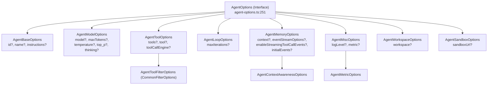
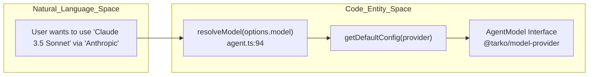

<!-- source: DeepWiki mcp.deepwiki.com · repo bytedance/UI-TARS-desktop · extra page Agent Class and Configuration Options · fetched 2026-10-30 -->

# Agent Class and Configuration Options

Relevant source files

The following files were used as context for generating this wiki page:

- [multimodal/agent-tars/core/src/environments/local/browser/browser-manager.ts](multimodal/agent-tars/core/src/environments/local/browser/browser-manager.ts)
- [multimodal/tarko/agent-interface/src/agent-event-stream.ts](multimodal/tarko/agent-interface/src/agent-event-stream.ts)
- [multimodal/tarko/agent-interface/src/agent-options.ts](multimodal/tarko/agent-interface/src/agent-options.ts)
- [multimodal/tarko/agent-interface/src/agent.ts](multimodal/tarko/agent-interface/src/agent.ts)
- [multimodal/tarko/agent-interface/src/tool-call-engine.ts](multimodal/tarko/agent-interface/src/tool-call-engine.ts)
- [multimodal/tarko/agent-snapshot/src/utils/snapshot-normalizer.ts](multimodal/tarko/agent-snapshot/src/utils/snapshot-normalizer.ts)
- [multimodal/tarko/agent/snapshot/__snapshots__/index.test.ts.snap](multimodal/tarko/agent/snapshot/__snapshots__/index.test.ts.snap)
- [multimodal/tarko/agent/src/agent/agent-runner.ts](multimodal/tarko/agent/src/agent/agent-runner.ts)
- [multimodal/tarko/agent/src/agent/agent.ts](multimodal/tarko/agent/src/agent/agent.ts)
- [multimodal/tarko/agent/src/agent/runner/llm-processor.ts](multimodal/tarko/agent/src/agent/runner/llm-processor.ts)
- [multimodal/tarko/agent/src/utils/tool-filter.ts](multimodal/tarko/agent/src/utils/tool-filter.ts)
- [multimodal/tarko/agent/tests/agent/llm-processor-usage-streaming.test.ts](multimodal/tarko/agent/tests/agent/llm-processor-usage-streaming.test.ts)
- [multimodal/tarko/llm-client/README.md](multimodal/tarko/llm-client/README.md)
- [multimodal/tarko/llm-client/src/handlers/openai-compatible.ts](multimodal/tarko/llm-client/src/handlers/openai-compatible.ts)
- [multimodal/tarko/llm/README.md](multimodal/tarko/llm/README.md)

## Purpose and Scope

This document details the `Agent` class constructor, the `AgentOptions` interface, and the configuration system that controls agent behavior in the Tarko framework. It covers the structure of configuration options, their default values, and how they are processed during agent initialization.

For information about the agent execution loop and runtime behavior, see page 4.1.2. For LLM processing details, see page 4.1.3. For tool execution, see page 4.1.4.

---

## Agent Class Structure

The `Agent` class is defined in [multimodal/tarko/agent/src/agent/agent.ts:55-720]() and serves as the main entry point for creating agent instances. It extends `BaseAgent` [multimodal/tarko/agent/src/agent/agent.ts:56-56]() and implements the `IAgent` interface [multimodal/tarko/agent/src/agent/agent.ts:57-57](). `BaseAgent` provides the lifecycle hook structure, while `Agent` adds execution logic (`run`, `abort`, `callLLM`) and configuration management.

### Agent Constructor Flow

The constructor initializes the agent's internal state and orchestrates the creation of specialized sub-components like the `AgentRunner` and `ToolManager`.

**Diagram: Agent Constructor Logic to Code Entities**

```mermaid
graph TB
    subgraph "Agent_Class_Constructor_Flow"
        AgentConstructor["Agent.constructor(options: AgentOptions)<br/>agent.ts:86"]
        
        AgentConstructor --> InitFields["this.instructions = options.instructions ?? getDefaultPrompt()<br/>this.maxIterations = options.maxIterations ?? 1000<br/>this.name = options.name ?? 'Anonymous'<br/>this.id = options.id ?? '@tarko/agent'<br/>Lines 89-93"]
        AgentConstructor --> ResolveModel["this.currentModel = resolveModel(options.model)<br/>Line 94"]
        AgentConstructor --> SetLogLevel["rootLogger.setLevel(options.logLevel)<br/>Lines 99-102"]
        AgentConstructor --> CreateEventStream["this.eventStream = new AgentEventStreamProcessor({<br/>  ...options.eventStreamOptions,<br/>  initialEvents: options.initialEvents<br/>})<br/>Lines 105-108"]
        AgentConstructor --> CreateToolManager["this.toolManager = new ToolManager()<br/>Line 111"]
        AgentConstructor --> RegisterTools["options.tools.forEach(tool => <br/>  this.registerTool(tool))<br/>Lines 122-126"]
        AgentConstructor --> CreateRunner["this.runner = new AgentRunner({...})<br/>Lines 154-168"]
        AgentConstructor --> CreateController["this.executionController = <br/>  new AgentExecutionController()<br/>Line 171"]
    end
    
    subgraph "Agent_Entity_Space"
        Fields1["Private Fields:<br/>instructions: string<br/>maxIterations: number<br/>maxTokens: number | undefined<br/>temperature: number<br/>top_p?: number<br/>reasoningOptions: LLMReasoningOptions<br/>customLLMClient?: OpenAI<br/>currentModel: AgentModel"]
        
        Fields2["Protected Fields:<br/>name: string<br/>id: string<br/>eventStream: AgentEventStreamProcessor<br/>executionController: AgentExecutionController"]
        
        Fields3["Public Fields:<br/>runner: AgentRunner<br/>logger: Logger<br/>initialized: boolean<br/>isReplaySnapshot: boolean"]
    end
    
    AgentConstructor --> Fields1
    AgentConstructor --> Fields2
    AgentConstructor --> Fields3
```

**Key Constructor Operations:**

1.  **Field Initialization** [multimodal/tarko/agent/src/agent/agent.ts:89-102](): Sets `this.instructions`, `this.maxIterations`, `this.maxTokens`, `this.name`, `this.id`, and `this.temperature`/`this.top_p` parameters with defaults.
2.  **Model Resolution** [multimodal/tarko/agent/src/agent/agent.ts:94](): Calls `resolveModel(options.model)` from `@tarko/model-provider` to convert model options to `AgentModel`, stores in `this.currentModel`.
3.  **Log Level Configuration** [multimodal/tarko/agent/src/agent/agent.ts:99-102](): Sets global `rootLogger.setLevel(options.logLevel)` if provided.
4.  **Event Stream Creation** [multimodal/tarko/agent/src/agent/agent.ts:105-108](): Instantiates `this.eventStream = new AgentEventStreamProcessor()` with event stream options and initial events.
5.  **Tool Manager Creation** [multimodal/tarko/agent/src/agent/agent.ts:111](): Creates `this.toolManager = new ToolManager()` for tool registration and retrieval.
6.  **Tool Registration** [multimodal/tarko/agent/src/agent/agent.ts:122-126](): Registers each tool from `options.tools` array via `this.registerTool(tool)`.
7.  **Runner Creation** [multimodal/tarko/agent/src/agent/agent.ts:154-168](): Creates `this.runner = new AgentRunner()` with all configuration and dependencies.
8.  **Execution Controller** [multimodal/tarko/agent/src/agent/agent.ts:171](): Initializes `this.executionController = new AgentExecutionController()` for execution state management.

**Sources:**
*   [multimodal/tarko/agent/src/agent/agent.ts:55-172]()
*   [multimodal/tarko/agent-interface/src/agent-options.ts:251-259]()

---

## AgentOptions Interface Hierarchy

The `AgentOptions` interface is defined in [multimodal/tarko/agent-interface/src/agent-options.ts:251-259]() and composes multiple specialized option interfaces.

**Sources:**
*   [multimodal/tarko/agent-interface/src/agent-options.ts:1-275]()

---

## Configuration Categories

### 1. Base Configuration
The `AgentBaseOptions` [multimodal/tarko/agent-interface/src/agent-options.ts:35-58]() defines identity.

| Option | Type | Default | Description |
| :--- | :--- | :--- | :--- |
| `id` | `string?` | `"@tarko/agent"` | Unique identifier for the agent instance. |
| `name` | `string?` | `"Anonymous"` | Agent's display name for tracing. |
| `instructions` | `string?` | `undefined` | System prompt defining agent behavior. |

**Sources:**
*   [multimodal/tarko/agent-interface/src/agent-options.ts:35-58]()
*   [multimodal/tarko/agent/src/agent/agent.ts:89-93]()

### 2. Model Configuration
The `AgentModelOptions` [multimodal/tarko/agent-interface/src/agent-options.ts:63-102]() controls LLM interaction.

| Option | Type | Default | Description |
| :--- | :--- | :--- | :--- |
| `model` | `AgentModel?` | `undefined` | Model settings (provider and model ID). |
| `maxTokens` | `number?` | `1000` | Maximum tokens allowed in the context window. |
| `temperature` | `number?` | `0.7` | LLM sampling temperature. |
| `top_p` | `number?` | `undefined` | Nucleus sampling parameter. |
| `thinking` | `LLMReasoningOptions?` | `{ type: 'disabled' }` | Reasoning content control configuration. |

**Sources:**
*   [multimodal/tarko/agent-interface/src/agent-options.ts:63-102]()
*   [multimodal/tarko/agent/src/agent/agent.ts:139-151]()

### 3. Model Resolution Logic
Model configuration is processed via the `resolveModel` function in `@tarko/model-provider`.

**Diagram: Model Configuration Flow**

**Key Resolution Steps:**
1.  **Defaults**: If no model configuration is provided, `resolveModel` handles defaults (typically `gpt-4o` on `openai` provider) [multimodal/tarko/agent/src/agent/agent.ts:94]().
2.  **Provider Mapping**: The system maps human-readable provider names to their internal API configurations, including `baseURL` and `apiKey` lookups.
3.  **On-Demand Resolution**: Model resolution is performed on-demand within the constructor [multimodal/tarko/agent/src/agent/agent.ts:94]().

**Sources:**
*   [multimodal/tarko/agent/src/agent/agent.ts:94-94]()
*   [multimodal/tarko/agent-interface/src/agent-options.ts:63-70]()

### 4. Memory and Context Configuration
The `AgentMemoryOptions` [multimodal/tarko/agent-interface/src/agent-options.ts:166-196]() manages history and event streaming.

| Option | Type | Default | Description |
| :--- | :--- | :--- | :--- |
| `context` | `AgentContextAwarenessOptions?` | `{ maxImagesCount: 5 }` | Controls message history management. |
| `eventStreamOptions` | `ProcessorOptions?` | `undefined` | Configuration for the `AgentEventStreamProcessor`. |
| `enableStreamingToolCallEvents` | `boolean?` | `false` | Emits `assistant_streaming_tool_call` events during construction. |
| `initialEvents` | `Event[]?` | `undefined` | Events to restore to the stream during initialization. |

**Sources:**
*   [multimodal/tarko/agent-interface/src/agent-options.ts:166-196]()
*   [multimodal/tarko/agent/src/agent/agent.ts:114-117]()

---

## Key Public Methods

The `Agent` class provides several methods for interacting with the reasoning loop and configuration.

| Method | Signature | Description |
| :--- | :--- | :--- |
| `run` | `run(input: string \| AgentRunObjectOptions)` | Starts the agent reasoning loop [multimodal/tarko/agent/src/agent/agent.ts:251](). |
| `abort` | `abort(): boolean` | Aborts the current execution via `executionController` [multimodal/tarko/agent/src/agent/agent.ts:401](). |
| `registerTool` | `registerTool(tool: Tool)` | Registers a new tool with the `ToolManager` [multimodal/tarko/agent/src/agent/agent.ts:203](). |
| `getTools` | `getTools(): Tool[]` | Returns filtered tools using `filterTools` utility [multimodal/tarko/agent/src/agent/agent.ts:212](). |
| `setCustomLLMClient` | `setCustomLLMClient(client: OpenAI)` | Overrides the default LLM client and updates the runner's processor [multimodal/tarko/agent/src/agent/agent.ts:181-185](). |
| `getCurrentLoopIteration` | `getCurrentLoopIteration(): number` | Returns the current 1-based iteration of the runner [multimodal/tarko/agent/src/agent/agent.ts:193-195](). |

**Sources:**
*   [multimodal/tarko/agent/src/agent/agent.ts:181-401]()

---

## Initialization Flow Summary

The agent follows a pattern where the constructor sets up sub-components and prepares the state for execution.

1.  **Construction**: Validates `thinking` options [multimodal/tarko/agent/src/agent/agent.ts:142-148](), resolves the model [multimodal/tarko/agent/src/agent/agent.ts:94](), and instantiates the `AgentRunner` [multimodal/tarko/agent/src/agent/agent.ts:154-168]().
2.  **Component Linkage**: The `AgentRunner` receives the `Agent` instance, `ToolManager`, and `EventStreamProcessor` to coordinate the `LoopExecutor` and `LLMProcessor` [multimodal/tarko/agent/src/agent/agent-runner.ts:91-117]().
3.  **Tool Setup**: Tools provided in options are registered immediately into the `ToolManager` [multimodal/tarko/agent/src/agent/agent.ts:122-126]().

**Sources:**
*   [multimodal/tarko/agent/src/agent/agent.ts:86-172]()
*   [multimodal/tarko/agent/src/agent/runner/llm-processor.ts:37-63]()
*   [multimodal/tarko/agent/src/agent/agent-runner.ts:77-117]()

---

