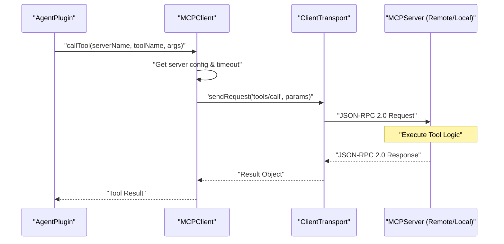

<!-- source: DeepWiki mcp.deepwiki.com · repo bytedance/UI-TARS-desktop · extra page MCP Transport Layer and Communication Protocol · fetched 2026-10-30 -->

# MCP Transport Layer and Communication Protocol

<details>
<summary>Relevant source files</summary>

The following files were used as context for generating this wiki page:

- [packages/agent-infra/mcp-client/CHANGELOG.md](packages/agent-infra/mcp-client/CHANGELOG.md)
- [packages/agent-infra/mcp-client/package.json](packages/agent-infra/mcp-client/package.json)
- [packages/agent-infra/mcp-http-server/README.md](packages/agent-infra/mcp-http-server/README.md)
- [packages/agent-infra/mcp-http-server/src/startServer.ts](packages/agent-infra/mcp-http-server/src/startServer.ts)
- [packages/agent-infra/mcp-http-server/tests/startServer-server.test.ts](packages/agent-infra/mcp-http-server/tests/startServer-server.test.ts)
- [packages/agent-infra/mcp-servers/browser/CHANGELOG.md](packages/agent-infra/mcp-servers/browser/CHANGELOG.md)
- [packages/agent-infra/mcp-servers/browser/package.json](packages/agent-infra/mcp-servers/browser/package.json)
- [packages/agent-infra/mcp-servers/commands/CHANGELOG.md](packages/agent-infra/mcp-servers/commands/CHANGELOG.md)
- [packages/agent-infra/mcp-servers/commands/README.md](packages/agent-infra/mcp-servers/commands/README.md)
- [packages/agent-infra/mcp-servers/commands/package.json](packages/agent-infra/mcp-servers/commands/package.json)
- [packages/agent-infra/mcp-servers/commands/src/index.ts](packages/agent-infra/mcp-servers/commands/src/index.ts)
- [packages/agent-infra/mcp-servers/filesystem/CHANGELOG.md](packages/agent-infra/mcp-servers/filesystem/CHANGELOG.md)
- [packages/agent-infra/mcp-servers/filesystem/package.json](packages/agent-infra/mcp-servers/filesystem/package.json)
- [packages/agent-infra/mcp-servers/filesystem/src/index.ts](packages/agent-infra/mcp-servers/filesystem/src/index.ts)
- [packages/agent-infra/mcp-servers/search/CHANGELOG.md](packages/agent-infra/mcp-servers/search/CHANGELOG.md)
- [packages/agent-infra/mcp-servers/search/package.json](packages/agent-infra/mcp-servers/search/package.json)
- [packages/agent-infra/mcp-shared/CHANGELOG.md](packages/agent-infra/mcp-shared/CHANGELOG.md)
- [packages/agent-infra/mcp-shared/package.json](packages/agent-infra/mcp-shared/package.json)

</details>


This document describes the Model Context Protocol (MCP) transport layer implementation in the UI-TARS system. It covers the MCP SDK integration, transport mechanisms (stdio, SSE, StreamableHTTP, and InMemory), the custom `mcp-http-server` infrastructure, and shared protocol utilities.

For information about MCP client connection management and tool discovery, see [6.1.1 MCP Client Architecture](). For details about specific MCP server implementations, see [6.1.2 MCP Server Implementations]().

## Overview

The MCP transport layer provides the communication infrastructure between MCP clients and servers. The system supports **four transport mechanisms**:

| Transport | Type Discriminant | Use Case |
|-----------|------------------|----------|
| **Stdio** | `type: 'stdio'` | Local subprocess spawned by command |
| **SSE** | `type: 'sse'` | Remote server over HTTP with Server-Sent Events |
| **StreamableHTTP** | `type: 'streamable-http'` | Remote server over HTTP (default for URL-based) |
| **BuiltIn (InMemory)** | `type: 'builtin'` | In-process server, no network overhead |

The transport type is determined at connection time in `MCPClient.activate()` based on the shape of the `MCPServer` configuration object. Type definitions reside in `@agent-infra/mcp-shared`, and connection logic lives in `@agent-infra/mcp-client`.

**Sources:** [packages/agent-infra/mcp-client/package.json:35-41](), [packages/agent-infra/mcp-shared/package.json:16-33]()

## MCP SDK Integration

The system uses the official `@modelcontextprotocol/sdk` package (version ~1.15.1) as the core protocol implementation. This SDK defines the standard MCP message format, protocol capabilities, and communication patterns.

### Protocol Version and Dependencies

All MCP components declare compatibility with MCP protocol version ~1.15.1:

| Package | SDK Version | Role |
|---------|-------------|------|
| `@agent-infra/mcp-client` | `~1.15.1` | Client implementation [packages/agent-infra/mcp-client/package.json:37]() |
| `@agent-infra/mcp-server-browser` | `~1.15.1` | Browser automation server [packages/agent-infra/mcp-servers/browser/package.json:52]() |
| `@agent-infra/mcp-server-filesystem` | `~1.15.1` | File operations server [packages/agent-infra/mcp-servers/filesystem/package.json:38]() |
| `@agent-infra/mcp-server-commands` | `~1.15.1` | Shell command server [packages/agent-infra/mcp-servers/commands/package.json:42]() |
| `@agent-infra/mcp-server-search` | `~1.15.1` | Search provider server [packages/agent-infra/mcp-servers/search/package.json:33]() |
| `@agent-infra/mcp-shared` | `~1.15.1` | Shared utilities [packages/agent-infra/mcp-shared/package.json:43]() |

The upgrade to version 1.15.1 occurred in system version 1.2.0.

**Sources:** [packages/agent-infra/mcp-client/CHANGELOG.md:209-210](), [packages/agent-infra/mcp-shared/CHANGELOG.md:77]()

## Transport Architecture

The following diagram bridges the high-level transport concepts to the specific code entities responsible for managing them.

**Transport Selection and Code Entity Mapping**

```mermaid
graph TB
    subgraph "MCPClient_Entity[@agent-infra/mcp-client]"
        "activate()"["activate(server: MCPServer)"]
        "StdioClientTransport"["StdioClientTransport"]
        "SSEClientTransport"["SSEClientTransport"]
        "StreamableHTTPClientTransport"["StreamableHTTPClientTransport"]
        "InMemoryTransport"["InMemoryTransport"]
    end

    subgraph "Config_Space[@agent-infra/mcp-shared]"
        "StdioMCPServer"["StdioMCPServer\n(has 'command')"]
        "SSEMCPServer"["SSEMCPServer\n(type: 'sse')"]
        "StreamableHTTPMCPServer"["StreamableHTTPMCPServer\n(type: 'streamable-http')"]
        "BuiltInMCPServer"["BuiltInMCPServer\n(has 'mcpServer')"]
    end

    subgraph "Server_Implementations"
        "BrowserSrv"["@agent-infra/mcp-server-browser"]
        "FileSrv"["@agent-infra/mcp-server-filesystem"]
        "CmdSrv"["@agent-infra/mcp-server-commands"]
    end

    "StdioMCPServer" -.->|selected_by_activate| "StdioClientTransport"
    "SSEMCPServer" -.->|selected_by_activate| "SSEClientTransport"
    "StreamableHTTPMCPServer" -.->|selected_by_activate| "StreamableHTTPClientTransport"
    "BuiltInMCPServer" -.->|selected_by_activate| "InMemoryTransport"

    "BrowserSrv" -->|uses| "McpHttpServer"["mcp-http-server"]
    "FileSrv" -->|uses| "McpHttpServer"
    "CmdSrv" -->|uses| "McpHttpServer"
```

**Sources:** [packages/agent-infra/mcp-client/package.json:35-37](), [packages/agent-infra/mcp-servers/browser/package.json:54]()

## Transport Types and Selection

The `activate()` method in `MCPClient` is the central dispatch point for transport instantiation.

### Selection Logic Flow

```mermaid
flowchart TD
    "Start"["activate(server: MCPServer)"] --> "IsUrl"{"'url' in server?"}
    "IsUrl" -- "Yes" --> "IsSSE"{"type === 'sse'?"}
    "IsSSE" -- "Yes" --> "CreateSSE"["new SSEClientTransport(url, headers)"]
    "IsSSE" -- "No" --> "CreateHTTP"["new StreamableHTTPClientTransport(url, headers)"]
    
    "IsUrl" -- "No" --> "IsStdio"{"'command' in server?"}
    "IsStdio" -- "Yes" --> "CreateStdio"["new StdioClientTransport(command, args, env, cwd)"]
    
    "IsStdio" -- "No" --> "IsBuiltIn"{"'mcpServer' in server?"}
    "IsBuiltIn" -- "Yes" --> "CreatePair"["InMemoryTransport.createLinkedPair()"]
    
    "CreateSSE" --> "Connect"["client.connect(transport)"]
    "CreateHTTP" --> "Connect"
    "CreateStdio" --> "Connect"
    "CreatePair" --> "LinkedConnect"["Promise.all([client.connect, mcpServer.connect])"]
```

**Sources:** [packages/agent-infra/mcp-client/package.json:35-41](), [packages/agent-infra/mcp-shared/package.json:16-33]()

### Stdio Transport
Used for local subprocesses. The client spawns a process and communicates via stdin/stdout. 

| Server | Binary Entry Point | Path |
|--------|--------------------|------|
| Browser | `mcp-server-browser` | `dist/index.cjs` [packages/agent-infra/mcp-servers/browser/package.json:16]() |
| Filesystem | `mcp-server-filesystem` | `dist/index.cjs` [packages/agent-infra/mcp-servers/filesystem/package.json:25]() |
| Commands | `mcp-server-commands` | `dist/index.cjs` [packages/agent-infra/mcp-servers/commands/package.json:17]() |
| Search | `mcp-server-search` | `dist/index.cjs` [packages/agent-infra/mcp-servers/search/package.json:17]() |

### SSE and StreamableHTTP Transport
These transports facilitate communication with remote servers. `SSEClientTransport` is used when `type: 'sse'` is explicitly provided. `StreamableHTTPClientTransport` is the default for URL-based servers. Both support custom HTTP headers via `requestInit`.

**Sources:** [packages/agent-infra/mcp-shared/package.json:22-31]()

### BuiltIn (InMemory) Transport
Allows an MCP server to run in the **same Node.js process** as the client. `InMemoryTransport.createLinkedPair()` generates a linked pair of transports where the client and server connect directly without serialization or network overhead. This is used for built-in plugins in the Electron application.

**Sources:** [packages/agent-infra/mcp-client/package.json:4]()

## mcp-http-server Infrastructure

The `mcp-http-server` package is a core internal dependency for the browser, filesystem, and commands servers. It wraps the base `McpServer` to expose it over HTTP.

### Server Capabilities and CLI
Servers using this infrastructure support:
- **SSE** and **StreamableHTTP** endpoints.
- **Custom Logger**: Support for injecting specific logger instances [packages/agent-infra/mcp-servers/browser/CHANGELOG.md:160-172]().
- **Request Context**: Access to per-request state via `getRequestContext` [packages/agent-infra/mcp-servers/browser/CHANGELOG.md:165]().

Servers typically expose a `--port` flag for network serving:
- `mcp-server-browser --port 3000` [packages/agent-infra/mcp-servers/browser/package.json:41]()
- `mcp-server-filesystem /tmp --port 3001` (implied by dependency on `mcp-http-server`) [packages/agent-infra/mcp-servers/filesystem/package.json:39]()

## Shared Protocol Utilities (`@agent-infra/mcp-shared`)

This package provides the core types and filters used across the transport layer.

### MCPServer Configuration Schema
The system supports configurable timeouts per server, defaulting to standard protocol values unless overridden.

**Sources:** [packages/agent-infra/mcp-client/CHANGELOG.md:55]()

### Filtering Logic
The `MCPClient` implements filtering using patterns. Filters are applied to both `listTools()` and `listPrompts()`:
1. **Allow**: If `allow` patterns exist, only matching items are kept.
2. **Block**: Any items matching `block` patterns are removed.

**Sources:** [packages/agent-infra/mcp-client/CHANGELOG.md:62-63]()

## Communication Flow

**Tool Call Execution Sequence**



**Sources:** [packages/agent-infra/mcp-client/package.json:35-42]()

## Logging and Debugging

- **Capability**: Servers declare `logging` capability. In version 1.2.21, `logging/setLevel` was implemented across servers to fix capability declaration mismatches [packages/agent-infra/mcp-servers/browser/CHANGELOG.md:49]().
- **Debug Mode**: Enabled via configuration or `process.env.DEBUG === 'mcp'`, which logs tool calls and lifecycle events.
- **Inspector**: Development scripts use `@modelcontextprotocol/inspector` for interactive debugging of stdio servers [packages/agent-infra/mcp-servers/browser/package.json:40]().

## Build and Distribution

Servers are compiled with `rslib` to both ESM and CJS formats. Binary entry points are explicitly set as executable in the `package.json` `bin` field and via `chmod` in build scripts.

**Sources:** [packages/agent-infra/mcp-servers/browser/package.json:18-34](), [packages/agent-infra/mcp-servers/browser/package.json:39](), [packages/agent-infra/mcp-servers/filesystem/package.json:31](), [packages/agent-infra/mcp-servers/commands/package.json:31]()

---

