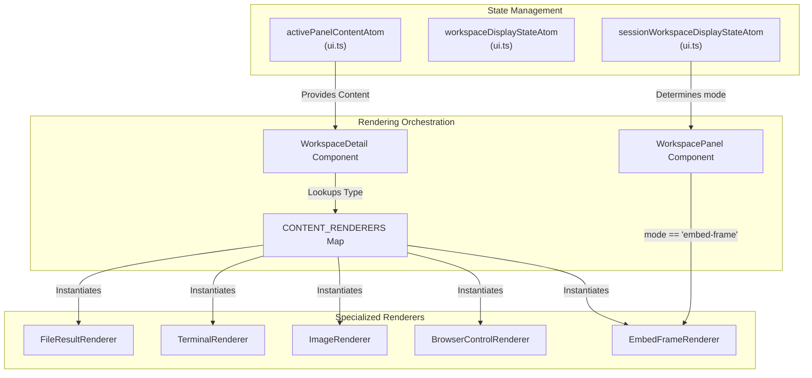
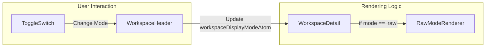

<!-- source: DeepWiki mcp.deepwiki.com · repo bytedance/UI-TARS-desktop · extra page Message and Content Rendering System · fetched 2026-10-30 -->

# Message and Content Rendering System

Relevant source files

The following files were used as context for generating this wiki page:

- [multimodal/tarko/agent-ui/docs/runtime-settings-autoactive.md](multimodal/tarko/agent-ui/docs/runtime-settings-autoactive.md)
- [multimodal/tarko/agent-ui/examples/webui-config.json](multimodal/tarko/agent-ui/examples/webui-config.json)
- [multimodal/tarko/agent-ui/src/common/hooks/useSession.ts](multimodal/tarko/agent-ui/src/common/hooks/useSession.ts)
- [multimodal/tarko/agent-ui/src/common/state/actions/eventProcessors/handlers/AgentRunHandler.ts](multimodal/tarko/agent-ui/src/common/state/actions/eventProcessors/handlers/AgentRunHandler.ts)
- [multimodal/tarko/agent-ui/src/common/state/actions/eventProcessors/handlers/SystemHandler.ts](multimodal/tarko/agent-ui/src/common/state/actions/eventProcessors/handlers/SystemHandler.ts)
- [multimodal/tarko/agent-ui/src/common/state/actions/eventProcessors/handlers/ToolHandler.ts](multimodal/tarko/agent-ui/src/common/state/actions/eventProcessors/handlers/ToolHandler.ts)
- [multimodal/tarko/agent-ui/src/common/state/actions/eventProcessors/utils/cacheManager.ts](multimodal/tarko/agent-ui/src/common/state/actions/eventProcessors/utils/cacheManager.ts)
- [multimodal/tarko/agent-ui/src/common/state/actions/eventProcessors/utils/panelContentUpdater.ts](multimodal/tarko/agent-ui/src/common/state/actions/eventProcessors/utils/panelContentUpdater.ts)
- [multimodal/tarko/agent-ui/src/common/state/actions/sessionActions.ts](multimodal/tarko/agent-ui/src/common/state/actions/sessionActions.ts)
- [multimodal/tarko/agent-ui/src/common/state/atoms/ui.ts](multimodal/tarko/agent-ui/src/common/state/atoms/ui.ts)
- [multimodal/tarko/agent-ui/src/common/types/index.ts](multimodal/tarko/agent-ui/src/common/types/index.ts)
- [multimodal/tarko/agent-ui/src/common/utils/modelUtils.ts](multimodal/tarko/agent-ui/src/common/utils/modelUtils.ts)
- [multimodal/tarko/agent-ui/src/standalone/app/Layout/MobileBottomSheet.tsx](multimodal/tarko/agent-ui/src/standalone/app/Layout/MobileBottomSheet.tsx)
- [multimodal/tarko/agent-ui/src/standalone/chat/Message/components/MultimodalContent.tsx](multimodal/tarko/agent-ui/src/standalone/chat/Message/components/MultimodalContent.tsx)
- [multimodal/tarko/agent-ui/src/standalone/chat/Message/components/ToolCalls.tsx](multimodal/tarko/agent-ui/src/standalone/chat/Message/components/ToolCalls.tsx)
- [multimodal/tarko/agent-ui/src/standalone/chat/Message/index.tsx](multimodal/tarko/agent-ui/src/standalone/chat/Message/index.tsx)
- [multimodal/tarko/agent-ui/src/standalone/navbar/ModelSelector.tsx](multimodal/tarko/agent-ui/src/standalone/navbar/ModelSelector.tsx)
- [multimodal/tarko/agent-ui/src/standalone/navbar/Navbar.tsx](multimodal/tarko/agent-ui/src/standalone/navbar/Navbar.tsx)
- [multimodal/tarko/agent-ui/src/standalone/workspace/Workspace.css](multimodal/tarko/agent-ui/src/standalone/workspace/Workspace.css)
- [multimodal/tarko/agent-ui/src/standalone/workspace/WorkspaceContent.tsx](multimodal/tarko/agent-ui/src/standalone/workspace/WorkspaceContent.tsx)
- [multimodal/tarko/agent-ui/src/standalone/workspace/WorkspaceDetail.tsx](multimodal/tarko/agent-ui/src/standalone/workspace/WorkspaceDetail.tsx)
- [multimodal/tarko/agent-ui/src/standalone/workspace/WorkspacePanel.tsx](multimodal/tarko/agent-ui/src/standalone/workspace/WorkspacePanel.tsx)
- [multimodal/tarko/agent-ui/src/standalone/workspace/components/FullscreenModal.tsx](multimodal/tarko/agent-ui/src/standalone/workspace/components/FullscreenModal.tsx)
- [multimodal/tarko/agent-ui/src/standalone/workspace/components/WorkspaceHeader.tsx](multimodal/tarko/agent-ui/src/standalone/workspace/components/WorkspaceHeader.tsx)
- [multimodal/tarko/agent-ui/src/standalone/workspace/components/shared/MessageContent.tsx](multimodal/tarko/agent-ui/src/standalone/workspace/components/shared/MessageContent.tsx)
- [multimodal/tarko/agent-ui/src/standalone/workspace/components/shared/ToggleSwitch.tsx](multimodal/tarko/agent-ui/src/standalone/workspace/components/shared/ToggleSwitch.tsx)
- [multimodal/tarko/agent-ui/src/standalone/workspace/components/shared/index.ts](multimodal/tarko/agent-ui/src/standalone/workspace/components/shared/index.ts)
- [multimodal/tarko/agent-ui/src/standalone/workspace/renderers/CommandResultRenderer.tsx](multimodal/tarko/agent-ui/src/standalone/workspace/renderers/CommandResultRenderer.tsx)
- [multimodal/tarko/agent-ui/src/standalone/workspace/renderers/FileResultRenderer.tsx](multimodal/tarko/agent-ui/src/standalone/workspace/renderers/FileResultRenderer.tsx)
- [multimodal/tarko/agent-ui/src/standalone/workspace/renderers/ImageRenderer.tsx](multimodal/tarko/agent-ui/src/standalone/workspace/renderers/ImageRenderer.tsx)
- [multimodal/tarko/agent-ui/src/standalone/workspace/renderers/TerminalRenderer.tsx](multimodal/tarko/agent-ui/src/standalone/workspace/renderers/TerminalRenderer.tsx)
- [multimodal/tarko/agent-ui/src/standalone/workspace/utils/fileTypeUtils.ts](multimodal/tarko/agent-ui/src/standalone/workspace/utils/fileTypeUtils.ts)
- [multimodal/tarko/ui/src/components/code-editor/CodeEditor.tsx](multimodal/tarko/ui/src/components/code-editor/CodeEditor.tsx)
- [multimodal/tarko/ui/src/components/code-editor/index.ts](multimodal/tarko/ui/src/components/code-editor/index.ts)

This document describes the message and content rendering system in the Tarko Agent Web UI, which transforms agent events and tool outputs into visual representations. The system handles multiple content types including text messages, code output, terminal-style tool results, and file operations.

## Purpose and Scope

The message and content rendering system is responsible for:

-   **Event-to-UI transformation**: Converting raw tool results and agent outputs into React components.
-   **Multi-format rendering**: Supporting markdown, terminal output, Monaco-based code editors, and throttled HTML previews.
-   **Streaming support**: Incrementally rendering content (e.g., file creation or terminal output) as it arrives.
-   **Workspace Integration**: Providing a specialized environment for viewing files and tool executions outside the primary chat flow.
-   **Content type detection**: Automatically selecting the appropriate renderer based on file extensions and message metadata.

## Architecture Overview

The rendering system is primarily located within the workspace module of the `agent-ui`. It uses a set of specialized renderer components to handle different data types.

### Code-to-Logic Mapping
The following diagram bridges the natural language concepts of "Content Rendering" to the specific code entities in the rendering pipeline.

**Sources**: [multimodal/tarko/agent-ui/src/standalone/workspace/WorkspaceDetail.tsx:34-59](), [multimodal/tarko/agent-ui/src/common/state/atoms/ui.ts:112-134](), [multimodal/tarko/agent-ui/src/standalone/workspace/WorkspacePanel.tsx:132-145]().

## File and Result Rendering

The `FileResultRenderer` is the core component for displaying file-based content. It determines the rendering strategy based on file extensions and the current `displayMode` (`source` or `rendered`).

### Content Extraction and Detection
The system uses utility functions to extract content from various event structures (e.g., `str_replace_editor` commands or direct source strings) and identify the file type.

| Function | Role | Source |
| :--- | :--- | :--- |
| `getFileContent` | Extracts text from `panelContent.arguments` or `panelContent.source`. | [multimodal/tarko/agent-ui/src/standalone/workspace/renderers/FileResultRenderer.tsx:114-146]() |
| `getFileTypeInfo` | Parses extension to determine if a file is HTML, Markdown, or Code. | [multimodal/tarko/agent-ui/src/standalone/workspace/utils/fileTypeUtils.ts:18-33]() |
| `determineFileType` | Maps extensions (js, py, java, etc.) to a 'code' category. | [multimodal/tarko/agent-ui/src/standalone/workspace/renderers/FileResultRenderer.tsx:156-169]() |

### Rendering Strategies

-   **Markdown**: Uses `MessageContent` which wraps `MarkdownRenderer` from `@tarko/ui`. If in `source` mode, it shows the raw markdown in a code editor [multimodal/tarko/agent-ui/src/standalone/workspace/renderers/FileResultRenderer.tsx:72-94]().
-   **HTML**: In `rendered` mode, it utilizes `ThrottledHtmlRenderer` to prevent excessive re-renders during streaming [multimodal/tarko/agent-ui/src/standalone/workspace/renderers/FileResultRenderer.tsx:47-51]().
-   **Code**: Leverages `MonacoCodeEditor` for syntax highlighting, line numbers, and read-only display [multimodal/tarko/agent-ui/src/standalone/workspace/renderers/FileResultRenderer.tsx:62-71]().
-   **Images**: Renders base64 encoded strings or URLs. The `ImageRenderer` supports zoom and download actions [multimodal/tarko/agent-ui/src/standalone/workspace/renderers/ImageRenderer.tsx:17-41]().
-   **GUI Browser**: `BrowserControlRenderer` handles the visual output for GUI-based agents (e.g., UI-TARS) when receiving screenshots [multimodal/tarko/agent-ui/src/standalone/workspace/WorkspaceDetail.tsx:49]().

**Sources**: [multimodal/tarko/agent-ui/src/standalone/workspace/renderers/FileResultRenderer.tsx:43-112](), [multimodal/tarko/agent-ui/src/standalone/workspace/components/shared/MessageContent.tsx:14-60](), [multimodal/tarko/agent-ui/src/standalone/workspace/renderers/ImageRenderer.tsx:96-188]().

## Terminal and Tool Execution Rendering

The `TerminalRenderer` and `CommandResultRenderer` provide a CLI-like experience for tool calls. They format commands, arguments, and outputs into a themed terminal window.

### Command Formatting
The `CommandResultRenderer` is used to display the output of shell commands or scripts. It is mapped in the `CONTENT_RENDERERS` registry to handle `command_result` and `script_result` types [multimodal/tarko/agent-ui/src/standalone/workspace/WorkspaceDetail.tsx:46-47]().

### URL Linkification
Renderers detect URLs within tool outputs and JSON arguments, making them clickable links that open in new tabs. This is particularly relevant for search results and browser-based tool outputs [multimodal/tarko/agent-ui/src/standalone/workspace/renderers/LinkRenderer.tsx:1-10]().

**Sources**: [multimodal/tarko/agent-ui/src/standalone/workspace/WorkspaceDetail.tsx:34-59](), [multimodal/tarko/agent-ui/src/standalone/workspace/renderers/TerminalRenderer.tsx:1-20]().

## Workspace UI and Navigation

The rendering system is wrapped in a workspace interface that allows users to toggle between different views and manage content.

### Workspace Header
The `WorkspaceHeader` component provides controls for:
-   **Display Mode Toggle**: Switching between "UI" (Interaction) and "RAW" (Code) modes using `ToggleSwitch` [multimodal/tarko/agent-ui/src/standalone/workspace/components/WorkspaceHeader.tsx:118-130]().
-   **Path Normalization**: Displaying cleaned file paths using `normalizeFilePath` [multimodal/tarko/agent-ui/src/standalone/workspace/components/WorkspaceHeader.tsx:92-96]().
-   **Fullscreen Toggle**: Opening content in a high-focus modal [multimodal/tarko/agent-ui/src/standalone/workspace/components/WorkspaceHeader.tsx:108-116]().

### Embed Frames
The `EmbedFrameRenderer` is used to host external tools like VNC or Code Server within the workspace. The `Navbar` can trigger `showEmbedFrame` based on `workspaceNavItems` configuration [multimodal/tarko/agent-ui/src/standalone/navbar/Navbar.tsx:171-188]().

**Sources**: [multimodal/tarko/agent-ui/src/standalone/workspace/components/WorkspaceHeader.tsx:118-134](), [multimodal/tarko/agent-ui/src/standalone/workspace/WorkspaceDetail.tsx:64](), [multimodal/tarko/agent-ui/src/standalone/navbar/Navbar.tsx:59-61]().

## Streaming and Updates

To handle live agent output, the system employs several stability and performance patterns:

-   **Stable Content Hooks**: `useStableCodeContent` is used to prevent the UI from flickering or losing state while a file is being written [multimodal/tarko/agent-ui/src/standalone/workspace/renderers/FileResultRenderer.tsx:26]().
-   **Streaming Detection**: Renderers receive an `isStreaming` flag from `panelContent.isStreaming`. For HTML files, the system defaults to `source` mode during streaming to avoid rendering partial/broken HTML tags [multimodal/tarko/agent-ui/src/standalone/workspace/renderers/FileResultRenderer.tsx:41-51]().
-   **Throttled Rendering**: `ThrottledHtmlRenderer` ensures that the browser is not overwhelmed by rapid updates to the DOM during high-frequency agent events [multimodal/tarko/agent-ui/src/standalone/workspace/renderers/FileResultRenderer.tsx:51]().
-   **Auto-Scroll and Selection**: When a session is activated, the system automatically selects the "best" file to display (prioritizing HTML > Markdown) using `selectBestFileToDisplay` [multimodal/tarko/agent-ui/src/common/state/actions/sessionActions.ts:17-55]().
-   **Event Handling**: The `EnvironmentInputHandler` processes `environment_input` events to update the `sessionPanelContentAtom`, typically displaying a screenshot in the `browser_vision_control` or `image` renderer [multimodal/tarko/agent-ui/src/common/state/actions/eventProcessors/handlers/SystemHandler.ts:90-129]().

**Sources**: [multimodal/tarko/agent-ui/src/standalone/workspace/renderers/FileResultRenderer.tsx:26-51](), [multimodal/tarko/agent-ui/src/common/state/actions/sessionActions.ts:17-55](), [multimodal/tarko/agent-ui/src/common/state/actions/eventProcessors/handlers/SystemHandler.ts:41-132]().

---

