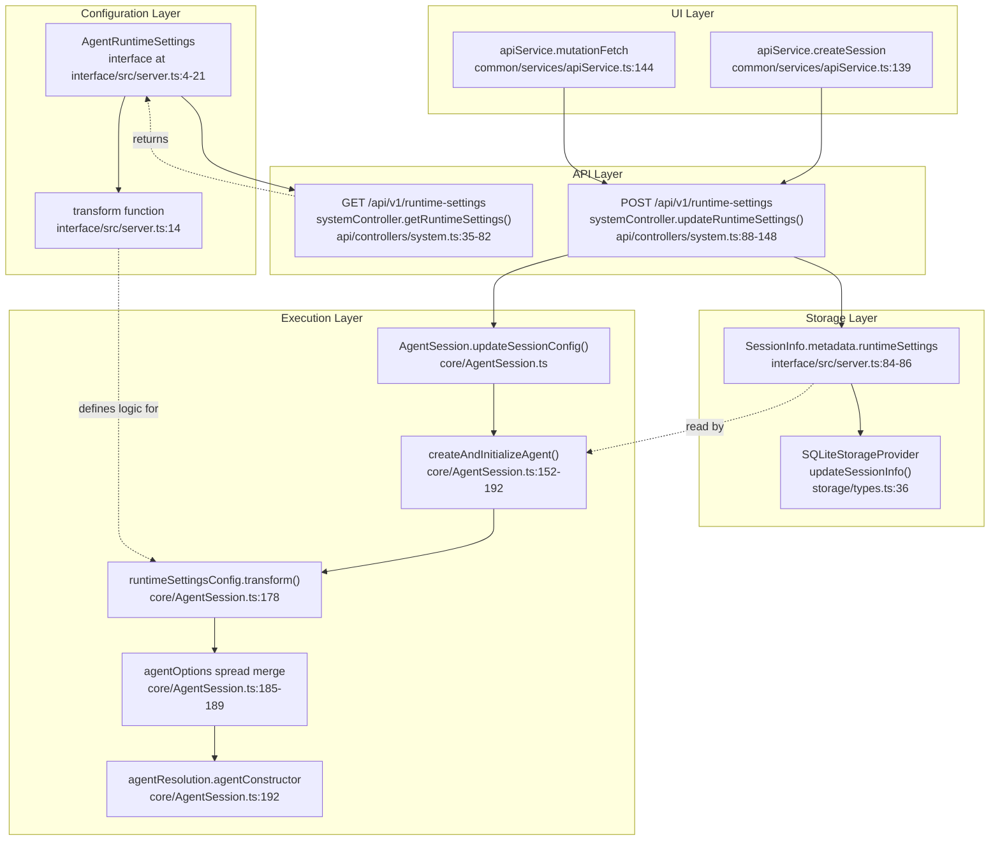
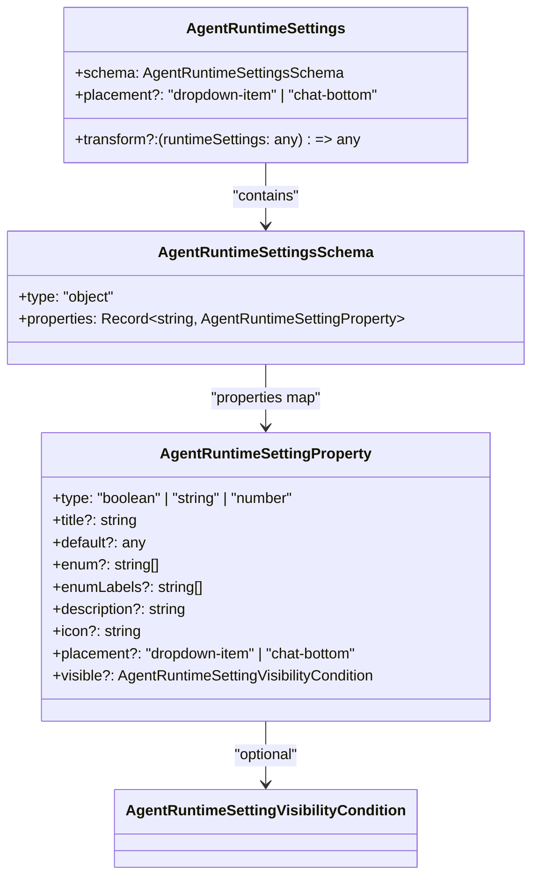
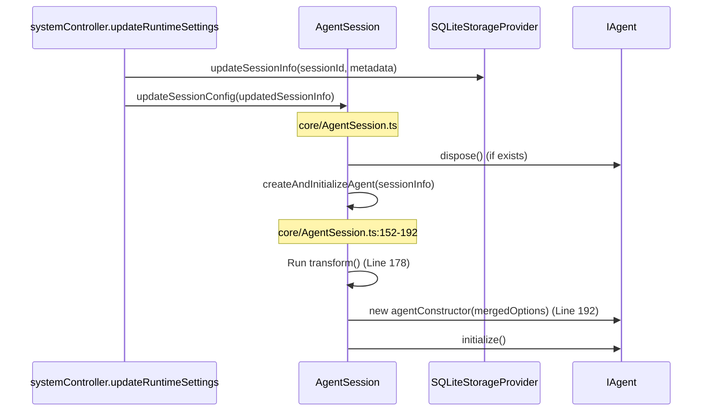

<!-- source: DeepWiki mcp.deepwiki.com · repo bytedance/UI-TARS-desktop · extra page Runtime Settings and Dynamic Reconfiguration · fetched 2026-10-30 -->

# Runtime Settings and Dynamic Reconfiguration

<details>
<summary>Relevant source files</summary>

The following files were used as context for generating this wiki page:

- [multimodal/tarko/agent-server/src/api/controllers/oneshot.ts](multimodal/tarko/agent-server/src/api/controllers/oneshot.ts)
- [multimodal/tarko/agent-server/src/api/controllers/sessions.ts](multimodal/tarko/agent-server/src/api/controllers/sessions.ts)
- [multimodal/tarko/agent-server/src/api/controllers/system.ts](multimodal/tarko/agent-server/src/api/controllers/system.ts)
- [multimodal/tarko/agent-server/src/api/routes/system.ts](multimodal/tarko/agent-server/src/api/routes/system.ts)
- [multimodal/tarko/agent-server/src/core/AgentSession.ts](multimodal/tarko/agent-server/src/core/AgentSession.ts)
- [multimodal/tarko/agent-server/src/server.ts](multimodal/tarko/agent-server/src/server.ts)
- [multimodal/tarko/agent-server/src/storage/SQLiteStorageProvider.ts](multimodal/tarko/agent-server/src/storage/SQLiteStorageProvider.ts)
- [multimodal/tarko/agent-server/src/storage/compatibility.ts](multimodal/tarko/agent-server/src/storage/compatibility.ts)
- [multimodal/tarko/agent-server/src/storage/types.ts](multimodal/tarko/agent-server/src/storage/types.ts)
- [multimodal/tarko/agent-ui/src/common/services/apiService.ts](multimodal/tarko/agent-ui/src/common/services/apiService.ts)
- [multimodal/tarko/interface/src/server.ts](multimodal/tarko/interface/src/server.ts)
- [multimodal/websites/tarko/docs/en/guide/_meta.json](multimodal/websites/tarko/docs/en/guide/_meta.json)
- [multimodal/websites/tarko/docs/en/guide/server/_meta.json](multimodal/websites/tarko/docs/en/guide/server/_meta.json)
- [multimodal/websites/tarko/docs/en/guide/server/runtime-settings.mdx](multimodal/websites/tarko/docs/en/guide/server/runtime-settings.mdx)
- [multimodal/websites/tarko/docs/zh/api/agent-server.mdx](multimodal/websites/tarko/docs/zh/api/agent-server.mdx)
- [multimodal/websites/tarko/docs/zh/guide/_meta.json](multimodal/websites/tarko/docs/zh/guide/_meta.json)
- [multimodal/websites/tarko/docs/zh/guide/server/_meta.json](multimodal/websites/tarko/docs/zh/guide/server/_meta.json)
- [multimodal/websites/tarko/docs/zh/guide/server/runtime-settings.mdx](multimodal/websites/tarko/docs/zh/guide/server/runtime-settings.mdx)

</details>


## Purpose and Scope

This document describes the runtime settings system in the Tarko Agent Server framework, which enables dynamic reconfiguration of agent behavior without code changes or server restarts. Runtime settings allow users to adjust agent parameters through the UI, with changes automatically persisting to session metadata and triggering agent recreation with updated configurations.

For general agent server architecture, see [4.2.1](). For agent session lifecycle management, see [4.2.2](). For web UI configuration, see [4.3.1]().

---

## System Overview

The runtime settings system provides a declarative configuration framework where:

1.  **Developers** define available settings using JSON Schema with UI metadata.
2.  **Transform functions** convert UI values into agent-specific options.
3.  **API endpoints** expose schemas and handle setting updates.
4.  **Session metadata** persists settings for durability in SQLite or other storage providers.
5.  **Agent recreation** applies new settings by reinitializing the agent instance.

### System Architecture and Data Flow

The following diagram illustrates the flow from configuration through API to agent recreation, mapping natural language concepts to specific code entities.

Title: "Runtime Settings Data Flow and Reconfiguration"


**Sources:**
*   [multimodal/tarko/interface/src/server.ts:4-21]()
*   [multimodal/tarko/agent-server/src/core/AgentSession.ts:152-192]()
*   [multimodal/tarko/agent-server/src/api/controllers/system.ts:35-148]()
*   [multimodal/tarko/agent-ui/src/common/services/apiService.ts:139-159]()
*   [multimodal/tarko/agent-server/src/storage/types.ts:36-39]()

---

## Schema Definition and Type System

### Core Interfaces

The runtime settings system is built on strongly-typed interfaces defined in `@tarko/interface`:

| Interface | Purpose | Key Properties |
| :--- | :--- | :--- |
| `AgentRuntimeSettings` | Top-level configuration | `schema`, `transform`, `placement` |
| `AgentRuntimeSettingsSchema` | JSON Schema definition | `type`, `properties` |
| `AgentRuntimeSettingProperty` | Individual setting metadata | `type`, `title`, `enum`, `enumLabels`, `default`, `visible`, `placement`, `icon` |
| `AgentRuntimeSettingVisibilityCondition` | Conditional visibility | `dependsOn`, `when` |

Title: "Runtime Settings Class Diagram"


**Sources:**
*   [multimodal/tarko/interface/src/server.ts:4-64]()

### Property Types and UI Metadata

The schema system supports three property types with specific UI behaviors:

*   **`boolean`**: Rendered as a toggle switch [multimodal/tarko/interface/src/server.ts:47]().
*   **`string` with `enum`**: Rendered as a dropdown menu [multimodal/tarko/interface/src/server.ts:53]().
*   **`string` with `enumLabels`**: Provides user-friendly display names for enum values [multimodal/tarko/interface/src/server.ts:55]().
*   **`number`**: Numeric parameters [multimodal/tarko/interface/src/server.ts:47]().

**Conditional Visibility**: Properties can specify a `visible` condition [multimodal/tarko/interface/src/server.ts:63](). This defines when a setting should be visible based on the values of other settings (`dependsOn` and `when`) [multimodal/tarko/interface/src/server.ts:35-40]().

**UI Placement**: Settings support two primary placements [multimodal/tarko/interface/src/server.ts:20]():
1.  `dropdown-item`: Appears in a settings dropdown menu.
2.  `chat-bottom`: Appears directly below the chat input for quick access.

**Sources:**
*   [multimodal/tarko/interface/src/server.ts:45-64]()

---

## Transform Function and Options Merging

### Transform Execution

The `transform` function is responsible for converting the flat key-value pairs from the UI into the specific structure expected by the agent implementation [multimodal/tarko/interface/src/server.ts:14]().

In `AgentSession.ts`, the transform is applied during agent creation:
1.  Retrieve current settings from session metadata [multimodal/tarko/agent-server/src/core/AgentSession.ts:174]().
2.  Execute the transform function if defined in `server.appConfig.server.runtimeSettings` [multimodal/tarko/agent-server/src/core/AgentSession.ts:178]().
3.  Merge the results into the final `agentOptions` [multimodal/tarko/agent-server/src/core/AgentSession.ts:185-189]().

### Options Merging Strategy

Agent options are merged using a specific precedence order (later items override earlier ones):

```typescript
// From AgentSession.ts:185-189
const agentOptions = {
  ...baseAgentOptions,      // Layer 1: App defaults, name, model, initial events
  ...transformedOptions,    // Layer 2: Transformed runtime settings (persisted)
  ...(this.agentOptions || {}), // Layer 3: One-time initialization overrides (ephemeral)
};
```

**Sources:**
*   [multimodal/tarko/agent-server/src/core/AgentSession.ts:165-190]()
*   [multimodal/tarko/interface/src/server.ts:10-14]()

---

## API Endpoints

The system is exposed via REST endpoints defined in the system routes [multimodal/tarko/agent-server/src/api/routes/system.ts:24-25]().

### GET `/api/v1/runtime-settings`
Retrieves the schema and current values for a session.

*   **Query Param**: `sessionId` (optional) [multimodal/tarko/agent-server/src/api/controllers/system.ts:36]().
*   **Behavior**: If `sessionId` is provided, it fetches stored values from the storage provider [multimodal/tarko/agent-server/src/api/controllers/system.ts:56](). It then merges these with default values from the schema [multimodal/tarko/agent-server/src/api/controllers/system.ts:64-72]().

### POST `/api/v1/runtime-settings`
Updates settings and triggers dynamic reconfiguration.

1.  **Update Storage**: Saves the new `runtimeSettings` into the session metadata via `storageProvider.updateSessionInfo()` [multimodal/tarko/agent-server/src/api/controllers/system.ts:115-120]().
2.  **Trigger Reconfiguration**: If the session is active, it calls `activeSession.updateSessionConfig(updatedSessionInfo)` [multimodal/tarko/agent-server/src/api/controllers/system.ts:132]().

**Sources:**
*   [multimodal/tarko/agent-server/src/api/controllers/system.ts:35-148]()
*   [multimodal/tarko/agent-server/src/api/routes/system.ts:24-25]()

---

## Agent Recreation Mechanism

When `updateSessionConfig` is called, the `AgentSession` performs a clean recreation of the agent instance. This is necessary because many agent options (like tool engines or model configurations) are applied only during constructor execution.

Title: "Agent Reconfiguration Sequence"


**Implementation Details**:
*   **State Preservation**: `initialEvents` are fetched from storage and passed to the new agent instance to maintain conversation history and reasoning state [multimodal/tarko/agent-server/src/core/AgentSession.ts:160-169]().
*   **Storage Persistence**: The `SQLiteStorageProvider` uses a JSON schema design for the `metadata` column in the `sessions` table to allow extensible storage of runtime settings [multimodal/tarko/agent-server/src/storage/SQLiteStorageProvider.ts:85-93]().

**Sources:**
*   [multimodal/tarko/agent-server/src/core/AgentSession.ts:152-192]()
*   [multimodal/tarko/agent-server/src/api/controllers/system.ts:122-138]()
*   [multimodal/tarko/agent-server/src/storage/SQLiteStorageProvider.ts:85-93]()

---

