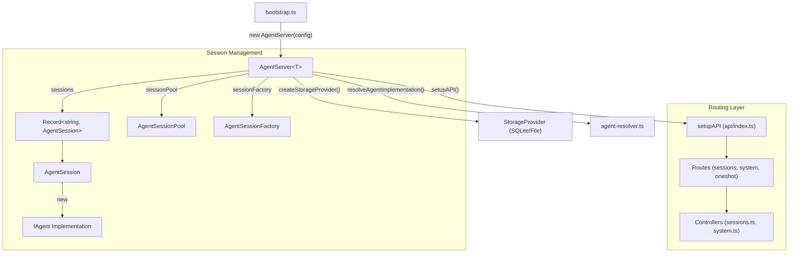
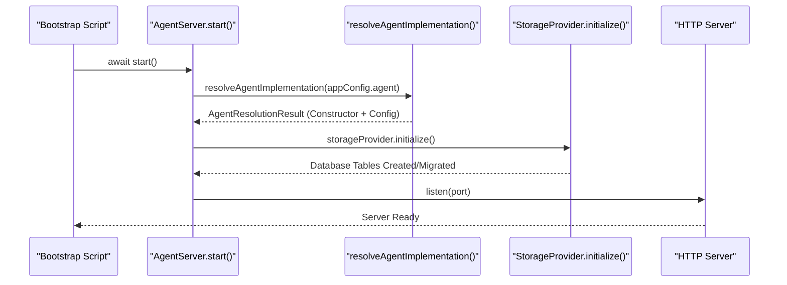

<!-- source: DeepWiki mcp.deepwiki.com · repo bytedance/UI-TARS-desktop · extra page Server Architecture and Bootstrap · fetched 2026-10-30 -->

# Server Architecture and Bootstrap

Relevant source files

The following files were used as context for generating this wiki page:

- [multimodal/tarko/agent-server-next/src/hooks/builtInHooks.ts](multimodal/tarko/agent-server-next/src/hooks/builtInHooks.ts)
- [multimodal/tarko/agent-server-next/src/hooks/index.ts](multimodal/tarko/agent-server-next/src/hooks/index.ts)
- [multimodal/tarko/agent-server-next/src/routes/csrf.ts](multimodal/tarko/agent-server-next/src/routes/csrf.ts)
- [multimodal/tarko/agent-server-next/src/routes/index.ts](multimodal/tarko/agent-server-next/src/routes/index.ts)
- [multimodal/tarko/agent-server-next/src/server.ts](multimodal/tarko/agent-server-next/src/server.ts)
- [multimodal/tarko/agent-server/src/api/controllers/oneshot.ts](multimodal/tarko/agent-server/src/api/controllers/oneshot.ts)
- [multimodal/tarko/agent-server/src/api/controllers/sessions.ts](multimodal/tarko/agent-server/src/api/controllers/sessions.ts)
- [multimodal/tarko/agent-server/src/api/controllers/system.ts](multimodal/tarko/agent-server/src/api/controllers/system.ts)
- [multimodal/tarko/agent-server/src/api/index.ts](multimodal/tarko/agent-server/src/api/index.ts)
- [multimodal/tarko/agent-server/src/api/middleware/csrf-protection.ts](multimodal/tarko/agent-server/src/api/middleware/csrf-protection.ts)
- [multimodal/tarko/agent-server/src/api/middleware/index.ts](multimodal/tarko/agent-server/src/api/middleware/index.ts)
- [multimodal/tarko/agent-server/src/api/routes/csrf.ts](multimodal/tarko/agent-server/src/api/routes/csrf.ts)
- [multimodal/tarko/agent-server/src/api/routes/system.ts](multimodal/tarko/agent-server/src/api/routes/system.ts)
- [multimodal/tarko/agent-server/src/core/AgentSession.ts](multimodal/tarko/agent-server/src/core/AgentSession.ts)
- [multimodal/tarko/agent-server/src/server.ts](multimodal/tarko/agent-server/src/server.ts)
- [multimodal/tarko/agent-server/src/storage/SQLiteStorageProvider.ts](multimodal/tarko/agent-server/src/storage/SQLiteStorageProvider.ts)
- [multimodal/tarko/agent-server/src/storage/compatibility.ts](multimodal/tarko/agent-server/src/storage/compatibility.ts)
- [multimodal/tarko/agent-server/src/storage/types.ts](multimodal/tarko/agent-server/src/storage/types.ts)
- [multimodal/tarko/agent-ui/src/common/services/apiService.ts](multimodal/tarko/agent-ui/src/common/services/apiService.ts)
- [multimodal/tarko/interface/src/server.ts](multimodal/tarko/interface/src/server.ts)

This page documents the `AgentServer` class, its initialization sequence, agent resolver logic, hook system, and the bootstrap configuration pattern used by the Tarko agent server framework. The server layer sits between the agent execution framework and the HTTP-facing API that clients and the web UI consume.

The Tarko framework supports two server implementations: the original Express-based server (`@tarko/agent-server`) and the newer Hono-based server (`@tarko/agent-server-next`). This documentation focuses on the architecture of the primary `AgentServer` implementation while highlighting the hook and session management systems.

---

## Overview

The Tarko agent server coordinates the lifecycle of agent execution contexts and exposes them via a RESTful API. It manages:

- **Server Lifecycle**: Express/Hono application and HTTP server management.
- **Agent Resolution**: Dynamic loading of agent implementations via module paths or direct constructors.
- **Session Management**: Orchestrating `AgentSession` lifecycles, including persistence, sandbox allocation, and runtime configuration.
- **Hook System**: A prioritized middleware system for cross-cutting concerns (Auth, CORS, CSRF).
- **Storage & Persistence**: Provider-based storage for session metadata and event logs using SQLite, MongoDB, or File systems.

**Server Architecture and Code Entity Mapping**

Sources: [multimodal/tarko/agent-server/src/server.ts:37-103](), [multimodal/tarko/agent-server/src/api/index.ts:1-20](), [multimodal/tarko/agent-server/src/core/AgentSession.ts:65-90](), [multimodal/tarko/agent-server-next/src/server.ts:51-116]()

---

## `AgentServer` Class

`AgentServer<T extends AgentAppConfig>` is the central orchestrator. It is generic over the application configuration type, allowing agent-specific extensions to `AgentAppConfig`.

### Initialization
The constructor performs synchronous setup of core infrastructure components:

1.  **Config Storage**: Stores `appConfig`, `versionInfo`, and directory defaults [multimodal/tarko/agent-server/src/server.ts:67-78]().
2.  **Storage Initialization**: Creates a `StorageProvider` (e.g., `SQLiteStorageProvider`) if `appConfig.server.storage` is defined [multimodal/tarko/agent-server/src/server.ts:90-92]().
3.  **API Setup**: Initializes Express routes and middleware via `setupAPI`, including static file serving for the agent workspace [multimodal/tarko/agent-server/src/server.ts:95-99]().
4.  **Context Injection**: Makes the server instance available to all request handlers via `app.locals.server` [multimodal/tarko/agent-server/src/server.ts:102]().

### Public API and State
| Member | Type | Purpose |
|--------|------|---------|
| `storageProvider` | `StorageProvider` | Interface for database operations (Sessions/Events) [multimodal/tarko/agent-server/src/server.ts:53]() |
| `sessions` | `Record<string, AgentSession>` | In-memory registry of active `AgentSession` instances [multimodal/tarko/agent-server/src/server.ts:46]() |
| `port` | `number` | The TCP port the server listens on (default 3000) [multimodal/tarko/agent-server/src/server.ts:81]() |
| `isExclusive` | `boolean` | If true, rejects new requests while an agent is running [multimodal/tarko/agent-server/src/server.ts:83]() |

Sources: [multimodal/tarko/agent-server/src/server.ts:46-56]()

---

## The Hook and Middleware System

The server utilizes a prioritized middleware system (managed via `HookManager` in the `next` implementation) to handle cross-cutting concerns.

### Hook Execution Flow
The `HookManager` ensures that middleware is applied to the application context in a strict priority order.

Sources: [multimodal/tarko/agent-server-next/src/server.ts:142-163](), [multimodal/tarko/agent-server-next/src/hooks/builtInHooks.ts:15-38]()

### Built-in Hooks and Priorities
| Hook Name | Priority / Order | File Reference |
|-----------|------------------|----------------|
| Request ID | `REQUEST_ID (900)` | [multimodal/tarko/agent-server-next/src/hooks/builtInHooks.ts:15-21]() |
| Error Handling | `ERROR_HANDLING (1000)` | [multimodal/tarko/agent-server-next/src/hooks/builtInHooks.ts:24-30]() |
| Context Storage | `CONTEXT_STORAGE (850)` | [multimodal/tarko/agent-server-next/src/hooks/builtInHooks.ts:33-38]() |
| Security Headers| `CORS + 10 (810)` | [multimodal/tarko/agent-server-next/src/hooks/builtInHooks.ts:218-228]() |
| CORS | `CORS (800)` | [multimodal/tarko/agent-server-next/src/hooks/builtInHooks.ts:79-104]() |
| CSRF Protection | `AUTH - 10 (690)` | [multimodal/tarko/agent-server-next/src/hooks/builtInHooks.ts:189-212]() |
| Authentication | `AUTH (700)` | [multimodal/tarko/agent-server-next/src/hooks/builtInHooks.ts:141-147]() |

### CSRF Management
The server implements a stateful CSRF protection mechanism. Tokens are generated with a 24-hour expiry and stored in an in-memory `csrfTokenStore` [multimodal/tarko/agent-server-next/src/hooks/builtInHooks.ts:151-171](). Mutation requests (POST/PUT/DELETE) must include a valid `X-CSRF-Token` header [multimodal/tarko/agent-server-next/src/hooks/builtInHooks.ts:189-212](). Clients typically fetch this token via a GET request to `/api/v1/csrf-token` before performing mutations [multimodal/tarko/agent-ui/src/common/services/apiService.ts:42-76]().

---

## Bootstrap and Startup Process

The `server.start()` method initiates the asynchronous bootstrap sequence, resolving the agent implementation before opening the network port.

**Bootstrap Sequence Diagram**

Sources: [multimodal/tarko/agent-server/src/server.ts:242-263](), [multimodal/tarko/agent-server/src/storage/SQLiteStorageProvider.ts:72-120]()

---

## Session Architecture and Initialization

When a client creates a session via `createSession` [multimodal/tarko/agent-server/src/api/controllers/sessions.ts:45](), the server orchestrates the creation of an `AgentSession`.

### Session Creation Workflow
1.  **ID Generation**: A unique `sessionId` is generated using `nanoid()` [multimodal/tarko/agent-server/src/api/controllers/sessions.ts:52]().
2.  **Persistence**: Initial `SessionInfo` (metadata, model config, workspace, runtime settings) is saved to the storage provider [multimodal/tarko/agent-server/src/api/controllers/sessions.ts:66-95]().
3.  **Agent Instantiation**: The `AgentSession` creates the `IAgent` instance. It merges base options with transformed `runtimeSettings` and any one-time `agentOptions` [multimodal/tarko/agent-server/src/core/AgentSession.ts:152-193]().
4.  **Event Hooking**: An event handler is attached to the agent's event stream *before* initialization to ensure all events (including startup logs) are captured and saved to storage [multimodal/tarko/agent-server/src/core/AgentSession.ts:112-137]().
5.  **Initialization**: The `initialize()` method is called on the session, which triggers the agent's internal setup [multimodal/tarko/agent-server/src/core/AgentSession.ts:92-107]().

### Runtime Reconfiguration
The server supports dynamic updates to `runtimeSettings` and `modelConfig`. When these settings are updated via the API [multimodal/tarko/agent-server/src/api/controllers/system.ts:88, 160](), the server triggers `activeSession.updateSessionConfig(updatedSessionInfo)`, which recreates the agent instance with the new configuration while maintaining the session context [multimodal/tarko/agent-server/src/api/controllers/system.ts:122-138]().

Sources: [multimodal/tarko/agent-server/src/core/AgentSession.ts:65-107](), [multimodal/tarko/agent-server/src/api/controllers/sessions.ts:98-113](), [multimodal/tarko/agent-server/src/api/controllers/system.ts:103-148]()

---

## Storage and Persistence

The server abstracts storage through the `StorageProvider` interface [multimodal/tarko/agent-server/src/storage/types.ts:14-75]().

### SQLite Implementation
The `SQLiteStorageProvider` uses the native Node.js `node:sqlite` module. It maintains two primary tables:
- `sessions`: Stores metadata, workspace paths, and a JSON `metadata` string for extensibility [multimodal/tarko/agent-server/src/storage/SQLiteStorageProvider.ts:85-93]().
- `events`: Stores the history of agent interactions linked via `sessionId` [multimodal/tarko/agent-server/src/storage/SQLiteStorageProvider.ts:97-104]().

The provider includes a `migrateIfNeeded` mechanism to handle schema evolution, specifically migrating legacy column-based designs to a flexible JSON metadata schema [multimodal/tarko/agent-server/src/storage/SQLiteStorageProvider.ts:125-161]().

### Event Filtering
To optimize storage and replay performance, the server filters out high-frequency streaming events (e.g., `assistant_streaming_message`, `final_answer_streaming`) from persistent storage, keeping only the final state and tool call events [multimodal/tarko/agent-server/src/core/AgentSession.ts:30-40]().

Sources: [multimodal/tarko/agent-server/src/storage/SQLiteStorageProvider.ts:53-70](), [multimodal/tarko/agent-server/src/core/AgentSession.ts:113-126](), [multimodal/tarko/agent-server/src/storage/SQLiteStorageProvider.ts:170-222]()

---

