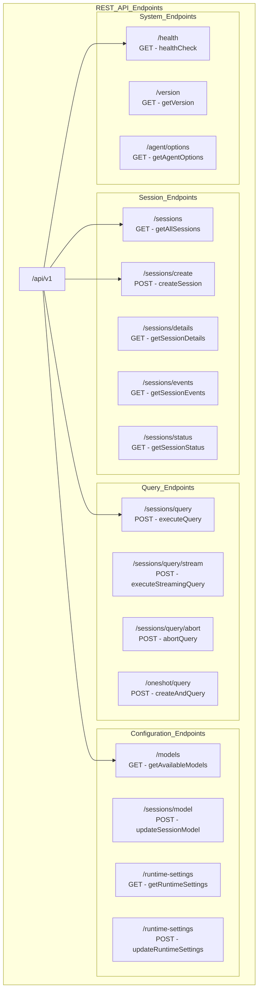
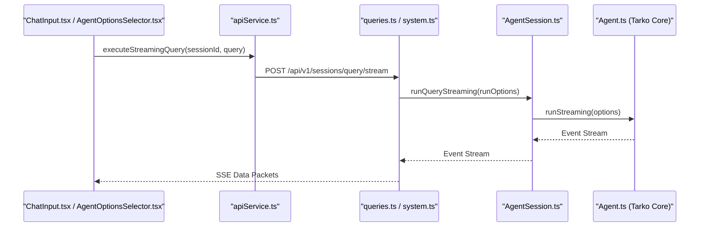

<!-- source: DeepWiki mcp.deepwiki.com · repo bytedance/UI-TARS-desktop · extra page Session API and REST Endpoints · fetched 2026-10-30 -->

# Session API and REST Endpoints

Relevant source files

The following files were used as context for generating this wiki page:

- [multimodal/tarko/agent-interface/src/agent-run-options.ts](multimodal/tarko/agent-interface/src/agent-run-options.ts)
- [multimodal/tarko/agent-server/src/api/controllers/oneshot.ts](multimodal/tarko/agent-server/src/api/controllers/oneshot.ts)
- [multimodal/tarko/agent-server/src/api/controllers/queries.ts](multimodal/tarko/agent-server/src/api/controllers/queries.ts)
- [multimodal/tarko/agent-server/src/api/controllers/sessions.ts](multimodal/tarko/agent-server/src/api/controllers/sessions.ts)
- [multimodal/tarko/agent-server/src/api/controllers/system.ts](multimodal/tarko/agent-server/src/api/controllers/system.ts)
- [multimodal/tarko/agent-server/src/api/routes/system.ts](multimodal/tarko/agent-server/src/api/routes/system.ts)
- [multimodal/tarko/agent-server/src/core/AgentSession.ts](multimodal/tarko/agent-server/src/core/AgentSession.ts)
- [multimodal/tarko/agent-server/src/server.ts](multimodal/tarko/agent-server/src/server.ts)
- [multimodal/tarko/agent-server/src/storage/SQLiteStorageProvider.ts](multimodal/tarko/agent-server/src/storage/SQLiteStorageProvider.ts)
- [multimodal/tarko/agent-server/src/storage/compatibility.ts](multimodal/tarko/agent-server/src/storage/compatibility.ts)
- [multimodal/tarko/agent-server/src/storage/types.ts](multimodal/tarko/agent-server/src/storage/types.ts)
- [multimodal/tarko/agent-server/tests/api/contextual-references.test.ts](multimodal/tarko/agent-server/tests/api/contextual-references.test.ts)
- [multimodal/tarko/agent-server/tests/api/queries.test.ts](multimodal/tarko/agent-server/tests/api/queries.test.ts)
- [multimodal/tarko/agent-ui/src/common/services/apiService.ts](multimodal/tarko/agent-ui/src/common/services/apiService.ts)
- [multimodal/tarko/agent/tests/agent/agent-modes.test.ts](multimodal/tarko/agent/tests/agent/agent-modes.test.ts)
- [multimodal/tarko/agent/tests/agent/environment-input.test.ts](multimodal/tarko/agent/tests/agent/environment-input.test.ts)
- [multimodal/tarko/context-engineer/src/node/context-reference-processor.ts](multimodal/tarko/context-engineer/src/node/context-reference-processor.ts)
- [multimodal/tarko/context-engineer/tests/context-reference-processor.test.ts](multimodal/tarko/context-engineer/tests/context-reference-processor.test.ts)
- [multimodal/tarko/interface/src/server.ts](multimodal/tarko/interface/src/server.ts)

This document describes the REST API endpoints exposed by the Tarko Agent Server for managing agent sessions, executing queries, and configuring runtime settings. These endpoints form the primary interface between client applications (Web UI, CLI, Desktop) and the agent execution framework.

For information about the AgentSession lifecycle and internal management, see **4.2.2 AgentSession Lifecycle and Management**. For event streaming details, see **4.2.4 Event Flow and Persistence Architecture**.

## Overview

The Tarko Agent Server exposes a RESTful API at `/api/v1` that provides:

- **Session lifecycle management**: Create, retrieve, and delete agent sessions [multimodal/tarko/agent-server/src/api/controllers/sessions.ts:18-221]().
- **Query execution**: Execute queries in streaming and non-streaming modes, including one-shot sessions [multimodal/tarko/agent-server/src/api/controllers/queries.ts:38-176](), [multimodal/tarko/agent-server/src/api/controllers/oneshot.ts:36-200]().
- **Configuration management**: Update model and runtime settings for active sessions [multimodal/tarko/agent-server/src/api/routes/system.ts:24-29]().
- **System information**: Health checks, version info, and available models [multimodal/tarko/agent-server/src/api/controllers/system.ts:10-28]().

All endpoints are registered through route registration functions like `registerSystemRoutes` [multimodal/tarko/agent-server/src/api/routes/system.ts:13-13]().

## API Endpoint Groups

### REST API Architecture Diagram

Sources: [multimodal/tarko/agent-server/src/api/routes/system.ts:15-29](), [multimodal/tarko/agent-server/src/api/controllers/queries.ts:38-191](), [multimodal/tarko/agent-server/src/api/controllers/sessions.ts:18-202]()

## Session and Query Management

### Core Session Operations

| Endpoint | Method | Description | Controller Function |
|----------|--------|-------------|---------------------|
| `/api/v1/sessions` | GET | List all sessions from storage | `getAllSessions` [multimodal/tarko/agent-server/src/api/controllers/sessions.ts:18-40]() |
| `/api/v1/sessions/create` | POST | Create new agent session | `createSession` [multimodal/tarko/agent-server/src/api/controllers/sessions.ts:45-142]() |
| `/api/v1/sessions/details` | GET | Get session metadata | `getSessionDetails` [multimodal/tarko/agent-server/src/api/controllers/sessions.ts:147-172]() |
| `/api/v1/sessions/events` | GET | Get session event history | `getSessionEvents` [multimodal/tarko/agent-server/src/api/controllers/sessions.ts:177-197]() |
| `/api/v1/sessions/status` | GET | Get current processing status | `getSessionStatus` [multimodal/tarko/agent-server/src/api/controllers/sessions.ts:202-221]() |
| `/api/v1/sessions/query` | POST | Execute non-streaming query | `executeQuery` [multimodal/tarko/agent-server/src/api/controllers/queries.ts:38-87]() |
| `/api/v1/sessions/query/stream` | POST | Execute streaming query (SSE) | `executeStreamingQuery` [multimodal/tarko/agent-server/src/api/controllers/queries.ts:92-176]() |

Sources: [multimodal/tarko/agent-server/src/api/controllers/sessions.ts:18-221](), [multimodal/tarko/agent-server/src/api/controllers/queries.ts:38-176]()

### Query Execution Flow
Queries are processed through a pipeline that includes contextual reference expansion and image compression before being passed to the agent [multimodal/tarko/agent-server/src/api/controllers/queries.ts:51-57]().

1.  **Context Expansion**: The `ContextReferenceProcessor` scans the query for `@file` or `@dir` tags and expands them into full text content [multimodal/tarko/agent-server/src/api/controllers/queries.ts:51-54]().
2.  **Image Processing**: The `ImageProcessor` compresses images to optimize token usage [multimodal/tarko/agent-server/src/api/controllers/queries.ts:57-57]().
3.  **Agent Execution**: The processed input is sent to `AgentSession.runQuery()` or `runQueryStreaming()` [multimodal/tarko/agent-server/src/api/controllers/queries.ts:74-74](), [multimodal/tarko/agent-server/src/api/controllers/queries.ts:133-133]().

Sources: [multimodal/tarko/agent-server/src/api/controllers/queries.ts:51-57](), [multimodal/tarko/agent-server/tests/api/queries.test.ts:59-86]()

### One-shot Queries
The server supports "one-shot" endpoints (`/api/v1/oneshot/query`) which combine session creation, initialization, and query execution into a single request [multimodal/tarko/agent-server/src/api/controllers/oneshot.ts:36-97](). These are ideal for CLI tools or simple automation scripts.
Sources: [multimodal/tarko/agent-server/src/api/controllers/oneshot.ts:36-97]()

## Configuration and Runtime Settings

### Runtime Settings Reconfiguration
Runtime settings allow dynamic adjustment of agent behavior without losing session context [multimodal/tarko/interface/src/server.ts:4-21]().

-   **Persistence**: Settings are stored in the session metadata within the `StorageProvider` (e.g., `SQLiteStorageProvider`) [multimodal/tarko/agent-server/src/api/controllers/system.ts:115-120]().
-   **Dynamic Update**: If a session is active, updating runtime settings via `POST /api/v1/runtime-settings` triggers `activeSession.updateSessionConfig()`, which recreates the internal agent with new options [multimodal/tarko/agent-server/src/api/controllers/system.ts:123-133]().

Sources: [multimodal/tarko/interface/src/server.ts:4-21](), [multimodal/tarko/agent-server/src/api/controllers/system.ts:115-133]()

### Model Selection
The `GET /api/v1/models` endpoint returns a list of models available on the server [multimodal/tarko/agent-server/src/api/controllers/system.ts:150-155](). Users can switch models for an existing session via `POST /api/v1/sessions/model`, which updates the `modelConfig` in session metadata and recreates the agent [multimodal/tarko/agent-server/src/api/controllers/system.ts:160-201]().
Sources: [multimodal/tarko/agent-server/src/api/controllers/system.ts:150-201]()

## Client-Side API Integration

### ApiService Class
The frontend interacts with these endpoints via the `ApiService` singleton [multimodal/tarko/agent-ui/src/common/services/apiService.ts:34-34]().

-   **CSRF Handling**: It fetches a token from `/api/v1/csrf-token` and automatically retries requests if the token expires (HTTP 403) [multimodal/tarko/agent-ui/src/common/services/apiService.ts:42-115]().
-   **Session Creation**: It handles the `POST` request to create a session, returning the `SessionInfo` and any initialization events [multimodal/tarko/agent-ui/src/common/services/apiService.ts:139-159]().

Sources: [multimodal/tarko/agent-ui/src/common/services/apiService.ts:34-159]()

### UI to Code Mapping Diagram
This diagram bridges the visual UI components to the underlying REST controllers and session logic.

Sources: [multimodal/tarko/agent-ui/src/common/services/apiService.ts:139-159](), [multimodal/tarko/agent-server/src/api/controllers/queries.ts:133-156](), [multimodal/tarko/agent-server/src/core/AgentSession.ts:92-107]()

## Security and Middleware

### CSRF Protection
The server enforces CSRF protection for all mutation requests. The `ApiService` fetches tokens and manages headers automatically [multimodal/tarko/agent-ui/src/common/services/apiService.ts:81-92]().
Sources: [multimodal/tarko/agent-ui/src/common/services/apiService.ts:81-92]()

### Exclusive Mode
The `AgentServer` can be configured in "exclusive mode" [multimodal/tarko/agent-server/src/server.ts:83-83](). When enabled, the server tracks a `runningSessionId` and can reject new requests if a session is already active [multimodal/tarko/agent-server/src/server.ts:147-152]().
Sources: [multimodal/tarko/agent-server/src/server.ts:83-83](), [multimodal/tarko/agent-server/src/server.ts:147-152]()

### Session Persistence
The `SQLiteStorageProvider` manages the lifecycle of session data on disk [multimodal/tarko/agent-server/src/storage/SQLiteStorageProvider.ts:53-70](). It stores session metadata in a `sessions` table and event history in an `events` table [multimodal/tarko/agent-server/src/storage/SQLiteStorageProvider.ts:86-104]().
Sources: [multimodal/tarko/agent-server/src/server.ts:46-53](), [multimodal/tarko/agent-server/src/storage/SQLiteStorageProvider.ts:86-104]()

---

