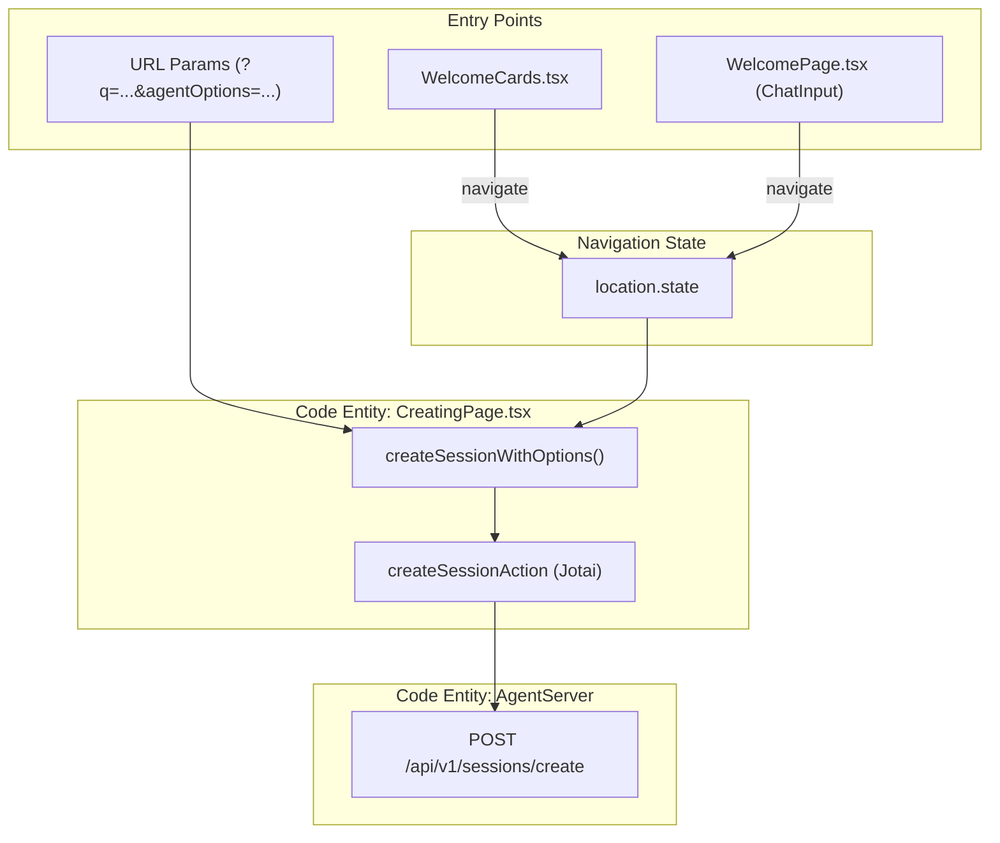
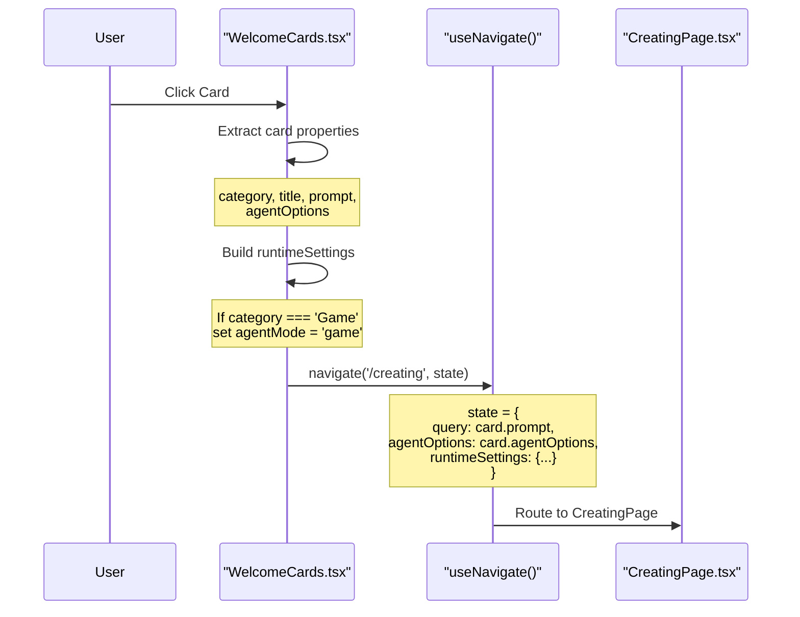

<!-- source: DeepWiki mcp.deepwiki.com · repo bytedance/UI-TARS-desktop · extra page Session Creation and Interaction Flow · fetched 2026-10-30 -->

# Session Creation and Interaction Flow

<details>
<summary>Relevant source files</summary>

The following files were used as context for generating this wiki page:

- [examples/conditional-visibility-settings.config.ts](examples/conditional-visibility-settings.config.ts)
- [examples/enhanced-runtime-settings.config.ts](examples/enhanced-runtime-settings.config.ts)
- [multimodal/agent-tars/cli/src/index.ts](multimodal/agent-tars/cli/src/index.ts)
- [multimodal/agent-tars/interface/src/constants.ts](multimodal/agent-tars/interface/src/constants.ts)
- [multimodal/omni-tars/omni-agent/src/index.ts](multimodal/omni-tars/omni-agent/src/index.ts)
- [multimodal/tarko/agent-server/src/api/routes/sessions.ts](multimodal/tarko/agent-server/src/api/routes/sessions.ts)
- [multimodal/tarko/agent-ui/src/standalone/chat/MessageInput/AgentOptionsSelector.tsx](multimodal/tarko/agent-ui/src/standalone/chat/MessageInput/AgentOptionsSelector.tsx)
- [multimodal/tarko/agent-ui/src/standalone/chat/MessageInput/ChatBottomSettings.tsx](multimodal/tarko/agent-ui/src/standalone/chat/MessageInput/ChatBottomSettings.tsx)
- [multimodal/tarko/agent-ui/src/standalone/chat/MessageInput/ChatInput.tsx](multimodal/tarko/agent-ui/src/standalone/chat/MessageInput/ChatInput.tsx)
- [multimodal/tarko/agent-ui/src/standalone/chat/MessageInput/agentIconUtils.tsx](multimodal/tarko/agent-ui/src/standalone/chat/MessageInput/agentIconUtils.tsx)
- [multimodal/tarko/agent-ui/src/standalone/components/ThemeToggle.tsx](multimodal/tarko/agent-ui/src/standalone/components/ThemeToggle.tsx)
- [multimodal/tarko/agent-ui/src/standalone/components/index.ts](multimodal/tarko/agent-ui/src/standalone/components/index.ts)
- [multimodal/tarko/agent-ui/src/standalone/home/CreatingPage.tsx](multimodal/tarko/agent-ui/src/standalone/home/CreatingPage.tsx)
- [multimodal/tarko/agent-ui/src/standalone/home/WelcomeCards.tsx](multimodal/tarko/agent-ui/src/standalone/home/WelcomeCards.tsx)
- [multimodal/tarko/agent-ui/src/standalone/home/WelcomePage.tsx](multimodal/tarko/agent-ui/src/standalone/home/WelcomePage.tsx)
- [multimodal/tarko/interface/src/web-ui-implementation.ts](multimodal/tarko/interface/src/web-ui-implementation.ts)
- [multimodal/tarko/ui/src/components/basic/Dropdown.tsx](multimodal/tarko/ui/src/components/basic/Dropdown.tsx)

</details>


## Purpose and Scope

This document details the session creation and interaction flow in the Tarko Agent Web UI. It covers how users initiate sessions through welcome cards, chat input, or direct navigation, how session parameters are collected and routed, and how the `CreatingPage` orchestrates the session creation process. 

For information about the overall Web UI configuration system, see [Web UI Configuration System](#4.3.1). For details on routing and application structure, see [Application Structure and Routing](#4.3.2). For message rendering after session creation, see [Message and Content Rendering System](#4.3.5).

## Session Creation Entry Points

The Tarko Agent Web UI provides primary entry points for session creation, primarily originating from the `WelcomePage` and `WelcomeCards` components.

### Welcome Cards

Welcome cards provide pre-configured session templates with optional prompts, agent options, and runtime settings. Each card is defined in the agent's `webuiConfig` and can specify:

- **prompt**: Pre-filled user query to send after session creation [multimodal/tarko/interface/src/web-ui-implementation.ts:168-169]().
- **agentOptions**: One-time configuration options (e.g., game mode, browser link) [multimodal/tarko/interface/src/web-ui-implementation.ts:176-177]().
- **category**: Card grouping for UI organization [multimodal/tarko/interface/src/web-ui-implementation.ts:162-163]().

The `WelcomeCard` interface is defined in [multimodal/tarko/interface/src/web-ui-implementation.ts:157-178]():

```typescript
export interface WelcomeCard {
  title: string;
  category: string;
  prompt?: string;
  image?: string;
  agentOptions?: Record<string, any>;
}
```

Example card configuration from `OmniTARSAgent` [multimodal/omni-tars/omni-agent/src/index.ts:21-34]():

```typescript
{
  title: '2048',
  category: 'Game',
  image: 'https://...',
  agentOptions: {
    agentMode: {
      id: 'game',
      link: 'https://poki.com/zh/g/2048',
      browserMode: 'hybrid',
    },
  },
}
```

### Chat Input

Users can type queries directly into the home page chat input. The `ChatInput` component supports:

- Plain text queries.
- Multimodal content (via `ChatCompletionContentPart[]`) [multimodal/tarko/agent-ui/src/standalone/chat/MessageInput/ChatInput.tsx:30]().
- File attachments (when enabled) [multimodal/tarko/agent-ui/src/standalone/chat/MessageInput/ChatInput.tsx:55]().
- Contextual file selection with `@` syntax [multimodal/tarko/agent-ui/src/standalone/chat/MessageInput/ChatInput.tsx:84]().

### Direct Chat Navigation

The `WelcomePage` allows users to navigate directly to their task history or create a simple session without initial parameters via `handleDirectChat` [multimodal/tarko/agent-ui/src/standalone/home/WelcomePage.tsx:108-126]().

**Sources:** [multimodal/tarko/interface/src/web-ui-implementation.ts:157-178](), [multimodal/omni-tars/omni-agent/src/index.ts:20-104](), [multimodal/tarko/agent-ui/src/standalone/chat/MessageInput/ChatInput.tsx:46-61](), [multimodal/tarko/agent-ui/src/standalone/home/WelcomePage.tsx:108-126]()

## Session Creation Flow Overview

Session creation is an asynchronous process coordinated between the frontend `CreatingPage` and the backend `AgentServer`.

### Interaction Sequence

1.  **Selection**: User selects a card or submits a query.
2.  **Transition**: UI navigates to `/creating` with state parameters [multimodal/tarko/agent-ui/src/standalone/home/CreatingPage.tsx:21-22]().
3.  **Creation**: `CreatingPage` invokes `createSession` (via `createSessionAction`) [multimodal/tarko/agent-ui/src/standalone/home/CreatingPage.tsx:89-92]().
4.  **Redirection**: Once a `sessionId` is returned, the UI navigates to `/:sessionId` [multimodal/tarko/agent-ui/src/standalone/home/CreatingPage.tsx:100]().
5.  **Query Submission**: If an initial query was provided, `sendMessage` is called immediately after navigation [multimodal/tarko/agent-ui/src/standalone/home/CreatingPage.tsx:104]().

### Session State Transitions

| Component | Action | Target Route | State Passed |
| :--- | :--- | :--- | :--- |
| `WelcomeCards` | `handleCardClick` | `/creating` | `query`, `agentOptions`, `runtimeSettings` [multimodal/tarko/agent-ui/src/standalone/home/WelcomeCards.tsx:58-64]() |
| `ChatInput` | `onSubmit` | `/creating` (Home variant) | `query`, `runtimeSettings` [multimodal/tarko/agent-ui/src/standalone/home/WelcomePage.tsx:96-101]() |
| `CreatingPage` | `createSession` | Backend API | `runtimeSettings`, `agentOptions` [multimodal/tarko/agent-ui/src/standalone/home/CreatingPage.tsx:89-92]() |

**Sources:** [multimodal/tarko/agent-ui/src/standalone/home/WelcomeCards.tsx:41-69](), [multimodal/tarko/agent-ui/src/standalone/home/CreatingPage.tsx:21-124](), [multimodal/tarko/agent-ui/src/standalone/home/WelcomePage.tsx:84-106]()

## Parameter Sources and Priority

The `CreatingPage` consolidates parameters from three distinct sources to ensure flexible session initialization.

### Priority Resolution Logic

1.  **Router State**: Highest priority. Used for internal navigation from the Home page (cards or chat input) [multimodal/tarko/agent-ui/src/standalone/home/CreatingPage.tsx:51-56]().
2.  **Global Runtime Settings**: Used when `globalRuntimeSettingsAtom` is active on the Home page [multimodal/tarko/agent-ui/src/standalone/home/CreatingPage.tsx:57-61]().
3.  **URL Search Parameters**: Lowest priority. Supports deployment scenarios where parameters like `q`, `runtimeSettings`, and `agentOptions` are passed in the URL [multimodal/tarko/agent-ui/src/standalone/home/CreatingPage.tsx:62-84]().

### Interaction Flow Diagram



**Sources:** [multimodal/tarko/agent-ui/src/standalone/home/CreatingPage.tsx:39-115](), [multimodal/tarko/agent-server/src/api/routes/sessions.ts:19]()

## Welcome Cards Parameter Flow

Welcome cards can specify both runtime settings and agent options through the `agentOptions` property and conditional logic based on category.

### Card Click Handler

The `handleCardClick` function in `WelcomeCards` component prepares parameters before navigation:



Implementation in [multimodal/tarko/agent-ui/src/standalone/home/WelcomeCards.tsx:41-69]():

```typescript
const handleCardClick = async (card: WelcomeCard) => {
  if (isLoading || isDirectChatLoading) return;
  // ...
  const runtimeSettings: Record<string, unknown> = {};
  if (activeCategory === 'Game') {
    runtimeSettings.agentMode = 'game';
  }

  navigate('/creating', {
    state: {
      ...(card.prompt && { query: card.prompt }),
      agentOptions: card.agentOptions || {},
      ...(Object.keys(runtimeSettings).length > 0 && { runtimeSettings }),
    },
  });
};
```

**Sources:** [multimodal/tarko/agent-ui/src/standalone/home/WelcomeCards.tsx:41-69]()

## Runtime Settings Management

During a session, users can dynamically modify runtime settings via the `AgentOptionsSelector` or `ChatBottomSettings`.

### AgentOptionsSelector Logic
The `AgentOptionsSelector` manages runtime settings schema and current values. It fetches settings via `apiService.getSessionRuntimeSettings` [multimodal/tarko/agent-ui/src/standalone/chat/MessageInput/AgentOptionsSelector.tsx:196](). When a setting is changed, it calls `apiService.updateSessionRuntimeSettings` and updates session metadata [multimodal/tarko/agent-ui/src/standalone/chat/MessageInput/AgentOptionsSelector.tsx:143-151]().

### Visibility Conditions
Settings can have conditional visibility based on other settings, defined in the `AgentRuntimeSettingsSchema` [multimodal/tarko/agent-ui/src/standalone/chat/MessageInput/ChatBottomSettings.tsx:97-107]().

```typescript
// Visibility check in ChatBottomSettings.tsx
const isOptionVisible = (key: string, property: AgentRuntimeSettingProperty): boolean => {
  if (!property.visible || !currentValues) return true;
  const { dependsOn, when } = property.visible;
  const dependentValue = currentValues[dependsOn];
  return dependentValue === when;
};
```

**Sources:** [multimodal/tarko/agent-ui/src/standalone/chat/MessageInput/AgentOptionsSelector.tsx:157-215](), [multimodal/tarko/agent-ui/src/standalone/chat/MessageInput/ChatBottomSettings.tsx:97-107]()

## Loading States and UI Feedback

The session creation flow provides visual feedback during transitions to maintain a responsive feel.

### UI Feedback Components

| Component | State Variable | Visual Indicator |
| :--- | :--- | :--- |
| `WelcomeCards` | `loadingCardId` | Displays loading spinner on the specific card [multimodal/tarko/agent-ui/src/standalone/home/WelcomeCards.tsx:155](). |
| `ChatInput` | `isProcessing` | Disables input and shows a square "stop" or loading icon [multimodal/tarko/agent-ui/src/standalone/chat/MessageInput/ChatInput.tsx:32](). |
| `AgentOptionsSelector` | `loadingOptions` | Displays a loader while updating specific settings [multimodal/tarko/agent-ui/src/standalone/chat/MessageInput/AgentOptionsSelector.tsx:176](). |
| `CreatingPage` | `isCreating` | Renders `SessionCreatingState` during session setup [multimodal/tarko/agent-ui/src/standalone/home/CreatingPage.tsx:120](). |

**Sources:** [multimodal/tarko/agent-ui/src/standalone/home/WelcomeCards.tsx:21-46](), [multimodal/tarko/agent-ui/src/standalone/chat/MessageInput/ChatInput.tsx:46-61](), [multimodal/tarko/agent-ui/src/standalone/chat/MessageInput/AgentOptionsSelector.tsx:173-215](), [multimodal/tarko/agent-ui/src/standalone/home/CreatingPage.tsx:118-122]()

---

