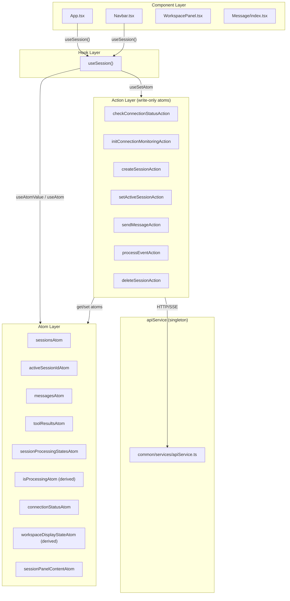
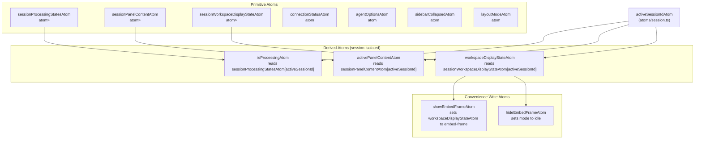
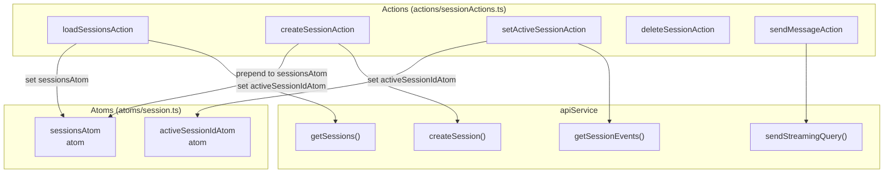
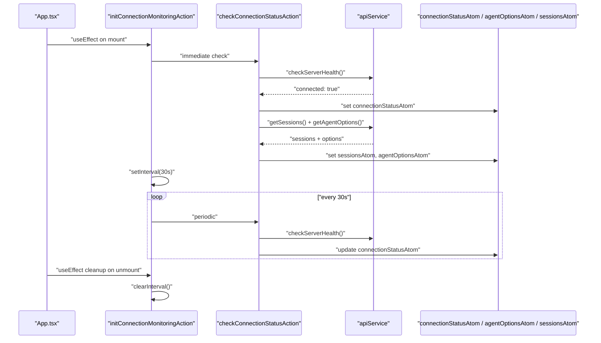
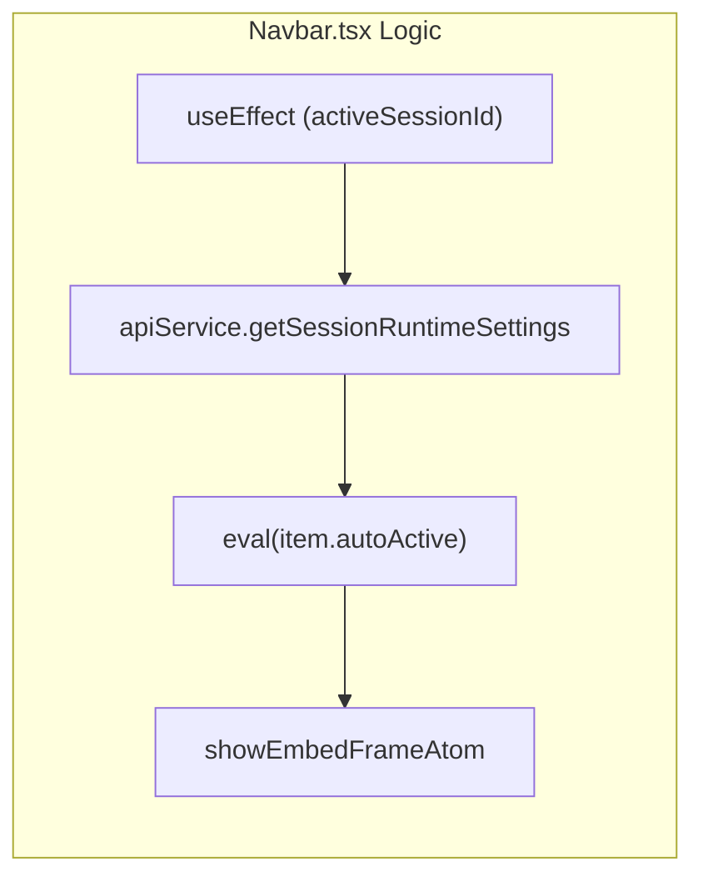

<!-- source: DeepWiki mcp.deepwiki.com · repo bytedance/UI-TARS-desktop · extra page State Management and Connection Monitoring · fetched 2026-10-30 -->

# State Management and Connection Monitoring

<details>
<summary>Relevant source files</summary>

The following files were used as context for generating this wiki page:

- [multimodal/tarko/agent-ui/docs/runtime-settings-autoactive.md](multimodal/tarko/agent-ui/docs/runtime-settings-autoactive.md)
- [multimodal/tarko/agent-ui/examples/webui-config.json](multimodal/tarko/agent-ui/examples/webui-config.json)
- [multimodal/tarko/agent-ui/rsbuild.config.ts](multimodal/tarko/agent-ui/rsbuild.config.ts)
- [multimodal/tarko/agent-ui/src/common/constants/index.ts](multimodal/tarko/agent-ui/src/common/constants/index.ts)
- [multimodal/tarko/agent-ui/src/common/hooks/useSession.ts](multimodal/tarko/agent-ui/src/common/hooks/useSession.ts)
- [multimodal/tarko/agent-ui/src/common/state/actions/connectionActions.ts](multimodal/tarko/agent-ui/src/common/state/actions/connectionActions.ts)
- [multimodal/tarko/agent-ui/src/common/state/actions/eventProcessors/handlers/AgentRunHandler.ts](multimodal/tarko/agent-ui/src/common/state/actions/eventProcessors/handlers/AgentRunHandler.ts)
- [multimodal/tarko/agent-ui/src/common/state/actions/eventProcessors/handlers/SystemHandler.ts](multimodal/tarko/agent-ui/src/common/state/actions/eventProcessors/handlers/SystemHandler.ts)
- [multimodal/tarko/agent-ui/src/common/state/actions/eventProcessors/handlers/ToolHandler.ts](multimodal/tarko/agent-ui/src/common/state/actions/eventProcessors/handlers/ToolHandler.ts)
- [multimodal/tarko/agent-ui/src/common/state/actions/eventProcessors/utils/cacheManager.ts](multimodal/tarko/agent-ui/src/common/state/actions/eventProcessors/utils/cacheManager.ts)
- [multimodal/tarko/agent-ui/src/common/state/actions/eventProcessors/utils/panelContentUpdater.ts](multimodal/tarko/agent-ui/src/common/state/actions/eventProcessors/utils/panelContentUpdater.ts)
- [multimodal/tarko/agent-ui/src/common/state/actions/sessionActions.ts](multimodal/tarko/agent-ui/src/common/state/actions/sessionActions.ts)
- [multimodal/tarko/agent-ui/src/common/state/atoms/ui.ts](multimodal/tarko/agent-ui/src/common/state/atoms/ui.ts)
- [multimodal/tarko/agent-ui/src/common/types/env.d.ts](multimodal/tarko/agent-ui/src/common/types/env.d.ts)
- [multimodal/tarko/agent-ui/src/common/types/index.ts](multimodal/tarko/agent-ui/src/common/types/index.ts)
- [multimodal/tarko/agent-ui/src/config/config-loader.ts](multimodal/tarko/agent-ui/src/config/config-loader.ts)
- [multimodal/tarko/agent-ui/src/config/web-ui-config.ts](multimodal/tarko/agent-ui/src/config/web-ui-config.ts)
- [multimodal/tarko/agent-ui/src/config/webui-config-provider.tsx](multimodal/tarko/agent-ui/src/config/webui-config-provider.tsx)
- [multimodal/tarko/agent-ui/src/entry.tsx](multimodal/tarko/agent-ui/src/entry.tsx)
- [multimodal/tarko/agent-ui/src/standalone/app/App.tsx](multimodal/tarko/agent-ui/src/standalone/app/App.tsx)
- [multimodal/tarko/agent-ui/src/standalone/app/index.tsx](multimodal/tarko/agent-ui/src/standalone/app/index.tsx)
- [multimodal/tarko/agent-ui/src/standalone/chat/Message/components/MultimodalContent.tsx](multimodal/tarko/agent-ui/src/standalone/chat/Message/components/MultimodalContent.tsx)
- [multimodal/tarko/agent-ui/src/standalone/chat/Message/index.tsx](multimodal/tarko/agent-ui/src/standalone/chat/Message/index.tsx)
- [multimodal/tarko/agent-ui/src/standalone/navbar/Navbar.tsx](multimodal/tarko/agent-ui/src/standalone/navbar/Navbar.tsx)
- [multimodal/tarko/agent-ui/src/standalone/share/shareService.ts](multimodal/tarko/agent-ui/src/standalone/share/shareService.ts)
- [multimodal/tarko/agent-ui/src/standalone/workspace/WorkspaceDetail.tsx](multimodal/tarko/agent-ui/src/standalone/workspace/WorkspaceDetail.tsx)
- [multimodal/tarko/agent-ui/src/standalone/workspace/WorkspacePanel.tsx](multimodal/tarko/agent-ui/src/standalone/workspace/WorkspacePanel.tsx)
- [multimodal/tarko/shared-utils/src/index.ts](multimodal/tarko/shared-utils/src/index.ts)

</details>


This document explains the state management architecture and connection monitoring system for the Tarko Agent Web UI. The Web UI uses Jotai for atomic state management, providing granular reactivity where individual state atoms are subscribed to by components. Connection monitoring ensures the UI remains synchronized with the Agent Server through periodic health checks and automatic reconnection.

For server-side session management, see page 4.2.2. For content rendering, see page 4.3.5. For routing and layout, see page 4.3.2.

## Jotai State Management Architecture

The Web UI implements state management using Jotai, a primitive and flexible state management library for React. Jotai provides an atomic model where each piece of state is an independent atom that components can subscribe to, enabling precise re-renders and composable state logic.

### Atom Organization and File Structure

State atoms are organized into separate files by domain:

| File | Key Atoms | Purpose |
|------|-----------|---------|
| `common/state/atoms/ui.ts` | `connectionStatusAtom`, `sessionProcessingStatesAtom`, `isProcessingAtom`, `sessionPanelContentAtom`, `activePanelContentAtom`, `workspaceDisplayStateAtom`, `layoutModeAtom`, `sidebarCollapsedAtom` | UI, processing, workspace, layout state |
| `common/state/atoms/session.ts` | `sessionsAtom`, `activeSessionIdAtom` | Session list and active session pointer |
| `common/state/atoms/message.ts` | `messagesAtom`, `groupedMessagesAtom` | Per-session message arrays |
| `common/state/atoms/tool.ts` | `toolResultsAtom`, `toolCallResultMap` | Per-session tool results |
| `common/state/atoms/files.ts` | `sessionFilesAtom` | Per-session tracked files |
| `common/state/atoms/replay.ts` | `replayStateAtom` | Replay mode state |
| `common/state/atoms/rawEvents.ts` | `rawToolMappingAtom` | Raw tool call/result mapping for raw mode |
| `common/state/atoms/workspace.ts` | `workspaceDisplayModeAtom` | Workspace raw/rendered toggle |

**Jotai State Architecture Diagram**



**Sources:**
- [multimodal/tarko/agent-ui/src/common/state/atoms/ui.ts:1-215]()
- [multimodal/tarko/agent-ui/src/common/state/atoms/session.ts:1-10]()
- [multimodal/tarko/agent-ui/src/common/hooks/useSession.ts:1-134]()

## Core State Atoms

### UI State Atoms (`ui.ts`)

`multimodal/tarko/agent-ui/src/common/state/atoms/ui.ts` defines the majority of the application's UI-related atoms. Most session-specific atoms use a two-level pattern: a session-keyed map atom (e.g. `sessionProcessingStatesAtom`) and a derived atom that reads/writes only the active session's slice (e.g. `isProcessingAtom`).

**UI Atom Relationships Diagram**



**Key atom definitions:**

| Atom | Type | Notes |
|------|------|-------|
| `sessionProcessingStatesAtom` | `atom<Record<string, boolean>>` | Maps session ID → processing flag [multimodal/tarko/agent-ui/src/common/state/atoms/ui.ts:63-63]() |
| `isProcessingAtom` | derived read/write | Reads/writes active session's slice of `sessionProcessingStatesAtom` [multimodal/tarko/agent-ui/src/common/state/atoms/ui.ts:69-84]() |
| `connectionStatusAtom` | `atom<ConnectionStatus>` | `{connected, lastConnected, lastError, reconnecting}` [multimodal/tarko/agent-ui/src/common/state/atoms/ui.ts:37-42]() |
| `agentOptionsAtom` | `atom<SanitizedAgentOptions \| null>` | Agent config from server [multimodal/tarko/agent-ui/src/common/state/atoms/ui.ts:47-47]() |
| `sessionPanelContentAtom` | `atom<Record<string, StandardPanelContent \| null>>` | Per-session workspace panel content [multimodal/tarko/agent-ui/src/common/state/atoms/ui.ts:11-11]() |
| `activePanelContentAtom` | derived read/write | Active session's panel content [multimodal/tarko/agent-ui/src/common/state/atoms/ui.ts:17-32]() |
| `sessionWorkspaceDisplayStateAtom` | `atom<Record<string, WorkspaceDisplayState>>` | Per-session workspace display mode [multimodal/tarko/agent-ui/src/common/state/atoms/ui.ts:106-106]() |
| `workspaceDisplayStateAtom` | derived read/write | Active session's `WorkspaceDisplayState` [multimodal/tarko/agent-ui/src/common/state/atoms/ui.ts:112-134]() |
| `layoutModeAtom` | read/write with localStorage | Persists `'default'` or `'narrow-chat'` layout choice [multimodal/tarko/agent-ui/src/common/state/atoms/ui.ts:193-204]() |

The `WorkspaceDisplayState` interface controls what content the workspace panel shows:
`{ mode: 'idle' | 'embed-frame' | 'tool-content', embedFrame?: WorkspaceNavItem, toolContent?: StandardPanelContent }` [multimodal/tarko/agent-ui/src/common/state/atoms/ui.ts:97-101]()

**Sources:**
- [multimodal/tarko/agent-ui/src/common/state/atoms/ui.ts:1-215]()
- [multimodal/tarko/agent-ui/src/standalone/navbar/Navbar.tsx:36-37]()

### Session State Atoms (`session.ts`)

`multimodal/tarko/agent-ui/src/common/state/atoms/session.ts` defines two primitive atoms:

- `sessionsAtom`: `atom<SessionInfo[]>` — the full list of sessions, each with an embedded `metadata` field containing `agentInfo`, `modelConfig`, `sandboxUrl`, and a user-assigned `name`.
- `activeSessionIdAtom`: `atom<string | null>` — the currently active session ID. Set directly by actions such as `createSessionAction` and `setActiveSessionAction`.

There is **no separate `sessionMetadataAtom`**. Components access metadata by looking up the active session in `sessionsAtom`. The `useSession` hook computes `sessionMetadata` via `useMemo`:

```typescript
// From useSession.ts
const sessionMetadata = useMemo(() => {
  if (!activeSessionId || !sessions.length) return {};
  const currentSession = sessions.find((s) => s.id === activeSessionId);
  return currentSession?.metadata || {};
}, [activeSessionId, sessions]);
```

**Session Atom and Action Flow Diagram**



**Sources:**
- [multimodal/tarko/agent-ui/src/common/state/atoms/session.ts:1-10]()
- [multimodal/tarko/agent-ui/src/common/state/actions/sessionActions.ts:74-126]()
- [multimodal/tarko/agent-ui/src/common/hooks/useSession.ts:48-52]()

## State Actions

State actions are write-only Jotai atoms. They accept parameters, call `apiService` methods, and update atoms. They are dispatched via `useSetAtom` in components or the `useSession` hook.

### Connection Actions

Connection actions manage server availability monitoring.

**Connection Monitoring Sequence**



**`checkConnectionStatusAction`**: Calls `apiService.checkServerHealth()`, updates `connectionStatusAtom`. On a new or recovered connection, it loads both `agentOptionsAtom` and `sessionsAtom` via `apiService.getSessions()` and `apiService.getAgentOptions()` [multimodal/tarko/agent-ui/src/common/state/actions/connectionActions.ts:1-75]().

**`initConnectionMonitoringAction`**: Triggers an immediate `checkConnectionStatusAction`, then sets a 30-second interval repeating it. Returns a cleanup function that clears the interval [multimodal/tarko/agent-ui/src/common/state/actions/connectionActions.ts:1-75]().

**Sources:**
- [multimodal/tarko/agent-ui/src/common/state/actions/connectionActions.ts:1-75]()
- [multimodal/tarko/agent-ui/src/standalone/app/App.tsx:20-42]()

### Session Actions

All session actions are defined in `multimodal/tarko/agent-ui/src/common/state/actions/sessionActions.ts` and used via the `useSession` hook.

| Action | API call | Atom effect |
|--------|----------|-------------|
| `loadSessionsAction` | `getSessions()` | Replaces `sessionsAtom` [multimodal/tarko/agent-ui/src/common/state/actions/sessionActions.ts:74-82]() |
| `createSessionAction` | `createSession(runtimeSettings, agentOptions)` | Prepends to `sessionsAtom`, sets `activeSessionIdAtom` [multimodal/tarko/agent-ui/src/common/state/actions/sessionActions.ts:84-126]() |
| `setActiveSessionAction` | `getSessionEvents()`, `getSessionStatus()` | Replays events into all atoms, sets `activeSessionIdAtom` [multimodal/tarko/agent-ui/src/common/state/actions/sessionActions.ts:129-215]() |
| `deleteSessionAction` | `deleteSession(sessionId)` | Removes from `sessionsAtom`, clears active ID if matched |
| `sendMessageAction` | `sendStreamingQuery(sessionId, content, callback)` | Streams events via SSE callback into `processEventAction` |

**Sources:**
- [multimodal/tarko/agent-ui/src/common/state/actions/sessionActions.ts:74-215]()
- [multimodal/tarko/agent-ui/src/common/hooks/useSession.ts:56-65]()

## Connection Monitoring System

The connection monitoring system keeps `connectionStatusAtom` and initial session data synchronized with the Agent Server through periodic health checks.

### Connection State Machine

```mermaid
stateDiagram-v2
    [*] --> "Initializing": "App.tsx mount / initConnectionMonitoringAction"
    "Initializing" --> "CheckHealth": "immediate check"
    "CheckHealth" --> "Connected": "checkServerHealth() -> 200"
    "CheckHealth" --> "Disconnected": "request failed"
    "Connected" --> "LoadFullState": "wasConnected === false"
    "LoadFullState" --> "Connected": "getSessions() + getAgentOptions() complete"
    "Connected" --> "PeriodicCheck": "setInterval(30000)"
    "PeriodicCheck" --> "CheckHealth": "every 30s"
    "Disconnected" --> "PeriodicCheck": "keep retrying"
    "Disconnected" --> "Connected": "reconnect"
    "Connected" --> "Cleanup": "App.tsx unmount"
    "Disconnected" --> "Cleanup": "App.tsx unmount"
    "Cleanup" --> [*]: "clearInterval()"
```

The `App.tsx` component runs `initConnectionMonitoringAction` inside `useEffect` on mount and calls the returned cleanup on unmount [multimodal/tarko/agent-ui/src/standalone/app/App.tsx:20-42]().

**Sources:**
- [multimodal/tarko/agent-ui/src/common/state/actions/connectionActions.ts:1-75]()
- [multimodal/tarko/agent-ui/src/standalone/app/App.tsx:27-41]()

## `useSession` Hook: Component Integration Layer

`multimodal/tarko/agent-ui/src/common/hooks/useSession.ts` is the primary facade for components to read state and dispatch actions. It assembles values from multiple atoms and returns a stable object via `useMemo`.

**Summary of returned values:**

| Property | Source |
|----------|--------|
| `sessions` | `sessionsAtom` [multimodal/tarko/agent-ui/src/common/hooks/useSession.ts:34-34]() |
| `activeSessionId` | `activeSessionIdAtom` [multimodal/tarko/agent-ui/src/common/hooks/useSession.ts:35-35]() |
| `sessionMetadata` | `useMemo` over `sessionsAtom` [multimodal/tarko/agent-ui/src/common/hooks/useSession.ts:48-52]() |
| `isProcessing` | `isProcessingAtom` (derived) [multimodal/tarko/agent-ui/src/common/hooks/useSession.ts:40-40]() |
| `connectionStatus` | `connectionStatusAtom` [multimodal/tarko/agent-ui/src/common/hooks/useSession.ts:42-42]() |
| `workspaceDisplayState` | `workspaceDisplayStateAtom` (derived) [multimodal/tarko/agent-ui/src/common/hooks/useSession.ts:44-44]() |
| `initConnectionMonitoring` | `initConnectionMonitoringAction` [multimodal/tarko/agent-ui/src/common/hooks/useSession.ts:64-64]() |

**Sources:**
- [multimodal/tarko/agent-ui/src/common/hooks/useSession.ts:1-134]()

## Integration Patterns

### Dynamic Workspace Auto-Activation

The `Navbar` component uses `activeSessionId` and `runtimeSettings` to automatically activate embedded frames based on configuration.



When a session changes, `Navbar` fetches current settings via `apiService.getSessionRuntimeSettings(activeSessionId)` [multimodal/tarko/agent-ui/src/standalone/navbar/Navbar.tsx:122-136](). It then evaluates the `autoActive` property of `WorkspaceNavItem` items (which can be a boolean or a JS string expression) against these settings to decide if an embed frame (like VNC or Code Server) should open automatically [multimodal/tarko/agent-ui/src/standalone/navbar/Navbar.tsx:67-110]().

**Sources:**
- [multimodal/tarko/agent-ui/src/standalone/navbar/Navbar.tsx:67-110]()
- [multimodal/tarko/agent-ui/src/standalone/navbar/Navbar.tsx:122-136]()

### Event Processing and UI Synchronization

The UI synchronizes with the agent server through a multi-path event routing system. Events received via SSE or historical event loading are processed by `processEventAction` [multimodal/tarko/agent-ui/src/common/state/actions/sessionActions.ts:8-8]().

Specialized handlers like `EnvironmentInputHandler` and `SystemMessageHandler` update the global message and panel states:

*   **`EnvironmentInputHandler`**: Extracts image content from environment events to update the `sessionPanelContentAtom` [multimodal/tarko/agent-ui/src/common/state/actions/eventProcessors/handlers/SystemHandler.ts:77-130]().
*   **`SystemMessageHandler`**: Appends system logs to the conversation stream [multimodal/tarko/agent-ui/src/common/state/actions/eventProcessors/handlers/SystemHandler.ts:15-38]().

**Sources:**
- [multimodal/tarko/agent-ui/src/common/state/actions/eventProcessors/handlers/SystemHandler.ts:10-132]()
- [multimodal/tarko/agent-ui/src/common/state/actions/sessionActions.ts:161-170]()

---

