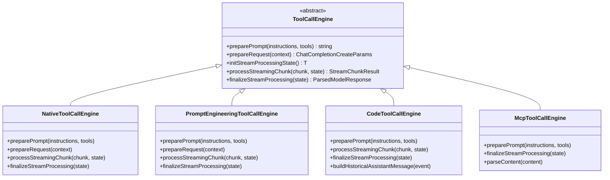
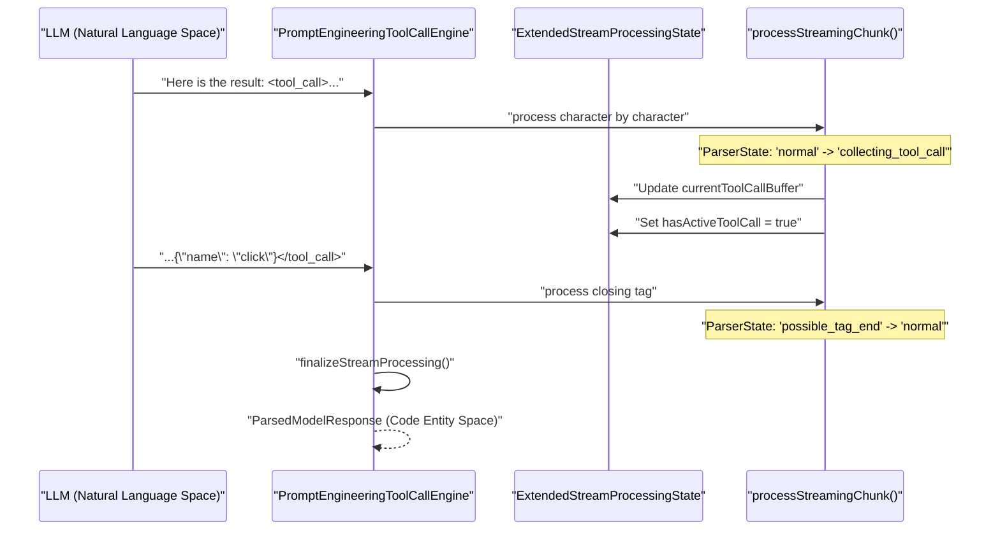
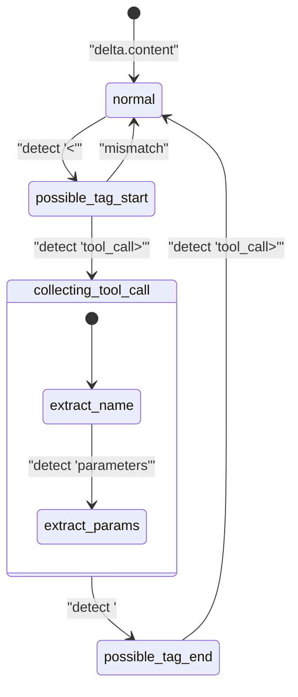

<!-- source: DeepWiki mcp.deepwiki.com · repo bytedance/UI-TARS-desktop · extra page Tool Call Engine Interface and Strategies · fetched 2026-10-30 -->

# Tool Call Engine Interface and Strategies

Relevant source files

The following files were used as context for generating this wiki page:

- [multimodal/agent-tars/core/src/environments/local/browser/browser-manager.ts](multimodal/agent-tars/core/src/environments/local/browser/browser-manager.ts)
- [multimodal/omni-tars/code-agent/src/CodeToolCallEngine.ts](multimodal/omni-tars/code-agent/src/CodeToolCallEngine.ts)
- [multimodal/omni-tars/mcp-agent/src/McpToolCallEngine.ts](multimodal/omni-tars/mcp-agent/src/McpToolCallEngine.ts)
- [multimodal/tarko/agent-interface/src/agent.ts](multimodal/tarko/agent-interface/src/agent.ts)
- [multimodal/tarko/agent-interface/src/tool-call-engine.ts](multimodal/tarko/agent-interface/src/tool-call-engine.ts)
- [multimodal/tarko/agent/src/tool-call-engine/NativeToolCallEngine.ts](multimodal/tarko/agent/src/tool-call-engine/NativeToolCallEngine.ts)
- [multimodal/tarko/agent/src/tool-call-engine/PromptEngineeringToolCallEngine.ts](multimodal/tarko/agent/src/tool-call-engine/PromptEngineeringToolCallEngine.ts)
- [multimodal/tarko/llm-client/README.md](multimodal/tarko/llm-client/README.md)
- [multimodal/tarko/llm-client/src/handlers/openai-compatible.ts](multimodal/tarko/llm-client/src/handlers/openai-compatible.ts)
- [multimodal/tarko/llm/README.md](multimodal/tarko/llm/README.md)

This document explains the `ToolCallEngine` interface and strategy pattern used in the Tarko agent framework for handling different approaches to LLM tool calling. The system provides a pluggable architecture for adapting to various LLM providers and tool invocation formats, from native function calling to prompt engineering and specialized T5-based multimodal formats.

---

## Overview and Design Goals

The `ToolCallEngine` abstraction decouples the agent's reasoning loop from the specific mechanism used to invoke tools. Different LLM providers and model families support different tool calling formats:

- **Native function calling** (OpenAI, compatible providers): Uses structured `tools` parameters in requests and `tool_calls` in responses [multimodal/tarko/agent-interface/src/tool-call-engine.ts:53-53]().
- **Prompt engineering** (custom formats like `<tool_call>`): Embeds tool definitions and calls in text using custom tags for models without native support [multimodal/tarko/agent/src/tool-call-engine/PromptEngineeringToolCallEngine.ts:68-68]().
- **Specialized T5/OmniTARS formats**: Uses structured XML-like tags (e.g., `<mcp_env>`, `<code_env>`) optimized for GUI, Code, and MCP agents [multimodal/omni-tars/code-agent/src/CodeToolCallEngine.ts:30-30]().

The `ToolCallEngine` interface provides a unified API for preparing prompts, formatting requests, parsing streaming chunks, and building conversation history [multimodal/tarko/agent-interface/src/tool-call-engine.ts:188-245]().

Sources: [multimodal/tarko/agent-interface/src/tool-call-engine.ts:18-58](), [multimodal/tarko/agent-interface/src/tool-call-engine.ts:188-245]().

---

## Tool Call Engine Interface

### Core Interface Definition

The `ToolCallEngine` abstract base class defines the contract that all tool calling strategies must implement.

**Tool Call Engine Class Hierarchy**

**Key Interface Methods:**

| Method | Purpose | Return Type |
|--------|---------|-------------|
| `preparePrompt()` | Generate system prompt segments with tool definitions [multimodal/tarko/agent/src/tool-call-engine/PromptEngineeringToolCallEngine.ts:71-126]() | `string` |
| `prepareRequest()` | Build LLM API request parameters (model, stop sequences, etc.) [multimodal/tarko/agent-interface/src/tool-call-engine.ts:206-206]() | `ChatCompletionCreateParams` |
| `initStreamProcessingState()` | Initialize state for streaming response parsing [multimodal/tarko/agent/src/tool-call-engine/PromptEngineeringToolCallEngine.ts:150-170]() | `T extends StreamProcessingState` |
| `processStreamingChunk()` | Parse incremental streaming chunks using a state machine [multimodal/tarko/agent/src/tool-call-engine/PromptEngineeringToolCallEngine.ts:175-214]() | `StreamChunkResult` |
| `finalizeStreamProcessing()` | Extract final tool calls and content from accumulated state [multimodal/omni-tars/mcp-agent/src/McpToolCallEngine.ts:56-77]() | `ParsedModelResponse` |

Sources: [multimodal/tarko/agent-interface/src/tool-call-engine.ts:188-245](), [multimodal/tarko/agent/src/tool-call-engine/PromptEngineeringToolCallEngine.ts:68-170]().

---

## Built-in Tool Call Strategies

### Native Tool Call Engine
The `NativeToolCallEngine` utilizes standard OpenAI-compatible function calling. It converts `Tool` objects into `ChatCompletionTool` definitions with JSON schemas using `zodToJsonSchema` [multimodal/tarko/agent/src/tool-call-engine/NativeToolCallEngine.ts:50-58](). It processes `delta.tool_calls` from streaming chunks and emits `StreamingToolCallUpdate` events [multimodal/tarko/agent/src/tool-call-engine/NativeToolCallEngine.ts:119-122]().

### Prompt Engineering Tool Call Engine
The `PromptEngineeringToolCallEngine` is designed for models that do not support native tool calling. It:
1. Injects a `<tool_instruction>` block into the system prompt with tool schemas [multimodal/tarko/agent/src/tool-call-engine/PromptEngineeringToolCallEngine.ts:98-125]().
2. Uses a complex state machine (`ParserState`) to parse `<tool_call>` tags character-by-character from the stream [multimodal/tarko/agent/src/tool-call-engine/PromptEngineeringToolCallEngine.ts:31-59]().
3. Sets `stop` sequences (e.g., `</tool_call>`) in the request to prevent the model from generating text after a tool call [multimodal/tarko/agent/src/tool-call-engine/PromptEngineeringToolCallEngine.ts:141-143]().

### Code and MCP Tool Call Engines
These engines are optimized for the OmniTARS ecosystem:
- **CodeToolCallEngine**: Uses `SYSTEM_PROMPT_GROUP` and the `omniProcessStreamingChunk` parser to handle code execution blocks [multimodal/omni-tars/code-agent/src/CodeToolCallEngine.ts:33-59]().
- **McpToolCallEngine**: Specialized in parsing Model Context Protocol (MCP) tool calls. It includes a robust `parseContent` method that handles multiple tag formats including `<|FunctionCallBegin|>`, `<think>`, and `<mcp_env>` [multimodal/omni-tars/mcp-agent/src/McpToolCallEngine.ts:90-188]().

Sources: [multimodal/omni-tars/code-agent/src/CodeToolCallEngine.ts:30-71](), [multimodal/omni-tars/mcp-agent/src/McpToolCallEngine.ts:25-77]().

---

## Streaming Data Flow

The following diagram bridges the **Natural Language Space** (LLM outputs) to the **Code Entity Space** (Internal State and Parsers).

**Streaming Tool Call Parsing Flow**

Sources: [multimodal/tarko/agent/src/tool-call-engine/PromptEngineeringToolCallEngine.ts:175-214](), [multimodal/tarko/agent/src/tool-call-engine/PromptEngineeringToolCallEngine.ts:31-59]().

---

## Historical Message Construction

Tool call engines are responsible for re-formatting conversation history so the LLM understands previous tool interactions.

| Engine | Assistant Message Format | Tool Result Format |
|--------|-------------------------|--------------------|
| **Native** | Standard `assistant` message | `role: 'tool'` with `tool_call_id` [multimodal/tarko/agent-interface/src/tool-call-engine.ts:142-149]() |
| **Code/MCP** | Uses `rawContent` (original tags) [multimodal/omni-tars/code-agent/src/CodeToolCallEngine.ts:78-79]() | `role: 'user'` with text "Tool [name] result: ..." [multimodal/omni-tars/code-agent/src/CodeToolCallEngine.ts:92-95]() |
| **Prompt** | Uses `rawContent` (if provided) | `role: 'user'` with text-based result [multimodal/tarko/agent/src/tool-call-engine/PromptEngineeringToolCallEngine.ts:26-26]() |

Sources: [multimodal/omni-tars/code-agent/src/CodeToolCallEngine.ts:73-97](), [multimodal/tarko/agent/src/tool-call-engine/NativeToolCallEngine.ts:205-208]().

---

## Strategy Logic: Parser State Machine

The `PromptEngineeringToolCallEngine` uses an `ExtendedStreamProcessingState` to track parsing across chunks. This ensures that even if a `<tool_call>` tag is split across two network packets, it is reconstructed correctly.

**Parser State Machine Transitions**

**State Definitions:**
- `normal`: Collecting standard chat content into `normalContentBuffer` [multimodal/tarko/agent/src/tool-call-engine/PromptEngineeringToolCallEngine.ts:42-42]().
- `collecting_tool_call`: Buffering JSON content into `currentToolCallBuffer` [multimodal/tarko/agent/src/tool-call-engine/PromptEngineeringToolCallEngine.ts:38-38]().
- `parameterBracketDepth`: Tracks `{}` nesting to correctly identify the end of a JSON object [multimodal/tarko/agent/src/tool-call-engine/PromptEngineeringToolCallEngine.ts:55-56]().

Sources: [multimodal/tarko/agent/src/tool-call-engine/PromptEngineeringToolCallEngine.ts:31-59](), [multimodal/tarko/agent/src/tool-call-engine/PromptEngineeringToolCallEngine.ts:150-170]().

---

