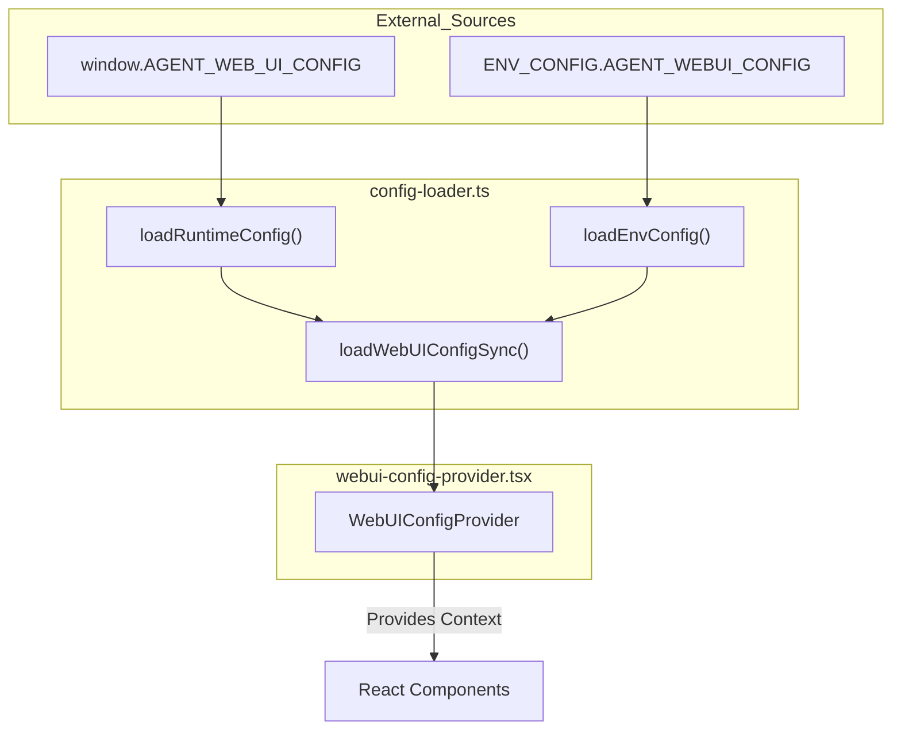
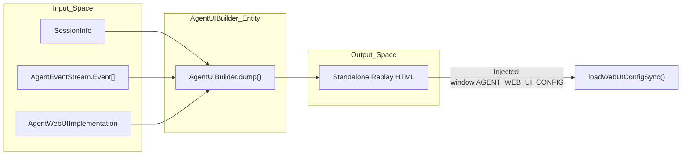

<!-- source: DeepWiki mcp.deepwiki.com · repo bytedance/UI-TARS-desktop · extra page Web UI Configuration System · fetched 2026-10-30 -->

# Web UI Configuration System

<details>
<summary>Relevant source files</summary>

The following files were used as context for generating this wiki page:

- [multimodal/agent-tars/core/src/agent-tars.ts](multimodal/agent-tars/core/src/agent-tars.ts)
- [multimodal/agent-tars/core/tests/filesystem/filesystem-tools-manager.test.ts](multimodal/agent-tars/core/tests/filesystem/filesystem-tools-manager.test.ts)
- [multimodal/tarko/agent-server-next/src/utils/webui/config.ts](multimodal/tarko/agent-server-next/src/utils/webui/config.ts)
- [multimodal/tarko/agent-server/src/utils/webui/config.ts](multimodal/tarko/agent-server/src/utils/webui/config.ts)
- [multimodal/tarko/agent-ui-builder/README.md](multimodal/tarko/agent-ui-builder/README.md)
- [multimodal/tarko/agent-ui-builder/src/types.ts](multimodal/tarko/agent-ui-builder/src/types.ts)
- [multimodal/tarko/agent-ui/rsbuild.config.ts](multimodal/tarko/agent-ui/rsbuild.config.ts)
- [multimodal/tarko/agent-ui/src/common/constants/index.ts](multimodal/tarko/agent-ui/src/common/constants/index.ts)
- [multimodal/tarko/agent-ui/src/common/state/actions/connectionActions.ts](multimodal/tarko/agent-ui/src/common/state/actions/connectionActions.ts)
- [multimodal/tarko/agent-ui/src/common/types/env.d.ts](multimodal/tarko/agent-ui/src/common/types/env.d.ts)
- [multimodal/tarko/agent-ui/src/config/config-loader.ts](multimodal/tarko/agent-ui/src/config/config-loader.ts)
- [multimodal/tarko/agent-ui/src/config/default-config.ts](multimodal/tarko/agent-ui/src/config/default-config.ts)
- [multimodal/tarko/agent-ui/src/config/web-ui-config.ts](multimodal/tarko/agent-ui/src/config/web-ui-config.ts)
- [multimodal/tarko/agent-ui/src/config/webui-config-provider.tsx](multimodal/tarko/agent-ui/src/config/webui-config-provider.tsx)
- [multimodal/tarko/agent-ui/src/entry.tsx](multimodal/tarko/agent-ui/src/entry.tsx)
- [multimodal/tarko/agent-ui/src/standalone/app/App.tsx](multimodal/tarko/agent-ui/src/standalone/app/App.tsx)
- [multimodal/tarko/agent-ui/src/standalone/app/index.tsx](multimodal/tarko/agent-ui/src/standalone/app/index.tsx)
- [multimodal/tarko/agent-ui/src/standalone/share/shareService.ts](multimodal/tarko/agent-ui/src/standalone/share/shareService.ts)
- [multimodal/tarko/shared-utils/src/index.ts](multimodal/tarko/shared-utils/src/index.ts)
- [multimodal/websites/tarko/docs/en/api/_meta.json](multimodal/websites/tarko/docs/en/api/_meta.json)
- [multimodal/websites/tarko/docs/en/api/agent-ui-config.mdx](multimodal/websites/tarko/docs/en/api/agent-ui-config.mdx)
- [multimodal/websites/tarko/docs/zh/api/_meta.json](multimodal/websites/tarko/docs/zh/api/_meta.json)
- [multimodal/websites/tarko/docs/zh/api/agent-ui-config.mdx](multimodal/websites/tarko/docs/zh/api/agent-ui-config.mdx)

</details>


This page documents the `AgentWebUIImplementation` interface, the configuration loading lifecycle, and how the UI dynamically adapts based on these settings. The configuration system ensures a consistent experience whether the UI is running in a standalone browser, injected via a CLI, or bundled as a static replay file.

---

## Interface Hierarchy

The configuration is structured via TypeScript interfaces defined in `@tarko/interface`. It supports two primary modes: `static` (standard deployment) and `remote` (loading UI from an external URL).

**Diagram: AgentWebUIImplementation type hierarchy**

```mermaid
classDiagram
    class "BaseAgentWebUIImplementation" {
        +logo string
        +title string
        +subtitle string
        +welcomTitle string
        +welcomePrompts string[]
        +welcomeCards WelcomeCard[]
        +workspace WorkspaceConfig
        +layout LayoutConfig
        +guiAgent TarkoWebUIGUIAgentConfig
    }

    class "StaticAgentWebUIImplementation" {
        +type "static"
        +staticPath string
    }

    class "RemoteAgentWebUIImplementation" {
        +type "remote"
        +remoteUrl string
    }

    class "WorkspaceConfig" {
        +navItems WorkspaceNavItem[]
    }

    class "WorkspaceNavItem" {
        +title string
        +link string
        +icon string
        +behavior "new-page" | "embed-frame"
        +autoActive boolean | string
    }

    class "TarkoWebUIGUIAgentConfig" {
        +defaultScreenshotRenderStrategy string
        +enableScreenshotRenderStrategySwitch boolean
        +renderGUIAction boolean
        +renderBrowserShell boolean
    }

    BaseAgentWebUIImplementation <|-- StaticAgentWebUIImplementation
    BaseAgentWebUIImplementation <|-- RemoteAgentWebUIImplementation
    BaseAgentWebUIImplementation --> WorkspaceConfig
    BaseAgentWebUIImplementation --> TarkoWebUIGUIAgentConfig
    WorkspaceConfig --> WorkspaceNavItem
```

Sources: [multimodal/tarko/agent-ui/src/config/default-config.ts:13-47](), [multimodal/tarko/agent-ui-builder/src/types.ts:6-31]()

---

## Configuration Loading Lifecycle

The Web UI resolves its configuration through a prioritized hierarchy. This allows for flexible deployments ranging from local development to production environments where configurations might be injected at runtime.

### Loading Priority
1.  **Runtime Injection**: Configuration attached to `window.AGENT_WEB_UI_CONFIG`. This is typically used by the CLI or host applications to inject settings directly into the browser context [multimodal/tarko/agent-ui/src/config/config-loader.ts:44-54]().
2.  **Environment Variables**: Configuration provided during the build process via `process.env.AGENT_WEBUI_CONFIG` [multimodal/tarko/agent-ui/src/common/constants/index.ts:10-10]().
3.  **Default Configuration**: Fallback to `DEFAULT_WEBUI_CONFIG` if no other source is found [multimodal/tarko/agent-ui/src/config/config-loader.ts:100-103]().

**Diagram: Config resolution from Natural Language Space to Code Entities**



Sources: [multimodal/tarko/agent-ui/src/config/config-loader.ts:44-104](), [multimodal/tarko/agent-ui/src/config/webui-config-provider.tsx:22-42](), [multimodal/tarko/agent-ui/src/common/constants/index.ts:8-11]()

---

## Server-Side Merging

When the UI communicates with an `AgentServer`, the server merges the base Web UI configuration with agent-specific configurations. This ensures that if a specific Agent class defines its own UI requirements via `getAgentConstructorWebConfig`, they are respected.

| Function | File Path | Role |
|---|---|---|
| `mergeWebUIConfig` | [multimodal/tarko/agent-server/src/utils/webui/config.ts:17-23]() | Merges base config with `server.getAgentConstructorWebConfig()` using `deepMerge`. |
| `deepMerge` | [multimodal/tarko/shared-utils/src/index.ts:7-7]() | Exported utility for recursively merging configuration objects. |
| `AGENT_TARS.webuiConfig` | [multimodal/agent-tars/core/src/agent-tars.ts:38-38]() | Defines the static UI configuration specific to Agent TARS. |

Sources: [multimodal/tarko/agent-server/src/utils/webui/config.ts:17-23](), [multimodal/tarko/agent-server-next/src/utils/webui/config.ts:16-22](), [multimodal/agent-tars/core/src/agent-tars.ts:32-38]()

---

## Configuration-Driven UI Elements

The Web UI is highly data-driven, with several key areas controlled entirely by the loaded configuration:

### 1. Branding and Content
The UI uses `getWebUIConfig()` to resolve branding elements like the logo, title, and subtitle.
*   **Logo**: Resolved via `getLogoUrl()` with a default fallback [multimodal/tarko/agent-ui/src/config/web-ui-config.ts:76-81]().
*   **Title**: Resolved via `getAgentTitle()` [multimodal/tarko/agent-ui/src/config/web-ui-config.ts:62-64]().
*   **Welcome Prompts**: The `welcomePrompts` array generates clickable suggestion chips on the home page [multimodal/tarko/agent-ui/src/config/default-config.ts:18-23]().

### 2. Layout and Routing
The application layout is dynamically adjusted based on configuration flags retrieved via `getLayoutConfig()` [multimodal/tarko/agent-ui/src/config/web-ui-config.ts:115-124]().
*   **Sidebar/Home**: The `App` component checks `isSidebarEnabled()` and `isHomeEnabled()` to conditionally render the `Sidebar` and home routes [multimodal/tarko/agent-ui/src/standalone/app/App.tsx:17-18](), [multimodal/tarko/agent-ui/src/standalone/app/App.tsx:59-88]().
*   **API Base**: The `getAPIBaseUrl()` function calculates the correct endpoint by combining `ENV_CONFIG.AGENT_BASE_URL` and the extracted `routeBase` [multimodal/tarko/agent-ui/src/config/web-ui-config.ts:36-55]().

### 3. Workspace Navigation
The `workspace.navItems` configuration defines external tools accessible from the UI.
*   **Dynamic Prefixing**: `getWorkspaceNavItems(prefix)` allows replacing `{prefix}` placeholders in links for dynamic routing [multimodal/tarko/agent-ui/src/config/web-ui-config.ts:86-96]().
*   **Default Tools**: Includes links for `Code Server` and `VNC` with auto-connect parameters [multimodal/tarko/agent-ui/src/config/default-config.ts:25-36]().

### 4. GUI Agent Rendering
The `guiAgent` block controls how the UI handles screenshots and actions from multimodal agents.
*   **Screenshot Strategy**: `defaultScreenshotRenderStrategy` determines if the UI shows the screen "before" or "after" an agent action by default [multimodal/tarko/agent-ui/src/config/default-config.ts:39-39]().
*   **Browser Shell**: `renderBrowserShell` toggles a decorative browser frame around agent screenshots [multimodal/tarko/agent-ui/src/config/default-config.ts:42-42]().
*   **Source**: [multimodal/tarko/agent-ui/src/config/web-ui-config.ts:101-110]()

---

## Replay and Builder Integration

The `@tarko/agent-ui-builder` package utilizes this configuration system to generate standalone HTML replay files. When a session is "dumped" to HTML, the `uiConfig` is injected into the static file so the replay UI matches the original session's branding and workspace settings.

**Diagram: Builder Configuration Injection**



Sources: [multimodal/tarko/agent-ui-builder/src/types.ts:16-31](), [multimodal/tarko/agent-ui-builder/README.md:119-138](), [multimodal/tarko/agent-ui/src/config/config-loader.ts:79-104]()

---

