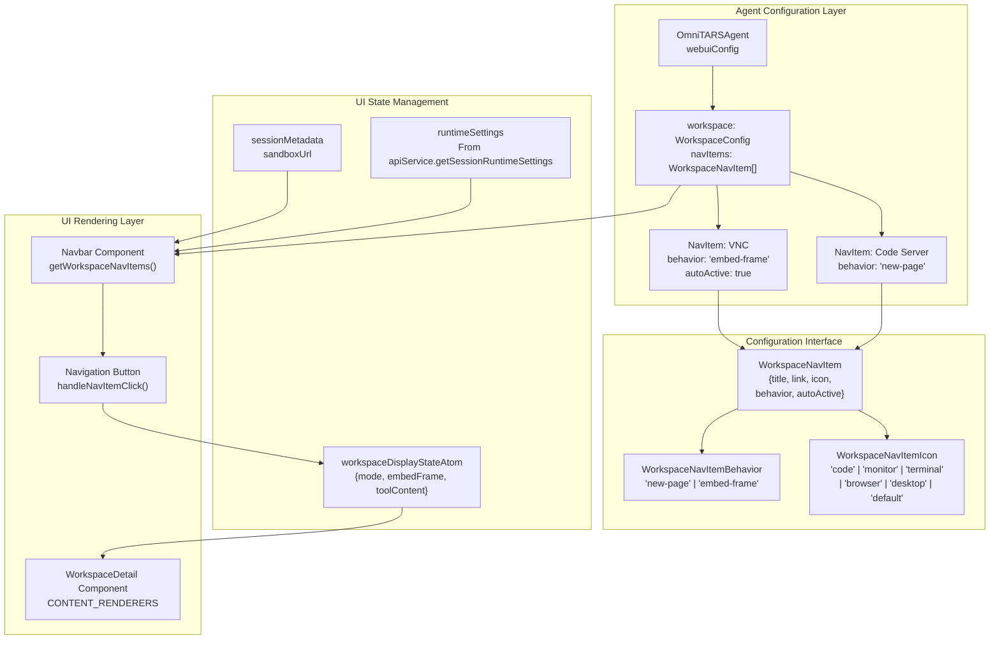
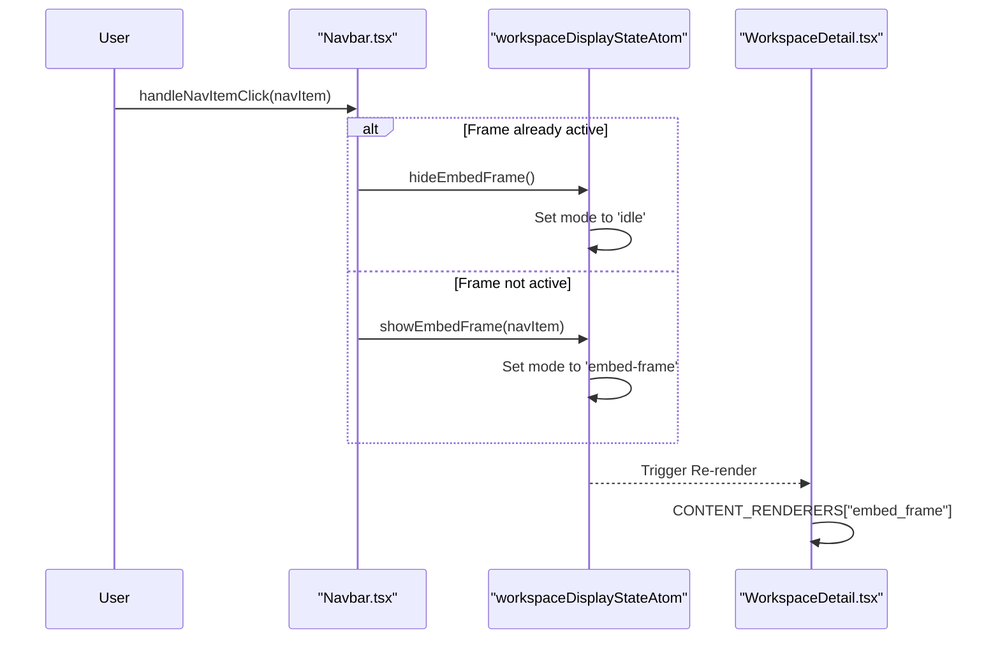
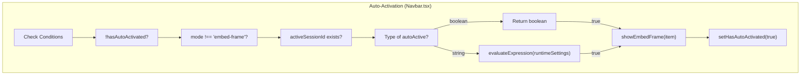

<!-- source: DeepWiki mcp.deepwiki.com · repo bytedance/UI-TARS-desktop · extra page Workspace Navigation and Integration · fetched 2026-10-30 -->

# Workspace Navigation and Integration

Relevant source files

The following files were used as context for generating this wiki page:

- [multimodal/agent-tars/cli/src/index.ts](multimodal/agent-tars/cli/src/index.ts)
- [multimodal/agent-tars/interface/src/constants.ts](multimodal/agent-tars/interface/src/constants.ts)
- [multimodal/omni-tars/omni-agent/src/index.ts](multimodal/omni-tars/omni-agent/src/index.ts)
- [multimodal/tarko/agent-ui/docs/runtime-settings-autoactive.md](multimodal/tarko/agent-ui/docs/runtime-settings-autoactive.md)
- [multimodal/tarko/agent-ui/examples/webui-config.json](multimodal/tarko/agent-ui/examples/webui-config.json)
- [multimodal/tarko/agent-ui/src/common/hooks/useSession.ts](multimodal/tarko/agent-ui/src/common/hooks/useSession.ts)
- [multimodal/tarko/agent-ui/src/common/state/actions/eventProcessors/handlers/AgentRunHandler.ts](multimodal/tarko/agent-ui/src/common/state/actions/eventProcessors/handlers/AgentRunHandler.ts)
- [multimodal/tarko/agent-ui/src/common/state/actions/eventProcessors/handlers/SystemHandler.ts](multimodal/tarko/agent-ui/src/common/state/actions/eventProcessors/handlers/SystemHandler.ts)
- [multimodal/tarko/agent-ui/src/common/state/actions/eventProcessors/handlers/ToolHandler.ts](multimodal/tarko/agent-ui/src/common/state/actions/eventProcessors/handlers/ToolHandler.ts)
- [multimodal/tarko/agent-ui/src/common/state/actions/eventProcessors/utils/cacheManager.ts](multimodal/tarko/agent-ui/src/common/state/actions/eventProcessors/utils/cacheManager.ts)
- [multimodal/tarko/agent-ui/src/common/state/actions/eventProcessors/utils/panelContentUpdater.ts](multimodal/tarko/agent-ui/src/common/state/actions/eventProcessors/utils/panelContentUpdater.ts)
- [multimodal/tarko/agent-ui/src/common/state/actions/sessionActions.ts](multimodal/tarko/agent-ui/src/common/state/actions/sessionActions.ts)
- [multimodal/tarko/agent-ui/src/common/state/atoms/ui.ts](multimodal/tarko/agent-ui/src/common/state/atoms/ui.ts)
- [multimodal/tarko/agent-ui/src/common/types/index.ts](multimodal/tarko/agent-ui/src/common/types/index.ts)
- [multimodal/tarko/agent-ui/src/standalone/chat/Message/components/MultimodalContent.tsx](multimodal/tarko/agent-ui/src/standalone/chat/Message/components/MultimodalContent.tsx)
- [multimodal/tarko/agent-ui/src/standalone/chat/Message/index.tsx](multimodal/tarko/agent-ui/src/standalone/chat/Message/index.tsx)
- [multimodal/tarko/agent-ui/src/standalone/components/ThemeToggle.tsx](multimodal/tarko/agent-ui/src/standalone/components/ThemeToggle.tsx)
- [multimodal/tarko/agent-ui/src/standalone/components/index.ts](multimodal/tarko/agent-ui/src/standalone/components/index.ts)
- [multimodal/tarko/agent-ui/src/standalone/home/CreatingPage.tsx](multimodal/tarko/agent-ui/src/standalone/home/CreatingPage.tsx)
- [multimodal/tarko/agent-ui/src/standalone/home/WelcomeCards.tsx](multimodal/tarko/agent-ui/src/standalone/home/WelcomeCards.tsx)
- [multimodal/tarko/agent-ui/src/standalone/home/WelcomePage.tsx](multimodal/tarko/agent-ui/src/standalone/home/WelcomePage.tsx)
- [multimodal/tarko/agent-ui/src/standalone/navbar/Navbar.tsx](multimodal/tarko/agent-ui/src/standalone/navbar/Navbar.tsx)
- [multimodal/tarko/agent-ui/src/standalone/workspace/WorkspaceDetail.tsx](multimodal/tarko/agent-ui/src/standalone/workspace/WorkspaceDetail.tsx)
- [multimodal/tarko/agent-ui/src/standalone/workspace/WorkspacePanel.tsx](multimodal/tarko/agent-ui/src/standalone/workspace/WorkspacePanel.tsx)
- [multimodal/tarko/interface/src/web-ui-implementation.ts](multimodal/tarko/interface/src/web-ui-implementation.ts)

## Purpose and Scope

This document describes the workspace navigation system in the Tarko Agent Web UI, which provides configurable navigation to external tools and sandbox environments. The system supports embedding iframe content within the workspace or opening links in new tabs, with sophisticated auto-activation logic based on runtime settings. This enables seamless integration with development environments like Code Server, VNC desktops, and interactive browser controls.

For information about the overall Web UI configuration system, see [4.3.1](). For details about runtime settings that drive conditional navigation behavior, see [4.2.5]().

## Workspace Navigation System Architecture

The workspace navigation system provides a declarative way for agents to expose external tools and sandbox environments through the web UI. Navigation items are defined in the agent's configuration and rendered in the navbar with configurable behavior and auto-activation rules.

### Configuration to UI Rendering Flow

**Sources:** [multimodal/tarko/agent-ui/src/standalone/navbar/Navbar.tsx:50-62](), [multimodal/tarko/agent-ui/src/standalone/workspace/WorkspaceDetail.tsx:61-70](), [multimodal/tarko/agent-ui/src/common/state/atoms/ui.ts:97-134]()

## Navigation Item Configuration

Navigation items are configured through the `WorkspaceNavItem` interface, which defines all aspects of a navigation element's appearance and behavior.

### WorkspaceNavItem Interface

| Property | Type | Description | Default |
|----------|------|-------------|---------|
| `title` | `string` | Display name shown on the navigation button | Required |
| `link` | `string` | URL to open in new tab or embed in workspace | Required |
| `icon` | `WorkspaceNavItemIcon` | Icon type for visual identification | `'default'` |
| `behavior` | `WorkspaceNavItemBehavior` | How the link is opened | `'new-page'` |
| `autoActive` | `boolean \| string` | Auto-activation rule (boolean or expression) | `false` |

**Sources:** [multimodal/tarko/interface/src/web-ui-implementation.ts:34-65](), [multimodal/tarko/agent-ui/src/standalone/navbar/Navbar.tsx:74-105]()

### Icon Types and Visual Styling

The system supports predefined icon types, each mapped to a specific React icon from `react-icons/fi` or `react-icons/md`:

| Icon Type | React Icon | File Reference |
|-----------|------------|----------------|
| `code` | `FiCode` | [multimodal/tarko/agent-ui/src/standalone/navbar/Navbar.tsx:18]() |
| `monitor` | `FiMonitor` | [multimodal/tarko/agent-ui/src/standalone/navbar/Navbar.tsx:17]() |
| `terminal` | `FiTerminal` | [multimodal/tarko/agent-ui/src/standalone/navbar/Navbar.tsx:21]() |
| `browser` | `FiGlobe` | [multimodal/tarko/agent-ui/src/standalone/navbar/Navbar.tsx:22]() |
| `desktop` | `MdDesktopWindows` | [multimodal/tarko/agent-ui/src/standalone/navbar/Navbar.tsx:25]() |
| `default` | `FiSettings` | [multimodal/tarko/agent-ui/src/standalone/navbar/Navbar.tsx:16]() |

**Sources:** [multimodal/tarko/agent-ui/src/standalone/navbar/Navbar.tsx:9-25](), [multimodal/tarko/interface/src/web-ui-implementation.ts:18-24]()

## Behavior Types and UI Integration

Navigation items support two distinct behaviors that determine how the target link is accessed and rendered within the workspace.

### new-page Behavior

When `behavior` is set to `'new-page'` (the default), clicking the navigation button opens the link in a new browser tab using `window.open`.

**Sources:** [multimodal/tarko/agent-ui/src/standalone/navbar/Navbar.tsx:185-187](), [multimodal/tarko/interface/src/web-ui-implementation.ts:29-29]()

### embed-frame Behavior

When `behavior` is set to `'embed-frame'`, the navigation system embeds the content within the workspace using an iframe. This is managed via the unified `workspaceDisplayStateAtom`.

**Sources:** [multimodal/tarko/agent-ui/src/standalone/navbar/Navbar.tsx:171-184](), [multimodal/tarko/agent-ui/src/common/state/atoms/ui.ts:139-149](), [multimodal/tarko/agent-ui/src/standalone/workspace/WorkspaceDetail.tsx:58-59]()

## Auto-Activation Logic

The `Navbar` component contains a `useEffect` hook that automatically activates `'embed-frame'` items based on the `autoActive` property and `runtimeSettings`.

### Auto-Activation Mechanism

The system evaluates the `autoActive` property once when a session is active and the workspace is in `'idle'` mode.

**Sources:** [multimodal/tarko/agent-ui/src/standalone/navbar/Navbar.tsx:67-119]()

### Expression-Based Auto-Activation

`autoActive` can be a string expression referencing `runtimeSettings`. The expression is evaluated in a strict mode sandbox using the `Function` constructor. This allows conditional activation (e.g., only show VNC if a specific GUI tool is enabled in the current session).

**Sources:** [multimodal/tarko/agent-ui/src/standalone/navbar/Navbar.tsx:83-102](), [multimodal/tarko/interface/src/web-ui-implementation.ts:54-63]()

## Workspace Content Priority

The workspace is a shared area for tool results, file previews, and embedded frames. The `WorkspaceDetail` component manages the display logic via `workspaceDisplayStateAtom`.

1.  **Tool Content**: When an agent performs a tool call or returns a file result, the result is shown via `showToolContentAtom` and rendered by `CONTENT_RENDERERS`.
2.  **Embed Frame**: If a user selects a navigation item (or it auto-activates), the frame occupies the workspace.
3.  **Idle State**: Shows the default empty state or initial background.

### File Display Integration
When `tool-content` is active, the `WorkspaceDetail` component uses specialized renderers (e.g., `FileResultRenderer`, `BrowserControlRenderer`) based on the content type. For files, the system employs a priority-based selection (HTML > Markdown > Others) to determine the best initial file to display in the workspace panel.

**Sources:** [multimodal/tarko/agent-ui/src/standalone/workspace/WorkspaceDetail.tsx:34-59](), [multimodal/tarko/agent-ui/src/common/state/actions/sessionActions.ts:17-55](), [multimodal/tarko/agent-ui/src/common/state/atoms/ui.ts:112-134]()

## VNC and Code Server Integration

The integration with sandbox tools like VNC and Code Server is facilitated by:
- **Sandbox URL Resolution**: `getWorkspaceNavItems` uses the `sandboxUrl` from `sessionMetadata` to resolve navigation items.
- **VNC Rendering**: Uses `EmbedFrameRenderer` to display the VNC client or Code Server within the workspace when the display mode is set to `embed-frame`.
- **Browser Control**: For interactive browser agents, the `BrowserControlRenderer` (mapped to `browser_vision_control`) provides a live view of the agent's browser state, distinct from a static embed frame. This is often triggered by `EnvironmentInputHandler` processing screenshots.
- **Dynamic Configuration**: Agents like `OmniTARSAgent` define welcome cards that can pre-configure `agentMode` (e.g., 'game') which in turn affects which navigation items or environments are relevant.

**Sources:** [multimodal/tarko/agent-ui/src/config/web-ui-config.ts:33-33](), [multimodal/tarko/agent-ui/src/standalone/workspace/WorkspaceDetail.tsx:49-58](), [multimodal/tarko/agent-ui/src/common/state/actions/eventProcessors/handlers/SystemHandler.ts:111-121](), [multimodal/omni-tars/omni-agent/src/index.ts:20-104]()

---

