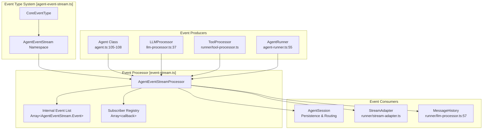
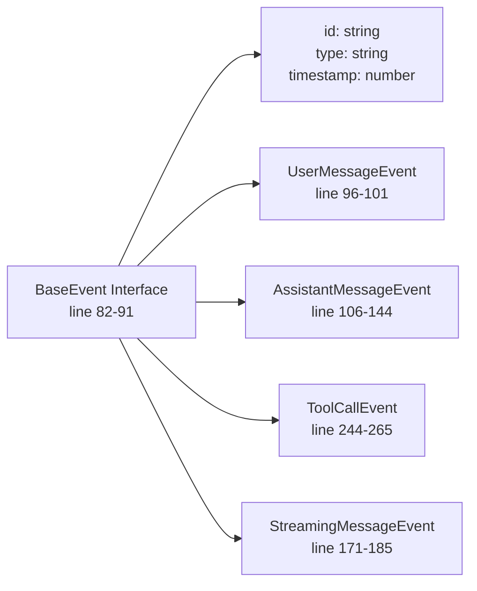
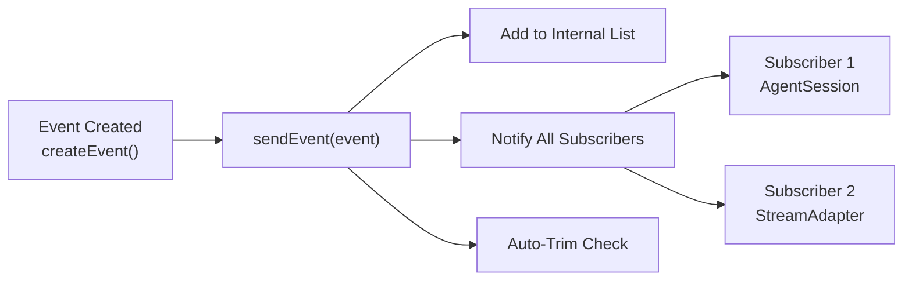

<!-- source: DeepWiki mcp.deepwiki.com · repo bytedance/UI-TARS-desktop · extra page Agent Event Stream Architecture · fetched 2026-10-30 -->

# Agent Event Stream Architecture

Relevant source files

The following files were used as context for generating this wiki page:

- [multimodal/tarko/agent-interface/src/agent-event-stream.ts](multimodal/tarko/agent-interface/src/agent-event-stream.ts)
- [multimodal/tarko/agent-interface/src/agent-options.ts](multimodal/tarko/agent-interface/src/agent-options.ts)
- [multimodal/tarko/agent-snapshot/src/utils/snapshot-normalizer.ts](multimodal/tarko/agent-snapshot/src/utils/snapshot-normalizer.ts)
- [multimodal/tarko/agent/snapshot/__snapshots__/index.test.ts.snap](multimodal/tarko/agent/snapshot/__snapshots__/index.test.ts.snap)
- [multimodal/tarko/agent/src/agent/agent-runner.ts](multimodal/tarko/agent/src/agent/agent-runner.ts)
- [multimodal/tarko/agent/src/agent/agent.ts](multimodal/tarko/agent/src/agent/agent.ts)
- [multimodal/tarko/agent/src/agent/runner/llm-processor.ts](multimodal/tarko/agent/src/agent/runner/llm-processor.ts)
- [multimodal/tarko/agent/src/utils/tool-filter.ts](multimodal/tarko/agent/src/utils/tool-filter.ts)
- [multimodal/tarko/agent/tests/agent/llm-processor-usage-streaming.test.ts](multimodal/tarko/agent/tests/agent/llm-processor-usage-streaming.test.ts)

## Purpose and Scope

This document details the Agent Event Stream Architecture within the Tarko Framework, which provides a comprehensive event-driven communication system for tracking agent execution state, conversation flow, and tool interactions. The event stream serves as the central nervous system for agent operations, enabling real-time streaming to clients, persistent storage of conversation history, and monitoring/analytics integration.

This page covers the event type system, processor implementation, subscription model, and event-driven communication patterns.

## Event Stream Architecture Overview

The event stream architecture is built on three primary components: the **event type definitions** (namespace-based TypeScript interfaces), the **event processor** (manages creation, storage, and subscriptions), and the **event consumers** (subscribers that react to events in real-time).

### System Component Interaction

The following diagram bridges the high-level event concepts with the specific code entities that produce and consume them.

**Diagram: Event Stream System to Code Entity Mapping**

**Sources:** [multimodal/tarko/agent-interface/src/agent-event-stream.ts:29-77](), [multimodal/tarko/agent/src/agent/agent.ts:105-108](), [multimodal/tarko/agent/src/agent/runner/llm-processor.ts:57-63]()

## Event Type System

The event type system is defined in the `AgentEventStream` namespace. It provides granular visibility into the agent's reasoning and execution process [multimodal/tarko/agent-interface/src/agent-event-stream.ts:15-35]().

### Core Event Categories

Events are categorized into distinct functional groups within the `CoreEventType` definition [multimodal/tarko/agent-interface/src/agent-event-stream.ts:37-77]():

| Category | Event Types | Purpose |
|----------|-------------|---------|
| **Conversation Flow** | `user_message`, `assistant_message`, `assistant_thinking_message` | Track primary dialogue between user and assistant |
| **Real-time Streaming** | `assistant_streaming_message`, `assistant_streaming_thinking_message`, `assistant_streaming_tool_call` | Provide incremental updates during execution |
| **Tool Execution** | `tool_call`, `tool_result` | Track individual tool invocations and results |
| **Lifecycle** | `agent_run_start`, `agent_run_end` | Mark execution session boundaries |
| **System** | `system` | System logs, warnings, and errors |
| **Environment** | `environment_input` | External context injection (screenshots, etc.) |
| **Planning** | `plan_start`, `plan_update`, `plan_finish` | Multi-step planning workflows |
| **Final Output** | `final_answer`, `final_answer_streaming` | Structured final responses |

**Sources:** [multimodal/tarko/agent-interface/src/agent-event-stream.ts:37-77]()

### Event Structure and Base Properties

All events inherit from `BaseEvent` and include standardized metadata:

**Diagram: Event Interface Hierarchy**

**Key Event Interfaces:**

- **`BaseEvent`** [multimodal/tarko/agent-interface/src/agent-event-stream.ts:82-91](): Contains `id` (unique identifier), `type` (event type string), and `timestamp` (creation time).
- **`UserMessageEvent`** [multimodal/tarko/agent-interface/src/agent-event-stream.ts:96-101](): Includes `content` field supporting both text and multimodal content (`ChatCompletionContentPart[]`).
- **`AssistantMessageEvent`** [multimodal/tarko/agent-interface/src/agent-event-stream.ts:106-144](): Includes `content`, `toolCalls`, `finishReason`, and performance metrics (`ttftMs`, `ttltMs`).
- **`AssistantStreamingMessageEvent`** [multimodal/tarko/agent-interface/src/agent-event-stream.ts:171-185](): Includes incremental `content` chunks, `isComplete` flag, and `messageId` for correlation.
- **`AssistantStreamingToolCallEvent`** [multimodal/tarko/agent-interface/src/agent-event-stream.ts:213-222](): Provides incremental updates for tool call construction, specifically optimized for large arguments.
- **`ToolResultEvent`** [multimodal/tarko/agent-interface/src/agent-event-stream.ts:270-293](): Contains `toolCallId`, tool `name`, execution `content`, and `elapsedMs`.

**Sources:** [multimodal/tarko/agent-interface/src/agent-event-stream.ts:82-293]()

## Event Stream Processor Implementation

The `AgentEventStreamProcessor` class (aliased as `AgentEventStream.Processor` in some contexts) is the concrete implementation that manages event lifecycle, storage, and subscriptions. It is instantiated within the `Agent` constructor [multimodal/tarko/agent/src/agent/agent.ts:105-108]().

### Processor Initialization and Configuration

The processor accepts `ProcessorOptions` during initialization [multimodal/tarko/agent-interface/src/agent-options.ts:177-177]():

- **`maxEvents`**: Maximum events to retain in memory.
- **`autoTrim`**: Whether to automatically remove old events when exceeding limits.
- **`initialEvents`**: Array of events to restore, useful for recreating agent instances with existing conversation context [multimodal/tarko/agent-interface/src/agent-options.ts:189-196]().

**Sources:** [multimodal/tarko/agent/src/agent/agent.ts:105-108](), [multimodal/tarko/agent-interface/src/agent-options.ts:172-196]()

### Event Creation and Emission

The processor provides the `createEvent` method to generate events with unique IDs and timestamps. Once created, events are broadcast via `sendEvent`.

**Diagram: Event Emission Flow**

**Sources:** [multimodal/tarko/agent/src/agent/agent.ts:105-108](), [multimodal/tarko/agent/src/agent/agent-runner.ts:28-28]()

## Subscription Model

The event stream supports multiple subscription patterns to allow different components to react to specific types of data.

### Subscription Methods

The framework provides mechanisms to:
- Subscribe to all events for logging or persistence.
- Subscribe to specific event types (e.g., only `tool_result`).
- Subscribe specifically to incremental content updates for real-time UI rendering.

Components like `StreamAdapter` use these subscriptions to convert internal events into external stream formats [multimodal/tarko/agent/src/agent/agent-runner.ts:116-116]().

**Sources:** [multimodal/tarko/agent/src/agent/agent-runner.ts:27-28](), [multimodal/tarko/agent/src/agent/agent-runner.ts:116-117]()

## Event Flow During Agent Execution

The execution loop heavily relies on events to maintain state and provide feedback. The `AgentRunner` coordinates specialized components like `LLMProcessor` and `ToolProcessor` which emit events throughout the lifecycle [multimodal/tarko/agent/src/agent/agent-runner.ts:91-117]().

### Execution Event Sequence

1.  **Start**: `AgentRunner` emits `agent_run_start` [multimodal/tarko/agent/snapshot/__snapshots__/index.test.ts.snap:24-35]().
2.  **Reasoning**: `LLMProcessor` emits `assistant_streaming_message` for real-time output and `assistant_message` for the final turn response [multimodal/tarko/agent-interface/src/agent-event-stream.ts:171-185]().
3.  **Tooling**: If the model requests a tool, `ToolProcessor` emits `tool_call` followed by `tool_result` once execution finishes [multimodal/tarko/agent/snapshot/__snapshots__/index.test.ts.snap:73-123]().
4.  **Metrics**: If `enableMetrics` is true, events include `ttftMs` (Time to First Token) and `ttltMs` (Time to Last Token) [multimodal/tarko/agent/src/agent/runner/llm-processor.ts:42-42](), [multimodal/tarko/agent-interface/src/agent-event-stream.ts:122-138]().

**Sources:** [multimodal/tarko/agent/src/agent/agent-runner.ts:92-114](), [multimodal/tarko/agent/src/agent/runner/llm-processor.ts:94-202](), [multimodal/tarko/agent-interface/src/agent-event-stream.ts:122-185](), [multimodal/tarko/agent/snapshot/__snapshots__/index.test.ts.snap:24-123]()

## Snapshot and Normalization

For testing and debugging, the event stream can be captured in snapshots. The `AgentNormalizerConfig` provides patterns to replace volatile fields (like `id`, `timestamp`, `ttftMs`, `sessionId`) with fixed placeholders (e.g., `<<TIMESTAMP>>`, `<<ID>>`) to ensure stable test comparisons [multimodal/tarko/agent-snapshot/src/utils/snapshot-normalizer.ts:34-50]().

**Sources:** [multimodal/tarko/agent-snapshot/src/utils/snapshot-normalizer.ts:34-50](), [multimodal/tarko/agent/snapshot/__snapshots__/index.test.ts.snap:12-83]()

---

