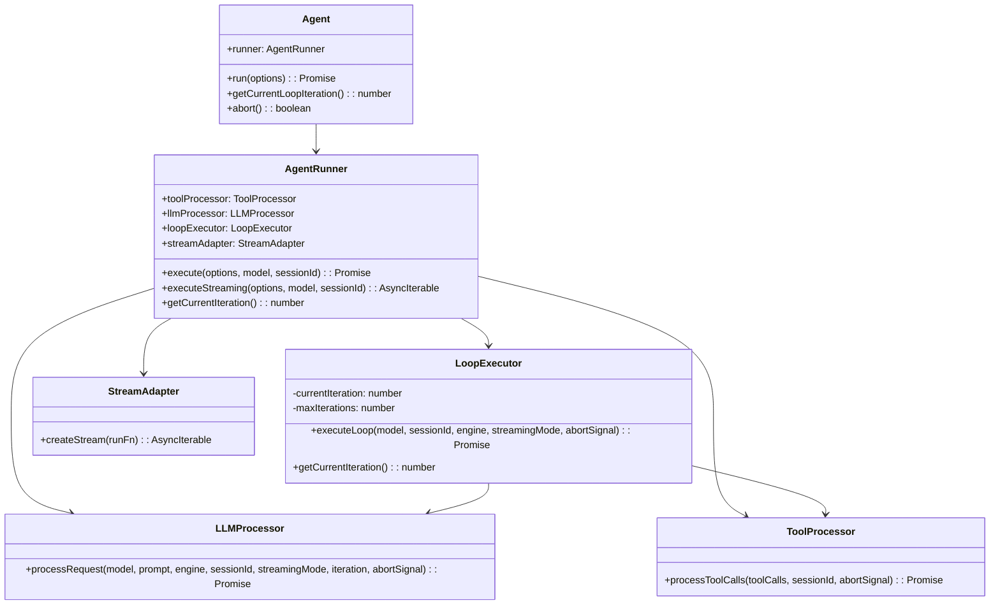
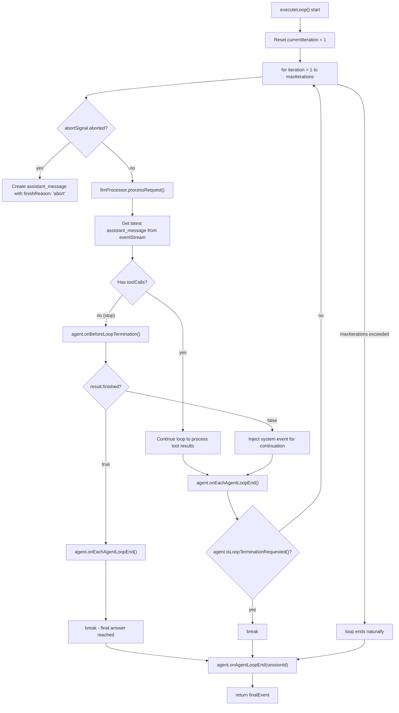
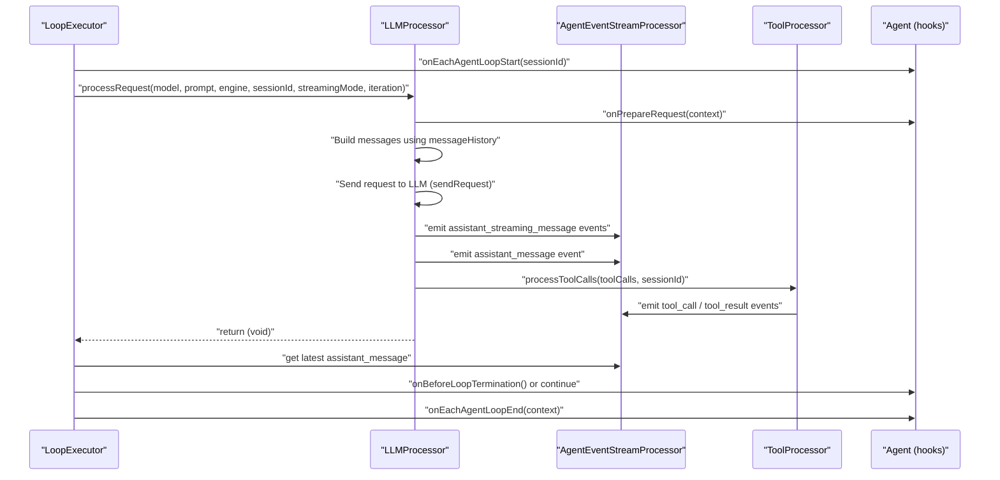

<!-- source: DeepWiki mcp.deepwiki.com · repo bytedance/UI-TARS-desktop · extra page Agent Runner and Loop Executor · fetched 2026-10-30 -->

# Agent Runner and Loop Executor

Relevant source files

The following files were used as context for generating this wiki page:

- [multimodal/tarko/agent-interface/src/agent-event-stream.ts](multimodal/tarko/agent-interface/src/agent-event-stream.ts)
- [multimodal/tarko/agent-interface/src/agent-instance.ts](multimodal/tarko/agent-interface/src/agent-instance.ts)
- [multimodal/tarko/agent-interface/src/agent-options.ts](multimodal/tarko/agent-interface/src/agent-options.ts)
- [multimodal/tarko/agent-snapshot/src/utils/snapshot-normalizer.ts](multimodal/tarko/agent-snapshot/src/utils/snapshot-normalizer.ts)
- [multimodal/tarko/agent/snapshot/__snapshots__/index.test.ts.snap](multimodal/tarko/agent/snapshot/__snapshots__/index.test.ts.snap)
- [multimodal/tarko/agent/src/agent/agent-runner.ts](multimodal/tarko/agent/src/agent/agent-runner.ts)
- [multimodal/tarko/agent/src/agent/agent.ts](multimodal/tarko/agent/src/agent/agent.ts)
- [multimodal/tarko/agent/src/agent/base-agent.ts](multimodal/tarko/agent/src/agent/base-agent.ts)
- [multimodal/tarko/agent/src/agent/runner/llm-processor.ts](multimodal/tarko/agent/src/agent/runner/llm-processor.ts)
- [multimodal/tarko/agent/src/agent/runner/loop-executor.ts](multimodal/tarko/agent/src/agent/runner/loop-executor.ts)
- [multimodal/tarko/agent/src/utils/tool-filter.ts](multimodal/tarko/agent/src/utils/tool-filter.ts)
- [multimodal/tarko/agent/tests/agent/llm-processor-usage-streaming.test.ts](multimodal/tarko/agent/tests/agent/llm-processor-usage-streaming.test.ts)
- [multimodal/websites/tarko/docs/en/guide/advanced/agent-hooks.mdx](multimodal/websites/tarko/docs/en/guide/advanced/agent-hooks.mdx)
- [multimodal/websites/tarko/docs/zh/guide/advanced/agent-hooks.mdx](multimodal/websites/tarko/docs/zh/guide/advanced/agent-hooks.mdx)

This page documents the `AgentRunner` and `LoopExecutor` internal components within the `@tarko/agent` package, covering how they coordinate the multi-turn reasoning loop, manage iteration state, and handle both streaming and non-streaming execution modes.

---

## Component Overview

The `Agent` class delegates all loop execution to an `AgentRunner` instance created during construction. `AgentRunner` itself is a coordinator that owns specialized sub-components, each handling a distinct concern in the reasoning lifecycle.

**Component Ownership Diagram**

Sources: [multimodal/tarko/agent/src/agent/agent.ts:71-73](), [multimodal/tarko/agent/src/agent/agent.ts:154-168](), [multimodal/tarko/agent/src/agent/agent-runner.ts:55-80](), [multimodal/tarko/agent/src/agent/runner/loop-executor.ts:19-30]()

---

## AgentRunner

`AgentRunner` is defined in [multimodal/tarko/agent/src/agent/agent-runner.ts](). It is constructed by `Agent` during initialization and is stored as the public field `runner`.

### Construction

`Agent` passes all relevant configuration into `AgentRunner` via `AgentRunnerOptions`:

| Option | Source | Description |
|--------|--------|-------------|
| `instructions` | `AgentOptions.instructions` | System prompt string [multimodal/tarko/agent/src/agent/agent.ts:89-89]() |
| `maxIterations` | `AgentOptions.maxIterations` | Hard loop limit (default 1000) [multimodal/tarko/agent/src/agent/agent.ts:90-90]() |
| `maxTokens` | `AgentOptions.maxTokens` | Per-request token cap [multimodal/tarko/agent/src/agent/agent.ts:91-91]() |
| `temperature` | `AgentOptions.temperature` | LLM sampling temperature [multimodal/tarko/agent/src/agent/agent.ts:139-139]() |
| `top_p` | `AgentOptions.top_p` | Nucleus sampling parameter [multimodal/tarko/agent/src/agent/agent.ts:140-140]() |
| `reasoningOptions` | `AgentOptions.thinking` | Reasoning/thinking control [multimodal/tarko/agent/src/agent/agent.ts:142-151]() |
| `toolCallEngine` | `AgentOptions.toolCallEngine` | Engine type or constructor [multimodal/tarko/agent-interface/src/agent-options.ts:146-146]() |
| `eventStream` | Built by `Agent` | `AgentEventStreamProcessor` instance [multimodal/tarko/agent/src/agent/agent.ts:105-108]() |
| `toolManager` | Built by `Agent` | `ToolManager` instance [multimodal/tarko/agent/src/agent/agent.ts:111-111]() |
| `agent` | `this` | Back-reference to the `Agent` for hooks [multimodal/tarko/agent/src/agent/agent.ts:164-164]() |
| `contextAwarenessOptions` | `AgentOptions.context` | Max image count, etc. [multimodal/tarko/agent/src/agent/agent.ts:114-117]() |
| `enableStreamingToolCallEvents` | `AgentOptions.enableStreamingToolCallEvents` | Delta tool call events [multimodal/tarko/agent/src/agent/agent.ts:166-166]() |
| `enableMetrics` | `AgentOptions.metric.enable` | TTFT/TTLT tracking [multimodal/tarko/agent/src/agent/agent.ts:167-167]() |

Sources: [multimodal/tarko/agent/src/agent/agent.ts:154-168](), [multimodal/tarko/agent/src/agent/agent-runner.ts:77-117]()

### Tool Call Engine Initialization

`AgentRunner` initializes the `ToolCallEngine` on demand. It maps the configured `ToolCallEngineType` string to a concrete implementation:

| `toolCallEngine` value | Concrete class |
|------------------------|----------------|
| `'native'` (default) | `NativeToolCallEngine` |
| `'prompt_engineering'` | `PromptEngineeringToolCallEngine` |
| `'structured_outputs'` | `StructuredOutputsToolCallEngine` |
| Custom constructor | Instantiated directly |

Sources: [multimodal/tarko/agent-interface/src/agent-options.ts:126-147](), [multimodal/tarko/agent/src/agent/agent-runner.ts:124-159]()

---

## LoopExecutor

`LoopExecutor` is defined in [multimodal/tarko/agent/src/agent/runner/loop-executor.ts](). It manages the counter `currentIteration` and drives the logic for the multi-turn reasoning cycle.

### executeLoop()

The `executeLoop` method resets the iteration counter and enters a `for` loop that continues until a termination condition is met or `maxIterations` is reached.

**Loop Execution Flow Diagram**

Sources: [multimodal/tarko/agent/src/agent/runner/loop-executor.ts:50-160]()

### Iteration Counter

`LoopExecutor` tracks the current iteration (1-based). `Agent.getCurrentLoopIteration()` provides external visibility into this state by delegating through the runner to the executor.

Sources: [multimodal/tarko/agent/src/agent/runner/loop-executor.ts:36-38](), [multimodal/tarko/agent/src/agent/agent.ts:193-195]()

---

## Iteration Control Mechanism

The loop can terminate via several mechanisms before reaching the hard `maxIterations` limit.

| Mechanism | Trigger | Where Checked |
|-----------|---------|---------------|
| `maxIterations` | Loop counter reaches limit | `for` loop condition in `LoopExecutor` [multimodal/tarko/agent/src/agent/runner/loop-executor.ts:63]() |
| `onBeforeLoopTermination()` | LLM returns `stop` reason | End of each iteration in `LoopExecutor` [multimodal/tarko/agent/src/agent/runner/loop-executor.ts:107-136]() |
| `requestLoopTermination()` | Programmatic call (e.g., from a hook) | `isLoopTerminationRequested()` check in `LoopExecutor` [multimodal/tarko/agent/src/agent/runner/loop-executor.ts:81-102]() |
| `AbortSignal` | `agent.abort()` | Top of each iteration in `LoopExecutor` [multimodal/tarko/agent/src/agent/runner/loop-executor.ts:65-78]() and inside `LLMProcessor` [multimodal/tarko/agent/src/agent/runner/llm-processor.ts:104-107]() |

**`onBeforeLoopTermination` behavior:**
When the LLM returns a `stop` reason without tool calls, the agent calls `onBeforeLoopTermination`. If the hook returns `{finished: false}`, the loop injects a system event and continues. This allows the agent to verify if specific criteria (like calling mandatory tools) have been met before finishing.

Sources: [multimodal/tarko/agent/src/agent/runner/loop-executor.ts:107-136](), [multimodal/tarko/agent/src/agent/base-agent.ts:269-311](), [multimodal/websites/tarko/docs/en/guide/advanced/agent-hooks.mdx:198-254]()

---

## Relationship to LLMProcessor and ToolProcessor

Within each iteration, `LoopExecutor` triggers `LLMProcessor.processRequest()`. The data flow follows a specific sequence where the LLM request leads to response processing, which may trigger tool execution.

**Data flow within a single iteration:**

Sources: [multimodal/tarko/agent/src/agent/runner/llm-processor.ts:94-226](), [multimodal/tarko/agent/src/agent/runner/loop-executor.ts:50-160](), [multimodal/tarko/agent/src/agent/base-agent.ts:118-207]()

---

## Hook Execution Order

The following hooks on `BaseAgent` (inherited by `Agent`) are invoked during each loop iteration:

1.  **`onEachAgentLoopStart(sessionId)`**: Called at the very beginning of the iteration [multimodal/tarko/agent/src/agent/base-agent.ts:145-155]().
2.  **`onPrepareRequest(context)`**: Called inside `LLMProcessor` to allow dynamic modification of tools or system prompts [multimodal/tarko/agent/src/agent/runner/llm-processor.ts:160-189]().
3.  **`onLLMRequest(sessionId, payload)`**: Intercepts the outgoing LLM request [multimodal/tarko/agent/src/agent/base-agent.ts:118-120]().
4.  **`onLLMResponse(sessionId, payload)`**: Intercepts the final LLM response [multimodal/tarko/agent/src/agent/base-agent.ts:129-131]().
5.  **`onProcessToolCalls(sessionId, toolCalls)`**: (If tool calls exist) High-level hook to override tool processing [multimodal/tarko/agent/src/agent/base-agent.ts:207-210]().
6.  **`onBeforeToolCall()` / `onAfterToolCall()`**: (If tool calls exist) Lifecycle hooks for individual tool execution [multimodal/tarko/agent/src/agent/base-agent.ts:180-205]().
7.  **`onBeforeLoopTermination(sessionId, finalEvent)`**: Called if the LLM finishes without tool calls [multimodal/tarko/agent/src/agent/runner/loop-executor.ts:107-136]().
8.  **`onEachAgentLoopEnd(context)`**: Final hook for the iteration [multimodal/tarko/agent/src/agent/runner/loop-executor.ts:174-182]().

Sources: [multimodal/tarko/agent/src/agent/base-agent.ts:118-281](), [multimodal/websites/tarko/docs/en/guide/advanced/agent-hooks.mdx:22-192]()

---

