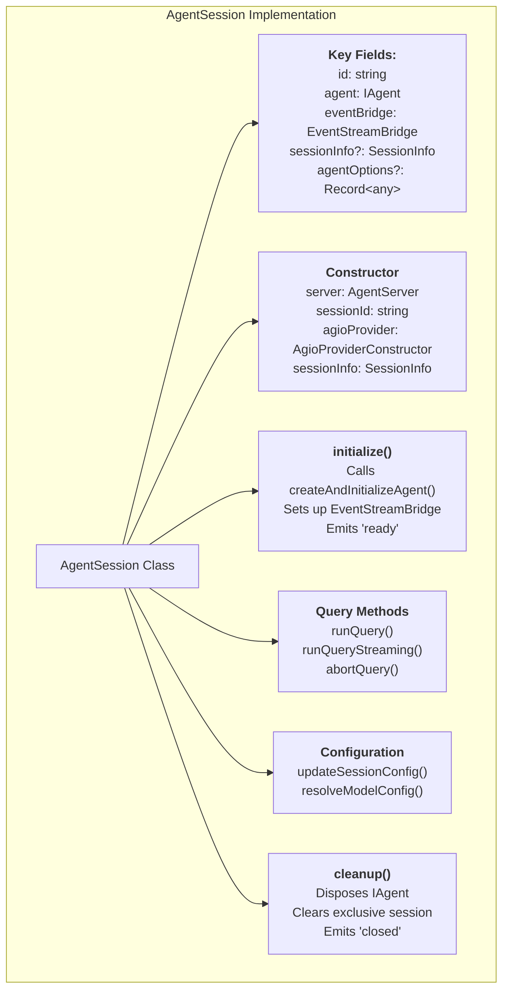
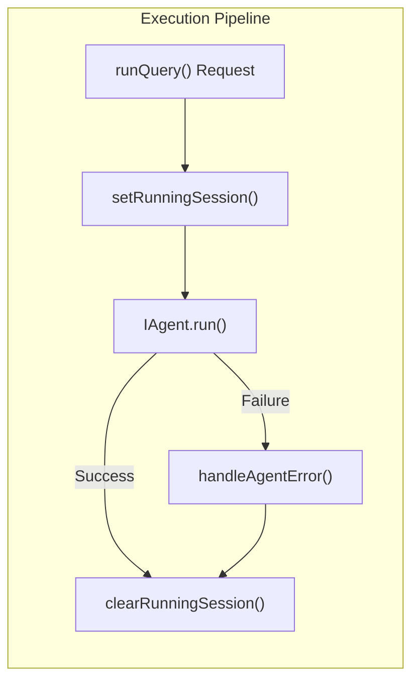

<!-- source: DeepWiki mcp.deepwiki.com · repo bytedance/UI-TARS-desktop · extra page AgentSession Lifecycle and Management · fetched 2026-10-30 -->

# AgentSession Lifecycle and Management

<details>
<summary>Relevant source files</summary>

The following files were used as context for generating this wiki page:

- [multimodal/omni-tars/mcp-agent/examples/mcp.ts](multimodal/omni-tars/mcp-agent/examples/mcp.ts)
- [multimodal/tarko/agent-server-next/examples/bootstrap.ts](multimodal/tarko/agent-server-next/examples/bootstrap.ts)
- [multimodal/tarko/agent-server-next/package.json](multimodal/tarko/agent-server-next/package.json)
- [multimodal/tarko/agent-server-next/src/controllers/sessions.ts](multimodal/tarko/agent-server-next/src/controllers/sessions.ts)
- [multimodal/tarko/agent-server-next/src/controllers/system.ts](multimodal/tarko/agent-server-next/src/controllers/system.ts)
- [multimodal/tarko/agent-server-next/src/routes/sessions.ts](multimodal/tarko/agent-server-next/src/routes/sessions.ts)
- [multimodal/tarko/agent-server-next/src/routes/system.ts](multimodal/tarko/agent-server-next/src/routes/system.ts)
- [multimodal/tarko/agent-server-next/src/services/session/AgentSession.ts](multimodal/tarko/agent-server-next/src/services/session/AgentSession.ts)
- [multimodal/tarko/agent-server-next/src/services/session/AgentSessionFactory.ts](multimodal/tarko/agent-server-next/src/services/session/AgentSessionFactory.ts)
- [multimodal/tarko/agent-server-next/src/utils/logger.ts](multimodal/tarko/agent-server-next/src/utils/logger.ts)
- [multimodal/tarko/agent-server/src/api/controllers/oneshot.ts](multimodal/tarko/agent-server/src/api/controllers/oneshot.ts)
- [multimodal/tarko/agent-server/src/api/controllers/sessions.ts](multimodal/tarko/agent-server/src/api/controllers/sessions.ts)
- [multimodal/tarko/agent-server/src/api/controllers/system.ts](multimodal/tarko/agent-server/src/api/controllers/system.ts)
- [multimodal/tarko/agent-server/src/api/routes/system.ts](multimodal/tarko/agent-server/src/api/routes/system.ts)
- [multimodal/tarko/agent-server/src/core/AgentSession.ts](multimodal/tarko/agent-server/src/core/AgentSession.ts)
- [multimodal/tarko/agent-server/src/server.ts](multimodal/tarko/agent-server/src/server.ts)
- [multimodal/tarko/agent-server/src/storage/SQLiteStorageProvider.ts](multimodal/tarko/agent-server/src/storage/SQLiteStorageProvider.ts)
- [multimodal/tarko/agent-server/src/storage/compatibility.ts](multimodal/tarko/agent-server/src/storage/compatibility.ts)
- [multimodal/tarko/agent-server/src/storage/types.ts](multimodal/tarko/agent-server/src/storage/types.ts)
- [multimodal/tarko/agent-ui/src/common/services/apiService.ts](multimodal/tarko/agent-ui/src/common/services/apiService.ts)
- [multimodal/tarko/interface/src/server.ts](multimodal/tarko/interface/src/server.ts)

</details>


This document details the `AgentSession` class, which represents a single agent execution context in the Tarko server framework. It covers session creation, initialization, agent management, query execution, configuration updates, and cleanup procedures.

**Scope**: This page focuses on the internal lifecycle of `AgentSession` instances. For REST API endpoints that interact with sessions, see [multimodal/tarko/agent-server/src/api/controllers/sessions.ts](). For event flow architecture and persistence details, see [multimodal/tarko/agent-server/src/core/AgentSession.ts]().

## AgentSession Class Overview

The `AgentSession` class manages the complete lifecycle of a single agent instance, including event streaming, storage integration, and AGIO monitoring. Each session has a unique ID and maintains its own agent instance, event bridge, and configuration.

### System Mapping: Code Entity Space
The following diagram maps high-level session concepts to the specific code entities that implement them.



**Sources**: [multimodal/tarko/agent-server/src/core/AgentSession.ts:65-90](), [multimodal/tarko/agent-server-next/src/services/session/AgentSession.ts:67-95]()

### Core Responsibilities

The `AgentSession` class has five primary responsibilities:

| Responsibility | Implementation |
|---------------|----------------|
| **Agent Instance Management** | Creates, wraps, initializes, and disposes `IAgent` instances |
| **Event Stream Bridging** | Connects agent events to clients via `EventStreamBridge` |
| **Query Processing** | Handles both streaming and non-streaming query execution |
| **Event Persistence** | Filters and saves events to storage via `StorageProvider` or `DAOFactory` |
| **AGIO Monitoring** | Processes agent events through `AgioProvider` if configured |

**Sources**: [multimodal/tarko/agent-server/src/core/AgentSession.ts:56-64](), [multimodal/tarko/agent-server-next/src/services/session/AgentSession.ts:58-66]()

## Session Creation and Initialization Flow

Session creation follows a multi-phase process that separates construction from initialization to enable proper event stream setup before the agent processes initial events.

### Phase 1: Constructor

The constructor performs minimal setup, deferring agent creation to the `initialize()` method:
- Stores `AgentServer` reference, session ID, and configuration parameters [multimodal/tarko/agent-server/src/core/AgentSession.ts:81-87]().
- Creates `EventStreamBridge` for client communication [multimodal/tarko/agent-server/src/core/AgentSession.ts:84]().
- Sets `agentOptions` for one-time initialization options passed from the API request [multimodal/tarko/agent-server/src/api/controllers/sessions.ts:103]().

**Sources**: [multimodal/tarko/agent-server/src/core/AgentSession.ts:76-90](), [multimodal/tarko/agent-server-next/src/services/session/AgentSession.ts:80-95](), [multimodal/tarko/agent-server/src/api/controllers/sessions.ts:98-104]()

### Phase 2: Initialize Method

The `initialize()` method orchestrates complete agent creation with proper event stream timing.

```mermaid
sequenceDiagram
    participant Controller as "sessions.ts (Controller)"
    participant Session as "AgentSession"
    participant Create as "createAndInitializeAgent"
    participant Agent as "IAgent"
    participant Storage as "StorageProvider/DAO"
    
    Controller->>Session: initialize()
    Session->>Create: createAndInitializeAgent(sessionInfo)
    
    Note over Create: Load History
    Create->>Storage: getSessionEvents(this.id)
    Storage-->>Create: storedEvents[]
    
    Note over Create: Build Options
    Create->>Create: Merge baseConfig + runtimeSettings + agentOptions
    Create->>Create: new agentConstructor(mergedOptions)
    
    Note over Create: Setup Event Pipeline
    Create->>Create: getEventStream()
    Create->>Create: createEventHandler() for Storage/AGIO
    
    Note over Create: Agent Boot
    Create->>Agent: initialize()
    Agent-->>Create: Initialized
    
    Create-->>Session: wrappedAgent
    Session->>Session: eventBridge.emit('ready')
    Session-->>Controller: { storageUnsubscribe }
```

**Critical Timing**: Event streams are connected via `createEventHandler` **before** calling `agent.initialize()` [multimodal/tarko/agent-server/src/core/AgentSession.ts:197-200](). This ensures that any events emitted during the agent's internal initialization (like tool discovery) are properly persisted to the database.

**Sources**: [multimodal/tarko/agent-server/src/core/AgentSession.ts:92-107](), [multimodal/tarko/agent-server/src/core/AgentSession.ts:152-242](), [multimodal/tarko/agent-server-next/src/services/session/AgentSession.ts:98-113]()

### Pending Event Saves

The session tracks pending event save operations to ensure all initialization events are persisted before returning to the controller:

```typescript
// From multimodal/tarko/agent-server/src/core/AgentSession.ts:112-137
private createEventHandler() {
  return async (event: AgentEventStream.Event) => {
    if (this.server.storageProvider && shouldStoreEvent(event)) {
      const savePromise = this.server.storageProvider.saveEvent(this.id, event)
        .finally(() => this.pendingEventSaves.delete(savePromise));
      this.pendingEventSaves.add(savePromise);
    }
  };
}
```

Controllers call `waitForEventSavesToComplete()` after initialization to ensure events are available before returning to the client [multimodal/tarko/agent-server/src/api/controllers/sessions.ts:118-121]().

**Sources**: [multimodal/tarko/agent-server/src/core/AgentSession.ts:143-147](), [multimodal/tarko/agent-server-next/src/services/session/AgentSession.ts:149-153]()

## Agent Configuration and Resolution

### Agent Creation with Options Merging

The `createAndInitializeAgent` method builds final agent options by merging multiple sources:

1.  **Base options**: Derived from `this.server.appConfig` [multimodal/tarko/agent-server/src/core/AgentSession.ts:165-170]().
2.  **Transformed runtime settings**: User-configured settings (e.g., `agentMode`) transformed via the `runtimeSettings.transform` function [multimodal/tarko/agent-server/src/core/AgentSession.ts:173-182]().
3.  **One-time agent options**: Options passed during the specific session creation call [multimodal/tarko/agent-server/src/core/AgentSession.ts:188]().
4.  **Initial events**: Stored events retrieved from the database to allow the agent to reconstruct state [multimodal/tarko/agent-server/src/core/AgentSession.ts:169]().

**Sources**: [multimodal/tarko/agent-server/src/core/AgentSession.ts:164-189](), [multimodal/tarko/agent-server-next/src/services/session/AgentSession.ts:171-197]()

### Model Configuration Resolution

Model resolution follows a fallback hierarchy:
1.  **Session-specific model**: From `sessionInfo.metadata.modelConfig` [multimodal/tarko/agent-server/src/core/AgentSession.ts:246-254]().
2.  **Default model**: Resolved via `getDefaultModel(this.server.appConfig)` [multimodal/tarko/agent-server/src/core/AgentSession.ts:267]().

**Sources**: [multimodal/tarko/agent-server/src/core/AgentSession.ts:244-268](), [multimodal/tarko/agent-server-next/src/services/session/AgentSession.ts:251-275]()

## Query Execution Lifecycle

### Query Processing Flow
The `runQuery` and `runQueryStreaming` methods manage the interaction between the HTTP request and the `IAgent` runner.



- **Exclusive Mode**: The `AgentServer` tracks the `runningSessionId` to prevent concurrent execution in exclusive mode [multimodal/tarko/agent-server/src/server.ts:157-164]().
- **Error Handling**: Errors are caught and processed by `handleAgentError`, which maps internal errors to `ErrorWithCode` for client responses [multimodal/tarko/agent-server/src/core/AgentSession.ts:358-373]().

**Sources**: [multimodal/tarko/agent-server/src/core/AgentSession.ts:311-446](), [multimodal/tarko/agent-server-next/src/services/session/AgentSession.ts:318-453]()

## Session Configuration Updates

### Dynamic Reconfiguration
The `updateSessionConfig` method allows the agent to be recreated with new configuration (e.g., switching models or runtime settings) while preserving the session ID:
1.  Disposes the current agent instance [multimodal/tarko/agent-server/src/core/AgentSession.ts:522]().
2.  Cleans up existing AGIO providers [multimodal/tarko/agent-server/src/core/AgentSession.ts:524]().
3.  Re-runs `createAndInitializeAgent` with the updated `SessionInfo` [multimodal/tarko/agent-server/src/core/AgentSession.ts:527]().

**Sources**: [multimodal/tarko/agent-server/src/core/AgentSession.ts:512-533](), [multimodal/tarko/agent-server-next/src/services/session/AgentSession.ts:519-540]()

## Cleanup and Resource Management

The `cleanup` method performs orderly shutdown:
1.  Clears the server's exclusive session lock via `clearRunningSession` [multimodal/tarko/agent-server/src/core/AgentSession.ts:546]().
2.  Unsubscribes from the agent's event stream [multimodal/tarko/agent-server/src/core/AgentSession.ts:549]().
3.  Calls `agent.dispose()` to release underlying resources [multimodal/tarko/agent-server/src/core/AgentSession.ts:553]().
4.  Emits a `closed` event via the event bridge [multimodal/tarko/agent-server/src/core/AgentSession.ts:566]().

**Sources**: [multimodal/tarko/agent-server/src/core/AgentSession.ts:545-567](), [multimodal/tarko/agent-server-next/src/services/session/AgentSession.ts:552-574]()

## Session Factory and Sandbox Integration (Next-Gen)

In the `agent-server-next` implementation, `AgentSessionFactory` manages the creation of sessions with integrated sandbox allocation.

- **Sandbox Allocation**: During `createSession`, the `SandboxScheduler` is called to provision an isolated environment [multimodal/tarko/agent-server-next/src/services/session/AgentSessionFactory.ts:66-75](). The resulting `sandboxUrl` is stored in the session metadata [multimodal/tarko/agent-server-next/src/services/session/AgentSessionFactory.ts:99]().
- **Restoration**: `restoreSession` checks if a sandbox instance still exists via `checkInstanceExist(old_sandboxUrl)` [multimodal/tarko/agent-server-next/src/services/session/AgentSessionFactory.ts:160](). If not, it reallocates one and updates the session metadata before re-initializing the agent [multimodal/tarko/agent-server-next/src/services/session/AgentSessionFactory.ts:168-174]().

**Sources**: [multimodal/tarko/agent-server-next/src/services/session/AgentSessionFactory.ts:29-205]()

## Event Filtering for Storage

The `shouldStoreEvent` function determines which events are persisted to storage. It filters out high-frequency streaming events to prevent performance degradation during replay and to save storage space.

| Filtered (Streaming) Events | Stored (Structural) Events |
|-----------------------------|---------------------------|
| `assistant_streaming_message` | `assistant_message` |
| `assistant_streaming_thinking_message` | `agent_status` |
| `assistant_streaming_tool_call` | `tool_call` |
| `final_answer_streaming` | `tool_result` |

**Sources**: [multimodal/tarko/agent-server/src/core/AgentSession.ts:30-40](), [multimodal/tarko/agent-server-next/src/services/session/AgentSession.ts:32-42]()

---

