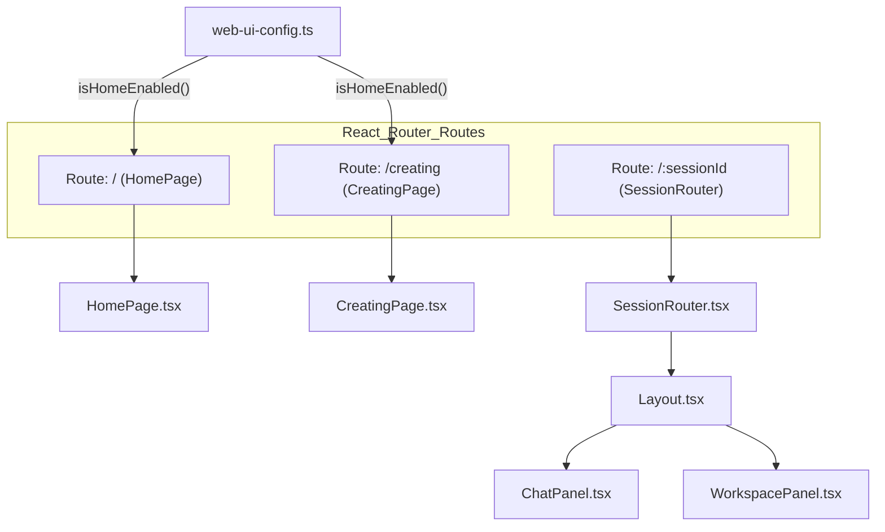
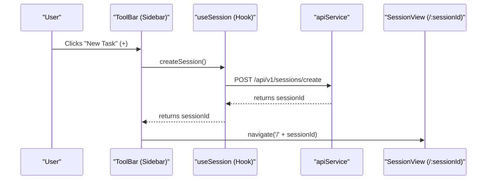
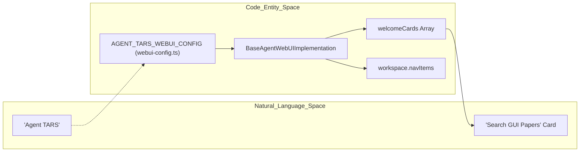

<!-- source: DeepWiki mcp.deepwiki.com · repo bytedance/UI-TARS-desktop · extra page Application Structure and Routing · fetched 2026-10-30 -->

# Application Structure and Routing

<details>
<summary>Relevant source files</summary>

The following files were used as context for generating this wiki page:

- [multimodal/agent-tars/core/src/webui-config.ts](multimodal/agent-tars/core/src/webui-config.ts)
- [multimodal/tarko/agent-ui/rsbuild.config.ts](multimodal/tarko/agent-ui/rsbuild.config.ts)
- [multimodal/tarko/agent-ui/src/common/components/JsonRenderer.tsx](multimodal/tarko/agent-ui/src/common/components/JsonRenderer.tsx)
- [multimodal/tarko/agent-ui/src/common/constants/index.ts](multimodal/tarko/agent-ui/src/common/constants/index.ts)
- [multimodal/tarko/agent-ui/src/common/state/actions/connectionActions.ts](multimodal/tarko/agent-ui/src/common/state/actions/connectionActions.ts)
- [multimodal/tarko/agent-ui/src/common/state/actions/eventProcessors/EventHandlerRegistry.ts](multimodal/tarko/agent-ui/src/common/state/actions/eventProcessors/EventHandlerRegistry.ts)
- [multimodal/tarko/agent-ui/src/common/state/actions/eventProcessors/handlers/RawEventsHandler.ts](multimodal/tarko/agent-ui/src/common/state/actions/eventProcessors/handlers/RawEventsHandler.ts)
- [multimodal/tarko/agent-ui/src/common/state/actions/eventProcessors/index.ts](multimodal/tarko/agent-ui/src/common/state/actions/eventProcessors/index.ts)
- [multimodal/tarko/agent-ui/src/common/state/atoms/eventStreamModal.ts](multimodal/tarko/agent-ui/src/common/state/atoms/eventStreamModal.ts)
- [multimodal/tarko/agent-ui/src/common/types/env.d.ts](multimodal/tarko/agent-ui/src/common/types/env.d.ts)
- [multimodal/tarko/agent-ui/src/config/config-loader.ts](multimodal/tarko/agent-ui/src/config/config-loader.ts)
- [multimodal/tarko/agent-ui/src/config/web-ui-config.ts](multimodal/tarko/agent-ui/src/config/web-ui-config.ts)
- [multimodal/tarko/agent-ui/src/config/webui-config-provider.tsx](multimodal/tarko/agent-ui/src/config/webui-config-provider.tsx)
- [multimodal/tarko/agent-ui/src/entry.tsx](multimodal/tarko/agent-ui/src/entry.tsx)
- [multimodal/tarko/agent-ui/src/standalone/app/App.tsx](multimodal/tarko/agent-ui/src/standalone/app/App.tsx)
- [multimodal/tarko/agent-ui/src/standalone/app/Layout/index.tsx](multimodal/tarko/agent-ui/src/standalone/app/Layout/index.tsx)
- [multimodal/tarko/agent-ui/src/standalone/app/index.tsx](multimodal/tarko/agent-ui/src/standalone/app/index.tsx)
- [multimodal/tarko/agent-ui/src/standalone/modals/EventStreamModal.tsx](multimodal/tarko/agent-ui/src/standalone/modals/EventStreamModal.tsx)
- [multimodal/tarko/agent-ui/src/standalone/share/shareService.ts](multimodal/tarko/agent-ui/src/standalone/share/shareService.ts)
- [multimodal/tarko/agent-ui/src/standalone/sidebar/ToolBar.tsx](multimodal/tarko/agent-ui/src/standalone/sidebar/ToolBar.tsx)
- [multimodal/tarko/shared-utils/src/index.ts](multimodal/tarko/shared-utils/src/index.ts)

</details>


This page documents the React-based application architecture and routing system of the Tarko Agent Web UI (`@tarko/agent-ui`). It details the React Router setup, the `App` component's conditional rendering logic, the intermediate session creation flow, and the layout components that form the user interface.

## Overview

The Web UI is a single-page application (SPA) built with React and [Jotai](https://jotai.org/) for state management. It uses `react-router-dom` v6 for client-side navigation. The application's structure is highly dynamic, driven by the `BaseAgentWebUIImplementation` configuration defined in the agent packages and loaded via `getWebUIConfig` [multimodal/tarko/agent-ui/src/config/web-ui-config.ts:14-17]().

Key structural features include:
- **Dynamic Routing**: Routes for the Home page and Session Creation are conditionally registered based on `LayoutConfig` [multimodal/tarko/agent-ui/src/standalone/app/App.tsx:59-88]().
- **Layout Modes**: Supports standard and `narrow-chat` modes, with optional sidebars and navbars configured through `getLayoutConfig` [multimodal/tarko/agent-ui/src/config/web-ui-config.ts:115-124]().
- **Replay Mode**: A specialized execution path that renders a read-only UI for recorded sessions without requiring a live server connection [multimodal/tarko/agent-ui/src/standalone/app/App.tsx:44-55]().
- **Connection Monitoring**: An automated system initialized via `initConnectionMonitoringAction` that synchronizes server state, agent options, and session lists with Jotai atoms [multimodal/tarko/agent-ui/src/common/state/actions/connectionActions.ts:62-75]().

Sources: [multimodal/tarko/agent-ui/src/standalone/app/App.tsx:1-105](), [multimodal/tarko/agent-ui/src/config/web-ui-config.ts:115-152](), [multimodal/tarko/agent-ui/src/common/state/actions/connectionActions.ts:9-57]()

---

## Route Architecture

The `App` component defines the top-level routing structure. It utilizes utility functions from `web-ui-config.ts` to fetch settings from the global configuration loader.

### Route Definitions

| Path | Component | Description | Conditional Logic |
| :--- | :--- | :--- | :--- |
| `/` | `HomePage` | Landing page featuring `WelcomeCards` and `ChatInput`. | `homeEnabled` (via `isHomeEnabled()`) [multimodal/tarko/agent-ui/src/standalone/app/App.tsx:60]() |
| `/creating` | `CreatingPage` | Intermediate state handling session initialization. | `homeEnabled` (via `isHomeEnabled()`) [multimodal/tarko/agent-ui/src/standalone/app/App.tsx:75]() |
| `/:sessionId` | `SessionRouter` | Main chat interface for an active agent session. | Always Registered [multimodal/tarko/agent-ui/src/standalone/app/App.tsx:89-102]() |

**App Route Visualization**



Sources: [multimodal/tarko/agent-ui/src/standalone/app/App.tsx:57-103](), [multimodal/tarko/agent-ui/src/config/web-ui-config.ts:149-152]()

---

## Session Creation and Navigation Flow

A critical aspect of the application structure is how it transitions from a "Natural Language" intent (a prompt) to a "Code Entity" (a session). The `ToolBar` within the `Sidebar` facilitates this by triggering session creation.

### The ToolBar Logic
The `ToolBar` component handles the creation of new sessions through the `handleNewSession` callback, which invokes the `createSession` hook and navigates to the resulting ID [multimodal/tarko/agent-ui/src/standalone/sidebar/ToolBar.tsx:35-47]().

**Data Flow: Prompt to Session**



Sources: [multimodal/tarko/agent-ui/src/standalone/sidebar/ToolBar.tsx:35-47](), [multimodal/tarko/agent-ui/src/common/constants/index.ts:18](), [multimodal/tarko/agent-ui/src/standalone/app/App.tsx:89-102]()

---

## Layout and Workspace Components

### The Shell and Panels
The `Layout` component ([multimodal/tarko/agent-ui/src/standalone/app/Layout/index.tsx]()) splits the screen into a `ChatPanel` and a `WorkspacePanel`. The proportions are controlled by `layoutModeAtom`, which supports:
- **`default`**: Equal split (50/50) [multimodal/tarko/agent-ui/src/standalone/app/Layout/index.tsx:53-67]().
- **`narrow-chat`**: Chat takes 33.3%, Workspace takes 66.6% [multimodal/tarko/agent-ui/src/standalone/app/Layout/index.tsx:54-68]().

### Navigation and Workspace Items
The `getWorkspaceNavItems` utility retrieves items defined in the `AgentWebUIImplementation` config. These items allow the agent to expose external tools within the UI [multimodal/tarko/agent-ui/src/config/web-ui-config.ts:86-96]().

### The ToolBar
Located within the `Sidebar`, the `ToolBar` provides global actions:
- **New Session**: Triggers `createSession()` via `handleNewSession` [multimodal/tarko/agent-ui/src/standalone/sidebar/ToolBar.tsx:35-47]().
- **Event Stream Viewer**: A debugging tool enabled by `isEventStreamViewerEnabled()` that opens the `EventStreamModal` [multimodal/tarko/agent-ui/src/standalone/sidebar/ToolBar.tsx:128-145]().
- **Layout Switch**: Allows users to toggle between layout modes if `enableLayoutSwitchButton` is true [multimodal/tarko/agent-ui/src/standalone/sidebar/ToolBar.tsx:148]().

**Entity Mapping: UI to Code Configuration**



Sources: [multimodal/tarko/agent-ui/src/standalone/app/Layout/index.tsx:43-98](), [multimodal/tarko/agent-ui/src/standalone/sidebar/ToolBar.tsx:21-166](), [multimodal/agent-tars/core/src/webui-config.ts:11-138](), [multimodal/tarko/agent-ui/src/config/web-ui-config.ts:86-96]()

---

## Replay Mode Structure

When `isReplayMode` is active, the `App` component renders a specialized layout that omits standard session management and connection monitoring.

**Replay Mode Logic**
```typescript
// [multimodal/tarko/agent-ui/src/standalone/app/App.tsx:44-55]
if (isReplayMode) {
  return (
    <div className="flex h-screen ...">
      {sidebarEnabled && <Sidebar />}
      <div className="flex-1 flex flex-col overflow-hidden">
        <Navbar />
        <Layout isReplayMode={true} />
      </div>
    </div>
  );
}
```

In this mode:
- The `initConnectionMonitoring` hook exits early to prevent unnecessary network activity [multimodal/tarko/agent-ui/src/standalone/app/App.tsx:21-24]().
- Event processors skip streaming events (e.g., `assistant_streaming_message`) to rely solely on completed state [multimodal/tarko/agent-ui/src/common/state/actions/eventProcessors/index.ts:14-24]().
- The `Layout` component receives the `isReplayMode` prop, which is used to adjust styling (e.g., adding margins) [multimodal/tarko/agent-ui/src/standalone/app/Layout/index.tsx:44-46]().

Sources: [multimodal/tarko/agent-ui/src/standalone/app/App.tsx:20-55](), [multimodal/tarko/agent-ui/src/standalone/app/Layout/index.tsx:26-47](), [multimodal/tarko/agent-ui/src/common/state/actions/eventProcessors/index.ts:14-24]()

---

