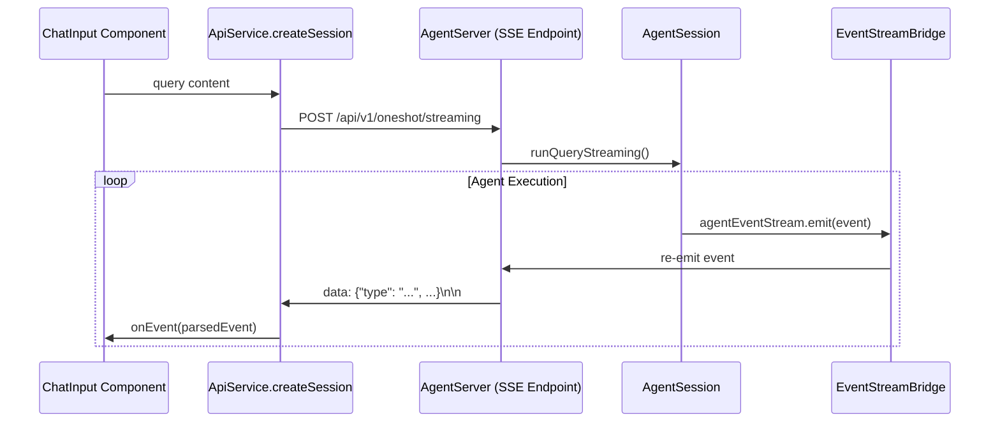

<!-- source: DeepWiki mcp.deepwiki.com · repo bytedance/UI-TARS-desktop · extra page Event Flow and Persistence Architecture · fetched 2026-10-30 -->

# Event Flow and Persistence Architecture

<details>
<summary>Relevant source files</summary>

The following files were used as context for generating this wiki page:

- [multimodal/tarko/agent-cli/src/config/display.ts](multimodal/tarko/agent-cli/src/config/display.ts)
- [multimodal/tarko/agent-server/rslib.config.ts](multimodal/tarko/agent-server/rslib.config.ts)
- [multimodal/tarko/agent-server/src/api/controllers/oneshot.ts](multimodal/tarko/agent-server/src/api/controllers/oneshot.ts)
- [multimodal/tarko/agent-server/src/api/controllers/sessions.ts](multimodal/tarko/agent-server/src/api/controllers/sessions.ts)
- [multimodal/tarko/agent-server/src/api/controllers/system.ts](multimodal/tarko/agent-server/src/api/controllers/system.ts)
- [multimodal/tarko/agent-server/src/api/routes/system.ts](multimodal/tarko/agent-server/src/api/routes/system.ts)
- [multimodal/tarko/agent-server/src/core/AgentSession.ts](multimodal/tarko/agent-server/src/core/AgentSession.ts)
- [multimodal/tarko/agent-server/src/server.ts](multimodal/tarko/agent-server/src/server.ts)
- [multimodal/tarko/agent-server/src/storage/DatabaseStorageProvider.ts](multimodal/tarko/agent-server/src/storage/DatabaseStorageProvider.ts)
- [multimodal/tarko/agent-server/src/storage/FileStorageProvider.ts](multimodal/tarko/agent-server/src/storage/FileStorageProvider.ts)
- [multimodal/tarko/agent-server/src/storage/MongoDBStorageProvider/MongoDBSchemas.ts](multimodal/tarko/agent-server/src/storage/MongoDBStorageProvider/MongoDBSchemas.ts)
- [multimodal/tarko/agent-server/src/storage/MongoDBStorageProvider/index.ts](multimodal/tarko/agent-server/src/storage/MongoDBStorageProvider/index.ts)
- [multimodal/tarko/agent-server/src/storage/SQLiteStorageProvider.ts](multimodal/tarko/agent-server/src/storage/SQLiteStorageProvider.ts)
- [multimodal/tarko/agent-server/src/storage/compatibility.ts](multimodal/tarko/agent-server/src/storage/compatibility.ts)
- [multimodal/tarko/agent-server/src/storage/index.ts](multimodal/tarko/agent-server/src/storage/index.ts)
- [multimodal/tarko/agent-server/src/storage/types.ts](multimodal/tarko/agent-server/src/storage/types.ts)
- [multimodal/tarko/agent-server/src/utils/event-stream.ts](multimodal/tarko/agent-server/src/utils/event-stream.ts)
- [multimodal/tarko/agent-ui/src/common/services/apiService.ts](multimodal/tarko/agent-ui/src/common/services/apiService.ts)
- [multimodal/tarko/interface/src/constants.ts](multimodal/tarko/interface/src/constants.ts)
- [multimodal/tarko/interface/src/index.ts](multimodal/tarko/interface/src/index.ts)
- [multimodal/tarko/interface/src/server.ts](multimodal/tarko/interface/src/server.ts)
- [multimodal/tarko/interface/src/storage-implementation.ts](multimodal/tarko/interface/src/storage-implementation.ts)

</details>


This document describes the event flow and persistence architecture in the Tarko Agent Server, detailing how events generated during agent execution are routed to multiple destinations (storage, monitoring, and clients), filtered for persistence, and consumed by web clients in real-time.

For information about the overall session lifecycle and agent initialization, see **4.2.2 AgentSession Lifecycle and Management**. For details on the REST API endpoints that expose event data, see **4.2.3 Session API and REST Endpoints**.

## Event Flow Overview

The Tarko Agent Server implements a multi-path event routing architecture where events generated by agent execution flow through three parallel paths:

1.  **Storage Path**: Filtered events persisted to database for session replay and sharing.
2.  **AGIO Path**: All events sent to monitoring/analytics service.
3.  **SSE Bridge Path**: All events streamed to connected web clients in real-time via `EventStreamBridge`.

Title: "Multi-Path Event Routing Architecture"
```mermaid
graph TB
    subgraph "Agent_Execution_Space"
        [IAgent]
        [AgentEventStream]
    end
    
    subgraph "Event_Generation"
        [user_message]
        [assistant_message]
        [assistant_streaming_message]
        [tool_call]
        [run_end]
    end
    
    subgraph "AgentSession_Logic"
        [AgentSession.createEventHandler]
        [shouldStoreEvent]
    end
    
    subgraph "Routing_Entities"
        [StorageProvider.saveEvent]
        [AgioProvider.processAgentEvent]
        [EventStreamBridge]
    end
    
    subgraph "Persistence_Monitoring"
        [SQLiteStorageProvider]
        [AgioProvider]
        [WebUI_Clients]
    end
    
    [IAgent] --> [AgentEventStream]
    [AgentEventStream] --> [user_message]
    [AgentEventStream] --> [assistant_message]
    [AgentEventStream] --> [assistant_streaming_message]
    [AgentEventStream] --> [tool_call]
    [AgentEventStream] --> [run_end]
    
    [user_message] --> [AgentSession.createEventHandler]
    [assistant_message] --> [AgentSession.createEventHandler]
    [assistant_streaming_message] --> [AgentSession.createEventHandler]
    [tool_call] --> [AgentSession.createEventHandler]
    [run_end] --> [AgentSession.createEventHandler]
    
    [AgentSession.createEventHandler] --> [shouldStoreEvent]
    [shouldStoreEvent] -->|"filtered events"| [StorageProvider.saveEvent]
    [shouldStoreEvent] -->|"all events"| [AgioProvider.processAgentEvent]
    [shouldStoreEvent] -->|"all events"| [EventStreamBridge]
    
    [StorageProvider.saveEvent] --> [SQLiteStorageProvider]
    [AgioProvider.processAgentEvent] --> [AgioProvider]
    [EventStreamBridge] --> [WebUI_Clients]
```
**Sources:** [multimodal/tarko/agent-server/src/core/AgentSession.ts:65-90](), [multimodal/tarko/agent-server/src/core/AgentSession.ts:112-137](), [multimodal/tarko/agent-server/src/utils/event-stream.ts:18-18]()

## Event Types and Filtering

The system distinguishes between **persistent events** (stored for replay) and **streaming events** (only needed for real-time updates). The `shouldStoreEvent` function filters out high-frequency streaming events to prevent performance degradation during session replay and to keep the storage footprint manageable [multimodal/tarko/agent-server/src/core/AgentSession.ts:30-40]().

### Filtered Event Types

The following event types are **excluded** from storage via `shouldStoreEvent` [multimodal/tarko/agent-server/src/core/AgentSession.ts:32-37]():

| Event Type | Purpose | Why Filtered |
| :--- | :--- | :--- |
| `assistant_streaming_message` | Real-time message chunks | Duplicate of final `assistant_message` |
| `assistant_streaming_thinking_message` | Real-time thinking chunks | Duplicate of final thinking content |
| `assistant_streaming_tool_call` | Real-time tool call chunks | Duplicate of final `tool_call` |
| `final_answer_streaming` | Real-time final answer chunks | Duplicate of final content |

Title: "Event Storage Filtering Logic"
```mermaid
graph LR
    subgraph "Classification_shouldStoreEvent"
        [AgentEventStream.Event]
        [IsStreamingType]
        [PersistToStorage]
        [SkipStorage]
    end
    
    [AgentEventStream.Event] --> [IsStreamingType]
    [IsStreamingType] -->|"No"| [PersistToStorage]
    [IsStreamingType] -->|"Yes"| [SkipStorage]
    
    [PersistToStorage] -->|"Stored"| [user_message]
    [PersistToStorage] --> [assistant_message]
    [PersistToStorage] --> [tool_call]
    [PersistToStorage] --> [tool_result]
    
    [SkipStorage] -->|"Ephemeral"| [assistant_streaming_message]
    [SkipStorage] --> [assistant_streaming_thinking_message]
    [SkipStorage] --> [assistant_streaming_tool_call]
```
**Sources:** [multimodal/tarko/agent-server/src/core/AgentSession.ts:30-40]()

## Multi-Path Event Routing Implementation

### Event Handler Creation

The `AgentSession` class creates an asynchronous event handler that implements the multi-path routing logic. This handler is executed whenever an event is emitted from the agent [multimodal/tarko/agent-server/src/core/AgentSession.ts:112-113]().

Title: "AgentSession Event Handler Internals"
```mermaid
graph TB
    subgraph "AgentSession.createEventHandler"
        [HandlerFunction]
        
        subgraph "Storage_Logic"
            [StorageExists]
            [ShouldStore]
            [saveEvent]
            [pendingEventSaves.add]
        end
        
        subgraph "AGIO_Monitoring"
            [AgioProviderExists]
            [processAgentEvent]
        end
        
        [LogError]
    end
    
    [HandlerFunction] --> [StorageExists]
    [StorageExists] -->|"Yes"| [ShouldStore]
    [ShouldStore] -->|"Yes"| [saveEvent]
    [saveEvent] --> [pendingEventSaves.add]
    [ShouldStore] -->|"No"| [AgioProviderExists]
    [StorageExists] -->|"No"| [AgioProviderExists]
    
    [AgioProviderExists] -->|"Yes"| [processAgentEvent]
    [processAgentEvent] --> [LogError]
    [AgioProviderExists] -->|"No"| [LogError]
```
**Sources:** [multimodal/tarko/agent-server/src/core/AgentSession.ts:112-137]()

### Pending Event Saves Tracking

To ensure all events are persisted before querying storage (e.g., when returning the initial event list during session creation), the system tracks pending save operations in a `Set` of promises [multimodal/tarko/agent-server/src/core/AgentSession.ts:74](). The `waitForEventSavesToComplete` method is used to block until all asynchronous I/O operations are finished [multimodal/tarko/agent-server/src/core/AgentSession.ts:143-147](). This is explicitly called during session creation to ensure consistency [multimodal/tarko/agent-server/src/api/controllers/sessions.ts:118]().

**Sources:** [multimodal/tarko/agent-server/src/core/AgentSession.ts:115-126](), [multimodal/tarko/agent-server/src/api/controllers/sessions.ts:118-132]()

## Storage Provider Architecture

The `StorageProvider` interface [multimodal/tarko/agent-server/src/storage/types.ts:14-75]() defines the contract for persistence. The server supports multiple backends including Memory, File, MongoDB, and SQLite [multimodal/tarko/agent-server/src/storage/index.ts:19-42]().

### Core Storage Methods
| Method | Description | Source |
| :--- | :--- | :--- |
| `createSession` | Persists initial `SessionInfo` metadata. | [multimodal/tarko/agent-server/src/storage/types.ts:29]() |
| `saveEvent` | Appends a single `AgentEventStream.Event` to a session. | [multimodal/tarko/agent-server/src/storage/types.ts:63]() |
| `getSessionEvents` | Retrieves all persistent events for a specific ID. | [multimodal/tarko/agent-server/src/storage/types.ts:69]() |
| `updateSessionInfo` | Updates metadata like `runtimeSettings` or `modelConfig`. | [multimodal/tarko/agent-server/src/storage/types.ts:36-39]() |

### SQLite Implementation Details
The `SQLiteStorageProvider` manages two primary tables: `sessions` (for metadata) and `events` (for session history) [multimodal/tarko/agent-server/src/storage/SQLiteStorageProvider.ts:85-104](). It includes a robust migration system to transition legacy column-based schemas to a modern JSON metadata design [multimodal/tarko/agent-server/src/storage/SQLiteStorageProvider.ts:170-222]().

**Sources:** [multimodal/tarko/agent-server/src/storage/types.ts:14-75](), [multimodal/tarko/agent-server/src/storage/SQLiteStorageProvider.ts:53-120](), [multimodal/tarko/agent-server/src/api/controllers/sessions.ts:66-95]()

## AGIO Monitoring Integration

The AGIO (Agent I/O) system provides standardized monitoring. When an `agioProvider` is configured via `server.getCustomAgioProvider()`, the session initializes it [multimodal/tarko/agent-server/src/core/AgentSession.ts:70-71]().

Unlike the storage path, AGIO processing receives the raw event stream directly, including streaming events, to provide high-fidelity monitoring [multimodal/tarko/agent-server/src/core/AgentSession.ts:131]().

**Sources:** [multimodal/tarko/agent-server/src/core/AgentSession.ts:128-136](), [multimodal/tarko/agent-server/src/api/controllers/oneshot.ts:49]()

## SSE Streaming and Client-Side Consumption

The server streams events to the Web UI using Server-Sent Events (SSE). The `EventStreamBridge` facilitates this by connecting the `AgentEventStream` to SSE listeners [multimodal/tarko/agent-server/src/utils/event-stream.ts:18]().

### Client-Side API Service
The `ApiService` in the Web UI handles the consumption of these streams. It provides methods for creating sessions and retrieving session events [multimodal/tarko/agent-ui/src/common/services/apiService.ts:139-234](). For one-shot streaming, the controller sets headers for `text/event-stream` and writes chunks as they arrive [multimodal/tarko/agent-server/src/api/controllers/oneshot.ts:145-167]().

Title: "SSE Streaming and Parsing Flow"

**Sources:** [multimodal/tarko/agent-ui/src/common/services/apiService.ts:139-234](), [multimodal/tarko/agent-server/src/api/controllers/oneshot.ts:145-176]()

## Persistence of Runtime Settings

Runtime settings are persisted within the `SessionInfo` metadata [multimodal/tarko/agent-server/src/api/controllers/sessions.ts:84-86](). When a user changes a setting in the UI, the following flow occurs:

1.  **Server Update**: The `updateRuntimeSettings` controller updates the database via `storageProvider.updateSessionInfo` [multimodal/tarko/agent-server/src/api/controllers/system.ts:115-120]().
2.  **Dynamic Reconfiguration**: If the session is active, `activeSession.updateSessionConfig` is called to recreate the agent with the new settings [multimodal/tarko/agent-server/src/api/controllers/system.ts:132]().

**Sources:** [multimodal/tarko/agent-server/src/api/controllers/system.ts:88-148](), [multimodal/tarko/agent-server/src/api/routes/system.ts:24-25]()

---

