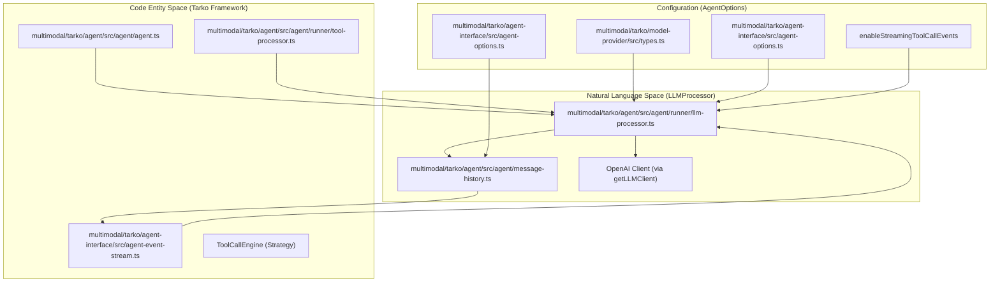
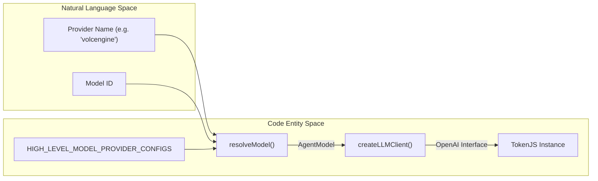
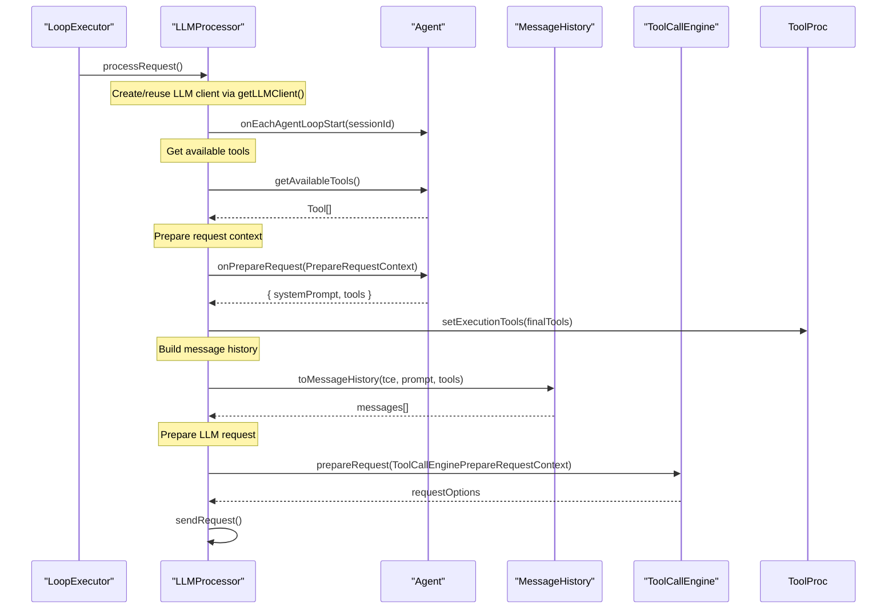
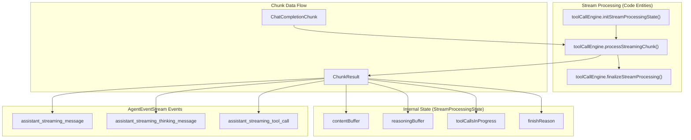

<!-- source: DeepWiki mcp.deepwiki.com · repo bytedance/UI-TARS-desktop · extra page LLM Processing and Streaming Pipeline · fetched 2026-10-30 -->

# LLM Processing and Streaming Pipeline

<details>
<summary>Relevant source files</summary>

The following files were used as context for generating this wiki page:

- [.secretlintrc.json](.secretlintrc.json)
- [multimodal/tarko/agent-interface/src/agent-event-stream.ts](multimodal/tarko/agent-interface/src/agent-event-stream.ts)
- [multimodal/tarko/agent-interface/src/agent-options.ts](multimodal/tarko/agent-interface/src/agent-options.ts)
- [multimodal/tarko/agent-snapshot/src/utils/snapshot-normalizer.ts](multimodal/tarko/agent-snapshot/src/utils/snapshot-normalizer.ts)
- [multimodal/tarko/agent/snapshot/__snapshots__/index.test.ts.snap](multimodal/tarko/agent/snapshot/__snapshots__/index.test.ts.snap)
- [multimodal/tarko/agent/src/agent/agent-runner.ts](multimodal/tarko/agent/src/agent/agent-runner.ts)
- [multimodal/tarko/agent/src/agent/agent.ts](multimodal/tarko/agent/src/agent/agent.ts)
- [multimodal/tarko/agent/src/agent/runner/llm-processor.ts](multimodal/tarko/agent/src/agent/runner/llm-processor.ts)
- [multimodal/tarko/agent/src/utils/llm-requester.ts](multimodal/tarko/agent/src/utils/llm-requester.ts)
- [multimodal/tarko/agent/src/utils/tool-filter.ts](multimodal/tarko/agent/src/utils/tool-filter.ts)
- [multimodal/tarko/agent/tests/agent/kernel/agent.test.ts](multimodal/tarko/agent/tests/agent/kernel/agent.test.ts)
- [multimodal/tarko/agent/tests/agent/llm-processor-usage-streaming.test.ts](multimodal/tarko/agent/tests/agent/llm-processor-usage-streaming.test.ts)
- [multimodal/tarko/model-provider/README.md](multimodal/tarko/model-provider/README.md)
- [multimodal/tarko/model-provider/src/constants.ts](multimodal/tarko/model-provider/src/constants.ts)
- [multimodal/tarko/model-provider/src/index.ts](multimodal/tarko/model-provider/src/index.ts)
- [multimodal/tarko/model-provider/src/llm-client.ts](multimodal/tarko/model-provider/src/llm-client.ts)
- [multimodal/tarko/model-provider/src/model-resolver.ts](multimodal/tarko/model-provider/src/model-resolver.ts)
- [multimodal/tarko/model-provider/src/third-party.ts](multimodal/tarko/model-provider/src/third-party.ts)
- [multimodal/tarko/model-provider/src/types.ts](multimodal/tarko/model-provider/src/types.ts)
- [multimodal/tarko/model-provider/tests/integration.test.ts](multimodal/tarko/model-provider/tests/integration.test.ts)
- [multimodal/tarko/model-provider/tests/llm-client.test.ts](multimodal/tarko/model-provider/tests/llm-client.test.ts)
- [multimodal/tarko/model-provider/tests/model-resolver.test.ts](multimodal/tarko/model-provider/tests/model-resolver.test.ts)

</details>


This document details the LLM processing and streaming pipeline within the Tarko agent framework, specifically focusing on how the `LLMProcessor` class handles communication with language models, processes streaming responses, and emits events for real-time updates.

The `LLMProcessor` is responsible for all LLM interaction within an agent execution loop. It prepares requests using message history and tool definitions, sends requests to LLM providers, processes streaming chunks in real-time, and emits appropriate events for both streaming and non-streaming modes.

---

## LLMProcessor Class Architecture

The `LLMProcessor` class serves as the central coordinator for all LLM communication within an agent's reasoning loop. It orchestrates multiple components to prepare requests, process responses, and emit events.

### LLMProcessor Component Relationships
Title: LLMProcessor Component Relationships

Sources: [multimodal/tarko/agent/src/agent/runner/llm-processor.ts:37-63](), [multimodal/tarko/agent/src/agent/agent.ts:154-168](), [multimodal/tarko/agent-interface/src/agent-options.ts:166-209]()

**Class Initialization**

The `LLMProcessor` is instantiated by the `AgentRunner` with the following key components:

- **MessageHistory**: Manages conversation context and builds message arrays for LLM requests, respecting `maxImagesCount` [multimodal/tarko/agent/src/agent/runner/llm-processor.ts:57-60]().
- **LLM Client**: OpenAI-compatible client for making API requests, created via `getLLMClient`. It can be overridden by a custom client for testing [multimodal/tarko/agent/src/agent/runner/llm-processor.ts:70-81](), [multimodal/tarko/agent/src/agent/runner/llm-processor.ts:122-136]().
- **Event Stream**: For emitting real-time streaming events and final messages [multimodal/tarko/agent/src/agent/runner/llm-processor.ts:47-47]().
- **Tool Processor**: For executing tool calls after they are parsed from LLM responses [multimodal/tarko/agent/src/agent/runner/llm-processor.ts:48-48]().

---

## Model Resolution and Client Creation

The framework uses a `resolveModel` utility to transform high-level provider names into concrete configurations.

Title: Model Resolution and Client Flow

Sources: [multimodal/tarko/model-provider/src/model-resolver.ts:54-90](), [multimodal/tarko/model-provider/src/llm-client.ts:27-85]()

* **resolveModel**: Normalizes provider names (e.g., mapping 'ollama' or 'volcengine' to 'openai' base providers) and injects default base URLs and API keys from `HIGH_LEVEL_MODEL_PROVIDER_CONFIGS` [multimodal/tarko/model-provider/src/model-resolver.ts:54-90]().
* **createLLMClient**: Instantiates a `TokenJS` client, applying custom headers (like `anthropic-beta` for Claude models) and request interceptors [multimodal/tarko/model-provider/src/llm-client.ts:27-85]().

---

## Request Preparation Pipeline

Before sending a request to the LLM, the `LLMProcessor` executes a multi-stage preparation pipeline that builds the complete request context.

Title: Request Preparation Sequence

Sources: [multimodal/tarko/agent/src/agent/runner/llm-processor.ts:94-226](), [multimodal/tarko/agent/src/agent/agent.ts:140-190]()

**Preparation Steps**

1. **LLM Client Creation**: Creates an OpenAI-compatible client via `getLLMClient()` with an interceptor that calls `agent.onLLMRequest()` to allow session tracking [multimodal/tarko/agent/src/agent/runner/llm-processor.ts:122-135]().
2. **Pre-iteration Hook**: Calls `agent.onEachAgentLoopStart(sessionId)` to allow agent-specific setup before each reasoning loop [multimodal/tarko/agent/src/agent/runner/llm-processor.ts:140-140]().
3. **Dynamic Request Modification**: Calls `agent.onPrepareRequest(prepareRequestContext)` which allows runtime modification of the system prompt and tool list based on the current session state [multimodal/tarko/agent/src/agent/runner/llm-processor.ts:172-172]().
4. **Execution Tool Registration**: Sets the final tools in `ToolProcessor` via `setExecutionTools()` [multimodal/tarko/agent/src/agent/runner/llm-processor.ts:181-181]().
5. **Message History Construction**: Calls `messageHistory.toMessageHistory()` to build the message array including multimodal context and system instructions [multimodal/tarko/agent/src/agent/runner/llm-processor.ts:192-196]().

---

## Streaming Response Processing

All LLM requests are made in streaming mode internally (`stream: true`) for optimal performance. The streaming pipeline processes chunks in real-time and accumulates state via the `ToolCallEngine`.

### Streaming State Management

Title: Streaming Chunk Processing Flow

Sources: [multimodal/tarko/agent/src/agent/runner/llm-processor.ts:280-495](), [multimodal/tarko/agent-interface/src/agent-event-stream.ts:48-51]()

### Chunk Processing Details

The `handleStreamingResponse` method processes each chunk and extracts different types of content based on the `ChunkResult` returned by the engine:

| Chunk Result Field | Description | Event Emitted (if streaming) |
|-------------------|-------------|------------------------------|
| `content` | Incremental response content | `assistant_streaming_message` |
| `reasoningContent` | Incremental thinking/reasoning | `assistant_streaming_thinking_message` |
| `streamingToolCallUpdates` | Tool call construction deltas | `assistant_streaming_tool_call` |
| `finishReason` | Completion reason when stream ends | N/A |

Sources: [multimodal/tarko/agent/src/agent/runner/llm-processor.ts:304-383](), [multimodal/tarko/agent-interface/src/agent-event-stream.ts:169-212]()

---

## Event Emission Strategy

The `LLMProcessor` implements a dual-mode event emission strategy to support both live UI updates and long-term conversation memory.

### Message ID Correlation
All streaming events for a single LLM response share the same `messageId` field [multimodal/tarko/agent/src/agent/runner/llm-processor.ts:296-297](). This allows clients to correlate incremental updates with the final message:
* `assistant_streaming_message` [multimodal/tarko/agent-interface/src/agent-event-stream.ts:171-185]()
* `assistant_streaming_thinking_message` [multimodal/tarko/agent-interface/src/agent-event-stream.ts:190-204]()
* `assistant_thinking_message` [multimodal/tarko/agent-interface/src/agent-event-stream.ts:149-166]()
* `assistant_message` [multimodal/tarko/agent-interface/src/agent-event-stream.ts:106-144]()

### Reasoning Completion
When reasoning completes (detected by the transition from reasoning content to response content), the processor immediately emits a final `assistant_thinking_message` event with the complete reasoning buffer and `thinkingDurationMs` [multimodal/tarko/agent/src/agent/runner/llm-processor.ts:336-381]().

---

## Metrics and Timing Tracking

When `enableMetrics` is set to `true` in `AgentOptions`, the `LLMProcessor` tracks performance metrics to benchmark model performance [multimodal/tarko/agent/src/agent/runner/llm-processor.ts:55-62]().

| Metric | Code Symbol | Description |
|--------|-------------|-------------|
| Time to First Token | `ttftMs` | Time from request start to first content chunk [multimodal/tarko/agent-interface/src/agent-event-stream.ts:122-128]() |
| Time to Last Token | `ttltMs` | Time from request start to response completion [multimodal/tarko/agent-interface/src/agent-event-stream.ts:131-137]() |
| Thinking Duration | `thinkingDurationMs` | Total time spent in the reasoning phase [multimodal/tarko/agent-interface/src/agent-event-stream.ts:159-159]() |

Timing metrics are included in the final `assistant_message` event for storage and analytics [multimodal/tarko/agent/src/agent/runner/llm-processor.ts:507-521]().

---

## Usage Extraction from Streaming Responses

LLM providers typically only include usage data in the final chunk of a streaming response. The `LLMProcessor` iterates through the stream and extracts the `usage` field from the final chunk to report token consumption [multimodal/tarko/agent/src/agent/runner/llm-processor.ts:448-474]().

```typescript
// Example of extraction logic in streaming mode
// The last chunk contains prompt_tokens, completion_tokens, and total_tokens
const lastChunk = allChunks[allChunks.length - 1];
const usage = lastChunk?.usage;
```
Sources: [multimodal/tarko/agent/src/agent/runner/llm-processor.ts:448-474](), [multimodal/tarko/agent/tests/agent/llm-processor-usage-streaming.test.ts:15-62]()

---

## Error Handling and Abort Signals

The `LLMProcessor` integrates with the `AgentExecutionController` via `AbortSignal` to ensure that long-running or runaway agent loops can be terminated cleanly.

1. **Pre-request check**: Aborts before sending the request to the LLM client [multimodal/tarko/agent/src/agent/runner/llm-processor.ts:104-107]().
2. **Streaming check**: Aborts the chunk processing loop if the signal is triggered during a response [multimodal/tarko/agent/src/agent/runner/llm-processor.ts:308-312]().
3. **Tool execution check**: Aborts before starting tool processing if the reasoning phase was canceled [multimodal/tarko/agent/src/agent/runner/llm-processor.ts:486-486]().

Sources: [multimodal/tarko/agent/src/agent/runner/llm-processor.ts:104-486](), [multimodal/tarko/agent/src/agent/agent.ts:171-171]()

---

