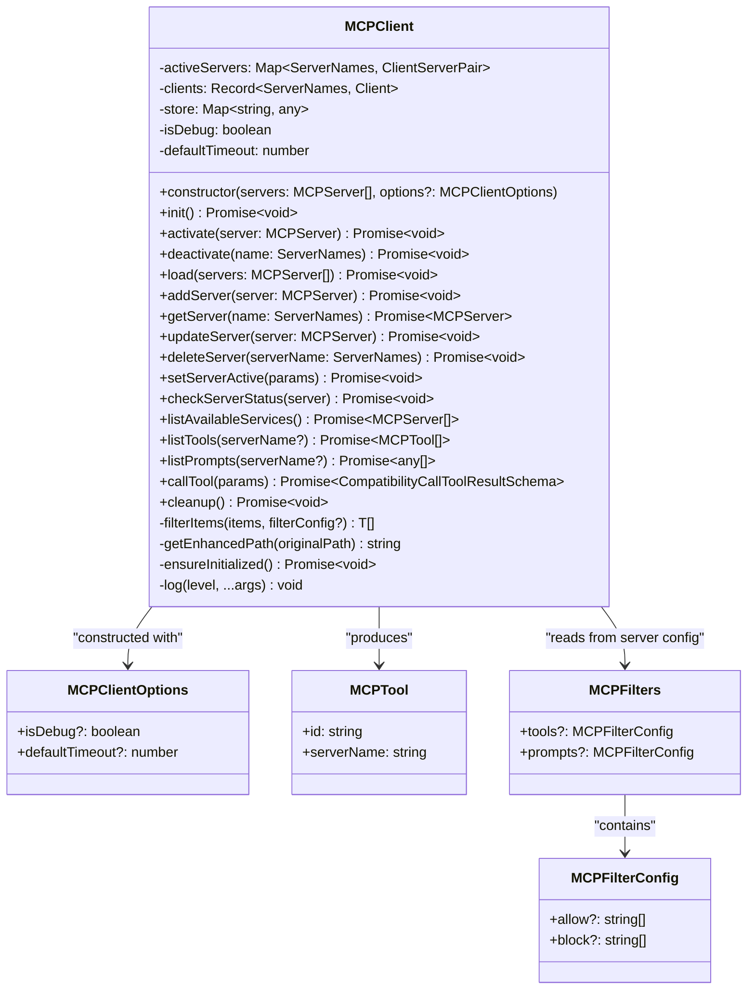
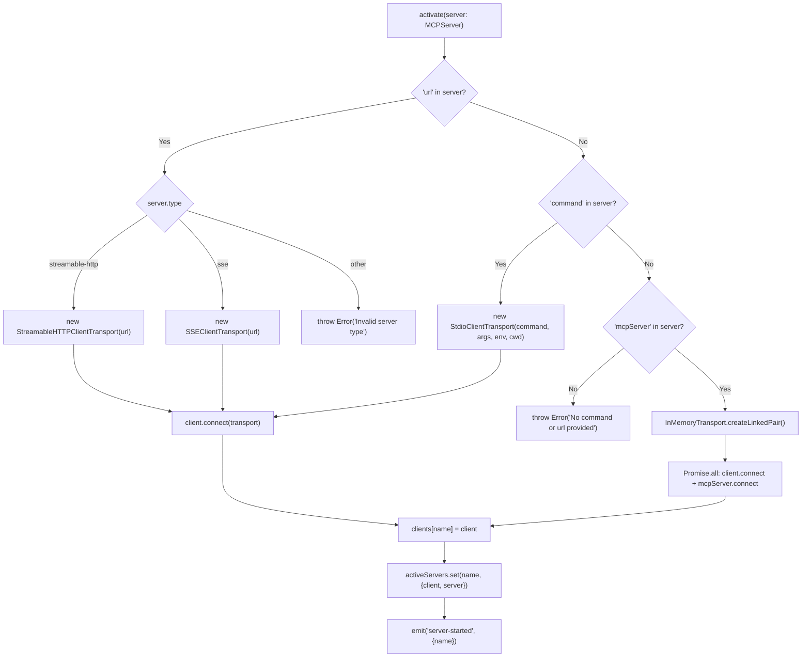
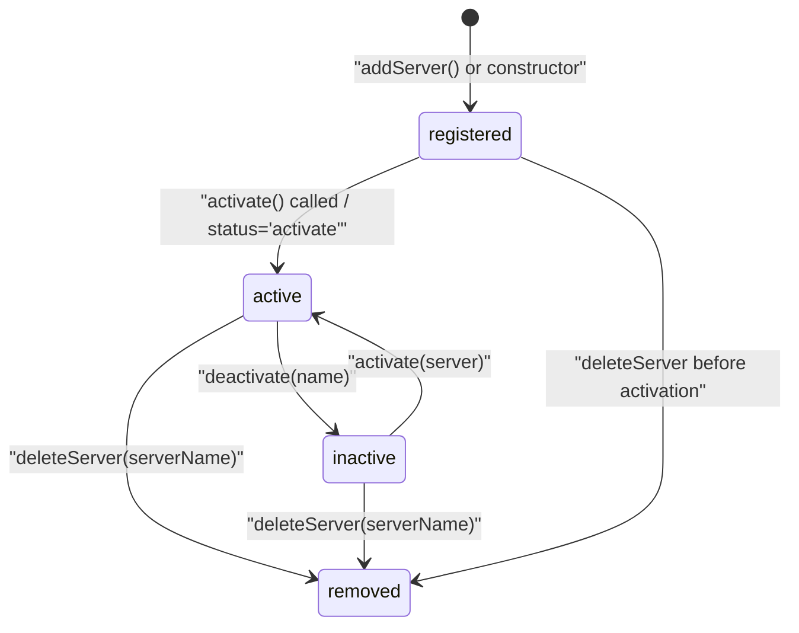
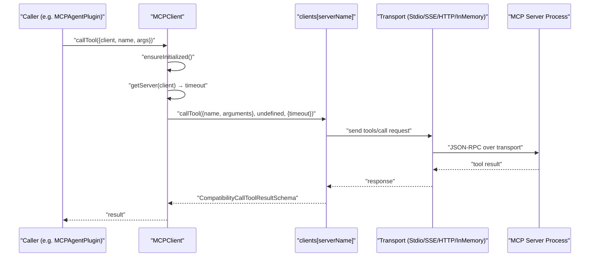

<!-- source: DeepWiki mcp.deepwiki.com · repo bytedance/UI-TARS-desktop · extra page MCP Client Architecture · fetched 2026-10-30 -->

# MCP Client Architecture

<details>
<summary>Relevant source files</summary>

The following files were used as context for generating this wiki page:

- [packages/agent-infra/mcp-client/CHANGELOG.md](packages/agent-infra/mcp-client/CHANGELOG.md)
- [packages/agent-infra/mcp-client/README.md](packages/agent-infra/mcp-client/README.md)
- [packages/agent-infra/mcp-client/package.json](packages/agent-infra/mcp-client/package.json)
- [packages/agent-infra/mcp-client/src/index.ts](packages/agent-infra/mcp-client/src/index.ts)
- [packages/agent-infra/mcp-client/test/index.test.ts](packages/agent-infra/mcp-client/test/index.test.ts)
- [packages/agent-infra/mcp-servers/browser/CHANGELOG.md](packages/agent-infra/mcp-servers/browser/CHANGELOG.md)
- [packages/agent-infra/mcp-servers/browser/package.json](packages/agent-infra/mcp-servers/browser/package.json)
- [packages/agent-infra/mcp-servers/commands/CHANGELOG.md](packages/agent-infra/mcp-servers/commands/CHANGELOG.md)
- [packages/agent-infra/mcp-servers/commands/package.json](packages/agent-infra/mcp-servers/commands/package.json)
- [packages/agent-infra/mcp-servers/filesystem/CHANGELOG.md](packages/agent-infra/mcp-servers/filesystem/CHANGELOG.md)
- [packages/agent-infra/mcp-servers/filesystem/package.json](packages/agent-infra/mcp-servers/filesystem/package.json)
- [packages/agent-infra/mcp-servers/search/CHANGELOG.md](packages/agent-infra/mcp-servers/search/CHANGELOG.md)
- [packages/agent-infra/mcp-servers/search/package.json](packages/agent-infra/mcp-servers/search/package.json)
- [packages/agent-infra/mcp-shared/CHANGELOG.md](packages/agent-infra/mcp-shared/CHANGELOG.md)
- [packages/agent-infra/mcp-shared/package.json](packages/agent-infra/mcp-shared/package.json)
- [packages/agent-infra/mcp-shared/src/client/types.ts](packages/agent-infra/mcp-shared/src/client/types.ts)

</details>


This page documents the `MCPClient` class in `packages/agent-infra/mcp-client`, covering its server lifecycle management, tool/prompt operations, transport selection logic, and filtering system. For an overview of how MCP fits into the larger repository and what MCP servers are available, see [6.1](). For the transport layer details and shared types, see [6.1.3](). For how the MCP agent plugin consumes `MCPClient` within the multimodal agent stack, see [3.5]().

---

## Overview

`MCPClient` is a unified TypeScript class that manages connections to one or more MCP (Model Context Protocol) servers simultaneously. It abstracts over four transport types — in-memory, Stdio, SSE, and Streamable HTTP — behind a single API for listing and calling tools and prompts.

The package is published as `@agent-infra/mcp-client` [[packages/agent-infra/mcp-client/package.json:2-4]]().

Sources: [[packages/agent-infra/mcp-client/package.json:1-4]](), [[packages/agent-infra/mcp-client/README.md:1-18]]()

---

## Core Abstractions

### `MCPServer` Type Union

Server configuration is represented by a discriminated union. Each variant extends `BaseMCPServer` and adds transport-specific fields [[packages/agent-infra/mcp-shared/src/client/types.ts:15-58]]().

| Type | Discriminant field | Required fields | Transport used |
|---|---|---|---|
| `BuiltInMCPServer` | `mcpServer` | `mcpServer: InMemoryMCPServer` | `InMemoryTransport` |
| `StdioMCPServer` | `command` | `command`, `args`, `env?`, `cwd?` | `StdioClientTransport` |
| `SSEMCPServer` | `url` + `type:'sse'` | `url`, `headers?` | `SSEClientTransport` |
| `StreamableHTTPMCPServer` | `url` + `type:'streamable-http'` | `url`, `headers?` | `StreamableHTTPClientTransport` |

All variants share the `BaseMCPServer` fields [[packages/agent-infra/mcp-shared/src/client/types.ts:7-15]]():

| Field | Type | Default | Description |
|---|---|---|---|
| `name` | `string` | required | Unique server identifier |
| `status` | `'activate' \| 'error' \| 'disabled'` | `'activate'` | Initial connection status |
| `description` | `string` | — | Human-readable label |
| `timeout` | `number` | `60` | Per-call timeout in seconds |
| `filters` | `MCPFilters` | — | Tool/prompt filtering config |

Sources: [[packages/agent-infra/mcp-shared/src/client/types.ts:1-58]]()

---

### `MCPTool` Interface

When tools are fetched from a server, they are augmented with two additional fields beyond the MCP SDK's `Tool` [[packages/agent-infra/mcp-client/src/index.ts:37-40]]():

```typescript
MCPTool extends Tool {
  id: string        // 'f' + UUID (no dashes), e.g. "fa1b2c3d..."
  serverName: string // The MCPServer.name that owns this tool
}
```

Sources: [[packages/agent-infra/mcp-client/src/index.ts:37-40]]()

---

## `MCPClient` Class Structure

**Class diagram: `MCPClient` and its dependencies**



Sources: [[packages/agent-infra/mcp-client/src/index.ts:48-78]](), [[packages/agent-infra/mcp-shared/src/client/types.ts:7-15]]()

---

## Transport Selection in `activate()`

The `activate()` method determines which SDK transport to instantiate based on the shape of the server configuration object [[packages/agent-infra/mcp-client/src/index.ts:212-313]]().

**Diagram: Transport selection flow in `activate()`**



**Notable behavior for Stdio servers on Windows:** When `command` is `npx`, it is rewritten to `npx.cmd`; when `command` is `node`, it is rewritten to `node.exe` [[packages/agent-infra/mcp-client/src/index.ts:227-233]](). The PATH is also augmented via `getEnhancedPath()` to include common tool locations (Homebrew, nvm, cargo, etc.) before spawning the subprocess [[packages/agent-infra/mcp-client/src/index.ts:152-210]]().

Sources: [[packages/agent-infra/mcp-client/src/index.ts:152-313]]()

---

## Initialization and Server Lifecycle

### Initialization

`MCPClient` uses a lazy, single-flight initialization pattern. The first call to any public method triggers `ensureInitialized()`, which calls `init()` [[packages/agent-infra/mcp-client/src/index.ts:115-126]]().

- `init()` is idempotent: if already initialized, it returns immediately [[packages/agent-infra/mcp-client/src/index.ts:128-132]]().
- Concurrent calls to `init()` are coalesced via `initPromise` — only one initialization runs [[packages/agent-infra/mcp-client/src/index.ts:133-134]]().
- During init, `load()` is called on all servers from the internal store [[packages/agent-infra/mcp-client/src/index.ts:145]]().
- `load()` filters to servers with `status === 'activate'` and calls `activate()` on each [[packages/agent-infra/mcp-client/src/index.ts:315-346]]().

Sources: [[packages/agent-infra/mcp-client/src/index.ts:115-148]](), [[packages/agent-infra/mcp-client/src/index.ts:315-346]]()

### Server State Transitions

**Diagram: Server lifecycle state machine**



### Key Lifecycle Methods

| Method | Description |
|---|---|
| `activate(server)` | Connect transport, register in `clients` and `activeServers`, emit `server-started` [[packages/agent-infra/mcp-client/src/index.ts:212-313]]() |
| `deactivate(name)` | Call `client.close()`, remove from `clients` and `activeServers`, emit `server-stopped` [[packages/agent-infra/mcp-client/src/index.ts:348-362]]() |
| `load(servers[])` | Iterate servers with `status='activate'`, call `activate()` on each, emit `server-error` on failure [[packages/agent-infra/mcp-client/src/index.ts:315-346]]() |
| `addServer(server)` | Persist to store, call `activate()` if `status='activate'` [[packages/agent-infra/mcp-client/src/index.ts:405-416]]() |
| `updateServer(server)` | Diff old vs new `status`, call `deactivate` or `activate` as needed, update store [[packages/agent-infra/mcp-client/src/index.ts:424-446]]() |
| `deleteServer(name)` | Call `deactivate()` if active, remove from store [[packages/agent-infra/mcp-client/src/index.ts:448-457]]() |
| `setServerActive({name, isActive})` | Toggle status in store and call `activate`/`deactivate` [[packages/agent-infra/mcp-client/src/index.ts:459-478]]() |
| `checkServerStatus(server)` | Call `activate()` then `deactivate()` — a connectivity test [[packages/agent-infra/mcp-client/src/index.ts:480-492]]() |
| `cleanup()` | Call `deactivate()` on all active clients, clear `clients` and `activeServers` [[packages/agent-infra/mcp-client/src/index.ts:494-497]]() |

Sources: [[packages/agent-infra/mcp-client/src/index.ts:212-497]]()

---

## Events

`MCPClient` extends `EventEmitter`. The following events are emitted:

| Event | Payload | Emitted when |
|---|---|---|
| `server-started` | `{ name: string }` | `activate()` succeeds [[packages/agent-infra/mcp-client/src/index.ts:311]]() |
| `server-stopped` | `{ name: string }` | `deactivate()` succeeds [[packages/agent-infra/mcp-client/src/index.ts:360]]() |
| `server-error` | `{ name: string, error: Error }` | `activate()` fails during `load()` [[packages/agent-infra/mcp-client/src/index.ts:342]]() |

Note: `server-error` is only emitted by `load()` (bulk activation). When `addServer()` activates a server and it fails, the error is thrown rather than emitted [[packages/agent-infra/mcp-client/src/index.ts:413-415]]().

Sources: [[packages/agent-infra/mcp-client/src/index.ts:294-415]]()

---

## Tool and Prompt Operations

### `listTools(serverName?)`

- Without `serverName`: queries all active clients, aggregates results [[packages/agent-infra/mcp-client/src/index.ts:503-524]]().
- With `serverName`: queries that specific client only; throws if client not found [[packages/agent-infra/mcp-client/src/index.ts:526-538]]().

Each tool is annotated with `serverName` and a generated `id` (`'f' + UUID-no-dashes`) before being returned [[packages/agent-infra/mcp-client/src/index.ts:555-556]]().

After fetching, if the server has a `filters.tools` config, `filterItems()` is applied [[packages/agent-infra/mcp-client/src/index.ts:559]](). Errors from individual servers are caught and logged; the method returns whatever tools were successfully retrieved.

### `callTool({client, name, args})`

Calls `client.callTool()` on the named MCP client [[packages/agent-infra/mcp-client/src/index.ts:640-675]](). The timeout applied is `server.timeout ?? this.defaultTimeout`, converted from seconds to milliseconds [[packages/agent-infra/mcp-client/src/index.ts:664]]().

Return type matches `CompatibilityCallToolResultSchema` from `@modelcontextprotocol/sdk/types.js`.

### `listPrompts(serverName?)`

Mirrors `listTools()` behavior but for MCP prompts [[packages/agent-infra/mcp-client/src/index.ts:574-638]](). Prompt items are annotated with `serverName` and a `'p' + UUID` id [[packages/agent-infra/mcp-client/src/index.ts:620-621]](). `filters.prompts` is applied if configured [[packages/agent-infra/mcp-client/src/index.ts:624]]().

Sources: [[packages/agent-infra/mcp-client/src/index.ts:499-675]]()

---

## Filtering System (`MCPFilterConfig`)

Each server can declare `filters.tools` and `filters.prompts`, each of which is an `MCPFilterConfig` [[packages/agent-infra/mcp-shared/src/client/types.ts:7-15]]():

```typescript
MCPFilterConfig {
  allow?: string[]   // glob patterns — only matching items pass
  block?: string[]   // glob patterns — matching items are excluded
}
```

Filtering is handled by `filterItems<T extends {name: string}>()`, which uses [minimatch](https://github.com/isaacs/minimatch) for glob pattern matching [[packages/agent-infra/mcp-client/src/index.ts:85-109]]():

1. If `allow` is non-empty, the list is reduced to items whose `name` matches at least one pattern [[packages/agent-infra/mcp-client/src/index.ts:93-98]]().
2. If `block` is non-empty, items whose `name` matches any pattern are removed [[packages/agent-infra/mcp-client/src/index.ts:101-106]]().

Both phases are applied in sequence (allow first, then block).

Sources: [[packages/agent-infra/mcp-client/src/index.ts:85-109]](), [[packages/agent-infra/mcp-shared/src/client/types.ts:7-15]](), [[packages/agent-infra/mcp-client/README.md:78-120]]()

---

## Timeout Behavior

| Setting | Source | Default |
|---|---|---|
| `defaultTimeout` | `MCPClientOptions.defaultTimeout` | 60 seconds |
| Per-server override | `MCPServer.timeout` | falls back to `defaultTimeout` |

In `callTool()`, the effective timeout is `(server.timeout ?? this.defaultTimeout) * 1000` milliseconds [[packages/agent-infra/mcp-client/src/index.ts:664]](). This is passed directly to the MCP SDK's `callTool` options.

Sources: [[packages/agent-infra/mcp-client/src/index.ts:640-675]](), [[packages/agent-infra/mcp-client/src/index.ts:42-46]]()

---

## Internal State

`MCPClient` maintains three internal data structures [[packages/agent-infra/mcp-client/src/index.ts:51-77]]():

| Field | Type | Purpose |
|---|---|---|
| `store` | `Map<string, any>` | Persists server registry under key `'mcp.servers'` |
| `clients` | `Record<ServerNames, Client>` | Active SDK `Client` instances, keyed by server name |
| `activeServers` | `Map<ServerNames, {client, server}>` | Active servers with their full config, used for filter and timeout lookups |

The `store` acts as the source of truth for server configuration (including inactive servers). `clients` and `activeServers` only contain currently-connected servers.

Sources: [[packages/agent-infra/mcp-client/src/index.ts:51-77]]()

---

## Full Data Flow Diagram

**Diagram: Request flow from `callTool()` to MCP server**



Sources: [[packages/agent-infra/mcp-client/src/index.ts:640-675]]()

---

