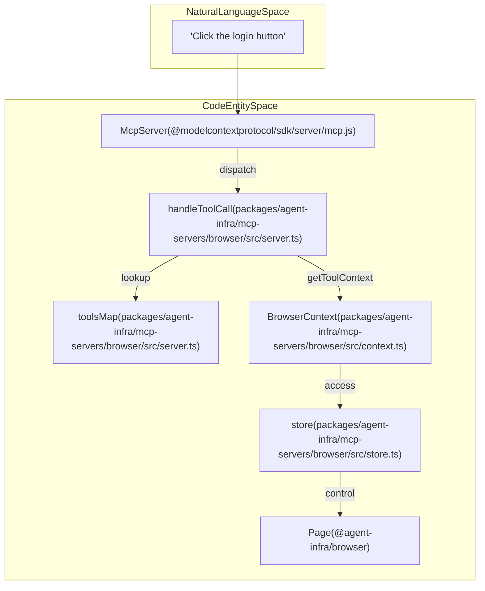
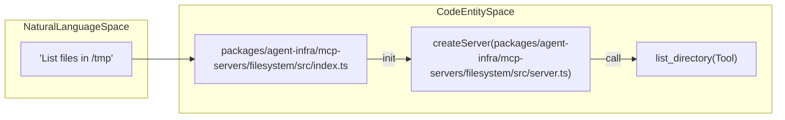
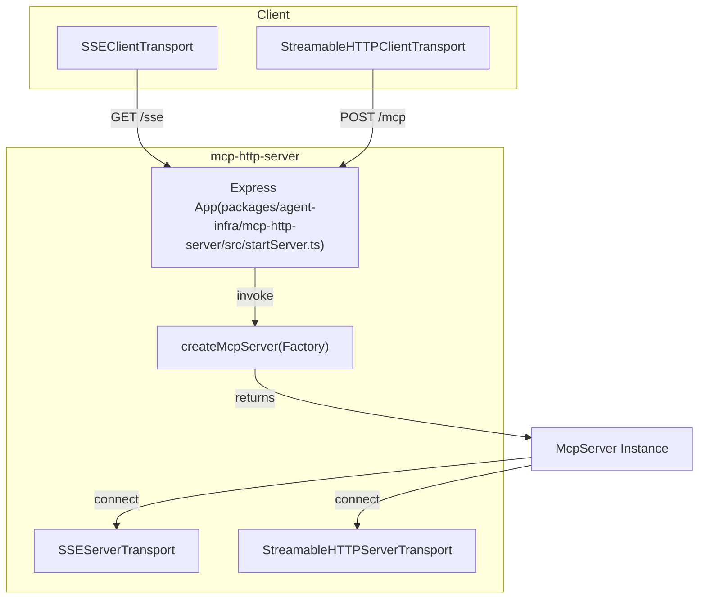

<!-- source: DeepWiki mcp.deepwiki.com · repo bytedance/UI-TARS-desktop · extra page MCP Server Implementations · fetched 2026-10-30 -->

# MCP Server Implementations

Relevant source files

The following files were used as context for generating this wiki page:

- [packages/agent-infra/mcp-http-server/README.md](packages/agent-infra/mcp-http-server/README.md)
- [packages/agent-infra/mcp-http-server/src/startServer.ts](packages/agent-infra/mcp-http-server/src/startServer.ts)
- [packages/agent-infra/mcp-http-server/tests/startServer-server.test.ts](packages/agent-infra/mcp-http-server/tests/startServer-server.test.ts)
- [packages/agent-infra/mcp-servers/browser/src/index.ts](packages/agent-infra/mcp-servers/browser/src/index.ts)
- [packages/agent-infra/mcp-servers/browser/src/server.ts](packages/agent-infra/mcp-servers/browser/src/server.ts)
- [packages/agent-infra/mcp-servers/commands/README.md](packages/agent-infra/mcp-servers/commands/README.md)
- [packages/agent-infra/mcp-servers/commands/src/index.ts](packages/agent-infra/mcp-servers/commands/src/index.ts)
- [packages/agent-infra/mcp-servers/filesystem/src/index.ts](packages/agent-infra/mcp-servers/filesystem/src/index.ts)

This page documents the built-in MCP (Model Context Protocol) server implementations provided by the UI-TARS Desktop repository. These servers expose specific capabilities (browser automation, filesystem access, shell commands) as MCP tools that can be consumed by agents through the MCP Client.

For information about the MCP client architecture and how agents connect to these servers, see [6.1.1 MCP Client Architecture](). For details on transport mechanisms and communication protocols, see [6.1.3 MCP Transport Layer and Communication Protocol]().

## Overview

The repository provides several production-ready MCP server implementations in the `packages/agent-infra/mcp-servers/` directory. These servers are built using the `@modelcontextprotocol/sdk` and specialized infrastructure packages.

| Server Package | MCP Name | Purpose | Key Dependencies |
|----------------|----------|---------|------------------|
| `@agent-infra/mcp-server-browser` | `mcp-server-browser` | Browser automation via Puppeteer | `puppeteer-core`, `@agent-infra/browser`, `@agent-infra/browser-use` |
| `@agent-infra/mcp-server-filesystem` | `mcp-server-filesystem` | File and directory operations | Node.js `fs`, `path` |
| `@agent-infra/mcp-server-commands` | `mcp-server-commands` | Shell command execution | Node.js `child_process` |

Each server is a standalone package that can be executed as a CLI tool (stdio transport), embedded in-process (in-memory transport), or served over HTTP/SSE for remote access via the `mcp-http-server` utility [packages/agent-infra/mcp-servers/browser/src/index.ts:10-14]().

**Sources:** [packages/agent-infra/mcp-servers/browser/src/index.ts:34-37](), [packages/agent-infra/mcp-servers/commands/src/index.ts:17-19](), [packages/agent-infra/mcp-servers/filesystem/src/index.ts:17-19]()

## Browser Server (`@agent-infra/mcp-server-browser`)

### Purpose and Capabilities
The browser server provides AI agents with comprehensive browser automation capabilities. It is designed to be fast and lightweight, utilizing Puppeteer's label index and accessibility data rather than full pixel-based input by default.

### Code Entity Bridge: Browser Tool Execution
The following diagram illustrates how a natural language intent to interact with a webpage is translated into code entities within the Browser MCP Server.

Title: Browser Tool Execution Flow

**Sources:** [packages/agent-infra/mcp-servers/browser/src/server.ts:9-36](), [packages/agent-infra/mcp-servers/browser/src/server.ts:82-187](), [packages/agent-infra/mcp-servers/browser/src/server.ts:200-212](), [packages/agent-infra/mcp-servers/browser/src/store.ts:1-10]()

### Tool Implementations
The server defines a robust set of tools in `toolsMap` using Zod schemas for validation [packages/agent-infra/mcp-servers/browser/src/server.ts:82-187]().

| Tool Name | Description | Key Parameters |
|-----------|-------------|----------------|
| `browser_screenshot` | Captures page/element. Supports visual highlighting [packages/agent-infra/mcp-servers/browser/src/server.ts:83-114](). | `selector`, `index`, `fullPage`, `highlight` |
| `browser_click` | Clicks an element by index [packages/agent-infra/mcp-servers/browser/src/server.ts:115-126](). | `index` |
| `browser_select` | Selects a value in a dropdown [packages/agent-infra/mcp-servers/browser/src/server.ts:127-139](). | `index`, `value` |
| `browser_hover` | Hovers over an element [packages/agent-infra/mcp-servers/browser/src/server.ts:140-151](). | `index`, `selector` |
| `browser_scroll` | Scrolls the page [packages/agent-infra/mcp-servers/browser/src/server.ts:157-168](). | `amount` |
| `browser_press_key` | Simulates keyboard input [packages/agent-infra/mcp-servers/browser/src/server.ts:174-186](). | `key` |

**Sources:** [packages/agent-infra/mcp-servers/browser/src/server.ts:82-187]()

### Implementation Details
1. **Vision Mode**: Enabled via the `--vision` flag [packages/agent-infra/mcp-servers/browser/src/index.ts:108-110](). When active, the server uses screenshots for visual understanding.
2. **Context Management**: The `BrowserContext` class manages the lifecycle of the browser and page instances [packages/agent-infra/mcp-servers/browser/src/server.ts:36]().
3. **DOM Interaction**: Integrates with `@agent-infra/browser-use` for functions like `removeHighlights` and `locateElement` [packages/agent-infra/mcp-servers/browser/src/server.ts:19-21]().
4. **Remote Configuration**: Supports connecting to existing browser instances via `--cdp-endpoint` or `--ws-endpoint` [packages/agent-infra/mcp-servers/browser/src/index.ts:57-64]().

**Sources:** [packages/agent-infra/mcp-servers/browser/src/index.ts:57-110](), [packages/agent-infra/mcp-servers/browser/src/server.ts:30-36]()

## Filesystem Server (`@agent-infra/mcp-server-filesystem`)

### Purpose and Capabilities
Provides controlled access to the local file system. It enforces security by requiring an `--allowed-directories` list [packages/agent-infra/mcp-servers/filesystem/src/index.ts:20-25]().

### Code Entity Bridge: Filesystem Operations
Title: Filesystem Tool Execution

**Sources:** [packages/agent-infra/mcp-servers/filesystem/src/index.ts:10-14](), [packages/agent-infra/mcp-servers/filesystem/src/server.ts:12]()

## Commands Server (`@agent-infra/mcp-server-commands`)

### Purpose and Capabilities
Allows agents to execute shell commands and scripts. This is essential for environment setup and running custom logic [packages/agent-infra/mcp-servers/commands/README.md:8-10]().

| Tool Name | Description | Key Parameters |
|-----------|-------------|----------------|
| `run_script` | Executes a script using a specified interpreter [packages/agent-infra/mcp-servers/commands/README.md:188-195](). | `interpreter`, `script` |

**Sources:** [packages/agent-infra/mcp-servers/commands/src/index.ts:14-15](), [packages/agent-infra/mcp-servers/commands/README.md:188-195]()

## Common Infrastructure: `mcp-http-server`

The `mcp-http-server` package provides a shared utility to wrap any `McpServer` or `Server` instance into an Express-based HTTP/SSE server [packages/agent-infra/mcp-http-server/src/startServer.ts:60-62]().

### Data Flow: Remote Transport Initialization
Title: HTTP/SSE Transport Flow

**Sources:** [packages/agent-infra/mcp-http-server/src/startServer.ts:120-138](), [packages/agent-infra/mcp-http-server/src/startServer.ts:159-209](), [packages/agent-infra/mcp-http-server/tests/startServer-server.test.ts:101-105]()

### Request Context and Headers
The browser server uses `setRequestContext` to store incoming HTTP headers, allowing dynamic configuration like `x-viewport-size` or `x-user-agent` to influence the browser instance created for that specific request [packages/agent-infra/mcp-servers/browser/src/index.ts:166-184](). The `startSseAndStreamableHttpMcpServer` function passes the `headers` from the Express `Request` into the `createMcpServer` factory [packages/agent-infra/mcp-http-server/src/startServer.ts:120-123]().

**Sources:** [packages/agent-infra/mcp-servers/browser/src/index.ts:16-23](), [packages/agent-infra/mcp-servers/browser/src/index.ts:166-184](), [packages/agent-infra/mcp-http-server/src/startServer.ts:39-40](), [packages/agent-infra/mcp-http-server/src/startServer.ts:160-162]()

---

