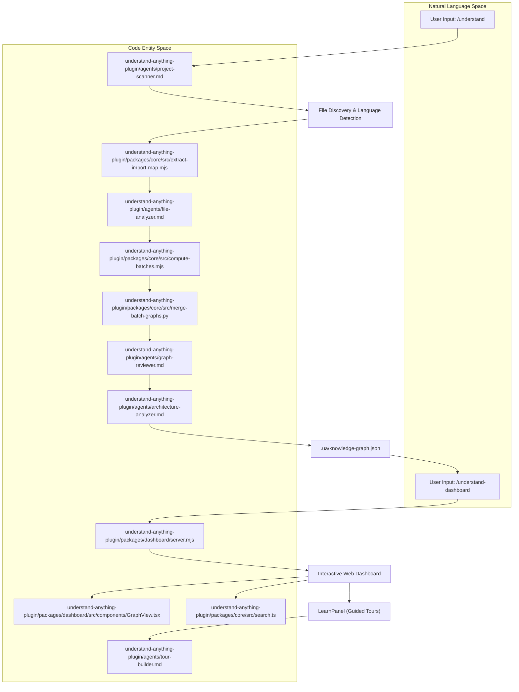
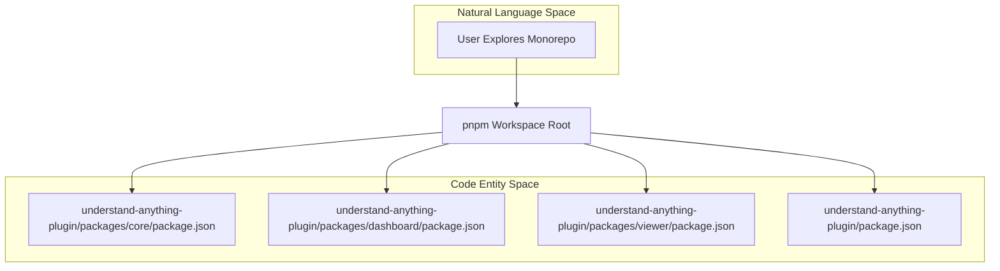

<!-- source: DeepWiki mcp.deepwiki.com · repo Egonex-AI/Understand-Anything · page 1 Overview · fetched 2026-10-30 -->

# Overview

Relevant source files

The following files were used as context for generating this wiki page:

- [.claude-plugin/marketplace.json](.claude-plugin/marketplace.json)
- [.claude-plugin/plugin.json](.claude-plugin/plugin.json)
- [.copilot-plugin/plugin.json](.copilot-plugin/plugin.json)
- [.cursor-plugin/plugin.json](.cursor-plugin/plugin.json)
- [README.md](README.md)
- [READMEs/README.es-ES.md](READMEs/README.es-ES.md)
- [READMEs/README.ja-JP.md](READMEs/README.ja-JP.md)
- [READMEs/README.ko-KR.md](READMEs/README.ko-KR.md)
- [READMEs/README.ru-RU.md](READMEs/README.ru-RU.md)
- [READMEs/README.tr-TR.md](READMEs/README.tr-TR.md)
- [READMEs/README.zh-CN.md](READMEs/README.zh-CN.md)
- [READMEs/README.zh-TW.md](READMEs/README.zh-TW.md)
- [install.ps1](install.ps1)
- [install.sh](install.sh)
- [understand-anything-plugin/.claude-plugin/plugin.json](understand-anything-plugin/.claude-plugin/plugin.json)
- [understand-anything-plugin/package.json](understand-anything-plugin/package.json)
- [understand-anything-plugin/packages/viewer/package.json](understand-anything-plugin/packages/viewer/package.json)

Understand Anything is an AI-powered plugin designed to transform any codebase, knowledge base, or documentation into an interactive knowledge graph [README.md:3-5](). The system employs a multi-agent pipeline to analyze projects, building a detailed knowledge graph of files, functions, classes, and dependencies [README.md:53-54](). The output is then presented through an interactive dashboard for visual exploration [README.md:64-67]().

This page provides a high-level introduction to Understand Anything, its end-to-end workflow, the monorepo layout, and links to its major subsystems. 

* For detailed instructions on installation, supported platforms (Claude, Cursor, Copilot, Gemini, Codex, etc.), and running the first `/understand` command, see **[Getting Started & Installation](#1.1)**.
* For the `pnpm` workspace layout (`packages/core`, `dashboard`, `viewer`, `src/`, `skills/`, `agents/`, `hooks/`, `tests/`), build commands, and configurations, see **[Repository Structure & Monorepo Layout](#1.2)**.
* For a complete reference of all slash commands (`/understand`, `-dashboard`, `-chat`, `-diff`, `-explain`, `-domain`, `-knowledge`, `-onboard`, `-figma`) with arguments and outputs, see **[Skills Reference](#1.3)**.

Sources: [README.md:3-5](), [README.md:53-54](), [README.md:64-67]()

## How it Works: End-to-End Flow

Understand Anything operates through a multi-agent pipeline that processes a project and generates a `KnowledgeGraph`. The process begins with the `/understand` command, which initiates the analysis. A multi-agent pipeline scans the project, extracts every file, function, class, and dependency, then builds a knowledge graph saved to `.ua/knowledge-graph.json` [README.md:125-128](). This graph can then be explored using the `/understand-dashboard` command, which launches an interactive web interface [README.md:138-142]().

### Diagram: Understand Anything End-to-End Flow

Sources: [README.md:53-54](), [README.md:125-128](), [understand-anything-plugin/agents/file-analyzer.md:2-7](), [understand-anything-plugin/agents/project-scanner.md:2-5]()

## Repository Structure & Monorepo Layout Summary

The project utilizes a `pnpm` workspace layout housing packages such as `@understand-anything/core`, `dashboard`, and `viewer`, alongside plugins, agents, hooks, and test directories [understand-anything-plugin/package.json:1-15]().

### Diagram: Monorepo Package Mapping

Sources: [understand-anything-plugin/package.json:1-15]()

For full details on build commands, `tsconfig`, and ESLint configurations, see **[Repository Structure & Monorepo Layout](#1.2)**.

Sources: [understand-anything-plugin/package.json:1-15]()

## Getting Started & Installation Summary

For detailed instructions on installing via `install.sh` or `install.ps1` on macOS, Linux, and Windows across platforms like Claude Code, Cursor, Copilot, Gemini, and Codex, as well as running your first `/understand` command, see **[Getting Started & Installation](#1.1)** [README.md:183-200](), [install.sh:1-46](), [install.ps1:1-45]().

Sources: [README.md:183-200](), [install.sh:1-46](), [install.ps1:1-45]()

## Skills Reference Summary

Understand Anything provides a robust set of slash commands including `/understand`, `/understand-dashboard`, `/understand-chat`, `/understand-diff`, `/understand-explain`, `/understand-domain`, `/understand-knowledge`, `/understand-onboard`, and `/understand-figma` [README.md:125-163](). For complete arguments, flags, and expected outputs, see **[Skills Reference](#1.3)**.

Sources: [README.md:125-163]()

---

