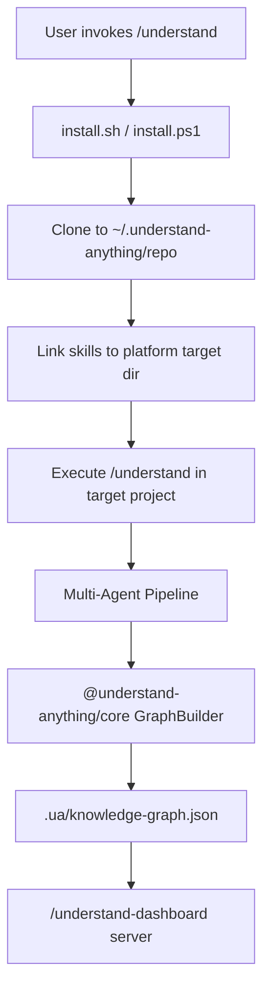
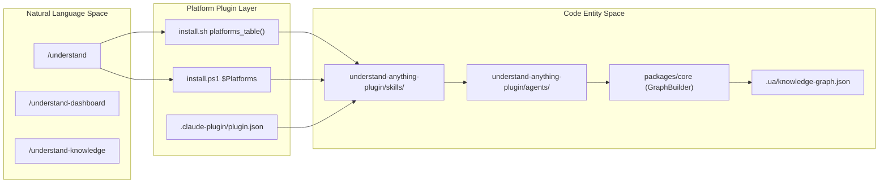

<!-- source: DeepWiki mcp.deepwiki.com · repo Egonex-AI/Understand-Anything · page 1.1 Getting Started & Installation · fetched 2026-10-30 -->

# Getting Started & Installation

<details>
<summary>Relevant source files</summary>

The following files were used as context for generating this wiki page:

- [README.md](README.md)
- [READMEs/README.es-ES.md](READMEs/README.es-ES.md)
- [READMEs/README.ja-JP.md](READMEs/README.ja-JP.md)
- [READMEs/README.ko-KR.md](READMEs/README.ko-KR.md)
- [READMEs/README.ru-RU.md](READMEs/README.ru-RU.md)
- [READMEs/README.tr-TR.md](READMEs/README.tr-TR.md)
- [READMEs/README.zh-CN.md](READMEs/README.zh-CN.md)
- [READMEs/README.zh-TW.md](READMEs/README.zh-TW.md)
- [install.ps1](install.ps1)
- [install.sh](install.sh)
- [tests/install/platform-table-consistency.test.mjs](tests/install/platform-table-consistency.test.mjs)

</details>


This page covers the technical details of installing, updating, and configuring **Understand Anything** across macOS, Linux, and Windows. It details the installation script internals (`install.sh` and `install.ps1`), the platform compatibility matrix, plugin discovery mechanisms, and running the initial `/understand` command to trigger the analysis pipeline.

---

## 1. Introduction

**Understand Anything** is an AI-powered plugin designed to analyze any codebase, knowledge base, or documentation, and transform it into an interactive knowledge graph. It operates across multiple AI coding environments by integrating a multi-agent pipeline that extracts semantic structure from projects, builds a knowledge graph, and provides an interactive dashboard for exploration [README.md:51-57]().

Supported platforms include:
- **Claude Code**: Native plugin via marketplace [README.md:26](), [README.md:113-118]()
- **Cursor**: Automatic discovery via `.cursor-plugin/plugin.json` [READMEs/README.zh-CN.md:212]()
- **GitHub Copilot**: VS Code extension integration [.copilot-plugin/plugin.json:1-14]()
- **Gemini CLI, Codex, OpenCode, Vibe CLI, Trae, Nanobot, Kiro**: Supported via shell and PowerShell installation scripts [README.md:27-33](), [install.sh:31-44]()

---

## 2. Installation on macOS/Linux

### 2.1. One-line Installer (`install.sh`)

The shell script `install.sh` handles automated setup on POSIX systems. It defines a platform matrix via `platforms_table()` [install.sh:25-45]() and executes the following sequence:

1. **Clone or Update**: Clones the official repository (`UA_REPO_URL`) into `UA_DIR` (default: `$HOME/.understand-anything/repo`) or performs a fast-forward pull if `.git` exists [install.sh:21-22](), [install.sh:93-101]().
2. **Link Skills**: Creates symbolic links in the target directory for the chosen platform. Depending on the link style (`per-skill` or `folder`), it links individual skill folders or the entire root directory [install.sh:120-142]().
3. **Link Plugin Root**: Establishes a universal plugin root link at `$HOME/.understand-anything-plugin` [install.sh:23](), [install.sh:172-179]().
4. **Kiro Configuration**: If `--platform kiro` is selected, it dynamically scans `agents/*.md` and generates `~/.kiro/agents/understand.json` [install.sh:194-221]().

#### Usage Examples:

```bash
# Interactive platform selection
curl -fsSL https://raw.githubusercontent.com/Egonex-AI/Understand-Anything/main/install.sh | bash

# Non-interactive installation for a specific platform
curl -fsSL https://raw.githubusercontent.com/Egonex-AI/Understand-Anything/main/install.sh | bash -s codex
```

Sources: `install.sh:1-225`(), `README.md:189-209`()

---

## 3. Installation on Windows (PowerShell)

Windows environments use `install.ps1`, which implements parity with the POSIX script using PowerShell directory junctions and ordered hashtables [install.ps1:1-283]().

```powershell
iwr -useb https://raw.githubusercontent.com/Egonex-AI/Understand-Anything/main/install.ps1 | iex
```

### Key PowerShell Functions:
- `Clone-Or-Update`: Manages local Git checkout under `$HOME\.understand-anything\repo` [install.ps1:26](), [install.ps1:89-99]().
- `New-Junction`: Safely checks for existing reparse points before creating directory junctions (`New-Item -ItemType Junction`), refusing to overwrite real user directories [install.ps1:107-136]().
- `Link-Skills`: Maps skills based on the platform configuration (`per-skill` vs `folder`) [install.ps1:30-45](), [install.ps1:138-158]().

Sources: `install.ps1:1-200`(), `tests/install/platform-table-consistency.test.mjs:36-47`()

---

## 4. Platform Matrix & Plugin Configuration

Both installation scripts share a strict platform mapping verified by automated test suites (`tests/install/platform-table-consistency.test.mjs`) [tests/install/platform-table-consistency.test.mjs:75-126]().

| Platform ID | Target Directory | Link Style | Description |
| :--- | :--- | :--- | :--- |
| `gemini` | `$HOME/.agents/skills` | `per-skill` | Gemini CLI integration [install.sh:31]() |
| `codex` | `$HOME/.agents/skills` | `per-skill` | Codex CLI integration (uses `$` prefix) [install.sh:32]() |
| `opencode` | `$HOME/.agents/skills` | `per-skill` | OpenCode assistant [install.sh:33]() |
| `pi` | `$HOME/.agents/skills` | `per-skill` | Pi Agent [install.sh:34]() |
| `openclaw` | `$HOME/.openclaw/skills` | `folder` | OpenClaw workspace [install.sh:35]() |
| `antigravity` | `$HOME/.gemini/antigravity/skills` | `folder` | Antigravity platform [install.sh:36]() |
| `vibe` | `$HOME/.vibe/skills` | `per-skill` | Vibe CLI [install.sh:37]() |
| `vscode` | `$HOME/.copilot/skills` | `per-skill` | GitHub Copilot / VS Code [install.sh:38]() |
| `hermes` | `$HOME/.hermes/skills` | `folder` | Hermes agent [install.sh:39]() |
| `cline` | `$HOME/.cline/skills` | `folder` | Cline extension [install.sh:40]() |
| `kimi` | `$HOME/.kimi-code/skills` | `folder` | Kimi Code CLI [install.sh:41]() |
| `trae` | `$HOME/.trae/skills` | `per-skill` | Trae IDE [install.sh:42]() |
| `nanobot` | `$HOME/.nanobot/workspace/skills` | `per-skill` | Nanobot workspace [install.sh:43]() |
| `kiro` | `$HOME/.kiro/skills` | `per-skill` | Kiro agent framework [install.sh:44]() |

Sources: `install.sh:29-45`(), `install.ps1:30-45`(), `tests/install/platform-table-consistency.test.mjs:75-126`()

---

## 5. Running the First `/understand` Command

Once installed, navigate to any target codebase and execute the primary skill:

```bash
/understand
```
[README.md:123-125]()

### Execution Workflow:
1. **Project Scan**: The project-scanner agent traverses directories, evaluating `.understandignore` filters and building file maps [README.md:128]().
2. **Graph Construction**: Parallel file analyzers parse language constructs via Tree-Sitter, assembling a validated `KnowledgeGraph` [README.md:128]().
3. **Persistence**: The output is serialized and stored in `.ua/knowledge-graph.json` (or `.understand-anything/` for legacy compatibility) [README.md:128]().
4. **Localization & Config**: On first initialization, the runner checks for language settings or auto-detects conversation context, saving preferences to `.ua/config.json` [READMEs/README.ja-JP.md:141]().

Sources: `README.md:123-136`(), `READMEs/README.ja-JP.md:132-147`()

---

## 6. Implementation Flow & Data Movement


Sources: `install.sh:181-193`(), `install.ps1:89-158`(), `README.md:111-154`()

---

## 7. Platform-to-Code Entity Mapping


Sources: `install.sh:25-45`(), `install.ps1:30-45`(), `.claude-plugin/plugin.json:1-18`(), `README.md:111-178`()

---

## 8. Post-Installation & Maintenance

- **Incremental Execution**: Subsequent runs of `/understand` automatically detect file fingerprints, updating only modified nodes and relationships [README.md:130]().
- **Auto-Update Hooks**: Run `/understand --auto-update` to register a `post-commit` Git hook that refreshes the graph automatically [READMEs/README.ja-JP.md:181]().
- **Dashboard Launch**: Execute `/understand-dashboard` to fire up the Vite visualization server [README.md:151]().

Sources: `README.md:130-151`(), `READMEs/README.ja-JP.md:181`()

---

