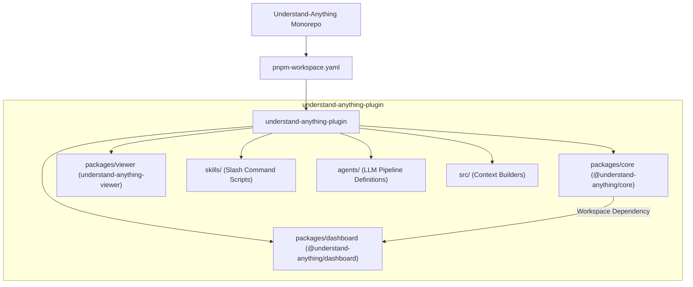
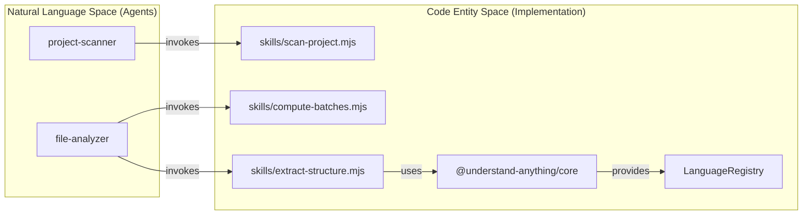
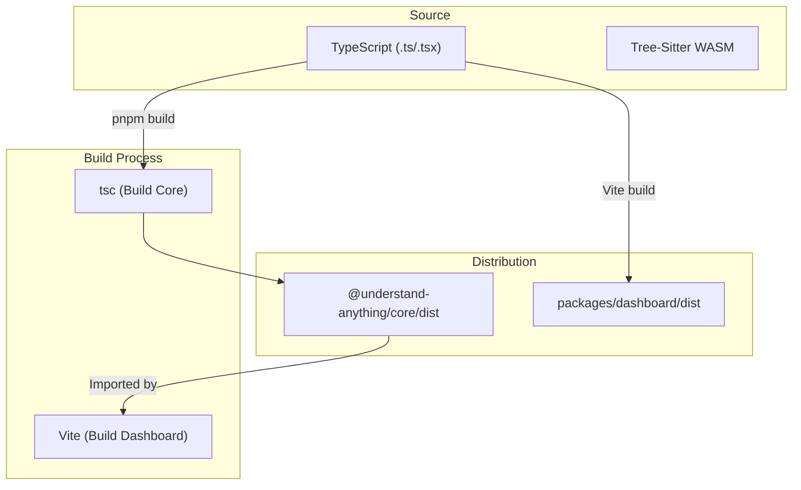

<!-- source: DeepWiki mcp.deepwiki.com · repo Egonex-AI/Understand-Anything · page 1.2 Repository Structure & Monorepo Layout · fetched 2026-10-30 -->

# Repository Structure & Monorepo Layout

Relevant source files

The following files were used as context for generating this wiki page:

- [.github/workflows/deploy-homepage.yml](.github/workflows/deploy-homepage.yml)
- [.gitignore](.gitignore)
- [.npmrc](.npmrc)
- [CONTRIBUTING.md](CONTRIBUTING.md)
- [eslint.config.mjs](eslint.config.mjs)
- [package.json](package.json)
- [scripts/benchmark-large-repo.mjs](scripts/benchmark-large-repo.mjs)
- [scripts/generate-large-graph.mjs](scripts/generate-large-graph.mjs)
- [tsconfig.json](tsconfig.json)
- [understand-anything-plugin/packages/core/package.json](understand-anything-plugin/packages/core/package.json)
- [understand-anything-plugin/packages/core/src/__tests__/language-registry.test.ts](understand-anything-plugin/packages/core/src/__tests__/language-registry.test.ts)
- [understand-anything-plugin/packages/core/src/__tests__/plugin-discovery.test.ts](understand-anything-plugin/packages/core/src/__tests__/plugin-discovery.test.ts)
- [understand-anything-plugin/packages/core/src/languages/configs/dart.ts](understand-anything-plugin/packages/core/src/languages/configs/dart.ts)
- [understand-anything-plugin/packages/core/src/languages/configs/index.ts](understand-anything-plugin/packages/core/src/languages/configs/index.ts)
- [understand-anything-plugin/packages/core/src/plugins/extractors/index.ts](understand-anything-plugin/packages/core/src/plugins/extractors/index.ts)
- [understand-anything-plugin/packages/core/tsconfig.json](understand-anything-plugin/packages/core/tsconfig.json)
- [understand-anything-plugin/pnpm-lock.yaml](understand-anything-plugin/pnpm-lock.yaml)
- [understand-anything-plugin/skills/understand-domain/extract-domain-context.py](understand-anything-plugin/skills/understand-domain/extract-domain-context.py)
- [understand-anything-plugin/tsconfig.json](understand-anything-plugin/tsconfig.json)

This page details the monorepo structure of the Understand Anything project, managed using `pnpm` workspaces. It outlines the organization of packages, core directories, build processes, TypeScript configurations, and ESLint setup.

## Monorepo Overview

The Understand Anything project is structured as a pnpm monorepo, enabling efficient management of multiple interdependent packages and applications. The workspace layout is defined by the root configuration and tracked via `pnpm-lock.yaml`, encompassing workspace members such as `@understand-anything/core`, `@understand-anything/dashboard`, the standalone viewer, skill execution scripts, and AI agent prompts [understand-anything-plugin/pnpm-lock.yaml:7-189]().

### Diagram: Monorepo Workspace Layout

Sources: [understand-anything-plugin/pnpm-lock.yaml:7-189](), [package.json:28-36]()

## Core Packages & Directories

### 1. Core Library (`packages/core`)
The `@understand-anything/core` package serves as the primary analysis and parsing engine. It exposes explicit export subpaths for types, schemas, search engines, languages, and Figma integrations [understand-anything-plugin/packages/core/package.json:7-32]().
- **Dependencies**: Relies on `web-tree-sitter`, `zod`, `fuse.js`, and numerous language-specific grammars [understand-anything-plugin/packages/core/package.json:43-63]().
- **WASM Parsers**: Incorporates specialized WASM modules for languages like Dart and Swift [understand-anything-plugin/packages/core/package.json:45-46]().
- **Language Extractors**: Houses built-in extractors for over 15 programming languages through `builtinExtractors` [understand-anything-plugin/packages/core/src/plugins/extractors/index.ts:32-46]().

### 2. Dashboard (`packages/dashboard`)
The `@understand-anything/dashboard` package provides the React-based interactive visualization UI [understand-anything-plugin/pnpm-lock.yaml:104-185]().
- **Visualization Stack**: Utilizes `@xyflow/react` (React Flow) for graph rendering, `elkjs` and `dagre` for automated layouting, and `d3-force` for domain graph views [understand-anything-plugin/pnpm-lock.yaml:106-123]().
- **State Management**: Powered by `zustand` [understand-anything-plugin/pnpm-lock.yaml:151-153]().

### 3. Viewer (`packages/viewer`)
A lightweight, zero-dependency alternative containing a standalone binary (`bin/viewer.mjs`) for serving static graph data snapshots.

### 4. Skill Logic, Agents, and Context Builders (`src/`, `skills/`, `agents/`)
- **`src/`**: Houses TypeScript context builders (`ChatContext`, `ExplainContext`, `onboard-builder.ts`) that translate graph data into actionable LLM context.
- **`skills/`**: Contains execution scripts for slash commands (`/understand`, `/understand-figma`, `/understand-domain`, etc.).
- **`agents/`**: Contains Markdown-based system prompts and execution rules for autonomous agents (`project-scanner`, `file-analyzer`, etc.).

Sources: [understand-anything-plugin/packages/core/package.json:7-63](), [understand-anything-plugin/pnpm-lock.yaml:104-185](), [CONTRIBUTING.md:186-203]()

### Diagram: Code Entity Mapping (Pipeline to Code)
This diagram maps abstract agent roles to concrete implementation files and core classes in the codebase.

Sources: [understand-anything-plugin/packages/core/src/languages/language-registry.ts:1-10](), [CONTRIBUTING.md:186-203]()

## Build & Development Commands

Task orchestration is handled through `pnpm` across the workspace. The root and package-level `package.json` files define standard scripts for building, testing, and linting [package.json:29-36]().

| Command | Action | Implementation |
|:---|:---|:---|
| `pnpm build` | Recursively builds workspace packages | `pnpm -r build` [package.json:31]() |
| `prepare` | Pre-builds core dependency on install | `pnpm --filter @understand-anything/core build` [package.json:30]() |
| `pnpm test` | Runs test suites via Vitest | `vitest run` [package.json:32]() |
| `pnpm lint` | Executes ESLint code quality checks | `eslint .` [package.json:35]() |
| `pnpm dev:dashboard` | Starts dashboard Vite dev server | `pnpm --filter @understand-anything/dashboard dev` [package.json:34]() |

Sources: [package.json:29-36](), [understand-anything-plugin/packages/core/package.json:33-36]()

## TypeScript, Linting & Workspace Configuration

The monorepo enforces strict code standards through shared configuration files at the repository root.

- **TypeScript**: Shared configurations govern strict type checking across packages [understand-anything-plugin/packages/core/tsconfig.json:1-19]().
- **ESLint**: Configured via `eslint.config.mjs`, applying `typescript-eslint` recommended rules, ignoring build artifacts (`dist/`, `build/`, `.ua/`), and configuring browser globals for dashboard code [eslint.config.mjs:1-57]().
- **Native Dependency Compilation**: Because tree-sitter bindings require native compilation, the root `package.json` utilizes `onlyBuiltDependencies` to whitelist packages like `esbuild`, `sharp`, and language-specific tree-sitter parsers [package.json:46-63]().

Sources: [eslint.config.mjs:1-57](), [package.json:46-63]()

### Diagram: Build Data Flow

Sources: [package.json:29-36](), [understand-anything-plugin/packages/core/package.json:33-36](), [.github/workflows/deploy-homepage.yml:39-51]()

---

