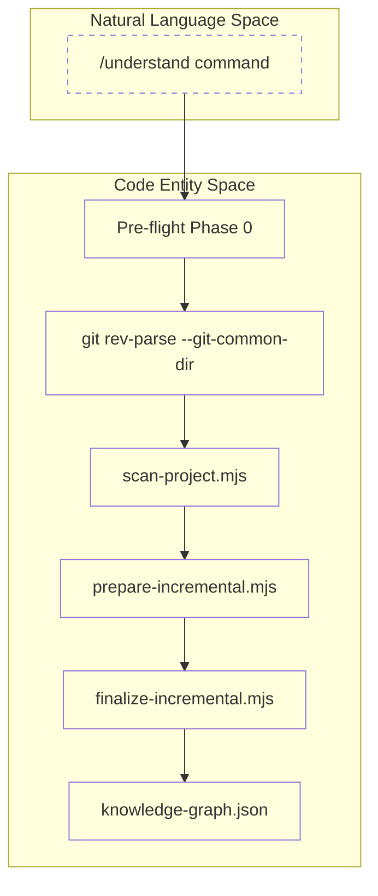
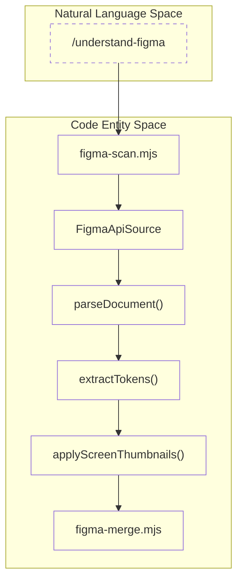

<!-- source: DeepWiki mcp.deepwiki.com · repo Egonex-AI/Understand-Anything · page 1.3 Skills Reference · fetched 2026-10-30 -->

# Skills Reference

Relevant source files

The following files were used as context for generating this wiki page:

- [tests/skill/understand/test_incremental_symbols.test.mjs](tests/skill/understand/test_incremental_symbols.test.mjs)
- [tests/skill/understand/test_prepare_incremental.test.mjs](tests/skill/understand/test_prepare_incremental.test.mjs)
- [understand-anything-plugin/packages/core/src/__tests__/staleness.test.ts](understand-anything-plugin/packages/core/src/__tests__/staleness.test.ts)
- [understand-anything-plugin/packages/core/src/staleness.ts](understand-anything-plugin/packages/core/src/staleness.ts)
- [understand-anything-plugin/skills/understand-chat/SKILL.md](understand-anything-plugin/skills/understand-chat/SKILL.md)
- [understand-anything-plugin/skills/understand-diff/SKILL.md](understand-anything-plugin/skills/understand-diff/SKILL.md)
- [understand-anything-plugin/skills/understand-explain/SKILL.md](understand-anything-plugin/skills/understand-explain/SKILL.md)
- [understand-anything-plugin/skills/understand-onboard/SKILL.md](understand-anything-plugin/skills/understand-onboard/SKILL.md)
- [understand-anything-plugin/skills/understand/SKILL.md](understand-anything-plugin/skills/understand/SKILL.md)
- [understand-anything-plugin/skills/understand/finalize-incremental.mjs](understand-anything-plugin/skills/understand/finalize-incremental.mjs)
- [understand-anything-plugin/skills/understand/locales/en.md](understand-anything-plugin/skills/understand/locales/en.md)
- [understand-anything-plugin/skills/understand/locales/ja.md](understand-anything-plugin/skills/understand/locales/ja.md)
- [understand-anything-plugin/skills/understand/locales/ko.md](understand-anything-plugin/skills/understand/locales/ko.md)
- [understand-anything-plugin/skills/understand/locales/zh-TW.md](understand-anything-plugin/skills/understand/locales/zh-TW.md)
- [understand-anything-plugin/skills/understand/locales/zh.md](understand-anything-plugin/skills/understand/locales/zh.md)
- [understand-anything-plugin/skills/understand/prepare-incremental.mjs](understand-anything-plugin/skills/understand/prepare-incremental.mjs)
- [understand-anything-plugin/skills/understand/prepare-symbol-retry.mjs](understand-anything-plugin/skills/understand/prepare-symbol-retry.mjs)
- [understand-anything-plugin/skills/understand/validate-incremental-symbols.mjs](understand-anything-plugin/skills/understand/validate-incremental-symbols.mjs)

This page provides a comprehensive technical reference for all user-facing slash commands (skills) available in the Understand Anything plugin ecosystem. It outlines arguments, execution flags, data flows, persistence outputs, and core implementation modules that bridge user intent to code entity space.

---

## `/understand`

Analyze the current codebase and produce an interactive knowledge graph (`knowledge-graph.json`) in the project's data directory (`.ua/`, or legacy `.understand-anything/`) [understand-anything-plugin/skills/understand/SKILL.md:7-10]().

### Arguments & Flags

*   `[path]` (optional): Target directory path to analyze instead of the working directory [understand-anything-plugin/skills/understand/SKILL.md:20-20]().
*   `--full`: Force a full graph rebuild, ignoring existing caches [understand-anything-plugin/skills/understand/SKILL.md:14-14]().
*   `--auto-update`: Enable automatic graph updates on commit by writing `autoUpdate: true` to `$UA_DIR/config.json` [understand-anything-plugin/skills/understand/SKILL.md:15-15]().
*   `--no-auto-update`: Disable automatic graph updates [understand-anything-plugin/skills/understand/SKILL.md:16-16]().
*   `--review`: Execute the full LLM graph-reviewer instead of inline deterministic validation [understand-anything-plugin/skills/understand/SKILL.md:17-17]().
*   `--language <lang>`: Generate textual metadata (summaries, descriptions, languageNotes, languageLesson) in the specified ISO 639-1 language code or friendly name [understand-anything-plugin/skills/understand/SKILL.md:18-18]().
*   `--exclude <patterns>`: Comma-separated glob patterns for additional file exclusions [understand-anything-plugin/skills/understand/SKILL.md:19-19]().

### Technical Implementation & Pre-flight

During Phase 0 pre-flight, the skill checks for git worktrees by comparing `git rev-parse --git-dir` against `git rev-parse --git-common-dir`. If they diverge, output is redirected to the main repository root to prevent ephemeral worktree data loss, unless `UNDERSTAND_NO_WORKTREE_REDIRECT=1` is specified [understand-anything-plugin/skills/understand/SKILL.md:53-73]().

**Title: Natural Language Space to Code Entity Space: /understand**

**Sources:**
* [understand-anything-plugin/skills/understand/SKILL.md:1-110]()
* [understand-anything-plugin/skills/understand/prepare-incremental.mjs:1-752]()
* [understand-anything-plugin/skills/understand/finalize-incremental.mjs:1-512]()

---

## `/understand-dashboard`

Starts the interactive web dashboard to visualize project architecture, domains, and diff overlays.

### Execution Strategy

1.  **Fast Path**: Attempts to download and execute `understand-anything-viewer` from npm/GitHub releases via `npx` [understand-anything-plugin/skills/understand-dashboard/SKILL.md:103-110]().
2.  **Development Fallback**: Builds `@understand-anything/core` and launches the Vite development server located in `packages/dashboard` [understand-anything-plugin/skills/understand-dashboard/SKILL.md:115-132]().
3.  **Security Model**: Generates an `ACCESS_TOKEN` and outputs a secured dashboard URL containing the `?token=` parameter [understand-anything-plugin/skills/understand-dashboard/SKILL.md:135-148]().

**Sources:**
* [understand-anything-plugin/skills/understand-dashboard/SKILL.md:1-150]()

---

## Analytical Query Skills (`/understand-chat`, `/understand-explain`, `/understand-diff`, `/understand-onboard`)

These skills provide structured contextual reasoning over the compiled knowledge graph.

### Common Behavior: Staleness & Freshness Verification
Before executing graph queries, each skill checks graph staleness using core freshness evaluation utilities (`staleness.ts`) [understand-anything-plugin/packages/core/src/staleness.ts:4-56]() by comparing `project.gitCommitHash` against the current `HEAD` commit and filtering out generated paths like `.ua/` or `.understand-anything/` [understand-anything-plugin/packages/core/src/staleness.ts:72-80]().

| Skill | Primary Function | Output Artifact / Action | Key Reference |
| :--- | :--- | :--- | :--- |
| `/understand-chat` | Answers questions via 1-hop subgraph expansion | Console conversational response | [understand-anything-plugin/skills/understand-chat/SKILL.md:1-70]() |
| `/understand-explain` | Deep-dive analysis of specific files, classes, or functions | Detailed component markdown breakdown | [understand-anything-plugin/skills/understand-explain/SKILL.md:1-73]() |
| `/understand-diff` | Impact analysis of code changes against the graph | Writes `$UA_DIR/diff-overlay.json` | [understand-anything-plugin/skills/understand-diff/SKILL.md:1-85]() |
| `/understand-onboard` | Generates team onboarding documentation | Suggests saving to `docs/UA_ONBOARDING.md` | [understand-anything-plugin/skills/understand-onboard/SKILL.md:1-70]() |

**Sources:**
* [understand-anything-plugin/packages/core/src/staleness.ts:1-508]()
* [understand-anything-plugin/skills/understand-chat/SKILL.md:1-70]()
* [understand-anything-plugin/skills/understand-explain/SKILL.md:1-73]()
* [understand-anything-plugin/skills/understand-diff/SKILL.md:1-85]()
* [understand-anything-plugin/skills/understand-onboard/SKILL.md:1-70]()

---

## `/understand-domain` & `/understand-knowledge`

Domain and knowledge graph skills extract higher-level business logic and documentation corpora.

*   **`/understand-domain`**: Extracts business flows and process steps. If `knowledge-graph.json` exists, it derives domain components directly; otherwise, it executes a lightweight entry-point scan, producing `domain-graph.json` [understand-anything-plugin/skills/understand-domain/SKILL.md:13-130]().
*   **`/understand-knowledge`**: Parses Karpathy-pattern LLM wikis via `parse-knowledge-base.py`, runs `article-analyzer` agents for implicit claims, and invokes `merge-knowledge-graph.py` to produce a `kind: "knowledge"` graph [understand-anything-plugin/skills/understand-knowledge/SKILL.md:13-86]().

**Sources:**
* [understand-anything-plugin/skills/understand-domain/SKILL.md:1-135]()
* [understand-anything-plugin/skills/understand-knowledge/SKILL.md:1-90]()

---

## `/understand-figma`

Integrates Figma design files and token sets into the project graph model.

### Technical Implementation & Data Flow

1.  **Version Check**: `figma-scan.mjs` verifies remote Figma file versions against `meta.json` [understand-anything-plugin/skills/understand-figma/figma-scan.mjs:29-37]().
2.  **Extraction**: `parseDocument` builds hierarchy trees while `extractTokens` captures design variables [understand-anything-plugin/skills/understand-figma/figma-scan.mjs:41-44]().
3.  **Enrichment**: Design analyzer batches enrich screen metadata before `figma-merge.mjs` outputs a `kind:design` graph structure.

**Title: Natural Language Space to Code Entity Space: /understand-figma**

**Sources:**
* [understand-anything-plugin/skills/understand-figma/figma-scan.mjs:1-80]()
* [understand-anything-plugin/packages/core/src/figma/index.ts:1-6]()

---

