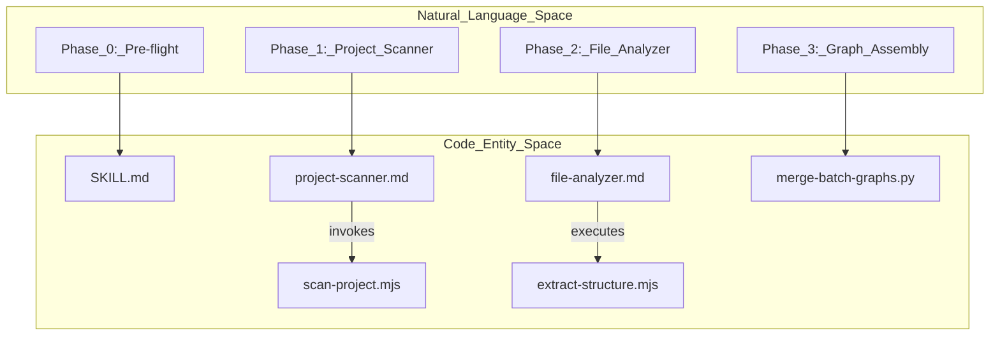
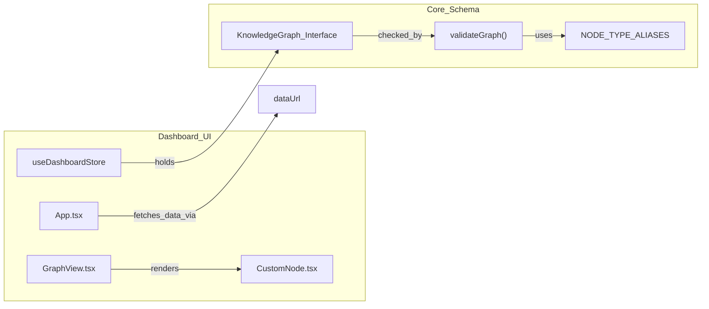

<!-- source: DeepWiki mcp.deepwiki.com · repo Egonex-AI/Understand-Anything · page 10 Glossary · fetched 2026-10-30 -->

# Glossary

Relevant source files

The following files were used as context for generating this wiki page:

- [CLAUDE.md](CLAUDE.md)
- [tests/skill/understand/test_incremental_symbols.test.mjs](tests/skill/understand/test_incremental_symbols.test.mjs)
- [tests/skill/understand/test_prepare_incremental.test.mjs](tests/skill/understand/test_prepare_incremental.test.mjs)
- [understand-anything-plugin/agents/architecture-analyzer.md](understand-anything-plugin/agents/architecture-analyzer.md)
- [understand-anything-plugin/agents/article-analyzer.md](understand-anything-plugin/agents/article-analyzer.md)
- [understand-anything-plugin/agents/assemble-reviewer.md](understand-anything-plugin/agents/assemble-reviewer.md)
- [understand-anything-plugin/agents/domain-analyzer.md](understand-anything-plugin/agents/domain-analyzer.md)
- [understand-anything-plugin/agents/file-analyzer.md](understand-anything-plugin/agents/file-analyzer.md)
- [understand-anything-plugin/agents/graph-reviewer.md](understand-anything-plugin/agents/graph-reviewer.md)
- [understand-anything-plugin/agents/knowledge-graph-guide.md](understand-anything-plugin/agents/knowledge-graph-guide.md)
- [understand-anything-plugin/agents/project-scanner.md](understand-anything-plugin/agents/project-scanner.md)
- [understand-anything-plugin/agents/tour-builder.md](understand-anything-plugin/agents/tour-builder.md)
- [understand-anything-plugin/packages/core/src/__tests__/domain-types.test.ts](understand-anything-plugin/packages/core/src/__tests__/domain-types.test.ts)
- [understand-anything-plugin/packages/core/src/__tests__/schema.test.ts](understand-anything-plugin/packages/core/src/__tests__/schema.test.ts)
- [understand-anything-plugin/packages/core/src/schema.ts](understand-anything-plugin/packages/core/src/schema.ts)
- [understand-anything-plugin/packages/core/src/types.ts](understand-anything-plugin/packages/core/src/types.ts)
- [understand-anything-plugin/skills/understand/SKILL.md](understand-anything-plugin/skills/understand/SKILL.md)
- [understand-anything-plugin/skills/understand/finalize-incremental.mjs](understand-anything-plugin/skills/understand/finalize-incremental.mjs)
- [understand-anything-plugin/skills/understand/prepare-incremental.mjs](understand-anything-plugin/skills/understand/prepare-incremental.mjs)
- [understand-anything-plugin/skills/understand/prepare-symbol-retry.mjs](understand-anything-plugin/skills/understand/prepare-symbol-retry.mjs)
- [understand-anything-plugin/skills/understand/validate-incremental-symbols.mjs](understand-anything-plugin/skills/understand/validate-incremental-symbols.mjs)

This page defines the technical terms, jargon, and domain-specific concepts used throughout the Understand Anything codebase. It serves as a reference for onboarding engineers to understand the mapping between abstract concepts and concrete code implementations, covering key classes, functions, file roles, data flows, and architecture.

---

## Core Concepts

### KnowledgeGraph
A central data structure representing the analyzed project as a directed graph. It models entities and their relationships in a unified schema to enable exploration and querying.

- **Nodes** represent entities like `file`, `function`, `class`, `service`, `domain`, `article`, `screen`, etc.
- **Edges** represent semantic or structural relationships like `calls`, `imports`, `depends_on`, `contains`, `instance_of`, etc.

**Implementation**:  
Defined as the `KnowledgeGraph` interface in [packages/core/src/types.ts:107-115](). The graph can be of different kinds: `codebase`, `knowledge`, or `design` [packages/core/src/types.ts:109]().

**Validation** is performed via a Zod-based schema in [packages/core/src/schema.ts:1-300](). The `validateGraph` function handles sanitization, normalization of aliases, and auto-fixing of common LLM hallucinations [packages/core/src/schema.ts:188-250]().

Sources: [packages/core/src/types.ts:107-115](), [packages/core/src/schema.ts:188-250](), [packages/core/src/__tests__/schema.test.ts:11-58]()

---

### NodeType
Each node in the graph is categorized by a `NodeType`. Node types reflect the role of an entity in the codebase, design, or domain. There are 27 total types across 5 categories.

| Category | Examples of Node Types |
| :--- | :--- |
| **Code Entities** | `file`, `function`, `class`, `module`, `concept` |
| **Infrastructure** | `service`, `resource`, `pipeline` |
| **Data** | `table`, `endpoint`, `schema` |
| **Domain** | `domain`, `flow`, `step` |
| **Knowledge** | `article`, `entity`, `topic`, `claim`, `source` |
| **Design (Figma)** | `page`, `screen`, `component`, `componentSet`, `instance`, `token` |

Node types are enumerated in [packages/core/src/types.ts:2-8](). The dashboard maps these to filter categories like `code`, `infra`, `data`, etc. via `NODE_TYPE_TO_CATEGORY` [packages/dashboard/src/components/GraphView.tsx:70-81]().

Sources: [packages/core/src/types.ts:2-8](), [packages/dashboard/src/components/GraphView.tsx:70-81](), [packages/dashboard/src/store.ts:14-14]()

---

### EdgeType
Edges represent relationships between nodes. For clarity and filtering, edges are grouped into 9 logical categories.

| Category | Edge Types Example |
| :--- | :--- |
| **Structural** | `imports`, `exports`, `contains`, `inherits`, `implements` |
| **Behavioral** | `calls`, `subscribes`, `publishes`, `middleware` |
| **Data Flow** | `reads_from`, `writes_to`, `transforms`, `validates` |
| **Dependencies** | `depends_on`, `tested_by`, `configures` |
| **Semantic** | `related`, `similar_to` |
| **Infrastructure** | `deploys`, `serves`, `provisions`, `triggers` |
| **Domain** | `contains_flow`, `flow_step`, `cross_domain` |
| **Knowledge** | `cites`, `contradicts`, `builds_on`, `authored_by` |
| **Design** | `instance_of`, `variant_of`, `uses_token` |

This mapping is defined in `EDGE_CATEGORY_MAP` at [packages/dashboard/src/store.ts:31-41]().

Sources: [packages/dashboard/src/store.ts:31-41](), [packages/core/src/__tests__/schema.test.ts:200-232]()

---

## Analysis Pipeline Terms

### Multi-Agent Pipeline
The multi-phase system that processes a project into a Knowledge Graph using cooperating specialized agents.

- **Phase 0: Pre-flight**: Argument parsing, project root resolution, and worktree redirection [skills/understand/SKILL.md:43-73]().
- **Phase 1: Project Scanning**: Handled by `project-scanner` agent and `scan-project.mjs`. It performs file enumeration and language detection [agents/project-scanner.md:25-106]().
- **Phase 2: File Analysis**: Handled by `file-analyzer` agent. It uses a two-phase approach: deterministic extraction via `extract-structure.mjs` (using tree-sitter) followed by LLM semantic analysis [agents/file-analyzer.md:17-82]().
- **Phase 3: Graph Assembly**: Merging partial outputs via `merge-batch-graphs.py`.

Sources: [skills/understand/SKILL.md:43-73](), [agents/project-scanner.md:25-106](), [agents/file-analyzer.md:17-82]()

### UA_DIR
The data directory where the plugin stores its state, intermediate results, and the final `knowledge-graph.json`.
- It defaults to `.ua/` for new projects.
- It falls back to the legacy `.understand-anything/` if it already exists [skills/understand/SKILL.md:9-9]().
- Agents resolve this via a shell snippet: `UA_DIR="$PROJECT_ROOT/$([ -d "$PROJECT_ROOT/.understand-anything" ] && echo .understand-anything || echo .ua)"` [agents/file-analyzer.md:35-35]().

Sources: [skills/understand/SKILL.md:9-9](), [agents/file-analyzer.md:35-35]()

### Incremental Update & Fingerprinting
A technique to avoid re-analyzing unchanged files.
- **Fingerprint**: A hash-based signature of a file's content and its structural metadata.
- **Staleness**: A file is "stale" if its current fingerprint differs from the one stored in the graph.
- **Change Classifier**: Determines if an update is a `SKIP`, `PARTIAL_UPDATE`, `ARCHITECTURE_UPDATE`, or `FULL_UPDATE` [hooks/auto-update-prompt.md:1-50]().

Sources: [skills/understand/SKILL.md:14-16](), [hooks/auto-update-prompt.md:1-50](), [packages/dashboard/src/App.tsx:124-125]()

---

## Technical Mapping: Concept to Code Entities

### Diagram 1: Analysis Pipeline to Code Artifacts and Agents

Sources: [agents/project-scanner.md:25-67](), [agents/file-analyzer.md:29-76](), [skills/understand/SKILL.md:43-130]()

### Diagram 2: Dashboard Visualization State

Sources: [packages/dashboard/src/store.ts:101-158](), [packages/core/src/schema.ts:18-75](), [packages/dashboard/src/App.tsx:57-74]()

---

## Specialized Terminology

### skill
A high-level command (e.g., `/understand`, `/understand-domain`) that triggers a specific workflow or agent pipeline. Defined by a `SKILL.md` file containing metadata and execution instructions [skills/understand/SKILL.md:1-5]().

Sources: [skills/understand/SKILL.md:1-5]()

### agent
An autonomous program or LLM-driven entity responsible for a specific task within the analysis pipeline, such as `project-scanner` [understand-anything-plugin/agents/project-scanner.md:1-7]() or `file-analyzer` [understand-anything-plugin/agents/file-analyzer.md:1-6](). Agents write intermediate results to the `.ua/intermediate/` directory [CLAUDE.md:27-28]().

Sources: [understand-anything-plugin/agents/project-scanner.md:1-7](), [understand-anything-plugin/agents/file-analyzer.md:1-6](), [CLAUDE.md:27-28]()

### importMap
A mapping of file paths to the files they import. This is generated by `extract-import-map.mjs` during Phase 1 of the analysis pipeline and is used to build `imports` edges in the graph [tests/skill/understand/test_prepare_incremental.test.mjs:96-96]().

Sources: [tests/skill/understand/test_prepare_incremental.test.mjs:96-96]()

### fingerprint
A hash-based signature of a file's content and its structural metadata. Used to detect changes for incremental updates. Generated by `build-fingerprints.mjs` [tests/skill/understand/test_prepare_incremental.test.mjs:22-22]().

Sources: [tests/skill/understand/test_prepare_incremental.test.mjs:22-22]()

### ChangeLevel
An enumeration (`SKIP`, `PARTIAL_UPDATE`, `ARCHITECTURE_UPDATE`, `FULL_UPDATE`) indicating the scope of changes detected in a codebase, which dictates the type of incremental update to perform. This is determined by the `classifyUpdate` function [understand-anything-plugin/skills/understand/prepare-incremental.mjs:57-57]().

Sources: [understand-anything-plugin/skills/understand/prepare-incremental.mjs:57-57]()

### SKIP/PARTIAL_UPDATE/ARCHITECTURE_UPDATE/FULL_UPDATE
These are the possible `ChangeLevel` values:
- **SKIP**: No significant changes detected, analysis can be skipped.
- **PARTIAL_UPDATE**: Minor changes, only affected files need re-analysis.
- **ARCHITECTURE_UPDATE**: Structural changes requiring re-evaluation of architectural layers.
- **FULL_UPDATE**: Major changes requiring a complete re-analysis of the project.

These levels are part of the incremental update planning process managed by `prepare-incremental.mjs` [understand-anything-plugin/skills/understand/prepare-incremental.mjs:1-21]().

Sources: [understand-anything-plugin/skills/understand/prepare-incremental.mjs:1-21]()

### SymbolEvidence
Data collected during strict Tree-sitter analysis that provides detailed information about symbols (functions, classes) in a file, including their kind, owner, name, and line range. This is crucial for validating incremental updates and detecting symbol loss [understand-anything-plugin/skills/understand/validate-incremental-symbols.mjs:68-72]().

Sources: [understand-anything-plugin/skills/understand/validate-incremental-symbols.mjs:68-72]()

### significance filter
A mechanism within the `file-analyzer` agent to prioritize which extracted structural elements (functions, classes, etc.) are important enough to be included in the knowledge graph. This helps manage graph complexity and focus on key architectural elements.

Sources: [understand-anything-plugin/agents/file-analyzer.md:1-123]() (implied by the agent's role in producing "precise, structured knowledge graph data")

### persona
A user profile (e.g., `junior`, `experienced`, `non-technical`) that determines the level of detail and complexity shown in the dashboard UI [packages/dashboard/src/store.ts:12-12](), [packages/dashboard/src/store.ts:128-128]().

Sources: [packages/dashboard/src/store.ts:12-12](), [packages/dashboard/src/store.ts:128-128]()

### portal
In the dashboard's graph visualization, a "portal" is a visual element that represents a collapsed group of nodes, allowing for hierarchical navigation. Clicking a portal expands it to reveal its contained nodes.

Sources: [packages/dashboard/src/components/GraphView.tsx:1-180]() (implied by ELK layout and hierarchical navigation)

### container
In the dashboard's graph visualization, a "container" is a visual grouping of related nodes, often representing a logical boundary like a directory or a layer. Containers can be expanded or collapsed.

Sources: [packages/dashboard/src/components/GraphView.tsx:1-180]() (implied by ELK layout and hierarchical navigation)

### ELK layout
The **Eclipse Layout Kernel** is the engine used for graph positioning in the dashboard. It uses a `layered` algorithm to minimize edge crossings and handles a two-stage layout lifecycle (global topology followed by lazy container expansion) [packages/dashboard/src/components/GraphView.tsx:41-45](), [packages/dashboard/src/components/GraphView.tsx:110-131]().

Sources: [packages/dashboard/src/components/GraphView.tsx:41-45](), [packages/dashboard/src/components/GraphView.tsx:110-131]()

### Louvain community
Used in `architecture-analyzer` to detect clusters of nodes that have high internal connectivity, which helps in automatic `Layer` assignment based on `intraGroupDensity` and `interGroupImports` heuristics [understand-anything-plugin/agents/architecture-analyzer.md:1-40]().

Sources: [understand-anything-plugin/agents/architecture-analyzer.md:1-40]()

### tree-sitter
The core engine for deterministic structural analysis. The system uses specialized language extractors to identify functions, classes, and call graphs without LLM calls during Phase 2 [agents/file-analyzer.md:29-32](), [packages/core/src/ignore-generator.ts:62-166](). The `TreeSitterPlugin` class manages the WASM parsers [understand-anything-plugin/skills/understand/prepare-incremental.mjs:53-53]().

Sources: [agents/file-analyzer.md:29-32](), [packages/core/src/ignore-generator.ts:62-166](), [understand-anything-plugin/skills/understand/prepare-incremental.mjs:53-53]()

### figmaMeta
Specific metadata for design nodes extracted from the Figma API, including `fileKey`, `nodeId`, `thumbnailUrl`, and `prototypeTargets` [packages/core/src/types.ts:41-51](). The dashboard uses `thumbnailUrl` to render visual previews of screens and components [packages/dashboard/src/components/NodeInfo.tsx:55-63]().

Sources: [packages/core/src/types.ts:41-51](), [packages/dashboard/src/components/NodeInfo.tsx:55-63]()

### Karpathy-pattern wiki
Refers to a structured knowledge base (LLM Wiki) following patterns popularized by Andrej Karpathy. The system parses these deterministically to extract wikilinks and categories from `index.md`, then uses LLM agents to discover implicit relationships and extract `article`, `entity`, and `claim` nodes [README.md:72-74]().

Sources: [README.md:72-74]()

### staleness
A file is considered "stale" if its current fingerprint differs from the one stored in the knowledge graph, indicating that its content has changed since the last analysis. This triggers incremental updates.

Sources: [understand-anything-plugin/skills/understand/prepare-incremental.mjs:1-21]() (implied by the purpose of incremental updates)

### ACCESS_TOKEN
A security token used by the dashboard to authenticate requests to the data API (e.g., `/file-content.json`). This prevents unauthorized access to project files.

Sources: [CLAUDE.md:23-23]() (implied by the dashboard's security model)

### viewer fast path
Refers to the `packages/viewer` component, which allows serving a committed graph without requiring the full Claude Code environment. It's a standalone executable that mirrors the dashboard's `vite.config.ts` dev-server middleware for quick visualization [CLAUDE.md:57-59]().

Sources: [CLAUDE.md:57-59]()

---

## Abbreviations Table

| Abbreviation | Full Term | Context / Usage |
| :--- | :--- | :--- |
| **UA** | Understand Anything | The project name and command prefix. |
| **KG** | Knowledge Graph | The final JSON data structure [packages/core/src/types.ts:107](). |
| **ELK** | Eclipse Layout Kernel | The graph layout engine [packages/dashboard/src/components/GraphView.tsx:41](). |
| **MJS** | ES Module JavaScript | The format used for all analysis scripts. |
| **WASM** | WebAssembly | Used for the Tree-sitter parser implementation. |
| **RAF** | Request Animation Frame | Used in the dashboard for smooth zooming/fitting [packages/dashboard/src/components/GraphView.tsx:129](). |

Sources:
- [packages/core/src/types.ts:1-115]()
- [packages/core/src/schema.ts:1-187]()
- [packages/dashboard/src/store.ts:1-158]()
- [agents/file-analyzer.md:1-130]()
- [agents/project-scanner.md:1-100]()
- [packages/dashboard/src/components/GraphView.tsx:1-180]()
- [packages/dashboard/src/App.tsx:1-160]()
- [skills/understand/SKILL.md:1-130]()
- [packages/core/src/ignore-generator.ts:1-180]()
- [packages/core/src/__tests__/schema.test.ts:1-250]()