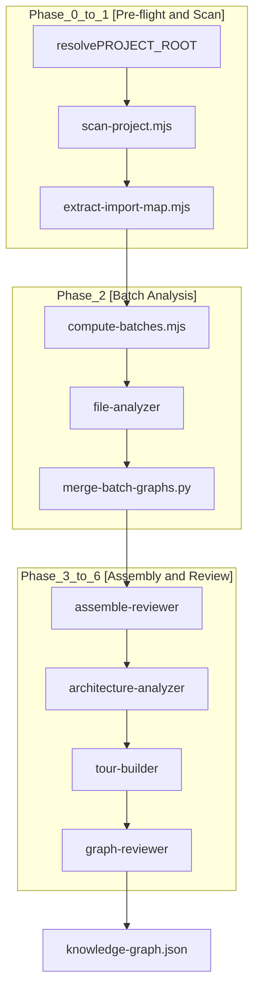
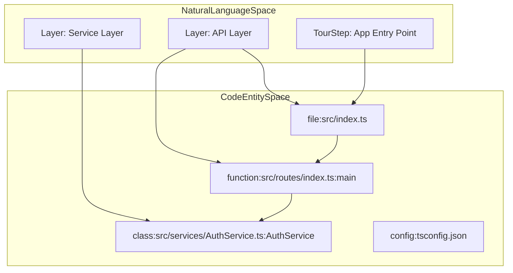
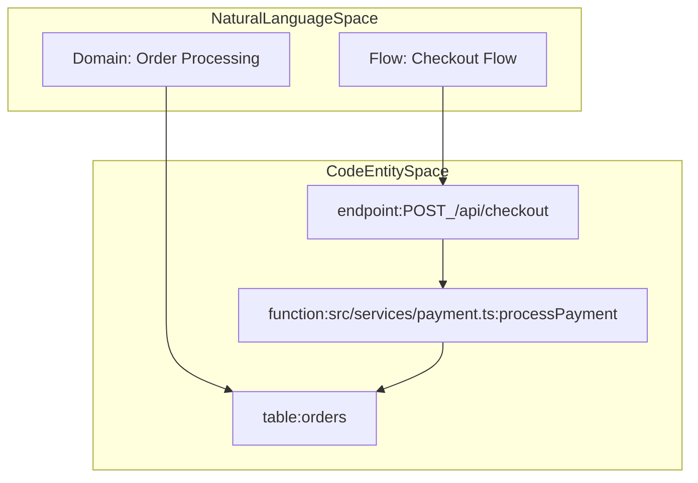

<!-- source: DeepWiki mcp.deepwiki.com · repo Egonex-AI/Understand-Anything · page 2 Analysis Pipeline · fetched 2026-10-30 -->

# Analysis Pipeline

Relevant source files

The following files were used as context for generating this wiki page:

- [CLAUDE.md](CLAUDE.md)
- [tests/skill/understand/test_incremental_symbols.test.mjs](tests/skill/understand/test_incremental_symbols.test.mjs)
- [tests/skill/understand/test_prepare_incremental.test.mjs](tests/skill/understand/test_prepare_incremental.test.mjs)
- [understand-anything-plugin/agents/architecture-analyzer.md](understand-anything-plugin/agents/architecture-analyzer.md)
- [understand-anything-plugin/agents/article-analyzer.md](understand-anything-plugin/agents/article-analyzer.md)
- [understand-anything-plugin/agents/assemble-reviewer.md](understand-anything-plugin/agents/assemble-reviewer.md)
- [understand-anything-plugin/agents/domain-analyzer.md](understand-anything-plugin/agents/domain-analyzer.md)
- [understand-anything-plugin/agents/file-analyzer.md](understand-anything-plugin/agents/file-analyzer.md)
- [understand-anything-plugin/agents/graph-reviewer.md](understand-anything-plugin/agents/graph-reviewer.md)
- [understand-anything-plugin/agents/knowledge-graph-guide.md](understand-anything-plugin/agents/knowledge-graph-guide.md)
- [understand-anything-plugin/agents/project-scanner.md](understand-anything-plugin/agents/project-scanner.md)
- [understand-anything-plugin/agents/tour-builder.md](understand-anything-plugin/agents/tour-builder.md)
- [understand-anything-plugin/skills/understand/SKILL.md](understand-anything-plugin/skills/understand/SKILL.md)
- [understand-anything-plugin/skills/understand/finalize-incremental.mjs](understand-anything-plugin/skills/understand/finalize-incremental.mjs)
- [understand-anything-plugin/skills/understand/prepare-incremental.mjs](understand-anything-plugin/skills/understand/prepare-incremental.mjs)
- [understand-anything-plugin/skills/understand/prepare-symbol-retry.mjs](understand-anything-plugin/skills/understand/prepare-symbol-retry.mjs)
- [understand-anything-plugin/skills/understand/validate-incremental-symbols.mjs](understand-anything-plugin/skills/understand/validate-incremental-symbols.mjs)

The Understand Anything analysis pipeline transforms a codebase into a rich, interactive `KnowledgeGraph`. This process relies on a multi-agent system orchestrating seven distinct phases, combining deterministic static analysis with Large Language Model (LLM) semantic reasoning [understand-anything-plugin/skills/understand/SKILL.md:7-10]().

This parent page outlines the high-level workflow, the agent roles, and the strategic split between deterministic and LLM-driven components. For granular technical specifications, consult the child pages:
- Project Scanner & File Discovery: [Project Scanner & File Discovery](#2.1)
- File Analyzer & Batch Processing: [File Analyzer & Batch Processing](#2.2)
- Graph Assembly & Validation: [Graph Assembly & Validation](#2.3)
- Tour Builder & Architecture Analyzer: [Tour Builder & Architecture Analyzer](#2.4)
- Domain & Knowledge Graph Skills: [Domain & Knowledge Graph Skills](#2.5)
- Figma Design Graph Skill: [Figma Design Graph Skill](#2.6)

---

## Pipeline Architecture & Hybrid Split

The pipeline uses a hybrid execution model to maximize both precision and semantic depth:
- **Deterministic Processing:** Handled by dedicated Node.js and Python scripts (`scan-project.mjs`, `extract-import-map.mjs`, `merge-batch-graphs.py`) for file enumeration, language detection, Tree-sitter parsing, import resolution, and structural graph merging [understand-anything-plugin/agents/project-scanner.md:15-18]().
- **LLM-driven Processing:** Delegated to specialized agents (`file-analyzer`, `architecture-analyzer`, `tour-builder`, `graph-reviewer`) for summarization, tag generation, architectural reasoning, and pedagogical tour planning [understand-anything-plugin/agents/file-analyzer.md:1-6](), [understand-anything-plugin/agents/architecture-analyzer.md:1-6](), [understand-anything-plugin/agents/tour-builder.md:1-6]().

Diagram: Pipeline Phase Flow

Sources: [understand-anything-plugin/skills/understand/SKILL.md:28-41](), [understand-anything-plugin/agents/project-scanner.md:25-28]()

---

## The Seven Phases Overview

1. **Phase 0 — Pre-flight:** Resolves `PROJECT_ROOT`, manages git worktree redirects, and ensures `@understand-anything/core` build artifacts are present [understand-anything-plugin/skills/understand/SKILL.md:43-120]().
2. **Phase 1 — Project Scan:** Inventories files, applies `.understandignore` rules, detects languages, and parses package manifests for narrative metadata. For details, see [Project Scanner & File Discovery](#2.1).
3. **Phase 2 — File Analysis:** Batches files and executes parallel `file-analyzer` subagents using Tree-sitter extraction (`extract-structure.mjs`). For details, see [File Analyzer & Batch Processing](#2.2).
4. **Phase 3 — Graph Assembly & Subdomain Merging:** Canonicalizes node IDs, merges batch graphs, and runs `assemble-reviewer` for semantic recovery. For details, see [Graph Assembly & Validation](#2.3).
5. **Phase 4 — Architecture & Layer Assignment:** Computes import densities and applies layer heuristics via `architecture-analyzer`. For details, see [Tour Builder & Architecture Analyzer](#2.4).
6. **Phase 5 — Tour Generation:** Builds a graph topology via BFS and fan-in ranking, generating guided learning steps with `tour-builder`. For details, see [Tour Builder & Architecture Analyzer](#2.4).
7. **Phase 6 — Validation:** Runs deterministic schema checks and referential integrity validations via `graph-reviewer`. For details, see [Graph Assembly & Validation](#2.3).

---

## Agent Roles

- `project-scanner`: Enumerates files, detects languages, and builds initial import maps [understand-anything-plugin/agents/project-scanner.md:1-6]().
- `file-analyzer`: Executes structural extraction scripts and builds semantic summaries, tags, and complexity ratings [understand-anything-plugin/agents/file-analyzer.md:1-6]().
- `assemble-reviewer`: Recovers dropped nodes and resolves cross-batch gaps [understand-anything-plugin/agents/assemble-reviewer.md:1-6]().
- `architecture-analyzer`: Identifies logical layers and assigns file nodes to layers [understand-anything-plugin/agents/architecture-analyzer.md:1-6]().
- `tour-builder`: Constructs ordered traversal paths through the codebase [understand-anything-plugin/agents/tour-builder.md:1-6]().
- `graph-reviewer`: Validates final graph structure against Zod schemas and referential integrity constraints [understand-anything-plugin/agents/graph-reviewer.md:1-6]().

---

## Bridging Natural Language to Code Entity Space

To provide meaningful explorations, the pipeline maps abstract textual concepts and high-level architecture directly to precise code symbols, file paths, and functions.

Diagram: Architecture Layer to Code Entity Mapping

Sources: [understand-anything-plugin/agents/architecture-analyzer.md:30-47](), [understand-anything-plugin/agents/tour-builder.md:1-6]()

Diagram: Domain and Artifact Navigation Bridge

Sources: [understand-anything-plugin/agents/domain-analyzer.md:27-32](), [understand-anything-plugin/agents/graph-reviewer.md:44-48]()

---

## Specialized Graph Skills

- **Domain Graph Skill (`/understand-domain`):** Processes business domains, flows, and steps into `domain-graph.json`. For details, see [Domain & Knowledge Graph Skills](#2.5).
- **Knowledge Base Skill (`/understand-knowledge`):** Parses Karpathy-pattern wikis into a structured knowledge graph. For details, see [Domain & Knowledge Graph Skills](#2.5).
- **Figma Design Graph Skill (`/understand-figma`):** Fetches design metadata via `figma-scan.mjs` and links UI design tokens to code components. For details, see [Figma Design Graph Skill](#2.6).

---

