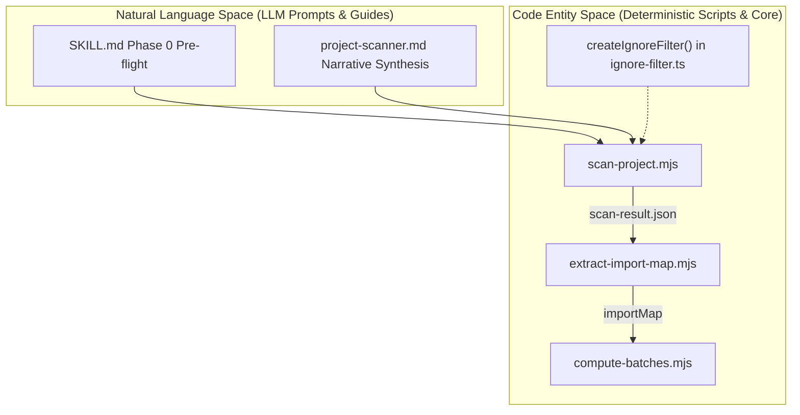
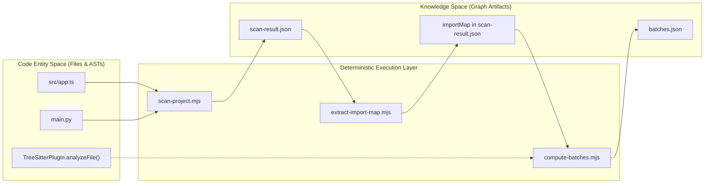

<!-- source: DeepWiki mcp.deepwiki.com · repo Egonex-AI/Understand-Anything · page 2.1 Project Scanner & File Discovery · fetched 2026-10-30 -->

# Project Scanner & File Discovery

Relevant source files

The following files were used as context for generating this wiki page:

- [tests/skill/understand/test_compute_batches.test.mjs](tests/skill/understand/test_compute_batches.test.mjs)
- [tests/skill/understand/test_extract_import_map.test.mjs](tests/skill/understand/test_extract_import_map.test.mjs)
- [tests/skill/understand/test_scan_project.test.mjs](tests/skill/understand/test_scan_project.test.mjs)
- [understand-anything-plugin/packages/core/src/__tests__/change-classifier.test.ts](understand-anything-plugin/packages/core/src/__tests__/change-classifier.test.ts)
- [understand-anything-plugin/packages/core/src/__tests__/ignore-generator.test.ts](understand-anything-plugin/packages/core/src/__tests__/ignore-generator.test.ts)
- [understand-anything-plugin/packages/core/src/change-classifier.ts](understand-anything-plugin/packages/core/src/change-classifier.ts)
- [understand-anything-plugin/packages/core/src/ignore-generator.ts](understand-anything-plugin/packages/core/src/ignore-generator.ts)
- [understand-anything-plugin/skills/understand/compute-batches.mjs](understand-anything-plugin/skills/understand/compute-batches.mjs)
- [understand-anything-plugin/skills/understand/extract-import-map.mjs](understand-anything-plugin/skills/understand/extract-import-map.mjs)
- [understand-anything-plugin/skills/understand/generate-ignore.mjs](understand-anything-plugin/skills/understand/generate-ignore.mjs)
- [understand-anything-plugin/skills/understand/scan-project.mjs](understand-anything-plugin/skills/understand/scan-project.mjs)

## Purpose and Scope

The **Project Scanner & File Discovery** subsystem implements Phases 0 through 1.5 of the Understand Anything analysis pipeline. Its primary objective is to inventory a codebase, detect languages and file categories, apply ignore rules via `.understandignore`, and extract a deterministic import map and louvain-based processing batches. 

This phase separates concerns between deterministic Node.js scripts and guided LLM agent narratives:
- **`scan-project.mjs`**: Enumerates files using `git ls-files` or recursive directory traversal, applying ignore filters and language classification [understand-anything-plugin/skills/understand/scan-project.mjs:18-27]().
- **`extract-import-map.mjs`**: Resolves raw import paths using `@understand-anything/core` Tree-sitter parsers into a project-internal import map [understand-anything-plugin/skills/understand/extract-import-map.mjs:5-14]().
- **`compute-batches.mjs`**: Applies Louvain community detection on the import graph and extracts top-level exported symbols to build parallel analysis batches (`batches.json`) [understand-anything-plugin/skills/understand/compute-batches.mjs:3-16]().
- **`ignore-generator.ts`**: Generates starter `.understandignore` configurations tailored to detected project structures and test conventions [understand-anything-plugin/packages/core/src/ignore-generator.ts:1-13]().

Sources: [understand-anything-plugin/skills/understand/scan-project.mjs:1-58](), [understand-anything-plugin/skills/understand/extract-import-map.mjs:2-34](), [understand-anything-plugin/skills/understand/compute-batches.mjs:2-21](), [understand-anything-plugin/packages/core/src/ignore-generator.ts:1-13]()

---

## Scan Workflow & Pipeline Orchestration

The project scanning workflow coordinates user-facing skill prompts with deterministic script executions.

Title: Pipeline Orchestration from Natural Language to Code Execution

Sources: [understand-anything-plugin/skills/understand/SKILL.md:43-165](), [understand-anything-plugin/skills/understand/scan-project.mjs:1-58](), [understand-anything-plugin/skills/understand/extract-import-map.mjs:2-34]()

---

## Detailed Components

### 1. File Enumeration and Detection (`scan-project.mjs`)

The `scan-project.mjs` script performs file enumeration and rule-based classification:
- **Enumeration Strategy**: Executes `git ls-files -co --exclude-standard` when inside a git worktree, falling back to a recursive synchronous directory walk [understand-anything-plugin/skills/understand/scan-project.mjs:18-21]().
- **Ignore Filtering**: Delegates pattern matching to `createIgnoreFilter` from `@understand-anything/core`, reading `.understandignore` and built-in defaults [understand-anything-plugin/skills/understand/scan-project.mjs:18-21]().
- **Language Detection**: Uses `LANGUAGE_BY_EXT` and filename tables to assign canonical language identifiers across 40+ languages [understand-anything-plugin/skills/understand/scan-project.mjs:100-214]().
- **Categorization & Metrics**: Computes line counts (`sizeLines`), estimates project complexity (`small` to `very-large`), and assigns a `fileCategory` (`code`, `config`, `docs`, `infra`, `data`, `script`, `markup`) [understand-anything-plugin/skills/understand/scan-project.mjs:22-27]().

Sources: [understand-anything-plugin/skills/understand/scan-project.mjs:1-58](), [understand-anything-plugin/skills/understand/scan-project.mjs:116-214]()

### 2. Deterministic Import Mapping (`extract-import-map.mjs`)

To bypass slow and inconsistent LLM-based regex scraping, `extract-import-map.mjs` provides a deterministic syntax-aware resolver:
- **Parser Integration**: Leverages `TreeSitterPlugin` and language extractors from `@understand-anything/core` to parse code structure [understand-anything-plugin/skills/understand/extract-import-map.mjs:5-13]().
- **Resolution Engine**: Resolves relative imports, `tsconfig.json` path aliases, and package exports into project-relative POSIX file paths [understand-anything-plugin/skills/understand/extract-import-map.mjs:96-180]().
- **Concurrency**: Reads input files in bounded parallel chunks while preserving deterministic output order [understand-anything-plugin/skills/understand/extract-import-map.mjs:57-68]().

Sources: [understand-anything-plugin/skills/understand/extract-import-map.mjs:1-184](), [tests/skill/understand/test_extract_import_map.test.mjs:67-98]()

### 3. Community Batching & Export Extraction (`compute-batches.mjs`)

Phase 1.5 processes the import graph to generate execution batches:
- **Louvain Clustering**: Uses `graphology` and `graphology-communities-louvain` to group highly-interconnected files into communities, minimizing cross-batch edges [understand-anything-plugin/skills/understand/compute-batches.mjs:5-7]().
- **Symbol Extraction**: Extracts top-level exported symbols (functions, classes, constants) via `TreeSitterPlugin.analyzeFile()` to build a `neighborMap` [understand-anything-plugin/skills/understand/compute-batches.mjs:59-134]().
- **Non-Code Clustering**: Groups infra files, workflows, and migrations using directory-proximity heuristics (`buildNonCodeBatches`) [understand-anything-plugin/skills/understand/compute-batches.mjs:138-144]().

Sources: [understand-anything-plugin/skills/understand/compute-batches.mjs:1-144](), [tests/skill/understand/test_compute_batches.test.mjs:87-105]()

---

## Ignore Filtering & Starter Generator

The ignore subsystem prevents noise from polluting the Knowledge Graph:
- **`createIgnoreFilter`**: Combines default exclusions (`node_modules`, `.git`, lockfiles) with custom rules defined in `.understandignore` [understand-anything-plugin/packages/core/src/ignore-filter.ts:9-70]().
- **`generateStarterIgnoreFile`**: Inspects disk layout to detect test directories (`__tests__`, `tests`, `spec`, `benches`) and outputs commented-out starter suggestions [understand-anything-plugin/packages/core/src/ignore-generator.ts:1-59]().
- **`generate-ignore.mjs`**: CLI script invoking `generateStarterIgnoreFile` to write `.understandignore` into the project data directory (`.ua/` or legacy `.understand-anything/`) [understand-anything-plugin/skills/understand/generate-ignore.mjs:5-18]().

Sources: [understand-anything-plugin/packages/core/src/ignore-generator.ts:20-159](), [understand-anything-plugin/packages/core/src/__tests__/ignore-generator.test.ts:34-177](), [understand-anything-plugin/skills/understand/generate-ignore.mjs:1-69]()

---

## Data Flow: Code Space to Knowledge Space

Title: Data Flow Transformation from Code Entities to Graph Artifacts

Sources: [understand-anything-plugin/skills/understand/scan-project.mjs:37-48](), [understand-anything-plugin/skills/understand/extract-import-map.mjs:24-29](), [understand-anything-plugin/skills/understand/compute-batches.mjs:5-16]()

---

## Technical Reference: Language & Category Mapping

| Extension | Language ID | Category |
| :--- | :--- | :--- |
| `.ts`, `.tsx` | `typescript` | `code` |
| `.py`, `.pyi` | `python` | `code` |
| `.go` | `go` | `code` |
| `.rb`, `.rake` | `ruby` | `code` |
| `.sql` | `sql` | `data` |
| `Dockerfile` | `dockerfile` | `infra` |
| `.yaml`, `.json` | `yaml`/`json` | `config` |
| `.md`, `.rst` | `markdown` | `docs` |

Sources: [understand-anything-plugin/skills/understand/scan-project.mjs:116-193]()

---

