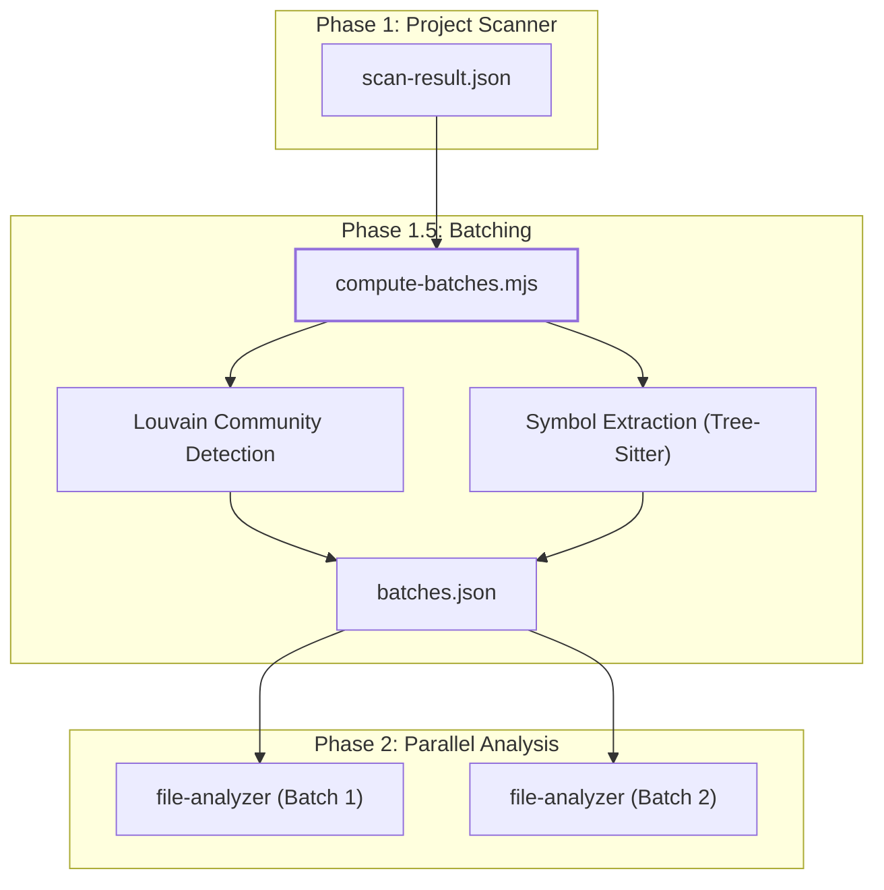
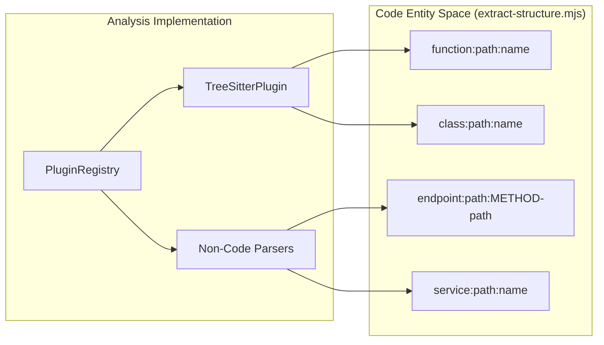
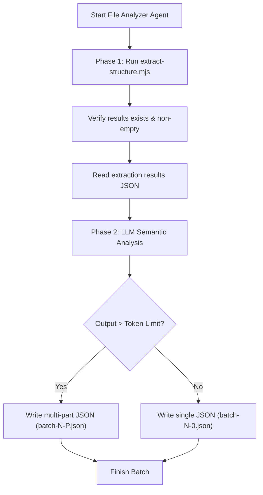

<!-- source: DeepWiki mcp.deepwiki.com · repo Egonex-AI/Understand-Anything · page 2.2 File Analyzer & Batch Processing · fetched 2026-10-30 -->

# File Analyzer & Batch Processing

Relevant source files

The following files were used as context for generating this wiki page:

- [CLAUDE.md](CLAUDE.md)
- [pnpm-workspace.yaml](pnpm-workspace.yaml)
- [tests/skill/understand/test_compute_batches.test.mjs](tests/skill/understand/test_compute_batches.test.mjs)
- [tests/skill/understand/test_extract_structure_cli.test.mjs](tests/skill/understand/test_extract_structure_cli.test.mjs)
- [tests/skill/understand/test_scan_project.test.mjs](tests/skill/understand/test_scan_project.test.mjs)
- [understand-anything-plugin/agents/architecture-analyzer.md](understand-anything-plugin/agents/architecture-analyzer.md)
- [understand-anything-plugin/agents/article-analyzer.md](understand-anything-plugin/agents/article-analyzer.md)
- [understand-anything-plugin/agents/assemble-reviewer.md](understand-anything-plugin/agents/assemble-reviewer.md)
- [understand-anything-plugin/agents/domain-analyzer.md](understand-anything-plugin/agents/domain-analyzer.md)
- [understand-anything-plugin/agents/file-analyzer.md](understand-anything-plugin/agents/file-analyzer.md)
- [understand-anything-plugin/agents/graph-reviewer.md](understand-anything-plugin/agents/graph-reviewer.md)
- [understand-anything-plugin/agents/knowledge-graph-guide.md](understand-anything-plugin/agents/knowledge-graph-guide.md)
- [understand-anything-plugin/agents/project-scanner.md](understand-anything-plugin/agents/project-scanner.md)
- [understand-anything-plugin/agents/tour-builder.md](understand-anything-plugin/agents/tour-builder.md)
- [understand-anything-plugin/pnpm-workspace.yaml](understand-anything-plugin/pnpm-workspace.yaml)
- [understand-anything-plugin/skills/understand/compute-batches.mjs](understand-anything-plugin/skills/understand/compute-batches.mjs)
- [understand-anything-plugin/skills/understand/extract-structure-result.mjs](understand-anything-plugin/skills/understand/extract-structure-result.mjs)
- [understand-anything-plugin/skills/understand/extract-structure.mjs](understand-anything-plugin/skills/understand/extract-structure.mjs)
- [understand-anything-plugin/skills/understand/scan-project.mjs](understand-anything-plugin/skills/understand/scan-project.mjs)
- [understand-anything-plugin/src/__tests__/extract-structure.test.mjs](understand-anything-plugin/src/__tests__/extract-structure.test.mjs)
- [understand-anything-plugin/src/__tests__/worktree-redirect.test.mjs](understand-anything-plugin/src/__tests__/worktree-redirect.test.mjs)

This page details Phase 2 of the Analysis Pipeline, focusing on how files are segmented into batches, processed by deterministic extraction scripts, and enriched by LLM-driven semantic analysis.

## Overview of Phase 2

Phase 2, "Analyzing files," transforms the project inventory into a preliminary set of `KnowledgeGraph` nodes and edges. It utilizes a hybrid approach: deterministic scripts for structural extraction (functions, classes, imports) and LLM subagents for semantic enrichment (summaries, tags, complexity).

The process follows this sequence:
1. **Batch Computation**: `compute-batches.mjs` segments files into groups based on import topology [understand-anything-plugin/skills/understand/compute-batches.mjs:5-16]().
2. **Parallel Dispatch**: `file-analyzer` subagents are invoked for each batch [understand-anything-plugin/agents/file-analyzer.md:4-6]().
3. **Structural Extraction**: `extract-structure.mjs` uses `tree-sitter` and specialized parsers to identify code entities [understand-anything-plugin/skills/understand/extract-structure.mjs:75-82]().
4. **Semantic Analysis**: LLMs synthesize summaries and identify higher-level relationships [understand-anything-plugin/agents/file-analyzer.md:17]().
5. **Multi-part Persistence**: Results are written to intermediate JSON files to handle token and context limits [understand-anything-plugin/agents/file-analyzer.md:145-146]().

Sources: [understand-anything-plugin/agents/file-analyzer.md:4-17](), [understand-anything-plugin/skills/understand/compute-batches.mjs:5-16](), [understand-anything-plugin/skills/understand/extract-structure.mjs:75-82]()

## Batch Computation with `compute-batches.mjs`

The `compute-batches.mjs` script organizes files into manageable batches. It prioritizes keeping semantically related files (those that import one another) in the same batch to provide the LLM with better context.

### Semantic Batching Algorithm
1. **Graph Construction**: The script builds a graph where nodes are files and edges represent imports from the `importMap` [understand-anything-plugin/skills/understand/compute-batches.mjs:58-62]().
2. **Louvain Community Detection**: It uses the Louvain algorithm to detect "communities" of files that are tightly coupled [understand-anything-plugin/skills/understand/compute-batches.mjs:55-56]().
3. **Non-Code Grouping**: Non-code files are grouped by heuristics, such as grouping `Dockerfile` clusters by directory or CI/CD workflows by platform [understand-anything-plugin/skills/understand/compute-batches.mjs:145-167]().
4. **Symbol Extraction**: For each code file, it extracts top-level exports using `TreeSitterPlugin` to populate a `neighborMap`. This map allows agents to resolve cross-batch edges with confidence [understand-anything-plugin/skills/understand/compute-batches.mjs:65-80](), [understand-anything-plugin/agents/file-analyzer.md:56-63]().

### Batch Processing Data Flow

Title: "Batching Data Flow"
Sources: [understand-anything-plugin/skills/understand/compute-batches.mjs:5-16](), [understand-anything-plugin/skills/understand/compute-batches.mjs:55-62](), [understand-anything-plugin/skills/understand/compute-batches.mjs:65-80]()

## Structural Extraction via `extract-structure.mjs`

The `file-analyzer` agent begins its task by executing `extract-structure.mjs`. This script provides deterministic extraction without relying on LLM regex generation.

### Extraction Logic
* **Code Files**: Uses `TreeSitterPlugin` (via `@understand-anything/core`) to parse files into ASTs and extract functions, classes, and call graphs [understand-anything-plugin/skills/understand/extract-structure.mjs:75-77]().
* **Non-Code Files**: Uses specialized parsers to extract logical units like `services` (Docker), `endpoints` (OpenAPI), `resources` (Terraform), or `steps` (CI/CD) [understand-anything-plugin/agents/file-analyzer.md:121-130]().
* **Validation**: The `extract-structure-result.mjs` module validates the output against a strict schema to ensure `lineRange`, `params`, and `name` fields are correctly formatted [understand-anything-plugin/skills/understand/extract-structure-result.mjs:52-97]().

### From Code Space to Entity Space

Title: "Structural Mapping"
Sources: [understand-anything-plugin/skills/understand/extract-structure.mjs:79-82](), [understand-anything-plugin/agents/file-analyzer.md:121-130](), [understand-anything-plugin/skills/understand/extract-structure-result.mjs:52-97]()

## LLM Semantic Enrichment

Once the structural results are loaded, the `file-analyzer` subagent performs semantic analysis.

1. **Summary Generation**: Writes a concise `summary` for each node based on the extracted structure and file content [understand-anything-plugin/agents/file-analyzer.md:17]().
2. **Tagging**: Assigns localized tags (e.g., "middleware", "api-handler") [understand-anything-plugin/agents/file-analyzer.md:23]().
3. **Complexity**: Assigns a rating of `simple`, `moderate`, or `complex` based on logic density [understand-anything-plugin/agents/file-analyzer.md:17]().
4. **Relationship Discovery**: Identifies edges that static analysis might miss, such as `related`, `publishes`, or `subscribes` [understand-anything-plugin/agents/file-analyzer.md:17]().
5. **Language Directives**: If specified, generates all textual content (summaries, tags) in a specific target language (e.g., Chinese) [understand-anything-plugin/agents/file-analyzer.md:21-25]().

Sources: [understand-anything-plugin/agents/file-analyzer.md:17](), [understand-anything-plugin/agents/file-analyzer.md:21-25]()

## Multi-Part Output Protocol

To stay within LLM token limits, the system supports splitting a single batch's results into multiple files.

* **Temporary Storage**: Agents write to `$UA_DIR/tmp/ua-file-analyzer-input-<batchIndex>.json` [understand-anything-plugin/agents/file-analyzer.md:35-45]().
* **Chunking**: If a batch analysis is too large, the agent is instructed to use a multi-part naming convention: `batch-<batchIndex>-<partIndex>.json` [understand-anything-plugin/agents/file-analyzer.md:145-146]().
* **Outcome Validation**: The system tracks `analysisOutcomes` (succeeded, failed, skipped) for both structural and call-graph analysis to ensure pipeline health [understand-anything-plugin/skills/understand/extract-structure.mjs:86-89]().

### File Analyzer Execution Loop

Title: "File Analyzer Execution Loop"
Sources: [understand-anything-plugin/agents/file-analyzer.md:17](), [understand-anything-plugin/agents/file-analyzer.md:68-76](), [understand-anything-plugin/agents/file-analyzer.md:145-146](), [understand-anything-plugin/skills/understand/extract-structure.mjs:86-89]()

Sources:
- [understand-anything-plugin/agents/file-analyzer.md]()
- [understand-anything-plugin/skills/understand/compute-batches.mjs]()
- [understand-anything-plugin/skills/understand/extract-structure.mjs]()
- [understand-anything-plugin/skills/understand/extract-structure-result.mjs]()
- [understand-anything-plugin/hooks/auto-update-prompt.md]()

---

