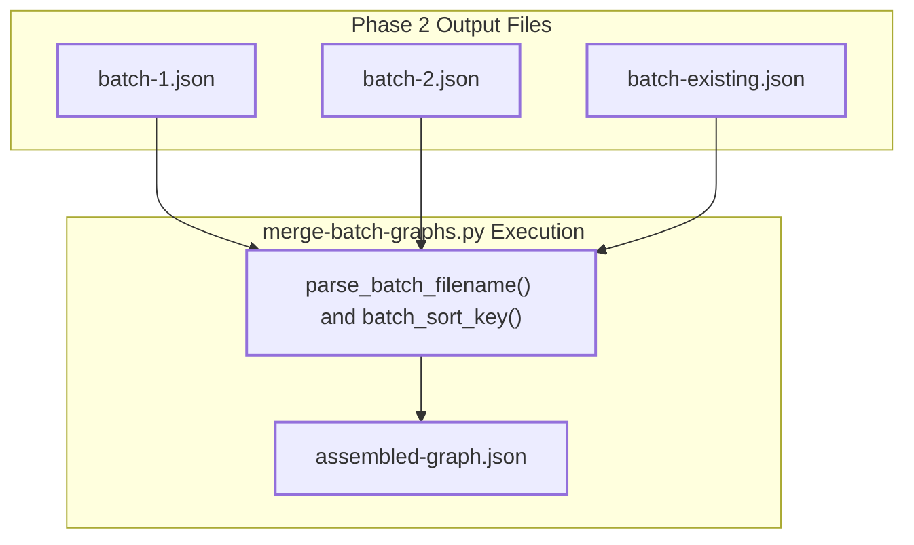
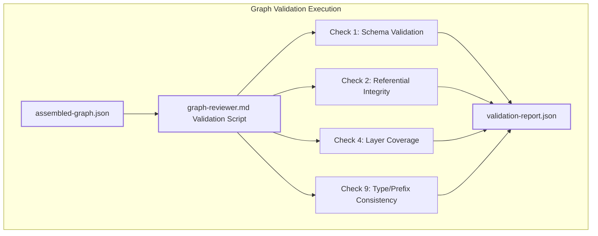

<!-- source: DeepWiki mcp.deepwiki.com · repo Egonex-AI/Understand-Anything · page 2.3 Graph Assembly & Validation · fetched 2026-10-30 -->

# Graph Assembly & Validation

Relevant source files

The following files were used as context for generating this wiki page:

- [.github/workflows/ci.yml](.github/workflows/ci.yml)
- [CLAUDE.md](CLAUDE.md)
- [tests/skill/knowledge/test_parse_knowledge_base.py](tests/skill/knowledge/test_parse_knowledge_base.py)
- [tests/skill/understand/test_merge_batch_graphs.py](tests/skill/understand/test_merge_batch_graphs.py)
- [tests/skill/understand/test_merge_subdomain_graphs.py](tests/skill/understand/test_merge_subdomain_graphs.py)
- [understand-anything-plugin/agents/architecture-analyzer.md](understand-anything-plugin/agents/architecture-analyzer.md)
- [understand-anything-plugin/agents/article-analyzer.md](understand-anything-plugin/agents/article-analyzer.md)
- [understand-anything-plugin/agents/assemble-reviewer.md](understand-anything-plugin/agents/assemble-reviewer.md)
- [understand-anything-plugin/agents/domain-analyzer.md](understand-anything-plugin/agents/domain-analyzer.md)
- [understand-anything-plugin/agents/file-analyzer.md](understand-anything-plugin/agents/file-analyzer.md)
- [understand-anything-plugin/agents/graph-reviewer.md](understand-anything-plugin/agents/graph-reviewer.md)
- [understand-anything-plugin/agents/knowledge-graph-guide.md](understand-anything-plugin/agents/knowledge-graph-guide.md)
- [understand-anything-plugin/agents/project-scanner.md](understand-anything-plugin/agents/project-scanner.md)
- [understand-anything-plugin/agents/tour-builder.md](understand-anything-plugin/agents/tour-builder.md)
- [understand-anything-plugin/packages/dashboard/src/components/KnowledgeGraphView.tsx](understand-anything-plugin/packages/dashboard/src/components/KnowledgeGraphView.tsx)
- [understand-anything-plugin/skills/understand-knowledge/merge-knowledge-graph.py](understand-anything-plugin/skills/understand-knowledge/merge-knowledge-graph.py)
- [understand-anything-plugin/skills/understand-knowledge/parse-knowledge-base.py](understand-anything-plugin/skills/understand-knowledge/parse-knowledge-base.py)
- [understand-anything-plugin/skills/understand/merge-batch-graphs.py](understand-anything-plugin/skills/understand/merge-batch-graphs.py)
- [understand-anything-plugin/skills/understand/merge-subdomain-graphs.py](understand-anything-plugin/skills/understand/merge-subdomain-graphs.py)
- [understand-anything-plugin/src/__tests__/merge-recover-imports.test.mjs](understand-anything-plugin/src/__tests__/merge-recover-imports.test.mjs)

This page details Phases 3 and 4 of the Analysis Pipeline, focusing on how raw, batch-processed graph data is consolidated, canonicalized, validated, and structured into logical layers. This involves batch merging via `merge-batch-graphs.py`, ID canonicalization, `tested_by` linking, subdomain merging via `merge-subdomain-graphs.py`, semantic recovery by `assemble-reviewer`, referential integrity checks by `graph-reviewer`, and architectural layer assignment by `architecture-analyzer`.

Sources: [understand-anything-plugin/skills/understand/merge-batch-graphs.py:1-18](), [understand-anything-plugin/skills/understand/merge-subdomain-graphs.py:1-20](), [understand-anything-plugin/agents/graph-reviewer.md:1-20]()

---

## 1. Phase 3: Graph Assembly (`merge-batch-graphs.py`)

After individual files and batches have been analyzed by `file-analyzer` agents, their outputs (nodes and edges) are merged into a single, coherent graph. This phase uses Python scripts to perform consolidation, sorting, and normalization under the project's data directory (`.ua/` or legacy `.understand-anything/`) [understand-anything-plugin/skills/understand/merge-batch-graphs.py:11-18]().

### 1.1 Batch Sorting and Loading

The `merge-batch-graphs.py` script combines all `batch-*.json` files generated by `file-analyzer` agents into a single `assembled-graph.json` [understand-anything-plugin/skills/understand/merge-batch-graphs.py:5-18](). It uses `parse_batch_filename` and `batch_sort_key` to order numeric batches correctly, ensuring `batch-existing.json` (used during incremental updates) sorts before freshly analyzed numeric batches [understand-anything-plugin/skills/understand/merge-batch-graphs.py:163-185]().

Title: "Data Flow for Batch Merging and Sorting"
Sources: [understand-anything-plugin/skills/understand/merge-batch-graphs.py:163-185]()

### 1.2 ID Canonicalization & Prefixes

A crucial step in merging is ensuring all node IDs adhere to a canonical format. The canonicalization process strips double prefixes (e.g., `file:file:src/foo.ts` $\rightarrow$ `file:src/foo.ts`), removes project-name prefixes, and applies correct prefixes based on node type [understand-anything-plugin/skills/understand/merge-batch-graphs.py:38-83]().

The `VALID_NODE_PREFIXES` set and `TYPE_TO_PREFIX` mapping enforce these constraints across structural types (`file`, `function`, `class`, `module`), configuration types (`config`, `service`, `table`, `endpoint`), and knowledge-base types (`article`, `entity`, `claim`) [understand-anything-plugin/skills/understand/merge-batch-graphs.py:38-83]().

### 1.3 Complexity & Direction Normalization

Node `complexity` values are normalized to a standard set (`simple`, `moderate`, `complex`) via `COMPLEXITY_MAP`, translating aliases like `easy` or `hard` [understand-anything-plugin/skills/understand/merge-batch-graphs.py:85-96](). Similarly, edge directions are canonicalized using `normalize_direction`, mapping aliases like `both` or `mutual` to `bidirectional` [understand-anything-plugin/skills/understand/merge-batch-graphs.py:142-152]().

### 1.4 Tested-By Linker Configuration

The script automatically infers `tested_by` relationships between code and test files by evaluating file paths against language-specific patterns (`_TEST_NAME_PATTERNS`, `_JS_TS_EXTS`, and `_MIRROR_PRODUCTION_ROOTS`) [understand-anything-plugin/skills/understand/merge-batch-graphs.py:100-138]().

Sources: [understand-anything-plugin/skills/understand/merge-batch-graphs.py:30-185]()

---

## 2. Subdomain Merging (`merge-subdomain-graphs.py`)

For multi-domain projects, `merge-subdomain-graphs.py` auto-discovers subdomain `knowledge-graph*.json` files in the project's data directory (excluding the base `knowledge-graph.json` to prevent self-merging loops) [understand-anything-plugin/skills/understand/merge-subdomain-graphs.py:5-16]().

- **Nodes**: Deduplicated by `id`, with later occurrences winning [understand-anything-plugin/skills/understand/merge-subdomain-graphs.py:83-95]().
- **Edges**: Deduplicated by the `(source, target, type)` triplet, retaining the edge with the highest `weight` [understand-anything-plugin/skills/understand/merge-subdomain-graphs.py:96-109]().
- **Structural Edges**: Edge types in `STRUCTURAL_EDGE_TYPES` (`contains_flow`, `flow_step`, `cross_domain`) carry domain hierarchy. If they are dropped due to missing endpoints, they generate prominent warnings and are scheduled for retry via `merge-report.json` [understand-anything-plugin/skills/understand/merge-subdomain-graphs.py:39-40, 127-131]().

Sources: [understand-anything-plugin/skills/understand/merge-subdomain-graphs.py:22-135]()

---

## 3. Semantic Recovery & Graph Validation (Phase 4)

Once graphs are merged, they undergo semantic review and rigorous validation before persistence.

### 3.1 Semantic Recovery by `assemble-reviewer`

After programmatic merging, the `assemble-reviewer` agent performs an LLM-driven semantic review. It catches issues scripts cannot identify, such as missing critical architectural nodes, orphaned control flows, or incorrect relationship semantics that are syntactically valid but logically flawed [understand-anything-plugin/agents/assemble-reviewer.md]().

### 3.2 Referential Integrity Checks by `graph-reviewer`

The `graph-reviewer` agent executes a validation script (Phase 1) that programmatically enforces structural correctness, schema compliance, and referential integrity before rendering an approval decision [understand-anything-plugin/agents/graph-reviewer.md:14-28]().

Title: "Graph Reviewer Validation Pipeline"
Sources: [understand-anything-plugin/agents/graph-reviewer.md:18-123]()

#### Core Validation Checks

| Check Name | Target | Constraint & Rule | Source |
|---|---|---|---|
| **Schema Validation** | Nodes & Edges | Every node must have valid `id`, `type`, `name`, `summary`, `tags`, `complexity`. Edges must have `source`, `target`, `type`, `direction`, `weight`. | [understand-anything-plugin/agents/graph-reviewer.md:31-62]() |
| **Referential Integrity** | Edges, Layers, Tours | Every edge `source`/`target`, layer `nodeIds`, and tour step `nodeIds` must point to an existing node `id`. | [understand-anything-plugin/agents/graph-reviewer.md:63-70]() |
| **Layer Coverage** | File-level Nodes | Every file-level node (`file`, `config`, `service`, etc.) must appear in exactly one layer's `nodeIds`. | [understand-anything-plugin/agents/graph-reviewer.md:80-86]() |
| **Uniqueness** | Node IDs | No duplicate node IDs are permitted across the graph. | [understand-anything-plugin/agents/graph-reviewer.md:87-89]() |
| **Type/Prefix Consistency** | Node IDs & Types | Verify node `type` matches its ID prefix (e.g., `type: "config"` $\rightarrow$ `config:` prefix). | [understand-anything-plugin/agents/graph-reviewer.md:116-123]() |

Sources: [understand-anything-plugin/agents/graph-reviewer.md:1-139](), [understand-anything-plugin/agents/assemble-reviewer.md]()

---

