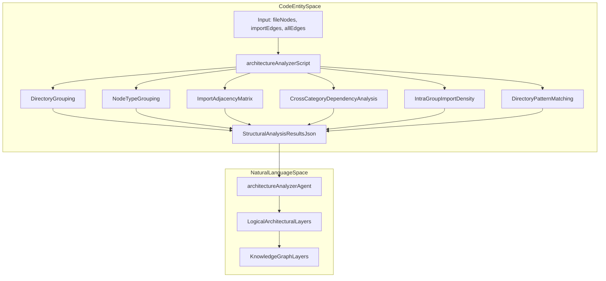
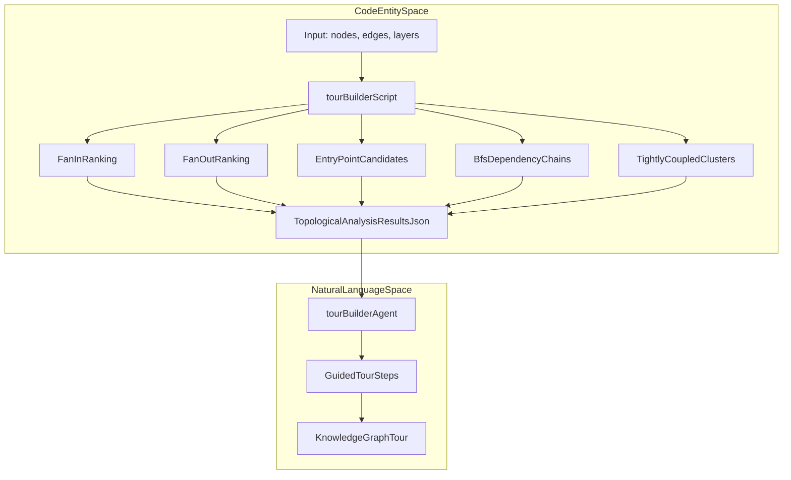

<!-- source: DeepWiki mcp.deepwiki.com · repo Egonex-AI/Understand-Anything · page 2.4 Tour Builder & Architecture Analyzer · fetched 2026-10-30 -->

# Tour Builder & Architecture Analyzer

Relevant source files

The following files were used as context for generating this wiki page:

- [CLAUDE.md](CLAUDE.md)
- [understand-anything-plugin/agents/architecture-analyzer.md](understand-anything-plugin/agents/architecture-analyzer.md)
- [understand-anything-plugin/agents/article-analyzer.md](understand-anything-plugin/agents/article-analyzer.md)
- [understand-anything-plugin/agents/assemble-reviewer.md](understand-anything-plugin/agents/assemble-reviewer.md)
- [understand-anything-plugin/agents/domain-analyzer.md](understand-anything-plugin/agents/domain-analyzer.md)
- [understand-anything-plugin/agents/file-analyzer.md](understand-anything-plugin/agents/file-analyzer.md)
- [understand-anything-plugin/agents/graph-reviewer.md](understand-anything-plugin/agents/graph-reviewer.md)
- [understand-anything-plugin/agents/knowledge-graph-guide.md](understand-anything-plugin/agents/knowledge-graph-guide.md)
- [understand-anything-plugin/agents/project-scanner.md](understand-anything-plugin/agents/project-scanner.md)
- [understand-anything-plugin/agents/tour-builder.md](understand-anything-plugin/agents/tour-builder.md)
- [understand-anything-plugin/packages/core/src/analyzer/layer-detector.ts](understand-anything-plugin/packages/core/src/analyzer/layer-detector.ts)
- [understand-anything-plugin/packages/core/src/analyzer/tour-generator.ts](understand-anything-plugin/packages/core/src/analyzer/tour-generator.ts)
- [understand-anything-plugin/packages/core/src/embedding-search.ts](understand-anything-plugin/packages/core/src/embedding-search.ts)

This page details Phases 4 and 5 of the Analysis Pipeline: Architecture Analysis and Tour Building. These phases transform a flat structural graph into a hierarchical, pedagogical model by assigning nodes to logical layers and generating a guided learning path.

## Architecture Analyzer (Phase 4)

The `architecture-analyzer` agent identifies logical architectural layers within a codebase and assigns every file to exactly one layer [understand-anything-plugin/agents/architecture-analyzer.md:9-10](). This process is split into two phases: a deterministic script for structural analysis and an LLM-driven phase for semantic interpretation. Additionally, the core library provides heuristic fallback detection via `detectLayers` in `layer-detector.ts` [understand-anything-plugin/packages/core/src/analyzer/layer-detector.ts:105-148]().

### Phase 1: Structural Analysis Script & Heuristics

The first phase involves a script (preferably Node.js, falling back to Python) that analyzes file paths and import edges to compute structural patterns [understand-anything-plugin/agents/architecture-analyzer.md:23-25](). In parallel, the core library implements `LAYER_PATTERNS` and `matchFileToLayer` to map directory segments (e.g., `routes`, `services`, `models`) to canonical layers (`API Layer`, `Service Layer`, `Data Layer`, etc.) [understand-anything-plugin/packages/core/src/analyzer/layer-detector.ts:16-97]().

This analysis performs several deterministic operations:
1.  **Directory Grouping**: Files are grouped by their top-level directory after a common path prefix is removed [understand-anything-plugin/agents/architecture-analyzer.md:54-63]().
2.  **Node Type Grouping**: File node IDs are grouped by their `type` (e.g., `file`, `config`, `document`, `service`) to reveal the distribution of code vs. non-code files [understand-anything-plugin/agents/architecture-analyzer.md:65-68]().
3.  **Import Adjacency Matrix**: An adjacency list is built to calculate fan-out and fan-in for each file [understand-anything-plugin/agents/architecture-analyzer.md:70-74]().
4.  **Cross-Category Dependency Analysis**: Identifies relationships between different node type groups [understand-anything-plugin/agents/architecture-analyzer.md:76-87]().
5.  **Inter-Group Import Frequency**: Generates a matrix of import edges between directory groups [understand-anything-plugin/agents/architecture-analyzer.md:89-96]().
6.  **Intra-Group Import Density**: Calculates the density of import edges within a group to evaluate cohesion [understand-anything-plugin/agents/architecture-analyzer.md:98-102]().
7.  **Directory Pattern Matching**: Matches directories against canonical architectural definitions [understand-anything-plugin/agents/architecture-analyzer.md:104-150](), mirrored programmatically in `LAYER_PATTERNS` [understand-anything-plugin/packages/core/src/analyzer/layer-detector.ts:16-67]().

Sources:
- [understand-anything-plugin/agents/architecture-analyzer.md:9-150]()
- [understand-anything-plugin/packages/core/src/analyzer/layer-detector.ts:16-148]()

### Phase 2: Semantic Layer Assignment (LLM)

In the second phase, the `architecture-analyzer` LLM agent uses structural insights to assign every file node to exactly one layer [understand-anything-plugin/agents/architecture-analyzer.md:10-11](). Layer names and descriptions are localized when language directives are present [understand-anything-plugin/agents/architecture-analyzer.md:16-19](). Programmatic fallback via `detectLayers()` utilizes `matchFileToLayer()` to assign unmatched files to a fallback `"Core"` layer [understand-anything-plugin/packages/core/src/analyzer/layer-detector.ts:80-148]().

#### Architecture Analyzer Data Flow

**Diagram: Architecture Analyzer Data Flow**

Sources:
- [understand-anything-plugin/agents/architecture-analyzer.md:9-169]()
- [understand-anything-plugin/packages/core/src/analyzer/layer-detector.ts:16-148]()

---

## Tour Builder (Phase 5)

The `tour-builder` agent designs guided learning tours through codebases, creating 5-15 pedagogical steps that teach project architecture and key concepts in a logical order [understand-anything-plugin/agents/tour-builder.md:10-11](). Alternatively, heuristic tours are generated deterministically via `generateHeuristicTour` in `tour-generator.ts` [understand-anything-plugin/packages/core/src/analyzer/tour-generator.ts:135-208]().

### Phase 1: Graph Topology Script & Heuristic Generation

The topology script and heuristic generator compute structural signals to inform tour construction:
1.  **Fan-In Ranking (Importance)**: Counts incoming edges to identify widely depended-upon modules [understand-anything-plugin/agents/tour-builder.md:55-57]().
2.  **Fan-Out Ranking (Scope)**: Counts outgoing edges to identify orchestrator files [understand-anything-plugin/agents/tour-builder.md:59-61]().
3.  **Entry Point Candidates**: Scores nodes based on filenames (`index.ts`, `main.py`), directory depth, and fan-out/fan-in metrics, prioritizing `README.md` [understand-anything-plugin/agents/tour-builder.md:63-74]().
4.  **Dependency Chains (BFS / Kahn's Algorithm)**: Performs Breadth-First Search or topological sorting (`generateHeuristicTour`) following `imports` and `calls` edges to establish reading order [understand-anything-plugin/agents/tour-builder.md:79-83](), [understand-anything-plugin/packages/core/src/analyzer/tour-generator.ts:135-195]().
5.  **Tightly Coupled Clusters**: Identifies groups with high mutual connectivity [understand-anything-plugin/agents/tour-builder.md:98-102]().

Sources:
- [understand-anything-plugin/agents/tour-builder.md:25-115]()
- [understand-anything-plugin/packages/core/src/analyzer/tour-generator.ts:135-208]()

### Phase 2: Pedagogical Tour Design (LLM)

The `tour-builder` LLM agent uses topological findings to construct 5-15 steps consisting of a `title`, `description`, `nodeIds`, and optional `languageLesson` [understand-anything-plugin/agents/tour-builder.md:16-20](). 

#### Tour Builder Data Flow

**Diagram: Tour Builder Data Flow**

Sources:
- [understand-anything-plugin/agents/tour-builder.md:10-130]()
- [understand-anything-plugin/packages/core/src/analyzer/tour-generator.ts:1-200]()

---

