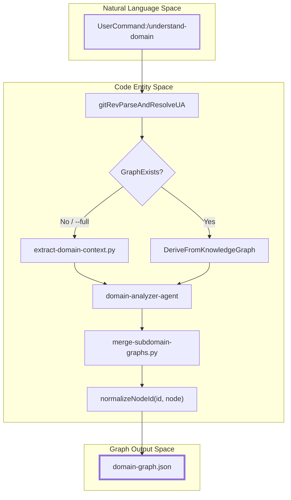
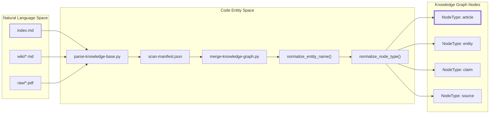

<!-- source: DeepWiki mcp.deepwiki.com · repo Egonex-AI/Understand-Anything · page 2.5 Domain & Knowledge Graph Skills · fetched 2026-10-30 -->

# Domain & Knowledge Graph Skills

Relevant source files

The following files were used as context for generating this wiki page:

- [.github/workflows/ci.yml](.github/workflows/ci.yml)
- [docs/superpowers/plans/2026-04-09-understand-knowledge.md](docs/superpowers/plans/2026-04-09-understand-knowledge.md)
- [tests/skill/knowledge/test_parse_knowledge_base.py](tests/skill/knowledge/test_parse_knowledge_base.py)
- [tests/skill/understand/test_merge_subdomain_graphs.py](tests/skill/understand/test_merge_subdomain_graphs.py)
- [understand-anything-plugin/packages/core/src/__tests__/domain-normalize.test.ts](understand-anything-plugin/packages/core/src/__tests__/domain-normalize.test.ts)
- [understand-anything-plugin/packages/core/src/__tests__/normalize-graph.test.ts](understand-anything-plugin/packages/core/src/__tests__/normalize-graph.test.ts)
- [understand-anything-plugin/packages/core/src/analyzer/normalize-graph.ts](understand-anything-plugin/packages/core/src/analyzer/normalize-graph.ts)
- [understand-anything-plugin/packages/dashboard/src/components/DomainGraphView.tsx](understand-anything-plugin/packages/dashboard/src/components/DomainGraphView.tsx)
- [understand-anything-plugin/packages/dashboard/src/components/KnowledgeGraphView.tsx](understand-anything-plugin/packages/dashboard/src/components/KnowledgeGraphView.tsx)
- [understand-anything-plugin/packages/dashboard/src/components/WarningBanner.tsx](understand-anything-plugin/packages/dashboard/src/components/WarningBanner.tsx)
- [understand-anything-plugin/skills/understand-domain/SKILL.md](understand-anything-plugin/skills/understand-domain/SKILL.md)
- [understand-anything-plugin/skills/understand-knowledge/merge-knowledge-graph.py](understand-anything-plugin/skills/understand-knowledge/merge-knowledge-graph.py)
- [understand-anything-plugin/skills/understand-knowledge/parse-knowledge-base.py](understand-anything-plugin/skills/understand-knowledge/parse-knowledge-base.py)
- [understand-anything-plugin/skills/understand/merge-subdomain-graphs.py](understand-anything-plugin/skills/understand/merge-subdomain-graphs.py)

This page details the implementation of two specialized semantic skills in Understand Anything: `/understand-domain` and `/understand-knowledge`. The `/understand-domain` skill extracts business domain workflows, flows, and process steps from a codebase, leveraging `extract-domain-context.py` [understand-anything-plugin/skills/understand-domain/SKILL.md:1-15]() and normalizing IDs via `normalize-graph.ts` [understand-anything-plugin/packages/core/src/analyzer/normalize-graph.ts:64-111](). The `/understand-knowledge` skill processes Karpathy-pattern LLM wikis, utilizing `parse-knowledge-base.py` [understand-anything-plugin/skills/understand-knowledge/parse-knowledge-base.py:1-17]() and `merge-knowledge-graph.py` [understand-anything-plugin/skills/understand-knowledge/merge-knowledge-graph.py:1-19]() to transform markdown documentation and raw files into structured knowledge graphs.

---

## 2.5.1. /understand-domain: Business Domain Extraction & Normalization

The `/understand-domain` skill analyzes a codebase to construct a business-centric flow graph. It can operate standalone through a lightweight scan or derive domain knowledge from an existing knowledge graph (`.ua/knowledge-graph.json`) [understand-anything-plugin/skills/understand-domain/SKILL.md:11-15]().

### Workflow and Phases

1.  **Project Root and Worktree Resolution**: The skill resolves `PROJECT_ROOT` and inspects git worktrees by comparing `git rev-parse --git-common-dir` with `git rev-parse --git-dir`. If they diverge, output is redirected to the main repository root to prevent data loss when ephemeral worktrees are destroyed [understand-anything-plugin/skills/understand-domain/SKILL.md:23-40]().
2.  **Data Directory Resolution**: Resolves `$UA_DIR`, retaining legacy `.understand-anything/` if present or defaulting to `.ua/` [understand-anything-plugin/skills/understand-domain/SKILL.md:45-49]().
3.  **Freshness Check**: If a knowledge graph exists and `--full` is omitted, the skill verifies project commit parity via `git diff` against `project.gitCommitHash`, ignoring the `.ua/` artifact directory [understand-anything-plugin/skills/understand-domain/SKILL.md:97-111]().
4.  **Context Extraction**: If no valid knowledge graph exists, `extract-domain-context.py` scans entry points and file trees.
5.  **Graph Normalization**: Identifiers and metadata are normalized using `normalizeNodeId` and `normalizeComplexity` from `normalize-graph.ts` [understand-anything-plugin/packages/core/src/analyzer/normalize-graph.ts:64-152]().

### Node ID Normalization for Domains

The `normalizeNodeId` function handles domain, flow, and step identifiers, ensuring correct scoping and preventing collision across flows sharing identically named steps [understand-anything-plugin/packages/core/src/analyzer/normalize-graph.ts:64-111]().

*   `domain` nodes maintain the format `domain:domain-slug` [understand-anything-plugin/packages/core/__tests__/domain-normalize.test.ts:5-11]().
*   `flow` nodes maintain `flow:flow-slug` [understand-anything-plugin/packages/core/__tests__/domain-normalize.test.ts:13-19]().
*   `step` nodes incorporate file paths and parent flow slugs: `step:flowSlug:filePath:stepSlug` [understand-anything-plugin/packages/core/src/analyzer/normalize-graph.ts:78-85]().

### Diagram: Domain Extraction & Normalization Data Flow

Sources:
- [understand-anything-plugin/skills/understand-domain/SKILL.md:19-113]()
- [understand-anything-plugin/packages/core/src/analyzer/normalize-graph.ts:64-111]()
- [understand-anything-plugin/packages/core/__tests__/domain-normalize.test.ts:5-46]()

---

## 2.5.2. /understand-knowledge: Karpathy-Pattern Wiki Parsing & Merging

The `/understand-knowledge` skill parses Karpathy-pattern LLM wikis, translating structured documentation directories into typed graph nodes (`article`, `entity`, `topic`, `claim`, `source`) [understand-anything-plugin/skills/understand-knowledge/parse-knowledge-base.py:67-100]().

### `parse-knowledge-base.py` Implementation

The deterministic parser executes initial structural extraction:
*   **Format Detection**: `detect_format(root)` checks for `index.md`, `log.md`, a `raw/` directory, and config files like `CLAUDE.md` or `AGENTS.md` [understand-anything-plugin/skills/understand-knowledge/parse-knowledge-base.py:67-100]().
*   **Case-Insensitive Resolution**: `find_markdown_case_insensitive` handles file system variations while prioritizing exact matches [understand-anything-plugin/skills/understand-knowledge/parse-knowledge-base.py:43-61]().
*   **Extraction Helpers**: Extracts YAML frontmatter (`extract_frontmatter`), wikilinks (`extract_wikilinks` using `WIKILINK_RE`), headings, code blocks, and introductory summaries (`extract_first_paragraph`) [understand-anything-plugin/skills/understand-knowledge/parse-knowledge-base.py:107-185]().

### `merge-knowledge-graph.py` Implementation

This script merges the deterministic scan manifest with analysis batches (`analysis-batch-*.json`) [understand-anything-plugin/skills/understand-knowledge/merge-knowledge-graph.py:120-141]().
*   **Entity Deduplication**: `normalize_entity_name` standardizes entity strings (lowercase, whitespace collapse) to map duplicate records to canonical node IDs [understand-anything-plugin/skills/understand-knowledge/merge-knowledge-graph.py:111-170]().
*   **Type Alias Resolution**: Normalizes node and edge aliases (e.g., mapping note/page to `article`, person to `entity`, and references to `cites`) [understand-anything-plugin/skills/understand-knowledge/merge-knowledge-graph.py:78-108]().

### Diagram: Karpathy Wiki to Knowledge Graph Pipeline

Sources:
- [understand-anything-plugin/skills/understand-knowledge/parse-knowledge-base.py:43-100]()
- [understand-anything-plugin/skills/understand-knowledge/parse-knowledge-base.py:107-185]()
- [understand-anything-plugin/skills/understand-knowledge/merge-knowledge-graph.py:78-170]()

---

## 2.5.3. Dashboard Visualization & Rendering Engines

The dashboard provides specialized views for domain and knowledge graphs using ReactFlow and layout engines.

### Domain Graph View (`DomainGraphView.tsx`)
*   **Overview vs Detail**: `buildDomainOverview` aggregates domain cluster nodes and cross-domain edges [understand-anything-plugin/packages/dashboard/src/components/DomainGraphView.tsx:41-88](). `buildDomainDetail` drills into specific flows and step sequences [understand-anything-plugin/packages/dashboard/src/components/DomainGraphView.tsx:90-165]().
*   **ELK Layout Integration**: Asynchronous layout execution via `applyElkLayout` arranges nodes in a left-to-right (`RIGHT`) direction [understand-anything-plugin/packages/dashboard/src/components/DomainGraphView.tsx:189-201]().

### Knowledge Graph View (`KnowledgeGraphView.tsx`)
*   **Worker-Based Force Layout**: Offloads `d3-force` simulation to `force-layout.worker.ts` via `startForceLayoutTask` to maintain UI responsiveness [understand-anything-plugin/packages/dashboard/src/components/KnowledgeGraphView.tsx:112-117]().
*   **Edge Styling**: Differentiates semantic relationships (e.g., dashed `cites`, red `contradicts`, solid `builds_on`) using `EDGE_STYLES` [understand-anything-plugin/packages/dashboard/src/components/KnowledgeGraphView.tsx:38-48]().

| Node Type | Origin / Source | Dashboard Role |
| :--- | :--- | :--- |
| `article` | Markdown Files (`.md`) | Primary wiki reading content [understand-anything-plugin/skills/understand-knowledge/merge-knowledge-graph.py:79]() |
| `entity` | LLM Analysis Batches | People, tools, and systems [understand-anything-plugin/skills/understand-knowledge/merge-knowledge-graph.py:80]() |
| `claim` | LLM Analysis Batches | Assertions and architectural decisions [understand-anything-plugin/skills/understand-knowledge/merge-knowledge-graph.py:82]() |
| `source` | Raw Files (`raw/`) | External citations and reference documents [understand-anything-plugin/skills/understand-knowledge/merge-knowledge-graph.py:83]() |
| `topic` | `index.md` Headings | Categorical grouping and taxonomy [understand-anything-plugin/skills/understand-knowledge/merge-knowledge-graph.py:81]() |

Sources:
- [understand-anything-plugin/packages/dashboard/src/components/DomainGraphView.tsx:41-201]()
- [understand-anything-plugin/packages/dashboard/src/components/KnowledgeGraphView.tsx:38-117]()
- [understand-anything-plugin/skills/understand-knowledge/merge-knowledge-graph.py:78-84]()

---

