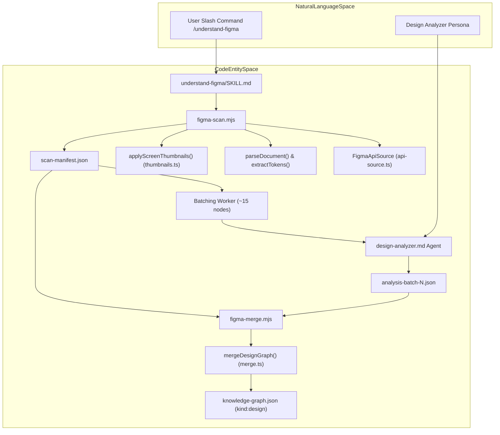
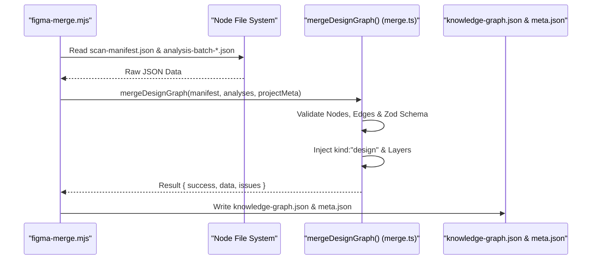

<!-- source: DeepWiki mcp.deepwiki.com · repo Egonex-AI/Understand-Anything · page 2.6 Figma Design Graph Skill · fetched 2026-10-30 -->

# Figma Design Graph Skill

<details>
<summary>Relevant source files</summary>

The following files were used as context for generating this wiki page:

- [docs/superpowers/plans/2026-06-24-understand-figma-foundation.md](docs/superpowers/plans/2026-06-24-understand-figma-foundation.md)
- [understand-anything-plugin/agents/design-analyzer.md](understand-anything-plugin/agents/design-analyzer.md)
- [understand-anything-plugin/packages/core/src/figma/__tests__/thumbnails.test.ts](understand-anything-plugin/packages/core/src/figma/__tests__/thumbnails.test.ts)
- [understand-anything-plugin/packages/core/src/figma/index.ts](understand-anything-plugin/packages/core/src/figma/index.ts)
- [understand-anything-plugin/packages/core/src/figma/thumbnails.ts](understand-anything-plugin/packages/core/src/figma/thumbnails.ts)
- [understand-anything-plugin/skills/understand-figma/SKILL.md](understand-anything-plugin/skills/understand-figma/SKILL.md)
- [understand-anything-plugin/skills/understand-figma/figma-merge.mjs](understand-anything-plugin/skills/understand-figma/figma-merge.mjs)
- [understand-anything-plugin/skills/understand-figma/figma-scan.mjs](understand-anything-plugin/skills/understand-figma/figma-scan.mjs)

</details>


The `/understand-figma` skill provides an end-to-end integration for analyzing Figma design files via the Figma REST API. It transforms raw design primitives into an interactive design knowledge graph (`kind:design`), allowing developers to query and visualize relationships between screens, components, instances, and design tokens alongside their codebase.

Sources: [understand-anything-plugin/skills/understand-figma/SKILL.md:1-5](), [docs/superpowers/plans/2026-06-24-understand-figma-foundation.md:1-18]()

---

## Overview and Data Flow

The skill operates through a four-phase pipeline, moving from deterministic API extraction to LLM-driven semantic enrichment, followed by canonical graph assembly.

### System Architecture & Code Entity Mapping


Sources: [understand-anything-plugin/skills/understand-figma/SKILL.md:19-69](), [understand-anything-plugin/skills/understand-figma/figma-scan.mjs:1-80](), [understand-anything-plugin/skills/understand-figma/figma-merge.mjs:1-43]()

---

## Phase 0 & 1 — Pre-Flight and Deterministic Fetch

The ingestion begins with pre-flight checks ensuring the `FIGMA_TOKEN` environment variable is present and building the core library if necessary [understand-anything-plugin/skills/understand-figma/SKILL.md:11-28](). 

### Deterministic Extraction (`figma-scan.mjs`)
The `figma-scan.mjs` script executes the deterministic retrieval phase:
1. Instantiates `FigmaApiSource` using the provided file URL or key and fetches the remote Figma document tree [understand-anything-plugin/skills/understand-figma/figma-scan.mjs:16-18]().
2. Performs an incremental version check against `.ua/meta.json` (or legacy `.understand-anything/meta.json`). If the remote `figmaVersion` matches local storage and `UNDERSTAND_FIGMA_FORCE` is not set, it refreshes pre-signed screen thumbnails in place and exits early with `UP_TO_DATE` [understand-anything-plugin/skills/understand-figma/figma-scan.mjs:20-37]().
3. Parses structural nodes via `parseDocument` (`page`, `screen`, `component`, `componentSet`, `instance`) and design styles via `extractTokens` (`token`) [understand-anything-plugin/skills/understand-figma/figma-scan.mjs:41-44]().
4. Renders bounded screen thumbnail URLs via `source.renderImages()` and binds them using `applyScreenThumbnails` [understand-anything-plugin/skills/understand-figma/figma-scan.mjs:46-51]().
5. Writes the resulting payload to `$UA_DIR/intermediate/scan-manifest.json` [understand-anything-plugin/skills/understand-figma/figma-scan.mjs:56-73]().

Sources: [understand-anything-plugin/skills/understand-figma/figma-scan.mjs:1-80](), [understand-anything-plugin/packages/core/src/figma/thumbnails.ts:1-29]()

---

## Phase 2 — LLM Semantic Enrichment

While Phase 1 captures exact structural hierarchies, nodes lack contextual summaries and functional tags. Phase 2 assigns this task to the `design-analyzer` agent.

### Batch Processing and Execution
* **Batching**: Nodes from `scan-manifest.json` are split into batches of approximately 15 nodes, grouped by page context where possible [understand-anything-plugin/skills/understand-figma/SKILL.md:43-43]().
* **Concurrency**: Up to 5 batches are analyzed in parallel by subagents executing `agents/design-analyzer.md` [understand-anything-plugin/skills/understand-figma/SKILL.md:51-51](), [understand-anything-plugin/agents/design-analyzer.md:1-51]().
* **Enrichment Deliverable**: Each subagent outputs an `analysis-batch-<N>.json` file containing functional summaries, tags, and conservative `related` edges without mutating or re-declaring structural nodes [understand-anything-plugin/agents/design-analyzer.md:23-51]().

Sources: [understand-anything-plugin/skills/understand-figma/SKILL.md:41-52](), [understand-anything-plugin/agents/design-analyzer.md:1-51]()

---

## Phase 3 — Graph Assembly and Merging

The `figma-merge.mjs` script combines the deterministic manifest with all `analysis-batch-*.json` files.


Sources: [understand-anything-plugin/skills/understand-figma/figma-merge.mjs:10-36](), [understand-anything-plugin/packages/core/src/figma/index.ts:1-6]()

---

## Incremental Updates and Thumbnail Maintenance

Figma REST API image URLs (`thumbnailUrl`) are pre-signed assets that expire after several hours. The system addresses this in two distinct paths:

1. **Standard Run**: Freshly fetched nodes have thumbnail URLs populated immediately before manifest generation [understand-anything-plugin/skills/understand-figma/figma-scan.mjs:46-51]().
2. **`UP_TO_DATE` Short-Circuit**: When the remote `figmaVersion` is unchanged, `refreshThumbnailsInPlace` re-renders active screen nodes and patches the existing `knowledge-graph.json` without re-running LLM analysis [understand-anything-plugin/skills/understand-figma/figma-scan.mjs:29-37](), [understand-anything-plugin/skills/understand-figma/figma-scan.mjs:89-105]().

| Function / Module | Target File | Role in Thumbnail Lifecycle |
| :--- | :--- | :--- |
| `applyScreenThumbnails` | `packages/core/src/figma/thumbnails.ts` | Pure utility matching node IDs to pre-signed image links [packages/core/src/figma/thumbnails.ts:13-29]() |
| `refreshThumbnailsInPlace` | `skills/understand-figma/figma-scan.mjs` | Disk-patching routine for fast-path incremental updates [understand-anything-plugin/skills/understand-figma/figma-scan.mjs:89-105]() |

Sources: [understand-anything-plugin/packages/core/src/figma/thumbnails.ts:1-29](), [understand-anything-plugin/skills/understand-figma/figma-scan.mjs:89-105]()

---

## Data Contract and `figmaMeta` Schema

Design nodes leverage the `figmaMeta` property to preserve upstream identifiers, physical dimensions, and prototype targets for the dashboard [docs/superpowers/plans/2026-06-24-understand-figma-foundation.md:81-96]().

```typescript
export interface FigmaMeta {
  fileKey?: string;
  nodeId?: string;             // Figma node identifier, e.g. "1:23"
  figmaType?: string;          // FRAME | COMPONENT | COMPONENT_SET | INSTANCE | TEXT
  thumbnailUrl?: string;       // Pre-signed image URL for dashboard previews
  dimensions?: { width: number; height: number };
  tokenKind?: "color" | "type" | "spacing" | "effect" | "grid";
  tokenValue?: string;         // e.g. "#0A84FF", "16px"
  prototypeTargets?: string[]; 
  componentKey?: string;       
}
```
Sources: [docs/superpowers/plans/2026-06-24-understand-figma-foundation.md:81-96]()

---

