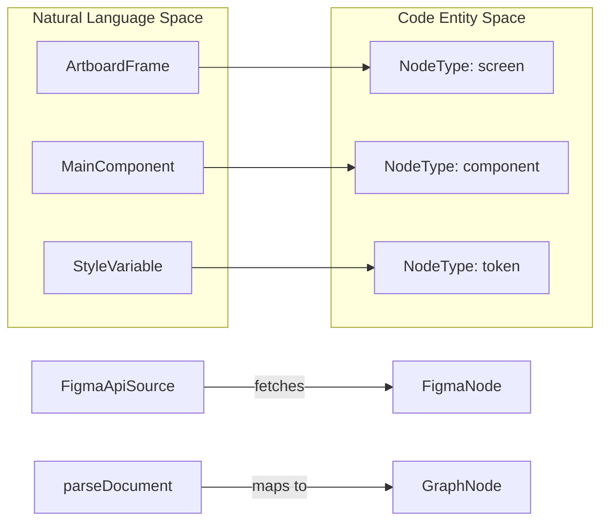

<!-- source: DeepWiki mcp.deepwiki.com · repo Egonex-AI/Understand-Anything · page 3 Core Library (@understand-anything/core) · fetched 2026-10-30 -->

# Core Library (@understand-anything/core)

Relevant source files

The following files were used as context for generating this wiki page:

- [understand-anything-plugin/packages/core/package.json](understand-anything-plugin/packages/core/package.json)
- [understand-anything-plugin/packages/core/src/__tests__/fingerprint.test.ts](understand-anything-plugin/packages/core/src/__tests__/fingerprint.test.ts)
- [understand-anything-plugin/packages/core/src/__tests__/language-registry.test.ts](understand-anything-plugin/packages/core/src/__tests__/language-registry.test.ts)
- [understand-anything-plugin/packages/core/src/__tests__/plugin-discovery.test.ts](understand-anything-plugin/packages/core/src/__tests__/plugin-discovery.test.ts)
- [understand-anything-plugin/packages/core/src/fingerprint.ts](understand-anything-plugin/packages/core/src/fingerprint.ts)
- [understand-anything-plugin/packages/core/src/index.ts](understand-anything-plugin/packages/core/src/index.ts)
- [understand-anything-plugin/packages/core/src/languages/configs/dart.ts](understand-anything-plugin/packages/core/src/languages/configs/dart.ts)
- [understand-anything-plugin/packages/core/src/languages/configs/index.ts](understand-anything-plugin/packages/core/src/languages/configs/index.ts)
- [understand-anything-plugin/packages/core/src/plugins/extractors/index.ts](understand-anything-plugin/packages/core/src/plugins/extractors/index.ts)
- [understand-anything-plugin/pnpm-lock.yaml](understand-anything-plugin/pnpm-lock.yaml)
- [understand-anything-plugin/skills/understand/build-fingerprints.mjs](understand-anything-plugin/skills/understand/build-fingerprints.mjs)

The `@understand-anything/core` package is the foundational TypeScript library that provides the core data structures, schema validation, graph construction logic, search capabilities, persistence mechanisms, and plugin architecture for the entire Understand Anything system [packages/core/package.json:1-6](), [packages/core/src/index.ts:1-90](). It defines the common language and contracts used across all components, from the analysis pipeline to the dashboard.

This page provides a high-level overview of the core library's responsibilities. For detailed information on each subsystem, please refer to the linked child pages.

## KnowledgeGraph Types & Schema

The core library defines the canonical data model for the `KnowledgeGraph`, which is the central artifact generated by the analysis pipeline. This includes a comprehensive set of `NodeType`s and `EdgeType`s to represent various code, non-code, domain, knowledge, and design entities and their relationships [packages/core/src/types.ts:1-115](). Key interfaces like `GraphNode`, `GraphEdge`, `Layer`, `TourStep`, `ProjectMeta`, `DomainMeta`, `KnowledgeMeta`, and `FigmaMeta` establish the structure of the graph [packages/core/src/types.ts:24-115]().

The library implements a robust Zod-based validation pipeline, which includes `sanitizeGraph`, `autoFixGraph`, and `validateGraph` functions [packages/core/src/index.ts:3-12](). This pipeline ensures data integrity by cleaning, normalizing, and validating graph data. Alias tables handle variations in input data generated by LLMs, while normalization functions ensure consistent `type:path` identifiers and complexity metrics [packages/core/src/index.ts:24-31]().

For details, see [KnowledgeGraph Types & Schema](#3.1).

Sources:
- [packages/core/src/types.ts:1-115]()
- [packages/core/src/index.ts:3-31]()

### KnowledgeGraph Structure

```mermaid
graph TD
    kg["KnowledgeGraph"] --> pm["ProjectMeta"]
    kg --> gn["GraphNode"]
    kg --> ge["GraphEdge"]
    kg --> layer["Layer"]
    kg --> ts["TourStep"]

    gn --> nt["NodeType"]
    gn --> dm["DomainMeta"]
    gn --> km["KnowledgeMeta"]
    gn --> fm["figmaMeta"]
    ge --> et["EdgeType"]

    subgraph "Node Types (NodeType)"
        CodeNodes["file, function, class, module, concept"]
        NonCodeNodes["config, document, service, table, endpoint, pipeline, schema, resource"]
        DomainNodes["domain, flow, step"]
        KnowledgeNodes["article, entity, topic, claim, source"]
        DesignNodes["page, screen, component, componentSet, instance, token"]
    end

    subgraph "Edge Types (EdgeType)"
        Structural["imports, exports, contains, inherits, implements"]
        Behavioral["calls, subscribes, publishes, middleware"]
        DataFlow["reads_from, writes_to, transforms, validates"]
        Dependencies["depends_on, tested_by, configures"]
        Semantic["related, similar_to"]
        InfraSchema["deploys, serves, provisions, triggers, migrates, documents, routes, defines_schema"]
        DomainEdges["contains_flow, flow_step, cross_domain"]
        KnowledgeEdges["cites, contradicts, builds_on, exemplifies, categorized_under, authored_by"]
        DesignEdges["instance_of, variant_of, uses_token"]
    end

    nt --> CodeNodes
    nt --> NonCodeNodes
    nt --> DomainNodes
    nt --> KnowledgeNodes
    nt --> DesignNodes

    et --> Structural
    et --> Behavioral
    et --> DataFlow
    et --> Dependencies
    et --> Semantic
    et --> InfraSchema
    et --> DomainEdges
    et --> KnowledgeEdges
    et --> DesignEdges
```

Sources:
- [packages/core/src/types.ts:1-115]()

## GraphBuilder & LLM Analyzer

The `GraphBuilder` class is central to constructing the `KnowledgeGraph` [packages/core/src/index.ts:16-16](). It provides methods to incrementally build the graph from various sources, leveraging LLM prompt builders such as `buildFileAnalysisPrompt` and `buildProjectSummaryPrompt` to extract semantic information from files [packages/core/src/index.ts:18-22]().

The `normalizeBatchOutput` function processes raw LLM outputs, fixing malformed IDs, normalizing numeric complexity to enum values, and rewriting edge references after ID correction [packages/core/src/index.ts:27-31](). This ensures that non-deterministic LLM output is coerced into the strict schema required by the core library.

For details, see [GraphBuilder & LLM Analyzer](#3.2).

Sources:
- [packages/core/src/index.ts:16-31]()

## Tree-Sitter Plugin & Language Extractors

The `TreeSitterPlugin` is the primary component for deterministic code analysis [packages/core/src/index.ts:13-13](). It utilizes Tree-Sitter grammars and WASM packages (such as `@understand-anything/tree-sitter-dart-wasm` and `@understand-anything/tree-sitter-swift-wasm`) to perform structural analysis, extract call graphs, and resolve imports [packages/core/package.json:43-63](). The plugin relies on the `LanguageExtractor` interface and is managed by `LanguageRegistry` and `FrameworkRegistry` [packages/core/src/index.ts:14-15](), [packages/core/src/index.ts:65-71]().

For details, see [Tree-Sitter Plugin & Language Extractors](#3.3).

Sources:
- [packages/core/src/index.ts:13-15]()
- [packages/core/src/index.ts:65-71]()
- [packages/core/package.json:43-63]()

### Symbol Evidence & Coverage Analysis

The symbol-evidence subsystem (`symbol-evidence.ts`, `symbol-scopes.ts`, `symbol-coverage.ts`, `symbol-ast.ts`) collects strict structural evidence during analysis [packages/core/src/index.ts:1-90](). This evidence tracks declared symbols and scopes to feed symbol-loss validation and ensure high fidelity during incremental re-analyses.

For details, see [Tree-Sitter Plugin & Language Extractors](#3.3).

Sources:
- [packages/core/src/index.ts:1-90]()

## Non-Code Parsers

The core library includes a dedicated parser subsystem for non-code file types [packages/core/src/index.ts:110-125](). These parsers extract structural data from configuration, markup, and environment files, mapping them to specialized node types like `service`, `table`, or `resource` [packages/core/src/index.ts:111-124]().

Supported parsers include `MarkdownParser`, `YAMLConfigParser`, `JSONConfigParser`, `TOMLParser`, `EnvParser`, `DockerfileParser`, `SQLParser`, `GraphQLParser`, `ProtobufParser`, `TerraformParser`, `MakefileParser`, and `ShellParser` [packages/core/src/index.ts:111-124]().

For details, see [Non-Code Parsers](#3.4).

Sources:
- [packages/core/src/index.ts:110-125]()

## Search, Persistence & Fingerprinting

The core library provides fuzzy search via `SearchEngine` (backed by Fuse.js) and semantic search via `SemanticSearchEngine` using cosine similarity on embeddings [packages/core/src/index.ts:32-32](), [packages/core/src/index.ts:86-89]().

The persistence layer handles reading and writing graphs while sanitizing file paths and resolving the `.ua/` data directory [packages/core/src/index.ts:2-2](). For change detection, the fingerprinting subsystem (`extractFileFingerprint`, `compareFingerprints`, `analyzeChanges`) captures function, class, and import signatures to compute change levels (`NONE`, `COSMETIC`, `STRUCTURAL`) [packages/core/src/index.ts:90-109]().

For details, see [Search, Persistence & Fingerprinting](#3.5).

Sources:
- [packages/core/src/index.ts:2-2]()
- [packages/core/src/index.ts:32-32]()
- [packages/core/src/index.ts:86-109]()
- [packages/core/src/fingerprint.ts:1-105]()

## Plugin Registry & Discovery

The `PluginRegistry` manages runtime plugin registration, while discovery utilities like `parsePluginConfig` and `DEFAULT_PLUGIN_CONFIG` parse user and default plugin configurations to enable or disable analyzers across languages [packages/core/src/index.ts:63-63](), [packages/core/src/index.ts:78-84]().

For details, see [Plugin Registry & Discovery](#3.6).

Sources:
- [packages/core/src/index.ts:63-63]()
- [packages/core/src/index.ts:78-84]()

## Figma Core Subsystem

The `figma/` module within the core library provides specialized types and logic for design-to-code mapping [packages/core/package.json:28-31](). It includes `FigmaApiSource` for fetching document data and tokens, and merge utilities for integrating design analysis into the main `KnowledgeGraph` with dedicated design node types (`screen`, `componentSet`, `token`) [packages/core/package.json:28-31]().

For details, see [Figma Core Subsystem](#3.7).

Sources:
- [packages/core/package.json:28-31]()

### Code to Design Space Mapping

Sources:
- [packages/core/package.json:28-31]()

---

