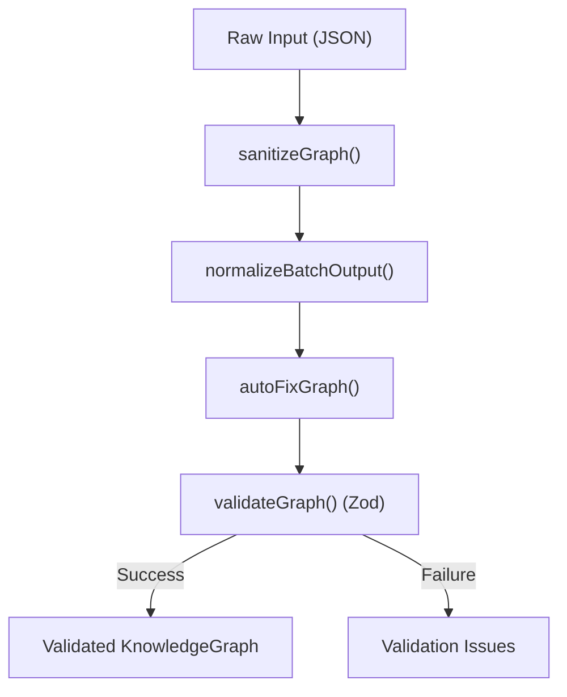

<!-- source: DeepWiki mcp.deepwiki.com · repo Egonex-AI/Understand-Anything · page 3.1 KnowledgeGraph Types & Schema · fetched 2026-10-30 -->

# KnowledgeGraph Types & Schema

<details>
<summary>Relevant source files</summary>

The following files were used as context for generating this wiki page:

- [understand-anything-plugin/packages/core/src/__tests__/config-schema.test.ts](understand-anything-plugin/packages/core/src/__tests__/config-schema.test.ts)
- [understand-anything-plugin/packages/core/src/__tests__/domain-types.test.ts](understand-anything-plugin/packages/core/src/__tests__/domain-types.test.ts)
- [understand-anything-plugin/packages/core/src/__tests__/schema.test.ts](understand-anything-plugin/packages/core/src/__tests__/schema.test.ts)
- [understand-anything-plugin/packages/core/src/schema.ts](understand-anything-plugin/packages/core/src/schema.ts)
- [understand-anything-plugin/packages/core/src/types.test.ts](understand-anything-plugin/packages/core/src/types.test.ts)
- [understand-anything-plugin/packages/core/src/types.ts](understand-anything-plugin/packages/core/src/types.ts)

</details>


This page documents the core KnowledgeGraph data contract employed in the Understand Anything system. It defines the canonical types for graph nodes (`NodeType`) and edges (`EdgeType`), key interfaces such as `GraphNode`, `GraphEdge`, `Layer`, `TourStep`, and project/domain/knowledge/design metadata types. The section also covers the robust schema validation pipeline based on Zod schemas, which performs sanitization, normalization (including alias resolution), auto-fixing, and final validation to guarantee integrity and consistency of the graph data at runtime.

---

## 1. KnowledgeGraph Data Model Overview

The KnowledgeGraph is a structured directed graph representing codebases, knowledge bases, or design documents. It is composed of:

- **Nodes (27 distinct types):** Representing code entities (`file`, `function`, `class`, `module`, `concept`); non-code entities (`config`, `document`, `service`, `table`, `endpoint`, `pipeline`, `schema`, `resource`); domain-specific abstractions (`domain`, `flow`, `step`); knowledge entities (`article`, `entity`, `topic`, `claim`, `source`); and design-specific entities (`page`, `screen`, `component`, `componentSet`, `instance`, `token`) [understand-anything-plugin/packages/core/src/types.ts:2-8]().

- **Edges (38 distinct types):** Expressing relationships across 9 categories: structural (`imports`, `inherits`), behavioral (`calls`, `publishes`), data flow (`reads_from`, `transforms`), dependencies (`depends_on`, `tested_by`), semantic (`related`, `similar_to`), infrastructure (`deploys`, `serves`), domain-specific (`contains_flow`, `flow_step`), knowledge relationships (`cites`, `contradicts`), and design relationships (`instance_of`, `variant_of`, `uses_token`) [understand-anything-plugin/packages/core/src/types.ts:11-21]().

- **Layers:** Logical groupings of nodes that correspond to architectural layers or other classifications [understand-anything-plugin/packages/core/src/types.ts:80-85]().

- **Tour Steps:** Ordered sequences for guided exploration or learning of the graph [understand-anything-plugin/packages/core/src/types.ts:88-94]().

- **Metadata:** Structured metadata describing the project context (`ProjectMeta`), domain details (`DomainMeta`), knowledge annotations (`KnowledgeMeta`), and Figma-specific design data (`FigmaMeta`) [understand-anything-plugin/packages/core/src/types.ts:24-51]().

### Core TypeScript Interfaces

```ts
// Root KnowledgeGraph
export interface KnowledgeGraph {
  version: string;
  kind?: "codebase" | "knowledge" | "design";
  project: ProjectMeta;
  nodes: GraphNode[];
  edges: GraphEdge[];
  layers: Layer[];
  tour: TourStep[];
}

// GraphNode with specialized metadata fields
export interface GraphNode {
  id: string;
  type: NodeType;
  name: string;
  filePath?: string;
  lineRange?: [number, number];
  summary: string;
  tags: string[];
  complexity: "simple" | "moderate" | "complex";
  languageNotes?: string;
  domainMeta?: DomainMeta;
  knowledgeMeta?: KnowledgeMeta;
  figmaMeta?: FigmaMeta;
}
```
These typings form the contract for the graph data consumed and output by all subsystems and persisted on disk [understand-anything-plugin/packages/core/src/types.ts:54-115]().

Sources:
- `understand-anything-plugin/packages/core/src/types.ts`

---

## 2. Type Aliases and Normalization

Human-generated or LLM-generated graphs often use synonyms. The system employs several alias tables to map these to canonical values.

### 2.1 Node Type Aliases
- **Code:** `func`, `fn`, `method` → `function`; `interface`, `struct` → `class`; `mod`, `pkg`, `package` → `module` [understand-anything-plugin/packages/core/src/schema.ts:18-26]().
- **Non-Code:** `container`, `deployment`, `pod` → `service`; `doc`, `readme`, `docs` → `document`; `db`, `database`, `view` → `table`; `api`, `query`, `mutation` → `endpoint` [understand-anything-plugin/packages/core/src/schema.ts:28-53]().
- **Domain:** `business_domain` → `domain`; `business_flow`, `business_process` → `flow`; `task`, `business_step` → `step` [understand-anything-plugin/packages/core/src/schema.ts:55-59]().
- **Design (Kind-Specific):** `frame`, `artboard` → `screen`; `canvas` → `page`; `main_component` → `component`; `component_set`, `variant_set`, `componentset` → `componentSet`; `design_token`, `style` → `token`. These are applied only when the graph's `kind` is `"design"` [understand-anything-plugin/packages/core/src/schema.ts:80-93]().
- **Knowledge Normalization:** In non-design graphs, `page` is normalized to `article` [understand-anything-plugin/packages/core/src/schema.ts:99-101]().

### 2.2 Edge Type Aliases
- **General:** `extends` → `inherits`; `invokes`, `invoke` → `calls`; `uses`, `requires` → `depends_on`; `relates_to`, `related_to` → `related` [understand-anything-plugin/packages/core/src/schema.ts:104-118]().
- **Design:** `instantiates` → `instance_of`; `variant` → `variant_of`; `styled_by`, `applies_token` → `uses_token` [understand-anything-plugin/packages/core/src/schema.ts:153-158]().
- **Knowledge Normalization:** In non-design graphs, `instance_of` is normalized to `exemplifies` [understand-anything-plugin/packages/core/src/schema.ts:163-165]().

### 2.3 Complexity and Direction Aliases
- **Complexity:** `low`, `easy` → `simple`; `medium`, `intermediate` → `moderate`; `high`, `hard`, `difficult` → `complex` [understand-anything-plugin/packages/core/src/schema.ts:168-176]().
- **Direction:** `to`, `outbound` → `forward`; `from`, `inbound` → `backward`; `both`, `mutual` → `bidirectional` [understand-anything-plugin/packages/core/src/schema.ts:179-186]().

Sources:
- `understand-anything-plugin/packages/core/src/schema.ts`

---

## 3. The Validation Pipeline

The pipeline ensures that raw JSON data is transformed into a strictly valid `KnowledgeGraph` object, handling sanitization, batch normalization, auto-fixing, and Zod schema validation [understand-anything-plugin/packages/core/src/__tests__/schema.test.ts:60-120]().

Title: "Validation Pipeline Flow"


**Pipeline Stages:**

1.  **`sanitizeGraph`**: Handles basic structural hygiene. It converts `null` collections to empty arrays, lowercases enum-like strings (types, complexity), and removes null values from optional fields [understand-anything-plugin/packages/core/src/schema.ts:188-230]().
2.  **`normalizeBatchOutput`**: Critical for handling LLM batch outputs. It fixes malformed node IDs (stripping double prefixes or project-name prefixes), normalizes numeric complexity to the 3-tier enum, and rewrites edge references if node IDs were changed [understand-anything-plugin/packages/core/src/analyzer/normalize-graph.ts:202-230]().
3.  **`autoFixGraph`**: Applies the alias tables described in Section 2. It also clamps out-of-range edge weights (0.0 to 1.0) and provides defaults for missing required fields like `complexity` [understand-anything-plugin/packages/core/src/schema.ts:232-310]().
4.  **`validateGraph`**: The final gatekeeper using Zod. It performs strict type checking and ensures referential integrity (dropping edges that point to non-existent nodes, and handling fatal errors if all nodes are invalid) [understand-anything-plugin/packages/core/src/__tests__/schema.test.ts:69-98]().

Sources:
- `understand-anything-plugin/packages/core/src/schema.ts`
- `understand-anything-plugin/packages/core/src/__tests__/schema.test.ts`
- `understand-anything-plugin/packages/core/src/analyzer/normalize-graph.ts`

---

## 4. ID Normalization Logic

Node IDs are normalized to a canonical `prefix:path[:name]` format using `normalizeNodeId`.

- **Prefixes:** `file`, `func`, `class`, `module`, `domain`, `flow`, `step`, etc. [understand-anything-plugin/packages/core/src/analyzer/normalize-graph.ts:8-25]().
- **Double Prefixes:** `file:file:src/foo.ts` is corrected to `file:src/foo.ts` [understand-anything-plugin/packages/core/src/analyzer/normalize-graph.ts:28-57]().
- **Domain Steps:** Step nodes include a flow discriminator to prevent collisions: `step:flowSlug:filePath:stepSlug` [understand-anything-plugin/packages/core/src/analyzer/normalize-graph.ts:78-85]().
- **Bare Paths:** Bare paths are automatically prefixed based on the node's type (e.g., `src/utils.ts` with type `file` becomes `file:src/utils.ts`) [understand-anything-plugin/packages/core/src/analyzer/normalize-graph.ts:89-108]().

Sources:
- `understand-anything-plugin/packages/core/src/analyzer/normalize-graph.ts`

---

## 5. Bridging Natural Language to Code Entity Space

The following diagrams show how system-level names (aliases) map to the internal `NodeType` and `EdgeType` enums used in the code.

Title: "Node Type Mapping from Natural Language to Code Space"
```mermaid
graph LR
  NL_Func[""func", "fn", "method""]
  NL_Struct[""struct", "interface""]
  NL_Pkg[""pkg", "package", "mod""]
  NL_Style[""style", "design_token" (Design Kind)"]
  
  Canonical_Func[""NodeType: function""]
  Canonical_Class[""NodeType: class""]
  Canonical_Module[""NodeType: module""]
  Canonical_Token[""NodeType: token""]

  NL_Func -->|NODE_TYPE_ALIASES| Canonical_Func
  NL_Struct -->|NODE_TYPE_ALIASES| Canonical_Class
  NL_Pkg -->|NODE_TYPE_ALIASES| Canonical_Module
  NL_Style -->|DESIGN_NODE_TYPE_ALIASES| Canonical_Token
```

Title: "Edge Type Mapping from Natural Language to Code Space"
```mermaid
graph LR
  NL_Extends[""extends""]
  NL_Invokes[""invokes", "invoke""]
  NL_Uses[""uses", "requires""]
  NL_Variant[""variant" (Design Kind)"]

  Canonical_Inherits[""EdgeType: inherits""]
  Canonical_Calls[""EdgeType: calls""]
  Canonical_Depends[""EdgeType: depends_on""]
  Canonical_Variant[""EdgeType: variant_of""]

  NL_Extends -->|EDGE_TYPE_ALIASES| Canonical_Inherits
  NL_Invokes -->|EDGE_TYPE_ALIASES| Canonical_Calls
  NL_Uses -->|EDGE_TYPE_ALIASES| Canonical_Depends
  NL_Variant -->|DESIGN_EDGE_TYPE_ALIASES| Canonical_Variant
```

Sources:
- `understand-anything-plugin/packages/core/src/schema.ts`
- `understand-anything-plugin/packages/core/src/types.ts`

---

## 6. Metadata Sub-Schemas

The graph supports specialized metadata for different "kinds" of analysis.

### FigmaMeta (Design Graphs)
Used for nodes of type `page`, `screen`, `component`, `componentSet`, `instance`, `token`:
- `fileKey`: Figma file identifier [understand-anything-plugin/packages/core/src/types.ts:42]().
- `nodeId`: The specific Figma node ID (e.g., `"1:23"`) [understand-anything-plugin/packages/core/src/types.ts:43]().
- `figmaType`: FRAME, COMPONENT, COMPONENT_SET, INSTANCE, TEXT, etc. [understand-anything-plugin/packages/core/src/types.ts:44]().
- `thumbnailUrl`: Pre-signed URL for visual previews [understand-anything-plugin/packages/core/src/types.ts:45]().
- `dimensions`: Width and height of the design element [understand-anything-plugin/packages/core/src/types.ts:46]().
- `tokenKind`: Categorization for design tokens (`color`, `type`, `spacing`, `effect`, `grid`) [understand-anything-plugin/packages/core/src/types.ts:47]().
- `tokenValue`: Raw token value (e.g., `#0A84FF`, `16px`) [understand-anything-plugin/packages/core/src/types.ts:48]().

### DomainMeta (Domain Graphs)
Used for `domain`, `flow`, and `step` nodes:
- `entities`: Associated business entities [understand-anything-plugin/packages/core/src/types.ts:33]().
- `businessRules`: Applied business rules [understand-anything-plugin/packages/core/src/types.ts:34]().
- `crossDomainInteractions`: Interaction identifiers with other domains [understand-anything-plugin/packages/core/src/types.ts:35]().
- `entryPoint`: The entry URL, command, or event [understand-anything-plugin/packages/core/src/types.ts:36]().
- `entryType`: `http`, `cli`, `event`, `cron`, or `manual` [understand-anything-plugin/packages/core/src/types.ts:37]().

### KnowledgeMeta (Knowledge Graphs)
Used for Karpathy-pattern wiki articles (`article`, `entity`, `topic`, `claim`, `source`):
- `wikilinks`: Outbound links using `[[Page Name]]` syntax [understand-anything-plugin/packages/core/src/types.ts:25]().
- `backlinks`: Inbound links discovered during parsing [understand-anything-plugin/packages/core/src/types.ts:26]().
- `category`: Topic category [understand-anything-plugin/packages/core/src/types.ts:27]().
- `content`: Markdown text content [understand-anything-plugin/packages/core/src/types.ts:28]().

Sources:
- `understand-anything-plugin/packages/core/src/types.ts`

---

## 7. Key Validation Functions

| Function | File | Description |
| :--- | :--- | :--- |
| `validateGraph` | `schema.ts` | Entry point for Zod validation; returns `ValidationResult` with `issues` [understand-anything-plugin/packages/core/src/schema.ts:330-360](). |
| `sanitizeGraph` | `schema.ts` | Lowercases types, cleans nulls, ensures collection arrays exist [understand-anything-plugin/packages/core/src/schema.ts:188-230](). |
| `autoFixGraph` | `schema.ts` | Resolves aliases and clamps weights [understand-anything-plugin/packages/core/src/schema.ts:232-310](). |
| `normalizeBatchOutput` | `normalize-graph.ts` | Deduplicates nodes/edges and fixes IDs across batch boundaries [understand-anything-plugin/packages/core/src/analyzer/normalize-graph.ts:202-300](). |
| `normalizeNodeId` | `normalize-graph.ts` | Idempotent function to ensure IDs follow `type:path` format [understand-anything-plugin/packages/core/src/analyzer/normalize-graph.ts:64-111](). |
| `normalizeComplexity` | `normalize-graph.ts` | Maps strings or numeric values to the canonical 3-tier enum [understand-anything-plugin/packages/core/src/analyzer/normalize-graph.ts:134-152](). |

Sources:
- `understand-anything-plugin/packages/core/src/schema.ts`
- `understand-anything-plugin/packages/core/src/analyzer/normalize-graph.ts`

---

