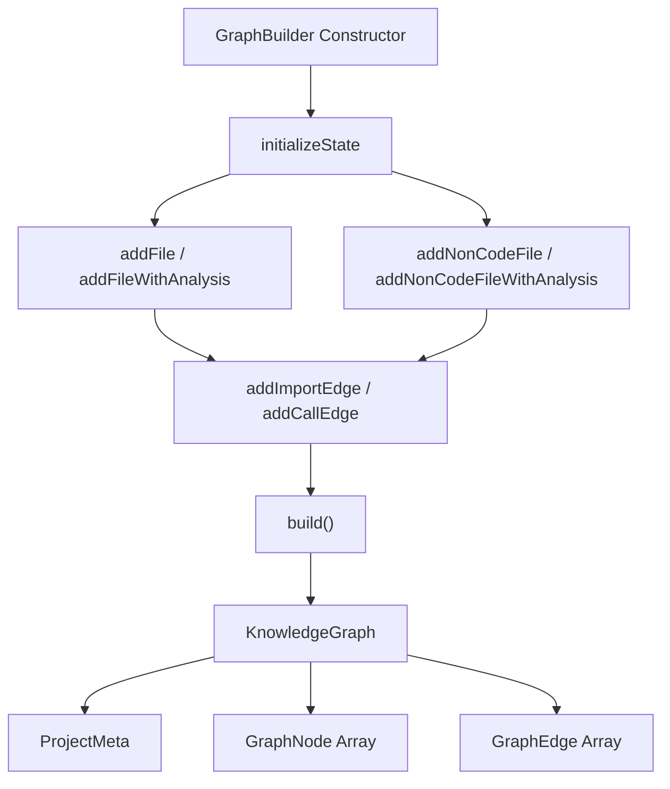
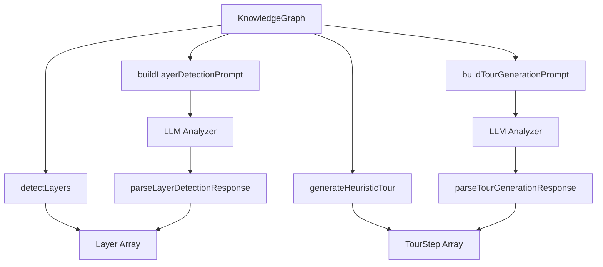
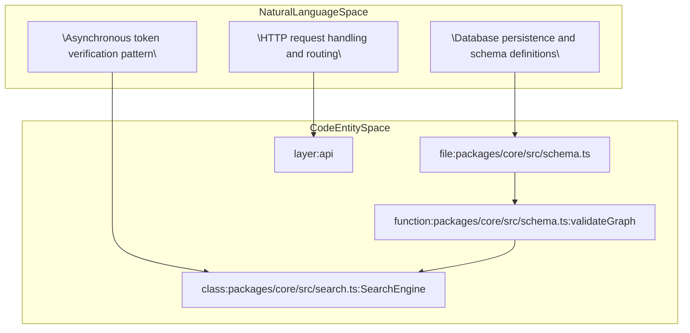
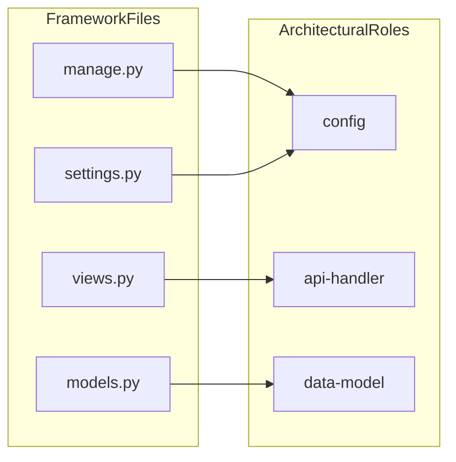

<!-- source: DeepWiki mcp.deepwiki.com · repo Egonex-AI/Understand-Anything · page 3.2 GraphBuilder & LLM Analyzer · fetched 2026-10-30 -->

# GraphBuilder & LLM Analyzer

<details>
<summary>Relevant source files</summary>

The following files were used as context for generating this wiki page:

- [understand-anything-plugin/packages/core/src/__tests__/language-lesson.test.ts](understand-anything-plugin/packages/core/src/__tests__/language-lesson.test.ts)
- [understand-anything-plugin/packages/core/src/analyzer/graph-builder.test.ts](understand-anything-plugin/packages/core/src/analyzer/graph-builder.test.ts)
- [understand-anything-plugin/packages/core/src/analyzer/graph-builder.ts](understand-anything-plugin/packages/core/src/analyzer/graph-builder.ts)
- [understand-anything-plugin/packages/core/src/analyzer/layer-detector.ts](understand-anything-plugin/packages/core/src/analyzer/layer-detector.ts)
- [understand-anything-plugin/packages/core/src/analyzer/tour-generator.ts](understand-anything-plugin/packages/core/src/analyzer/tour-generator.ts)
- [understand-anything-plugin/packages/core/src/embedding-search.ts](understand-anything-plugin/packages/core/src/embedding-search.ts)
- [understand-anything-plugin/packages/dashboard/public/knowledge-graph.json](understand-anything-plugin/packages/dashboard/public/knowledge-graph.json)
- [understand-anything-plugin/skills/understand/frameworks/django.md](understand-anything-plugin/skills/understand/frameworks/django.md)

</details>


This page details the core components responsible for constructing the `KnowledgeGraph` and leveraging Large Language Models (LLMs) for semantic analysis within `@understand-anything/core`. It covers the `GraphBuilder` class API, LLM prompt builders, language-lesson analyzers, layer detection heuristics, and tour generation routines.

## Purpose and Scope

The subsystem covered here bridges raw project files and structural analyses into a queryable, structured `KnowledgeGraph`. It provides programmatic graph construction via `GraphBuilder`, prompt generation and response parsing for LLM-assisted architecture discovery, and heuristic fallbacks for offline or deterministic execution.

Sources:
- [understand-anything-plugin/packages/core/src/analyzer/graph-builder.ts:60-337]()
- [understand-anything-plugin/packages/core/src/analyzer/layer-detector.ts:1-213]()
- [understand-anything-plugin/packages/core/src/analyzer/tour-generator.ts:1-220]()

## GraphBuilder API & Construction

The `GraphBuilder` class [understand-anything-plugin/packages/core/src/analyzer/graph-builder.ts:60-337]() is the primary programmatic interface for assembling nodes and edges into a `KnowledgeGraph`. It maintains internal deduplication sets for node IDs and edge keys, and queries a `LanguageRegistry` for file language identification.

### Initialization and State Management

`GraphBuilder` accepts a `projectName`, a `gitHash`, and an optional `LanguageRegistry` [understand-anything-plugin/packages/core/src/analyzer/graph-builder.ts:70-74](). It tracks detected languages dynamically as files are added.

```typescript
class GraphBuilder {
  private readonly nodes: GraphNode[] = [];
  private readonly edges: GraphEdge[] = [];
  private readonly languages = new Set<string>();
  private readonly nodeIds = new Set<string>();
  private readonly edgeKeys = new Set<string>();
  // ... constructor and methods
}
```
Sources:
- [understand-anything-plugin/packages/core/src/analyzer/graph-builder.ts:60-74]()

### Core Methods

*   `addFile(filePath: string, meta: FileMeta)`: Registers a generic file node after detecting its language [understand-anything-plugin/packages/core/src/analyzer/graph-builder.ts:84-103]().
*   `addFileWithAnalysis(filePath: string, analysis: StructuralAnalysis, meta: FileAnalysisMeta)`: Registers a file node along with its extracted `functions` and `classes` as child nodes, linking them with `"contains"` edges [understand-anything-plugin/packages/core/src/analyzer/graph-builder.ts:105-177]().
*   `addImportEdge(fromFile: string, toFile: string)`: Creates deduplicated `"imports"` edges between files [understand-anything-plugin/packages/core/src/analyzer/graph-builder.ts:179-190]().
*   `addCallEdge(callerFile: string, callerFunc: string, calleeFile: string, calleeFunc: string)`: Creates deduplicated `"calls"` edges between function nodes [understand-anything-plugin/packages/core/src/analyzer/graph-builder.ts:192-208]().
*   `addNonCodeFile(filePath: string, meta: NonCodeFileMeta)`: Adds non-code manifest or configuration files with mapped node types [understand-anything-plugin/packages/core/src/analyzer/graph-builder.ts:210-226]().
*   `addNonCodeFileWithAnalysis(filePath: string, meta: NonCodeFileAnalysisMeta)`: Adds non-code files with structured child definitions (tables, schemas, routes) mapped via `KIND_TO_NODE_TYPE` [understand-anything-plugin/packages/core/src/analyzer/graph-builder.ts:39-58, 228-240]().

Title: Graph Construction Lifecycle

Sources:
- [understand-anything-plugin/packages/core/src/analyzer/graph-builder.ts:60-337]()
- [understand-anything-plugin/packages/core/src/analyzer/graph-builder.test.ts:6-203]()

## LLM Analyzer & Prompt Builders

The package supplies prompt construction and response parsing utilities for LLM-backed enrichment tasks, operating alongside heuristic fallbacks.

### Layer Detection

The layer detection module (`layer-detector.ts`) classifies file nodes into architectural layers either deterministically or via LLM prompting [understand-anything-plugin/packages/core/src/analyzer/layer-detector.ts:1-213]().

*   `detectLayers(graph)`: Applies heuristic directory matching via `LAYER_PATTERNS` to group file nodes into layers like `"API Layer"`, `"Service Layer"`, and `"Data Layer"` [understand-anything-plugin/packages/core/src/analyzer/layer-detector.ts:16-148]().
*   `buildLayerDetectionPrompt(graph)`: Constructs a prompt instructing an LLM to analyze file paths and output 3–7 logical architectural layers as JSON [understand-anything-plugin/packages/core/src/analyzer/layer-detector.ts:154-174]().
*   `parseLayerDetectionResponse(response)`: Validates and sanitizes LLM JSON output containing layer definitions [understand-anything-plugin/packages/core/src/analyzer/layer-detector.ts:181-205]().

Sources:
- [understand-anything-plugin/packages/core/src/analyzer/layer-detector.ts:1-213]()

### Tour Generation

The tour generator (`tour-generator.ts`) builds guided walkthroughs for codebase newcomers [understand-anything-plugin/packages/core/src/analyzer/tour-generator.ts:1-220]().

*   `buildTourGenerationPrompt(graph)`: Assembles project metadata, node summaries, relationships, and layers into an LLM prompt for step-by-step tour creation [understand-anything-plugin/packages/core/src/analyzer/tour-generator.ts:7-62]().
*   `parseTourGenerationResponse(response)`: Parses LLM responses into structured `TourStep` objects [understand-anything-plugin/packages/core/src/analyzer/tour-generator.ts:70-120]().
*   `generateHeuristicTour(graph)`: Performs topological sorting via Kahn's algorithm over dependency edges to construct deterministic tour steps when no LLM is available [understand-anything-plugin/packages/core/src/analyzer/tour-generator.ts:125-220]().

Sources:
- [understand-anything-plugin/packages/core/src/analyzer/tour-generator.ts:1-220]()

### Language Lessons

The language lesson subsystem (`language-lesson.ts`) generates contextual explanations of language idioms and patterns for specific code entities [understand-anything-plugin/packages/core/src/__tests__/language-lesson.test.ts:1-157]().

*   `buildLanguageLessonPrompt`: Focuses prompt generation on a target `GraphNode` and its immediate `GraphEdge` neighborhood [understand-anything-plugin/packages/core/src/__tests__/language-lesson.test.ts:41-77]().
*   `detectLanguageConcepts`: Identifies recurring idioms (e.g., `async/await`, `middleware pattern`) from node tags and summaries [understand-anything-plugin/packages/core/src/__tests__/language-lesson.test.ts:123-156]().

Sources:
- [understand-anything-plugin/packages/core/src/__tests__/language-lesson.test.ts:1-157]()

Title: Layer Detection and Tour Generation Workflow

Sources:
- [understand-anything-plugin/packages/core/src/analyzer/layer-detector.ts:105-205]()
- [understand-anything-plugin/packages/core/src/analyzer/tour-generator.ts:7-220]()

## Bridging Natural Language Space to Code Entity Space

The analysis pipeline bridges human-readable concepts and architectural descriptions with concrete code structures in the `KnowledgeGraph`. Framework-specific rules (such as the Django addendum) instruct analyzers on mapping file roles (e.g., `views.py`) to semantic node categories (`api-handler`) [understand-anything-plugin/skills/understand/frameworks/django.md:1-67]().

Title: Semantic Mapping from Natural Language to Code Entities

Sources:
- [understand-anything-plugin/packages/core/src/analyzer/graph-builder.ts:105-177]()
- [understand-anything-plugin/packages/core/src/analyzer/layer-detector.ts:72-74]()
- [understand-anything-plugin/packages/dashboard/public/knowledge-graph.json:29-150]()

Title: Framework Integration Mapping for Django

Sources:
- [understand-anything-plugin/skills/understand/frameworks/django.md:12-33]()
- [understand-anything-plugin/packages/core/src/analyzer/graph-builder.ts:39-58]()

---

