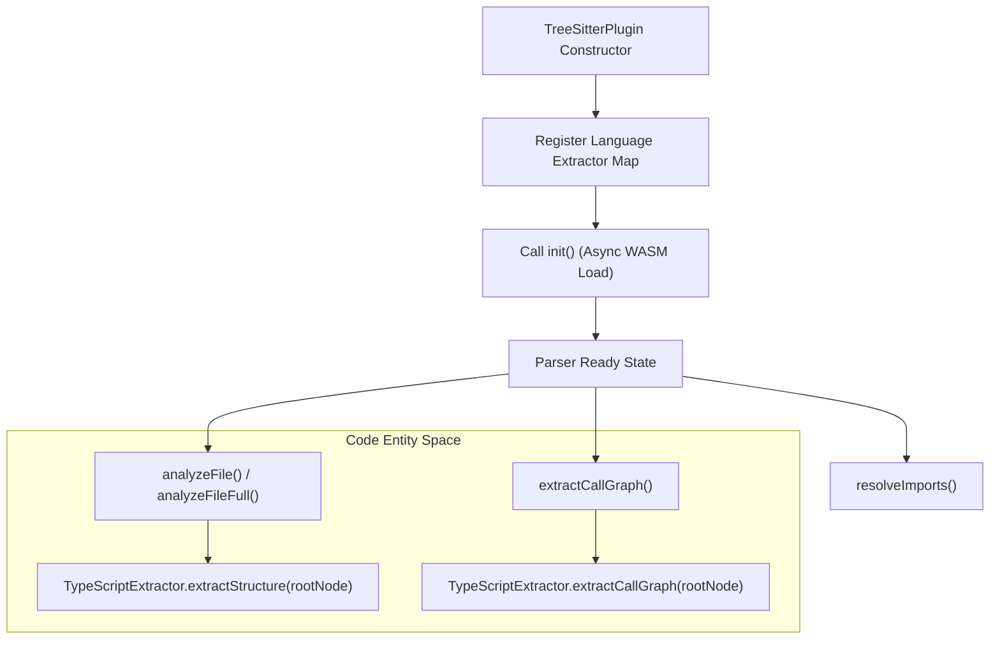
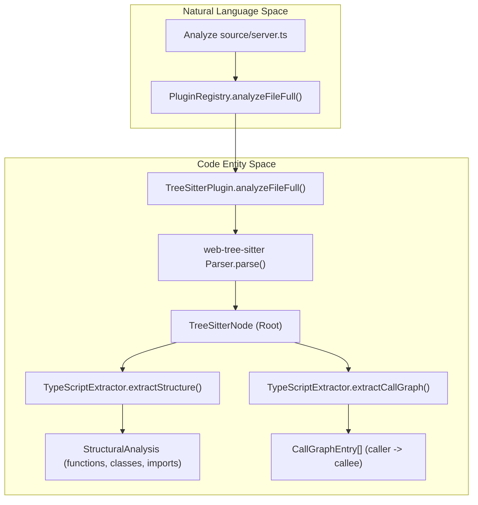

<!-- source: DeepWiki mcp.deepwiki.com · repo Egonex-AI/Understand-Anything · page 3.3 Tree-Sitter Plugin & Language Extractors · fetched 2026-10-30 -->

# Tree-Sitter Plugin & Language Extractors

Relevant source files

The following files were used as context for generating this wiki page:

- [understand-anything-plugin/packages/core/src/languages/configs/c.ts](understand-anything-plugin/packages/core/src/languages/configs/c.ts)
- [understand-anything-plugin/packages/core/src/languages/configs/cpp.ts](understand-anything-plugin/packages/core/src/languages/configs/cpp.ts)
- [understand-anything-plugin/packages/core/src/languages/configs/csharp.ts](understand-anything-plugin/packages/core/src/languages/configs/csharp.ts)
- [understand-anything-plugin/packages/core/src/languages/configs/go.ts](understand-anything-plugin/packages/core/src/languages/configs/go.ts)
- [understand-anything-plugin/packages/core/src/languages/configs/java.ts](understand-anything-plugin/packages/core/src/languages/configs/java.ts)
- [understand-anything-plugin/packages/core/src/languages/configs/kotlin.ts](understand-anything-plugin/packages/core/src/languages/configs/kotlin.ts)
- [understand-anything-plugin/packages/core/src/languages/configs/lua.ts](understand-anything-plugin/packages/core/src/languages/configs/lua.ts)
- [understand-anything-plugin/packages/core/src/languages/configs/php.ts](understand-anything-plugin/packages/core/src/languages/configs/php.ts)
- [understand-anything-plugin/packages/core/src/languages/configs/python.ts](understand-anything-plugin/packages/core/src/languages/configs/python.ts)
- [understand-anything-plugin/packages/core/src/languages/configs/ruby.ts](understand-anything-plugin/packages/core/src/languages/configs/ruby.ts)
- [understand-anything-plugin/packages/core/src/languages/configs/rust.ts](understand-anything-plugin/packages/core/src/languages/configs/rust.ts)
- [understand-anything-plugin/packages/core/src/languages/configs/swift.ts](understand-anything-plugin/packages/core/src/languages/configs/swift.ts)
- [understand-anything-plugin/packages/core/src/plugins/extractors/__tests__/cpp-extractor.test.ts](understand-anything-plugin/packages/core/src/plugins/extractors/__tests__/cpp-extractor.test.ts)
- [understand-anything-plugin/packages/core/src/plugins/extractors/__tests__/csharp-extractor.test.ts](understand-anything-plugin/packages/core/src/plugins/extractors/__tests__/csharp-extractor.test.ts)
- [understand-anything-plugin/packages/core/src/plugins/extractors/__tests__/dart-extractor.test.ts](understand-anything-plugin/packages/core/src/plugins/extractors/__tests__/dart-extractor.test.ts)
- [understand-anything-plugin/packages/core/src/plugins/extractors/__tests__/go-extractor.test.ts](understand-anything-plugin/packages/core/src/plugins/extractors/__tests__/go-extractor.test.ts)
- [understand-anything-plugin/packages/core/src/plugins/extractors/__tests__/java-extractor.test.ts](understand-anything-plugin/packages/core/src/plugins/extractors/__tests__/java-extractor.test.ts)
- [understand-anything-plugin/packages/core/src/plugins/extractors/__tests__/kotlin-extractor.test.ts](understand-anything-plugin/packages/core/src/plugins/extractors/__tests__/kotlin-extractor.test.ts)
- [understand-anything-plugin/packages/core/src/plugins/extractors/__tests__/php-extractor.test.ts](understand-anything-plugin/packages/core/src/plugins/extractors/__tests__/php-extractor.test.ts)
- [understand-anything-plugin/packages/core/src/plugins/extractors/__tests__/python-extractor.test.ts](understand-anything-plugin/packages/core/src/plugins/extractors/__tests__/python-extractor.test.ts)
- [understand-anything-plugin/packages/core/src/plugins/extractors/__tests__/ruby-extractor.test.ts](understand-anything-plugin/packages/core/src/plugins/extractors/__tests__/ruby-extractor.test.ts)
- [understand-anything-plugin/packages/core/src/plugins/extractors/__tests__/rust-extractor.test.ts](understand-anything-plugin/packages/core/src/plugins/extractors/__tests__/rust-extractor.test.ts)
- [understand-anything-plugin/packages/core/src/plugins/extractors/__tests__/swift-extractor.test.ts](understand-anything-plugin/packages/core/src/plugins/extractors/__tests__/swift-extractor.test.ts)
- [understand-anything-plugin/packages/core/src/plugins/extractors/__tests__/typescript-extractor.test.ts](understand-anything-plugin/packages/core/src/plugins/extractors/__tests__/typescript-extractor.test.ts)
- [understand-anything-plugin/packages/core/src/plugins/extractors/base-extractor.ts](understand-anything-plugin/packages/core/src/plugins/extractors/base-extractor.ts)
- [understand-anything-plugin/packages/core/src/plugins/extractors/cpp-extractor.ts](understand-anything-plugin/packages/core/src/plugins/extractors/cpp-extractor.ts)
- [understand-anything-plugin/packages/core/src/plugins/extractors/csharp-extractor.ts](understand-anything-plugin/packages/core/src/plugins/extractors/csharp-extractor.ts)
- [understand-anything-plugin/packages/core/src/plugins/extractors/dart-extractor.ts](understand-anything-plugin/packages/core/src/plugins/extractors/dart-extractor.ts)
- [understand-anything-plugin/packages/core/src/plugins/extractors/go-extractor.ts](understand-anything-plugin/packages/core/src/plugins/extractors/go-extractor.ts)
- [understand-anything-plugin/packages/core/src/plugins/extractors/java-extractor.ts](understand-anything-plugin/packages/core/src/plugins/extractors/java-extractor.ts)
- [understand-anything-plugin/packages/core/src/plugins/extractors/kotlin-extractor.ts](understand-anything-plugin/packages/core/src/plugins/extractors/kotlin-extractor.ts)
- [understand-anything-plugin/packages/core/src/plugins/extractors/php-extractor.ts](understand-anything-plugin/packages/core/src/plugins/extractors/php-extractor.ts)
- [understand-anything-plugin/packages/core/src/plugins/extractors/python-extractor.ts](understand-anything-plugin/packages/core/src/plugins/extractors/python-extractor.ts)
- [understand-anything-plugin/packages/core/src/plugins/extractors/ruby-extractor.ts](understand-anything-plugin/packages/core/src/plugins/extractors/ruby-extractor.ts)
- [understand-anything-plugin/packages/core/src/plugins/extractors/rust-extractor.ts](understand-anything-plugin/packages/core/src/plugins/extractors/rust-extractor.ts)
- [understand-anything-plugin/packages/core/src/plugins/extractors/swift-extractor.ts](understand-anything-plugin/packages/core/src/plugins/extractors/swift-extractor.ts)
- [understand-anything-plugin/packages/core/src/plugins/extractors/types.ts](understand-anything-plugin/packages/core/src/plugins/extractors/types.ts)
- [understand-anything-plugin/packages/core/src/plugins/extractors/typescript-extractor.ts](understand-anything-plugin/packages/core/src/plugins/extractors/typescript-extractor.ts)
- [understand-anything-plugin/packages/core/src/plugins/tree-sitter-plugin.test.ts](understand-anything-plugin/packages/core/src/plugins/tree-sitter-plugin.test.ts)
- [understand-anything-plugin/packages/core/src/plugins/tree-sitter-plugin.ts](understand-anything-plugin/packages/core/src/plugins/tree-sitter-plugin.ts)
- [understand-anything-plugin/packages/tree-sitter-dart-wasm/BUILD.md](understand-anything-plugin/packages/tree-sitter-dart-wasm/BUILD.md)
- [understand-anything-plugin/packages/tree-sitter-dart-wasm/package.json](understand-anything-plugin/packages/tree-sitter-dart-wasm/package.json)
- [understand-anything-plugin/packages/tree-sitter-dart-wasm/tree-sitter-dart.wasm](understand-anything-plugin/packages/tree-sitter-dart-wasm/tree-sitter-dart.wasm)
- [understand-anything-plugin/packages/tree-sitter-swift-wasm/.swift-grammar-pin](understand-anything-plugin/packages/tree-sitter-swift-wasm/.swift-grammar-pin)

This page provides a high-level overview of the `TreeSitterPlugin` and its supporting subsystems within `@understand-anything/core`. The Tree-Sitter subsystem is responsible for deterministic, syntax-driven structural code analysis, bridging raw source code files to the `KnowledgeGraph` representation. 

For deep technical details on symbol-evidence collection and symbol-loss validation, see [Symbol Evidence & Coverage Analysis](#3.3.1).

---

## 1. TreeSitterPlugin Lifecycle & Analysis Methods

The `TreeSitterPlugin` implements the `AnalyzerPlugin` interface, managing the loading of WebAssembly (WASM) parser modules and delegating parsing tasks to specialized language extractors [understand-anything-plugin/packages/core/src/plugins/tree-sitter-plugin.ts:32-53]().

### Lifecycle Phases
1. **Instantiation (`constructor`)**: Filters provided language configs for those with a `treeSitter` property, registers extensions, and attaches built-in extractors [understand-anything-plugin/packages/core/src/plugins/tree-sitter-plugin.ts:62-103]().
2. **Asynchronous Initialization (`init`)**: Loads the `web-tree-sitter` runtime module, initializes the parser class, and loads WASM grammar binaries for each configured language [understand-anything-plugin/packages/core/src/plugins/tree-sitter-plugin.ts:129-178]().
3. **Execution**: Exposes methods such as `analyzeFile`, `analyzeFileFull`, `analyzeFileStrict`, `resolveImports`, and `extractCallGraph` to query the syntax tree.

**Diagram: TreeSitterPlugin Lifecycle and Execution Flow**  
Sources: [understand-anything-plugin/packages/core/src/plugins/tree-sitter-plugin.ts:32-178](), [understand-anything-plugin/packages/core/src/plugins/tree-sitter-plugin.ts:241-322]()

---

## 2. LanguageExtractor Interface & Implementations

The `LanguageExtractor` interface defines the contract that individual language modules must implement to extract structure, call graphs, and import resolution paths [understand-anything-plugin/packages/core/src/plugins/extractors/types.ts:1-10]().

| Language / Subsystem | Extractor Class | Key AST Nodes Handled | Source Reference |
| :--- | :--- | :--- | :--- |
| **TypeScript / JS** | `TypeScriptExtractor` | `function_declaration`, `class_declaration`, `call_expression` | [understand-anything-plugin/packages/core/src/plugins/extractors/typescript-extractor.ts:106-194]() |
| **Python** | `PythonExtractor` | `function_definition`, `class_definition`, `call` | [understand-anything-plugin/packages/core/src/plugins/extractors/python-extractor.ts]() |
| **Go** | `GoExtractor` | `function_declaration`, `method_declaration`, `type_declaration` | [understand-anything-plugin/packages/core/src/plugins/extractors/go-extractor.ts:84-177]() |
| **Rust** | `RustExtractor` | `function_item`, `struct_item`, `impl_item`, `call_expression` | [understand-anything-plugin/packages/core/src/plugins/extractors/rust-extractor.ts:92-189]() |
| **C / C++** | `CppExtractor` | `function_definition`, `class_specifier`, `call_expression` | [understand-anything-plugin/packages/core/src/plugins/extractors/cpp-extractor.ts:124-196]() |
| **Dart** | `DartExtractor` | `class_definition`, `function_signature`, `formal_parameter_list` | [understand-anything-plugin/packages/core/src/plugins/extractors/dart-extractor.ts:251-358]() |

**Diagram: From Natural File Input to Structural Code Entities**  
Sources: [understand-anything-plugin/packages/core/src/plugins/tree-sitter-plugin.ts:241-301](), [understand-anything-plugin/packages/core/src/plugins/registry.ts:56-86]()

---

## 3. LanguageRegistry, Language Configs & WASM Grammars

The `LanguageRegistry` coordinates language identification across file paths, extensions, and special filenames (such as `Dockerfile` or `Makefile`) [understand-anything-plugin/packages/core/src/languages/language-registry.ts:1-30](). Each language is backed by a `LanguageConfig` that maps metadata, file extensions, and the required WASM grammar package (`wasmPackage` and `wasmFile`) consumed by `TreeSitterPlugin`.

For details on symbol evidence collection during strict analysis phases, see [Symbol Evidence & Coverage Analysis](#3.3.1).

Sources:
- [understand-anything-plugin/packages/core/src/plugins/tree-sitter-plugin.ts:32-103]()
- [understand-anything-plugin/packages/core/src/plugins/extractors/types.ts:1-10]()
- [understand-anything-plugin/packages/core/src/languages/language-registry.ts:1-30]()

---

