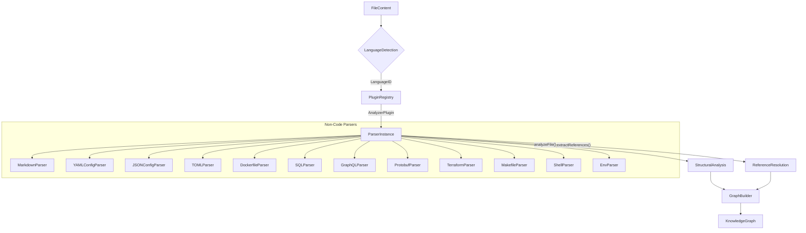
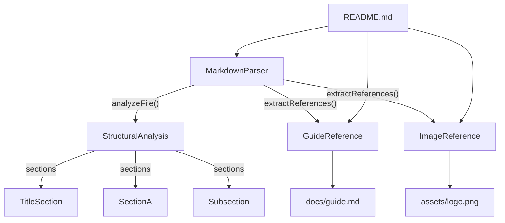
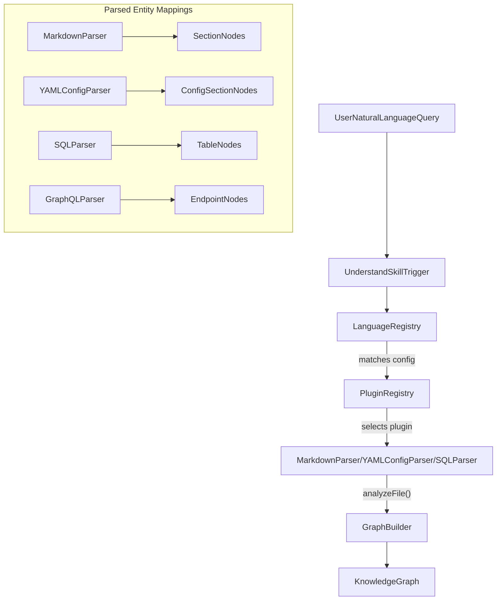

<!-- source: DeepWiki mcp.deepwiki.com · repo Egonex-AI/Understand-Anything · page 3.4 Non-Code Parsers · fetched 2026-10-30 -->

# Non-Code Parsers

<details>
<summary>Relevant source files</summary>

The following files were used as context for generating this wiki page:

- [understand-anything-plugin/packages/core/src/__tests__/parsers.test.ts](understand-anything-plugin/packages/core/src/__tests__/parsers.test.ts)
- [understand-anything-plugin/packages/core/src/languages/configs/json-schema.ts](understand-anything-plugin/packages/core/src/languages/configs/json-schema.ts)
- [understand-anything-plugin/packages/core/src/languages/configs/kubernetes.ts](understand-anything-plugin/packages/core/src/languages/configs/kubernetes.ts)
- [understand-anything-plugin/packages/core/src/languages/configs/openapi.ts](understand-anything-plugin/packages/core/src/languages/configs/openapi.ts)
- [understand-anything-plugin/packages/core/src/plugins/parsers/dockerfile-parser.ts](understand-anything-plugin/packages/core/src/plugins/parsers/dockerfile-parser.ts)
- [understand-anything-plugin/packages/core/src/plugins/parsers/env-parser.ts](understand-anything-plugin/packages/core/src/plugins/parsers/env-parser.ts)
- [understand-anything-plugin/packages/core/src/plugins/parsers/graphql-parser.ts](understand-anything-plugin/packages/core/src/plugins/parsers/graphql-parser.ts)
- [understand-anything-plugin/packages/core/src/plugins/parsers/json-parser.ts](understand-anything-plugin/packages/core/src/plugins/parsers/json-parser.ts)
- [understand-anything-plugin/packages/core/src/plugins/parsers/makefile-parser.ts](understand-anything-plugin/packages/core/src/plugins/parsers/makefile-parser.ts)
- [understand-anything-plugin/packages/core/src/plugins/parsers/markdown-parser.ts](understand-anything-plugin/packages/core/src/plugins/parsers/markdown-parser.ts)
- [understand-anything-plugin/packages/core/src/plugins/parsers/protobuf-parser.ts](understand-anything-plugin/packages/core/src/plugins/parsers/protobuf-parser.ts)
- [understand-anything-plugin/packages/core/src/plugins/parsers/shell-parser.ts](understand-anything-plugin/packages/core/src/plugins/parsers/shell-parser.ts)
- [understand-anything-plugin/packages/core/src/plugins/parsers/sql-parser.ts](understand-anything-plugin/packages/core/src/plugins/parsers/sql-parser.ts)
- [understand-anything-plugin/packages/core/src/plugins/parsers/terraform-parser.ts](understand-anything-plugin/packages/core/src/plugins/parsers/terraform-parser.ts)
- [understand-anything-plugin/packages/core/src/plugins/parsers/yaml-parser.ts](understand-anything-plugin/packages/core/src/plugins/parsers/yaml-parser.ts)
- [understand-anything-plugin/skills/understand/languages/css.md](understand-anything-plugin/skills/understand/languages/css.md)
- [understand-anything-plugin/skills/understand/languages/dockerfile.md](understand-anything-plugin/skills/understand/languages/dockerfile.md)
- [understand-anything-plugin/skills/understand/languages/graphql.md](understand-anything-plugin/skills/understand/languages/graphql.md)
- [understand-anything-plugin/skills/understand/languages/html.md](understand-anything-plugin/skills/understand/languages/html.md)
- [understand-anything-plugin/skills/understand/languages/json.md](understand-anything-plugin/skills/understand/languages/json.md)
- [understand-anything-plugin/skills/understand/languages/markdown.md](understand-anything-plugin/skills/understand/languages/markdown.md)
- [understand-anything-plugin/skills/understand/languages/protobuf.md](understand-anything-plugin/skills/understand/languages/protobuf.md)
- [understand-anything-plugin/skills/understand/languages/shell.md](understand-anything-plugin/skills/understand/languages/shell.md)
- [understand-anything-plugin/skills/understand/languages/sql.md](understand-anything-plugin/skills/understand/languages/sql.md)
- [understand-anything-plugin/skills/understand/languages/terraform.md](understand-anything-plugin/skills/understand/languages/terraform.md)
- [understand-anything-plugin/skills/understand/languages/yaml.md](understand-anything-plugin/skills/understand/languages/yaml.md)

</details>


This page details the parser subsystem within the `@understand-anything/core` package responsible for extracting structural information from various non-code file types. These parsers implement the `AnalyzerPlugin` interface and are designed to identify key entities like sections, services, resources, definitions, and steps within configuration files, documentation, and other domain-specific languages. This extracted information is then used to enrich the `KnowledgeGraph`.

Sources: [packages/core/src/plugins/parsers/graphql-parser.ts:8-10](), [packages/core/src/__tests__/parsers.test.ts:14-15]()

## Overview of Non-Code Parsers

The `understand-anything` plugin utilizes a set of specialized parsers for non-code files. These parsers are crucial for understanding the structure and relationships within files that don't conform to traditional programming language syntax but still contain valuable architectural or configuration data. Each parser is implemented as a class that adheres to the `AnalyzerPlugin` interface [packages/core/src/plugins/parsers/graphql-parser.ts:8-10](), providing `analyzeFile` and optionally `extractReferences` methods.

The `registerAllParsers` function registers all these parsers with the `PluginRegistry`, allowing the system to dynamically select the appropriate parser based on the file's language or extension [packages/core/src/__tests__/parsers.test.ts:14-15]().

Supported non-code file types include:
- **Markdown**: Headings and local references extraction.
- **YAML**: Top-level keys + array entries extraction, supporting various flavors.
- **JSON/JSONC**: Top-level keys extraction, `$ref` references support.
- **TOML**: Top-level keys extraction.
- **Dockerfile**: Multi-stage build stages, exposed ports, instruction steps.
- **SQL**: Table, view, and index definitions.
- **GraphQL**: Schema definitions and endpoint extraction.
- **Protobuf**: Message, enum, service, and RPC method extraction.
- **Terraform**: Resources, modules, variables, outputs extraction.
- **Makefile**: Build targets extraction.
- **Shell**: Function definitions and source references.
- **Env**: Environment variable assignments.

### Parser Architecture

Each parser class implements the `AnalyzerPlugin` interface, defining:
- `name`: Unique parser identifier.
- `languages`: Array of language strings handled.
- `analyzeFile(filePath: string, content: string)`: Returns a `StructuralAnalysis` object describing file structure.
- Optional `extractReferences(filePath: string, content: string)`: Returns `ReferenceResolution` objects for cross-file references.

Title: Non-Code Parser Data Flow

Sources: [packages/core/src/plugins/parsers/graphql-parser.ts:1-23](), [packages/core/src/__tests__/parsers.test.ts:14-15]()

---

## Markdown Parser

The `MarkdownParser` handles Markdown (`.md`) files by extracting heading sections and local file/image references [packages/core/src/plugins/parsers/markdown-parser.ts:8-10]().

### Key Implementation Details
- Extracts ATX headings (`#` through `######`), capturing their text, heading level, and line ranges [packages/core/src/plugins/parsers/markdown-parser.ts:41-77]().
- Ignores headings inside fenced code blocks (` ``` ` or ` ~~~ `) to avoid false positives [packages/core/src/plugins/parsers/markdown-parser.ts:44-60]().
- Extracts local file references and image references by parsing Markdown links/images with `[alt](target)` syntax, skipping external URLs (starting with `http`) [packages/core/src/plugins/parsers/markdown-parser.ts:23-39]().

### Graph Node Mapping
- **Sections**: Represented as `Section` nodes correlating to document structure.
- **References**: Form `references` edges in the graph between files or between files and images.

Title: Markdown Parser Output Mapping

Sources: [packages/core/src/plugins/parsers/markdown-parser.ts:8-78](), [packages/core/src/__tests__/parsers.test.ts:17-86]()

---

## YAML Parser

The `YAMLConfigParser` analyzes YAML files and YAML-based domain formats such as `docker-compose`, `kubernetes`, `github-actions`, and `openapi` [packages/core/src/plugins/parsers/yaml-parser.ts:14-22]().

### Key Implementation Details
- Uses the `yaml` library to parse contents, extracting top-level document keys as `SectionInfo` [packages/core/src/plugins/parsers/yaml-parser.ts:35-60]().
- Handles array-root documents by creating one section per array entry, named by `name`, `id`, or `kind` keys if present [packages/core/src/plugins/parsers/yaml-parser.ts:61-80]().
- Falls back to a regex-based extraction method if YAML parsing fails, extracting keys heuristically [packages/core/src/plugins/parsers/yaml-parser.ts:81-99]().

### Graph Node Mapping
- **Top-Level Keys and Array Entries**: Become `Section` nodes.
  - For `docker-compose.yml`, keys represent services.
  - For GitHub Actions, keys represent triggers or jobs [packages/core/src/__tests__/parsers.test.ts:115-125]().

Sources: [packages/core/src/plugins/parsers/yaml-parser.ts:14-106](), [packages/core/src/__tests__/parsers.test.ts:88-126]()

---

## JSON / JSONC Parser

The `JSONConfigParser` supports JSON and JSONC files, including JSON Schema and OpenAPI specs [packages/core/src/plugins/parsers/json-parser.ts:69-74]().

### Key Implementation Details
- `stripJsoncSyntax` function preprocesses JSONC by removing line comments (`//`), block comments (`/* */`), and trailing commas while preserving string contents [packages/core/src/plugins/parsers/json-parser.ts:11-59]().
- Parses JSON after sanitization, extracting top-level keys as `SectionInfo` nodes [packages/core/src/plugins/parsers/json-parser.ts:106-130]().
- Extracts external `$ref` references, skipping internal refs starting with `#`, as `ReferenceResolution` with type `"schema"` [packages/core/src/plugins/parsers/json-parser.ts:87-104]().

Sources: [packages/core/src/plugins/parsers/json-parser.ts:69-136](), [packages/core/src/__tests__/parsers.test.ts:128-190]()

---

## Dockerfile Parser

The `DockerfileParser` extracts multi-stage build stages, exposed ports, and instruction steps from Dockerfiles.

### Key Implementation Details
- Identifies `FROM` directives, treating each as a build stage with base image and optional alias name.
- Collects all `EXPOSE` port declarations within each stage.
- Extracts Dockerfile instructions (`RUN`, `COPY`, etc.) as discrete steps.

### Graph Node Mapping
- **Services**: Represented as `Service` nodes linked to their image and exposed ports.
- **Steps**: Represented as `Step` nodes indicating build or setup actions.

Sources: [packages/core/src/plugins/parsers/dockerfile-parser.ts:1-86](), [packages/core/src/__tests__/parsers.test.ts:200-240]()

---

## SQL Parser

The `SQLParser` extracts table, view, and index definitions from SQL files [packages/core/src/plugins/parsers/sql-parser.ts:8-10]().

### Key Implementation Details
- Matches `CREATE TABLE` statements with optional `IF NOT EXISTS`, extracting table name and column fields [packages/core/src/plugins/parsers/sql-parser.ts:27-49]().
- Extracts columns by looking for column names in the parenthesized block, skipping constraints like `PRIMARY KEY` [packages/core/src/plugins/parsers/sql-parser.ts:78-101]().
- Matches `CREATE VIEW` and `CREATE INDEX` statements [packages/core/src/plugins/parsers/sql-parser.ts:51-73]().

Sources: [packages/core/src/plugins/parsers/sql-parser.ts:1-103](), [packages/core/src/__tests__/parsers.test.ts:8]()

---

## GraphQL Parser

The `GraphQLParser` parses GraphQL schema files to extract type definitions and endpoints [packages/core/src/plugins/parsers/graphql-parser.ts:8-10]().

### Key Implementation Details
- Extracts `type`, `input`, `enum`, `interface`, `union`, and `scalar` definitions using regex [packages/core/src/plugins/parsers/graphql-parser.ts:25-56]().
- Identifies `Query`, `Mutation`, and `Subscription` blocks and extracts their fields as `EndpointInfo` [packages/core/src/plugins/parsers/graphql-parser.ts:58-95]().
- Computes line ranges for definitions by finding the closing brace `}` [packages/core/src/plugins/parsers/graphql-parser.ts:40-45]().

Sources: [packages/core/src/plugins/parsers/graphql-parser.ts:1-122](), [packages/core/src/__tests__/parsers.test.ts:9]()

---

## Protobuf Parser

The `ProtobufParser` parses Protocol Buffer (`.proto`) files.

### Key Implementation Details
- Extracts `message` blocks with fields.
- Extracts `enum` blocks with values.
- Extracts `service` blocks and their RPC methods as `EndpointInfo`.
- Implements brace tracking to determine structural boundaries.

Sources: [packages/core/src/plugins/parsers/protobuf-parser.ts:1-141](), [packages/core/src/__tests__/parsers.test.ts:280-319]()

---

## Terraform Parser

The `TerraformParser` parses Terraform `.tf` files to extract infrastructure resources and variables.

### Key Implementation Details
- Extracts `resource` blocks with type and name combined as `kind.name`.
- Extracts `data` source blocks similarly.
- Extracts `module` blocks.
- Extracts `variable` and `output` blocks as definitions.

Sources: [packages/core/src/plugins/parsers/terraform-parser.ts:1-131](), [packages/core/src/__tests__/parsers.test.ts:321-360]()

---

## Makefile Parser

The `MakefileParser` extracts targets from Makefiles.

### Key Implementation Details
- Extracts target names from lines matching target definition patterns.
- Filters out special Make targets (starting with `.`) and variable assignments (`:=`, `?=`).
- Determines target range by looking for indented lines following the target definition.

Sources: [packages/core/src/plugins/parsers/makefile-parser.ts:1-51](), [packages/core/src/__tests__/parsers.test.ts:362-390]()

---

## Shell Parser

The `ShellParser` analyzes shell scripts (`.sh`, `.bash`) and Jenkinsfiles [packages/core/src/plugins/parsers/shell-parser.ts:8-12]().

### Key Implementation Details
- Extracts function definitions in both `name() {` and `function name {` styles [packages/core/src/plugins/parsers/shell-parser.ts:51-52]().
- Accurately matches opening/closing braces to determine function body range [packages/core/src/plugins/parsers/shell-parser.ts:65-76]().
- Extracts `source` or `.` commands referencing other shell files [packages/core/src/plugins/parsers/shell-parser.ts:24-40]().

Sources: [packages/core/src/plugins/parsers/shell-parser.ts:1-86](), [packages/core/src/__tests__/parsers.test.ts:392-431]()

---

## Env Parser

The `EnvParser` parses `.env` files.

### Key Implementation Details
- Parses lines matching variable assignment patterns, ignoring comments and empty lines.
- Extracted variables are returned as `DefinitionInfo` with kind `variable`.

Sources: [packages/core/src/plugins/parsers/env-parser.ts:1-41](), [packages/core/src/__tests__/parsers.test.ts:433-455]()

---

## Per-Language Skill Guidance Docs & Configurations

To assist LLM analyzers and agents during codebase scanning, the project maintains language configuration modules and skill guidance documents (such as `openapiConfig`, `jsonSchemaConfig`, `kubernetesConfig`, and markdown snippet files) [packages/core/src/languages/configs/openapi.ts:1-15](), [skills/understand/languages/shell.md:1-36](), [skills/understand/languages/css.md:1-38](). These guides define core concepts, notable file patterns, edge relationships, and summary styles for each language, enabling the architecture analyzer and prompt builders to construct domain-accurate graph summaries.

Sources: [packages/core/src/languages/configs/openapi.ts:1-15](), [packages/core/src/languages/configs/json-schema.ts:1-18](), [packages/core/src/languages/configs/kubernetes.ts:1-19](), [skills/understand/languages/shell.md:1-36](), [skills/understand/languages/css.md:1-38]()

---

## Bridging Natural Language Concepts to Code Entities

Context builders and skills trigger these parsers based on detected file types, bridging natural language queries and configurations directly to code entities inside the `KnowledgeGraph` via `GraphBuilder`.

Title: Natural Language Space to Code Entity Space

Sources: [packages/core/src/plugins/parsers/graphql-parser.ts:1-23](), [packages/core/src/plugins/parsers/sql-parser.ts:1-21](), [packages/core/src/plugins/parsers/markdown-parser.ts:8-22]()

---

