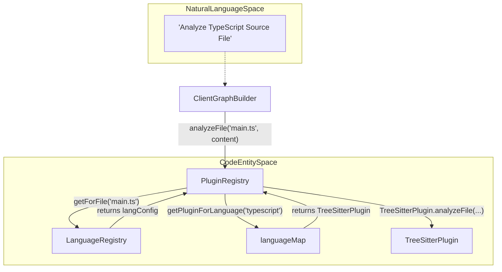
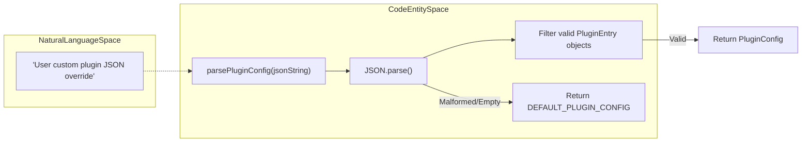

<!-- source: DeepWiki mcp.deepwiki.com · repo Egonex-AI/Understand-Anything · page 3.6 Plugin Registry & Discovery · fetched 2026-10-30 -->

# Plugin Registry & Discovery

<details>
<summary>Relevant source files</summary>

The following files were used as context for generating this wiki page:

- [understand-anything-plugin/packages/core/package.json](understand-anything-plugin/packages/core/package.json)
- [understand-anything-plugin/packages/core/src/__tests__/language-registry.test.ts](understand-anything-plugin/packages/core/src/__tests__/language-registry.test.ts)
- [understand-anything-plugin/packages/core/src/__tests__/plugin-discovery.test.ts](understand-anything-plugin/packages/core/src/__tests__/plugin-discovery.test.ts)
- [understand-anything-plugin/packages/core/src/__tests__/plugin-registry.test.ts](understand-anything-plugin/packages/core/src/__tests__/plugin-registry.test.ts)
- [understand-anything-plugin/packages/core/src/analyzer/language-lesson.ts](understand-anything-plugin/packages/core/src/analyzer/language-lesson.ts)
- [understand-anything-plugin/packages/core/src/languages/configs/dart.ts](understand-anything-plugin/packages/core/src/languages/configs/dart.ts)
- [understand-anything-plugin/packages/core/src/languages/configs/index.ts](understand-anything-plugin/packages/core/src/languages/configs/index.ts)
- [understand-anything-plugin/packages/core/src/plugins/discovery.ts](understand-anything-plugin/packages/core/src/plugins/discovery.ts)
- [understand-anything-plugin/packages/core/src/plugins/extractors/index.ts](understand-anything-plugin/packages/core/src/plugins/extractors/index.ts)
- [understand-anything-plugin/packages/core/src/plugins/registry.ts](understand-anything-plugin/packages/core/src/plugins/registry.ts)
- [understand-anything-plugin/pnpm-lock.yaml](understand-anything-plugin/pnpm-lock.yaml)

</details>


This page details the plugin architecture within the `@understand-anything/core` package, focusing on how `AnalyzerPlugin` implementations are registered, discovered, and invoked. It covers the `PluginRegistry` class, the configuration mechanism for plugins (`parsePluginConfig`, `serializePluginConfig`), and the `DEFAULT_PLUGIN_CONFIG`.

## Purpose and Scope

The plugin subsystem decouples language-specific syntax analysis from the core graph construction engine (`GraphBuilder`). By utilizing the `PluginRegistry` and a modular `AnalyzerPlugin` contract, the core package can support dozens of programming and markup languages uniformly through plugins such as `TreeSitterPlugin`.

Sources:
*   [understand-anything-plugin/packages/core/src/plugins/registry.ts:11-18]()
*   [understand-anything-plugin/packages/core/src/plugins/discovery.ts:1-24]()

## AnalyzerPlugin Interface

The core of the plugin system is the `AnalyzerPlugin` interface, which specifies the methods that any plugin must implement to provide structural analysis capabilities.

```typescript
export interface AnalyzerPlugin {
  readonly name: string;
  readonly languages: string[]; // List of language IDs this plugin supports

  analyzeFile(filePath: string, content: string): StructuralAnalysis | null;
  analyzeFileFull?(
    filePath: string,
    content: string,
  ): { structure: StructuralAnalysis; callGraph: CallGraphEntry[] } | null;
  resolveImports?(filePath: string, content: string): ImportResolution[] | null;
  extractCallGraph?(filePath: string, content: string): CallGraphEntry[] | null;
}
```

The interface requires a `name` and a list of `languages` it supports. It defines primary methods:
*   `analyzeFile`: Performs deep structural analysis, extracting functions, classes, imports, and exports [understand-anything-plugin/packages/core/src/plugins/registry.ts:56-60]().
*   `analyzeFileFull`: An optional fast-path method returning both structural analysis and call graph data in a single pass [understand-anything-plugin/packages/core/src/plugins/registry.ts:79-86]().
*   `resolveImports`: Handles the resolution of import statements [understand-anything-plugin/packages/core/src/plugins/registry.ts:62-66]().
*   `extractCallGraph`: Extracts call graph information [understand-anything-plugin/packages/core/src/plugins/registry.ts:68-72]().

Sources:
*   [understand-anything-plugin/packages/core/src/plugins/registry.ts:56-86]()

## PluginRegistry

The `PluginRegistry` class acts as a central hub for managing and dispatching `AnalyzerPlugin` instances, mapping supported languages to their respective plugins using a `LanguageRegistry` instance [understand-anything-plugin/packages/core/src/plugins/registry.ts:11-18]().

### Plugin Management and Dispatch Methods

*   **`register(plugin: AnalyzerPlugin): void`**: Adds a plugin and updates internal language mappings [understand-anything-plugin/packages/core/src/plugins/registry.ts:20-25](). Later registrations take precedence for overlapping languages [understand-anything-plugin/packages/core/src/__tests__/plugin-registry.test.ts:85-92]().
*   **`unregister(name: string): void`**: Removes a plugin by name and rebuilds the language map [understand-anything-plugin/packages/core/src/plugins/registry.ts:27-37]().
*   **`getPluginForFile(filePath: string): AnalyzerPlugin | null`**: Looks up the file's language via `LanguageRegistry` and returns the matching plugin [understand-anything-plugin/packages/core/src/plugins/registry.ts:43-47]().
*   **`analyzeFile(filePath: string, content: string)`**: Delegates to the resolved plugin [understand-anything-plugin/packages/core/src/plugins/registry.ts:56-60]().

### Plugin Registry Data Flow


**Diagram: Plugin Registry Data Flow**

Sources:
*   [understand-anything-plugin/packages/core/src/plugins/registry.ts:11-86]()
*   [understand-anything-plugin/packages/core/src/__tests__/plugin-registry.test.ts:22-106]()

## Plugin Discovery and Configuration

The system supports dynamic plugin configuration via JSON parsing and serialization utilities [understand-anything-plugin/packages/core/src/plugins/discovery.ts:30-68]().

### Configuration Schema

*   `PluginEntry`: Represents an individual plugin entry with `name`, `enabled`, `languages`, and optional `options` [understand-anything-plugin/packages/core/src/plugins/discovery.ts:3-8]().
*   `PluginConfig`: Wrapper container holding an array of `PluginEntry` objects [understand-anything-plugin/packages/core/src/plugins/discovery.ts:10-12]().
*   `DEFAULT_PLUGIN_CONFIG`: Enables the `tree-sitter` plugin by default for all languages possessing a valid `treeSitter` configuration [understand-anything-plugin/packages/core/src/plugins/discovery.ts:14-24]().

### Discovery Workflow


**Diagram: Plugin Configuration Discovery**

Sources:
*   [understand-anything-plugin/packages/core/src/plugins/discovery.ts:30-61]()
*   [understand-anything-plugin/packages/core/src/__tests__/plugin-discovery.test.ts:10-72]()

---

