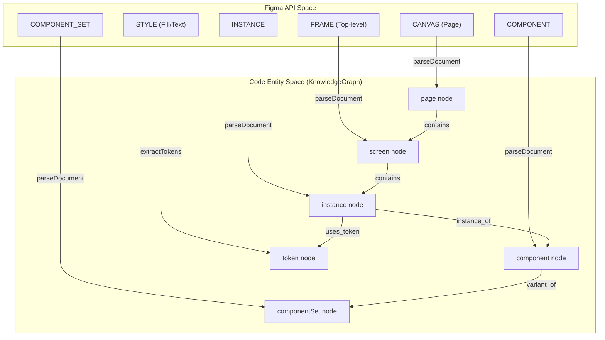
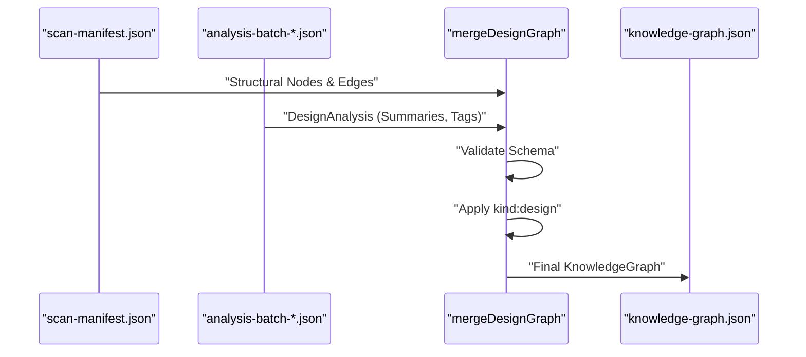

<!-- source: DeepWiki mcp.deepwiki.com · repo Egonex-AI/Understand-Anything · page 3.7 Figma Core Subsystem · fetched 2026-10-30 -->

# Figma Core Subsystem

Relevant source files

The following files were used as context for generating this wiki page:

- [understand-anything-plugin/packages/core/src/figma/__tests__/api-source.test.ts](understand-anything-plugin/packages/core/src/figma/__tests__/api-source.test.ts)
- [understand-anything-plugin/packages/core/src/figma/__tests__/merge.test.ts](understand-anything-plugin/packages/core/src/figma/__tests__/merge.test.ts)
- [understand-anything-plugin/packages/core/src/figma/__tests__/parse-document.test.ts](understand-anything-plugin/packages/core/src/figma/__tests__/parse-document.test.ts)
- [understand-anything-plugin/packages/core/src/figma/__tests__/thumbnails.test.ts](understand-anything-plugin/packages/core/src/figma/__tests__/thumbnails.test.ts)
- [understand-anything-plugin/packages/core/src/figma/__tests__/tokens.test.ts](understand-anything-plugin/packages/core/src/figma/__tests__/tokens.test.ts)
- [understand-anything-plugin/packages/core/src/figma/index.ts](understand-anything-plugin/packages/core/src/figma/index.ts)
- [understand-anything-plugin/packages/core/src/figma/merge.ts](understand-anything-plugin/packages/core/src/figma/merge.ts)
- [understand-anything-plugin/packages/core/src/figma/parse/parse-document.ts](understand-anything-plugin/packages/core/src/figma/parse/parse-document.ts)
- [understand-anything-plugin/packages/core/src/figma/parse/tokens.ts](understand-anything-plugin/packages/core/src/figma/parse/tokens.ts)
- [understand-anything-plugin/packages/core/src/figma/source/api-source.ts](understand-anything-plugin/packages/core/src/figma/source/api-source.ts)
- [understand-anything-plugin/packages/core/src/figma/source/types.ts](understand-anything-plugin/packages/core/src/figma/source/types.ts)
- [understand-anything-plugin/packages/core/src/figma/thumbnails.ts](understand-anything-plugin/packages/core/src/figma/thumbnails.ts)
- [understand-anything-plugin/skills/understand-figma/SKILL.md](understand-anything-plugin/skills/understand-figma/SKILL.md)
- [understand-anything-plugin/skills/understand-figma/figma-merge.mjs](understand-anything-plugin/skills/understand-figma/figma-merge.mjs)
- [understand-anything-plugin/skills/understand-figma/figma-scan.mjs](understand-anything-plugin/skills/understand-figma/figma-scan.mjs)

The Figma Core Subsystem is a specialized module within `@understand-anything/core` designed to bridge design assets with the system's unified `KnowledgeGraph`. It provides deterministic fetching and parsing of Figma documents, design token extraction, and a merging logic that integrates LLM-based design analysis into the graph.

## Architecture & Data Flow

The subsystem operates in three primary stages: **Fetch**, **Parse**, and **Enrich/Merge**. It utilizes the Figma REST API to retrieve document structures and styles, converting them into a set of nodes and edges categorized as `kind: "design"`.

### Design-to-Code Entity Mapping

The following diagram illustrates how Figma's internal document structure maps to the `KnowledgeGraph` entity space using code symbols and functions.

**Figma Entity Mapping**

Sources: [understand-anything-plugin/packages/core/src/figma/parse/parse-document.ts:50-97](), [understand-anything-plugin/packages/core/src/figma/parse/tokens.ts:12-34]()

## Key Components

### FigmaApiSource
The `FigmaApiSource` class handles all communication with the Figma REST API. It requires a `FIGMA_TOKEN` environment variable [understand-anything-plugin/packages/core/src/figma/source/api-source.ts:15-23]().

*   **`parseFileKey(urlOrKey)`**: Extracts the file key from a Figma URL or validates a bare key string [understand-anything-plugin/packages/core/src/figma/source/api-source.ts:5-10]().
*   **`fetchDocument()`**: Retrieves the full JSON tree of the Figma file [understand-anything-plugin/packages/core/src/figma/source/api-source.ts:34-36]().
*   **`fetchStyles()`**: Retrieves published styles (colors, typography) from the file [understand-anything-plugin/packages/core/src/figma/source/api-source.ts:38-40]().
*   **`renderImages(nodeIds)`**: Generates pre-signed PNG URLs for specific nodes (primarily used for screen thumbnails) [understand-anything-plugin/packages/core/src/figma/source/api-source.ts:42-49]().

Sources: [understand-anything-plugin/packages/core/src/figma/source/api-source.ts:1-50]()

### Document Parsing (`parseDocument`)
The `parseDocument` function traverses the Figma document tree and generates structural nodes. It specifically targets `CANVAS` (pages), `FRAME` (screens), `COMPONENT`, `COMPONENT_SET`, and `INSTANCE` types [understand-anything-plugin/packages/core/src/figma/parse/parse-document.ts:21-97]().

*   **Containment**: Links pages to screens/components via `contains` edges [understand-anything-plugin/packages/core/src/figma/parse/parse-document.ts:60]().
*   **Instances**: Recursively finds `INSTANCE` nodes within screens and links them to their main component via `instance_of` edges [understand-anything-plugin/packages/core/src/figma/parse/parse-document.ts:31-48]().
*   **Variants**: Links components within a `COMPONENT_SET` via `variant_of` edges [understand-anything-plugin/packages/core/src/figma/parse/parse-document.ts:78]().

Sources: [understand-anything-plugin/packages/core/src/figma/parse/parse-document.ts:1-100]()

### Token Extraction (`extractTokens`)
`extractTokens` identifies design tokens from Figma styles. It bridges file-local style IDs to global published keys [understand-anything-plugin/packages/core/src/figma/parse/tokens.ts:12-72]().

*   **Attribute Attribution**: If a style is applied to a deep leaf layer (like a `TEXT` or `RECTANGLE` inside a `FRAME`), the `uses_token` edge is attributed to the nearest structural ancestor (e.g., the `screen` node) to ensure the relationship is visible in the graph [understand-anything-plugin/packages/core/src/figma/parse/tokens.ts:42-68]().
*   **Token Kinds**: Maps Figma style types to `tokenKind` values: `FILL` -> `color`, `TEXT` -> `type`, `EFFECT` -> `effect`, `GRID` -> `grid` [understand-anything-plugin/packages/core/src/figma/parse/tokens.ts:4-6]().

Sources: [understand-anything-plugin/packages/core/src/figma/parse/tokens.ts:1-72]()

## Incremental Updates & Thumbnails

The subsystem implements a version-check optimization to avoid redundant LLM analysis.

### UP_TO_DATE Logic
In `figma-scan.mjs`, the system compares the `figmaVersion` from the API with the version stored in `meta.json` [understand-anything-plugin/skills/understand-figma/figma-scan.mjs:20-37]().
*   If versions match, the system skips re-parsing and LLM enrichment.
*   Because Figma's thumbnail URLs are pre-signed and expire after a few hours, the system calls `refreshThumbnailsInPlace` to update the existing graph with fresh URLs [understand-anything-plugin/skills/understand-figma/figma-scan.mjs:89-105]().

Sources: [understand-anything-plugin/skills/understand-figma/figma-scan.mjs:1-105]()

### Thumbnail Application
`applyScreenThumbnails` mutates `screen` nodes to include a `thumbnailUrl` in their `figmaMeta` [understand-anything-plugin/packages/core/src/figma/thumbnails.ts:13-29](). This allows the dashboard to display visual previews of screens in the sidebar.

Sources: [understand-anything-plugin/packages/core/src/figma/thumbnails.ts:1-29]()

## Data Merging (`mergeDesignGraph`)

The final phase combines the deterministic scan results with LLM-generated analysis.

**Merge Process Flow**

Sources: [understand-anything-plugin/skills/understand-figma/figma-merge.mjs:11-21](), [understand-anything-plugin/packages/core/src/figma/index.ts:1-6]()

The `mergeDesignGraph` function ensures that the resulting graph conforms to the `KnowledgeGraph` schema while preserving design-specific metadata and attaching the `kind: "design"` attribute to the project metadata.

Sources: [understand-anything-plugin/skills/understand-figma/figma-merge.mjs:1-43]()

## Figma Metadata (`figmaMeta`)

Nodes of `kind: "design"` carry a `figmaMeta` object containing:

| Field | Description |
| :--- | :--- |
| `fileKey` | The unique identifier of the Figma file [understand-anything-plugin/packages/core/src/figma/parse/parse-document.ts:54](). |
| `nodeId` | The internal Figma ID (e.g., `1:2`) [understand-anything-plugin/packages/core/src/figma/parse/parse-document.ts:54](). |
| `thumbnailUrl` | Pre-signed URL for screen previews [understand-anything-plugin/packages/core/src/figma/thumbnails.ts:24](). |
| `tokenKind` | For `token` nodes: `color`, `type`, `effect`, `grid` [understand-anything-plugin/packages/core/src/figma/parse/tokens.ts:31](). |
| `componentKey` | The global published key for components [understand-anything-plugin/packages/core/src/figma/parse/parse-document.ts:39](). |
| `prototypeTargets` | Array of node IDs targeted by prototype transitions [understand-anything-plugin/packages/core/src/figma/parse/parse-document.ts:40](). |
| `dimensions` | Width and height for `screen` nodes [understand-anything-plugin/packages/core/src/figma/parse/parse-document.ts:55-57](). |

Sources: [understand-anything-plugin/packages/core/src/figma/parse/parse-document.ts:34-80](), [understand-anything-plugin/packages/core/src/figma/parse/tokens.ts:31](), [understand-anything-plugin/packages/core/src/figma/thumbnails.ts:24]()

---

