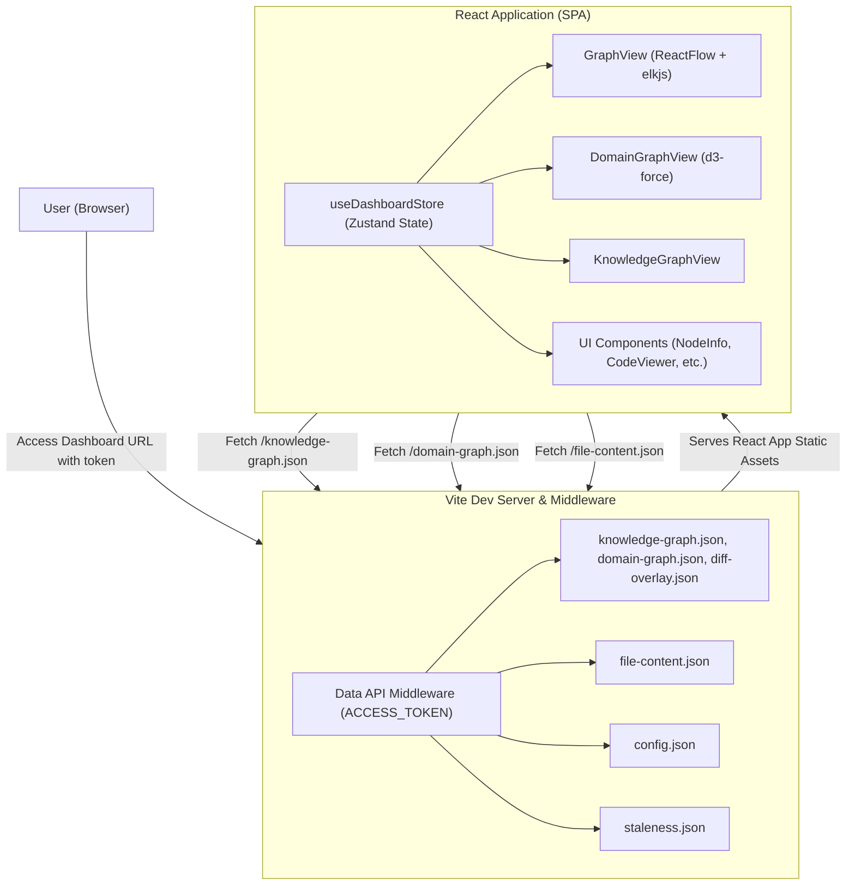
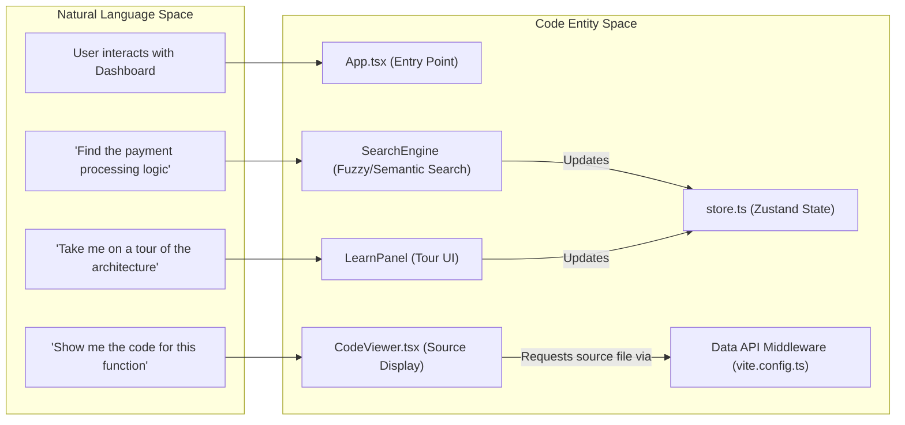

<!-- source: DeepWiki mcp.deepwiki.com · repo Egonex-AI/Understand-Anything · page 4 Dashboard (@understand-anything/dashboard) · fetched 2026-10-30 -->

# Dashboard (@understand-anything/dashboard)

Relevant source files

The following files were used as context for generating this wiki page:

- [pnpm-lock.yaml](pnpm-lock.yaml)
- [understand-anything-plugin/packages/dashboard/index.html](understand-anything-plugin/packages/dashboard/index.html)
- [understand-anything-plugin/packages/dashboard/package.json](understand-anything-plugin/packages/dashboard/package.json)
- [understand-anything-plugin/packages/dashboard/public/favicon.ico](understand-anything-plugin/packages/dashboard/public/favicon.ico)
- [understand-anything-plugin/packages/dashboard/public/favicon.svg](understand-anything-plugin/packages/dashboard/public/favicon.svg)
- [understand-anything-plugin/packages/dashboard/src/App.tsx](understand-anything-plugin/packages/dashboard/src/App.tsx)
- [understand-anything-plugin/packages/dashboard/src/components/CustomNode.tsx](understand-anything-plugin/packages/dashboard/src/components/CustomNode.tsx)
- [understand-anything-plugin/packages/dashboard/src/components/GraphView.tsx](understand-anything-plugin/packages/dashboard/src/components/GraphView.tsx)
- [understand-anything-plugin/packages/dashboard/src/components/NodeInfo.tsx](understand-anything-plugin/packages/dashboard/src/components/NodeInfo.tsx)
- [understand-anything-plugin/packages/dashboard/src/store.ts](understand-anything-plugin/packages/dashboard/src/store.ts)
- [understand-anything-plugin/packages/dashboard/src/utils/__tests__/smoke.test.ts](understand-anything-plugin/packages/dashboard/src/utils/__tests__/smoke.test.ts)
- [understand-anything-plugin/packages/dashboard/src/utils/layout.ts](understand-anything-plugin/packages/dashboard/src/utils/layout.ts)
- [understand-anything-plugin/packages/dashboard/vite.config.ts](understand-anything-plugin/packages/dashboard/vite.config.ts)

The `@understand-anything/dashboard` package implements a React-based interactive visualization dashboard for the Understand Anything system. It provides users with powerful tools to explore and understand their project's KnowledgeGraph through various graph visualizations, integrated search, code previews, and guided tours.

This page gives a high-level overview of the dashboard's architecture, its Vite-based development server paired with a secure data API middleware, the overall state management and UI component structure, as well as theming and internationalization support. Deeper technical details are available in dedicated child pages that cover the dashboard server, graph views, state management, UI components, and theming.

---

## Architecture Overview

The dashboard is a modern single-page React application built with Vite for fast development and optimized bundling [understand-anything-plugin/packages/dashboard/package.json:7-9](). Its architecture includes two main components:

- **Vite Dev Server with Data API Middleware:**  
  Serves static assets for the React app and exposes REST-like JSON endpoints providing the knowledge graph data (`knowledge-graph.json`), domain-specific graph data (`domain-graph.json`), diff overlays (`diff-overlay.json`), file content previews (`file-content.json`), configuration, and staleness information. The access to sensitive graph data requires an `ACCESS_TOKEN` query parameter to enforce security, handled in middleware [understand-anything-plugin/packages/dashboard/vite.config.ts:15-138](). It also implements path sanitization to restrict file access within the project directory.

- **React Frontend Application:**  
  The frontend fetches data from the above endpoints and presents an interactive visualization environment using the following technologies:
  - `@xyflow/react` (a React Flow fork) for rendering and interacting with graph nodes and edges [understand-anything-plugin/packages/dashboard/src/components/GraphView.tsx:3-13]().
  - `elkjs` for layered graph layouts with advanced options for edge routing and spacing [understand-anything-plugin/packages/dashboard/src/utils/layout.ts:75-84]().
  - `d3-force` for force-directed layouts, primarily used in the DomainGraph view for domain-centric graphs [understand-anything-plugin/packages/dashboard/package.json:18]().
  - `zustand` for lightweight centralized state management enabling complex interactivity, filtering, and navigation [understand-anything-plugin/packages/dashboard/src/store.ts:1-10]().

### System Architecture Diagram

Sources: [understand-anything-plugin/packages/dashboard/package.json:7-9](), [understand-anything-plugin/packages/dashboard/vite.config.ts:15-138](), [understand-anything-plugin/packages/dashboard/src/App.tsx:1-116](), [understand-anything-plugin/packages/dashboard/src/store.ts:1-10](), [understand-anything-plugin/packages/dashboard/src/components/GraphView.tsx:1-62]()

---

## Dashboard Server & Data API

The dashboard's server is powered by Vite which includes a middleware layer responsible for serving key data endpoints. The middleware restricts access to data files behind a generated or configured `ACCESS_TOKEN`. This token is required as a URL query parameter to fetch graph data and other sensitive JSON files ensuring that the dashboard is only accessible by authorized users [understand-anything-plugin/packages/dashboard/vite.config.ts:15-18,125-188]().

The middleware provides these main HTTP JSON endpoints:

- `/knowledge-graph.json` — the main serialized KnowledgeGraph data representing the entire analyzed project.
- `/domain-graph.json` — domain-specific subgraph data focusing on domain flow nodes.
- `/diff-overlay.json` — contains information about changed and affected nodes for visual diffing.
- `/file-content.json` — serves sanitized previews of source files on demand by the frontend's code viewer.
- `/config.json` — configuration data such as preferred output language.
- `/staleness.json` — freshness report to indicate how up-to-date data files are.

The middleware validates all file paths requested to ensure they do not escape the project root and verifies that requested files are part of the graph metadata for security. It also imposes limits on file size and rejects binary files for preview [understand-anything-plugin/packages/dashboard/vite.config.ts:125-188]().

A standalone viewer package exists to operate independently with read-only static data, also making use of the same server API model.

For full technical details and security model, see the child page: [Dashboard Server & Data API](#4.1).

Sources: [understand-anything-plugin/packages/dashboard/vite.config.ts:15-188](), [understand-anything-plugin/packages/dashboard/src/App.tsx:57-95]()

---

## Graph Visualization Engine

The core visualization logic is implemented with ReactFlow (`@xyflow/react`) with advanced, multi-stage layout managed primarily through ELK.js for layered graph positioning and D3 force-directed layouts for domain graphs [understand-anything-plugin/packages/dashboard/src/components/GraphView.tsx:3-45](), [understand-anything-plugin/packages/dashboard/src/utils/layout.ts:75-84]().

Key aspects:

- **Node Types and Categories:**  
  Nodes correspond to various `NodeType` values (e.g., `file`, `function`, `domain`, `article`) which are mapped to broader filterable `NodeCategory` buckets such as code, config, docs, infra and knowledge [understand-anything-plugin/packages/dashboard/src/components/GraphView.tsx:70-81]().

- **Two-Stage ELK Layout:**  
  The dashboard implements a two-step layout lifecycle:
  1. Initial global graph layout to position top-level nodes.
  2. Lazy expansion and layout of containers and portals to improve performance on large graphs.

- **Custom Nodes and Visual Styling:**  
  `CustomNode` React component encapsulates node rendering, displaying labels, complexity badges, highlight/focus states, and diff overlays. It uses CSS variables for color theming keyed by node type [understand-anything-plugin/packages/dashboard/src/components/CustomNode.tsx:8-36]().

- **Edge Aggregation and Portals:**  
  The engine groups and inflates edges for clarity and computes portals to show connections between different layers of abstraction.

The visualization engine integrates tightly with the central application state via the `useDashboardStore` Zustand store for reactive updates.

For full details on the lifecycle, layout workers, edge aggregation, and performance optimizations, see the child page: [Graph Visualization Engine](#4.2).

Sources: [understand-anything-plugin/packages/dashboard/src/components/GraphView.tsx:57-106](), [understand-anything-plugin/packages/dashboard/src/components/CustomNode.tsx:1-198](), [understand-anything-plugin/packages/dashboard/src/utils/layout.ts:75-110]()

---

## Domain Graph View & Force Layout

The DomainGraphView component specializes in visualizing the business domain aspect of the knowledge graph, particularly focusing on `domain`, `flow`, and `step` node types [understand-anything-plugin/packages/dashboard/src/components/DomainGraphView.tsx:1-9](). 

Features include:

- Specialized node types such as `DomainClusterNode`, `FlowNode`, and `StepNode` represent hierarchical domain structures and workflows visually.
- The use of D3's force-directed layout engine allows organic and interactive positioning of domain graph nodes, enhancing understanding of business process flows [understand-anything-plugin/packages/dashboard/package.json:18]().
- Includes modes for both overview of cross-domain connections and detailed step-level drill-down.
- Integrates with the central state and supports interactions like node selection and navigation.

For detailed implementation of domain-specific components, force layout, and their integration, refer to the child page: [Domain Graph View & Force Layout](#4.3).

Sources: [understand-anything-plugin/packages/dashboard/src/components/DomainGraphView.tsx:25-166]()

---

## Dashboard State Management (Zustand Store)

State management is centralized in the `useDashboardStore` hook built with `zustand` [understand-anything-plugin/packages/dashboard/src/store.ts:1-165](). This store manages:

- **Graph Data:**  
  Maintains the loaded KnowledgeGraph and domain graph. Provides quick lookup maps from node IDs to nodes and layers, supporting efficient state queries and UI updates.

- **Navigation & View Modes:**  
  Tracks current navigation level (overview or layer detail), active layers, node selections, diff overlay toggles, and persona filtering.

- **Search:**  
  Manages search queries and results using both fuzzy and semantic search engines integrated from the core package.

- **UI State:**  
  Controls sidebar panel visibility, code viewer state, onboarding overlays, and keyboard shortcut handlers.

- **History and Filters:**  
  Tracks navigation history with a capped stack and stores active filters on node types, edge categories, complexities, and layers.

The store exposes actions for updating these states reactively, enabling responsive graph updates and user interface interactions.

For a detailed breakdown of store slices, selectors, and search integration, see the child page: [Dashboard State Management (Zustand Store)](#4.4).

Sources: [understand-anything-plugin/packages/dashboard/src/store.ts:101-200]()

---

## UI Components & Panels

The dashboard includes a rich set of React UI components styled with Tailwind CSS, providing diverse functionality and a polished user experience [understand-anything-plugin/packages/dashboard/src/App.tsx:1-42]():

- **Panels:**  
  - `NodeInfo` to display metadata and detailed info for the selected node [understand-anything-plugin/packages/dashboard/src/components/NodeInfo.tsx:1-144]().
  - `SearchBar` for interactive graph search and navigation.
  - `LearnPanel` providing guided tours through graph layers.
  - `LayerLegend`, `FilterPanel`, `PersonaSelector` for user filtering and customization.
  - `ExportMenu` for exporting graph data and visualizations.
  - `WarningBanner` and `StalenessBanner` for notifications.

- **CodeViewer:**  
  Renders source code previews with syntax highlighting and Markdown rendering integrated via `prism-react-renderer`, allowing users to browse code referenced in nodes [understand-anything-plugin/packages/dashboard/src/components/CodeViewer.tsx:1-120]().

- **Design Integration:**  
  Components like `FigmaThumbnail` showcase design-related nodes sourced from Figma, providing visual design context within the knowledge graph visualization [understand-anything-plugin/packages/dashboard/src/components/NodeInfo.tsx:55-63]().

- **Modals and Overlays:**  
  `PathFinderModal`, `OnboardingOverlay`, `KeyboardShortcutsHelp` enable advanced UI workflows and onboarding.

For a complete list and details on individual UI components and their roles, consult the child page: [UI Components & Panels](#4.5).

Sources: [understand-anything-plugin/packages/dashboard/src/App.tsx:1-42](), [understand-anything-plugin/packages/dashboard/src/components/CodeViewer.tsx:1-120](), [understand-anything-plugin/packages/dashboard/src/components/NodeInfo.tsx:55-63]()

---

## Theming & Internationalization

The dashboard supports dynamic theming and i18n localization for global usage:

- **Themes:**  
  The `ThemeProvider` and `ThemePicker` components manage theme presets, such as `dark-gold` and `light-minimal`. Colors and UI styling rely on CSS variables scoped by theme, for example using `var(--color-node-file)` to style nodes by type [understand-anything-plugin/packages/dashboard/src/components/CustomNode.tsx:9]().

- **Internationalization:**  
  Uses `I18nProvider` to supply translations and localized strings supporting English, Chinese (simplified and traditional), Japanese, Korean, and Russian locales [understand-anything-plugin/packages/dashboard/src/App.tsx:27]().

This ensures the dashboard UI is adaptable in both appearance and language based on user preferences or project configurations.

For a full description of the theming system and supported locales, see the child page: [Theming & Internationalization](#4.6).

Sources: [understand-anything-plugin/packages/dashboard/src/App.tsx:24-27](), [understand-anything-plugin/packages/dashboard/src/components/CustomNode.tsx:8-36]()

---

## Summary Diagram: Bridging Natural Language to Code Entity Space

This diagram connects user interactions and natural language intents to specific code entities implementing dashboard features.

This highlights the flow from user queries and interactions through React components and state management to underlying data retrieval middleware fulfilling those requests.

Sources: [understand-anything-plugin/packages/dashboard/src/App.tsx:1-116](), [understand-anything-plugin/packages/dashboard/src/store.ts:1-165](), [understand-anything-plugin/packages/dashboard/src/components/CodeViewer.tsx:1-120](), [understand-anything-plugin/packages/dashboard/vite.config.ts:125-188]()

---

For a detailed technical deep dive into each aspect, consult the corresponding child pages:
- [Dashboard Server & Data API](#4.1)
- [Graph Visualization Engine](#4.2)
- [Domain Graph View & Force Layout](#4.3)
- [Dashboard State Management (Zustand Store)](#4.4)
- [UI Components & Panels](#4.5)
- [Theming & Internationalization](#4.6)

---

