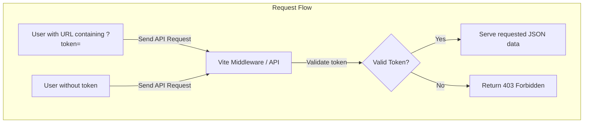
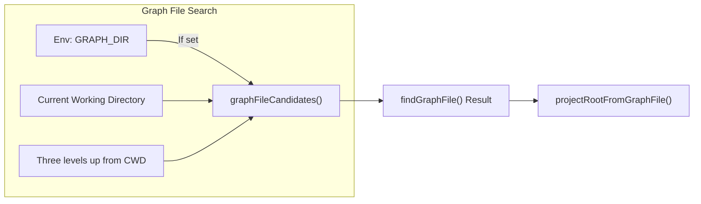
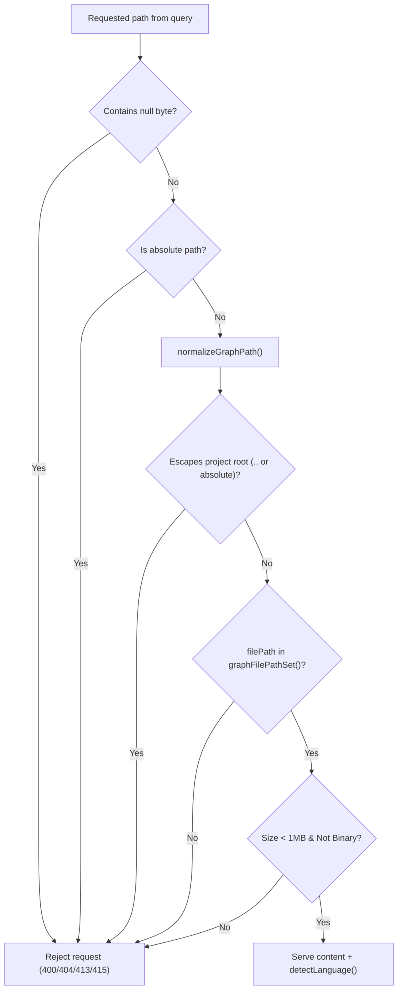
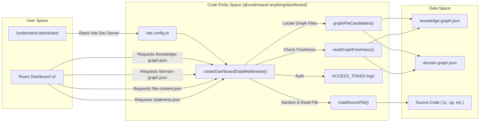

<!-- source: DeepWiki mcp.deepwiki.com · repo Egonex-AI/Understand-Anything · page 4.1 Dashboard Server & Data API · fetched 2026-10-30 -->

# Dashboard Server & Data API

Relevant source files

The following files were used as context for generating this wiki page:

- [homepage/astro.config.mjs](homepage/astro.config.mjs)
- [homepage/public/CNAME](homepage/public/CNAME)
- [pnpm-lock.yaml](pnpm-lock.yaml)
- [tests/skill/understand/test_skill_graph_freshness.test.mjs](tests/skill/understand/test_skill_graph_freshness.test.mjs)
- [tests/skill/viewer/test_viewer.test.mjs](tests/skill/viewer/test_viewer.test.mjs)
- [understand-anything-plugin/packages/dashboard/package.json](understand-anything-plugin/packages/dashboard/package.json)
- [understand-anything-plugin/packages/dashboard/src/__tests__/vite-staleness.test.ts](understand-anything-plugin/packages/dashboard/src/__tests__/vite-staleness.test.ts)
- [understand-anything-plugin/packages/dashboard/src/components/MobileBottomNav.tsx](understand-anything-plugin/packages/dashboard/src/components/MobileBottomNav.tsx)
- [understand-anything-plugin/packages/dashboard/src/components/MobileDrawer.tsx](understand-anything-plugin/packages/dashboard/src/components/MobileDrawer.tsx)
- [understand-anything-plugin/packages/dashboard/src/components/MobileLayout.tsx](understand-anything-plugin/packages/dashboard/src/components/MobileLayout.tsx)
- [understand-anything-plugin/packages/dashboard/src/components/StalenessBanner.tsx](understand-anything-plugin/packages/dashboard/src/components/StalenessBanner.tsx)
- [understand-anything-plugin/packages/dashboard/src/components/__tests__/StalenessBanner.test.ts](understand-anything-plugin/packages/dashboard/src/components/__tests__/StalenessBanner.test.ts)
- [understand-anything-plugin/packages/dashboard/src/utils/__tests__/smoke.test.ts](understand-anything-plugin/packages/dashboard/src/utils/__tests__/smoke.test.ts)
- [understand-anything-plugin/packages/dashboard/vite.config.demo.ts](understand-anything-plugin/packages/dashboard/vite.config.demo.ts)
- [understand-anything-plugin/packages/dashboard/vite.config.ts](understand-anything-plugin/packages/dashboard/vite.config.ts)
- [understand-anything-plugin/packages/viewer/README.md](understand-anything-plugin/packages/viewer/README.md)
- [understand-anything-plugin/packages/viewer/bin/viewer.mjs](understand-anything-plugin/packages/viewer/bin/viewer.mjs)
- [understand-anything-plugin/packages/viewer/build.mjs](understand-anything-plugin/packages/viewer/build.mjs)

This section documents the core middleware server functionality embedded into the Vite development server within the `@understand-anything/dashboard` package. It covers how the dashboard serves its data API endpoints used for visualizing the analyzed project knowledge graphs and source code contents. This includes the security and path sanitization models, the lifecycle and discovery process for the project graph directory, and the search strategy for loading the appropriate graph files. It also covers the standalone `understand-anything-viewer` as a zero-dependency alternative.

---

## 4.1.1 Purpose and Scope

The dashboard server is implemented as custom middleware atop the Vite dev server, providing a REST-like data API. This API exposes several critical JSON endpoints such as:

- `/knowledge-graph.json` — the full project knowledge graph [understand-anything-plugin/packages/dashboard/vite.config.ts:300-301]() (in the `createDashboardDataMiddleware` function).
- `/domain-graph.json` — business domain data graph [understand-anything-plugin/packages/dashboard/vite.config.ts:302-303]() (in the `createDashboardDataMiddleware` function).
- `/diff-overlay.json` — differential overlays highlighting changed nodes [understand-anything-plugin/packages/dashboard/vite.config.ts:304-305]() (in the `createDashboardDataMiddleware` function).
- `/file-content.json` — raw source file contents for preview [understand-anything-plugin/packages/dashboard/vite.config.ts:306-307]() (in the `createDashboardDataMiddleware` function).
- `/config.json` — runtime configuration [understand-anything-plugin/packages/dashboard/vite.config.ts:308-309]() (in the `createDashboardDataMiddleware` function).
- `/staleness.json` — graph freshness report [understand-anything-plugin/packages/dashboard/vite.config.ts:310-311]() (in the `createDashboardDataMiddleware` function).

The middleware imposes an **Access Token security model** to restrict access to sensitive graph data. It also implements path normalization and strict sanitization to prevent unauthorized file access. The middleware uses an optimized **graph file candidate search strategy** to locate the relevant `.ua/` or `.understand-anything/` data directories [understand-anything-plugin/packages/dashboard/vite.config.ts:21-35]().

---

## 4.1.2 ACCESS_TOKEN Security Model

To protect the sensitive knowledge graph data, the server requires an `ACCESS_TOKEN` query parameter on API requests. This token is a randomly generated 16-byte hex string created once per server process runtime at startup [understand-anything-plugin/packages/dashboard/vite.config.ts:15-18](). It is either:

- Provided via the environment variable `UNDERSTAND_ACCESS_TOKEN`.
- Or else randomly generated using Node's `crypto.randomBytes(16).toString("hex")` [understand-anything-plugin/packages/dashboard/vite.config.ts:18]().

The server then opens with a URL automatically including this token as a `?token=...` query parameter. Any API request to endpoints like `/knowledge-graph.json` or `/diff-overlay.json` requires this token or results in HTTP 403 Forbidden [understand-anything-plugin/packages/dashboard/vite.config.ts:316-319]() (in `createDashboardDataMiddleware`).

**Sources:** [understand-anything-plugin/packages/dashboard/vite.config.ts:15-18](), [understand-anything-plugin/packages/dashboard/vite.config.ts:316-319](), [understand-anything-plugin/packages/dashboard/src/__tests__/vite-staleness.test.ts:155-163]()

---

## 4.1.3 GRAPH_DIR Lifecycle and Graph File Discovery

The knowledge graph resides within a data directory, preferring the legacy `.understand-anything/` if it exists, otherwise defaulting to `.ua/` [understand-anything-plugin/packages/dashboard/vite.config.ts:21-23](). The location of this project directory can be customized via the `GRAPH_DIR` environment variable [understand-anything-plugin/packages/dashboard/vite.config.ts:26]().

The middleware uses `graphFileCandidates()` to generate an ordered list of candidate absolute file paths [understand-anything-plugin/packages/dashboard/vite.config.ts:25-35]():

1. If `GRAPH_DIR` is set, look there first.
2. Look in the current working directory (`process.cwd()`).
3. Look three levels up from the current working directory (to handle nested monorepo structures) [understand-anything-plugin/packages/dashboard/vite.config.ts:30]().

The first existing candidate path is selected via `findGraphFile()` [understand-anything-plugin/packages/dashboard/vite.config.ts:37-39](). The project root is inferred as two directories above the graph file path [understand-anything-plugin/packages/dashboard/vite.config.ts:41-43]().

**Sources:** [understand-anything-plugin/packages/dashboard/vite.config.ts:21-43](), [understand-anything-plugin/packages/dashboard/src/__tests__/vite-staleness.test.ts:45-49]()

---

## 4.1.4 Path Sanitization and Validation Pipeline

When the UI requests source code via `/file-content.json?path=...`, the server executes a strict sanitization pipeline in `readSourceFile()` [understand-anything-plugin/packages/dashboard/vite.config.ts:125-188]():

1.  **Query extraction:** Reject missing paths or those containing null bytes [understand-anything-plugin/packages/dashboard/vite.config.ts:127-128]().
2.  **Absolute path check:** Absolute paths are strictly disallowed [understand-anything-plugin/packages/dashboard/vite.config.ts:129]().
3.  **Normalization:** Normalize with `path.normalize()`. Reject if it escapes the project root (e.g., starts with `..`) [understand-anything-plugin/packages/dashboard/vite.config.ts:131-139]().
4.  **Graph inclusion check:** The file path must be explicitly present in the `knowledge-graph.json` node list, verified by `graphFilePathSet()` [understand-anything-plugin/packages/dashboard/vite.config.ts:158-160]().
5.  **File constraints:** The file must exist, not exceed `MAX_SOURCE_FILE_BYTES` (1MB), and not be binary (no null bytes) [understand-anything-plugin/packages/dashboard/vite.config.ts:162-175]().
6.  **Metadata return:** Returns content, detected language (via `detectLanguage()`), line count, and byte length [understand-anything-plugin/packages/dashboard/vite.config.ts:178-187]().

**Sources:** [understand-anything-plugin/packages/dashboard/vite.config.ts:19-20](), [understand-anything-plugin/packages/dashboard/vite.config.ts:83-113](), [understand-anything-plugin/packages/dashboard/vite.config.ts:125-188]()

---

## 4.1.5 Standalone Viewer (`@understand-anything/viewer`)

The `@understand-anything/viewer` package (located in `packages/viewer/bin/viewer.mjs`) provides a zero-dependency, read-only alternative to the full dashboard dev server.

-   **Fast Path:** It is shipped as a self-contained tarball in GitHub releases [understand-anything-plugin/packages/viewer/README.md:10]().
-   **Zero Build:** It does not require `pnpm install` or `pnpm build` in the dashboard package [understand-anything-plugin/packages/viewer/README.md:14]().
-   **Usage:** Invoked via `npx --yes "$VIEWER_URL" "$PROJECT_DIR"` [understand-anything-plugin/packages/viewer/README.md:11]().
-   **Behavior:** It provides the same `🔑 Dashboard URL` output and token security as the Vite-based server [understand-anything-plugin/packages/viewer/README.md:17-20]().
-   **Demo Configuration:** The `vite.config.demo.ts` file [understand-anything-plugin/packages/dashboard/vite.config.demo.ts:1-49]() is used to build a demo version of the dashboard, which is likely what the standalone viewer package uses. This configuration sets a `base` path to `/demo/` [understand-anything-plugin/packages/dashboard/vite.config.demo.ts:7]() and defines `import.meta.env.VITE_DEMO_MODE` [understand-anything-plugin/packages/dashboard/vite.config.demo.ts:17-19](). It also optimizes chunking for various dependencies like React, `xyflow`, `dagrejs`, `d3-force`, and `react-markdown` [understand-anything-plugin/packages/dashboard/vite.config.demo.ts:21-46]().

**Sources:** [understand-anything-plugin/packages/viewer/bin/viewer.mjs](), [understand-anything-plugin/packages/viewer/README.md:1-26](), [understand-anything-plugin/packages/dashboard/vite.config.demo.ts:1-49]()

---

## 4.1.6 Key Functions and Data Flow

| Function | Role | Source |
| :--- | :--- | :--- |
| `graphFileCandidates()` | Generates search paths for graph artifacts | [understand-anything-plugin/packages/dashboard/vite.config.ts:25-35]() |
| `findGraphFile()` | Locates the first existing graph file among candidates | [understand-anything-plugin/packages/dashboard/vite.config.ts:37-39]() |
| `normalizeGraphPath()` | Restricts paths to be relative and within project root | [understand-anything-plugin/packages/dashboard/vite.config.ts:45-64]() |
| `graphFilePathSet()` | Builds a whitelist of files from the knowledge graph | [understand-anything-plugin/packages/dashboard/vite.config.ts:66-81]() |
| `detectLanguage()` | Maps file extensions to Prism/Highlight.js languages | [understand-anything-plugin/packages/dashboard/vite.config.ts:83-113]() |
| `readSourceFile()` | Orchestrates path sanitization and file reading | [understand-anything-plugin/packages/dashboard/vite.config.ts:125-188]() |
| `readGraphMetadata()` | Extracts commit hash and analysis timestamp from graph | [understand-anything-plugin/packages/dashboard/vite.config.ts:197-214]() |
| `createDashboardDataMiddleware()` | Main middleware function handling all API endpoints | [understand-anything-plugin/packages/dashboard/vite.config.ts:250-479]() |

---

## 4.1.7 Mapping Dashboard Concepts to Code Entities

The dashboard server bridges the user's request for visualization with the underlying file system and security logic.

**Sources:** [understand-anything-plugin/packages/dashboard/vite.config.ts:15-479](), [understand-anything-plugin/packages/dashboard/src/components/MobileLayout.tsx:14](), [understand-anything-plugin/packages/dashboard/src/components/StalenessBanner.tsx:1-196]()

---

## 4.1.8 Freshness & Staleness API

The dashboard middleware provides a `readGraphFreshness()` function that integrates with the core staleness logic [understand-anything-plugin/packages/dashboard/vite.config.ts:216-247](). This function is called by `createDashboardDataMiddleware` when the `/staleness.json` endpoint is hit [understand-anything-plugin/packages/dashboard/vite.config.ts:310-311]().

-   It reads `gitCommitHash` and `analyzedAt` from the graph metadata via `readGraphMetadata()` [understand-anything-plugin/packages/dashboard/vite.config.ts:197-214]().
-   It invokes `getGraphFreshnessBatch()` from `@understand-anything/core` to determine if the graph is out of sync with the current Git HEAD [understand-anything-plugin/packages/dashboard/vite.config.ts:10-13, 237-241]().
-   The result is served to the dashboard to display a warning banner if the data is stale [understand-anything-plugin/packages/dashboard/src/components/StalenessBanner.tsx:164-167]().
-   The `buildFreshnessBanner` function [understand-anything-plugin/packages/dashboard/src/components/StalenessBanner.tsx:100-162]() processes the `DashboardFreshnessReport` to generate the content for the banner, prioritizing stale over dirty and unknown states [understand-anything-plugin/packages/dashboard/src/components/__tests__/StalenessBanner.test.ts:97-124]().
-   The staleness check is also performed by graph-consuming skills like `/understand-chat` and `/understand-domain` to warn users about outdated information [tests/skill/understand/test_skill_graph_freshness.test.mjs:33-49]().

**Sources:** [understand-anything-plugin/packages/dashboard/vite.config.ts:10-13](), [understand-anything-plugin/packages/dashboard/vite.config.ts:190-214](), [understand-anything-plugin/packages/dashboard/vite.config.ts:216-247](), [understand-anything-plugin/packages/dashboard/vite.config.ts:310-311](), [understand-anything-plugin/packages/dashboard/src/components/StalenessBanner.tsx:1-196](), [understand-anything-plugin/packages/dashboard/src/components/__tests__/StalenessBanner.test.ts:1-169](), [tests/skill/understand/test_skill_graph_freshness.test.mjs:1-71]()

---

