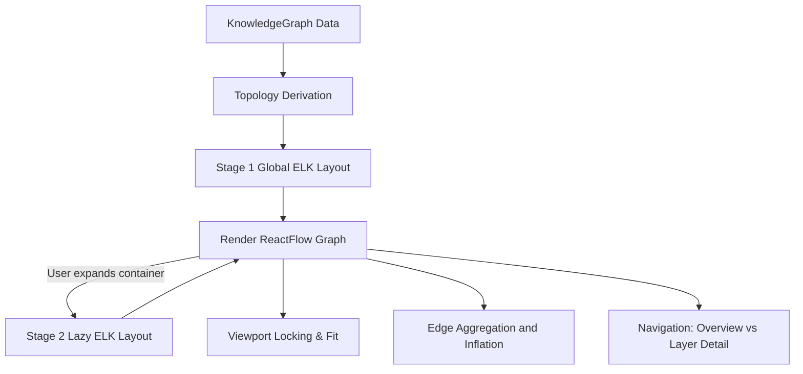
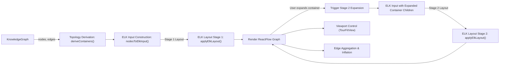
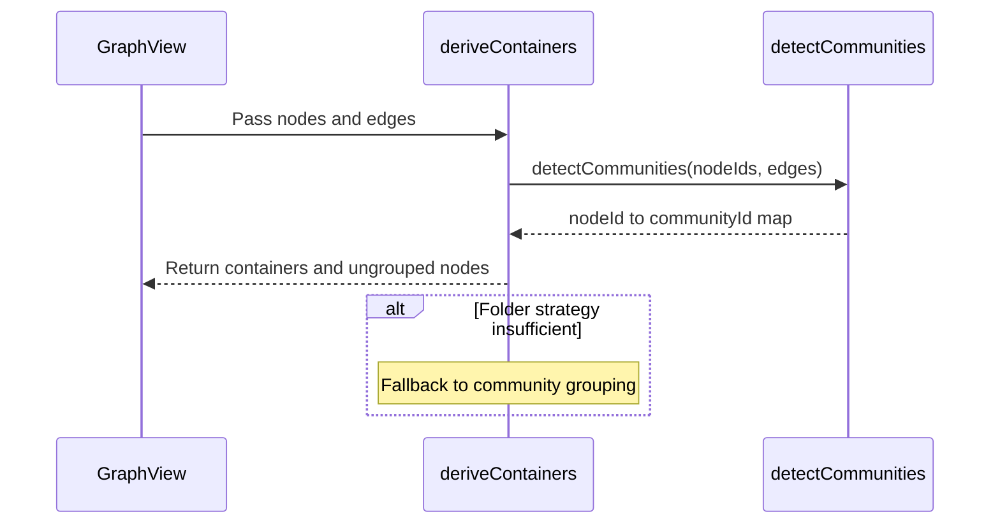
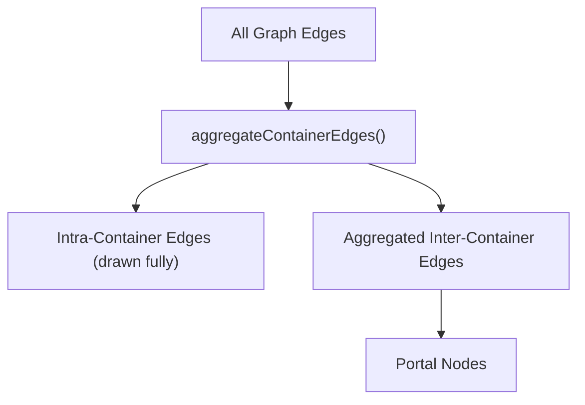
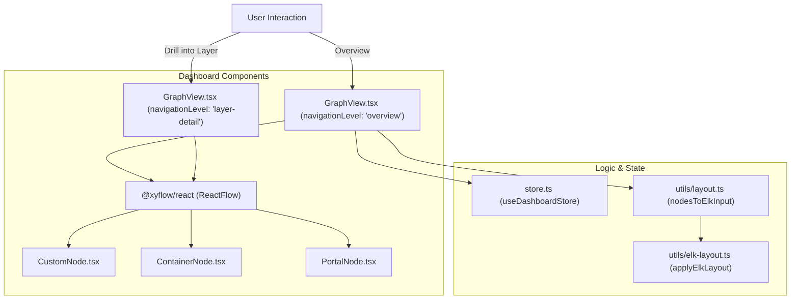
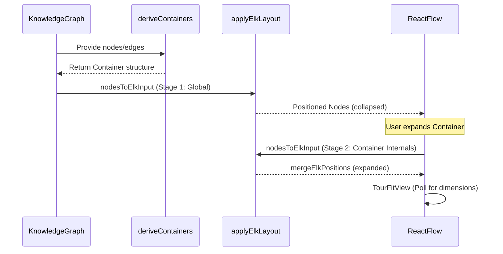

<!-- source: DeepWiki mcp.deepwiki.com · repo Egonex-AI/Understand-Anything · page 4.2 Graph Visualization Engine · fetched 2026-10-30 -->

# Graph Visualization Engine

Relevant source files

The following files were used as context for generating this wiki page:

- [docs/superpowers/plans/2026-05-03-graph-layout-scaling.md](docs/superpowers/plans/2026-05-03-graph-layout-scaling.md)
- [docs/superpowers/specs/2026-05-03-graph-layout-scaling-design.md](docs/superpowers/specs/2026-05-03-graph-layout-scaling-design.md)
- [understand-anything-plugin/packages/dashboard/scripts/benchmark-layout.mjs](understand-anything-plugin/packages/dashboard/scripts/benchmark-layout.mjs)
- [understand-anything-plugin/packages/dashboard/src/App.tsx](understand-anything-plugin/packages/dashboard/src/App.tsx)
- [understand-anything-plugin/packages/dashboard/src/components/Breadcrumb.tsx](understand-anything-plugin/packages/dashboard/src/components/Breadcrumb.tsx)
- [understand-anything-plugin/packages/dashboard/src/components/ContainerNode.tsx](understand-anything-plugin/packages/dashboard/src/components/ContainerNode.tsx)
- [understand-anything-plugin/packages/dashboard/src/components/CustomNode.tsx](understand-anything-plugin/packages/dashboard/src/components/CustomNode.tsx)
- [understand-anything-plugin/packages/dashboard/src/components/DomainClusterNode.tsx](understand-anything-plugin/packages/dashboard/src/components/DomainClusterNode.tsx)
- [understand-anything-plugin/packages/dashboard/src/components/GraphView.tsx](understand-anything-plugin/packages/dashboard/src/components/GraphView.tsx)
- [understand-anything-plugin/packages/dashboard/src/components/LayerClusterNode.tsx](understand-anything-plugin/packages/dashboard/src/components/LayerClusterNode.tsx)
- [understand-anything-plugin/packages/dashboard/src/components/NodeInfo.tsx](understand-anything-plugin/packages/dashboard/src/components/NodeInfo.tsx)
- [understand-anything-plugin/packages/dashboard/src/components/PortalNode.tsx](understand-anything-plugin/packages/dashboard/src/components/PortalNode.tsx)
- [understand-anything-plugin/packages/dashboard/src/store.ts](understand-anything-plugin/packages/dashboard/src/store.ts)
- [understand-anything-plugin/packages/dashboard/src/utils/__tests__/containers.test.ts](understand-anything-plugin/packages/dashboard/src/utils/__tests__/containers.test.ts)
- [understand-anything-plugin/packages/dashboard/src/utils/__tests__/edgeAggregation.test.ts](understand-anything-plugin/packages/dashboard/src/utils/__tests__/edgeAggregation.test.ts)
- [understand-anything-plugin/packages/dashboard/src/utils/__tests__/elk-layout.test.ts](understand-anything-plugin/packages/dashboard/src/utils/__tests__/elk-layout.test.ts)
- [understand-anything-plugin/packages/dashboard/src/utils/containers.ts](understand-anything-plugin/packages/dashboard/src/utils/containers.ts)
- [understand-anything-plugin/packages/dashboard/src/utils/edgeAggregation.ts](understand-anything-plugin/packages/dashboard/src/utils/edgeAggregation.ts)
- [understand-anything-plugin/packages/dashboard/src/utils/elk-layout.ts](understand-anything-plugin/packages/dashboard/src/utils/elk-layout.ts)
- [understand-anything-plugin/packages/dashboard/src/utils/layout.ts](understand-anything-plugin/packages/dashboard/src/utils/layout.ts)
- [understand-anything-plugin/packages/dashboard/src/utils/layout.worker.ts](understand-anything-plugin/packages/dashboard/src/utils/layout.worker.ts)
- [understand-anything-plugin/packages/dashboard/src/utils/louvain.ts](understand-anything-plugin/packages/dashboard/src/utils/louvain.ts)

This section presents a deep technical dive into the **Graph Visualization Engine** of the Understand-Anything Dashboard. This engine is centered around the `GraphView` React component and its orchestration of a sophisticated two-stage layout lifecycle based on ELK (Eclipse Layout Kernel). We detail the topology derivation strategies, the Stage 1 global layout using ELK’s layered algorithm, and the Stage 2 incremental layout phase enabling lazy container expansion. The engine also incorporates viewport locking mechanisms, edge aggregation and inflation techniques to optimize visual clarity, and navigation paradigms supporting overview and layer-detail levels.

---

## 1. Architecture Overview

The **Graph Visualization Engine** renders complex knowledge graphs using ReactFlow (via `@xyflow/react`) integrated with ELK for hierarchical layouts. The core React component is `GraphView`, responsible for translating raw `KnowledgeGraph` data into interactive visualizations. It implements a multi-phase rendering lifecycle with performance tradeoffs between layout accuracy and interactivity.

### High-Level Flow

-   **Topology Derivation:** Input nodes and edges are processed, grouped into containers and layers, and transformed into ELK-compatible input.
-   **Stage 1 Layout (Global):** ELK computes a global layered layout with containers and clusters expanded minimally.
-   **Stage 2 Layout (Lazy Expansion):** Containers are incrementally expanded with updated ELK calls to lay out internal children.
-   **Viewport Locking & Fitting:** The viewport adjusts to navigation and tour nodes using polling and fit strategies.
-   **Edge Aggregation/Inflation:** Edges crossing containers and layers are aggregated to reduce visual clutter.
-   **Navigation Modes:** Two levels (`overview` and `layer-detail`) determine the granularity of the view.

Sources:
[understand-anything-plugin/packages/dashboard/src/components/GraphView.tsx:1-172]()
[understand-anything-plugin/packages/dashboard/src/utils/layout.ts:71-146]()
[understand-anything-plugin/packages/dashboard/src/utils/elk-layout.ts]()
[understand-anything-plugin/packages/dashboard/src/utils/edgeAggregation.ts:1-208]()

---

## 2. GraphView Component

Located at [understand-anything-plugin/packages/dashboard/src/components/GraphView.tsx](), the `GraphView` component is the visual spine of the Engine.

### Responsibilities

-   Subscribe to the graph via `useDashboardStore` [understand-anything-plugin/packages/dashboard/src/components/GraphView.tsx:26]().
-   Derive container groupings via `deriveContainers` [understand-anything-plugin/packages/dashboard/src/utils/containers.ts]().
-   Prepare `ElkInput` via `nodesToElkInput` [understand-anything-plugin/packages/dashboard/src/utils/layout.ts:86-109]().
-   Trigger **two-stage** ELK layout calls via `applyElkLayout` [understand-anything-plugin/packages/dashboard/src/utils/elk-layout.ts]() (specifically, the `applyElkLayout` function).
-   Manage viewport fitting with `TourFitView` [understand-anything-plugin/packages/dashboard/src/components/GraphView.tsx:123-181]().
-   Render different node types:
    -   `CustomNode` for code/config/data [understand-anything-plugin/packages/dashboard/src/components/CustomNode.tsx:96-202]().
    -   `LayerClusterNode` for architectural layers [understand-anything-plugin/packages/dashboard/src/components/LayerClusterNode.tsx]().
    -   `PortalNode` for cross-layer connections [understand-anything-plugin/packages/dashboard/src/components/PortalNode.tsx]().
    -   `ContainerNode` for grouped clusters [understand-anything-plugin/packages/dashboard/src/components/ContainerNode.tsx]().

---

### Key Data Flow and Classes

| Class/Function | Purpose |
| :------------- | :------ |
| `deriveContainers` | Groups nodes by folder or Louvain community fallback [understand-anything-plugin/packages/dashboard/src/utils/containers.ts]() |
| `nodesToElkInput` | Converts ReactFlow data into ELK input [understand-anything-plugin/packages/dashboard/src/utils/layout.ts:86-109]() |
| `applyElkLayout` | Asynchronous ELK call for coordinate computation [understand-anything-plugin/packages/dashboard/src/utils/elk-layout.ts]() |
| `aggregateContainerEdges` | Buckets edges into intra-container and aggregated inter-container edges [understand-anything-plugin/packages/dashboard/src/utils/edgeAggregation.ts:158-208]() |
| `useDashboardStore` | State management for selection, filters, and navigation [understand-anything-plugin/packages/dashboard/src/store.ts:101-165]() |
| `TourFitView` | Effect to pan/zoom to tour-highlighted nodes [understand-anything-plugin/packages/dashboard/src/components/GraphView.tsx:123-181]() |

---

### Two-Stage ELK Layout Lifecycle Explained

1.  **Topology Derivation:**
    Containers group nodes by folder structures or via Louvain community detection [understand-anything-plugin/packages/dashboard/src/utils/containers.ts]().
2.  **Stage 1 Global Layout:**
    Initial pass using `ELK_DEFAULT_LAYOUT_OPTIONS` (layered, direction DOWN) [understand-anything-plugin/packages/dashboard/src/utils/layout.ts:75-84]().
3.  **Stage 2 Lazy Container Expansion:**
    Triggered when a user drills into a container. ELK lays out the container internals asynchronously, and results are merged via `mergeElkPositions` [understand-anything-plugin/packages/dashboard/src/utils/layout.ts:111-146]().
4.  **Viewport Locking:**
    `TourFitView` polls ReactFlow's internal lookup via `getInternalNode` to ensure children have measured dimensions before fitting the view [understand-anything-plugin/packages/dashboard/src/components/GraphView.tsx:163-170]().
5.  **Edge Aggregation:**
    `aggregateContainerEdges` merges multiple same-direction inter-container edges into a single aggregated edge with counts and type summaries [understand-anything-plugin/packages/dashboard/src/utils/__tests__/edgeAggregation.test.ts:30-45]().

---

### Mermaid Diagram: Component and Data Flow in `GraphView`

Sources:
[understand-anything-plugin/packages/dashboard/src/components/GraphView.tsx:41-53]()
[understand-anything-plugin/packages/dashboard/src/utils/layout.ts:86-146]()

---

## 3. Topology Derivation and Container Grouping

The utility `deriveContainers` at [understand-anything-plugin/packages/dashboard/src/utils/containers.ts]() performs grouping:

-   **Folder-based grouping:** Groups nodes by the first folder segment after removing the Longest Common Prefix (LCP) [understand-anything-plugin/packages/dashboard/src/utils/__tests__/containers.test.ts:18-33]().
-   **Community detection fallback:** If folder grouping is unbalanced (one folder > 70%), Louvain community detection is used via `detectCommunities` [understand-anything-plugin/packages/dashboard/src/utils/__tests__/containers.test.ts:117-131](). The `detectCommunities` function [understand-anything-plugin/packages/dashboard/src/utils/louvain.ts:17-55]() uses the `graphology-communities-louvain` library to assign a community ID to each node.

Sources:
[understand-anything-plugin/packages/dashboard/src/utils/containers.ts]()
[understand-anything-plugin/packages/dashboard/src/utils/louvain.ts:17-55]()
[understand-anything-plugin/packages/dashboard/src/utils/__tests__/containers.test.ts:18-33]()
[understand-anything-plugin/packages/dashboard/src/utils/__tests__/containers.test.ts:117-131]()

---

## 4. Edge Aggregation and Inflation

To reduce visual clutter, edges crossing container boundaries are aggregated:

-   **Intra-container edges:** Preserved as individual `GraphEdge` objects [understand-anything-plugin/packages/dashboard/src/utils/edgeAggregation.ts:178-179]().
-   **Inter-container edges:** Consolidated by `(sourceContainer, targetContainer)` pair. A length-prefix key `${sc.length}:${sc}\0${tc}` is used to prevent collisions [understand-anything-plugin/packages/dashboard/src/utils/edgeAggregation.ts:181-196]().
-   **Portal Nodes:** Represent external layer connections. `computePortals` calculates the `connectionCount` for each adjacent layer [understand-anything-plugin/packages/dashboard/src/utils/edgeAggregation.ts:77-105]().

Sources:
[understand-anything-plugin/packages/dashboard/src/utils/edgeAggregation.ts:137-208]()
[understand-anything-plugin/packages/dashboard/src/utils/__tests__/edgeAggregation.test.ts:30-45]()

---

## 5. Mapping Natural Language Space to Code Entities

### Diagram 1: System Navigation to Code Components

Sources:
[understand-anything-plugin/packages/dashboard/src/components/GraphView.tsx:1-172]()
[understand-anything-plugin/packages/dashboard/src/components/CustomNode.tsx:1-200]()
[understand-anything-plugin/packages/dashboard/src/components/ContainerNode.tsx:1-95]()
[understand-anything-plugin/packages/dashboard/src/components/PortalNode.tsx]()
[understand-anything-plugin/packages/dashboard/src/store.ts:1-797]()
[understand-anything-plugin/packages/dashboard/src/utils/layout.ts:1-146]()
[understand-anything-plugin/packages/dashboard/src/utils/elk-layout.ts]()

### Diagram 2: Layout Lifecycle Sequence

Sources:
[understand-anything-plugin/packages/dashboard/src/components/GraphView.tsx:123-181]()
[understand-anything-plugin/packages/dashboard/src/utils/layout.ts:111-146]()
[understand-anything-plugin/packages/dashboard/src/store.ts:116-119]()
[understand-anything-plugin/packages/dashboard/src/utils/containers.ts]()
[understand-anything-plugin/packages/dashboard/src/utils/elk-layout.ts]()

---

## 6. Navigation Levels

The engine supports toggling between levels via the store's `navigationLevel` state [understand-anything-plugin/packages/dashboard/src/store.ts:117]():

-   **Overview:** Displays architectural layers as `LayerClusterNode` and `PortalNode` [understand-anything-plugin/packages/dashboard/src/components/GraphView.tsx:59-60]().
-   **Layer Detail:** Renders code entities (`file`, `class`, `function`) within the active layer. The `STRUCTURAL_VISIBLE_TYPES` set [understand-anything-plugin/packages/dashboard/src/components/GraphView.tsx:97-106]() defines which node types are rendered in this view, explicitly excluding knowledge graph types.

Filter categories map `NodeType` to `NodeCategory` (code, config, docs, infra, data, domain, knowledge) to allow selective visibility [understand-anything-plugin/packages/dashboard/src/components/GraphView.tsx:70-81]().

Sources:
[understand-anything-plugin/packages/dashboard/src/components/GraphView.tsx:70-106]()
[understand-anything-plugin/packages/dashboard/src/store.ts:116-119]()

---

