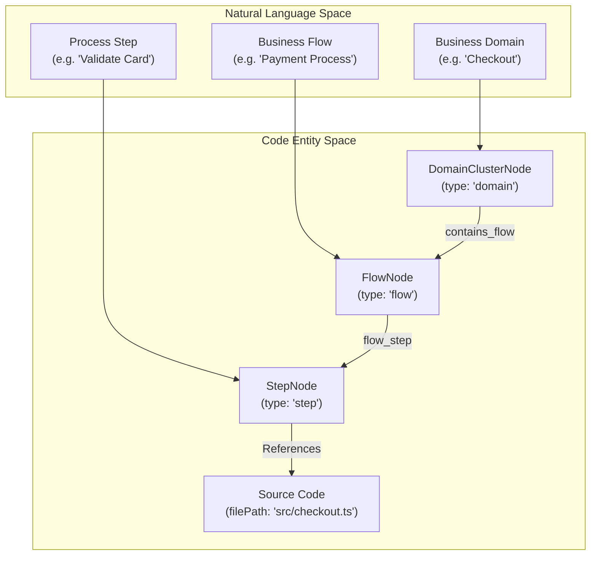
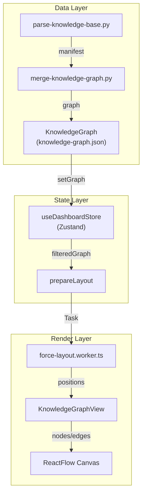

<!-- source: DeepWiki mcp.deepwiki.com · repo Egonex-AI/Understand-Anything · page 4.3 Domain Graph View & Force Layout · fetched 2026-10-30 -->

# Domain Graph View & Force Layout

Relevant source files

The following files were used as context for generating this wiki page:

- [understand-anything-plugin/packages/core/src/__tests__/domain-normalize.test.ts](understand-anything-plugin/packages/core/src/__tests__/domain-normalize.test.ts)
- [understand-anything-plugin/packages/core/src/__tests__/normalize-graph.test.ts](understand-anything-plugin/packages/core/src/__tests__/normalize-graph.test.ts)
- [understand-anything-plugin/packages/core/src/analyzer/normalize-graph.ts](understand-anything-plugin/packages/core/src/analyzer/normalize-graph.ts)
- [understand-anything-plugin/packages/dashboard/src/components/DomainGraphView.tsx](understand-anything-plugin/packages/dashboard/src/components/DomainGraphView.tsx)
- [understand-anything-plugin/packages/dashboard/src/components/FlowNode.tsx](understand-anything-plugin/packages/dashboard/src/components/FlowNode.tsx)
- [understand-anything-plugin/packages/dashboard/src/components/StepNode.tsx](understand-anything-plugin/packages/dashboard/src/components/StepNode.tsx)
- [understand-anything-plugin/packages/dashboard/src/components/WarningBanner.tsx](understand-anything-plugin/packages/dashboard/src/components/WarningBanner.tsx)
- [understand-anything-plugin/packages/dashboard/src/utils/__tests__/force-layout.test.ts](understand-anything-plugin/packages/dashboard/src/utils/__tests__/force-layout.test.ts)
- [understand-anything-plugin/packages/dashboard/src/utils/force-layout.ts](understand-anything-plugin/packages/dashboard/src/utils/force-layout.ts)
- [understand-anything-plugin/skills/understand-domain/SKILL.md](understand-anything-plugin/skills/understand-domain/SKILL.md)

This page documents the implementation details of the Domain Graph visualization in the dashboard subsystem of the Understand Anything project. It covers the `DomainGraphView` component, its primary construction functions `buildDomainOverview` and `buildDomainDetail`, specialized node components, the D3-based force-directed layout, and the ELK layout engine integration.

---

## 4.3.1 Purpose and Scope

The domain graph view visualizes business domain structures, their contained flows, and detailed flow steps. It is an interactive, layered graph representation supporting drill-down levels and navigation.

While structural code views use **ELK (Eclipse Layout Kernel)** by default for hierarchical layering, specialized views like the Knowledge Graph utilize a **D3-based force-directed layout** executed in a dedicated web worker to ensure UI responsiveness.

Sources: [understand-anything-plugin/packages/dashboard/src/components/DomainGraphView.tsx:1-12](), [understand-anything-plugin/packages/dashboard/src/utils/force-layout.ts:1-9]()

---

## 4.3.2 DomainGraphView: Overview & Detail Construction

### Components and Node Types

- **DomainGraphView** is the main React component orchestrating the domain graph visualization [understand-anything-plugin/packages/dashboard/src/components/DomainGraphView.tsx:167-171]().
- It registers three specialized node components with ReactFlow via the `nodeTypes` mapping [understand-anything-plugin/packages/dashboard/src/components/DomainGraphView.tsx:25-29]():
  - `DomainClusterNode`: Represents a high-level business domain [understand-anything-plugin/packages/dashboard/src/components/DomainClusterNode.tsx:1]().
  - `FlowNode`: Represents a business process flow [understand-anything-plugin/packages/dashboard/src/components/FlowNode.tsx:1]().
  - `StepNode`: Represents an individual step within a flow [understand-anything-plugin/packages/dashboard/src/components/StepNode.tsx:1]().

### Building the Domain Overview Graph (`buildDomainOverview`)

This function creates a high-level graph of business domains connected by cross-domain relationships [understand-anything-plugin/packages/dashboard/src/components/DomainGraphView.tsx:41-88]().

- **Filtering:** It selects nodes of type `"domain"` from the `KnowledgeGraph` [understand-anything-plugin/packages/dashboard/src/components/DomainGraphView.tsx:43]().
- **Flow Counting:** It counts flows per domain using edges typed `"contains_flow"` [understand-anything-plugin/packages/dashboard/src/components/DomainGraphView.tsx:46-51]().
- **Node Construction:** Creates `DomainClusterFlowNode` objects with metadata like `entities` and `businessRules` from `domainMeta` [understand-anything-plugin/packages/dashboard/src/components/DomainGraphView.tsx:53-70]().
- **Edge Construction:** Filters edges typed `"cross_domain"` to show inter-domain dependencies, styled with dashes and animation [understand-anything-plugin/packages/dashboard/src/components/DomainGraphView.tsx:72-85]().

### Building the Domain Detail Graph (`buildDomainDetail`)

This function produces a detailed view for a specific domain [understand-anything-plugin/packages/dashboard/src/components/DomainGraphView.tsx:90-165]().

- **Process Extraction:** Identifies flows via `"contains_flow"` and individual steps via `"flow_step"` edges [understand-anything-plugin/packages/dashboard/src/components/DomainGraphView.tsx:95-106]().
- **Ordering:** Uses the edge `weight` property to determine the `order` of steps within a flow [understand-anything-plugin/packages/dashboard/src/components/DomainGraphView.tsx:109-112]().
- **Node Construction:** Maps steps to `StepNode` components which include the `filePath` to the implementing code [understand-anything-plugin/packages/dashboard/src/components/DomainGraphView.tsx:139-153]().

### Domain Entity Mapping

Title: Mapping Business Logic to Code Entities

Sources: [understand-anything-plugin/packages/dashboard/src/components/DomainGraphView.tsx:25-29](), [understand-anything-plugin/packages/dashboard/src/components/DomainGraphView.tsx:90-165](), [understand-anything-plugin/packages/dashboard/src/store.ts:38-39]()

---

## 4.3.3 Force-Directed Layout Implementation

For non-hierarchical graphs (Knowledge and Design views), the system uses a physics-based simulation.

### Simulation Logic (`computeForceLayout`)

The `computeForceLayout` function executes a DOM-free `d3-force` simulation [understand-anything-plugin/packages/dashboard/src/utils/force-layout.ts:60-134]().

- **Forces:**
  - `forceLink`: Maintains target distances between connected nodes [understand-anything-plugin/packages/dashboard/src/utils/force-layout.ts:93-101]().
  - `forceManyBody`: Repulsion between all nodes [understand-anything-plugin/packages/dashboard/src/utils/force-layout.ts:102]().
  - `forceCollide`: Prevents node overlaps using `width` and `height` [understand-anything-plugin/packages/dashboard/src/utils/force-layout.ts:104-109]().
  - **Community Clustering:** Nodes with the same `community` ID (detected via Louvain algorithm) are attracted to specific radial sectors [understand-anything-plugin/packages/dashboard/src/utils/force-layout.ts:111-124]().

### Worker Architecture

To keep the UI responsive, layouts are computed in the background.

1. **`force-layout.worker.ts`**: Entry point for the Web Worker.
2. **`startForceLayoutTask`**: Manages the lifecycle of a layout request, including worker termination.
3. **`createFallbackGrid`**: Deterministic grid fallback used if the simulation fails or is cancelled [understand-anything-plugin/packages/dashboard/src/utils/force-layout-client.ts:65-76]().

Sources: [understand-anything-plugin/packages/dashboard/src/utils/force-layout.ts:60-134](), [understand-anything-plugin/packages/dashboard/src/utils/__tests__/force-layout.test.ts:65-76]()

---

## 4.3.4 Visualization Components

### CustomNode Component
The `CustomNode` is the primary renderer for code entities.

- **Theming:** Colors are mapped from `NodeType` to CSS variables (e.g., `--color-node-file`).
- **States:** Supports selection, tour highlighting, search score rings, and diff overlay states (changed/affected).

### NodeInfo Sidebar
`NodeInfo` provides the detailed metadata panel.

- **Knowledge Details:** Displays wikilinks, backlinks, and category hierarchies for articles/entities.
- **Figma Integration:** Renders thumbnails for design nodes (screen, component) using `figmaMeta.thumbnailUrl`.

Sources: [understand-anything-plugin/packages/dashboard/src/components/WarningBanner.tsx:1-253]()

---

## 4.3.5 Layout Engine Comparison

| Feature | ELK (Default) | D3 Force (Knowledge/Design) | Dagre (Deprecated) |
| :--- | :--- | :--- | :--- |
| **Strategy** | Hierarchical / Layered | Physics Simulation | Layered Graph |
| **Thread** | Main (Async Worker) | Web Worker | Main (Sync) |
| **Determinism** | High | High (fixed ticks) | High |
| **Key Function** | `applyElkLayout` | `computeForceLayout` | `applyDagreLayout` |

Sources: [understand-anything-plugin/packages/dashboard/src/utils/layout.ts:20-69](), [understand-anything-plugin/packages/dashboard/src/utils/force-layout.ts:60-134](), [understand-anything-plugin/packages/dashboard/src/components/DomainGraphView.tsx:197-213]()

---

## 4.3.6 Knowledge Graph Rendering Pipeline

Title: Knowledge Graph Data Flow

Sources: [understand-anything-plugin/packages/dashboard/src/store.ts:158-164](), [understand-anything-plugin/packages/dashboard/src/components/DomainGraphView.tsx:167-182](), [understand-anything-plugin/packages/dashboard/src/components/DomainGraphView.tsx:189-204](), [understand-anything-plugin/skills/understand-domain/SKILL.md:1-112]()

---

